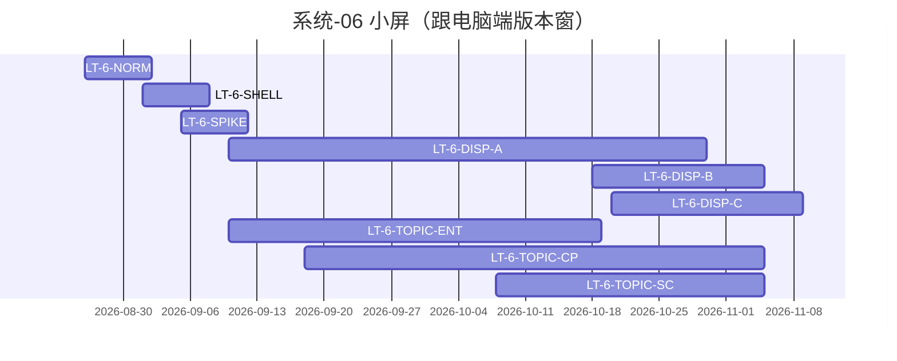

# 系统-06 · 多端小屏（展示 + 专题）

上级：[INDEX](./INDEX.md) · Epic：`E-FE-SMALL-SCREEN`

跨 **展示 / 专题** UI，不单独出门。智谱倒排未单列小屏，**批页出门跟电脑端版本窗**。排版 lite；规范轻、实现可 D 段为主。

| LT-ID | 名称 | 计划开始 | 计划结束 | 实际开始 | 实际结束 | 责任人 | 段 | 前置 | registry |
|---|---|---|---|---|---|---|---|---|---|
| LT-6-NORM | 小屏断点/裁剪规范 | 2026-08-26 | 2026-09-02 | 2026-08-26 | 2026-08-26 | 孔东确认 C1–C7；高颖可补签 | 规范 | — | 会签 `agent-handoffs/LT-6-NORM-小屏规约会签.md`；真源 `Design-mobile.md` v1.1.2 |
| LT-6-SHELL | 小屏壳+宽度断点 | 2026-09-01 | 2026-09-08 | — | — | **孔东**（监管高颖） | D/壳 | LT-6-NORM | `FE-SMALL-SHELL-L01` |
| LT-6-SPIKE | AI 出效果试点（展示1+专题1） | 2026-09-05 | 2026-09-12 | — | — | 孔东收口；丽影专题样板 | spike | SHELL | `FE-SMALL-AI-SPIKE-L01`（看板已签收，实际时点未回填本表） |
| LT-6-DISP-A | 展示小屏·态势/指数（跟 V1.0 **10-30**） | 2026-09-10 | 2026-10-30 | — | — | **孔东** | D | SPIKE；对齐 LT-5-SIT | `FE-DISPLAY-SMALL-BATCH-A` |
| LT-6-DISP-B | 展示小屏·政策/成果（跟 V2.0 **11-05**） | 2026-10-18 | 2026-11-05 | — | — | **孔东** | D | DISP-A | `FE-DISPLAY-SMALL-BATCH-B` |
| LT-6-DISP-C | 展示小屏·服务入口（跟 V3.0 **11-09**） | 2026-10-20 | 2026-11-09 | — | — | **孔东** | D | DISP-B；对齐 LT-5-SVC | （未单独立叶则挂 BATCH-B 延窗） |
| LT-6-TOPIC-ENT | 专题小屏·企业维（跟 V1.0 **10-19**） | 2026-09-10 | 2026-10-19 | — | — | **曹丽影**；会签孔东 | D | SPIKE；对齐 LT-4-ENT；**仓=`lumen-ui-topic-mobile`** | `FE-TOPIC-SMALL-ENT-L01` |
| LT-6-TOPIC-CP | 专题小屏·产业链+政策（产业链随 V1.0、政策随 V2.0） | 2026-09-18 | 2026-11-05 | — | — | **曹丽影**；会签孔东 | D | TOPIC-ENT；仓=topic-mobile | `FE-TOPIC-SMALL-CHAIN-POL-L01` |
| LT-6-TOPIC-SC | 专题小屏·产业服务+综合（跟 V2.0 **11-05**） | 2026-10-08 | 2026-11-05 | — | — | **曹丽影**；会签孔东 | D | TOPIC-CP；仓=topic-mobile | `FE-TOPIC-SMALL-SVC-COMP-L01` |
| LT-6-LARGE | 大屏确认（挂起） | — | — | — | — | 郭万迎 | chore | 智树确认 | `FE-LARGE-PENDING-L01` |

```text
SHELL → SPIKE → DISP-A(V1 10-30) → DISP-B(V2 11-05) → DISP-C(V3 11-09)
              └→ TOPIC-ENT(V1 10-19) → TOPIC-CP(至 V2 11-05) → TOPIC-SC(V2 11-05)
LARGE 独立 blocked
```



规范真源：`agent-delivery/Design-mobile.md` v1.1.2（2026-08-26 孔东 C1–C7；2026-08-27 C5 上限按页选用、禁止套版）。

| 任务 | 仓 | 必读文件 |
|---|---|---|
| `FE-SMALL-SHELL-L01` | `lumen-ui-science-mobile` | Design-mobile · 断点规则 |
| `FE-SMALL-AI-SPIKE-L01` | `lumen-ui-science-mobile` | Design-mobile · AI 备忘 |
| `FE-DISPLAY-SMALL-BATCH-A/B` | `lumen-ui-science-mobile` | Design-mobile · 断点规则 · AI 备忘 |
| `FE-TOPIC-SMALL-*` | `lumen-ui-topic-mobile`（禁 `lumen-ui-topic`） | Design-mobile · 断点规则 §4 · AI 备忘 |
