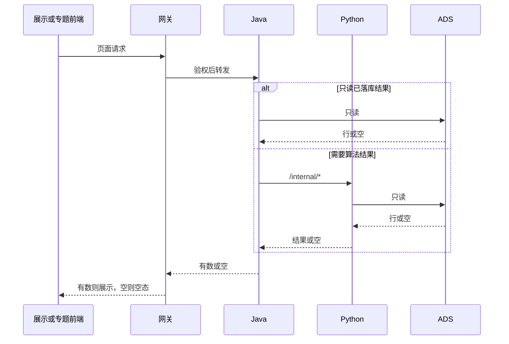

# 系统集成技术方案 · 对接三要素

> **状态**：草案 · 2026-10-22 · 未签收  
> **WBS**：WBS-02-00  
> **过程位置**：工程过程卷 03。已有 SCI-INT 分析只作输入。  
> 缺的写「还没有」。签收前不按本文派编码。

## 1. 背景与集成需求

展示、专题、数据和指标都要接北京久新的三条垂向：技术 / 技术链、人才、科研机构。企业不算科研机构。

展示侧分析已完成：态势 8 页 + 人才 4 子页，283 个 SRS 叶。确认状态一律待确认。专题侧不在这 283 叶里。

对接系统：

| 系统 | 角色 |
|---|---|
| 智树展示 `lumen-ui-science-pc` | 页面。不直连久新 |
| 智树专题 `lumen-ui-topic` | 专题侧三要素监管人淮政玮。是否开实现叶本方案还没写死；系统-04 目前是只分析 |
| Java `gkxlumen-*` | 只读门面 |
| `lumen-algo-py` | `/internal/*`，算法只在这里 |
| 北京久新 | 对端。算法与当前数据在 Doris 只读库，连接见 §3。数据结构说明、指标和算法说明文件还没有 |

## 2. 应用对接技术架构

调用方向：前端 → 网关 → Java → Python `/internal/*` → ADS，或由 Python 访问久新 Doris。禁止前端直连久新，禁止 Java 使用该只读账号，禁止 `demo-*` 进 lumen 调用链。鉴权走网关。缺数时页面空态，不把「待确认」画成已接入。2026-10-22 只读库已测通；本稿仍未签收，不按本文派编码。

```text
diagram_id: SYSINT-SCHEME-02-SEQ
signoff_status: draft
```

请求线程里没有久新。离线加工见 §3 的 `SYSINT-SCHEME-02-FLOW`。



实现方式：SCI-INT 的集成模式 IP-01…IP-13 只作候选。本方案签收前不选定哪一种落到哪一页。

## 3. 数据存储与数据流转

对接需求：人才、技术链、科研机构的主数据、关系和指标输入。51 行基线（SQL 3 / Python 6 / API 42）里本管线消费 38 行、未消费 13 行。逐字段清单还没有对端回文。

```text
diagram_id: SYSINT-SCHEME-02-FLOW
signoff_status: draft
```

实线是已经写死的读方向。虚线是还没有的加工。不在这张图上画网关、Nebula、Kafka 或 `demo-*`。


加工与融合：自动结果、久新结果、人工修订的优先级在分析卡里写过 `manual > jx > rule`，对端未确认，不能当融合规则定稿。

存储设计：C05 给李伟的 55 条是结构升级清单，不是已批的加字段表。本方案不列出新列。正式图空间仍是 `demo_gkx_chain`，切换归第 7 项。

久新提供的算法和当前数据都在下面这个库里，不是另交的算法包。2026-10-22 用只读账号测通：`SELECT 1` 成功，`version_comment` 为 `doris-4.1.0-rc03-5960d4cea0e`，库内 130 张表。表结构清单和算法说明文件仍未到，不把这些表写成已确认结构。密码不进 git，由 PM 另行保管。

| 项 | 值 |
|---|---|
| 实例 | Doris 4.1.0（`doris-4.1.0-rc03-5960d4cea0e`） |
| 协议 | MySQL |
| 主机 | `47.93.119.170` |
| 端口 | `29030` |
| 用户 | `test2`（只读，`'test2'@'%'`） |
| 密码 | 不进 git。PM 另行保管 |
| 数据库 | `gkx_technology_analysis_dev` |

```text
mysql -h 47.93.119.170 -P 29030 -u test2 -p gkx_technology_analysis_dev
```

## 4. 指标

SCI-INT 写过展示侧指标卡片（会签数字：指标 93/93 有模式编号）。这是分析覆盖，不是和指标库逐条对齐的结论。

| 问题 | 现状 |
|---|---|
| 实现方式 | 候选在 Python。Java 不算指标 |
| 与指标库对齐 | 还没有。签收前用 metric-registry 逐条对，不在本文改口径 |
| 缺项 | 算法与当前数据在 §3 的 Doris 库中。指标和算法说明文件还没有。没有这份文件就不能判断缺项清单已关闭 |

## 5. 分模块实现与 WBS

| 模块 | WBS | 前端 | 算法 | 数据加工 |
|---|---|---|---|---|
| 方案本身 | WBS-02-00 | 不改页面 | 不改模型 | 不改表。连接坐标已写入 §3；数据结构与算法说明文件仍未到，不因此建叶 |
| 人才四子页 | WBS-02-01 | 孔东按页面计划复刻。无数据时空态，不直连久新 | 人才指标与画像在 `lumen-algo-py`，说明未到则不实现新算法 | 主数据进 ADS 后 Java 只读。加工规则等对端说明 |
| 态势八页的技术 / 机构 | WBS-02-02 | 同上。八页若跨两位后端，签收时拆叶 | 技术链、机构类计算在 Python | 同左。不把待确认关系写成已融合 |
| 专题侧三要素 | WBS-02-03 | 监管人淮政玮。开不开页由本方案写死。系统-04 目前是只分析 | 若开，算法仍只在 Python | 不把 SCI-INT 卡片当成专题已落库 |
| ADS 只读落点 | WBS-02-04 | 无页面 | 写入在 Python 作业，不在请求线程里做重活 | 徐滕强过目 ADS 契约。不加未清单上的字段 |
| 指标侧 | WBS-02-05 | 不改页面 | 唐绍祖对照指标库。说明未到不实现新算法 | 不改表。缺项保持空态 |

智树不做：久新侧库表和算法实现；第 5 项菜单上三要素以外的对象；第 7 项图空间切换。
