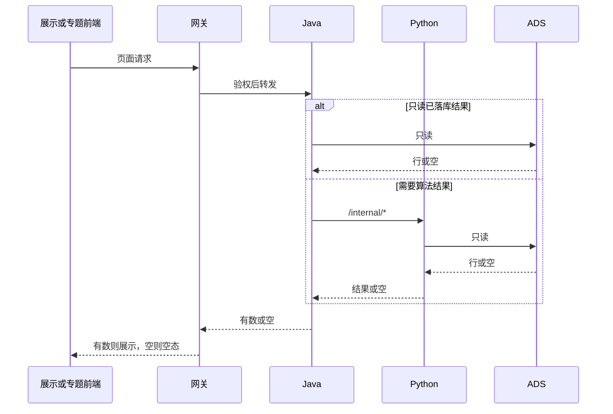

# 系统集成技术方案 · 对接三要素

> **状态**：草案 · 2026-10-22 · 未签收  
> **任务**：`SYSINT-SCHEME-02-L01`（WBS-02-00）  
> **监管人**：human:淮政玮。签收操作人同此人。本稿不自签。  
> **过程位置**：`工程过程/04-系统集成/02-对接三要素/`。五段章节对齐《系统集成整体过程规约》§6。  
> **开始时间**：2026-10-22。**完成日期要求**：2026-10-25。这两列是我方要求，不是北京久新的承诺。双方约定时点还没有。  
> 某一段没有材料，写「还没有」。不把分析覆盖、探库成功或「待确认」写成已接入。WBS 任务按本稿建立。本稿的验收要等这些任务全部完成。

三份对端材料里，库连接的非密坐标已经落盘，并且 2026-10-22 测通 Doris。数据结构说明、指标计算方法于 2026-10-22 由对端给出公开文档，schema 5.11.0，见 §1.4。本稿仍是草案：页面选用哪种对接模式还没有拍板，离线加工还没有。验收要等 WBS 已建任务全部完成，现在不改为 `ready_to_sign`。

## 1. 背景、集成需求、对接系统说明

### 1.1 背景

第 2 项对端是北京久新。范围是三条垂向：技术 / 技术链、人才、科研机构。对接和嵌入同时覆盖展示、专题、数据、指标四侧。企业不算科研机构。企业归专题四要素里的企业分析，不在本项把企业写成机构。

展示侧分析已经做完，只作输入。总控是 [`SCI-INT-长任务总控.md`](../../../agent-handoffs/展示系统三要素集成-SCI-INT/SCI-INT-长任务总控.md)。范围是科技发展态势 8 页（196 个 SRS 叶）和科技人才态势 4 子页（87 个 SRS 叶），合计 283。分析时拆成 A01–A15，这是卡片切分，不是菜单张数。确认列一律是待确认。这 283 叶不算专题已覆盖。

专题侧深度以 [`scope-baseline.md`](../../../scope-baseline.md) §0.2 和 [`系统-04`](../../02-策划与监控/02-智树工作计划/02-进度/系统-04-科技专题服务.md) 为准：科研机构、技术链、人才深度分析只分析、不实现。本方案不改这份范围。

### 1.2 集成需求

| 侧 | 要对上什么 | 本稿结论 |
|---|---|---|
| 展示 | 人才四子页的三要素供数；态势八页里的技术 / 技术链 / 科研机构区块 | 页面走 §2 时序。无数则空态。前端不直连久新 |
| 专题 | 技术链、人才、科研机构 | 深度实现叶写死不开。嵌入哪一页还没有页面清单，见 §5.3 |
| 数据 | 三要素主数据 | 落 ADS。Java 只读。页面不直连久新库。加工边还没有，见 §3 |
| 指标 | 与指标库对齐 | 还没有。SCI-INT 的 93/93 分析覆盖不算已对齐，见 §4 |

展示四子页（分析叶，叶数合计 87）：

| 分析叶 | 子页 | SRS 叶数 |
|---|---|---|
| A12 | 全球领域人才态势 | 23 |
| A13 | 关注地区人才态势 | 11 |
| A14 | 重点科技人才画像 | 28 |
| A15 | 人才引进推荐评估 | 25 |

态势 196 叶的分析切分是 A01–A11，叶数与总控的 196 对得上：科技全域态势，科学技术全景（展示 / 维护），技术发展跟踪，全球创新监测（成果与实时数据 / 载体排行、监测分析、城市），湾区创新监测，深圳创新监测，科技创新评估，科技指数，科技发展规划。规约写的菜单数是 8 页。11 个分析叶怎样收成这 8 个菜单，还没有一张已签收的对照表。本稿不把 11 个分析叶当成 11 个菜单，也不自行合并菜单边界。八页菜单名以 SRS「科技发展态势」目录为准。本项只认这些页上的三要素区块。

科学技术全景、技术发展跟踪同时出现在第 5 项菜单里。本项只写其中的三要素供数。菜单上三要素以外的对接归第 5 项，不在这里展开。

### 1.3 对接系统

| 系统 | 在本项的角色 |
|---|---|
| 展示前端 `lumen-ui-science-pc` | 人才四子页和态势八页上的三要素区块。只调网关 |
| 专题前端 `lumen-ui-topic` | 若将来有页，走同一条网关链。深度实现叶不开。现有专题页面清单还没有 |
| 网关 `gkxlumen-platform-gateway` | 验权并转发。业务服务不各自做登录 |
| Java `gkxlumen-topic` / `gkxlumen-innov` / `gkxlumen-metrics` / `gkxlumen-display` | 只读 ADS，经 Feign 调 Python `/internal/*`。不算指标，不写 nGQL，不使用久新只读账号 |
| `lumen-algo-py` | 算法只在这里。请求线程只读 ADS。离线作业将来才读久新 Doris，这道作业还没有 |
| `lumen-etl-es-py` | 正式 ETL 若要拉取，仍走 lumen 作业，不回落 demo。三要素检索索引还没有批准 |
| 北京久新 | 对端。算法和当前数据在 §3 的 Doris 只读库。结构与计算方法见 §1.4 的 schema 5.11.0。可执行 SQL / Python 源码不在该文档仓 |
| 统一用户中心 | 将来开发叶的收口：菜单用相对路径。本方案不配置菜单 |

小屏仓不在本维 WBS 里。还没有单独一行。

`demo-*` 不进入这条调用链。对照 demo 可以读代码后在 lumen 重写。不把 demo 服务写成下游。

### 1.4 材料

| 材料 | 状态 | 落点 |
|---|---|---|
| 数据库连接信息（非密坐标） | 已落盘。2026-10-22 只读账号测通 | [`对接文档/对端/README.md`](./对接文档/对端/README.md)，坐标复述在 §3.5 |
| 数据结构说明 | 已到。2026-10-22 读取，schema **5.11.0** | 活文档 [ADS_SCHEMA.md](https://github.com/leonlee723/sz-gkx-data-warehouse-docs/blob/main/ADS_SCHEMA.md)（`345c0e02`）。当日快照 [`2026-10-22-ADS_SCHEMA-5.11.0.md`](./对接文档/对端/2026-10-22-ADS_SCHEMA-5.11.0.md)。对端说数据更新会同步改这份文档，以后以 URL 为准 |
| 指标和算法说明 | 已到。计算方法写在同一份 schema，不是另一份独立算法仓 | 版本日志 [ADS_SCHEMA_RELEASE_NOTES.md](https://github.com/leonlee723/sz-gkx-data-warehouse-docs/blob/main/ADS_SCHEMA_RELEASE_NOTES.md)（`fbc967ab`）。当日快照 [`2026-10-22-ADS_SCHEMA_RELEASE_NOTES.md`](./对接文档/对端/2026-10-22-ADS_SCHEMA_RELEASE_NOTES.md)。当前最新条是 5.11.0，日期 2026-10-22 |
| 我方已发出的对接文档 | 还没有 | [`对接文档/我方/README.md`](./对接文档/我方/README.md) 索引为空 |
| 双方约定时点 | 还没有 | [`约定时点.md`](./约定时点.md) 第一节为空 |
| 纪要 | 还没有 | [`纪要/README.md`](./纪要/README.md) |

过程夹 README 仍写着三份都未到、方案任务未建。那是建档时的句子。连接坐标以对端 README 和 §3.5 为准。本稿不改 README。

SCI-INT 的接口需求说明、依赖总表、A/B/C/D handoff 是分析输入。确认状态是待确认。它们不是对端回文，也不是已发出的我方对接文档。

## 2. 应用对接技术架构、对接时序、实现方式

### 2.1 调用方向

写死，与 [`architecture-baseline.md`](../../../architecture-baseline.md) §1 调用链和 D12 一致。不另画全局拓扑。

```text
展示或专题前端
  → gkxlumen-platform-gateway
  → Java
  → 要么 Java 只读 ADS，要么 Java 调 lumen-algo-py 的 /internal/*，再由 Python 只读 ADS
  → 返回有数或空
```

久新 Doris 不在这条请求链上。它只可能出现在 §3 的离线作业里，而那道作业还没有。

禁止：

- 前端直连久新、Python、ADS、Nebula、对象存储
- Java 使用 §3.5 的只读账号
- Java 写算法、写 ADS、写 nGQL
- lumen 调用链落到 `demo-svc-platform`、`demo-platform-*`、`demo-algo-*`、`demo-svc-topic-py`
- 在请求线程里扫描久新库

### 2.2 对接时序

```text
diagram_id: SYSINT-SCHEME-02-SEQ
signoff_status: draft
```

请求线程里没有久新。离线加工见 §3 的 `SYSINT-SCHEME-02-FLOW`。



图中名字对应 §1.3 的系统。`Python` 是 `lumen-algo-py` 的请求线程，不是离线作业。两条分支的结果都只来自 ADS。ADS 没有行时，返回空，页面走 §2.5。

专题前端画在这张图里，是因为四侧共用这一条读链。它不表示专题深度页已经开建。

### 2.3 实现方式

架构约束写死：

- 读已落库的统计或主数据：Java 只读 ADS。
- 要算法结果：Java 调 `lumen-algo-py` 的 `/internal/*`，Python 只读 ADS 上的快照或派生结果。重计算不放在请求线程。
- 新算法若要进正式链，先登记 `cfg_metric` / `cfg_model_registry`，再由 Java 经注册中心调用。本稿不新登记任何一条。
- 可观测按现有 OTel 要求做三端 trace。SCI-INT-Z02 记过分析测试卡的三端 trace 未齐。那是分析会签的附条件，不是本项已经埋好点。本项的三端 trace 还没有。本稿不写新的埋点参数。

SCI-INT-B01 的 IP-01…IP-13 只作候选，不在本稿选到页上：

| 模式 | 一句话 | 本稿 |
|---|---|---|
| IP-01 | STAT 自建，GDF 建 ADS，Java 只读 | 候选 |
| IP-02 | COMPUTE，Python 批作业写 ADS | 候选。B01 记 93 条里当时没有 COMPUTE |
| IP-03 | MODEL 同步推理 | 候选。同步判据未在本项复用 |
| IP-04 | MODEL/GRAPH 异步作业，结果写快照 | 候选。与「请求线程不做重活」同向，未选到页 |
| IP-05 | GRAPH 自建，Python 读写 Nebula，结果投影 ADS | 候选。图空间切换归第 7 项 |
| IP-06 | 久新交 SQL，评审后进 GDF，落 ADS | 候选。SQL 正文还没有 |
| IP-07 | 久新交 Python，并入 `lumen-algo-py` | 候选。计算方法在 schema 5.11.0。可并入的 Python 源码还没有 |
| IP-08 | 久新交 API，Python 适配 | 候选。API 契约还没有 |
| IP-09 | 页面派生，不再向久新要一次 | 候选 |
| IP-10 | 无来源则空态，不伪造数值 | 与 §2.5 同向。未按页勾选 |
| IP-11 | 结果快照与版本 | 候选 |
| IP-12 | 挂 `metric_id` 与 8 件套 | 与 §4 同向。本稿不改指标库 |
| IP-13 | Mock 开关 | 候选。`USE_MOCK=false` 时不用 fixture 填数 |

哪一页用哪一个模式：还没有。结构与计算方法已经到了，页面选用仍要人拍板，本稿不代选。

### 2.4 鉴权

| 对象 | 结论 |
|---|---|
| 我方用户 | 只经网关。业务服务不各自实现一套登录。细到角色、脱敏范围：还没有本项专页的权限表 |
| 久新 Doris 只读账号 | 用户 `test2`。密码不进 git，PM 保管。Java 与前端不使用。将来只允许 `lumen-algo-py` 离线作业使用，凭证走 Secret 或主机环境文件。这道作业还没有，所以现在除已完成的连通性探测外，不授权扫表入库 |
| 久新 API 的令牌、签名、白名单 | 还没有 |

### 2.5 缺数时界面表现

写死：

- ADS 没有该对象的行，或对端材料未到，或该数在指标库对不上：页面空态。
- 不把 SCI-INT 的「待确认」画成已接入。
- 不造数，不用 fixture 把空填上。
- 统计数字若要显示，必须能在指标库里找到对应 `metric_id`。对不上就不显示一个伪数。口径、公式不在本稿新写。

空态的界面文案还没有。角标用现有 D9 组件，不在本稿新做一种徽章。

## 3. 数据存储与流转

### 3.1 对接的数据需求

本项要的数是人才、技术 / 技术链、科研机构的主数据、关系，以及指标计算的输入。企业主数据不在本项。

分析基线沿用久新 51 行（SQL 3 / Python 6 / API 42）。SCI-INT-Z02 核对：B 段引用 38 行，未消费 13 行，38+13=51。确认列全部是待确认。逐字段以对端回文为准。回文还没有。本稿不抄那 51 行的字段表，避免把待确认字段写成契约。

需求说明在 [`SCI-INT-久新接口需求说明.md`](../../../agent-handoffs/展示系统三要素集成-SCI-INT/产物/SCI-INT-久新接口需求说明.md)。文件开头写明只写需求、确认状态待确认。

### 3.2 数据流

```text
diagram_id: SYSINT-SCHEME-02-FLOW
signoff_status: draft
```

实线是已经写死的读方向。虚线是还没有的加工。不在这张图上画网关、Nebula、Kafka 或 `demo-*`。


读链（实线）与 §2 时序是同一件事的两个方向：时序是一次页面请求，本图是数从哪来。网关在时序里，不在本图重复，避免画成第二张全局拓扑。

加工链（虚线）的目标是：`lumen-algo-py` 离线作业读取久新 Doris，写入我方 ADS。Java 只读我方 ADS。结构说明已经到了，这道写入作业还没有，虚线仍不实施。2026-10-22 的只读调研只证明库内有什么，不证明加工已经接上。库内表名虽以 `ads_` 开头，那是久新库里的表，不是我方 ADS。

图的读写归第 7 项。本图不把 Nebula 画进来。正式图空间切换也不在本方案里改。

### 3.3 加工与融合

加工规则还没有。结构说明和计算方法已经到了（§1.4）。可执行作业还没有。

分析卡片的输出字段里出现过 `priority(manual>jx>rule)`，出处是久新接口需求说明里的字段摘录，确认状态是待确认。对端没有确认。本稿不把它定成融合规则。

在融合规则还没有的时候：自动结果、久新结果、人工修订不合成一个数拿去展示。页面要么读到已落 ADS 的单一结果，要么空态。

GDF 的 ODS → DWD → ADS 主路径归第 6 项。本项消费落到 ADS 的结果，不改第 6 项的方案。Python 直写 ADS 在架构里是旁路。本项连这条旁路的作业都还没有，不在本稿选定走工厂还是走旁路。

### 3.4 存储设计

主数据落点写死为 ADS。Java 只读。相对现有 ADS 要增加的字段：还没有。

SCI-INT-Z02 列给 human:李伟的结构升级清单是 55 条。那是分析阶段的升级清单，不是已批的加字段表。本稿不逐条列出，不把它当成 DDL。未批准的列不加。

A01 提过三要素检索索引，并标了结构升级。索引还没有批准。本稿不新增 ES 索引名。

对象存储不新开桶，不新开顶层目录。本项不让前端直连 RustFS。

### 3.5 已落盘的非密连接坐标

久新说明：算法和当前数据都在这个库里，不是另交的算法包。密码不写入任何文件。下面没有口令，也没有带口令的连接串。

| 项 | 值 |
|---|---|
| 实例 | Doris 4.1.0（`version_comment` = `doris-4.1.0-rc03-5960d4cea0e`） |
| 协议 | MySQL |
| 主机 | `47.93.119.170` |
| 端口 | `29030` |
| 用户 | `test2`（只读，`'test2'@'%'`） |
| 密码 | 不进 git。PM 另行保管 |
| 数据库 | `gkx_technology_analysis_dev` |
| 探测 | 2026-10-22，`SELECT 1` 成功。库内 130 张表。这 130 张不是已确认结构 |

```text
mysql -h 47.93.119.170 -P 29030 -u test2 -p gkx_technology_analysis_dev
```

表清单在 [调研记录](./调研/调研记录.md)。结构说明已经落到对端目录。库内表仍不是我方 ADS 映射。

### 3.6 图空间

SCI-INT-Z02 记载：INT-C-X-490 的正式空间仍写 `demo_gkx_chain`，正式 `gkx_chain` 待定，会签未把该空间判通过。切换归第 7 项。本方案不改空间，不新增 space，不写 nGQL。

## 4. 对接涉及的指标

### 4.1 分析里点过名的指标

SCI-INT-B01 的范围是展示侧 93 条：人才 32、技术链 39、科研机构 22。SCI-INT-Z02 核对 93/93 都挂了 IP-01…IP-13 的模式编号，模式不符为 0。

这是分析覆盖。它不是指标库逐条对齐的结论，也不是缺项已经关闭。

93 条的 `metric_id`、口径、公式、`algorithm_type` 以指标库为准。本稿不抄一份新的口径表，不改 seed，不改就绪度。

### 4.2 实现方式

写死：

- 指标计算在 Python。Java 不算指标。
- 出口是指标注册（`cfg_metric` / `gkxlumen-metrics` 的 catalog）和模型注册。页面上的 ⓘ 读 catalog，不读本稿。
- `algorithm_type` 未定或为 `UNKNOWN` 的，不派实现。
- 8 件套的齐备态由 data-agent 维护。doc 本稿只消费，不新定义 `definition` / `formula` / `algorithm_type`。

请求路径见 §2：算完的结果在 ADS，页面不在请求里现算久新库。

### 4.3 与指标库是否对齐

还没有。

2026-10-22 的只读调研对照了指标库技术 39、人才 32、机构 22 共 93 条，看库里有没有同主题结果表。记录在 [调研记录](./调研/调研记录.md)。「结果表在」只说明久新库里有表、有行，不写成已对齐，也不改 D1 / D4。

签收前若要逐条核对口径，只读 metric-registry 的 `metric-get` / `metric-query`。不在本稿写口径，也不用这次核对去改种子。SCI-INT 卡片里已经写过的模式编号，不能代替这次核对。

专题侧没有对应的指标对齐清单。把展示侧 93 条说成专题已对齐：不可以。

### 4.4 缺项

缺项清单还没有关闭。

对端的指标计算方法已经写在 schema 5.11.0。与指标库逐条对齐还没有做完，不能写「缺项为 0」或「已对齐」。

已知的空缺，都保持打开：

| 项 | 状态 |
|---|---|
| 对端指标和算法说明 | 已到。schema 5.11.0，见 §1.4。可执行 Python 源码还没有 |
| 与指标库逐条对齐记录 | 还没有。调研只有库内支持对照，见 [调研记录](./调研/调研记录.md) |
| 本项专页的 D1–D4 改写 | 不做。前端不得把状态改绿 |
| 无 `metric_id` 的统计位 | 不展示伪数，走 §2.5 空态 |

风险夹里「公用数据 / 久新分析 / 智树自算」三分清单未提交。三分清单还没有。在它还没有的时候，不把某一条指标判给久新或判给智树自算。

## 5. 分模块实现、本维 WBS、前端、算法、数据加工

WBS 正文在 [`WBS.md`](./WBS.md)。2026-10-23 起，WBS 与本节同一张任务表。已建任务回写在 WBS。WBS-02-03 不建任务。

日期都抄 WBS 已有的我方要求。不改这些日期，也不把它们写成久新承诺。

| WBS | 任务 | 子项 | 监管人 | 开始 | 完成日期要求 | 本稿 |
|---|---|---|---|---|---|---|
| WBS-02-00 | `SYSINT-SCHEME-02-L01` | 技术方案，即本任务 | 淮政玮 | 2026-10-22 | 2026-10-25 | 五段写在本文件。验收要等其余已建任务完成 |
| WBS-02-01 | `SYSINT-TAL-02-L01` | 展示·人才四子页供数 | 李伟 | 2026-10-25 | 2026-11-05 | 已建，进行中 |
| WBS-02-02 | `SYSINT-SIT-02-L01` | 展示·态势八页的三要素区块 | 李伟 | 2026-10-20 | 2026-11-05 | 已建，进行中。本叶不拆 |
| WBS-02-03 | 不建 | 专题侧三要素 | 淮政玮 | 2026-10-19 | 2026-11-05 | 深度叶写死不开。嵌入页还没有 |
| WBS-02-04 | `SYSINT-ADS-02-L01` | 主数据落 ADS，Java 只读 | 徐滕强 | 2026-10-19 | 2026-11-10 | 已建，进行中 |
| WBS-02-05 | `SYSINT-SURVEY-02-L01` | 久新只读库内容调研（存储 + 指标支持） | 唐绍祖 | 2026-10-22 | 待指定 | 已建，进行中。完成日不是久新承诺 |

| 模块 | 前端 | 算法 | 数据加工 |
|---|---|---|---|
| WBS-02-00 方案 | 不改页面 | 不改模型 | 不改表。连接坐标已在 §3.5 |
| WBS-02-01 人才四子页 | `lumen-ui-science-pc`。四页走 §2。不直连久新。无数则 §2.5。菜单相对路径是该任务的完成条件 | 人才类计算只在 `lumen-algo-py`。计算方法已在 schema。可执行源码还没有，不实现新算法 | 主数据进 ADS 后 Java 只读。加工规则还没有 |
| WBS-02-02 态势八页区块 | 同上，只覆盖三要素区块。本叶不拆 | 技术链、科研机构类计算只在 Python。可执行源码还没有则不实现 | 同左。待确认关系不写成已融合 |
| WBS-02-03 专题 | 见 §5.3 | 深度模型 3/4/5 不实现 | 不把 SCI-INT 卡片当成专题已落库 |
| WBS-02-04 ADS | 无页面 | 写入只在 Python 离线作业，不在请求线程 | 不加 §3.4 未批准的字段。作业还没有 |
| WBS-02-05 库内容调研 | 不改页面 | 不实现新算法。只看库内已有内容能支撑哪些指标 | 不改表，不写入 ADS。只读 |

统一用户中心的菜单和用户权限是 WBS-02-01、02-02 的完成条件，不单开一叶。菜单还没有按本项去配。

### 5.1 WBS-02-01

四子页是 §1.2 的 A12–A15。任务 `SYSINT-TAL-02-L01`，监管人李伟，进行中。可对端的含义：四页主路径能调通，或空态。空态规则在 §2.5。

### 5.2 WBS-02-02

八页的三要素区块。任务 `SYSINT-SIT-02-L01`，监管人李伟，进行中。本叶不拆。可对端的含义：这些区块有数或空态。SCI-INT 的待确认不写成已接入。

### 5.3 WBS-02-03

深度分析写死：**不开实现叶。不建任务。**

依据是 scope-baseline §0.2（科研机构、技术链、人才深度分析及深度模型 3/4/5 不作为智树实现交付）、系统-04（只分析，不开实现 LT）、规约 §15 第 11 条（不把「只分析」改成开发范围）。本稿不改 scope-baseline。

专题页面上嵌入三要素、改走 §2 同一条 ADS 读链：**深度实现叶仍不建（本行 WBS-02-03）。**  
2026-10-31 另建定义/对照叶（**不计入本方案「深度页」验收**）：

| WBS | 任务 | 作用 |
|---|---|---|
| WBS-02-10 | `SYSINT-TOPIC-CHAIN-GAP-02-L01` | 产业链菜单「开始分析」三要素嵌入供数缺口清单收口 |
| WBS-02-11 | `SYSINT-TOPIC-CHAIN-ALIGN-02-L01` | 页内 metric ↔ 久新 ADS 对照记录（不改 seed） |

缺口真源 [`专题-产业链分析-三要素对接需求.md`](./专题-产业链分析-三要素对接需求.md)。会签前不派 Job 嵌入实现。SCI-INT 的 283 个 SRS 叶全部是展示侧。不算专题已覆盖。

### 5.4 WBS-02-04

任务 `SYSINT-ADS-02-L01`，监管人徐滕强，进行中。落点是 ADS，读取方是 Java。写入方是 `lumen-algo-py` 离线作业。该作业还没有，对应 §3 图的两条虚线。页面不直连久新库。正式图空间不在本行切换。

### 5.5 WBS-02-05

任务 `SYSINT-SURVEY-02-L01`，监管人唐绍祖，进行中。对久新已经提供的 Doris 只读库做全面调研和挖掘。目的有两件：掌握现有数据存储情况；掌握这些内容对指标的支持情况。

只用 §3.5 的非密坐标。密码不进 git。不改对端库，不把表写进 ADS，不把摸到的表写成已确认结构和已接入。企业相关内容只记存储事实，不把企业算成科研机构。完成日期要求还没有指定，不是久新承诺。

与指标库逐条对齐的记录仍然还没有。调研记录不关闭 §4 的缺项。血缘规约里的会签分工不因本行改成监管人。

### 5.6 必须能答出的口径

| 问题 | 答案 |
|---|---|
| 调用方向 | §2.1、时序 `SYSINT-SCHEME-02-SEQ`。请求线程到 ADS 为止。久新只在数据流图的虚线上，加工还没有 |
| 鉴权 | §2.4。用户走网关。Doris 只读账号不进 Java、不进前端、密码不进 git。对端 API 鉴权还没有 |
| 数据落点 | ADS。Java 只读。要增加的字段还没有。图空间不在本项改 |
| 缺数表现 | §2.5 空态。不伪造，不把待确认画成已接入。空态文案还没有 |
| 智树不做 | 见 §5.7 |
| 我方对接文档 | 见 §5.8。已发出的还没有 |
| 对端对接文档 | 见 §5.8。连接坐标已有。数据结构说明和指标计算方法已到 schema 5.11.0。可执行源码还没有 |

### 5.7 智树不做

- 久新侧库表和久新侧算法的实现。我方不改对端库。
- 专题深度模型 3/4/5 的实现叶。WBS-02-03 不建任务。
- 第 5 项菜单上三要素以外的对接对象。
- 第 6 项 GDF 方案本身。
- 第 7 项的图空间切换、读图、查图、图指标集成。
- 企业作为科研机构。
- 在已建 WBS 任务完成之前验收本稿。
- 把 2026-10-25 或 WBS 上的其他完成日期要求写成久新承诺。

### 5.8 对接文档清单

我方（[`对接文档/我方/`](./对接文档/我方/README.md)）：

| 文档 | 状态 |
|---|---|
| 已发出的字段、时序、环境、验收条件 | 还没有。索引无行 |
| SCI-INT 长任务总控、Z01、Z02、久新接口需求说明、集成依赖总表、A/B/C/D handoff | 分析输入。未收口成已发出文档。确认列待确认 |
| 外部接口夹 06、06 字段级、06b 字段级 | 展示侧旧稿，第 5 项也引用。不复制进本夹，不视为本项已发契约 |

对端（[`对接文档/对端/`](./对接文档/对端/README.md)）：

| 收到日期 | 文档 | 状态 |
|---|---|---|
| 2026-10-22 | 深圳国科信数据仓库只读账号（非密坐标） | 已落盘，已测通 |
| 2026-10-22 | 数据结构说明 | 已到。schema 5.11.0，见 §1.4 |
| 2026-10-22 | 指标和算法说明 | 已到。计算方法在同一份 schema，见 §1.4 |

### 5.9 签收闸门

五段已经按规约 §6 写在本文件。验收条件是：WBS 里除本任务以外的已建任务全部 `done`。这些任务是 `SYSINT-TAL-02-L01`、`SYSINT-SIT-02-L01`、`SYSINT-ADS-02-L01`、`SYSINT-SURVEY-02-L01`。WBS-02-03 不建任务，不计入。

现在这些任务还没有完成，本稿保持 `in_progress`，不送 `ready_to_sign`，不标 `done`，不写「会签通过」。签收操作人仍是 human:淮政玮。
