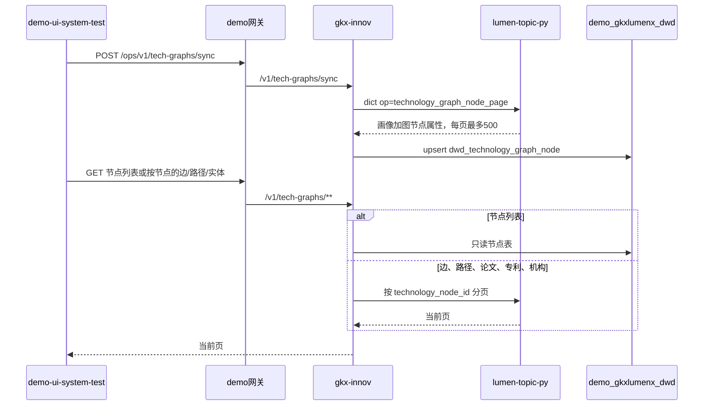

# 方案 · 技术点图谱菜单（SYSINT-TECHGRAPH-02）

算法中台 `demo-ui-system-test` 维护管理增加一个菜单，用来承载科学技术全景要用的久新技术点图事实：节点、边、路径，以及论文、专利、机构。人在这里同步和核对。展示页、Nebula 入图、图谱写回都不在本菜单。

监管人：human:淮政玮。日期：2026-11-05。

## 菜单

与「技术节点与产业映射」「Topic与产业映射」并列，排在 Topic 菜单下面。

| 项 | 值 |
|---|---|
| 菜单名 | 技术点图谱 |
| 路由 | `/ops/tech-graph` |
| 仓 | `demo-ui-system-test` |
| 控件 | Element Plus，不新加 npm 包 |

页面四个区域：

1. **节点**。【同步】才拉取。打开页面、关键字查询不打久新。列表给出全表数量，关键字最多 200 行，留空看最近同步的前 200 行。列：`technology_node_id`、中文名、英文名、社区角色、加权度、图发布号。中文为空就空着，不把英文抄进中文列。
2. **关系**。先选定一个已同步节点，再查它的邻边。默认只看证据 HIGH 和 MEDIUM，可改成含 LOW。每页最多 50 条。列：对端节点、关系类型、confidence、evidence_level、方向。页头写明边是推断边（`DWS_INFERRED`），LOW 约占六成。
3. **路径**。同一节点下列出经过它的路径步。每页最多 50 条。列：`path_id`、步序、路径分、路径长度。页头写明只有一份快照，没有两期差分。
4. **关联实体**。同一节点下三个列表：代表论文、代表专利、关联机构。每个列表默认 20 条，按代表排名或机构排名。人才一栏固定文案：「久新没有技术点到人才的直连表，本菜单不编造人才。」不查 `ads_talent_topic_profile`。

没有【关联】按钮。产业节点关联仍只在「技术节点与产业映射」。没有添加、删除、改属性、导入、版本。写回不在本方案。

## 同步与不落库

| 久新表 | 行数量级 | 本菜单 | 原因 |
|---|---:|---|---|
| `ads_technology_profile` | 19,430 | **同步进本侧节点表** | 节点身份。主键 `technology_node_id` |
| `ads_technology_graph_node` | 19,430 | **随节点同步** | 补社区角色、加权度、`graph_release_id`。与画像同一主键 |
| `ads_technology_graph_edge` / `evolution_edge` | 各 587,252 | 按节点查询，不落全量 | 边不是节点身份。枢纽节点邻边可以很多，分页即可 |
| `ads_technology_evolution_path_step` | 47,909 | 按节点查询，不落全量 | 路径不是节点身份 |
| `ads_technology_paper` / `patent` / `institution` | 10.8 万 / 17.3 万 / 252.9 万 | 按节点查询，不落全量 | 代表实体。机构全表过大 |
| `ads_technology_application_case` | 181,735 | 不同步、不查询 | 全是科研项目，不是需规里的四类实体 |
| `ads_technology_policy_evidence` | 0 | 不查询 | 0 行不是「没有政策」 |
| 正式 `tech_id` | 空 | 不作为主键 | 画像上的正式目录列已删除 |
| 人才 | 无 `ads_technology_talent` | 只展示缺口文案 | 人才挂在 Topic，不挂 `technology_node_id` |

节点表：`demo_gkxlumenx_dwd.dwd_technology_graph_node`。一行一个 `technology_node_id`。列至少有中文名、英文名、`community_role`、`weighted_degree`、`community_id`、`graph_release_id`、`data_version`、同步时间。按主键更新，不整表清空。某一页失败时已写入的页保留。字典返回空则不改表。

不写入 `dwd_tech_node_industry_map`、`dwd_topic_industry_map`、`subfield_topic_map`。不建边表、路径表、实体表。

## 调用

图号：`SYSINT-TECHGRAPH-02-SEQ`。图文冲突以图为准。

前端不直连久新、Python、Nebula。Java 不写 nGQL，不算向量，不调模型。密码和连接串不进 git。lumen 展示前端不调用本 demo 中台。

字典 op 加在 `lumen-topic-py` 已有 `_OPS` 上，复用 `technology_node_page` 的分页写法，不复制一套连接。节点同步的 SQL 用画像左连 `ads_technology_graph_node`。边、路径、实体各自一个 op，都必须带 `technology_node_id`，没有节点号就拒绝，禁止全表扫描出口。

网关路由 id `gkx-ops-tech-graphs`，Path `/ops/v1/tech-graphs` 与 `/ops/v1/tech-graphs/**`，uri `lb://gkx-innov`。过滤器和 `gkx-ops-tech-node-maps` 相同。helm 与 `gkxx.sys_route_conf` 两处都要有。不要发会清空只存在于 Redis 的路由的 reload。

## 不在本方案里的事

| 事 | 落点 |
|---|---|
| 技术节点对产业 | 已有菜单「技术节点与产业映射」，WBS-02-12 |
| Topic 对产业 | WBS-02-18，正在做。本菜单等它停手再改同一批文件 |
| 展示页科学技术全景切真数 | 第 5 项 WBS-05-01a/01b。本菜单不给 lumen 当后端 |
| 写入 Nebula / 燕大入图包 | 第 7 项。不塞进企业包或产业链包，本方案不新开入图行 |
| 维护图谱、增删改、版本 | 不拆。主数据谁持有、能否覆盖久新推断边，都还没定 |
| 人才挂到技术点 | 不建桥。页面只标明没有直连表 |

## 任务

| WBS | 任务 | 做什么 |
|---|---|---|
| WBS-02-19 | `SYSINT-TECHGRAPH-02-L01` | 菜单、节点表、【同步】、节点列表 |
| WBS-02-20 | `SYSINT-TECHGRAPH-02-L02` | 选定节点后的边、路径、论文、专利、机构，以及人才缺口文案 |

L01 等 `SYSINT-TOPICMAP-02-L01` 交出同一批仓再开工。L02 等 L01。两单都是 backlog，监管人 human:淮政玮。
