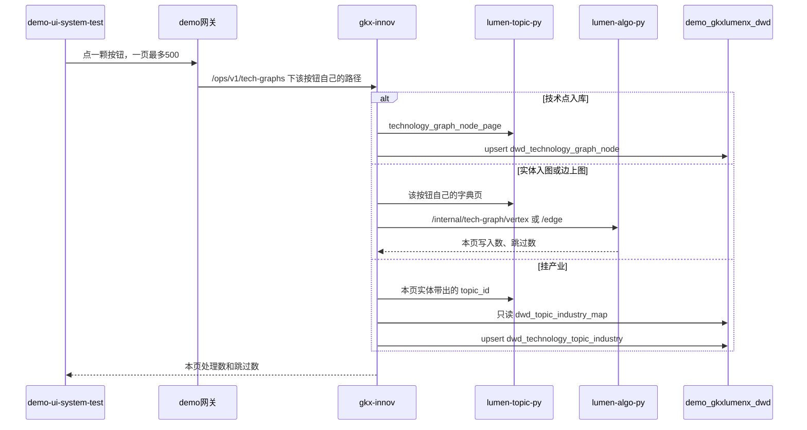

# 方案 · 技术点图谱菜单（SYSINT-TECHGRAPH-02）

算法中台 `demo-ui-system-test` 维护管理增加「技术点图谱」。技术相关要素先入图，再按按钮把边写上图。跟产业节点的关系不进图，经 Topic 对到已有产业映射后入库。

一个按钮只做一件事。点实体不写边、不挂产业。点边上图不补点、不挂产业。点挂产业不写 Nebula。打开页面和查询都不触发这些按钮。

监管人：human:淮政玮。日期：2026-11-05。

## 签收

2026-11-05 human:淮政玮确定签收。按本文三组按钮执行：实体入图、边上图、经 Topic 挂产业。图空间 `demo_gkx_chain`。关系表 `dwd_technology_topic_industry`。不改 M01–M24，不写 `gkx_chain`。

## 菜单

与「技术节点与产业映射」「Topic与产业映射」并列，排在 Topic 菜单下面。

| 项 | 值 |
|---|---|
| 菜单名 | 技术点图谱 |
| 路由 | `/ops/tech-graph` |
| 仓 | `demo-ui-system-test` |
| 控件 | Element Plus，不新加 npm 包 |

图空间只用 `demo_gkx_chain`。不写燕大正式空间 `gkx_chain`。Tag 不用七要素那套名字。技术点不是七要素里的「技术」。

| 点 | Tag | VID |
|---|---|---|
| 技术点 | `tech_point` | `tech_point:` + `technology_node_id` |
| 论文 | `tech_paper` | `tech_paper:` + `paper_id` |
| 专利 | `tech_patent` | `tech_patent:` + `patent_id` |
| 机构 | `tech_institution` | `tech_institution:` + `institution_id` |
| 人 | `tech_person` | `tech_person:` + `talent_id` |

边上图用独立 Edge，不复用七要素必须边的名字：`tech_rel`、`tech_has_paper`、`tech_has_patent`、`tech_has_institution`、`tech_has_person`、`tech_path_step`。重复点击按 VID 或边键更新，不另起一套点。

人没有 `ads_technology_talent`。论文来源先把代表论文的 OpenAlex `W` 号换成 `ads_paper_profile.paper_id`（`wrk_`），再对 `ads_talent_research_achievement`。Topic 来源先把论文上的 OpenAlex `T` 号换成 `ads_discipline_topic.topic_id`（`top_`），再对 `ads_talent_topic_profile`。两路各一颗按钮。同一人两路都有时，后一颗只补自己的来源标记，不抹掉前一颗。`T` 号对不上字典时 Topic 这一路写 0 行。

## 按钮

每颗按钮一次请求只处理一页，最多 500 行。页面自己按页往下翻，直到本页处理 0 行或失败停下。某一页失败时已写入的页保留。

### 实体

只写点。技术点先入库，再入图。其余实体不落全量本侧表，按页读久新后直接入图。

| 按钮 | 做什么 | 不做什么 |
|---|---|---|
| 技术点入库 | `ads_technology_profile` 左连 `ads_technology_graph_node`，约 19,430 行，upsert `dwd_technology_graph_node` | 不入图，不写边 |
| 技术点入图 | 本侧节点表 → Tag `tech_point` | 不改节点表，不写边 |
| 论文入图 | `ads_technology_paper` → Tag `tech_paper` | 不写 `tech_has_paper` |
| 专利入图 | `ads_technology_patent` → Tag `tech_patent` | 不写 `tech_has_patent` |
| 机构入图 | `ads_technology_institution` 里的机构 → Tag `tech_institution` | 不扫机构主题全表，不写边 |
| 人入图·论文 | 代表论文上的人 → Tag `tech_person`，来源标论文 | 不查 Topic 人才表 |
| 人入图·Topic | 代表论文 Primary Topic 上的人 → Tag `tech_person`，来源标 Topic | 不扫 684 万行全表，只查本页论文带出的 `topic_id` |

中文名用画像原样。空就空着，不把英文抄进中文。主键是 `technology_node_id`，不是 `tech_id`、`topic_id`、`path_id`。

### 边上图

只写边。任一端点还没有时，跳过并计数，不顺手补点。技术点关系默认不要 LOW；LOW 单独一颗。

| 按钮 | Edge | 来源 |
|---|---|---|
| 技术点关系上图 | `tech_rel` | `ads_technology_graph_edge`，只要 HIGH、MEDIUM |
| 低证据关系上图 | `tech_rel` | 同一张边表，只要 LOW |
| 论文上图 | `tech_has_paper` | `ads_technology_paper` |
| 专利上图 | `tech_has_patent` | `ads_technology_patent` |
| 机构上图 | `tech_has_institution` | `ads_technology_institution` |
| 人上图·论文 | `tech_has_person` | 代表论文上的人，边上标记来源=论文 |
| 人上图·Topic | `tech_has_person` | Primary Topic 上的人，边上标记来源=Topic |
| 路径上图 | `tech_path_step` | `ads_technology_evolution_path_step` 的相邻步。这是路径序列，不是 `tech_rel` |

### 挂产业

要素入图之后才挂。只读 `dwd_topic_industry_map` 里已经有产业节点的 Topic。Topic 还没挂上产业节点的，跳过并计数，不在这里重跑向量，不猜一个产业节点。

写入 `demo_gkxlumenx_dwd.dwd_technology_topic_industry`。一行是一个实体、一个技术点、一个 Topic、一个产业节点。逻辑键：`entity_kind` + `entity_id` + `technology_node_id` + `topic_id` + `industry_node_id`。按键更新，不整表清空。

| 按钮 | 实体 | Topic 从哪来 |
|---|---|---|
| 技术点挂产业 | `tech_point` | 该节点代表论文的 `primary_topic_id` |
| 论文挂产业 | `tech_paper` | 论文自己的 `primary_topic_id` |
| 人挂产业·论文 | `tech_person` | 带出这个人的那篇代表论文的 `primary_topic_id` |
| 人挂产业·Topic | `tech_person` | 人才 Topic 表上的 `topic_id`，且该 Topic 属于本页代表论文 |
| 机构挂产业 | `tech_institution` | 已入图机构在 `ads_institution_topic_entry` 上的 `topic_id`。只查本页这批机构号 |

专利不单挂。`ads_patent_analysis_topic` 不是 Topic 映射那张表的来源，本菜单不借它给专利找产业。

不写入 `dwd_tech_node_industry_map`、`dwd_topic_industry_map`、`subfield_topic_map`。那三张表各管各的。「技术节点与产业映射」仍是技术点名称对产业节点的另一条路，本菜单不覆盖它。

## 列表

列表只读，不入图，不挂产业。

1. **节点**。全表数量。关键字最多 200 行，留空看最近入库的前 200 行。列：`technology_node_id`、中文名、英文名、社区角色、加权度、图发布号。
2. **关系**。先选定一个已入库节点。默认 HIGH 和 MEDIUM，可改成含 LOW。每页最多 50 条。页头写明边是推断边，LOW 约占六成。
3. **路径**。同一节点下的路径步，每页最多 50 条。页头写明只有一份快照。
4. **关联实体**。论文、专利、机构、人。前三个默认 20 条。人分论文来源和 Topic 来源，各默认 20 条，每条带来源。
5. **已挂产业**。同一节点下已入库的 Topic 和产业节点，默认 20 条。未挂上的 Topic 不出现在这张表里。

没有添加、删除、改属性、导入、版本。写回不在本方案。

## 不落全量的表

| 久新表 | 行数量级 | 本菜单 |
|---|---:|---|
| `ads_technology_profile` + `ads_technology_graph_node` | 各 19,430 | 技术点入库进 `dwd_technology_graph_node`，再由另一颗按钮入图 |
| `ads_technology_graph_edge` | 587,252 | 只在两颗关系按钮里按页上图，不进本侧边表 |
| `ads_technology_evolution_path_step` | 47,909 | 只在路径按钮里按页上图 |
| `ads_technology_paper` / `patent` / `institution` | 10.8 万 / 17.3 万 / 252.9 万 | 实体按钮入点，边上图按钮写边。不落全量本侧表 |
| 人才两张表 | 代表成果 90.3 万；Topic 画像 684.7 万 | 只按本页论文或本页 Topic 取人 |
| `ads_technology_application_case` | 181,735 | 不读。全是科研项目 |
| `ads_technology_policy_evidence` | 0 | 不读 |
| `ads_patent_analysis_topic` | — | 不读。专利不单挂产业 |

节点表按 `technology_node_id` 更新，不整表清空。字典返回空则不改表。

## 调用

图号：`SYSINT-TECHGRAPH-02-SEQ`。图文冲突以图为准。

前端不直连久新、Python、Nebula。Java 不写 nGQL。入图和边上图只由 `lumen-algo-py` 写 `demo_gkx_chain`。挂产业只写上面那张关系表。密码和连接串不进 git。lumen 展示前端不调用本 demo 中台。

字典 op 加在 `lumen-topic-py` 已有 `_OPS` 上。每个按钮一个 op，都必须能分页。人、机构、挂产业的 op 没有本页技术点或本页论文号就拒绝。

网关路由 id `gkx-ops-tech-graphs`，Path `/ops/v1/tech-graphs` 与 `/ops/v1/tech-graphs/**`，uri `lb://gkx-innov`。过滤器和 `gkx-ops-tech-node-maps` 相同。helm 与 `gkxx.sys_route_conf` 两处都要有。不要发会清空只存在于 Redis 的路由的 reload。

## 不在本方案里的事

| 事 | 落点 |
|---|---|
| 技术点名称对产业节点 | 已有菜单「技术节点与产业映射」，表 `dwd_tech_node_industry_map` |
| Topic 对产业节点 | WBS-02-18，表 `dwd_topic_industry_map`。本菜单只读它 |
| 展示页科学技术全景切真数 | 第 5 项。本菜单不给 lumen 当后端 |
| 燕大正式空间和七要素包 | 不写 `gkx_chain`，不塞进 WBS-07-00G / 00H，不改 M01–M24 |
| 专利挂产业 | 不单做 |
| 维护图谱、增删改、版本 | 不拆 |

## 任务

| WBS | 任务 | 做什么 |
|---|---|---|
| WBS-02-19 | `SYSINT-TECHGRAPH-02-L01` | 菜单、节点表、七颗实体按钮、节点列表 |
| WBS-02-20 | `SYSINT-TECHGRAPH-02-L02` | 八颗边上图按钮，以及边、路径、实体的只读列表 |
| WBS-02-21 | `SYSINT-TECHGRAPH-02-L03` | 五颗挂产业按钮和已挂产业列表 |

三单都等 `SYSINT-TOPICMAP-02-L01` 交出同一批仓。L02、L03 再等 L01。都是 backlog，监管人 human:淮政玮。
