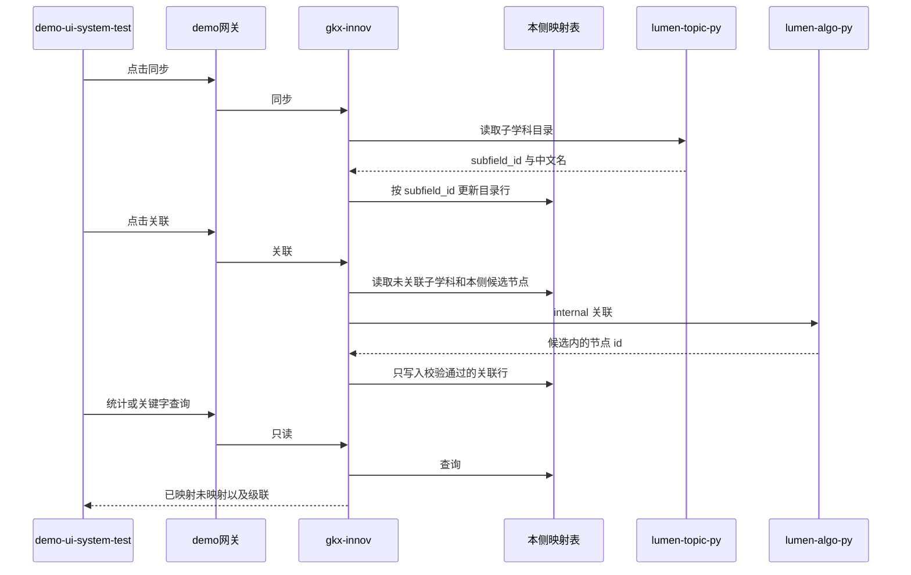

# 派单说明 · SYSINT-TFMAP-02-L01

```text
/goal algorithm-agent
身份：你是经验丰富、遵循最佳实践的资深算法/数据工程师。本单把子学科和本侧产业节点的关联做成固定表。LLM 只在 Python。Java 只读写本侧表和转发。
强度：ponytail full（默认）。禁止用 YAGNI 跳过调用链、可观测与架构铁律。
图：必含 SYSINT-TFMAP-02-SEQ。先写调用时序再写代码。图放在本文件「调用时序」一节，diagram_id 为 SYSINT-TFMAP-02-SEQ。不另画全局拓扑。图文冲突以图为准。必读 agent-delivery/diagram-as-contract.md。

任务：SYSINT-TFMAP-02-L01
标题：技术领域与产业节点关联：子学科同步进本侧表，LLM 关联产业节点
监管人：待指定。未指定前不认领、不改业务仓。指定后 task-claim，claimed_by=agent:algorithm-agent，supervised_by 用指定的人。若认领要求先 ready，先把状态改到 ready 再认领。
执行：agent:algorithm-agent。协作 api-agent（本侧表和转发）、frontend-agent（demo-ui-system-test 菜单）。同一 task-id，不另开任务。
状态：backlog，未认领。
仓：菜单在 demo-ui-system-test（Vue 3 + Element Plus + Pinia）。接口跟产业集群映射同一条链：demo-ui-system-test → demo 网关 → demo-svc-platform 的 gkx-innov。映射表与 industry_cluster_map 同一业务库。子学科目录复用已有字典接口（lumen-topic-py，经 Java 转发）。LLM 调用 lumen-algo-py 已有智谱客户端的 /internal/*。分支 dev。业务仓完工停在本地，不自行 commit / push，除非监管人明确说提交。
开始时间：2026-10-28。完成日期要求：待指定。

目标：关联关系落在本侧数据库的映射表，其他模块只读这张表。页面查询、统计、测试框都不打久新，也不在请求路径上再拉字典接口。【同步】才把子学科目录灌进表。【关联】才调用 LLM，把子学科对上本侧已有产业节点。

调用方向（必须落在图上）：
同步：demo-ui-system-test → 网关 → gkx-innov → 已有子学科字典 → 写入本侧映射表。
关联：demo-ui-system-test → 网关 → gkx-innov → lumen-algo-py /internal/* → 校验 id 后写入本侧映射表。
查询和统计：demo-ui-system-test → 网关 → gkx-innov → 只读本侧映射表。
前端不直连久新、不直连 Python、不直连模型。Java 不写提示词、不调模型、不使用只读账号 test2。密码、完整连接串、模型密钥不进 git。

必读：
- 本文件（范围真源）
- agent-delivery/工程过程/04-系统集成/02-对接三要素/WBS.md（WBS-02-08）
- agent-delivery/architecture-baseline.md（调用链、算法只在 Python、D12）
- agent-delivery/diagram-as-contract.md
- demo-ui-system-test 的 src/router/index.ts、src/views/ops/opsMenuConfig.ts、src/views/ops/pages/ClusterMapPage.vue
- demo-svc-platform gkx-innov 的 IndustryClusterController、IndustryClusterService（表在同一业务库）
- lumen-topic-py 已有子学科字典（SYSINT-DICT-02-L01）
- lumen-algo-py 已有智谱 LLM 客户端
任务查询只用 MCP task-get / task-query。禁止读 task-registry.yaml。

范围：
1. 本侧映射表。目录行至少有 subfield_id、中文名、data_version、同步时间。关联行至少有 subfield_id、产业节点 id、产业 id、集群 id、模型名、关联时间。未关联的子学科保留目录行，关联列为空。同步按 subfield_id 更新名称和版本，不整表清空，不删掉已有关联。表与 industry_cluster_map 同一业务库。不建在前端 seed，不把结果只放在浏览器内存。
2. demo-ui-system-test 维护管理增加菜单，与「产业集群映射」并列。路由挂在现有 ops 下，菜单项写入 OPS_SUB_MENU。控件用 Element Plus。不新加 npm 包。
3. 【同步】把子学科目录写入映射表。来源是已有子学科字典，不在页面上直连久新。同步失败时表保持上次成功的内容，页面写出失败原因。
4. 【关联】由人点击后才调用 LLM。只处理还没有关联的子学科。候选清单在调用前从本侧已有目录读出：集群用 CL-*，产业用该集群已挂上的 L0 industry_id，产业节点用该产业下已有的 chain node。LLM 返回的 id 不在候选里就丢弃，该子学科保持未映射。某一层本侧没有目录行，该层留空，并在 handoff 写明缺口，不编造节点。按批调用。超时或单行失败不把未完成的行标成已映射。页面能看到失败行。
5. 统计：标题用「子学科与专题映射」。已映射 = 至少有一条通过校验的产业节点关联。未映射 = 已同步但没有关联。两边都列出子学科中文名和 subfield_id，并给出两侧数量。这里的专题指这张表要给专题等其他模块用，统计对象是子学科有没有对上产业节点。
6. 测试关联查询：输入子学科关键字，定位到子学科。其后级联展示该子学科已关联的产业节点、产业、集群。多条关联都列出来。未关联则级联为空。查询只读本侧表，不触发同步，不触发 LLM。
7. 其他模块使用这张表或只读这张表的查询接口。不在各自请求里再拉子学科字典来现算关联。

DoD（与注册表一致）：
1. 本侧映射表落库。其他模块读这张表，不在请求路径上打久新或字典接口。密码和模型密钥不进 git。
2. demo-ui-system-test 维护管理有菜单。【同步】按 subfield_id 更新子学科目录，不整表清空。【关联】调用 LLM，只接受本侧已有产业节点，失败行保持未映射。
3. 页面列出已映射和未映射的子学科，并给出两侧数量。
4. 输入子学科关键字能定位子学科，级联只显示该子学科已关联的产业节点、产业、集群。未关联则级联为空。
5. 不改政策三页的提交逻辑，不替换政策页产业集群下拉。不建技术链、人才、科研机构深度分析页。不改 iticsci 专题仓。Java 不调模型。handoff 写明表名、菜单路径、LLM 落点和本侧目录缺口。
6. handoff：agent-delivery/agent-handoffs/SYSINT-TFMAP-02-L01.md。含 ponytail: full。evidence 指向该 handoff、本派单（含 SYSINT-TFMAP-02-SEQ）和业务仓本地改动路径。不要把任务标 done。联调确认词只在监管人确认后写入。

可观测：新的 Python /internal 路由沿用 lumen-algo-py 已有 OTel。Java 转发沿用 gkx-innov 已有日志。本页数字是映射维护统计，不为每条子学科加指标 ⓘ。

禁止：
- 重开 WBS-02-03，或新建技术链、人才、科研机构深度分析页。
- 修改 iticsci-tech-topic-backend、iticsci-tech-topic-frontend。
- 用久新 ads_industry.industry_id 充当本侧产业节点，或用产业集群目录顶替缺失的 chain node。
- 页面打开、输入关键字或查看统计时自动打字典接口或自动调用 LLM。
- 用 fixture、Mock 或随机数填映射。
- 在 Java 里写提示词或直连模型。前端直连 Python、久新或模型。
- 把政策三页的产业下拉换成这张表。把 QPOL-tech 写成已确认。
- 把密码、模型密钥或完整连接串写入 git。
- task-create 新叶，或修改本任务以外的 depends_on、状态、DoD。
- 业务仓自行 commit / push。
```

## 调用时序

diagram_id: SYSINT-TFMAP-02-SEQ


