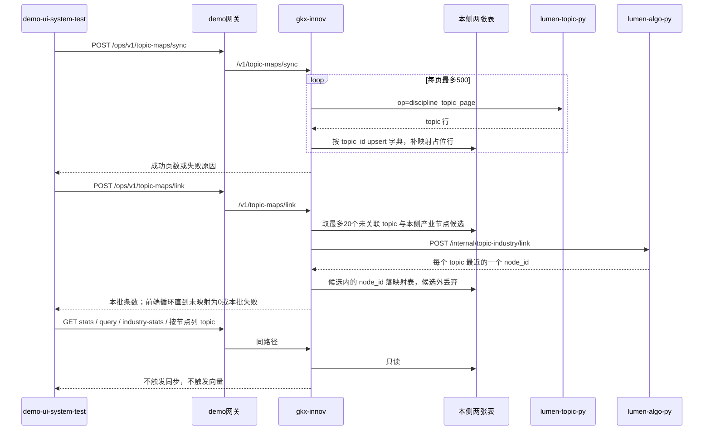

# 派单说明 · SYSINT-TOPICMAP-02-L01

```text
/goal algorithm-agent
身份：你是经验丰富、遵循最佳实践的资深算法/数据工程师。本单把久新平台 Topic 同步进本侧表，再用名称向量关联到本侧已有产业节点。向量只在 Python。Java 只读写本侧表和转发。
强度：ponytail full（默认）。禁止用 YAGNI 跳过调用链、可观测与架构铁律。
图：必含 SYSINT-TOPICMAP-02-SEQ。先对调用时序再写代码。图放在本文件「调用时序」一节，diagram_id 为 SYSINT-TOPICMAP-02-SEQ。不另画全局拓扑。图文冲突以图为准。必读 agent-delivery/diagram-as-contract.md。

任务：SYSINT-TOPICMAP-02-L01
标题：Topic 与产业节点映射：仿技术节点映射，ads_discipline_topic 同步进本侧表 + Topic 关联产业节点
WBS：WBS-02-18
监管人：human:淮政玮。开工前 task-claim，claimed_by=agent:algorithm-agent，supervised_by=human:淮政玮。状态若仍是 backlog，先由 coordinator 或监管人转到 ready 再认领。
执行：agent:algorithm-agent。协作 api-agent（本侧表、gkx-innov 转发、网关路由）、frontend-agent（demo-ui-system-test 菜单与页面）。同一 task-id，不另开任务。
状态：backlog。依赖 SYSINT-CHAIN-ELEM-LINK-02-L01（判定已出）、SYSINT-TFMAP-02-L01。依赖叶未签收不挡本叶开工，也不要把依赖叶标 done。
仓：lumen-topic-py（字典 op）、demo-svc-platform 的 gkx-innov（表与转发）、demo-ui-system-test（菜单）、lumen-algo-py（向量）。分支 origin/dev。工程自检绿后 commit + push origin/dev，commit 带 [agent:<role>]。禁止 force push，禁止推 main。
开始时间：2026-11-05。完成日期要求：待指定。

已锁定（执行时不得改口）：
映射主体是平台 Topic，主键 topic_id（top_<hex32>）。不是 subfield_id，不是 technology_node_id，不是 GB/T 4754 的 industry_id。
菜单名「Topic与产业映射」，路由 /ops/topic-map，挂在维护管理，排在「技术节点与产业映射」下面。
【同步】【关联】只在人点击后发生。打开页面、关键字查询、看统计都不触发。
每个 Topic 只保留余弦最近的一个产业 node_id。该节点在本侧挂了几个集群，映射表就写几行（同一 node_id，cluster_id 不同）。节点没有集群时写一行，cluster_id 为空。不因为多个集群去匹配多个节点。
对外字典 op 名是 discipline_topic_page。lumen-topic-py 已有 topic_page（同表、同列、每页上限 500）。本叶只在 _OPS 里让 discipline_topic_page 指向现有 topic_page，不复制 SQL。
一批 20 个尚未关联的 topic。页面循环到未映射为 0；某一批失败或剩余数不再下降就停下。

目标：关联落在本侧库。其他模块只读本侧表。页面不打久新。Java 不算向量。

调用方向（必须落在图上）：
同步：demo-ui-system-test → demo 网关 /ops/v1/topic-maps/** → gkx-innov → lumen-topic-py POST /internal/gkx-svc/dict/query（op=discipline_topic_page）→ 写入 demo_gkxlumenx_dwd.dwd_discipline_topic，并保证 dwd_topic_industry_map 里每个 topic 至少有一行。
关联：demo-ui-system-test → 网关 → gkx-innov → lumen-algo-py POST /internal/topic-industry/link → 校验 node_id 后写入 dwd_topic_industry_map。
查询和统计：demo-ui-system-test → 网关 → gkx-innov → 只读这两张本侧表。
前端不直连久新、不直连 Python、不直连模型。Java 不写向量、不调 embedding。密码、完整连接串、模型密钥不进 git。

必读：
- 本文件（范围真源）
- agent-delivery/工程过程/04-系统集成/02-对接三要素/方案-SYSINT-TOPICMAP-02-L01.md
- agent-delivery/工程过程/04-系统集成/02-对接三要素/方案-SYSINT-TECHMAP-02-L01.md
- agent-delivery/工程过程/04-系统集成/02-对接三要素/调研/Topic桥可行性判定.md
- agent-delivery/工程过程/04-系统集成/02-对接三要素/WBS.md（WBS-02-18）
- agent-delivery/architecture-baseline.md（调用链、算法只在 Python、D12）
- agent-delivery/diagram-as-contract.md
- demo-ui-system-test：src/views/ops/opsMenuConfig.ts、src/router/index.ts、src/views/ops/pages/TechNodeMapPage.vue、src/api/tech-node-map/index.ts
- demo-svc-platform gkx-innov：technode/TechNodeMapController、TechNodeMapService、TechNodeMapAlgoClient
- demo-svc-platform helm/gkx-platform/configs/gkx-gateway-dev.yml 里的 gkx-ops-tech-node-maps
- lumen-topic-py：gkx_svc_service/jx_dict.py 的 topic_page 与 _OPS
- lumen-algo-py：lumen_common/algorithms/tech_node_industry.py、views/tech_node_industry.py、industry_embed.embed_texts
- agent-delivery/agent-handoffs/SYSINT-TECHMAP-02-L01.md（网关路由当时怎么进 gkxx.sys_route_conf）
任务查询只用 MCP task-get / task-query。禁止读 task-registry.yaml。

范围：
1. 字典表 demo_gkxlumenx_dwd.dwd_discipline_topic。列至少有 topic_id、name_zh、name_en、subfield_id、field_id、domain_id、data_version、同步时间。按 topic_id 更新名称和版本，不整表清空。某一页失败时已写入的页保留，页面写出失败原因。字典返回空则不改表。来源行数约 4,516。建表方式跟 TechNodeMapService 保证映射表存在的做法一致，不另写进供应方库。
2. 映射表 demo_gkxlumenx_dwd.dwd_topic_industry_map。一行是一个 topic 的一条产业关联。逻辑键 topic_id + node_id + cluster_id。未关联保留一行，node_id 为空。同步不得删掉已有关联。不写入 subfield_topic_map，不写入 dwd_tech_node_industry_map。
3. 不同步这些表：ads_talent_topic_profile、ads_institution_topic_entry、ads_patent_analysis_topic、ads_emerging_topic_*。它们是主体挂接或评估结果，不是本叶的映射对象。上级 field/subfield 已有 field_page、subfield_page，页面级联需要时复用。domain 没有现成 page op，不为此新开表，domain_id 留在 topic 行上。
4. 菜单。OPS_SUB_MENU 增加 { path: '/ops/topic-map', label: 'Topic与产业映射' }，路由注册方式照抄 /ops/tech-node-map。控件用 Element Plus。不新加 npm 包。页面结构照抄 TechNodeMapPage.vue。
5. 网关。新增路由 id gkx-ops-topic-maps，Path=/ops/v1/topic-maps 与 /ops/v1/topic-maps/**，uri lb://gkx-innov。helm 的 gkx-gateway-dev.yml 与 gkxx.sys_route_conf 两处都要有，过滤器与 gkx-ops-tech-node-maps 逐项相同。不要发会清空只存在于 Redis 的路由的 reload。
6. Java 控制器挂 /v1/topic-maps，与 TechNodeMapController 同组接口：sync、link、stats、query、industry-stats，以及按 node_id 列出已关联 topic。sync 按页调 discipline_topic_page，每页不超过 500。link 一次只送 20 个未关联 topic，候选产业节点与技术节点映射用同一套本侧目录。
7. Python。新模块，新路由 POST /internal/topic-industry/link。请求体是 topics 与 candidates。文本用 name_zh，空则用 name_en。embedding 复用 industry_embed.embed_texts，不改 tech_node_industry.link_batch 的入参和返回。返回的 node_id 不在本批候选里就丢弃，该 topic 保持未映射。沿用进程内已有 OTel，不另建 tracer。留一个 pytest：构造两名候选，较近的那个被选中，候选外的 id 不出现在 links 里。
8. 页面。已映射、未映射给出全表数量。两段列表各最多 200 行。关键字查询最多 200 个 topic，留空只看已关联。已映射产业及其 topic 数量。选定产业节点后只列该节点已关联的 topic。这些请求不触发同步，不触发向量。

DoD（与注册表一致）：
1. 本侧字典表 demo_gkxlumenx_dwd.dwd_discipline_topic 落库：同步 ads_discipline_topic 4516 行（topic_id/name_zh/name_en/subfield_id/field_id/domain_id），按 topic_id upsert 不整表清空；来源 lumen-topic-py 字典通道新 op=discipline_topic_page（每页≤500），页面不直连久新。
2. 本侧映射表 demo_gkxlumenx_dwd.dwd_topic_industry_map 落库：一行一个 topic 的一条产业关联，逻辑键 topic_id + 产业 node_id（+集群），未关联保留 node_id 空；不写入 subfield_topic_map 和 dwd_tech_node_industry_map。
3. 算法中台 demo-ui-system-test 维护管理新菜单「Topic与产业映射」（路由 /ops/topic-map），与「技术节点与产业映射」同构：【同步】灌字典，【关联】用名称向量对产业节点余弦取最近；一次请求一批，前端循环到未映射 0 或批失败停止。
4. 页面：已映射/未映射全量数、两段列表各≤200 行、关键字查询≤200 个 topic、已映射产业及 topic 数、选定产业节点列已关联 topic——交互与 tech-node-map 页一致。
5. 其他模块读本侧表不直连久新；Topic 桥消费方（链节点→topic 展开）后续读 dwd_topic_industry_map，不动既有 subfield_topic_map / tech_node_industry_map 数据。
6. handoff 写明两张表名、通道 op、菜单路径、向量落点与批策略；架构自检：调用链不越层、Java 不算向量、密码不进 git。handoff 路径 agent-delivery/agent-handoffs/系统集成-SYSINT/SYSINT-TOPICMAP-02-L01.md，含 ponytail: full。evidence 指向该 handoff、本派单（含 SYSINT-TOPICMAP-02-SEQ）和业务仓改动。不要把任务标 done。联调确认词只在监管人确认后写入。

可观测：新的 Python /internal 路由沿用 lumen-algo-py 已有 OTel。Java 转发沿用 gkx-innov 已有日志。本页数字是映射维护统计，不为每个 topic 加指标 ⓘ。

禁止：
- 重开 WBS-02-03，或新建技术链、人才、科研机构深度分析页。
- 修改 iticsci-tech-topic-backend、iticsci-tech-topic-frontend。
- 改政策三页的选择和提交。改 subfield_topic_map 或 dwd_tech_node_industry_map 的既有行。
- 用 ads_industry 的 GB 代码充当本侧产业节点。
- 把人才、机构、专利、论文、项目的 *_topic 大表同步进本叶的表。
- 页面打开、输入关键字或查看统计时自动打字典或自动算向量。
- 用 fixture、Mock 或随机数填映射。
- 在 Java 里做向量或直连模型。前端直连 Python、久新或模型。lumen 前端调用本 demo 中台。
- 把密码、模型密钥或完整连接串写入 git。
- task-create 新叶，或修改本任务以外的 depends_on、状态、DoD。
- 把本任务标 done 或 ready_to_sign。
```

## 调用时序

diagram_id: SYSINT-TOPICMAP-02-SEQ


