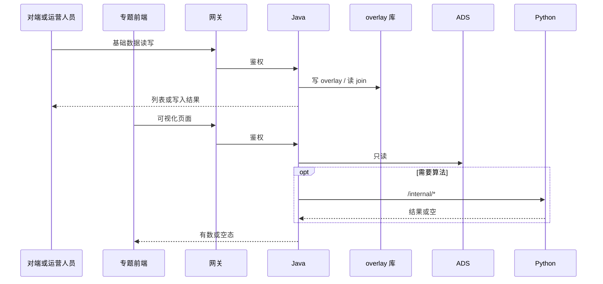
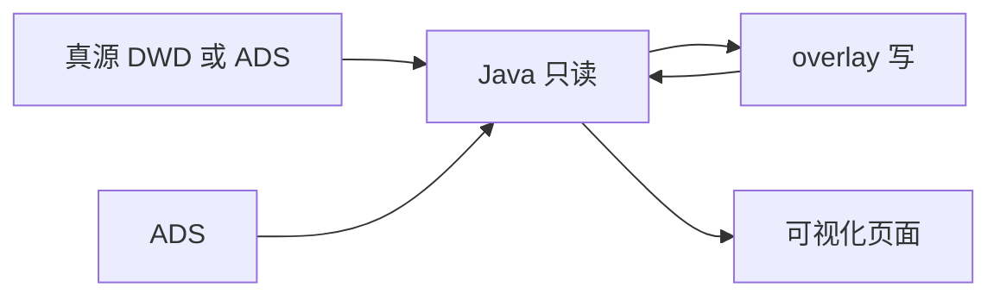

# 系统集成技术方案 · 专题系统集成

> **状态**：草案 · 2026-10-22 · 未签收  
> **WBS**：WBS-03-00  
> **过程位置**：工程过程卷 03。CMS 规格书和门户 CMS 契约只作输入。  
> 已在跑的基础数据叶不回退。内容管理和可视化在本方案签收前不新建开发叶。

## 1. 背景与集成需求

第 2 项以外的专题集成，三块：

1. 基础数据：产品链、企业、政策、产业服务机构。智树出接口，对端调用。技术链、科研机构、人才不在本块。
2. 内容管理四菜单：智树做页面、接口、数据，然后把菜单配到统一用户中心。
3. 可视化四菜单：前后端智树全部自做，不再由久新做页面。做完后同样配菜单。

对接系统：专题前端、`lumen-svc-platform` 的 CMS/overlay 接口、对端（消费基础数据接口的调用方）、统一用户中心（只登记菜单路径）。

名称还没对齐：产业全景 / 专题全景 / 产业概况，专题服务 / 产业服务，政策扶持 / 政策新闻。方案签收前先收口。

## 2. 应用对接技术架构

基础数据：对端 → 网关 → Java `/cms/v1/*`。写在独立 overlay schema，不进 DWD。读可以 join 真源。Java 不写算法。

可视化：`lumen-ui-topic` → 网关 → Java → 需要计算时 Python `/internal/*` → 只读 ADS。缺数为空态。

菜单：统一用户中心只存相对路径，主机在 `baseurl`。见门户夹 2026-10-22 纪要。

10-09 的 wujie 嵌入不是这四块可视化的做法。

## 3. 数据存储与数据流转

加工与融合：overlay 是运营写入，不把 overlay 行倒灌成三方源。政策扶持契约写明不涉及 CMS 回写；`PORTAL-CMS-DWD-WRITEBACK-POL-L01` 仍是 claimed，回写总单 blocked。企业、专题全景、专题服务的回写单在 ready_to_sign，规则未签收前不在本文写新字段。

存储设计：要扩展的字段以各 `PORTAL-CMS-*.md` 为输入。企业发展已确认，其余三份是草案。本文不另造列。overlay DDL 任务 `CMS-JX-OVERLAY-DDL-L01` 已在待签收，独立 schema。

## 4. 指标

| 模块 | 实现方式 | 与指标库 | 缺项 |
|---|---|---|---|
| 基础数据接口 | 读已有事实，不在接口里新算口径 | 还没有逐条对完 | 政策列表、企业档案已补为 WBS-03-16、03-17。其余 TopN、全景包、名录、政策统计、失效通知仍不进 WBS |
| 内容管理四菜单 | 展示已发布正文；指标区块见契约草案 | `PORTAL-CMS-METRIC-COVER-L01` 为 claimed，对齐未完成 | 未完成前标缺项，不手写口径 |
| 可视化四菜单 | 计算在 Python，Java 只读 ADS | 同上，四模块覆盖核对未完成 | 同上 |

## 5. 分模块实现与 WBS

| 模块 | WBS | 前端 | 算法 | 数据加工 |
|---|---|---|---|---|
| 方案本身 | WBS-03-00 | 不新做页 | 不改算法 | 不新加列。收口菜单名称。可视化与内容管理是运维页，门户四页是普通用户页，不是同一套 |
| overlay | WBS-03-09 | 无 | 无 | DDL 与读写边界签收。写侧继续依赖这份 DDL |
| 企业 / 产品链 / 政策 / 服务机构接口 | WBS-03-10～14 | 不在本叶做可视化页 | 无新算法 | 只加工 overlay 与已有只读 join。政策列表与企业档案不并进这些叶 |
| 政策列表 / 详情 | WBS-03-16 | 无新页 | 无新算法 | 只读 DWD 政策真源。沿用 `CMS-JX-POL-LIST-L01` |
| 企业基础档案 | WBS-03-17 | 无新页 | 无新算法 | 只读。沿用 `CMS-JX-ENT-PROFILE-L01`，顺延笔记保留 |
| CMS 前端框架 | WBS-03-15 | 孔东：公共控件选型、设计、开发；CMS 字段增删改查表单通用框架 | 无 | 不新加列。政策扶持无 CMS 表单 |
| 企业发展内容 | WBS-03-01a～d | 运营页套 WBS-03-15。指标页空态待核对 | 企业段走 `PORTAL-CMS-METRIC-COVER-L01`。LLM 摘要单独一块 | 回写只按 ENT 定义单的 12 个 content_type，会签前不写 DWD |
| 产业全景内容 | WBS-03-02a～d | 五块正文套 WBS-03-15。资讯不上 CMS | 专题全景段指标在 Python。节点边不进 CMS | 回写五个 `pano_*`。资讯表不覆盖 |
| 专题服务内容 | WBS-03-03a～c | `svc_business_domain` 套 WBS-03-15 | 专题服务段指标在 Python。名称走主数据 | 只回写这一处 HTML |
| 政策扶持 | WBS-03-04a～c | 无运营后台。智树做指标页和时间线 | 力度用已有评分。数量类保持缺口 | 不回写 DWD，不新造富文本 |
| 四个可视化菜单 | WBS-03-05～08 | `lumen-ui-topic` 全页。缺数空态。菜单相对路径进统一用户中心 | 需要计算的区块走 `/internal/*` | 读 ADS。不复用基础数据写侧任务当页面接口 |
| 菜单注册与用户权限 | WBS-03-18 | 不新做页。八个菜单配进统一用户中心 | 无 | 无。地址只写相对路径 |

智树不做：久新的可视化前端；技术链、人才、科研机构的基础数据接口（归第 2 项）；专家知识和全要素图谱 overlay。
