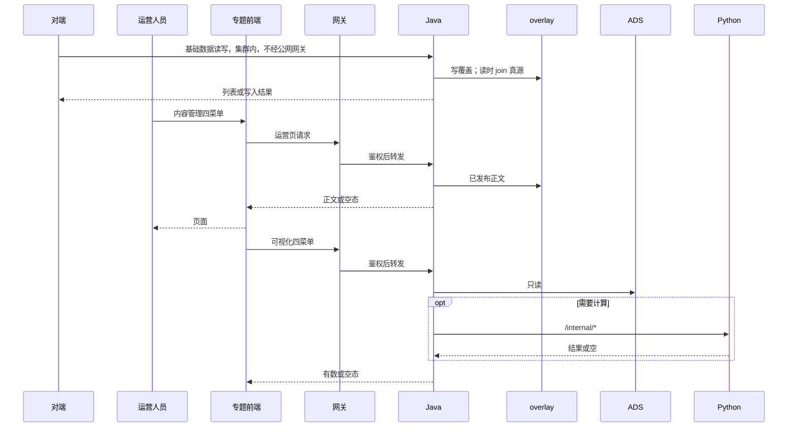
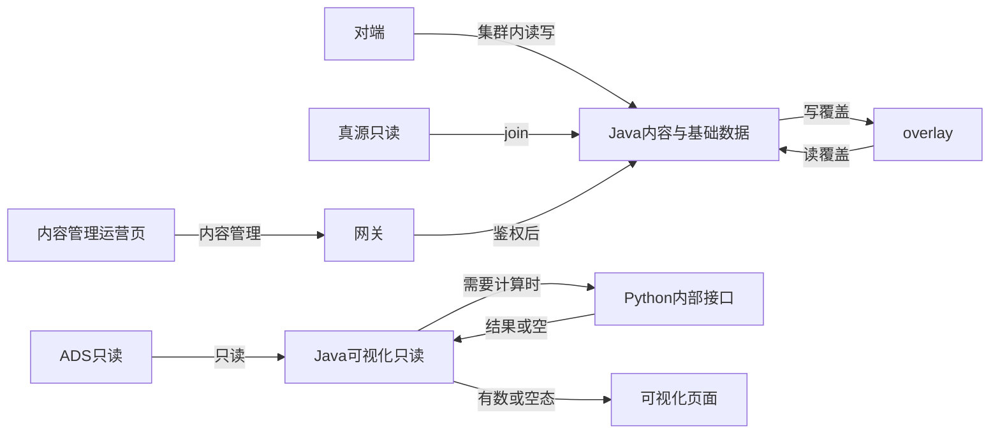

# 系统集成技术方案 · 专题系统集成

> **状态**：待签收 · 2026-10-22 · 签收操作人 `human:淮政玮`（尚未签收）  
> **任务**：`SYSINT-SCHEME-03-L01` · WBS-03-00  
> **开始时间**：无开始时间。**完成日期要求**：2026-11-05。这个日期是科技专题服务系统功能开发较晚的那一档，不是系统测试日，也不是上线日，也不是对端承诺。  
> **过程位置**：工程过程卷 03。读的规约是 [`系统集成整体过程规约.md`](../../../系统集成整体过程规约.md)（正式稿）。讨论稿未用作本章依据。  
> **范围**：本页不改 `scope-baseline`。不新建开发叶。已在注册表的基础数据叶保持原 ID、原 `depends_on`，不把本任务追进去。

CMS 规格书、门户 CMS 契约、overlay 增补只作输入。契约字段本文不改。回写单未签收前，本文不写新字段、不新造表名。

## 1. 背景、集成需求、对接系统说明

### 1.1 背景

第 3 项是第 2 项以外的专题系统集成。智树在报价范围内实现专题战略 4 要素（企业、产业链、产业服务机构、政策）及对应基础数据接口。科研机构、技术链、人才的深度分析在范围基线里是只分析，本项不把它们写成实现范围，归第 2 项。

2026-10-22 规约定稿把本项收成三块。内容管理、可视化管理的使用人是运维人员。第 4 项门户上的产业全景、专题服务、企业发展、政策扶持四页，使用人是最终普通用户。两批页面都保留。本方案不合并它们，也不删第 4 项过程夹里的页面行。

方案未签收前，内容管理和可视化不新建注册表开发叶。基础数据里已经在跑的叶不回退。

### 1.2 集成需求

1. **基础数据。** 产品链、企业、政策、产业服务机构。智树出接口，对端调用。技术链、科研机构、人才不在本块。同 epic `CMS-JX-INT` 里的专家知识、全要素图谱 overlay、门户回写不计入本块。
2. **内容管理四个菜单，一个整体模块。** 产业全景内容管理、专题服务内容管理、企业发展内容管理、政策扶持内容管理。页面、接口、数据由智树做。使用人是运维人员。做完后把菜单配到统一用户中心。
3. **可视化四个菜单。** 产业全景可视化、专题服务可视化、企业发展可视化、政策扶持可视化。前后端由智树做。使用人是运维人员。做完后同样配菜单。这四页不是第 4 项给普通用户看的那四页。`CMS-JX接口规格书` 里「可视化管理不在本期」不再作为本项分工依据。
4. **收口。** 上述八个菜单的相对路径和用户权限是 WBS-03-18。各开发叶以后仍要写清自己的相对路径。监管人是淮政玮（2026-10-22 纪要未点名，2026-10-23 指定）。八个菜单的相对路径仍还没有。

全链路开发叶等本方案被 `human:淮政玮` 签收之后再由 coordinator 另拆。本文不派编码。

### 1.3 对接系统说明

| 系统 | 在本项里的位置 | 材料 |
|---|---|---|
| 对端（基础数据调用方） | 调用已上线的集群内基础数据接口 | live 对接说明写适用方为久新 CMS。见 §6 |
| 专题前端 `lumen-ui-topic` | 运维人员使用的内容管理页、可视化页 | 正式仓。不走 `demo-ui-topic` |
| Java | 基础数据与 overlay 读写在 `gkxlumen-cms`。可视化读哪一个已有 Java 服务上的哪条路由：还没有 | 不新造服务名 |
| 网关 `gkxlumen-gateway` | 运营页、可视化页的浏览器入口。基础数据不注册 `/cms` 公网路由 | 见 §2 |
| overlay 业务库 | 基础数据写入落点 | 库名见 §3，以已送签收的 A5 / DDL 为准 |
| ADS | 可视化与指标的只读契约面 | Java 不写 ADS |
| Python | 需要计算时只走 `/internal/*` | `lumen-algo-py` 等 lumen 算法仓。Java 不写算法 |
| 统一用户中心 | 只登记菜单相对路径和用户权限 | 主机放 `baseurl`。见门户夹 2026-10-22 纪要 |
| 指标库 | 统计数字的口径真源 | 本文只消费，不新定义口径 |
| 第 4 项门户 | 普通用户四页及其读接口形状 | 只作边界。`/portal/v1/*` 不并进本维页面 |

任欢出现在四份门户契约里，写的是已发布正文的维护和读接口。live 文档写的对端是久新 CMS。任欢与久新是不是同一主体，本文不另作认定，记「还没有」。

现网另有新兴科技、科研力量、领军人才、产研报告、平台介绍等内容项，材料未标智树。不写入本项。

### 1.4 四个内容菜单与现网用词

收口结论：**还没有**。本稿和 WBS 继续用来稿用词。不把「产业概况」另开一叶，也不用别的维度的名字填空。

| 本稿 / WBS 用词 | 契约文件 | 现网（专题内容运营 · 门户内容管理） | 收口 |
|---|---|---|---|
| 产业全景内容管理 | `PORTAL-CMS-专题全景.md`（草案；文内写产业概况） | 产业全景内容管理（智树） | 还没有。产业全景 / 专题全景 / 产业概况未拍板 |
| 专题服务内容管理 | `PORTAL-CMS-专题服务.md`（草案） | 现网无同名项。相近项是产业服务内容管理（智树） | 还没有。专题服务 / 产业服务未拍板 |
| 企业发展内容管理 | `PORTAL-CMS-企业发展.md`（已确认） | 企业发展内容管理（智树） | 菜单用词一致。契约仍是门户读已发布内容，不是本维运营写接口的路径 |
| 政策扶持内容管理 | `PORTAL-CMS-政策扶持.md`（草案；写明不涉及 CMS） | 现网无同名项。相近项是政策新闻内容管理（智树） | 还没有。政策扶持 / 政策新闻未拍板 |

企业发展契约已确认，字段以该文件为准。专题全景、专题服务、政策扶持三份仍是草案，按草案引用，不改字段。

## 2. 应用对接技术架构、对接时序、实现方式

### 2.1 应用架构

调用链以 [`architecture-baseline.md`](../../../architecture-baseline.md) §1、§2 为准。本文不另画全局拓扑。

- 浏览器只打 lumen 前端。前端只打网关。网关到 Java。Java 需要计算时才 Feign Python `/internal/*`。前端不直连 Python、数据库、Nebula。Java 不写算法，不直连 nGQL，不写 ADS。
- **D12**：正式开发只在 `lumen-*`。`lumen-ui-topic` 只经 `gkxlumen-platform-gateway` 调 `gkxlumen-*`。Java 下游只调 `lumen-algo-py`、`lumen-etl-es-py`、`lumen-topic-py` 的 `/internal/*`。禁止打到 `demo-svc-platform`、`demo-platform-*`、`demo-algo-*`、`demo-svc-topic-py`。禁止把 demo 仓 merge 进 lumen。
- **D6**：浏览器侧鉴权、SSO、权限经网关统一。业务服务不各自做一套登录。
- 图数据库的空间切换不在本方案里写。

三条调用方向：

| 块 | 调用方向 | 鉴权 | 数据落点 |
|---|---|---|---|
| 基础数据 | 对端 → Java `gkxlumen-cms`（集群内）。网关不注册 `/cms`，无公网入口，不另开 Ingress | 每个请求带 `X-CMS-Api-Key`。写操作建议另带 `X-CMS-Operator`，缺省记为 `unknown`，只用于审计归属。凭证和 namespace 由对接通知另给，不进 git。namespace 的具体值：还没有 | 写业务库 `gkxlumenx_cms` 的 overlay。读时 join 真源。真源零写 |
| 内容管理四菜单 | 运维人员 → `lumen-ui-topic` → 网关 → Java → overlay | 浏览器请求走网关统一鉴权。八个菜单各自的角色名：还没有。不复用基础数据的 API Key 作为运营人员登录态 | 方向是已发布正文落 overlay。正文本体放任欢 `{cms_base}` 还是 `gkxlumenx_cms` 里的运营宽表：还没有。不新造表名 |
| 可视化四菜单 | 运维人员 → `lumen-ui-topic` → 网关 → Java → 只读 ADS；需要计算时 Java → Python `/internal/*` | 同网关统一鉴权。菜单角色名：还没有 | 只读 ADS。不把基础数据写接口当作页面接口。页面路由落在哪一个已有 Java 服务：还没有 |

基础数据的路径前缀是已上线的 `POST /api/open/cms/v1/*`，业务 id 在请求体里，不走路径。统一信封 `code` / `msg` / `data`。无效 Key 为 `40101`。不存在或已软删为 `40401`。列表无记录时 `code=0` 且 `records` 为空，本文不为对端界面另造文案。

内容管理、可视化的浏览器路径：还没有。不把 `/cms/v1` 注册到公网网关，也不把契约里的 `GET /portal/v1/...` 当成这两批运维页的路径。那些 `/portal/v1/*` 是第 4 项门户对浏览器的形状，契约写明该单不实现。

### 2.2 对接时序

> **diagram_id**：`SYSINT-SCHEME-03-SEQ`  
> **会签态**：draft（待 `human:淮政玮` 签收。本文不自填已通过）  
> 对端走集群内 Java，再到 overlay。运营人员的内容管理走专题前端、网关、Java、overlay。可视化走专题前端、网关、Java，再读 ADS；需要计算时才到 Python `/internal/*`。

2026-10-09 门户建议稿里的 wujie 嵌入，不是这四个可视化菜单的做法。该稿只作第 4 项的输入，本文不改那份稿。

### 2.3 实现方式

**基础数据。** 沿用已上线接口和已送签收的 overlay 边界。写侧只写 overlay 的字段级覆盖，删除是软删加审计。读侧是真源与 overlay 的 join，软删行不返回。政策列表 / 详情 / 下拉、企业基础档案仍是独立只读叶（WBS-03-16、03-17），不并进政策写侧叶、企业写侧叶。名单、TopN、全景包、名录、政策统计、失效通知等其余 backlog 不进本维 WBS。

**内容管理。** 智树在 `lumen-ui-topic` 做运维页，使用人是运维人员。这是 2026-10-22 规约的分工。A5 手稿里有一句「智树侧不直接面向运营人员」，该句没有被单独改写；本文不改 A5 原文，页面归属以较晚的规约为准。有 CMS 正文的菜单共用 WBS-03-15 的 Arco 控件和增删改查表单框架。政策扶持没有 CMS 字段，不做这套表单。字段形状：企业发展以已确认契约为准；其余三份以草案为准，确认前不改字段。只向下游给出 `publish_status=published` 的块。草稿、审核中不下发。统计数字不写进 HTML，Java 不把富文本解析成指标。

**可视化。** 智树做前后端。缺数为空态。不复用基础数据写侧任务当页面接口，也不复用内容管理运营页当这四页。四个可视化菜单各自展示哪些指标：还没有单独清单。本文不把内容契约或第 4 项门户页的指标行自动抄过来。

**菜单。** 统一用户中心只存相对路径。域名或 IP 配在 `baseurl`。已有菜单要把 `https://next.itic-sci.com/` 换成空字符串，例如 `/bs/xx/xx`。八个菜单各自的相对路径：还没有。用户中心登录地址和菜单 `baseurl` 要不要分成两处：纪要写了下次再对，书面结论还没有。纪要里的 `next.itic-sci.com` 与 2026-10-21 统一用户链路图里的 `edu.itic-sci.com` 不是同一个字符串。本条只约束菜单跳转地址，不改那张链路图。

## 3. 数据存储与流转

### 3.1 对接上的数据需求

| 数据 | 谁产生 | 谁读取 | 能否写进真源或 ADS |
|---|---|---|---|
| 企业、产品链、政策、服务机构的运营覆盖 | 对端经基础数据接口写入 | 同一批接口 join 后返回 | 真源零写。ADS 不写 |
| 已发布运营正文 | 运维人员经内容管理写入。物理落点还没有选边 | 内容页读取已发布块。第 4 项门户若读取，走契约里的另一条读接口，不并进本维 | 回写 DWD 的单未签收前不写新字段 |
| 可视化统计 | Python 按指标库已有口径写入 ADS。本文不新定义口径 | Java 只读 ADS，再给可视化页 | Java 不写 ADS |
| 产业资讯记录 | 不进 CMS | 契约草案写读 `dwd_industry_chain_news_info` | 客户决策清单 2026-08-25 记该表禁止业务使用。未解除则不上屏 |
| 政策时间线 | 政策主数据上的文件记录，不是运营富文本 | 政策扶持页只读 | 政策扶持不回写 DWD，不新造富文本 |

基础数据读侧按已送签收的 A5：只读账号读真源，与 overlay join。架构基线 D3 的一般规则仍是 Java 业务 API 读 ADS、不写 ADS。CMS 这条只读 join 以 A5 的已写边界为准。本文不改 D3，也不为此另画一张全局图。

### 3.2 数据流

> **diagram_id**：`SYSINT-SCHEME-03-FLOW`  
> **会签态**：draft  
> 图上有真源、overlay、ADS、可视化页面。回写 DWD 未签收，本图不画写入。基础数据的结果回到对端，不进可视化页面。

不需要计算时，可视化不调用 Python。overlay 行不倒灌成三方源。

### 3.3 加工与融合

- **基础数据。** 未覆盖的字段随真源透出。覆盖字段以 overlay 为准。虚拟实体只存在于 overlay。软删只把 overlay 的删除标记置上，不物理删除真源行。写 overlay 与写审计同一事务，失败一起回滚。
- **内容正文。** 门户契约按块描述已发布内容。企业发展的计算数字、大模型摘要、图谱边不进 CMS。专题全景草案里，节点和边不进 CMS，资讯不进 CMS。专题服务草案里，CMS 只有业务介绍一处，法定名称走主数据。政策扶持草案没有 CMS 字段。
- **指标。** 计算在 Python。Java 只读 ADS，经指标服务出口。缺口不手填，不用相邻指标顶替。口径、公式、`algorithm_type` 以指标库为准，本文不新写。
- **大模型摘要。** 企业发展契约：链上瓶颈解读、生态合作摘要由智树调用大模型生成，不进 CMS，不设 `star_ecosystem_note`。生成失败只隐藏文案，不补假节点。生成接口的路径：契约写明不展开，本文记还没有。
- **回写 DWD。** `PORTAL-CMS-DWD-WRITEBACK-L01` 仍是 blocked。企业、专题全景、专题服务三条定义单是 ready_to_sign。政策扶持定义单是 claimed，契约写明不回写。这些单未 `done`、架构师未允许写入之前，实现不落 DWD 新字段。本文不增列。

### 3.4 存储设计（相对原表要增加的字段）

本文增加的字段：**没有**。不新造表名。

已经写在送签收材料里、本文只引用、不改名的对象：

| 对象 | 出处 | 本文动作 |
|---|---|---|
| 业务库 `gkxlumenx_cms` | `CMS-JX-OVERLAY-A5-L01`（ready_to_sign） | 基础数据写入落这里。不入 DWD / ADS |
| `cms_entity_overlay`、`cms_op_audit` | 同上，DDL 单照此落库 | 不改列 |
| join 视图 `v_cms_ent`、`v_cms_pol`、`v_cms_svc`、`v_cms_prod` | `CMS-JX-OVERLAY-DDL-L01`（ready_to_sign） | 不另做一套库 |
| 运营内容宽表族 | A5 只写到「宽表族」，具体表名在 DDL 单 | 本文不另起表名 |
| 企业发展 12 个 `content_type` | 已确认契约与 WBS-03-01a | 不改字段。回写范围只按企业回写定义单 |
| 专题全景五个 `pano_*` | 草案与 WBS-03-02a | 草案确认前不改字段 |
| `svc_business_domain` | 专题服务草案与 WBS-03-03a | 草案确认前不改字段 |
| 政策扶持 | 草案写明无 CMS 字段 | 不新造富文本列 |

`content_id` 只作内容引用，不进 ADS 主键。企业绑定用契约里的 `enterprise_code`。产业码用已发布的正式码，CMS 不自造。图片和链接只传 URL，不传二进制。HTML 不允许脚本、内嵌框架、事件属性。对象存储若以后要收 CMS 图片，走架构基线 D14 已有目录；本文不新造桶，凭证不进 git。本项现在没有单独的上传接口说明，上传路径记还没有。

### 3.5 缺数时界面表现

| 场景 | 表现 |
|---|---|
| 基础数据列表没有记录 | 接口成功，`records` 为空。对端界面文案：还没有（对端界面不是智树做的） |
| 基础数据 id 不存在或已软删 | `40401` |
| 基础数据 Key 无效 | `40101`。不返回业务数据 |
| 基础数据 join 没有 overlay 行 | 按 A5：纯真源照常返回 |
| 基础数据真源查询失败或写失败 | 5xx。写失败不留下只改了一半的覆盖 |
| 内容正文未发布 | 按该模块契约的空态。企业发展用已确认文案（如「本产业明星企业待配置」「核心产品待完善」「内容服务暂不可用」）。专题全景、专题服务按草案：未发布块空态或隐藏介绍，不用大模型冒充已发布正文。CMS 超时只影响正文区，指标区照常 |
| 内容管理运营页若要一套和门户不同的空态文案 | 还没有 |
| 可视化缺数、指标缺口 | 空态。不手填，不用相邻指标顶替，不计假数 |
| 企业发展大模型摘要失败 | 只隐藏该段文案 |
| 产业资讯无记录，或 2026-08-25 禁止业务使用未解除 | 事件线为空。不从其他产业补，不用大模型生成 |
| 政策扶持没有 CMS | 不做运营后台空态。时间线有记录或为空。统计缺口为空态 |
| 入选标准未定稿（企业发展已确认契约） | 门户写「入选标准待配置」，企业展示仍保留 |

## 4. 对接涉及的指标

指标段只消费指标库。本文不新编 `metric_id`，不写口径定义、公式、`algorithm_type`，不改种子，不改就绪度。8 件套和 D1–D4 的真源是指标库。契约或 WBS 里出现的「D1 aligned」只是 2026-10-20 查询时写在契约里的句子，不是本方案宣布对齐完成。

`PORTAL-CMS-METRIC-COVER-L01` 于 2026-10-22 经任务查询仍是 **claimed**（`claimed_by` 为 `human:唐绍祖`，监管 `human:唐绍祖`）。该单未完成。四模块与指标库的逐条对齐：**还没有**。WBS-03-01b 写过「已对齐」的，是对契约句子的摘录；本文不把 claimed 写成已对齐。

实现方式：已有 ID 的统计数字走指标服务，计算在 Python，Java 只读 ADS。页面上的统计数字在实现叶里要能回到指标库的 `metric_id`。缺口保持空态。

### 4.1 基础数据接口

基础数据接口交付名单、档案和覆盖，不在接口里新算口径。这些接口与指标库的逐条对应：还没有。政策列表、企业档案是 WBS-03-16、03-17，不是新指标。

### 4.2 内容管理四菜单点名过的 ID

下表只列契约和 WBS 已经点名的 ID。缺 ID 的行保持缺口。建议名未入指标库的，本文不注册。

**企业发展**（已确认契约；COVER 企业段仍未完成）

| 契约点名的 ID | 本方案的对齐结论 | 缺项 |
|---|---|---|
| `M_ENT_TOTAL_COUNT`、`M_ENT_REGIONAL_COUNT`、`M_ENT_RESEARCHER_COUNT`、`M_ENT_KEY_NODE_COUNT`、`M_ENT_KEYPANO_QUAL_DISTRIBUTION`、`M_ENT_KEYPANO_DOMAIN_SUMMARY`、`M_ENT_KEY_TOTAL`、`M_ENT_STAR_ENTERPRISE_COUNT`、`M_ENT_RD_INVESTMENT_RATIO`、`M_ENT_SZ_COUNT` | 还没有。等 COVER 企业段做完 | 历年总数趋势、专利数、深圳历年趋势、领域个数、规模、上市数、国企数。契约写明 `M_ENT_NEW_COUNT_Y` 不能顶替总数趋势 |
| `M_ENT_FUTURE_INDUSTRY_COVERAGE_COUNT` | 还没有。契约写它不是上面的招标叶子 | 页面若展示，仍走指标服务 |
| 科学家/核心人才比例 | 不进指标库。契约定为 CMS 手填 | 不是缺口指标 |

科研人数仍挂 Q-E32-01。重点企业阈值仍挂 Q038。图谱边仍挂 Q040。照片与外链公开仍挂 Q041。明星名单准入仍挂 Q048。本文不拍板。

**专题全景**（草案；COVER 专题全景段仍未完成）

| 契约点名的 ID | 本方案的对齐结论 | 缺项 |
|---|---|---|
| `M_CHAIN_ENTERPRISE_COUNT`、`M_CHAIN_INSTITUTION_COUNT`、`M_CHAIN_NODE_COUNT`、`M_CHAIN_SZ_ENTERPRISE_COUNT`、`M_CHAIN_SZ_INSTITUTION_COUNT`、`M_CHAIN_GLOBAL_REGION_COUNT`、`M_CHAIN_NATIONAL_REGION_COUNT` | 还没有 | 深圳各区计数没有已注册 ID。节点简介、市场规模文案本轮不进 CMS，也不在本文新造字段 |

**专题服务**（草案；COVER 专题服务段仍未完成）

| 契约点名的 ID | 本方案的对齐结论 | 缺项 |
|---|---|---|
| `M_SVC_PT_GLOBAL_TOTAL`、`M_SVC_PT_GLOBAL_TYPE_DIST`、`M_SVC_PT_GLOBAL_SCALE_DIST`、`M_SVC_CHAIN_SEGMENT_ORG_COUNT`、`M_SVC_PT_REGION_ORG`、`M_SVC_ORG_TECH_SCORE`、`M_SVC_PT_SZ_TOTAL`、`M_SVC_PT_SZ_TYPE_DIST`、`M_SVC_PT_SZ_FIELD_DIST`、`M_SVC_PT_SZ_REGION_ORG`、`M_SVC_PT_KEYORG_SCALE` | 还没有。技术力权重仍是 Q-SVCCHAIN-01 | 全球数量历年趋势、深圳数量历年趋势没有单独 ID。没有单独的「前 30 名」ID，契约写按 `M_SVC_ORG_TECH_SCORE` 取前 30。名称、成立时间、领导人走主数据 |

**政策扶持**（草案；无 CMS；COVER 政策段仍未完成）

| 契约点名的 ID | 本方案的对齐结论 | 缺项 |
|---|---|---|
| `M_POLICY_INTENSITY_SCORE` | 还没有。契约写种子里有、就绪度矩阵未覆盖。没有单独的省级排名 ID、城市排名 ID | 全国、省、市的数量与连续性，发布密度，节点覆盖，深圳数量、趋势、各区、节点覆盖，都没有可用 ID。`M_POLICY_OPPORTUNITY_COUNT` 不顶替数量 |

### 4.3 可视化四菜单

与指标库是否对齐：还没有。四个菜单各自的指标清单：还没有。在清单出现之前，实现方式只写到：有计算就走 Python `/internal/*`，Java 只读 ADS，缺数为空态。

## 5. 分模块对接实现与本维 WBS

分组标题不是任务。下表每一行对上 WBS 里已经有的行。完成日期要求抄 WBS，是计划日期，不是对端承诺。`约定时点.md` 第一节双方约定仍为空。开始时间均为无开始时间。

已 `done` 的 `CMS-JX-INT-DESIGN-L01` 不占 WBS 行，只作设计输入。

### 5.1 方案与基础数据

| WBS | 子项与现有任务 | 监管人 | 前端 | 算法 | 数据加工 | 完成日期要求 |
|---|---|---|---|---|---|---|
| WBS-03-00 | 技术方案设计 `SYSINT-SCHEME-03-L01`。依赖：无。不把本行追进已开工基础数据叶 | 淮政玮 | 不新做页 | 不改算法 | 不新加列 | 2026-11-05 |
| WBS-03-09 | overlay 边界与落库。`CMS-JX-OVERLAY-A5-L01`、`CMS-JX-OVERLAY-DDL-L01`，均为 ready_to_sign。依赖保持注册表现状 | 徐滕强 | 无 | 无 | 独立业务库与读写边界。写侧继续依赖这份 DDL，不另做一套库 | 2026-11-05 |
| WBS-03-10 | 企业。写侧 `CMS-JX-ENT-CRUD-L01`、`CMS-JX-ENT-NEWS-L01`、`CMS-JX-ENT-SZ-L01`；只读 `CMS-JX-ENT-LIST-L01`、`CMS-JX-ENT-PRODUCT-L01`。WBS 记均为 integration。写侧依赖 DDL | 徐滕强（LIST、PRODUCT、CRUD）。NEWS、SZ：还没有，WBS 记注册表未返回 | 不在本叶做可视化页 | 无新算法 | 只加工 overlay 与已有只读 join | 2026-10-19 |
| WBS-03-11 | 产品链。写侧 `CMS-JX-PROD-CRUD-L01`、`CMS-JX-IND-CUSTOM-L01`、`CMS-JX-PROD-NEWS-L01`、`CMS-JX-PROD-SZ-L01`；只读 `CMS-JX-IND-TREE-L01`、`CMS-JX-IND-LINK-L01`。WBS 记均为 integration | 分类树、环节只读为徐滕强。四条写侧：还没有 | 不在本叶做可视化页 | 无新算法 | 同上。对端能读标准分类与环节，能写产品、自定义分类、产业资讯、区域名录 | 2026-10-19 |
| WBS-03-12 | 政策写侧 `CMS-JX-POL-CRUD-L01` 与已失效只读 `CMS-JX-POL-EXPIRED-L01`。WBS 记均为 integration。列表/详情不在本叶 | 已失效列表为徐滕强。写侧：还没有 | 无新页 | 无新算法 | overlay 与只读 join。不并进 WBS-03-16 | 2026-11-05 |
| WBS-03-13 | 产业服务机构。写侧 `CMS-JX-SVC-CRUD-L01`、`CMS-JX-SVC-NEWS-L01`、`CMS-JX-SVC-SZ-L01`；只读 `CMS-JX-SVC-LIST-L01`。WBS 记均为 integration | LIST、NEWS 为徐滕强。CRUD、SZ：还没有 | 不在本叶做可视化页 | 无新算法 | overlay 与只读 join | 2026-11-05 |
| WBS-03-14 | 跨对象批量只读 `CMS-JX-BULK-L01`（WBS 记 integration）。依赖保持注册表现状 | 徐滕强 | 无新页 | 无新算法 | 按一批实体取基础信息。不新加列 | 2026-11-05 |
| WBS-03-16 | 政策列表 / 详情 / 下拉 `CMS-JX-POL-LIST-L01`（WBS 记 backlog）。依赖保持 `CMS-JX-INT-DESIGN-L01`。不并进 WBS-03-12 | 淮政玮 | 无新页 | 无新算法 | 只读 DWD 政策真源。集群内暴露 | 2026-11-05 |
| WBS-03-17 | 企业基础档案 `CMS-JX-ENT-PROFILE-L01`（WBS 记 backlog）。依赖保持 `CMS-JX-ENT-LIST-L01`。2026-10-15 笔记写明顺延，本行仍计入 | 徐滕强 | 无新页 | 无新算法 | 按企业业务 ID 返回基础档案只读字段。不另开 Ingress | 2026-10-19 |

基础数据是接口，不单开菜单叶。用户权限不写进上面各叶。

### 5.2 内容管理

`PORTAL-CMS-FIELD-API-L01`（WBS 记 in_progress，监管淮政玮）是字段和读接口定义单，不是四菜单的全链路开发叶。定义单保持原 ID 和状态。本文不改它的依赖。

| WBS | 子项 | 监管人 | 前端 | 算法 | 数据加工 | 完成日期要求 |
|---|---|---|---|---|---|---|
| WBS-03-15 | CMS 公共控件选型、设计、开发；字段增删改查表单通用框架。依赖本方案。控件用仓内 Arco | 孔东 | `lumen-ui-topic`。企业、产业全景、专题服务的正文编辑套这个框架 | 无 | 不新加列。政策扶持不做出 CMS 表单 | 2026-11-05 |
| WBS-03-01a | 企业发展运营正文。12 个 `content_type` 见已确认契约。`overview` 无 CMS。依赖本方案与 WBS-03-15 | 徐滕强 | 运营页套通用表单。法定名称走主数据，别名标明非法定名 | 无 | 专利数和研发占比不写进 HTML。回写见 01d | 2026-10-19 |
| WBS-03-01b | 企业发展指标区块。依赖 COVER 企业段 | 徐滕强 | 指标页空态待 COVER 核对 | 计算在 `lumen-algo-py`。对齐还没有 | 缺口不手填进 CMS | 2026-10-19 |
| WBS-03-01c | 链上瓶颈解读、生态合作摘要。图谱边不从 CMS 画。边的正式口径仍是 Q040 | 徐滕强 | 生成失败只隐藏文案 | 大模型摘要。生成接口路径还没有 | 不设 `star_ecosystem_note`，不补假节点 | 2026-10-19 |
| WBS-03-01d | 已发布正文回写。定义单 `PORTAL-CMS-DWD-WRITEBACK-ENT-L01`（ready_to_sign）的 12 个 `content_type` | 徐滕强 | 无新页 | 指标、摘要、图谱边不回写 | 会签前不写 DWD。没有现成表的保持缺口，不新编表名 | 2026-10-19 |
| WBS-03-02a | 产业全景运营正文。五个 `pano_*`。节点简介和市场规模文案本轮不进 CMS。契约草案确认前不改字段 | 李伟 | 五块正文套 WBS-03-15。资讯不上 CMS | 无 | 正文不内嵌企业数 | 2026-10-19 |
| WBS-03-02b | 产业全景指标与图谱数字。依赖 COVER 专题全景段 | 李伟 | 区级缺口空态 | 专题全景段指标在 Python。节点和边不进 CMS | 读图不在本叶新做。对齐还没有 | 2026-10-19 |
| WBS-03-02c | 产业资讯。不进 CMS。读 `dwd_industry_chain_news_info`，按 `industry_code` 过滤 | 李伟 | 无记录则事件线为空 | 不用大模型生成 | 禁止业务使用未解除则不上屏 | 2026-10-19 |
| WBS-03-02d | 回写五个 `pano_*`。定义单 `PORTAL-CMS-DWD-WRITEBACK-CHAIN-L01`（ready_to_sign）。资讯表不用 CMS 覆盖 | 徐滕强（回写定义单）。页面仍归李伟 | 无新页 | 无 | 会签前不写 DWD。不改 2026-08-25 对资讯表的记录 | 2026-10-19 |
| WBS-03-03a | 专题服务运营正文。仅 `svc_business_domain.body_html`，绑定 `org_id` 与 `industry_id`。草案确认前不改字段 | 徐滕强 | 只编这一处 HTML，套通用表单 | 无 | 法定名称、领导人、名次、分数不进正文 | 2026-11-05 |
| WBS-03-03b | 专题服务指标与主数据。依赖 COVER 专题服务段。技术力权重仍是 Q-SVCCHAIN-01 | 徐滕强 | 已有 ID 走指标服务 | 计算在 Python。对齐还没有 | CMS 不另维护重点名单，不覆盖法定名称 | 2026-11-05 |
| WBS-03-03c | 回写 `svc_business_domain`。定义单 `PORTAL-CMS-DWD-WRITEBACK-SVC-L01`（ready_to_sign） | 徐滕强（回写定义单）。页面仍归侯佳伟 | 无新页 | 数量、类型、规模、区域、技术力、重点名单不回写 | 会签前不写 DWD | 2026-11-05 |
| WBS-03-04a | 确认无 CMS、无正文读接口、不回写 DWD。定义单 `PORTAL-CMS-DWD-WRITEBACK-POL-L01`（claimed） | 淮政玮 | 不另做内容管理后台 | 无 | 不新造政策富文本 | 2026-11-05 |
| WBS-03-04b | 政策指标页。力度排名用 `M_POLICY_INTENSITY_SCORE`。依赖 COVER 政策段 | 淮政玮 | 有 ID 的走指标服务。缺口空态 | 数量类保持缺口。对齐还没有 | CMS 不填名次和分数 | 2026-11-05 |
| WBS-03-04c | 最新政策与深圳最新政策。字段沿用草案：`policy_id`、`title`、`publish_time`、`region_name`、`source_url` | 淮政玮 | 时间线有记录或为空 | 无新算法 | 只读政策主数据。不重做 WBS-03-12，也不把 WBS-03-16 并进本叶 | 2026-11-05 |

菜单相对路径进统一用户中心，写在各内容叶的完成条件里，注册动作在 WBS-03-18。

### 5.3 可视化与菜单收口

可视化使用人是运维人员。依赖本方案。不复用基础数据写侧，也不复用 WBS-03-01 的运营页。

| WBS | 子项 | 监管人 | 前端 | 算法 | 数据加工 | 完成日期要求 |
|---|---|---|---|---|---|---|
| WBS-03-05 | 企业发展可视化（前后端） | 徐滕强 | `lumen-ui-topic` 全页。缺数为空态 | 需要计算的区块走 `/internal/*`。本页指标清单还没有 | 读 ADS | 2026-10-19 |
| WBS-03-06 | 产业全景可视化（前后端） | 李伟 | 同上 | 同上。读图主路径不在内容叶里新做 | 读 ADS | 2026-10-19 |
| WBS-03-07 | 专题服务可视化（前后端） | 黄敬洲 | 同上 | 同上 | 读 ADS | 2026-11-05 |
| WBS-03-08 | 政策扶持可视化（前后端） | 淮政玮 | 同上 | 同上 | 读 ADS | 2026-11-05 |
| WBS-03-18 | 八个菜单的注册与用户权限。依赖本方案。各菜单叶负责自己的相对路径 | 淮政玮。2026-10-22 纪要未点名，2026-10-23 指定 | 不新做页。业务仓不写主机名 | 无 | 无。地址只写相对路径，不写 `https://next.itic-sci.com/`。路径字符串仍还没有 | 2026-11-05 |

八个菜单现在的相对路径：还没有。八个菜单的用户权限名单：还没有。

## 6. 对接七问

### 6.1 调用方向

- 基础数据：对端 → Java `gkxlumen-cms`（集群内，不经公网网关）→ overlay。读时 join 真源。
- 内容管理：运维人员 → `lumen-ui-topic` → 网关 → Java → overlay。浏览器路径还没有。
- 可视化：运维人员 → `lumen-ui-topic` → 网关 → Java → 只读 ADS；需要计算时 → Python `/internal/*`。页面路由还没有。
- 菜单：统一用户中心只存相对路径，主机在 `baseurl`。

### 6.2 鉴权

- 基础数据：`X-CMS-Api-Key`。写操作建议 `X-CMS-Operator`。凭证不进 git。namespace：还没有。
- 运营页与可视化页：网关统一鉴权。八个菜单的角色：还没有。
- 企业发展契约里的任欢读接口：服务凭证名待联调，不复用门户用户登录态。那是第 4 项读已发布内容的句子，不改写成运维登录。

### 6.3 数据落点

- 基础数据写入：`gkxlumenx_cms`。真源零写，ADS 不写。
- 四个内容菜单的正文本体：还没有在「任欢 `{cms_base}`」和「同一业务库运营宽表」之间选边。
- 可视化：只读 ADS。
- DWD 回写：总单 blocked，分单未签收。签收前不写新字段。

### 6.4 缺数时界面表现

见 §3.5。可视化与指标缺口为空态。基础数据对端界面文案还没有。运营页专用空态若与契约文案不同：还没有。

### 6.5 智树不做的部分

- 技术链、科研机构、人才的基础数据接口（第 2 项；范围基线里这三维深度只分析）。
- 专家知识、全要素图谱 overlay。
- 第 4 项门户上给普通用户看的四页。本项不合并、不删除那些页。
- 把四个可视化菜单的前端交给久新做。前后端都由智树做。
- 现网未标智树的新兴科技、科研力量、领军人才、产研报告、平台介绍。
- 对方系统的后台，以及对方基础数据界面上的文案。
- 政策扶持的 CMS 表单、政策富文本、政策 DWD 回写。
- Java 里的算法、nGQL、写 ADS、写真源。
- 把 overlay 倒灌成三方源。
- 图空间切换。
- 在过程夹里改范围基线。
- 八个菜单的相对路径和用户权限名单。监管人已指定为淮政玮。路径仍还没有。
- 拍板产业全景 / 专题全景 / 产业概况、专题服务 / 产业服务、政策扶持 / 政策新闻。记还没有。

### 6.6 我方对接文档清单

正式发出目录 [`对接文档/我方/`](./对接文档/我方/README.md) 的索引：**还没有**。下面是调查输入，签收前不视为已经发给对端的定稿。收口由 PM 做，本文不把它们改名为已发出。

| 文档 | 状态 |
|---|---|
| [`PORTAL-CMS-字段与读接口契约.md`](../../../agent-handoffs/平台基建-PLATFORM/产物/PORTAL-CMS-字段与读接口契约.md) | 索引。企业发展已确认，其余三份草案 |
| [`PORTAL-CMS-企业发展.md`](../../../agent-handoffs/平台基建-PLATFORM/产物/PORTAL-CMS-企业发展.md) | 已确认。本文不改字段 |
| [`PORTAL-CMS-专题全景.md`](../../../agent-handoffs/平台基建-PLATFORM/产物/PORTAL-CMS-专题全景.md) | 草案 |
| [`PORTAL-CMS-专题服务.md`](../../../agent-handoffs/平台基建-PLATFORM/产物/PORTAL-CMS-专题服务.md) | 草案 |
| [`PORTAL-CMS-政策扶持.md`](../../../agent-handoffs/平台基建-PLATFORM/产物/PORTAL-CMS-政策扶持.md) | 草案。写明不涉及 CMS |
| [`CMS-JX-接口文档-live-久新对接.md`](../../02-策划与监控/01-总集大项目整体计划/07-内容运营中心接口需求评估/CMS-JX-接口文档-live-久新对接.md) | 我方整理的已上线基础数据说明。未收口进本维发出目录 |
| [`CMS-JX接口规格书.md`](../../02-策划与监控/01-总集大项目整体计划/07-内容运营中心接口需求评估/CMS-JX接口规格书.md) | 输入。其中「可视化不在本期」不再作为本项分工依据 |
| [`CMS接口需求评估与智树实现方案.md`](../../02-策划与监控/01-总集大项目整体计划/07-内容运营中心接口需求评估/CMS接口需求评估与智树实现方案.md) | 评估稿 |
| [`内容运营中心_智树接口需求20261008-评估.md`](../../02-策划与监控/01-总集大项目整体计划/07-内容运营中心接口需求评估/内容运营中心_智树接口需求20261008-评估.md) | 对 20261008 需求的评估 |
| [`企业智能搜索接口文档-久新CMS对接.md`](../../02-策划与监控/01-总集大项目整体计划/07-内容运营中心接口需求评估/企业智能搜索接口文档-久新CMS对接.md) | 企业搜索对接说明 |
| `CMS-JX-OVERLAY-A5-L01`、`CMS-JX-OVERLAY-DDL-L01` 的 handoff | 内部落库边界，ready_to_sign。不是对端发出件 |
| 本文、[`WBS.md`](./WBS.md)、[2026-10-22 菜单纪要](../04-门户系统集成/纪要/2026-10-22-统一用户中心菜单配置.md) | 过程稿。本文待签收 |

### 6.7 对端对接文档清单

[`对接文档/对端/`](./对接文档/对端/README.md) 的索引为空。对端发来的原文：**还没有**。监管人不往该目录放文件。未到的数据结构、连接信息、对端口径说明，不写成已确认。连接信息若以后由 PM 落盘，密码不进 git。
