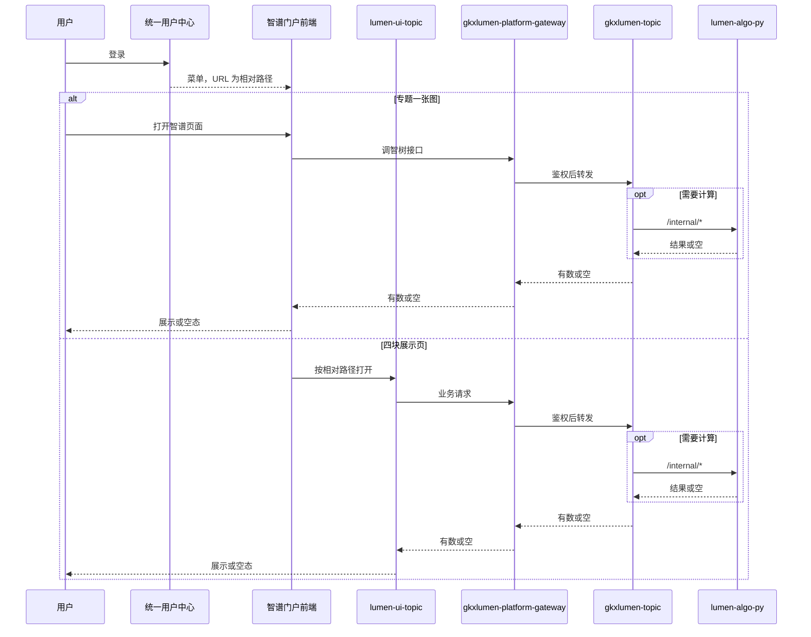
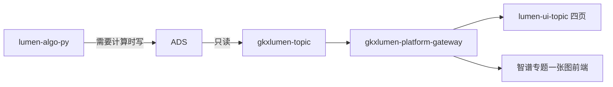

# 系统集成技术方案 · 门户系统集成

> **状态**：待签收 · 2026-10-22 送 `SYSINT-SCHEME-04-L01` · 签收操作人 `human:淮政玮`  
> **WBS**：WBS-04-00  
> **过程位置**：工程过程卷 03。五段对齐《系统集成整体过程规约》§6。  
> **读过的规约**：`agent-delivery/系统集成整体过程规约.md`（v1.0，2026-10-22 定稿）§2 第 4 项、§6、§7、§13。本章不依据讨论稿。  
> **不改范围**：`scope-baseline.md` 保持原样。  
> **输入，签收前不是已定方案**：2026-10-09《科技专题服务系统与门户系统集成方案》（wujie 建议稿）。本章不按该稿定稿，不按它派编码。

全局拓扑只认 `architecture-baseline.md` §1 `ARCH-TOPO-LUMEN`。下面两张图只描述本维这一跳，不另画一套全局图。

| 图 | 层 | 会签 |
|---|---|---|
| `SYSINT-SCHEME-04-SEQ` | L4 时序 | `draft`。淮政玮签收本方案前不标 approved |
| `SYSINT-SCHEME-04-FLOW` | 本维数据流 | `draft`。不替代各域已签 L2（`ENT-STORAGE-FLOW` / `CHAIN-STORAGE-FLOW` / `SVC-STORAGE-FLOW` / `POLICY-STORAGE-FLOW`） |

## 1. 背景、集成需求、对接系统说明

### 1.1 背景

门户上要出现专题能力。分工以 2026-10-22 定稿的规约 §2 第 4 项和本维 WBS 为准：

| 能力 | 使用人 | 前端 | 后台 | 监管人 |
|---|---|---|---|---|
| 「专题一张图」 | 最终普通用户 | 智谱。页面不进智树仓 | 智树接口 | 淮政玮 |
| 产业全景、专题服务、企业发展、政策扶持 | 最终普通用户 | 智树 | 智树 | 见 §5。产业全景李伟；专题服务徐滕强；企业发展孔东（2026-10-24 由徐滕强改）；政策扶持淮政玮 |

2026-10-22 晚拍板：这四页与第 3 项内容管理、可视化管理不是同一批。第 3 项给运维人员用。两边的 WBS 行都保留，不因菜单同名合并，也不删任一侧。第 3 项方案在 `工程过程/04-系统集成/03-专题系统集成/技术方案.md`，本文件不改那一夹。

`scope-baseline.md` §0.2 把「门户」整系统列为智树不实现的招标周边。本方案不改该文件，也不把门户产品改成智树交付。智树在本维只做：一张图的后台接口，以及上表四页的前端和后端。门户壳、统一用户中心产品本身，智树不做。

### 1.2 集成需求

需规来源：`bid-reference/srs/01-智慧服务门户系统/集群服务/科技专题服务.md`。功能正文以该需规为准。本方案不改写口径，不把需规句子登记成新的 `metric_id`。

需规四级菜单写的是「专题全景」。本维 WBS 用的页面名是「产业全景」。名称对照还没有另做一张已签收的对照表。下文按 WBS 用名，并在括号里标需规序号，避免和运维菜单混成一页。

| WBS | 页面 | 需规序号（只作追溯） | 本维要做到的集成结果 |
|---|---|---|---|
| WBS-04-01 | 专题一张图 | 99 专题产业相关统计；100 专题产业相关指标；101 地图分析工具 | 智谱页面能调到智树接口。无数时为空态。智树不交这个页面 |
| WBS-04-02 | 产业全景 | 69 产业链全景；70 产业资讯；71 产业整体概况 | 普通用户从门户菜单按相对路径打开智树页面。无数时为空态 |
| WBS-04-03 | 专题服务 | 88 全球服务机构概况；89 服务机构产业分布；90 服务机构区域分布；91 服务机构技术能力；92 深圳产业服务介绍 | 同上 |
| WBS-04-04 | 企业发展 | 75 企业整体概况；76 重点企业全景图；77 明星企业介绍；78 深圳企业介绍 | 同上 |
| WBS-04-05 | 政策扶持 | 93 政策概况统计；94 政策地图；95 政策产业覆盖；96 政策力度排名；97 最新政策动态；98 深圳政策对比 | 同上 |

不进本维：第 3 项四个内容管理菜单和四个可视化菜单；需规里有、WBS 未点名的科技前沿、科研力量、领军人才、研究报告、平台介绍。全文检索也未进本维 WBS，还没有纳入。

序号 99 的需规文字含技术指标、人才指标、科研指标。`scope-baseline.md` §0.2 与规约第 2 项写明：科研机构、技术链、人才的深度分析可分析、不作为智树实现交付。本方案不把这三句改成智树实现范围。一张图后台只对「已经落在智树实现范围内、并且指标库能对上」的数出接口。对不上的，接口给空，页面空态。哪些句子落在实现范围内，还没有逐条划完。

### 1.3 对接系统

| 系统 | 本维角色 | 谁负责该系统本身 |
|---|---|---|
| 智谱门户 | 壳；展示菜单；承载「专题一张图」前端 | 智谱。智树不做门户壳，不做该页前端 |
| 统一用户中心 | 登录，以及按相对路径登记菜单和用户权限 | 既有产品。智树不做这个产品 |
| `lumen-ui-topic` | 四页前端。仓是 WBS 建议，建叶时由该行监管人确定 | 智树 |
| `gkxlumen-platform-gateway` | 鉴权与转发。`architecture-baseline.md` §1 图内简写作 `gkxlumen-gateway`，是同一网关 | 智树。本方案不另起网关 |
| `gkxlumen-topic` | 只读 ADS，向两路前端出数 | 智树。Java 不写算法 |
| `lumen-algo-py` | 需要计算时走 `/internal/*` | 智树。WBS-04-01 点名该仓 |
| ADS | 业务数的落点 | 智树数据面。门户不另建业务库 |
| `gkxlumen-metrics` | 指标身份证只读消费（`/metrics/v1/catalog`） | 智树。本方案不新定义口径 |

`lumen-etl-es-py`、`lumen-topic-py` 在架构上可以承接别的 `/internal/*`。本维要不要打到这两处，还没有。禁止打到任何 `demo-*` 服务（D12）。

总集是否指定统一集成框架（wujie、qiankun、iframe 或其他）：还没有书面要求。2026-10-09 建议稿推荐 wujie，只作输入。

### 1.4 菜单地址与两个主机名

2026-10-22 纪要《统一用户中心菜单配置》约束的是菜单跳转，不是登录主机：

- 菜单里不写主机名。例子 `https://next.itic-sci.com/bs/xx/xx` 改成 `/bs/xx/xx`。`/bs/xx/xx` 只说明改写规则，不是这五页已经确认的路径。
- 主机配在 `baseurl`。纪要记录的临时入口是 `http://183.62.232.63/`。域名还会变。变主机时只改 `baseurl`。
- 五页各自的相对路径还没有。10-09 建议稿里的 `/industry-center/overview`、`/enterprise-center/overview`、`/policy-portal/overview`、`/service-portal` 不采用为已确认路径。

登录主机另见 `agent-handoffs/门户集成-PORTAL/统一用户链路图.md`（2026-10-21）：用户中心 `https://edu.itic-sci.com/uc`，门户登录页在该链路图里写的是 `edu.itic-sci.com`。这和菜单 `baseurl` 不是同一个字符串。本方案不把二者合成一个域名，也不改那张链路图。

配菜单的人：2026-10-22 纪要未点名。还没有。

登录地址和菜单 `baseurl` 是否必须分成两处：纪要写明本夹没有这场会对齐的书面结论。还没有。

## 2. 应用对接技术架构、对接时序、实现方式

### 2.1 调用方向

与 `architecture-baseline.md` 调用链一致：前端不直连 Python、ADS、Nebula；Java 不写算法、不直连 nGQL；只读 ADS。门户后端不代理智树这组 API。

1. **专题一张图**：用户从统一用户中心的相对路径进入智谱前端。智谱前端请求 `gkxlumen-platform-gateway`，网关转到 `gkxlumen-topic`。需要计算时，Java 再调 `lumen-algo-py` 的 `/internal/*`。结果回到智谱页面。智谱前端不直连 Python。
2. **四页**：用户从同一套菜单的相对路径打开 `lumen-ui-topic` 上的智树页面。页面请求同一网关、同一 Java。需要计算时同样只走 `/internal/*`。这四页不是第 3 项运维可视化页，不走第 3 项的 overlay 写入。

```yaml
diagram_id: SYSINT-SCHEME-04-SEQ
layer: L4
signoff_status: draft
```



登录换票的逐步时序在 2026-10-21 链路图里，不在本图重画，避免把 `edu.itic-sci.com` 和菜单 `baseurl` 画成同一个节点。本图的「登录」只表示：用户先有统一用户中心的登录结果，再拿相对路径菜单。

| 生产者 | 消费者 | 触发 | 失败语义 | 禁止事项 |
|---|---|---|---|---|
| 统一用户中心 | 智谱门户 | 用户登录后取菜单 | 菜单未登记则该入口不可见。不临时拼一个主机名 | 菜单 URL 不写主机名。不把 `edu.itic-sci.com` 写成 `baseurl` |
| 智谱门户前端 | `gkxlumen-platform-gateway` | 打开专题一张图 | 网关或 Java 无数据：页面空态。不允许改去直连 Python 补数 | 智树不做该页前端。门户后端不代理这组 API |
| `lumen-ui-topic` | `gkxlumen-platform-gateway` | 打开四页 | 同上，空态 | 不按 wujie 施工。不打 `demo-*`。不打开第 3 项运维页来顶替 |
| `gkxlumen-topic` | `lumen-algo-py` | 这一响需要计算 | Python 返回空则页面空态，不伪造数 | Java 不写算法，不写 ADS，不直连 nGQL |
| `gkxlumen-topic` | ADS | 在线只读 | 读不到则空态 | Java 不扫 ODS/DWD。门户不另建业务库 |

### 2.2 鉴权

写死的部分：

- 业务请求的鉴权在 `gkxlumen-platform-gateway`。业务服务不各自做一套登录（架构基线 D6）。
- 密钥只留在后端。本方案不记录口令、`client_secret` 或连接串。
- 2026-10-21 链路图已记录：子系统用门户写入的访问令牌访问 lumen 后端，后端向用户中心核验。该图的登录主机是 `edu.itic-sci.com`。Cookie 域在该图中写成 `.edu.itic-sci.com`。

还没有的部分：

- 该 Cookie 域能否覆盖菜单 `baseurl` 所在主机：还没有。
- 五页在统一用户中心里的权限点名称、角色和授权名单：还没有。WBS-04-06 只要求「对应用户登录后能进」。配菜单的人还没有。
- 总集统一集成框架若要求另一套传票方式：还没有书面要求，本章不预选 wujie props。

### 2.3 实现方式

- 四页是智树全页，由门户菜单按相对路径打开。不是把智树页面嵌成 wujie 子应用，也不是让智谱重做这四页。
- 专题一张图是智谱页面调智树接口。智树不替智谱做该页，也不把该页放进 `lumen-ui-topic` 来交差。
- 缺数、对端未承诺、指标未对齐：界面空态。不把空数做成已发布口径，不伪造数值。
- 空态的逐页文案和组件稿：还没有。
- 智树四页上若出现统计数字，ⓘ 与角标只消费指标库（`data-lineage-policy.md`），不在本方案写口径。智谱那一页的界面由智谱做，智树不替画。
- 开发叶在本方案被签收（`done`）之前不建。本章不派编码。

## 3. 数据存储与流转

### 3.1 对接的数据需求

两路页面要的业务数都从智树已有数据面读出：Java 只读 ADS。门户不复制一套业务库，不在门户侧再融合一次。

可以与第 3 项可视化读同一套 ADS。页面不是同一页。第 3 项内容管理的 overlay 写入不进本维数据流。

具体 ADS 表名、列名：还没有在本维列出。与可视化同页的字段只在第 3 项技术方案里写一次。本方案不复制那份字段表，也不为门户新造列。

### 3.2 数据流

```yaml
diagram_id: SYSINT-SCHEME-04-FLOW
layer: 本维数据流
signoff_status: draft
```



| 生产者 | 消费者 | 触发 | 失败语义 | 禁止事项 |
|---|---|---|---|---|
| `lumen-algo-py` | ADS | 需要计算时写入 | 写不出则 Java 读到空，页面空态。不把半成品标成已发布口径 | 不对前端暴露 `/internal/*`。不写门户库 |
| ADS | `gkxlumen-topic` | 在线只读 | 无行则空态 | Java 不写 ADS，不扫 ODS/DWD |
| `gkxlumen-topic` | 网关，再至两路前端 | 页面请求 | 无数据原样空态 | 不经门户后端转发。不把数写入智谱库 |
| — | — | — | — | 不新造桶或顶层目录（D14）。不画 `demo-*`。不画第 3 项 overlay |

对象存储沿用架构基线 §2.1 已有目录。本维不新增桶、不新增目录。四页或一张图是否要读已有对象，还没有逐页确认。前端不直连对象存储。

### 3.3 加工与融合

- 加工在 Python，经 `/internal/*`，结果落 ADS。Java 只读。
- 不在门户侧做第二次加工，也不把四页和运维可视化并成一次融合。
- 一张图若需规句子超出智树实现范围（§1.2 的技术、人才、科研深度分析），不在这里新做一条加工链来补齐。该数为空态。
- 批处理、刷新频率、由哪条已有 ETL 供数：还没有按本维五页逐条写明。频率以指标库已登记的 `update_freq` 为准；库里没有的，还没有，不在本章新填。

### 3.4 存储设计（相对原表要增加的字段）

还没有为门户单独增加的字段。本章不新增列。

与第 3 项可视化同页的字段，只在第 3 项技术方案写一次。第 3 项文稿仍未签收时，本维仍然不新造字段，也不把契约草案抄进来当本维存储设计。

## 4. 对接涉及的指标

指标只消费指标库。登记和口径在 `cfg_metric` 与 `gkxlumen-metrics` 的 `/metrics/v1/catalog`。本章不新定义口径，不新编 `metric_id`，不把 D1–D4 写成 8 件套字段，也不把未对齐的数标成已对齐。

同一业务口径只登记一次。四页和一张图若用到已有指标，引用已有 `metric_id`，不因「门户上又显示一次」另起一条。哪些 ID 被哪一页引用：还没有做完逐条对齐。

| 范围 | 实现方式 | 与指标库是否对齐 | 缺项 |
|---|---|---|---|
| 专题一张图（序号 99–101） | 智树接口出数。计算在 Python。未对上的格子空态。智谱只展示，不在智谱侧另算一套口径 | 还没有 | 还没有逐条 `metric_id`。技术、人才、科研句子与第 2 项边界还没有划完。未划完的不出已发布数 |
| 四块展示页（WBS-04-02～05） | 智树页面读 Java。计算可走与可视化相同的 `/internal/*`，页面不合并。统计数字的 ⓘ 只读 catalog | 还没有 | 还没有逐条 `metric_id`。不在本章列出契约草案里的指标行 |
| 第 3 项侧的核对任务 | `PORTAL-CMS-METRIC-COVER-L01` 在 2026-10-22 查询时为 `claimed`（epic `CMS-JX-INT`）。它核对的是第 3 项四模块契约，不替代本维对齐，也不等于本维四页已对齐 | 该任务自己的对齐未完成 | 未完成前，本维不把其中任何一行写成已发布口径 |

缺数时的界面：空态。D3 为 `none` 的指标不伪造数值。空态文案还没有。未对齐的数字不上门户页充当已发布口径。

## 5. 分模块实现、本维 WBS、前端、算法、数据加工

方案未 `done` 之前不建开发叶。下表是 WBS-04-00～04-06 的实现说明，不是派单。仓是建议，建叶时由该行监管人确定。开始时间与完成日期要求以 [WBS.md](./WBS.md) 为准。完成日期要求是 2026-11-10。这两列是我方记录，不是对端承诺。

`约定时点.md` 第二节有智树内部需要日「专题 V2.0 出门日 2026-11-05 前后」。那不是本维完成日期要求，也不是对端承诺。第一节双方约定时点仍为空。

| 模块 | WBS | 前端 | 算法 | 数据加工 | 可对端时看到什么 |
|---|---|---|---|---|---|
| 方案本身 | WBS-04-00。监管人淮政玮。仓 `gkx-orchestration`。开始 2026-10-22。完成日期要求 2026-11-10 | 不改门户代码，不改业务仓 | 无 | 无。已写明与运维四页不是同一批 | 本文件五段可签收 |
| 专题一张图后台接口 | WBS-04-01。监管人淮政玮。专题 Java 与 `lumen-algo-py`。前端在智谱门户，不进智树仓。开始时间还没有（WBS 记为未记录）。完成日期要求 2026-11-10 | 智谱做。智树不交这个页面 | 需要计算时在 `lumen-algo-py` 的 `/internal/*`。Java 不算。清单未对齐前可空态 | 读 ADS。不新建门户库。超出智树实现范围的句子不新做加工 | 智谱页面能调到智树接口；缺数为空态 |
| 产业全景展示页 | WBS-04-02。监管人李伟。建议仓 `lumen-ui-topic`、专题 Java。开始时间还没有。完成日期要求 2026-11-10 | 智树做普通用户全页。不是 WBS-03-06 | 可走与可视化相同的 `/internal/*`。页面不合并。逐条算法还没有 | 读 ADS，不第二次加工。字段不在本维新造 | 门户菜单按相对路径打开即智树页面；缺数为空态 |
| 专题服务展示页 | WBS-04-03。监管人徐滕强（2026-10-23 由侯佳伟改）。仓同上。开始时间还没有。完成日期要求 2026-11-10 | 同上。不是 WBS-03-07 | 同上 | 同上 | 同上 |
| 企业发展展示页 | WBS-04-04。监管人孔东（2026-10-24 由徐滕强改）。仓同上。开始时间还没有。完成日期要求 2026-11-10 | 同上。不是 WBS-03-05 | 同上 | 同上 | 同上 |
| 政策扶持展示页 | WBS-04-05。监管人淮政玮。仓同上。开始时间还没有。完成日期要求 2026-11-10 | 同上。不是 WBS-03-08 | 同上 | 同上 | 同上 |
| 菜单注册与用户权限 | WBS-04-06。监管人还没有（纪要未点名，WBS 写待指定）。统一用户中心配置，业务仓不写主机名。依赖方案任务，以及各页自己的相对路径。开始时间还没有。完成日期要求 2026-11-10 | 不新做页。把相对路径配进统一用户中心 | 无 | 无 | 这些菜单以相对路径可见，对应用户登录后能进。智树不做统一用户中心产品 |

各页相对路径由该页叶子负责。路径字符串还没有，所以 WBS-04-06 在方案签收后仍要等路径，不能先用 10-09 建议稿里的路径顶上。

### 5.1 智树不做

- 智谱门户壳，以及「专题一张图」的前端。
- 统一用户中心产品本身。菜单只按相对路径去登记。
- wujie 或其他微前端改造。总集框架还没有书面要求。
- 第 3 项内容管理、可视化管理（运维人员使用的那一批）。
- 未进本维 WBS 的需规菜单：科技前沿、科研力量、领军人才、研究报告、平台介绍、全文检索。
- 科研机构、技术链、人才的深度分析实现（第 2 项；scope §0.2）。
- 门户业务库、门户专用新字段、新的对象存储桶或目录。
- 把 `edu.itic-sci.com` 和菜单 `baseurl` 合成一个域名。
- 在本方案签收前建立开发叶。

### 5.2 对接文档清单

我方正式发出件：还没有。`对接文档/我方/` 索引为空。签收前下面这些只是输入，不是已发出的对接文档：

| 输入 | 路径 | 在本方案里的用法 |
|---|---|---|
| 本技术方案 | 本文件 | 送签收的五段方案 |
| 2026-10-09 建议稿 | `工程过程/02-策划与监控/01-总集大项目整体计划/08-门户集成方案/科技专题服务系统与门户系统集成方案.md` | 只作输入，不按它定稿 |
| 门户需规叶子 | `bid-reference/srs/01-智慧服务门户系统/集群服务/科技专题服务.md` | 集成需求追溯。不是接口契约 |
| 2026-10-22 菜单纪要 | `纪要/2026-10-22-统一用户中心菜单配置.md` | 相对路径规则。不提供五页正式路径 |
| 2026-10-21 统一用户链路图 | `agent-handoffs/门户集成-PORTAL/统一用户链路图.md` | 只说明登录主机。不并入菜单 `baseurl` |

对端对接文档：还没有。`对接文档/对端/` 索引为空。智谱或总集尚未把接口、环境或验收原文落进该目录。需规不是对端发出的对接文档。

### 5.3 签收核对

下列各项已写进上面五段。标「还没有」的，签收时按还没有理解，不用别的维度补上。

| 要能答出的问题 | 本章结论 |
|---|---|
| 调用方向 | 见 §2.1 与 `SYSINT-SCHEME-04-SEQ`：两路都经 `gkxlumen-platform-gateway` 到 `gkxlumen-topic`，需要计算时才到 `lumen-algo-py` 的 `/internal/*` |
| 鉴权 | 经网关。登录主机与菜单 `baseurl` 不是同一个字符串。Cookie 域能否覆盖 `baseurl` 所在主机：还没有 |
| 数据落点 | ADS。Java 只读。门户不另建业务库。门户专用新字段：还没有，本章不新造 |
| 缺数时界面 | 空态。不伪造已发布口径。逐页文案：还没有 |
| 智树不做 | 见 §5.1 |
| 我方对接文档 | 正式发出件还没有。输入清单见 §5.2 |
| 对端对接文档 | 还没有 |
| 统一集成框架 | 还没有书面要求 |
| 与指标库逐条对齐 | 一张图和四页都还没有 |
| 配菜单的人 | 还没有 |
| 五页相对路径 | 还没有。只有「不写主机名、主机放 `baseurl`」 |
