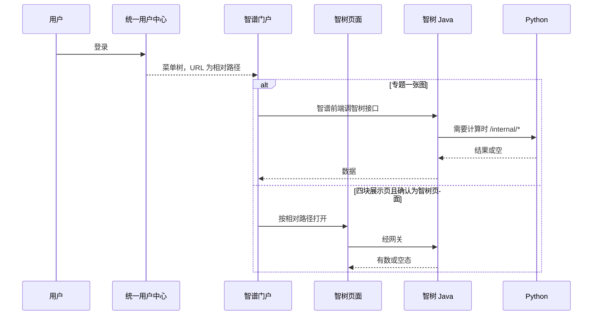
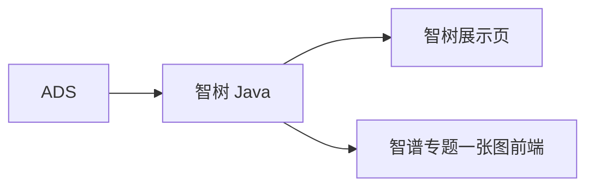

# 系统集成技术方案 · 门户系统集成

> **状态**：草案 · 2026-10-22 · 未签收  
> **WBS**：WBS-04-00  
> **过程位置**：工程过程卷 03。2026-10-09 wujie 建议稿只作输入，不是本方案。

## 1. 背景与集成需求

门户上要出现专题能力。定稿分工：

- 「专题一张图」：智谱做前端，智树做后台接口。
- 产业全景、专题服务、企业发展、政策扶持：智树做前端和后端。这是门户上的展示页，不是第 3 项的内容管理后台。

和可视化四菜单是不是同一套页面，还没写死。写死为同一套时，删掉 WBS-04-02～05，只留挂载。

对接系统：智谱门户、统一用户中心、智树 `lumen-ui-topic`、专题 Java。总集是否指定统一集成框架，还没有书面要求。

## 2. 应用对接技术架构

菜单 URL 不带主机名。`https://next.itic-sci.com/bs/xx/xx` 改为 `/bs/xx/xx`。主机放 `baseurl`。当前临时入口 `http://183.62.232.63/`，域名还会变。登录主机在另一份链路图里写的是 `edu.itic-sci.com`，和菜单前缀不是同一个字符串，本方案不把二者合成一个域名。

实现方式：不按 wujie 子应用定稿。鉴权经网关。门户后端不代理智树全部 API，门户前端不直连 Python。

## 3. 数据存储与数据流转

数据仍在智树 ADS / 专题接口。门户不落一套业务库。

加工与融合：与第 3 项可视化共用同一套 ADS 读口径。不在门户侧再融合一次。

存储设计：还没有为门户单独加的字段。若与可视化同页，扩展字段只在第 3 项方案里写一次。

## 4. 指标

专题一张图的需规有「专题产业相关统计、指标、地图分析工具」。与指标库的逐条对齐还没有。

四块展示页的指标与 `PORTAL-CMS-METRIC-COVER-L01` 是同一组待核对项，该任务 claimed，缺项未关闭。未对齐的数字不在门户页上做成已发布口径。

## 5. 分模块实现与 WBS

| 模块 | WBS | 前端 | 算法 | 数据加工 |
|---|---|---|---|---|
| 方案本身 | WBS-04-00 | 不改门户代码 | 无 | 无。写死与 WBS-03-05～08 是否同页 |
| 专题一张图 | WBS-04-01 | 智谱做。智树不交这个页面 | 统计与指标在 Python，清单未对齐前可空态 | 读 ADS。不新建门户库 |
| 四块展示页 | WBS-04-02～05 | 若不同页：`lumen-ui-topic` 做全页。若同页：只配菜单路径 | 与可视化叶共用 `/internal/*`，不各写一套 | 与第 3 项同一 ADS，不第二次加工 |

智树不做：智谱门户壳、统一用户中心本身、wujie 改造（除非签收时改口）。
