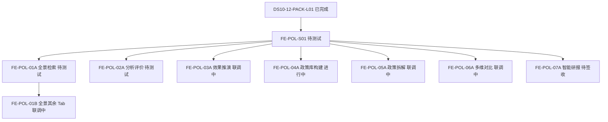
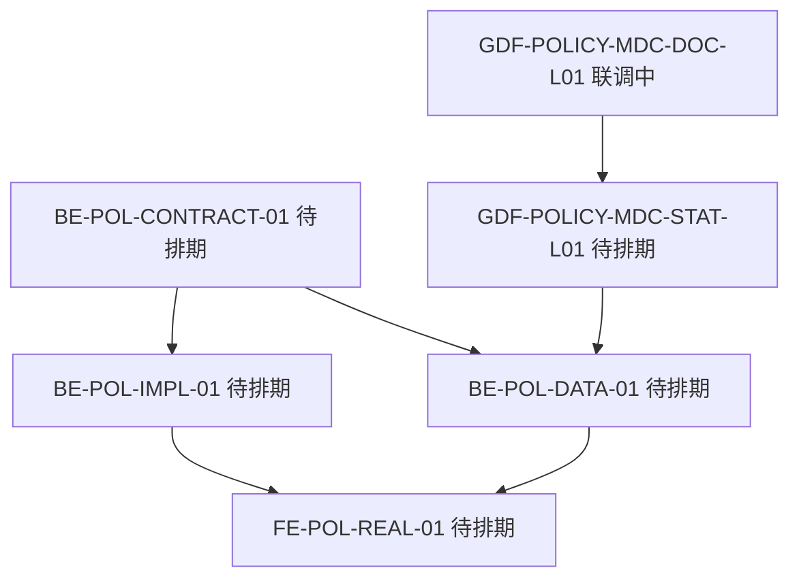
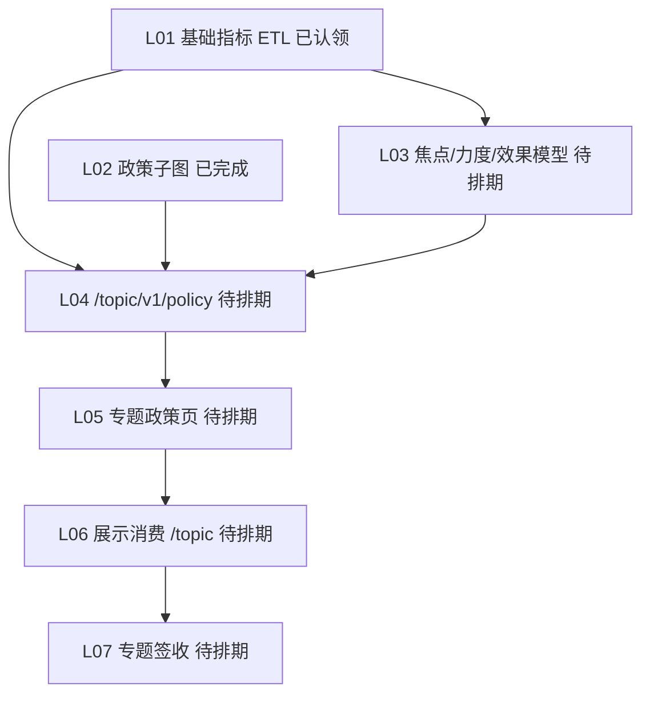

# 对照 · 科技政策跟踪存量任务与依赖

- 日期：2026-11-03
- 性质：架构对照。挂 `WBS-05-23`。2026-11-03 调研四叶 handoff 已齐，本文第 7 节为定稿。系统详细设计 `POL-DISPLAY-SDD-L01` 在三叶齐后合成。真数链 `BE-POL-IMPL-01`、`BE-POL-DATA-01`、`FE-POL-REAL-01` 仍待排期。契约仍由 `BE-POL-CONTRACT-01` 出。
- 状态快照：`task-registry` 于 2026-11-03 凌晨读取。任务 `update_time` 止于 2026-11-02 21:35。状态以注册表为准。
- 开工真源（已有，不重写）：`agent-handoffs/科技政策跟踪-POL/POLICY-模块开发规划与任务拆分.md`（2026-11-02）
- 产品包（已完成）：`DS10-12-PACK-L01`。指标：政策域 35 条，D1 全部 `aligned`，D4 全部 `mock`。

## 1. 结论

展示侧正式复刻单已经拆完，并且大多已开工。缺的是把它们挂进 WBS，以及把「页面 mock 能并行」和「真数必须等契约」两条链分开。

编写顺序是：`POL-DISPLAY-SURVEY-L01`（本节已定稿）→ 详设三叶 `POL-DISPLAY-SDD-CHAIN-L01`、`POL-DISPLAY-SDD-METRIC-L01`、`POL-DISPLAY-SDD-INPUT-L01` → `POL-DISPLAY-SDD-L01`（合成说明书）→ `BE-POL-CONTRACT-01`（API-POL 契约）。契约单的注册表硬依赖仍为空，WBS 把详设列为它的前置。实现单、对齐单、真联调单已经建好，都停在待排期。契约冻结前，前端继续 mock，不猜 `/display/v1/policy/**` 路径。

`E-E7-POLICY-M1-L06`（展示全景消费专题 `/topic/v1/policy`）与架构裁决 A1、详设第 5 卷冲突。它不是展示集成的前置。专题签收单 `L07` 注册表硬依赖 `L06`，这条链停在专题侧，不拖展示页面。

## 2. 两条链

### 2.1 展示复刻链（mock，已在跑）

注册表硬依赖只认 `depends_on`。除全景后半段必须等检索主链路外，各页只依赖基座，彼此没有硬依赖。

| 任务 | 注册表状态 | 注册表硬依赖 | 说明 |
|---|---|---|---|
| `FE-POL-S01` | pending_test | 无 | 菜单 3→7、mock 种子、`api/policy.ts` 双轨、35 指标镜像。后续各页的根 |
| `FE-POL-01A` | pending_test | `FE-POL-S01` | 全景检索主链路。handoff 已落盘，业务仓已推 `origin/dev` |
| `FE-POL-01B` | integration | `FE-POL-01A` | 动向 / 舆情 / 比对 / 订阅。注册表只写了 01A，基座经 01A 传递。note 写前端链路联调通过，状态仍是联调中 |
| `FE-POL-02A` | pending_test | `FE-POL-S01` | 分析评价。与全景无硬依赖，可并行 |
| `FE-POL-03A` | integration | `FE-POL-S01` | 效果推演。handoff 写停在本地待验收 |
| `FE-POL-04A` | in_progress | `FE-POL-S01` | 智能政策库构建。核增链的 ChainSteps 归本单 |
| `FE-POL-05A` | integration | `FE-POL-S01` | 智能拆解。note 写 handoff 已落盘；主仓目录未见 `FE-POL-05A.md` |
| `FE-POL-06A` | integration | `FE-POL-S01` | 多维对比。生成研报会跳到研报页 |
| `FE-POL-07A` | ready_to_sign | `FE-POL-S01` | 智能研报。note 写未 commit / push，ChainSteps 仍是占位 |

规划正文还写过「01A～07A 都依赖 S01；04A～07A 可并行」。注册表与这句话一致，只有 01B 把直接前置收成 01A。

软依赖（注册表没写，合入时要处理）：

- `FE-POL-06A`、`FE-POL-07A` 的 note 都写 ChainSteps 内联占位，等 `FE-POL-04A` 合入后替换。04A 仍在进行中。这不挡住 06A / 07A 各自的 mock 验收，挡住的是四页导航共用同一组件。
- `FE-POL-06A` 的「生成研报」跳 `FE-POL-07A`。07A 任务状态更靠前，但停在 worktree，和 06A 不在同一分支。跳转要等两边合入同一 `dev` 再验。
- 规划批次（批 1 基座+检索+契约启动，批 2 全景收尾+评价，批 3 推演+治理，批 4 拆解+对比+研报+真联调）是排期，不是注册表闸门。现状已经叠批：07A 待签收，04A 仍在做。

`FE-POL-*` 的 `depends_on` 都不含 `BE-POL-CONTRACT-01`。mock 复刻不等契约。`USE_MOCK=false` 的真联调才等契约冻结，这是规划约束，不是当前注册表边。

### 2.2 真数链（还没开工）

| 任务 | 状态 | 硬依赖 | 和展示页的关系 |
|---|---|---|---|
| `BE-POL-CONTRACT-01` | backlog | 无 | 7 页 63 叶的 Java 契约。冻结前前端 real 路径只占位。2026-11-03 已按本链补建实现、对齐、真联调三单，不再等口头再拆 |
| `BE-POL-IMPL-01` | backlog | `BE-POL-CONTRACT-01` | 2026-11-03 新建。实现 `/display/v1/policy/**`。不转调专题接口 |
| `BE-POL-DATA-01` | backlog | `BE-POL-CONTRACT-01`、`GDF-POLICY-MDC-STAT-L01` | 2026-11-03 新建。只把统计指标对到已有 ADS，不新开 GDF |
| `FE-POL-REAL-01` | backlog | 实现单、对齐单、以及 `FE-POL-01B` 到 `07A` | 2026-11-03 新建。七页关掉 mock 后的联调，不重做页面 |
| `GDF-POLICY-WORKPACK-V2-L01` | done | — | 第 6 项派单包。展示不重开 |
| `GDF-POLICY-MDC-DOC-L01` | integration | — | STAT 脚本的说明叶 |
| `GDF-POLICY-MDC-STAT-L01` | backlog | `GDF-POLICY-MDC-DOC-L01` | 第一批统计指标离线加工。D4 要从 mock 离开，走这条，不在展示仓算数 |
| `GDF-POLICY-GRAPH-EXT-L01` | backlog | — | 实体与关系抽取脚本。展示只消费子图 |
| `GDF-POLICY-MOCK-GATE-L01` | blocked | — | 灌数闸门。未解开则正式值仍是 mock |

模型类页面（评价、推演、拆解、研报）在契约里保持 501，直到对应模型注册。统计类读面（总数、级别 / 类型 / 全国 / 深圳分布、时序）可以先挂已有 `metric_id`，数值仍是 mock，角标保持 🧪。不能用专题「政策布局推荐」填展示推演页。

## 3. 专题链：只索引，不作为展示前置

`L04` 还硬依赖 `E-PLATFORM-P0-L05`。`L01` 硬依赖 `E-PLATFORM-P0-L01`、`E-PLATFORM-P0-L08`。`L05` 还硬依赖 `E-PLATFORM-P0-L07`。仓是专题 / demo 算法，不是 `lumen-ui-science-pc`。

`L06` 的 DoD 写「展示层消费 `/topic/v1/policy`」。A1 已裁定展示对外只走 `gkxlumen-display` 的 `/display/v1/**`，详设第 5 卷写明不复用 `/topic/v1/policy/**`。展示集成不把 `L06` 列入关键路径。`L07` 因此也不能当成展示模块的签收门。

同一算法可以复用，URL 不复用。`L03` 若以后注册焦点 / 力度 / 效果模型，展示契约只引用注册结果，不改调用闭包去打专题路由。

## 4. 其他已有工作：挂接，不另开

| 已有任务 | 状态 | 依赖位置 |
|---|---|---|
| `DISPLAY-POLICY-GAP-AC-L01` | integration | demo 原型。档 A/C 已是契约单和复刻 DoD 的输入，不再作为 lumen 开工闸门 |
| `FE-DISPLAY-POLICY-TRACK-OPT-20260817-L01` | in_progress | demo 原型优化。无同名 handoff。不阻塞 `FE-POL-*` |
| `DS10-12-V1-HIFI-L01` | integration | 高保真对齐，产品轨。正式复刻已另有 `FE-POL-*` |
| `POLICY-METRIC-OPEN-L01` | done | 指标语义卡。35 条指标的定义前置已满足 |
| `ALGO-LIB-POL-PORTAL-*` 十条 | 计算侧多条 done；`ALGO-LIB-POL-PORTAL-LUMEN-L01` integration | 门户「政策扶持」。不是 DS-10～12 的页面任务。同一 `metric_id` 可复用计算 |
| `FE-DISPLAY-SMALL-BATCH-B` | backlog | 已在 `WBS-05-26`。注册表无硬依赖。小屏裁剪应等对应 `FE-POL` 页合入 `dev` 后再做，避免按过期原型裁 |

## 5. 页面对指标（决定谁等真数）

D4 全是 mock。下表只区分「契约冻结后可以接统计读面」和「模型未注册必须 501」。

| 页 | 复刻单 | 可挂的统计读面 | 未注册则 501 |
|---|---|---|---|
| DS-10 全景 | 01A、01B | 政策总数、类型分布、级别分布、全国分布、深圳分布、时序、产业链覆盖率、有效率 | 政策匹配推送 |
| DS-11 评价 | 02A | 短板清单条数、机遇清单条数（计数字段，源模型仍是 mock） | 焦点 / 力度 / 效果 / 短板 / 机遇模型，智能摘要，实施路径 |
| DS-12 推演 | 03A | 无统计读面可替代推演 | 政策效果推演。布局推荐属于专题，不能顶替 |
| PC-1 治理 | 04A | 指标库无治理质量指标 | 展示只读第 6 项结果；血缘接口是 `GDF-POLICY-LINEAGE-L01`（backlog） |
| PC-2 拆解 | 05A | 无 | 政策文本解析；实体关联消费图，不在本页重做抽取 |
| PC-3 对比 | 06A | 上表统计分布可进对比表 | 智能摘要导出另算 |
| PC-4 研报 | 07A | 无 | Job 未注册则导出 501 / 空态 |

`M_POLICY_DS_07_POLICY_GUARD_001`、`M_POLICY_DS_07_POLICY_GUARD_008` 的编号像专题或旧叶子，不在本表派给 DS-11。归哪一页由 `BE-POL-CONTRACT-01` 核对。

## 6. 对 WBS 的含义

父行仍是 `WBS-05-23`。子行见 WBS §4.1b。

2026-11-03 已补建、且保持待排期的三张单：

| ID | WBS | 作用 |
|---|---|---|
| `BE-POL-IMPL-01` | WBS-05-23-11 | 契约冻结后实现 `/display/v1/policy/**` |
| `BE-POL-DATA-01` | WBS-05-23-12 | 统计指标对到已有 ADS |
| `FE-POL-REAL-01` | WBS-05-23-13 | 七页切真实接口 |

2026-11-03 补上的编写单：

| ID | WBS | 状态 | 作用 |
|---|---|---|---|
| `POL-DISPLAY-SURVEY-L01` | WBS-05-23-14 | 定稿见第 7 节 | 七页 × 任务 × 指标。四叶合成 |
| `POL-DISPLAY-SDD-L01` | WBS-05-23-15 | backlog | 系统详细设计说明书。等详设三叶 handoff。不写 OpenAPI |

仍然不新建的：

- 第二套前端复刻单
- 把 `BE-POL-CONTRACT-01` 当成系统详细设计（它只出 API-POL）
- 把 `L06` 改造成展示联调单

## 7. 调研定稿（2026-11-03）

四叶 handoff 已落盘。判定明细以分册为准，本文不另造指标。

| 叶 | 分册 | handoff | 可接统计读面 | 501 | 跨项索引 |
|---|---|---|---|---|---|
| DS-10 全景 | `survey/DS-10.md` | `POL-DISPLAY-SURVEY-DS10-L01` | 9 | 13 | 2（能力表）。另有边界索引 3 条，全是跨项索引 |
| DS-11 评价 | `survey/DS-11.md` | `POL-DISPLAY-SURVEY-DS11-L01` | 2 | 9 | 1 |
| DS-12 推演 | `survey/DS-12.md` | `POL-DISPLAY-SURVEY-DS12-L01` | 0 | 10 | 2 |
| 核增四页 | `survey/PC.md` | `POL-DISPLAY-SURVEY-PC-L01` | 0 | 12 | 5 |

DS-11 另有 5 行交互壳写了「未见」。这不是第四档业务能力。详设里，没有可调用模型的能力仍写 501。

带到详设的裁定：

- 政策域 35 条，D4 全部 mock。可接统计读面的数值仍是 mock。
- 推演只认 `M_POLICY_SIMULATE`（501）。`M_POLICY_DEEP_171_1` 与 `M_POLICY_LAYOUT_REC_COUNT` 是布局推荐，跨项索引，不顶替推演。
- `E-E7-POLICY-M1-L06` 不是展示实现路径。
- `M_POLICY_DS_07_POLICY_GUARD_001`、`M_POLICY_DS_07_POLICY_GUARD_008` 不派给 DS-11。归页留给契约核对，不在详设里改挂。
- 核增研报 Job 未注册，真路径 501 / 空态。治理质量指标未见，治理页只读第 6 项已有结果。
- 不新建第二套 `FE-POL-*`，不重开政策 GDF 包，不把门户扶持十条写成展示页任务。
