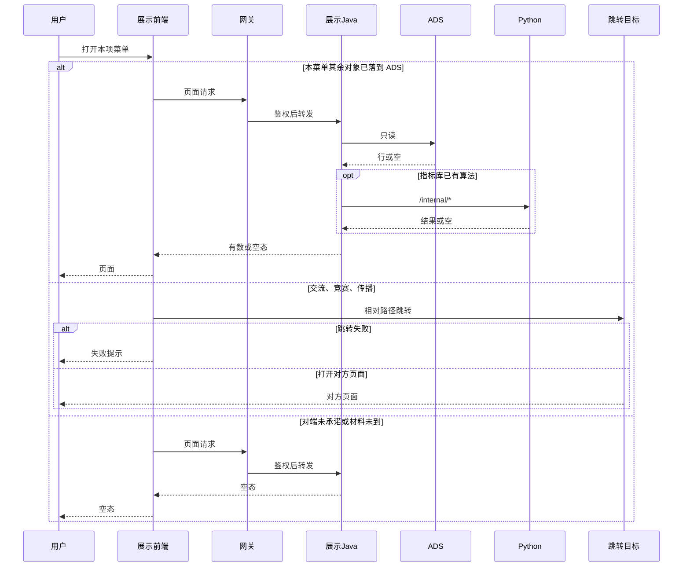
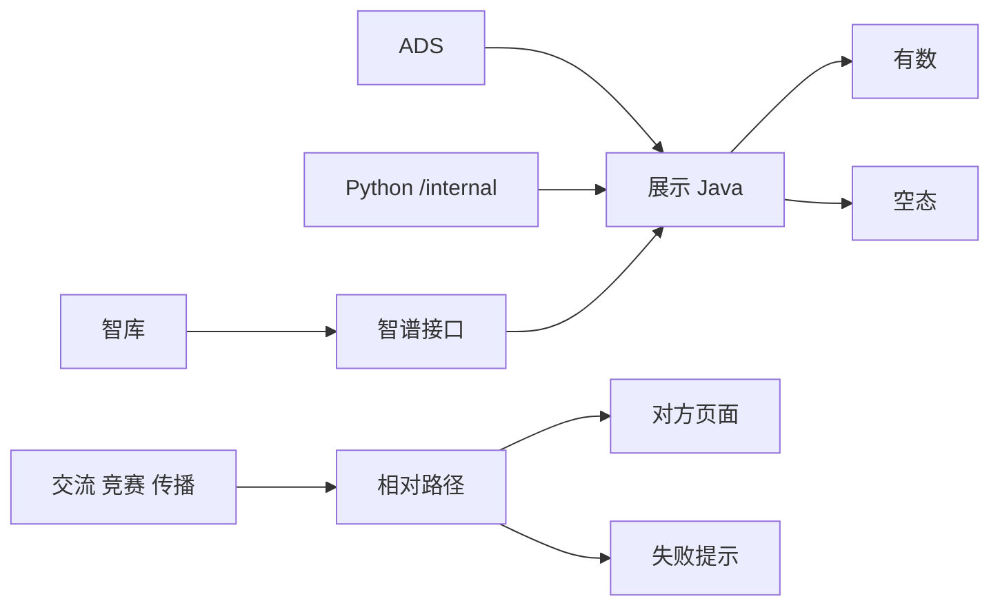

# 系统集成技术方案 · 展示系统集成

> **状态**：待签收 · 2026-10-22 · 签收操作人 `human:淮政玮`（尚未签收）  
> **任务**：`SYSINT-SCHEME-05-L01` · WBS-05-00  
> **开始时间**：待填写。**完成日期要求**：无截至时间。方案行在倒排里没有单独的功能开发完成日。这两列是我方栏位，不是对端承诺。本文不补日期。  
> **过程位置**：工程过程卷 03 的技术方案体例。文件在 `04-系统集成/05-展示系统集成/`。页面施工序不是本方案。  
> **读本**：[`系统集成整体过程规约.md`](../../../系统集成整体过程规约.md) §2 第 5 项、§6、§7、§13（正式稿）。讨论稿未用作本章依据。  
> **范围**：本页不改 `scope-baseline`。不新建开发叶。不把页面计划的计划叶 ID 写成注册表任务。

调用链以 [`architecture-baseline.md`](../../../architecture-baseline.md) §2（D1–D7、D12）和 §3.1 为准。本文不另画全局拓扑。指标只消费指标库，口径以 [`data-lineage-policy.md`](../../../data-lineage-policy.md) 为准，本文不新定义。

## 1. 背景、集成需求、对接系统说明

### 1.1 背景

第 5 项是展示系统里、第 1 项全链路自研以外的菜单对接。智树做本项范围内的展示页面或跳转入口，并消费已经落到 ADS 的数。对端未承诺、或承诺了但材料还没交到的数，页面空态。

三要素供数在第 2 项：人才四子页是 WBS-02-01，科技发展态势八页里的技术 / 技术链 / 科研机构是 WBS-02-02。读图、查图、图指标在第 7 项。知识图谱四页（分析展示、指标展示、算法展示、服务展示）不在本方案建第二套页，查图时序不在这里重画。

2026-10-22 的页面施工序仍是 [`05-展示系统集成工作计划.md`](../../02-策划与监控/02-智树工作计划/02-进度/05-展示系统集成工作计划.md)。该页排的是页面，不代替本方案。两边不一致时，未签收的对接子项在页面上用空态。

方案未由 `human:淮政玮` 签收前，不建本维开发叶。

### 1.2 集成需求

本项菜单与 WBS 对应如下。每一行只保留该菜单上、三要素和读图以外的对接对象。

| 菜单 | WBS | 本方案留下的对接对象 |
|---|---|---|
| 科学技术全景 | WBS-05-01a / 01b | 三要素区块归 WBS-02-02。图谱、关键实体、路径的读图归第 7 项。其余已签收对接对象：还没有。页面可开，未承诺的块空态 |
| 技术发展跟踪 | WBS-05-02a / 02b | 名称收口见 §1.4。三要素归 WBS-02-02。结果 / 参数 / 方法三个 Tab 可开。对端说明未到则空态 |
| 科技人才态势 | WBS-05-03a / 03b | 菜单壳与非三要素区块。四子页不重做，供数是 WBS-02-01。非三要素区块的对接对象清单：还没有 |
| 科技数据资源 | WBS-05-04 | 总体、接入、主题、应用四个视窗。对端材料写智谱，回文还没有，供数还没有 |
| 科技成果展示 | WBS-05-05 | 五页可开或空态。仪器只展示，不做预约闭环。与「科技创新生态服务」不是同一菜单 |
| 科技创新生态服务 | WBS-05-06 | 服务全景里由智树做列表和详情的子菜单。已签收供数：还没有 |
| 智库服务 | WBS-05-07 | 要求智谱提供接口。本仓做对接，不按跳转。接口未到为空态。智树不做高端智库后台 |
| 科技交流、科技竞赛、科技传播 | WBS-05-08 | 他队做界面。三个入口跳转，失败有提示。供数进本仓：还没有 |
| 上述菜单的注册与用户权限 | WBS-05-09 | 相对路径进统一用户中心。配菜单的人：还没有。统一登录本身不在本项 |

不进本项：统一登录本身、政策跟踪、全域 / 湾区 / 深圳监测、科技创新评估、科技指数、科技发展规划、维护页。这些留在第 1 项或原页面计划。大屏不在本项单列。报价表划掉且工作量为 0 的行不实现，包括科学技术全景「维护技术图谱」和技术发展跟踪里被划掉的部分后台。范围基线本文不改。

### 1.3 对接系统说明

| 系统 | 在本项里的位置 | 材料 |
|---|---|---|
| 展示前端 `lumen-ui-science-pc` | 本项菜单的页面或跳转入口 | 正式仓。不走 `demo-ui-science` 运行时 |
| 网关 `gkxlumen-platform-gateway` | 浏览器请求的入口。鉴权经网关 | 架构基线 D5、D6、D12 |
| 展示 Java | 只读 ADS。需要计算时才调 Python `/internal/*` | 具体落在哪一个已有 `gkxlumen-*`：还没有。不新造服务名。`gkxlumen-display` 在基线里是 Wave4，本文不写成已上线 |
| ADS | 本菜单其余对象的读数落点 | Java 不写 ADS |
| Python | 只跑指标库里已经有的算法 | `lumen-algo-py`、`lumen-etl-es-py`、`lumen-topic-py` 的 `/internal/*`。不打 `demo-*` |
| 指标库 | 统计数字的口径真源 | 本文只消费，不新定义口径。逐条对齐还没有 |
| 统一用户中心 | 菜单相对路径和用户权限 | 主机不写进菜单地址。配菜单的人还没有。统一登录产品不在本项 |
| 北京久新 | 2026-10-20 妙记提出开放 Doris、不做定制接口。三要素供数归第 2 项 | 数据说明、字典、指标定义、连接信息都还没有。直连不写入本方案的调用方向，见 §2 |
| 燕大 | 读图、查图 | 归第 7 项。本方案不重画查图时序，不把久新 Doris 当成图谱来源 |
| 智谱 | 数据资源清单里的建议供方之一（调用统计）。智库接口的对端 | 数据资源回文还没有。智库接口还没有。2026-10-23 起智库不按跳转，向智谱要接口 |
| 高端智库业务系统 | 智谱提供接口的系统。不是本仓的跳转页 | 后台不由智树做。接口形状还没有 |
| 交流 / 竞赛 / 传播的外部系统 | 规约表写「北大深势」 | 名称核对还没有，见 §1.4。三个入口按范围基线跳转 |
| 第 6 项数据工厂 | 三方源若要进 ADS，走 GDF，不在展示 Java 里融合 | 本方案不新开 GDF 包，不加字段 |

2026-10-20 妙记还说到可视化模块由久新做前端、智树出接口，以及产业全景可视化复用展示页。那是第 3 项、第 4 项的输入。本文不把那些页面并进本项菜单，也不改那两项过程夹。

### 1.4 两处名称

**技术发展跟踪。** 范围基线、本维 WBS、页面计划用「技术发展跟踪」。规约 §2 第 5 项的表用「技术发展追踪」。二者是同一菜单。本方案后文只用「技术发展跟踪」，不另开一页。

**「北大深势」。** 名称核对还没有。已读材料如下：

| 材料 | 怎么署名 |
|---|---|
| 规约 §2 第 5 项 | 写「外部系统，北大深势」 |
| 《科技交流、科技竞赛、科技传播数据与功能提供能力评估》 | 标题与正文未出现「北大深势」「深势」「北大」 |
| 《科技服务全景对外开放接口.openapi.yaml》 | `info.title` 为「科技服务全景对外开放接口」。样例里有主办方「深势科技」，是一条活动样例，不是供方署名 |
| 我方《科技服务全景-页面维度供数缺口自研对照表》 | 把上面两份文件称作深势材料，并写待会签。这是我方用词 |
| 《04-科技数据资源与服务全景-第三方API接口清单》§二 | 建议供方写「久新 / 电信 / 待确认」 |
| 本维沟通流水、约定时点、对端索引 | 使用「北大深势」 |

核对完成前，不把「北大深势」写成已确认的对端名称。过程夹里写的 10-26 开始对接，挂在这个未核对的名称下。该日期不是本方案的完成日期要求，也不是已签收的供数承诺。

## 2. 应用对接技术架构、对接时序、实现方式

### 2.1 应用架构

浏览器只打开 `lumen-ui-science-pc`。前端只打 `gkxlumen-platform-gateway`。网关到展示 Java。Java 只读 ADS。指标库里已经有、且本菜单用得上的算法，才由 Java 调 lumen Python 的 `/internal/*`。前端不直连 Python、数据库、Nebula、对端库。Java 不写算法，不直连 nGQL，不写 ADS，不扫 ODS / DWD。

**D12**：正式开发只在 `lumen-*`。展示前端只经 `gkxlumen-platform-gateway` 调 `gkxlumen-*`。Java 下游只调 `lumen-algo-py`、`lumen-etl-es-py`、`lumen-topic-py`。禁止打到 `demo-svc-platform`、`demo-platform-*`、`demo-algo-*`、`demo-svc-topic-py`。禁止把 demo 仓 merge 进 lumen。

**D6**：浏览器侧鉴权、单点登录、权限经网关统一。业务服务不各自做一套登录。统一登录产品本身不在本项。

三条调用方向：

| 块 | 调用方向 | 鉴权 | 数据落点 |
|---|---|---|---|
| 全景、技术发展跟踪、人才菜单壳、数据资源、成果、生态服务 | 用户 → 展示前端 → 网关 → 展示 Java → 只读 ADS。已有算法时 Java → Python `/internal/*` | 网关统一鉴权。各菜单角色名：还没有。不对端库账号 | 只读 ADS。Java 不写。未落到 ADS 则接口返回空，页面空态 |
| 智库服务 | 用户 → 展示前端 → 网关 → 展示 Java → 智谱接口。不跳转 | 网关统一鉴权。智谱接口的鉴权方式还没有，凭证不进 git | 接口未到则空态。不把未交到的字段写成已定表。智树不做高端智库后台 |
| 交流、竞赛、传播 | 用户 → 展示前端 → 相对路径跳转。不经展示 Java 取对方的数 | 用户进入菜单前走统一用户中心。对方页面自己的登录：还没有。本方案不把对方凭证写进 git | 不入库。本仓不落对方页面的业务表 |
| 菜单注册 WBS-05-09 | 配置动作在统一用户中心，不在业务仓写主机名 | 配菜单的人：还没有 | 菜单存相对路径。各菜单的路径字符串：还没有 |

2026-10-20 妙记：久新拟开放 Doris，供我方直接查询基础数据，不做定制接口。截至本文，数据说明、数据字典、指标定义、连接信息都还没有交到。账号、查询规范、安全评审：还没有。口令不进 git。

这条提议和架构基线的调用链不是同一件事。基线要求展示读数走 ADS，三方源经数据工厂进入 ADS，Java 不扫对方库。因此本方案的调用方向不画「页面或展示 Java 直连久新 Doris」。对方库若以后要被读，落点是第 6 项写入 ADS 之后，再由本项 Java 只读。第 6 项不在本文签收，本文不加字段、不加表。

展示 Java 使用哪一个已经存在的服务：还没有。本文不新造服务名，也不把 Wave4 的 `gkxlumen-display` 写成当前入口。

### 2.2 对接时序

> **diagram_id**：`SYSINT-SCHEME-05-SEQ`  
> **会签态**：draft（待 `human:淮政玮` 签收。本文不自填已通过）  
> 读数只经网关到展示 Java，再只读 ADS。指标库里已经有的算法才到 Python `/internal/*`。智库要求智谱提供接口，不跳转；接口未到走空态。交流、竞赛、传播走相对路径跳转。对端材料未到不画进 Java。三要素供数和读图时序不在本图。

图的三支和正文对应：

1. **已落到 ADS。** 只读。ADS 返回空行时，页面仍是空态。Python 只在指标库已有该算法时出现。
2. **跳转。** 交流、竞赛、传播。相对路径，地址不写主机名。失败有提示。不把对方页面做进本仓。智库不在这一支，见下一条实现方式。
3. **未承诺或材料未到。** 请求仍经网关到展示 Java，Java 返回空。不调用对端，不用样例数填页面。

三要素的时序在第 2 项。读图时序在第 7 项。本图没有这两组调用。

### 2.3 实现方式

**科学技术全景。** 页面能打开。图谱、关键实体、路径的读数归第 7 项，本叶不接第二套查图接口。三要素区块的数归 WBS-02-02。这两块以外的已签收对接对象：还没有。未承诺的块空态。报价表划掉的「维护技术图谱」不实现。

**技术发展跟踪。** 结果、参数、方法三个 Tab 能打开。三要素归 WBS-02-02。2026-10-20 妙记说久新可给技术点列表、基础指标、技术与专利的弱关联，并说专家评估法、经济分析法由我方组合实现。这些材料还没有交到，现网也没有已签收的算法说明。三个 Tab 在材料未到时为空态。本文不新定义这几种方法的口径。

**科技人才态势。** 做菜单壳和非三要素区块。四子页（全球领域人才态势、关注地区人才态势、重点科技人才画像、人才引进推荐评估）不重做，供数是 WBS-02-01。非三要素区块有哪些对接对象：还没有。2026-10-20 妙记说久新没有人才资讯、职位变动动态、奖项荣誉、人才引进成本、尽调报告。这五类不写成已接入，页面空态。会上说的约 10 万条人才主数据还没有随库和字典交到，不写成已接入。要不要另做自研补数：还没有。本方案不补假数。

**科技数据资源。** 四个视窗可以切换。智树做界面。供数还没有。见 §3。

**科技成果展示。** 五页可以打开或为空态：软科学成果展示、科技创新生态展示、科技时空演进展示、大型科学仪器共享、创新载体孵化载体。其中「科技创新生态展示」是成果菜单里的一页。「科技创新生态服务」是另一个菜单（WBS-05-06），两处不合并。大型科学仪器只做展示。我方字段稿写明仪器共享尚无接口契约。预约闭环不做，预约表不建。口径未绿时用角标，不改数。

**科技创新生态服务。** 范围基线写明：服务全景里除这一子菜单外，他队做界面、本仓只跳转。这一子菜单由智树做列表和详情。已签收的供数和字段：还没有。没有数则空态。

**智库服务。** 2026-10-23 口令：不是跳转，要求对端智谱提供接口。调用走展示前端 → 网关 → 展示 Java → 智谱接口。接口未到为空态。智树不做高端智库后台。2026-10-16 纪要把专家、活动、成果、报告写成复用和嵌入，并拆了三个接口包。字段和消息体纪要记为待提供，至今还没有。未交到的字段不写成已定接口。智库报告原挂电信泳道，过程夹记由智谱与久新承接。承接不等于接口已到。范围基线若仍写跳转，以本次口令为准，本文不改 `scope-baseline` 文件。

**科技交流、科技竞赛、科技传播。** 三个入口可用，或明确不可用并给出失败提示。范围基线是跳转。供数进 ADS：还没有。能力评估写明当前不支持的项，不做成已有数据：热门标签统计、展览 / 图书 / 视频、传播的国际国内区域市级级别、活动讲者关联学者、精确地图、实际到场人数、文章活动期刊人才统一搜索。成绩榜上评估写明不支持的项目名称、机构信息和奖金设置，同样不做成已有数据。过程夹风险里的三个差项仍按未闭环记录，本文不改成已关闭。

**菜单。** 统一用户中心只存相对路径，不写主机名。各菜单路径字符串：还没有。配菜单的人，2026-10-22 纪要没有点名，写「还没有」。统一登录本身不在 WBS-05-09。

## 3. 数据存储与流转

### 3.1 对接上的数据需求

| 数据 | 谁提供 | 本方案怎么用 | 状态 |
|---|---|---|---|
| 全景、技术发展跟踪上的三要素 | 第 2 项，WBS-02-02 | 本方案不接第二路 | 久新库与指标说明还没有。不写成已接入 |
| 人才四子页主数据 | 第 2 项，WBS-02-01 | 本方案不重做四页 | 同上 |
| 人才五类缺失（资讯、职位变动、奖项荣誉、引进成本、尽调） | 2026-10-20 妙记说久新没有 | 空态 | 不补假数 |
| 全景上的读图 | 第 7 项 | 不建第二套页，不重画时序 | 燕大材料不在本文签收 |
| 数据资源四视窗 | 清单建议供方含数据资源平台、数据中台、智谱（调用统计） | 四个视窗可切换。未到则空 | 对端回文还没有。沟通流水：对接方仍未找到，原华为云大数据团队 2026-10-15 已退出 |
| 成果五页的论文、专利、技术列表等 | 妙记说久新可给。我方有字段级需求稿 | 对端未回则空态 | 不在本文加列 |
| 大型科学仪器 | 字段稿写明尚无接口契约 | 只展示。不预约 | 契约还没有。不建预约表 |
| 生态服务列表与详情 | 还没有已签收供数 | 有 ADS 行则读，否则空态 | 供数还没有 |
| 智库 | 智谱接口 | 展示 Java 调智谱接口。不跳转。接口未到则空态 | 接口形状还没有 |
| 交流、竞赛、传播 | 对方页面 | 跳转。不入库 | 供方名称核对还没有 |

我方《04-科技数据资源与服务全景-第三方API接口清单》是 2026-09-17 的澄清稿，状态 DRAFT。它向供方要读接口，并写明最终责任方待总集签认，不代替厂商承诺。本文不把 R-01～R-24、S-01～S-09 的字段收成已签收表结构。

我方《06c-科技成果展示-久新侧接口需求（字段级）》是 2026-10-15 的需求稿。对端未回。其中协作网络涉及读图，归第 7 项。本文不按该稿加列，也不把它里面的直连形状写成已签收调用方向。

### 3.2 数据流

> **diagram_id**：`SYSINT-SCHEME-05-FLOW`  
> **会签态**：draft  
> 数从 ADS 读出。已有算法从 Python 回到 Java。Java 给出有数或空态。智库另走智谱接口，接口未到则空态，图上不画未交到的字段。交流、竞赛、传播走相对路径，成功到对方页面，失败有提示，不入库。不画查图时序，不加预约表。

图上智库经智谱接口进展示 Java。接口未到时不画字段，页面走空态。交流、竞赛、传播不经过这条读数链。没有查图节点。没有预约表。没有新的 ADS 列。Java 的两个出口是有数和空态。空态包括 ADS 没有行，也包括对端未承诺、因此没有落入 ADS。

### 3.3 加工与融合

展示 Java 不做多源融合，不算指标，不写 ADS。

三要素的加工在第 2 项。三方源进 ADS 的映射在第 6 项。两处都不是本方案新开的 GDF 包。

数据资源、成果、生态的字段，对端没有回文。不在本文把我方需求稿收成融合规则。

交流、竞赛、传播的能力评估列出了可提供和不可提供。名称未核对，且范围基线是跳转，所以这些「可提供」不写成已经接入本仓的融合结果。评估写明不支持的项保持不支持，不用文本推断或前端补数代替。

风险表里有一条预判：数据资源若仍无对接方，用模拟数据应付验收。那不是本方案的数据策略。未承诺的数是空态。`USE_MOCK=false` 时不用样例数填页面。Java 和前端不造数。

### 3.4 存储设计（相对原表要增加的字段）

还没有签收过的新增字段。本文不加列，不新造表名。

大型科学仪器不做预约闭环，不为此增加预约表。

跳转类菜单不在本仓建对方业务表。

对象存储若以后要放本项的用户导出或分析中间结果，只用架构基线 §2.1 已有目录。本文不新造桶，不把凭证写进 git。当前没有已签收的、必须新建的对象。

## 4. 对接涉及的指标

### 4.1 消费规则

页面上的统计数字沿用展示详设已经点名、并且已经在指标库里的口径。本文不新定义口径，不新造 `metric_id`，不把 D1–D4 写成 8 件套字段。

8 件套（含 `algorithm_type`，齐备态共 9 项）只在指标库。`D1=aligned` 才是齐备。未填 `algorithm_type` 视为 `UNKNOWN`。`UNKNOWN` 不在本方案派成新算法。

界面：每个统计数字旁有说明入口。口径未绿用角标，不改数，不在前端把就绪度改绿。源映射为 `none` 的指标不伪造数值。接入状态的阶段只记事实，不写百分比。

2026-10-20 妙记把「现有 560 余个指标与久新指标比对」记为我方待办。比对结果还没有。本文不做逐条对齐。

### 4.2 分菜单

| 菜单 | 实现方式 | 与指标库是否对齐 | 缺项 |
|---|---|---|---|
| 科学技术全景、技术发展跟踪 | 三要素指标在第 2 项。本菜单其余统计数字只消费指标库已有口径。未落到 ADS 则空态。Python 只跑库里已有且类型不是 `UNKNOWN` 的算法 | 还没有 | 久新指标说明未到。会上说的专家评估法、经济分析法没有已签收实现。本文不新定义口径 |
| 科技人才态势菜单壳 | 四子页指标在 WBS-02-01。非三要素区块没有单独的指标清单 | 还没有 | 五类缺失为空态。约 10 万条主数据未交到，不写成已接入 |
| 科技数据资源 | 四个视窗上的统计等待供数。未到则空态。调用统计在我方清单里写智谱，没有回文 | 还没有 | 供数还没有。对接方沟通记录仍是未找到 |
| 科技成果展示 | 沿用展示详设和指标库。口径未绿用角标，不改数 | 还没有 | 字段级需求稿未回。仪器没有预约指标，也不加预约表。仪器接口契约还没有 |
| 科技创新生态服务 | 列表和详情上的统计只消费指标库。没有已签收供数则空态 | 还没有 | 逐条清单还没有 |
| 智库服务 | 消费智谱接口上的统计。接口未到则空态。不在本仓计算对方未交到的口径 | 还没有 | 三个接口包的字段还没有。不按跳转 |
| 交流、竞赛、传播 | 跳转。不在本仓计算对方指标 | 不把对方的数登记成已接入。逐条对齐还没有 | 评估文写明不支持的项不做成已有数据 |

## 5. 分模块对接实现、本维 WBS、前端、算法、数据加工

开发行的监管人、仓、可对端条件以 [WBS.md](./WBS.md) 现稿为准。仓是建议，建叶时由该行监管人定。本文不建这些叶。

各开发行的开始时间仍是待填写。完成日期要求以 WBS 现稿为准，是我方栏位，不是对端承诺。WBS-05-00 与 WBS-05-09 没有截至时间。本文不新写日期。

页面计划里的计划叶、以及计划表上的后端主责，不代替下表。计划与下表冲突时，页面用空态，不把未承诺的数写成已接入。

| 模块 | WBS | 前端 | 算法 | 数据加工 |
|---|---|---|---|---|
| 方案本身 | WBS-05-00 | 无页面 | 无 | 无。名称收口见 §1.4。「北大深势」核对还没有 |
| 科学技术全景 · 前端 | WBS-05-01a | 孔东。`lumen-ui-science-pc`。图谱、关键实体、路径可操作，或空态。不把未承诺的久新数据写成已接入。读图数据不在本叶另接一套 | 无。算法不在前端 | 无。三要素依赖 WBS-02-02 |
| 科学技术全景 · 后端 | WBS-05-01b | 无页面。唐绍祖。展示 Java。三要素以外的区块能调到，或返回空 | 三要素算法不在本叶。其余算法说明还没有。有说明且已在指标库时才走 Python `/internal/*` | 不在本叶加工三要素。不直连对方库。不写假数 |
| 技术发展跟踪 · 前端 | WBS-05-02a | 孔东。结果 / 参数 / 方法三个 Tab 可开，或空态 | 无 | 无。三要素依赖 WBS-02-02 |
| 技术发展跟踪 · 后端 | WBS-05-02b | 无页面。唐绍祖。三个 Tab 的接口可调，或空 | 专家评估法、经济分析法没有已签收实现。不在本叶新定义口径 | 同上。材料未到不加工假数 |
| 人才态势菜单壳 · 前端 | WBS-05-03a | 孔东。菜单可进。非三要素区块有数或空态。四子页不重做、不在本叶填数 | 无 | 四子页数据不在本叶填 |
| 人才态势菜单壳 · 后端 | WBS-05-03b | 无页面。唐绍祖。非三要素接口可调，或空。四子页供数是 WBS-02-01 | 四子页算法不在本叶。非三要素算法说明还没有 | 不在本叶填四子页。五类缺失保持空态 |
| 科技数据资源 | WBS-05-04 | 淮政玮。四个视窗可切换。共建数据未到为空态。菜单进统一用户中心 | 无新算法 | 供数还没有。未到不加工假数。不把模拟数写成验收数据 |
| 科技成果展示 | WBS-05-05 | 徐滕强。五页可打开或空态。口径未绿用角标 | 无新算法 | 不按未回的字段稿加列。不建预约数据 |
| 科技创新生态服务 | WBS-05-06 | 徐滕强。列表与详情可开，或空态 | 指标库已有才走 Python。逐条核对还没有，本叶不新增算法 | 读已有 ADS，或空态。不新开 GDF 包 |
| 智库服务 | WBS-05-07 | 李伟。对接智谱接口，不跳转。接口未到为空态 | 不做对方未交到的算法 | 不把未交到的字段入库。智树不做智库后台 |
| 科技交流、科技竞赛、科技传播 | WBS-05-08 | 李伟。三个入口可用，或明确不可用 | 不做对方算法 | 不入库。不把评估文里不支持的字段做成已有数据。供方名称核对还没有 |
| 菜单注册与用户权限 | WBS-05-09 | 不新做页。相对路径配进统一用户中心。配菜单的人还没有 | 无 | 无。地址不写主机名 |

WBS-05-01～03 按前端、后端分行，与 WBS 现稿一致。其余菜单各一行，不另开前端叶。

### 5.1 智树不做的部分

- 高端智库后台。智谱提供接口，本仓只做对接。交流、竞赛、传播的对方系统仍不由智树做。
- 第 7 项的知识图谱四页，以及读图、查图、图指标。不在本仓写图算法，不嵌图库管理界面。
- 第 2 项的三要素供数（WBS-02-01、WBS-02-02）。
- 第 1 项的政策跟踪、全域 / 湾区 / 深圳监测、科技创新评估、科技指数、科技发展规划、维护页。
- 统一用户中心产品本身，以及统一登录本身。
- 第 6 项的数据工厂作业。本方案不新开 GDF 包。
- 大型科学仪器的预约闭环。
- 报价表划掉且工作量为 0 的维护技术图谱，以及技术发展跟踪里被划掉的后台。
- 第 3 项、第 4 项的专题页面和门户页面。2026-10-20 妙记里的复用、嵌入只作那两项的输入。

### 5.2 我方对接文档清单

`对接文档/我方/` 的发出索引仍是暂无。下面是已经落盘、但还没有收口进该目录的分析稿。它们是我方需求或施工序，不是对端回文。签收前不是已定方案。

| 文档 | 和本方案的关系 | 状态 |
|---|---|---|
| [05-展示系统集成工作计划](../../02-策划与监控/02-智树工作计划/02-进度/05-展示系统集成工作计划.md) | 页面施工序 | 不代替本方案 |
| [外部接口依赖 README](../../02-策划与监控/01-总集大项目整体计划/外部接口依赖/README.md) | 三叶工作包入口 | 输入 |
| [01-总集外部接口依赖摘要](../../02-策划与监控/01-总集大项目整体计划/外部接口依赖/01-总集外部接口依赖摘要.md) | 0702 五段摘要 | 输入 |
| [02-智树外部依赖与图谱重叠表](../../02-策划与监控/01-总集大项目整体计划/外部接口依赖/02-智树外部依赖与图谱重叠表.md) | 范围裁剪。读图重叠归第 7 项 | 输入 |
| [03-对外接口对接工作计划](../../02-策划与监控/01-总集大项目整体计划/外部接口依赖/03-对外接口对接工作计划.md) | B0–B3 与接口包。其中的日期是内部需要日 | 不是对端承诺 |
| [04-科技数据资源与服务全景-第三方API接口清单](../../02-策划与监控/01-总集大项目整体计划/外部接口依赖/04-科技数据资源与服务全景-第三方API接口清单.md) | 数据资源四视窗与交流 / 竞赛 / 传播的澄清稿 | DRAFT。不是回文 |
| [05-展示五大模块-第三方API接口清单](../../02-策划与监控/01-总集大项目整体计划/外部接口依赖/05-展示五大模块-第三方API接口清单.md) | 态势 / 政策 / 人才 / 图谱 / 成果 | 政策、监测、图谱、三要素不在本方案派实现 |
| [06-统一接口需求对接文档（久新+燕大）](../../02-策划与监控/01-总集大项目整体计划/外部接口依赖/06-统一接口需求对接文档（久新+燕大）.md) | 2026-10-19 发给久新、燕大 | DRAFT。三要素以第 2 项为准。未收口到本夹 |
| [06c-科技成果展示-久新侧接口需求（字段级）](../../02-策划与监控/01-总集大项目整体计划/外部接口依赖/06c-科技成果展示-久新侧接口需求（字段级）.md) | 成果字段级需求 | 对端未回。本文不加列 |
| [06b-科技人才态势-久新侧接口需求（字段级）](../../02-策划与监控/01-总集大项目整体计划/外部接口依赖/06b-科技人才态势-久新侧接口需求（字段级）.md) | 人才字段 | 同时被第 2 项引用。四子页以 WBS-02-01 为准 |
| [科技交流竞赛传播能力评估](../../02-策划与监控/01-总集大项目整体计划/09-科技服务全景接口需求评估/科技交流竞赛传播能力评估.md) | 能提供和不能提供什么 | 未署「北大深势」 |
| [科技服务全景-页面维度供数缺口自研对照表](../../02-策划与监控/01-总集大项目整体计划/09-科技服务全景接口需求评估/科技服务全景-页面维度供数缺口自研对照表.md) | 我方缺口对照 | DRAFT。待会签。不改范围基线的跳转 |
| 展示系统详细设计 | `agent-handoffs/产品整体定义/科技信息展示系统-完整详细设计/` | 页面设计输入。本文不改口径 |

图谱字段级稿归第 7 项，不列入本方案的实现清单。

### 5.3 对端对接文档清单

`对接文档/对端/` 由 PM 落盘。下表是索引里已经指向的材料。凭证、库账号、`client_id`、`api_key` 不进 git。

| 收到情况 | 来源 | 文档 | 本方案怎么用 |
|---|---|---|---|
| 2026-10-20 已读纪要 | 久新 | 展示系统集成需求会议妙记 | Doris 直连是提议。库、字典、指标说明还没有。不写成调用方向 |
| 逾期未交 | 久新 | Doris 数据说明、数据库字典、指标定义 | 还没有 |
| 2026-10-21 已读纪要 | 燕大 | 七链图谱构建专题会 | 归第 7 项。本文不重画查图 |
| 2026-10-16 已读纪要 | 智谱 / 久新 | 智库服务依赖沟通 | 字段与三个接口包的消息体还没有。2026-10-23 起要求智谱提供接口，不按跳转 |
| 本地有文件，供方名称未核对 | 过程夹称作北大深势；评估文未署此名 | 能力评估、对外开放接口 OpenAPI | 不写成已接入。不支持的字段不做成已有数据 |
| 还没有回文 | 科技数据资源 | 清单建议供方含智谱。沟通记录是对接方未找到 | 供数还没有 |

## 6. 对接七问

| 问题 | 答案 |
|---|---|
| 调用方向 | 读数：展示前端 → 网关 → 展示 Java → 只读 ADS；已有算法时 Java → lumen Python `/internal/*`。智库：展示前端 → 网关 → 展示 Java → 智谱接口，不跳转。交流、竞赛、传播：展示前端 → 相对路径。不画页面或 Java 直连 Doris，不画查图时序。见 §2.1、§2.2 |
| 鉴权 | 浏览器经网关统一鉴权。统一登录产品不在本项。菜单角色名还没有。对端库账号、智谱接口凭证和 API 凭证还没有，不进 git。见 §2.1 |
| 数据落点 | 读数落点是 ADS，Java 只读、不写。智库接口未到不新建表。交流、竞赛、传播跳转不入库。未承诺的数不新建表。见 §3 |
| 缺数时界面表现 | 空态。口径未绿用角标，不改数。交流、竞赛、传播跳转失败有提示。智库接口未到为空态。`USE_MOCK=false` 时不用样例数填页面。见 §2.2、§3.3、§4 |
| 智树不做的部分 | 见 §5.1 |
| 我方对接文档清单 | 见 §5.2。本夹发出索引仍是暂无 |
| 对端对接文档清单 | 见 §5.3。久新库与字典、数据资源回文、智库消息体：还没有 |
