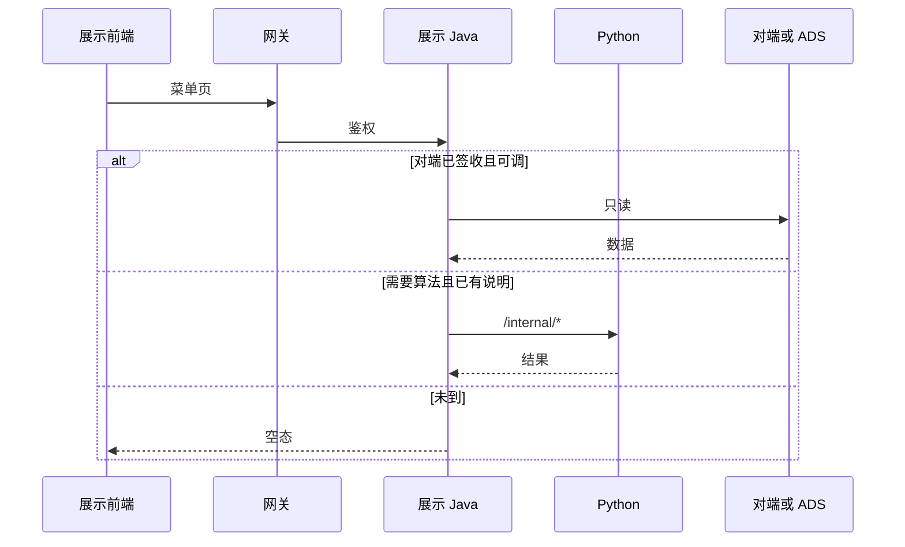
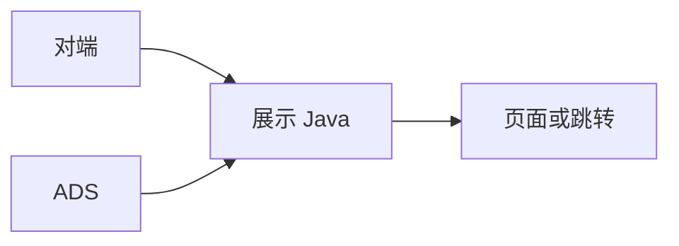

# 系统集成技术方案 · 展示系统集成

> **状态**：草案 · 2026-10-22 · 未签收  
> **WBS**：WBS-05-00  
> **过程位置**：工程过程卷 03。页面施工序不是本方案。

## 1. 背景与集成需求

下列菜单走对接，不进第 1 项自研全链路：科学技术全景、技术发展追踪、科技人才态势、科技数据资源、科技成果展示、科技创新生态服务、智库服务、科技交流 / 竞赛 / 传播。

三要素供数归第 2 项。读图、查图、图指标归第 7 项。本方案只保留各菜单其余对接对象。对端未承诺的数，页面空态。

对接系统：久新、燕大、智谱、高端智库，以及规约所写的外部系统（交流 / 竞赛 / 传播；「北大深势」这个名称评估文未署，先核对）。展示前端 `lumen-ui-science-pc`，Java 展示门面，统一用户中心只登记相对路径。

## 2. 应用对接技术架构

前端 → 网关 → 展示 Java → 已签收的对端或 ADS。算法在 Python。缺数空态，`USE_MOCK=false` 时不用 fixture 填数。

智库、交流、竞赛、传播默认跳转，不把对方页面做进本仓。

## 3. 数据存储与数据流转

加工与融合：不在展示 Java 里融合多源。三要素融合归第 2 项。成果、资源、生态的字段级稿是我方需求，对端未回，不在本文加列。

存储设计：还没有签收过的新增字段。仪器展示不做预约闭环，不为此加预约表。

## 4. 指标

页面上的统计数字沿用展示详设和指标库，不在对接方案里新定义口径。与指标库逐条对齐还没有做完。

| 菜单 | 实现方式 | 对齐 / 缺项 |
|---|---|---|
| 全景、技术追踪、人才 | 三要素指标在第 2 项。本菜单其余数字空态直到有源 | 久新说明未到，缺项未关闭 |
| 数据资源 | 调用统计等待智谱。未到则空态 | 未对齐 |
| 成果 | 口径未绿用角标，不改数 | 未对齐 |
| 生态服务 | 智树页面 + 已有或待补指标 | 未做逐条核对 |
| 智库、交流、竞赛、传播 | 跳转。不在本仓算对方指标 | 不适用自研指标；评估文已写明若干字段不支持 |

## 5. 分模块实现与 WBS

前端编码按页面计划为孔东，不另开前端叶。算法只在对端说明或指标库已有实现时由 Python 配合。数据加工不在本方案新开 GDF 包。

| 模块 | WBS | 前端 | 算法 | 数据加工 |
|---|---|---|---|---|
| 方案本身 | WBS-05-00 | 无 | 无 | 无。核对深势名称，收口「追踪 / 跟踪」 |
| 科学技术全景 | WBS-05-01a / 01b | 孔东做页面，空态可开 | 唐绍祖做接口。三要素算法不在本叶 | 三要素数据依赖 WBS-02-02 |
| 技术发展跟踪 | WBS-05-02a / 02b | 孔东做三个 Tab | 唐绍祖做接口 | 同上 |
| 人才态势菜单壳 | WBS-05-03a / 03b | 孔东做菜单和非三要素区块。四子页不重做 | 唐绍祖做非三要素接口。四子页算法在 WBS-02-01 | 四子页数据不在本叶填 |
| 数据资源 | WBS-05-04 | 四个视窗可切换 | 无新算法 | 等智谱供数，未到不加工假数 |
| 成果展示 | WBS-05-05 | 五页可开或空态 | 无新算法 | 不建预约数据 |
| 生态服务 | WBS-05-06 | 列表和详情 | 若有指标则走 Python | 读 ADS 或空态 |
| 智库 / 交流 / 竞赛 / 传播 | WBS-05-07、08 | 跳转和失败提示 | 不做对方算法 | 不入库 |
| 菜单注册与用户权限 | WBS-05-09 | 不新做页。相对路径配进统一用户中心 | 无 | 无 |

智树不做：高端智库后台、对方竞赛系统、第 7 项读图四页、第 1 项里的政策与监测页、统一用户中心产品本身。
