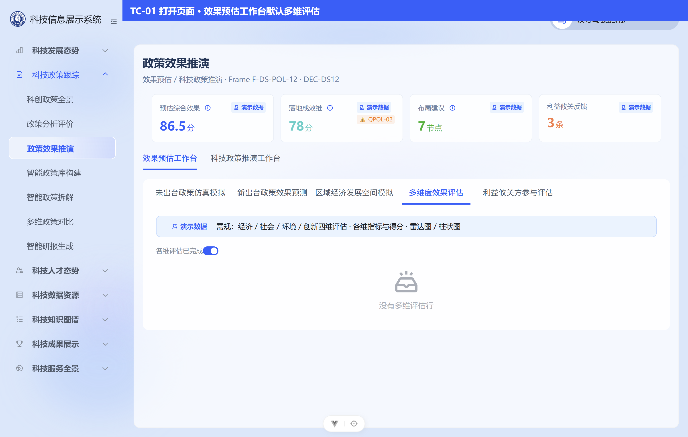
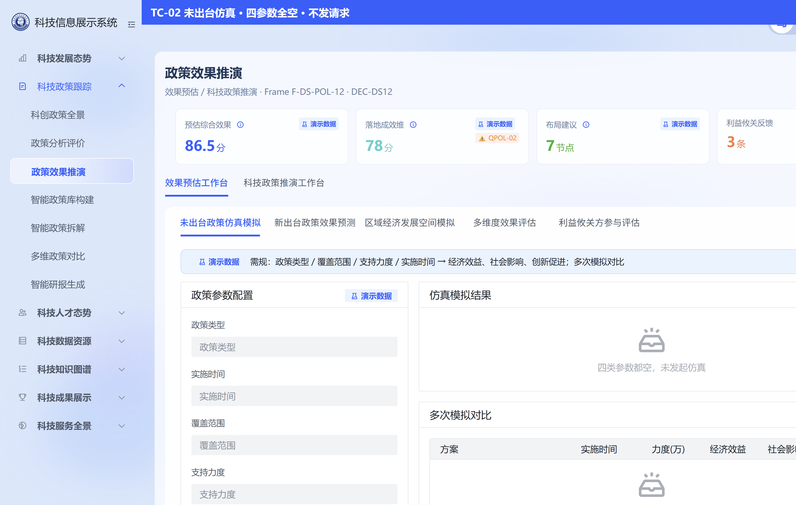
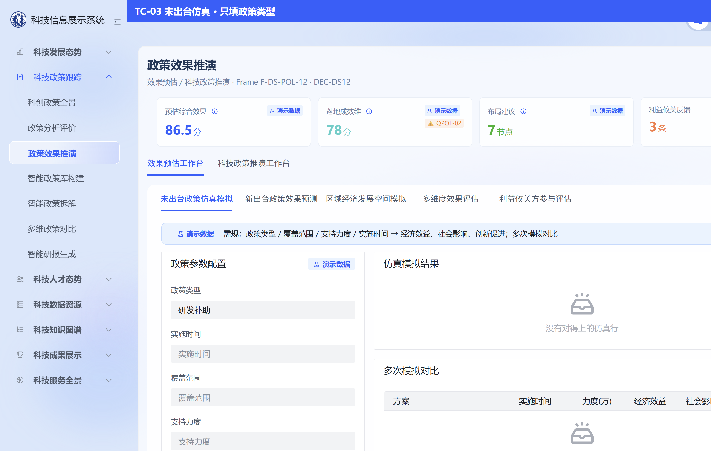
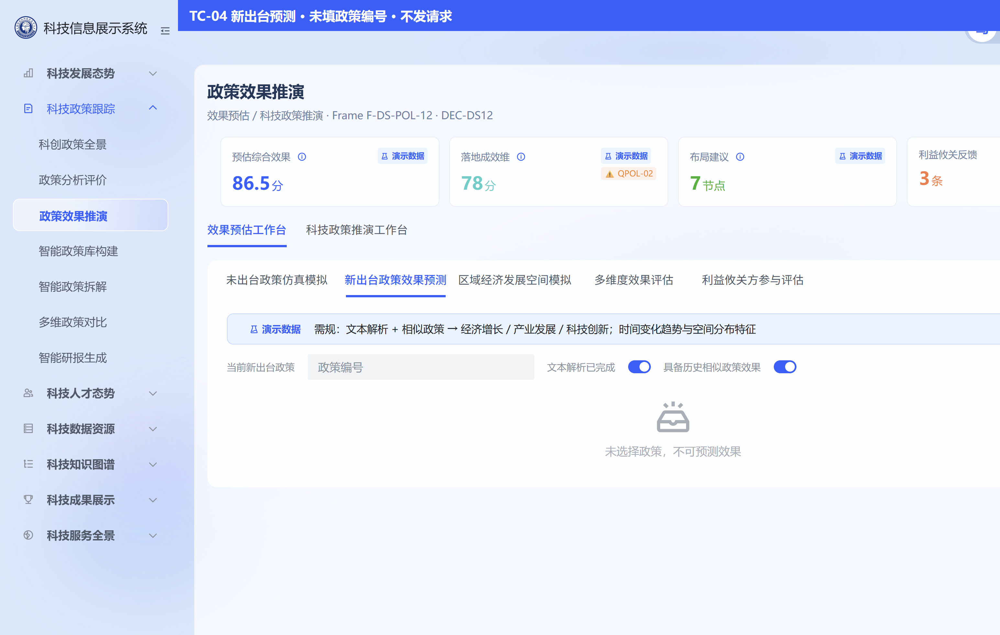
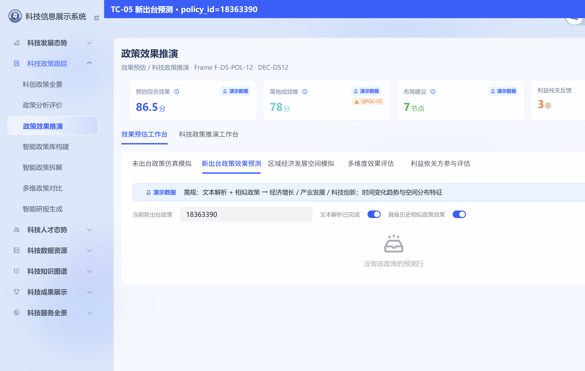
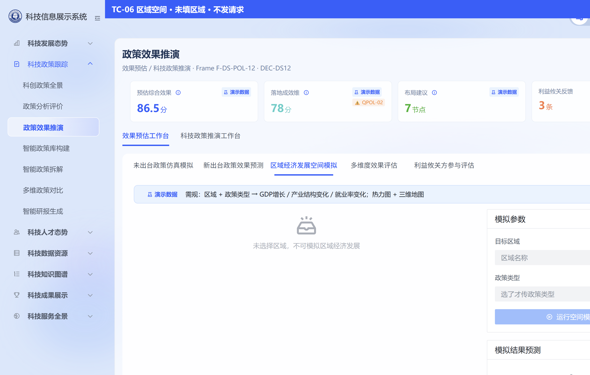
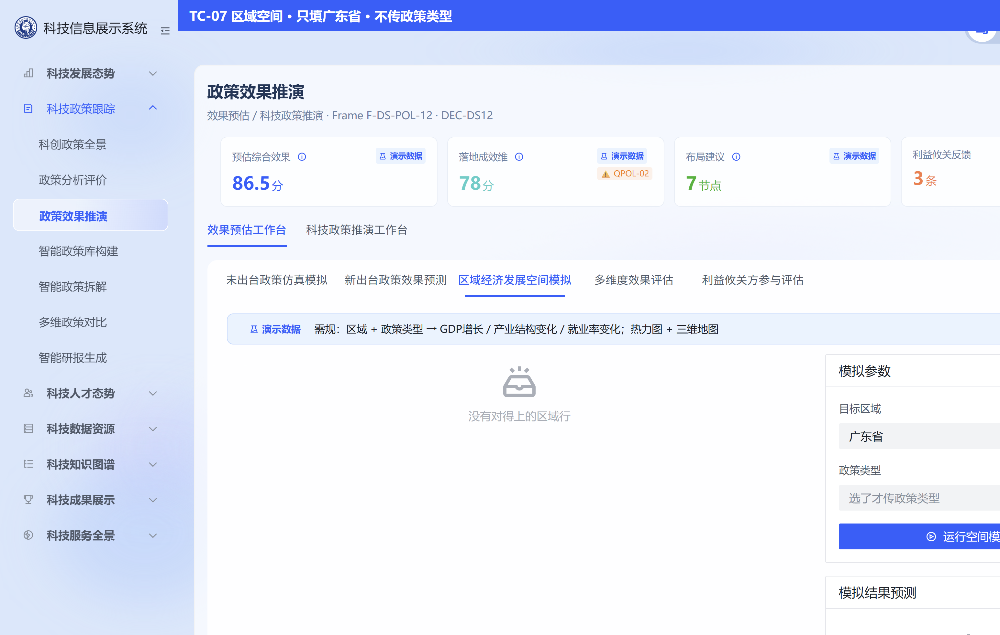
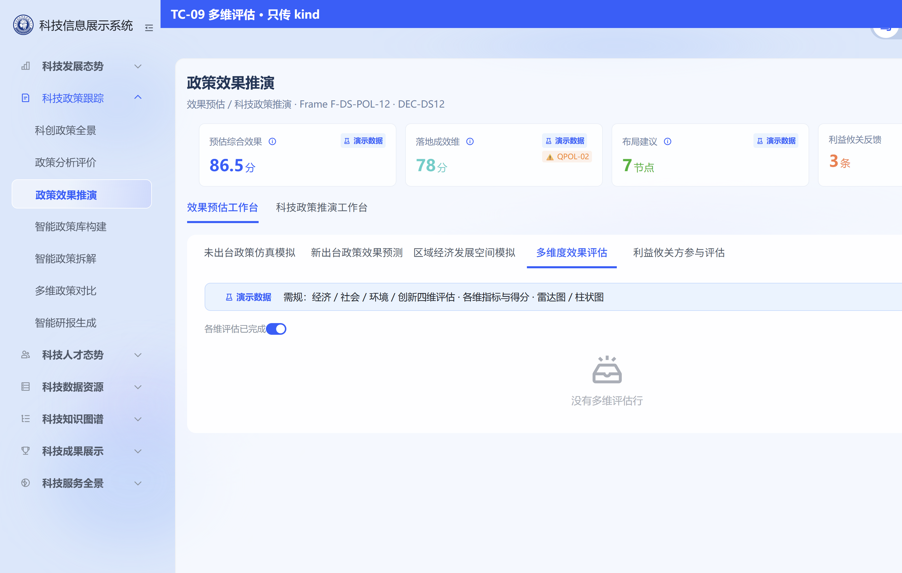
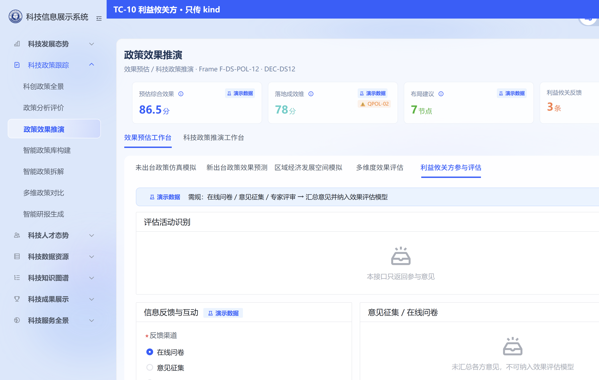
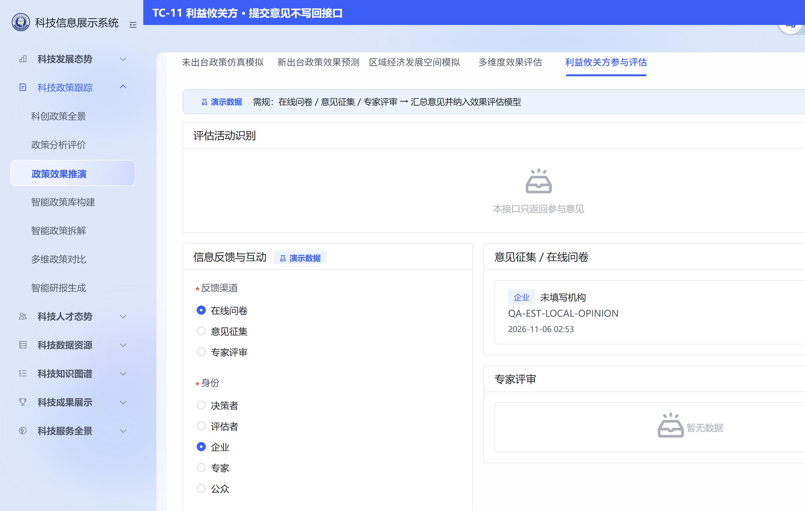

# POL-L2-DS12-EST-TEST-L01 · 政策效果推演 · 效果预估 · 集成测试用例

- 任务：`POL-L2-DS12-EST-TEST-L01`（WBS 行 `WBS-05-23-L2-08F`）
- 日期：2026-11-06
- 执行：`agent:qa-agent`；监管：`human:淮政玮`
- 被测链路：DS12 效果预估（SRS **232–236**）。只测效果预估，不测 237–242
- 设计真源：`agent-delivery/agent-handoffs/科技政策跟踪-POL/sdd/l2/POL-L2-DS12-EST-API.md`、`sdd/l2/POL-L2-DS12-EST-DATA.md`
- 2026-11-07 修订（`human:淮政玮`）：232 增加目标产业等值过滤，对齐上述两份同日修订与修复单 `POL-L2-DS12-INDUSTRY-EQ-FIX-L01`。第 2、3 节里 2026-11-06 已写下的实际结果不改写。新增用例的实际结果标未测。
- 灌数脚本：`lumen-algo-py/scripts/seed_gapfill_policy_sim_forecast.py`（只覆盖 232–234）
- 强度：ponytail full
- 截图目录：`POL-L2-DS12-EST-TEST-L01/`（相对本文件）

## 0. 接口与链路总览（被测对象）

五叶共用一条同步读，一次请求只带一种类。不建任务，不进 `gkxlumen-topic-async-service`，不调 Python。

| 序号 | 公开资源 | 读法 |
|---|---|---|
| 232 未出台仿真 | `POST /display/v1/policy/simulation/jobs`，`kind=未出台仿真` | display → element → `gkxlumenx_gapfill.gapfill_policy_sim_forecast` 的未出台仿真行。政策类型、覆盖范围、支持力度、实施时间、目标产业五类至少一类才查；五类全空不发请求。提交了的项与行上等值，没提交的项不加谓词。目标产业字段是 `target_industry`，值是级联回显全文 |
| 233 新出台预测 | 同一条，`kind=新出台预测` | 同一张表按 `policy_id` 拣行。没有 `policy_id` 不发请求 |
| 234 区域空间 | 同一条，`kind=区域空间` | 同一张表。必须有 `region_name`；`policy_type` 只在选了时传。没有名为「全国」的行 |
| 235 多维评估 | 同一条，`kind=多维评估` | 只传 `kind`。读 `gapfill_policy_sim_result` 的多维评估行。本灌数脚本不写这张表 |
| 236 利益攸关方 | 同一条，`kind=利益攸关方` | 只传 `kind`。读 `gapfill_policy_sim_stakeholder` 的参与意见行。页面新提交的意见不写回。禁止文案「利益低关方」 |

空态契约（API 分册第 8 节）：无行或条件对不上则空，HTTP 成功，`records` 为空列表，不返回 501，不返回写死曲线、得分或意见。查询不灌数。不写 ODS / DWD / ADS。

---

## 1. 合规交付主路径数据准备

> 232–234 的行来自预测灌数脚本，235、236 的行来自结果灌数脚本。2026-11-06 已写入 `gkxlumenx_gapfill`。口令不写入本文，也不写入 git。

### DP-01 脚本校验（不连库）

| 项 | 内容 |
|---|---|
| 前置 | 仓 `repos/lumen-algo-py`，脚本 `scripts/seed_gapfill_policy_sim_forecast.py` |
| 操作 | `python scripts/seed_gapfill_policy_sim_forecast.py --check` |
| 实际 | 退出码 0。`{"mode":"check","ok":true,"db":"gkxlumenx_gapfill","rows":{"gapfill_policy_sim_forecast":6}}`。SQL 镜像 `scripts/mysql/gapfill_policy_sim_forecast.sql` 含 **6 条 INSERT**。git 对照该 SQL 与脚本无新差异。镜像中无「全国」、无「利益低关方」、无 `gkxlumenx_ods` / `gkxlumenx_dwd` / `gkxlumenx_ads` |
| `--apply` | 2026-11-06 已执行。结果表与参与意见表由结果脚本直接写入：`gapfill_policy_sim_result` 20 行、`gapfill_policy_sim_stakeholder` 3 行。预测表第一次建表失败，MySQL `errno 1071`（四列唯一索引超过 3072 字节）。表已按脚本同列建成，四参数唯一索引改为各 128 字符前缀后，预测脚本插入 **6** 行。业务仓脚本与 SQL 文件未改 |

### DP-02 预测行（6 行，已落库）

库 `gkxlumenx_gapfill`，表 `gapfill_policy_sim_forecast`。每种 2 行。`is_mock=1`，`metric_id=M_POLICY_SIMULATE`，`fill_method=manual`，`gapfill_batch_id=POL-L2-DS12-EST-GAPFILL-L01`，`generated_at=2026-11-06 01:00:00`。用不到的列是 NULL。

| row_kind | 行数 | 业务键 | gap_item |
|---|---|---|---|
| 未出台仿真 | 2 | 研发补助 × 广东省高新技术企业 × 按研发投入的20%补助 × 2026年至2028年 × 新一代信息技术；人才引进 × 深圳市重点实验室 × 每人每年30万元 × 2027年至2029年 × 生物产业。`target_industry` 是级联回显全文 | `232 未出台政策仿真模拟` |
| 新出台预测 | 2 | `policy_id` `18363390`（广东省科技型中小企业研发环境支持）、`18407696`（深圳市外国人来华工作许可） | `233 新出台政策效果预测` |
| 区域空间 | 2 | 广东省 × 人才政策；深圳市 × 科创政策（对齐全景字典）。没有「全国」 | `234 区域经济发展空间模拟` |

### DP-03 行数核对（2026-11-06 已对上）

预测表按 `row_kind` 为未出台仿真 2、新出台预测 2、区域空间 2。`is_mock=1` 且 `metric_id=M_POLICY_SIMULATE` 的共 6 行。没有 `region_name=全国`。新出台两行是 `18363390`、`18407696`。下面的 SQL 是同一口径，口令不写入本文。

```sql
SELECT row_kind, COUNT(*) AS n
FROM gkxlumenx_gapfill.gapfill_policy_sim_forecast
GROUP BY row_kind;
-- 预期：未出台仿真 2、新出台预测 2、区域空间 2

SELECT COUNT(*) FROM gkxlumenx_gapfill.gapfill_policy_sim_forecast
WHERE is_mock = 1 AND metric_id = 'M_POLICY_SIMULATE' AND fill_method = 'manual';
-- 预期：6

SELECT COUNT(*) FROM gkxlumenx_gapfill.gapfill_policy_sim_forecast
WHERE region_name = '全国' OR policy_id IN ('18363390', '18407696');
-- 全国行预期 0；两条 policy_id 预期各 1，且都在新出台预测

SELECT policy_id, policy_title FROM gkxlumenx_gapfill.gapfill_policy_sim_forecast
WHERE row_kind = '新出台预测' ORDER BY policy_id;
-- 预期：18363390、18407696

SELECT policy_type, target_industry FROM gkxlumenx_gapfill.gapfill_policy_sim_forecast
WHERE row_kind = '未出台仿真' AND policy_type IN ('研发补助', '人才引进')
ORDER BY policy_type;
-- 2026-11-07 起预期：研发补助 / 新一代信息技术；人才引进 / 生物产业
-- 未出台仿真行的 target_industry 不得为 NULL。新出台预测、区域空间此列仍为 NULL
```

脚本 `--apply` 会先 `DELETE FROM gapfill_policy_sim_forecast` 再插入这 6 行，可重复。只写 `gkxlumenx_gapfill`。

### DP-04 环境

| 环境 | 本轮 |
|---|---|
| 本机前端 | `lumen-ui-science-pc` 已在 `http://127.0.0.1:3000`。`.env.development` 为 `VITE_APP_USE_MOCK=false`、`VITE_ENABLE_MOCK_AUTH=true`，接口代理到 `http://127.0.0.1:7099`。截图时地址带 `review=1`，页头有「演示数据」角标 |
| 线上 | `https://edu.itic-sci.com/tid/policy/policy-effect-simulation`。登录按新人引导第 6 节，机构「某某大学」。账号口令不写入本文 |
| 库 | `10.50.11.76` 的 `gkxlumenx_gapfill`。首批是预测 6 行、结果 20 行、参与意见 3 行。同日又按场景各追加 5 条，见第 1.2 节。正式政策标题在 `gkxlumenx_dwd.policy_base_info` |

---

## 1.1 演示样本（2026-11-06 库内实查）

四条都在 `gkxlumenx_dwd.policy_base_info`。页面上新出台卡片显示的是缺项行里的短标题，不是下面的正式标题。

| 政策编号 | 正式标题 | 发文机关 | 发布日期 | 本页能演示的种类 |
|---|---|---|---|---|
| `18363390` | 广东省科学技术厅关于印发《贯彻落实〈科技部办公厅关于营造更好环境支持科技型中小企业研发的通知〉的工作方案》的通知 | 广东省科学技术厅 | 2022-04-06 | 新出台预测。重点、影响范围、路径、解读也挂这个编号，见推演用例 |
| `18407696` | 深圳市科技创新委员会（深圳市外国专家局）关于发布2022年度深圳市外国人来华工作许可工资收入计算标准的通知 | 深圳市科技创新委员会 | 2022-06-15 | 新出台预测。没有重点、影响范围、路径、解读行 |
| `18318861` | 六部门关于印发《蚕桑丝绸产业高质量发展行动计划(2021-2025年)》的通知 | 工信部 | 2020-09-25 | 只用于文本解析，见推演用例。本页五类都不读解析表 |
| `18318865` | 三部门关于开展第四批智慧健康养老应用试点示范的通知 | 工信部 | 2020-07-16 | 同上，只用于文本解析 |

真轨下拉与级联回显必须与库内字符串一致。目标产业传级联回显全文，不传内部编码。接口通之后，页面应出现右列原文。2026-11-06 本轮接口仍是 401，下表是库内应有行，不是当时界面已经画出的结果。

| 页签 | 填入 | 页面应出现 |
|---|---|---|
| 未出台政策仿真模拟 | 政策类型 `研发补助`，覆盖范围 `广东省高新技术企业`，支持力度 `按研发投入的20%补助`，实施时间 `2026年至2028年`，目标产业 `新一代信息技术` | 经济效益「经济效益预测值约128亿元，相对基线变化率约6.5%。缺项演示。」；逐年趋势 `2026年120、2027年146、2028年171` |
| 未出台政策仿真模拟 | 政策类型 `人才引进`，覆盖范围 `深圳市重点实验室`，支持力度 `每人每年30万元`，实施时间 `2027年至2029年`，目标产业 `生物产业` | 经济效益「经济效益预测值约46亿元，相对基线变化率约3.4%。缺项演示。」 |
| 新出台政策效果预测 | 政策编号 `18363390` | 摘要标题「广东省科技型中小企业研发环境支持」；短期效果「短期内申报便利度上升，受惠企业数量约增加一成。缺项演示。」 |
| 新出台政策效果预测 | 政策编号 `18407696` | 摘要标题「深圳市外国人来华工作许可」；短期效果「短期内许可办理时长下降，用人单位补件次数减少。缺项演示。」 |
| 区域经济发展空间模拟 | 目标区域 `广东省`，政策类型填 `人才政策`（字典项；与界面一致） | 空间分布「广州市42、深圳市38、佛山市21、东莞市16」；GDP增长「GDP增长约1.2个百分点。AI推演结果，仅供参考。」；须见三维地图卡 + 热力矩阵卡 |
| 区域经济发展空间模拟 | 目标区域 `深圳市`，政策类型填 `科创政策` | 空间分布「南山区28、福田区19、宝安区14、龙岗区11」；GDP增长「GDP增长约0.6个百分点。AI推演结果，仅供参考。」 |
| 多维评估 | 不填，进入页签即请求 | 四个维度：经济 78.2500、社会 71.5000、环境 66.0000、创新 74.7500 |
| 利益攸关方 | 不填，进入页签即请求 | 三条参与意见：决策者 / 在线问卷「建议把研发补助的覆盖范围写清楚，便于部门执行。」；评估者 / 意见征集；利益攸关方 / 专家评审「企业侧希望申报材料再简化，并提前公布评审时间。」 |

只填政策类型 `研发补助`、不填目标产业时，未出台只应返回第一行。再填目标产业 `新一代信息技术` 仍是这一行；改填 `生物产业` 则该次模拟空。区域页：须同时选区域与政策类型才可点运行；请求可带 `policy_type`，不带 `target_industry`（产业仅 UI）。不要填「全国」。

### 1.2 每个场景另加 5 条（2026-11-06）

追加行的 `gapfill_batch_id` 是 `POL-L2-DS12-DEMO-EXTRA`，`is_mock=1`。再执行两支灌数脚本的 `--apply` 会清空整表，这 15+25+5 条会被删掉。文本解析不在本页。

未出台五条都要五项一起填，页面应出现对应的经济效益句。目标产业同样是级联回显全文。2026-11-06 追加时还没有这一列，修复单补上后按下表等值。

| 政策类型 | 覆盖范围 | 支持力度 | 实施时间 | 目标产业 | 经济效益 |
|---|---|---|---|---|---|
| 税收优惠 | 北京市科技企业 | 研发费用加计扣除 | 2026年至2028年 | 新能源 | 经济效益预测值约36亿元。缺项演示。 |
| 平台建设 | 上海市重点实验室 | 每个平台每年200万元 | 2026年至2028年 | 新材料 | 经济效益预测值约52亿元。缺项演示。 |
| 审批优化 | 浙江省高新技术企业 | 办结时限压缩至5个工作日 | 2026年至2027年 | 高端装备 | 经济效益预测值约18亿元。缺项演示。 |
| 资金扶持 | 江苏省专精特新企业 | 单户最高500万元 | 2027年至2029年 | 绿色环保 | 经济效益预测值约64亿元。缺项演示。 |
| 人才补贴 | 山东省高层次人才 | 每人每年20万元 | 2026年至2028年 | 海洋产业 | 经济效益预测值约27亿元。缺项演示。 |

新出台五条的页面标题就是正式标题。填政策编号。

| 政策编号 | 正式标题 | 发文机关 | 发布日期 | 短期效果 |
|---|---|---|---|---|
| `18407919` | 关于征集第二十五届京港洽谈会双向投资项目的通知 | 北京市发展和改革委员会 | 2022-08-16 | 短期内征集项目增多，京港双向投资对接场次上升。缺项演示。 |
| `18325652` | 江西省商务厅关于修改部分规范性文件的通知 | 江西省商务厅 | 2022-08-15 | 短期内被修改的规范性文件执行口径更清楚。缺项演示。 |
| `18353808` | 商务部公告2018年第42号关于原产于印度的进口间苯氧基苯甲醛反倾销调查最终裁定的公告 | 江西省商务厅 | 2022-08-15 | 短期内相关进口企业的合规关注上升。缺项演示。 |
| `18354583` | 江西省商务厅关于印发《江西国际贸易“单一窗口”数据安全管理实施细则》的通知 | 江西省商务厅 | 2022-08-15 | 短期内单一窗口数据调阅留痕更完整。缺项演示。 |
| `18407856` | 江西省人民政府关于印发江西省流域综合管理暂行办法的通知 | 江西省人民政府 | 2022-08-15 | 短期内流域管理职责边界更清楚。缺项演示。 |

区域五条只填区域名，政策类型留空。

| 目标区域 | GDP增长 | 空间分布 |
|---|---|---|
| 北京市 | GDP增长约0.4个百分点。缺项演示。 | 东城区12、西城区9、海淀区16、朝阳区14 |
| 上海市 | GDP增长约0.5个百分点。缺项演示。 | 浦东新区22、徐汇区11、闵行区9、嘉定区7 |
| 山东省 | GDP增长约0.3个百分点。缺项演示。 | 济南市15、青岛市18、烟台市8、潍坊市6 |
| 浙江省 | GDP增长约0.7个百分点。缺项演示。 | 杭州市24、宁波市16、温州市9、嘉兴市7 |
| 陕西省 | GDP增长约0.2个百分点。缺项演示。 | 西安市20、宝鸡市6、咸阳市5、渭南市4 |

多维评估打开页签即返回全部维度。原有经济、社会、环境、创新仍在，另加：

| 维度 | 得分 | 说明 |
|---|---|---|
| 产业 | 82.0000 | 产业发展得分高于环境维度。缺项演示。 |
| 人才 | 70.5000 | 人才维度接近社会维度。缺项演示。 |
| 开放 | 68.0000 | 开放维度改善有限。缺项演示。 |
| 安全 | 73.2500 | 安全维度介于人才与创新之间。缺项演示。 |
| 治理 | 76.0000 | 治理维度接近经济维度。缺项演示。 |

利益攸关方打开页签后，原有 3 条仍在，另加：

| 角色 | 渠道 | 时间 | 意见 |
|---|---|---|---|
| 决策者 | 在线问卷 | 2026-04-02 09:00:00 | 建议先公布征集项目的评审时间。 |
| 评估者 | 意见征集 | 2026-04-18 11:00:00 | 评估流域管理时建议分开看上下游。 |
| 利益攸关方 | 专家评审 | 2026-05-06 15:00:00 | 企业希望单一窗口的数据调阅再简化。 |
| 决策者 | 意见征集 | 2026-05-21 10:30:00 | 规范性文件修改后建议同步更新办事指南。 |
| 评估者 | 在线问卷 | 2026-06-09 16:20:00 | 反倾销裁定的影响建议按进口企业规模分开看。 |

当前表内行数：未出台仿真 7、新出台预测 7、区域空间 7、多维评估 9、参与意见 8。

---

## 2. 关键路径验证用例

> 实际结果只记本轮看到的响应。接口没有返回「HTTP 成功且 records 为空」时，不记通过。

### TC-API-01 未出台 · 五类全空

| 列 | 内容 |
|---|---|
| 编号 | TC-API-01 |
| 前置 | `USE_MOCK=false` |
| 步骤 | 打开效果预估，进入「未出台政策仿真模拟」，政策类型、覆盖范围、支持力度、实施时间、目标产业都空。再点「运行仿真模拟」 |
| 预期 | 不发 `POST /display/v1/policy/simulation/jobs`。页面文案「五类参数都空，未发起仿真」 |
| 实际结果 | **2026-11-06 按当时四类测过**。本机网络没有这条 POST。按钮 `disabled=true`。当时文案是「四类参数都空，未发起仿真」。见 TC-02 截图。五类文案尚未复测 |

### TC-API-02 未出台 · 只填一类

| 列 | 内容 |
|---|---|
| 编号 | TC-API-02 |
| 步骤 | 只填政策类型「研发补助」 |
| 预期 | 只传已填项：`{"kind":"未出台仿真","policy_type":"研发补助"}`，不带 `target_industry`。命中研发补助那一行。HTTP 成功，不返回 501 |
| 实际结果 | **请求体符合，HTTP 成功空列表未测到**。本机发出上述 JSON，响应 HTTP **401**，`msg=访问令牌不存在`。页面显示「没有对得上的仿真行」。这是失败降级，不是 200 空列表。见 TC-03。当时请求还没有 `target_industry` |

### TC-API-12 未出台 · 只填目标产业

| 列 | 内容 |
|---|---|
| 编号 | TC-API-12 |
| 步骤 | 其他四类留空，目标产业只选集群「新一代信息技术」 |
| 预期 | body 为 `{"kind":"未出台仿真","target_industry":"新一代信息技术"}`。等值命中研发补助那一行。HTTP 成功，不返回 501 |
| 实际结果 | **未测**。归修复单 `POL-L2-DS12-INDUSTRY-EQ-FIX-L01` |

### TC-API-13 未出台 · 五类对档

| 列 | 内容 |
|---|---|
| 编号 | TC-API-13 |
| 步骤 | 政策类型 `研发补助`，覆盖范围 `广东省高新技术企业`，支持力度 `按研发投入的20%补助`，实施时间 `2026年至2028年`，目标产业 `新一代信息技术` |
| 预期 | 五个字段都在 body 里，且与行上等值。返回经济效益约 128 亿元那一句。改目标产业为 `生物产业` 后 records 空，HTTP 成功 |
| 实际结果 | **未测**。归修复单 `POL-L2-DS12-INDUSTRY-EQ-FIX-L01` |

### TC-API-14 未出台 · 多选回显

| 列 | 内容 |
|---|---|
| 编号 | TC-API-14 |
| 步骤 | 目标产业同时选中两个集群 |
| 预期 | `target_industry` 是整段回显，含 `、` 或「等 N 项」。按整串等值，不拆成 OR。对不上现有行则 records 空，HTTP 成功 |
| 实际结果 | **未测**。归修复单 `POL-L2-DS12-INDUSTRY-EQ-FIX-L01` |

### TC-API-03 新出台 · 无政策编号

| 列 | 内容 |
|---|---|
| 编号 | TC-API-03 |
| 步骤 | 进入「新出台政策效果预测」，政策编号留空 |
| 预期 | 不发请求。文案「未选择政策，不可预测效果」 |
| 实际结果 | **符合**。无 POST。见 TC-04 |

### TC-API-04 新出台 · 必须 policy_id

| 列 | 内容 |
|---|---|
| 编号 | TC-API-04 |
| 步骤 | 填 `18363390` |
| 预期 | body 只有 `kind` 与 `policy_id`。有行则带回该政策预测；无行则空，HTTP 成功，不返回 501 |
| 实际结果 | **请求体符合，成功空列表未测到**。body `{"kind":"新出台预测","policy_id":"18363390"}`。本机 HTTP **401**，`访问令牌不存在`。页面「没有该政策的预测行」。见 TC-05。库内这条预测行已经在，接口通后应看到短标题「广东省科技型中小企业研发环境支持」，见第 1.1 节。本轮没有读到它 |

### TC-API-05 区域 · 无区域名

| 列 | 内容 |
|---|---|
| 编号 | TC-API-05 |
| 步骤 | 进入「区域经济发展空间模拟」，区域留空 |
| 预期 | 不发请求。文案「未选择区域，不可模拟区域经济发展」。不补全国 |
| 实际结果 | **符合**。无 POST。政策类型占位为「选了才传政策类型」。见 TC-06 |

### TC-API-06 区域 · 只选区域名（2026-11-12：类型亦必选）

| 列 | 内容 |
|---|---|
| 编号 | TC-API-06 |
| 步骤 | 只填区域「广东省」，政策类型留空 |
| 预期 | **不发请求**；按钮禁用；文案「未选择政策类型，不可模拟区域经济发展」 |
| 实际结果 | （待重测；COVER 闸门对齐 mock） |

### TC-API-07 区域 · 区域+字典类型

| 列 | 内容 |
|---|---|
| 编号 | TC-API-07 |
| 步骤 | 区域「广东省」，政策类型「人才政策」 |
| 预期 | body `{"kind":"区域空间","region_name":"广东省","policy_type":"人才政策"}`；命中粤行；须见三维地图卡与热力卡 |
| 实际结果 | （待线上回灌后重测） |

### TC-API-08 多维评估 · 只传 kind

| 列 | 内容 |
|---|---|
| 编号 | TC-API-08 |
| 步骤 | 进入「多维度效果评估」 |
| 预期 | body 只有 `{"kind":"多维评估"}`。无行则雷达和柱状空，HTTP 成功，不返回 501 |
| 实际结果 | **请求体符合，成功空列表未测到**。首次进入本机 HTTP **401**，`访问令牌不存在`。再次进入 body 仍只有 `{"kind":"多维评估"}`，XHR status 0。页面「没有多维评估行」，没有用种子雷达填数。见 TC-01、TC-09 |

### TC-API-09 利益攸关方 · 只传 kind

| 列 | 内容 |
|---|---|
| 编号 | TC-API-09 |
| 步骤 | 进入「利益攸关方参与评估」 |
| 预期 | body 只有 `{"kind":"利益攸关方"}`。页面不得出现「利益低关方」 |
| 实际结果 | **请求体与用字符合，成功空列表未测到**。body `{"kind":"利益攸关方"}`。XHR status 0。页内文案是「利益攸关方」「本接口只返回参与意见」。整页文本无「利益低关方」。见 TC-10 |

### TC-API-10 页面提交的意见不写回

| 列 | 内容 |
|---|---|
| 编号 | TC-API-10 |
| 步骤 | 在利益攸关方填写意见 `QA-EST-LOCAL-OPINION`，点「提交反馈」 |
| 预期 | 意见只留在浏览器。请求不插入。不出现带这段意见正文的 jobs |
| 实际结果 | **符合**。提示「意见留在本页，未写入接口」。列表出现该条。提交后没有 jobs body 含这段文字。见 TC-11 |

### TC-API-11 线上 jobs 与未知 kind

| 列 | 内容 |
|---|---|
| 编号 | TC-API-11 |
| 步骤 | 登录后对 `POST https://edu.itic-sci.com/tid/api/display/v1/policy/simulation/jobs` 依次提交：未出台全空、未出台一项、五类对档、只填 `target_industry=新一代信息技术`、`target_industry=生物产业` 且政策类型仍是研发补助、多选回显整串、新出台无编号、`18363390`、`18407696`、区域空、广东省、广东省+研发补助、对不上的类型、`region_name=全国`、多维评估、利益攸关方、`利益低关方`、未知 kind、空 body。区域请求不带 `target_industry` |
| 预期 | 空表或未知 kind：HTTP 成功，records 空，不返回 501。对得上的 232–234 在灌库后返回对应行 |
| 实际结果 | **未测到成功空列表**。未带登录的同一 URL 为 HTTP 401。带登录后上述 body **全部 HTTP 404**，Spring 体 `path=/v1/policy/simulation/jobs`，`error=Not Found`。响应里没有 501，也没有 records。说明网关把 `/display` 剥掉后，当前 display 进程没有这条映射。未登录打 `https://edu.itic-sci.com/api/display/v1/policy/simulation/jobs` 为 HTTP 500。本机直连 `http://127.0.0.1:7099/v1/policy/simulation/jobs`（body `{"kind":"多维评估"}`，无登录）为 HTTP **401** 未经授权，约 59 秒后返回。这条路径在本机网关存在，但仍不是 200 空列表 |

### 用例汇总

| 编号 | 一句话 | 状态 |
|---|---|---|
| TC-API-01 / 03 / 05 | 条件不齐不发请求 | 本机已测到 |
| TC-API-02 / 04 / 06 / 07 / 08 / 09 | 请求体按种类收口 | 请求体已测到；HTTP 200 空列表未测到 |
| TC-API-12 / 13 / 14 | 目标产业等值 | 未测。归 `POL-L2-DS12-INDUSTRY-EQ-FIX-L01` |
| TC-API-10 | 意见不写回 | 本机已测到 |
| TC-API-11 | 空表与未知 kind 不返回 501 | 线上 404，未测到该契约 |
| 灌库 | 首批未出台 2、新出台 2、区域 2 | 2026-11-06 已写入。同日每个场景另加 5 条，见第 1.2 节 |

---

## 3. 界面操作过程（lumen-ui-science-pc · 政策效果推演 · 效果预估）

前置：`VITE_APP_USE_MOCK=false`。入口：科技政策跟踪 → 政策效果推演 → 效果预估工作台。无数据时截空态，不用 fixture 填这五块。页头 86.5 / 78 / 7 / 3 是页面壳上的数字，不是这五叶 jobs 的返回，见 OBS-01。

| 步骤 | 操作 | 预期 | 实际 | 截图 |
|---|---|---|---|---|
| S1 | 打开页面 | 默认在效果预估；多维评估无行则空 | 默认「多维度效果评估」，「没有多维评估行」 | TC-01 |
| S2 | 未出台，五类全空 | 不发请求 | 2026-11-06 文案仍是「四类参数都空，未发起仿真」，无 POST。五类文案未复测 | TC-02 |
| S3 | 未出台只填政策类型 | 只带这一项去查；不带 `target_industry` | 发出仅含 `policy_type` 的 body；401 后显示「没有对得上的仿真行」 | TC-03 |
| S12 | 未出台只选「新一代信息技术」 | body 只有 kind 与 `target_industry`，命中研发补助行 | 未测 | — |
| S13 | 未出台五类按研发补助那一行填齐 | 五字段等值，出现约 128 亿元那一句 | 未测 | — |
| S14 | 同一行把目标产业改成「生物产业」 | records 空，HTTP 成功 | 未测 | — |
| S4 | 新出台不填编号 | 不发请求 | 「未选择政策，不可预测效果」 | TC-04 |
| S5 | 新出台填 `18363390` | 只带 policy_id | body 符合；401 后「没有该政策的预测行」 | TC-05 |
| S6 | 区域不填名称 | 不发请求 | 「未选择区域，不可模拟区域经济发展」 | TC-06 |
| S7 | 区域只填广东省 | 不传政策类型 | body 只有 kind 与 region_name；空态「没有对得上的区域行」 | TC-07 |
| S8 | 区域再填研发补助 | 此时才传 policy_type | body 含这两项；空态仍空 | TC-08 |
| S9 | 多维评估 | 只传 kind，无种子雷达 | 「没有多维评估行」 | TC-09 |
| S10 | 利益攸关方 | 只传 kind，用字正确 | 「本接口只返回参与意见」「未汇总各方意见」 | TC-10 |
| S11 | 提交一条意见 | 不写回接口 | 列表出现本地意见，提示未写入接口 | TC-11 |






















---

## 4. 观察

| 编号 | 说明 |
|---|---|
| OBS-01 | `USE_MOCK=false` 时五叶结果区是空态，没有种子曲线。页头「预估综合效果 86.5」「落地成效维 78」「布局建议 7」「利益攸关反馈 3」仍显示。截图带 `review=1` 时这些卡还有「演示数据」。这四张卡不是本轮 jobs 的 records |
| OBS-02 | 本机 401 和后来未完成的 XHR，页面都落成「没有对得上的…行 / 没有多维评估行」。不能把这句文案当成接口已返回 200 空列表 |
| OBS-03 | 线上 display 当前没有 `POST /v1/policy/simulation/jobs`（404）。232–236 的成功空列表与灌库后的有行分支都还不能在这条 URL 上复测 |

## 5. 结论

- `--check` 通过。2026-11-06 首批预测 6 行、多维评估 4 行、参与意见 3 行已在 `gkxlumenx_gapfill`，同日每个场景另加 5 条，见第 1.2 节。
- 前端在 `USE_MOCK=false` 下：2026-11-06 当时四参数全空、未选政策、未选区域都不发请求；有条件时 body 按种类收口；意见提交不写回；页面无「利益低关方」。
- 2026-11-07 起，未出台再加目标产业等值。五类全空不发请求。`target_industry` 用级联回显全文。TC-API-12、TC-API-13、TC-API-14 尚未复测。
- `POST /display/v1/policy/simulation/jobs` 的「HTTP 成功、records 空、不返回 501」本轮没有测到。线上当时是 404，本机是 401 或 XHR 未完成。库内行还没有被这条接口读出来。
