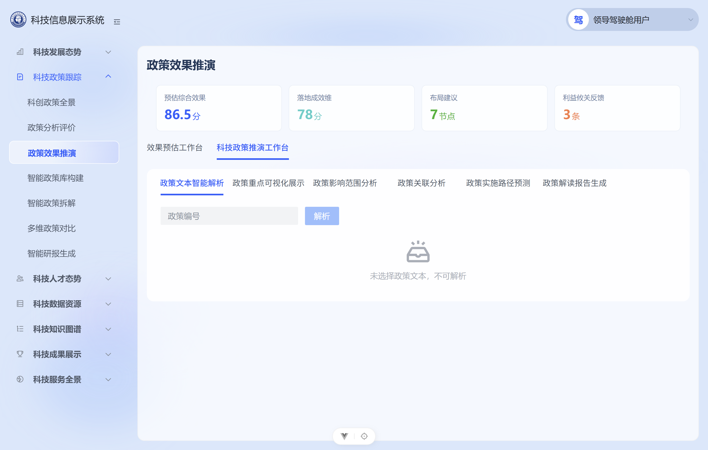
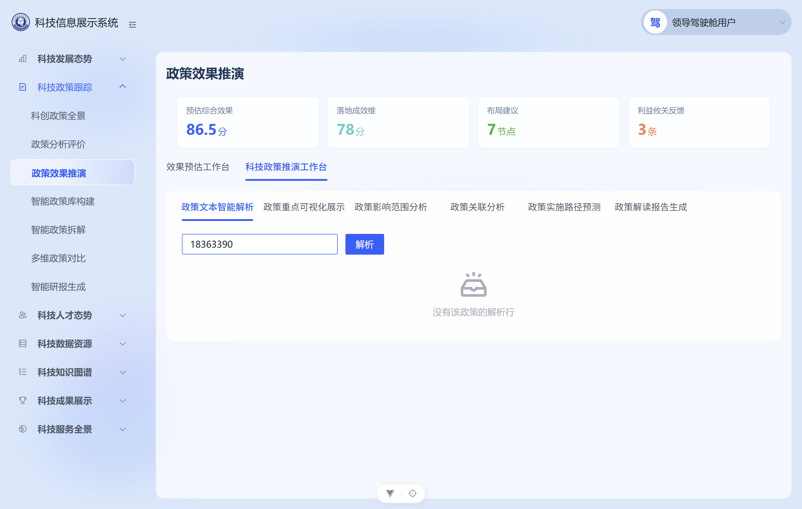
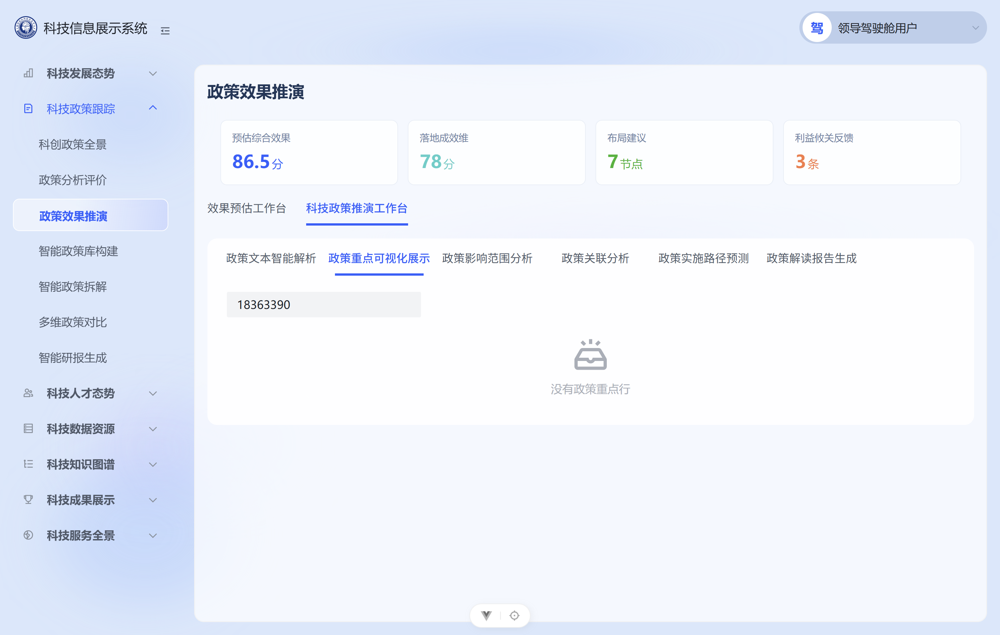
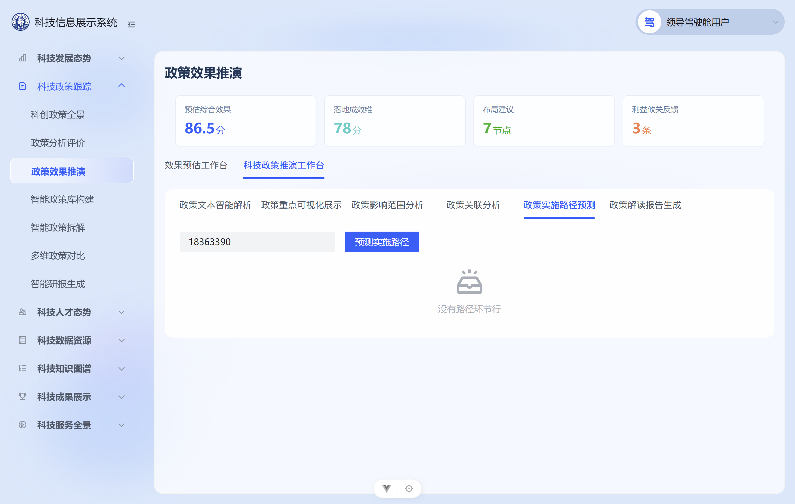
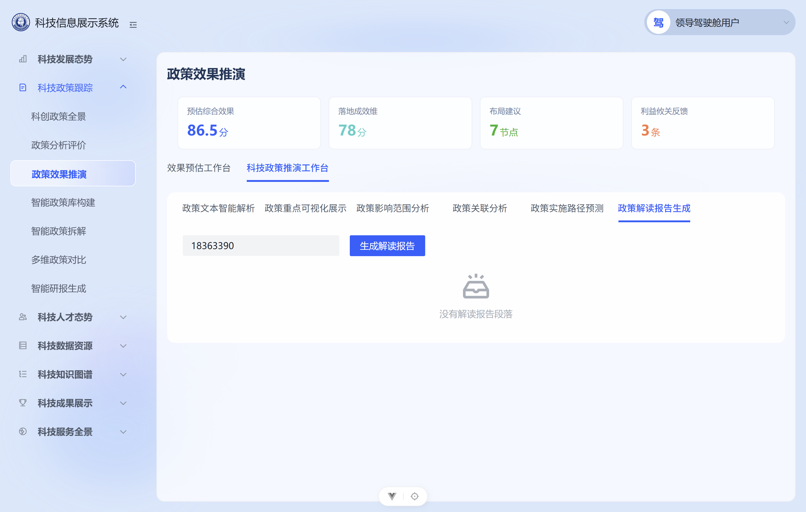
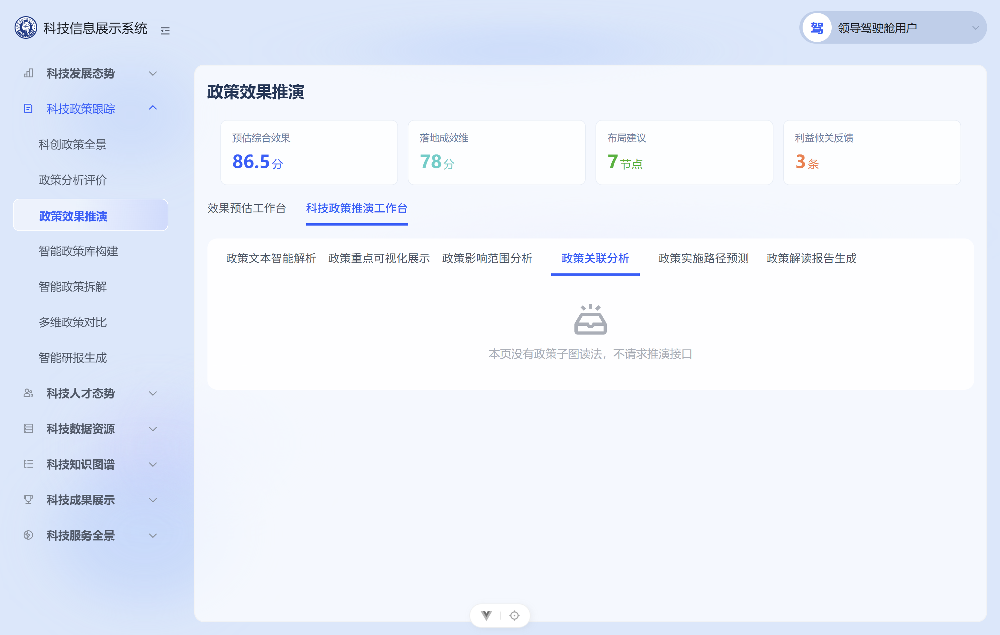

# POL-L2-DS12-SIM-TEST-L01 · 科技政策推演 · 集成测试用例

- 任务：`POL-L2-DS12-SIM-TEST-L01`（WBS 行 `WBS-05-23-L2-09F`）
- 日期：2026-11-06
- 执行：`agent:qa-agent`；监管：`human:淮政玮`；认领与监管均为 `human:淮政玮`，状态保持 `in_progress`
- 被测链路：科技政策推演（SRS 237–242）
- 设计真源：`agent-delivery/agent-handoffs/科技政策跟踪-POL/sdd/l2/POL-L2-DS12-SIM-API.md`、`sdd/l2/POL-L2-DS12-SIM-DATA.md`
- 灌数脚本：`lumen-algo-py/scripts/seed_gapfill_policy_sim_result.py`（`POL-L2-DS12-SIM-GAPFILL-L01`）
- 强度：ponytail full
- 本轮未改 lumen 业务仓，未改 `POL-L2-DS12-EST-TEST-L01`，未 commit，未 push，未改 task-registry

## 0. 接口与链路总览（被测对象）

公开资源只有一条：`POST /display/v1/policy/simulation/jobs`。一次请求一种类。浏览器 → 网关 `gkxlumen-platform-gateway`（`/display/**`，StripPrefix=1）→ `gkxlumen-display` → `gkxlumen-element`。display 不建任务，不转发 `gkxlumen-topic-async-service`，不调 Python `/internal/*`。

| SRS | 种类 | 读法 |
|---|---|---|
| 237 政策文本智能解析 | 文本解析 | 按 `policy_id` 读已有 `ads.policy_text_parse` / `gkxlumenx_ads.policy_text_parse`。返回时从 `structured_elements` 去掉 `clauses`、`clause_meta`，行仍在。请求路径不调用 `polan.text.parse.run` |
| 238 政策重点可视化展示 | 重点可视化 | 必须 `policy_id`。读 `gkxlumenx_gapfill.gapfill_policy_sim_result` 的重点行 |
| 239 政策影响范围分析 | 影响范围 | 必须 `policy_id`。同一张表的影响范围行 |
| 240 政策关联分析 | 无 | 无 HTTP 资源。页面不请求 `simulation/jobs` |
| 241 政策实施路径预测 | 路径预测 | 必须 `policy_id`。同一张表的路径环节行 |
| 242 政策解读报告生成 | 解读报告 | 必须 `policy_id`。同一张表的解读段落行。只返正文，不生成 PDF / Word |

空态契约（API 分册）：无行则该区空，HTTP 成功，`records` 为空列表，不返回 501，接口函数不写死 mock。

样本政策编号：`18363390`（脚本里重点、影响范围、路径环节、解读段落共用）。`18407696` 只在预测脚本，本叶四类结果行不挂它。

## 1. 合规交付主路径数据准备

### DP-01 结果表与参与意见表（脚本校验）

| 项 | 内容 |
|---|---|
| 仓 | `e:\zhipu\gkx-lumen\repos\lumen-algo-py` |
| 操作 | `python scripts/seed_gapfill_policy_sim_result.py --check` |
| 实际结果 | 2026-11-06 本轮退出码 0：`{"mode":"check","ok":true,"db":"gkxlumenx_gapfill","rows":{"gapfill_policy_sim_result":20,"gapfill_policy_sim_stakeholder":3}}`。随后 `git status --short` 对脚本与 `scripts/mysql/gapfill_policy_sim_result.sql` 无输出，工作区保持干净 |
| 行构成 | 结果表 20 = 多维评估 4（`policy_id` 空）+ 重点 4 + 影响范围 3 + 路径环节 5 + 解读段落 4。后四类 `policy_id=18363390`。意见表 3 行，`row_kind` 只有「参与意见」，`actor_role` 依次为决策者、评估者、利益攸关方。脚本断言禁止「利益低关方」 |
| 未做 | 不灌文本解析，不为 240 建表，不写文件路径，不调用 `polan.text.parse.run`，不写 ODS / DWD / ADS |

### DP-02 写入库

| 项 | 内容 |
|---|---|
| 条件 | 只有环境里已经有 `LUMEN_ALGO_MYSQL_PASSWORD` 才执行 `--apply` |
| 实际结果 | 本机进程环境变量为空。`--apply` 未执行。口令未写入 git，也未写入本用例。库内是否已有这 20+3 行，本轮没有连库核实 |

### DP-03 文本解析表

237 读已有解析表。本轮不灌、不改 `policy_text_parse`。网关匿名调用未进入 element，剥条款与「行仍在」没有在线上响应里核对。代码依据：`PolicySimulationReadController.parse` 对每行调用 `stripClauses`，从结构化要素去掉 `clauses` 与 `clause_meta` 后仍返回该行。既有单测 `PolicySimulationReadControllerTest` 覆盖该行为。

### DP-04 环境

| 环境 | 实测 |
|---|---|
| 网关 | `http://10.50.69.111:30895`。`GET /display/actuator/health` HTTP 200。已发布展示前端 `http://10.50.69.111:30891/` HTTP 200 |
| 本机页面 | `lumen-ui-science-pc`，`VITE_APP_USE_MOCK=false`。`pnpm` 对应的 vite 落在 `http://127.0.0.1:3001/`（3000 已被占用）。页面 API 配置指向 `http://127.0.0.1:7099`，该端口原无服务，本轮用临时转发把 `/v1/*` 送到网关 `/display/v1/*`。转发只作本机入口，判定以直连网关的响应为准 |
| 登录态 | 页面为本地模拟登录（领导驾驶舱用户），请求不带 Bearer。与直连网关不带令牌的调用一致 |

## 2. 关键路径验证用例

### TC-01 灌数脚本行数与主体闭集

| 列 | 内容 |
|---|---|
| 编号 | TC-01 |
| 前置 | 脚本在仓内，不连库 |
| 步骤 | 执行 DP-01 的 `--check` |
| 预期 | `gapfill_policy_sim_result` 20 行，`gapfill_policy_sim_stakeholder` 3 行；意见 `row_kind` 只有「参与意见」；`actor_role` 只有决策者、评估者、利益攸关方 |
| 实际结果 | **通过（脚本层）**。输出即 DP-01。`--apply` 未执行，线上行数未证实 |

### TC-02 237 文本解析

| 列 | 内容 |
|---|---|
| 编号 | TC-02 |
| 前置 | 网关在线；政策编号 `18363390` |
| 步骤 | `POST /display/v1/policy/simulation/jobs`，body `{"kind":"文本解析","policy_id":"18363390"}`。客户端带 `X-Trace-Id: qa-ds12-sim-20261106`。页面在填入同一编号后同样发起该请求 |
| 预期 | HTTP 成功；有解析行则行仍在，且 `structured_elements` 不含 `clauses`、`clause_meta`；无行则 `records` 为空。请求路径不调用 `polan.text.parse.run`。不返回 501 |
| 实际结果 | **未通过（BUG-01）**。直连网关 HTTP 401，body `{"code":401,"msg":"访问令牌不存在","data":"Full authentication is required to access this resource","ok":false}`。网关回写 `X-Trace-Id: 8625a312d1fd2d44ae15772d57014481`。页面 XHR 同 URL 同 body，状态 401。响应没有 `records`，剥条款与「不调 parse.run」在这条链上没有被执行到 |

### TC-03 238 / 239 / 241 / 242 必须带政策编号

| 列 | 内容 |
|---|---|
| 编号 | TC-03 |
| 前置 | 同一页面，`USE_MOCK=false` |
| 步骤 | 1. 政策编号为空时停在各子页；2. 填入 `18363390` 后依次打开重点、影响范围、路径、解读报告 |
| 预期 | 无 `policy_id` 时不发请求，区域为空。有 `policy_id` 时各发一次对应种类。无行则 HTTP 成功且 `records` 为空。解读只返正文 |
| 实际结果 | 编号为空时，`simulationJobBody` 对这四类返回 null，页面不发 jobs（请求日志从开始逐字输入才出现）。填入 `18363390` 后页面实际发出：`重点可视化`、`影响范围`、`路径预测`、`解读报告`，四次都带 `policy_id=18363390`，HTTP 均为 401（BUG-01）。空 `records` 的成功响应没有在线上见到 |

### TC-04 242 不生成 PDF / Word

| 列 | 内容 |
|---|---|
| 编号 | TC-04 |
| 前置 | 解读报告子页，`USE_MOCK=false`，政策编号 `18363390` |
| 步骤 | 打开「政策解读报告生成」，检查按钮与正文区 |
| 预期 | 只呈现段落正文。页面不提供 PDF / Word 下载 |
| 实际结果 | **通过（界面）**。可见按钮是「生成解读报告」。正文区文案「没有解读报告段落」。页面文本不含「下载」「PDF」「Word」。Word/PDF 单选与「下载推演解读报告」写在 `USE_MOCK` 分支，本次未渲染。接口侧因 401 没有正文可对 |

### TC-05 240 不请求推演接口

| 列 | 内容 |
|---|---|
| 编号 | TC-05 |
| 前置 | 已在其他子页发过 jobs，政策编号仍为 `18363390` |
| 步骤 | 打开「政策关联分析」，对比打开前后的 XHR 列表 |
| 预期 | 不请求 `POST /display/v1/policy/simulation/jobs`。本轮也不另发关联查询 |
| 实际结果 | **通过**。打开该页签新增请求数为 0。文案：「本页没有政策子图读法，不请求推演接口」 |

### TC-06 空表成功且 records 为空

| 列 | 内容 |
|---|---|
| 编号 | TC-06 |
| 前置 | 种类合法，或表无对应行 |
| 步骤 | 匿名 POST jobs（TC-02 同体） |
| 预期 | HTTP 成功，`records` 为空列表，不返回 501 |
| 实际结果 | **未在线上证实（BUG-01）**。匿名调用得到 401，没有进入 `PolicySimulationService.jobs`。该方法在种类未就绪或 Feign 失败时返回 `R.ok({records:[]})`，源码注释写明不返回 501。这条成功空列表没有在本轮响应里出现。页面把 401 收成空数组后，展示「没有该政策的解析行」等空文案，与「表空所以 records 为空」不是同一次证据 |

### TC-07 可观测

| 列 | 内容 |
|---|---|
| 编号 | TC-07 |
| 步骤 | 直连网关的 TC-02 请求保留响应头 |
| 预期 | 响应带回 `X-Trace-Id`，可据此到 Tempo / Loki 检索 |
| 实际结果 | 响应头有 `X-Trace-Id: 8625a312d1fd2d44ae15772d57014481`，以及 `traceparent: 00-8625a312d1fd2d44ae15772d57014481-76e1a4d7eb72755b-01`。本轮未登录 Tempo / Loki，链路只到网关 401，没有 display → element 的后续 span 可对 |

### 用例汇总

| 编号 | 一句话 | 状态 |
|---|---|---|
| TC-01 | 脚本 20 / 3，主体闭集合法 | 脚本通过；`--apply` 未跑 |
| TC-02 | 237 文本解析 | 未通过，网关 401 |
| TC-03 | 四类必须 `policy_id` | 缺编号不发请求；有编号后 401 |
| TC-04 | 解读不下载 PDF/Word | 界面通过 |
| TC-05 | 240 不请求 jobs | 通过 |
| TC-06 | 空表 HTTP 成功且 records 空 | 被 401 挡住，线上未证实 |
| TC-07 | TraceId | 网关已回写；未下钻 Tempo |

## 3. 界面操作过程（lumen-ui-science-pc · 科技政策推演）

入口：`http://127.0.0.1:3001/policy/policy-effect-simulation`。主页签「科技政策推演工作台」。`USE_MOCK=false`。接口无数据或请求失败时保持页面空文案，本轮没有用 fixture 填推演结果区。

页头四张卡在截图里可见：预估综合效果 86.5 分、落地成效维 78 分、布局建议 7 节点、利益攸关反馈 3 条。后三张的数值写在 `index.vue`。综合分在 `dimsEvalDone` 为真时同样使用写死的 86.5。它们是页头卡片，推演子页的列表、导图、路径、报告没有改用这些数字。见 OBS-01。

| 步骤 | 操作 | 实际 | 截图 |
|---|---|---|---|
| S1 | 不填政策编号，停在「政策文本智能解析」 | 解析按钮不可用。文案「未选择政策文本，不可解析」。此时尚无 jobs 请求 | `01-empty-no-policy.png` |
| S2 | 填入 `18363390` | 请求 `kind=文本解析`。页面文案「没有该政策的解析行」。XHR 状态 401 | `02-text-parse.png` |
| S3 | 打开「政策重点可视化展示」 | 请求 `kind=重点可视化`。文案「没有政策重点行」。XHR 401 | `03-focus.png` |
| S4 | 打开「政策影响范围分析」 | 请求 `kind=影响范围`。文案「没有影响范围行」。XHR 401 | `04-impact.png` |
| S5 | 打开「政策实施路径预测」 | 请求 `kind=路径预测`。文案「没有路径环节行」。XHR 401 | `05-path.png` |
| S6 | 打开「政策解读报告生成」 | 请求 `kind=解读报告`。按钮只有「生成解读报告」。文案「没有解读报告段落」。无下载控件 | `06-report-no-download.png` |
| S7 | 打开「政策关联分析」 | 新增 jobs 请求数 0。文案「本页没有政策子图读法，不请求推演接口」 | `07-relation-empty.png` |

截图目录：`agent-delivery/工程过程/04-系统集成/05-展示系统集成/测试用例/POL-L2-DS12-SIM-TEST-L01/`（7 张）。

## 4. 缺陷与观察

| 编号 | 级别 | 描述 | 影响 | 建议 |
|---|---|---|---|---|
| BUG-01 | P1 | `gkxlumen-display` 的 `security.oauth2.client.ignore-urls` 止于 `/v1/aggregations/**`、`/v1/situation/**`、`/v1/exchange/**`、`/v1/competition/**`、`/v1/communication/**`、`/v1/data-ops/**`，没有 `/v1/policy/**`。同文件记录产品裁定（human:孔东 2026-10-31）：展示侧接口不校验登录。匿名 `POST /display/v1/policy/simulation/jobs` 被资源服务器拒绝 | 237–242 的同步读在无令牌的展示访问下到不了 element。页面 `optional: true` 把失败收成空列表，界面呈现「没有该政策的解析行」一类空文案，与表内真有行或真无行无法区分。TC-02、TC-06 因此不能收口 | 按已写的展示侧放行口径，把政策推演读口纳入 ignore-urls（或改为统一用户中心令牌后再测）。放行后复测：有行时剥掉 `clauses`/`clause_meta` 且行仍在；无行时 HTTP 成功、`records` 为空、不返回 501 |
| OBS-01 | 观察 | 页头「落地成效维 78」「布局建议 7」「利益攸关反馈 3」在 `index.vue` 写死；「预估综合效果 86.5」在 `dimsEvalDone` 打开后同样写死。本次截图能看见这四张卡 | 看图的人会以为推演结果已有数。推演六个子页的结果区仍是空文案，本轮没有往结果区填 fixture | 页头数字与 jobs 读口分开记账。复测时若仍显示写死分值，由前端单处理，不在本用例里改页面 |
| OBS-02 | 观察 | 政策编号逐字输入时，`watch(liveKey)` 每次变更都发一次文本解析。日志里出现 `1`、`18`、`183` 直到 `18363390` 的连续 POST，全部 401 | 放行鉴权后会对中间编号打多次读库 | 可在失焦或点击「解析」时再发。本轮不改代码 |

## 5. 结论

- `--check` 通过：结果表 20 行、参与意见表 3 行，主体闭集符合裁定。`--apply` 未执行。
- 界面七步已截图。未选政策为空态；240 不发请求；解读报告无下载。
- 带政策编号的五次 jobs（文本解析、重点、影响范围、路径、解读）都停在网关 401。空表成功、剥条款、解读正文这三项要等 BUG-01 放行后复测。
- 实测停在：脚本校验 + 网关匿名调用 + 本地真接口页面走查。库内行数与 element 读结果尚未实测。
