# WBS · GDF 数据治理集成（总→分 · 分域实施）

> **叙事主轴**：[附件一 · 实施工作范围](./GDF实施工作范围-20261109.md) **§2 分域实施范围**（一级域 → 要素 → ① Mapping / ② Mapping 后）。  
> **辅轴**：[附件二 · 培训服务与技术支持](./GDF培训服务与技术支持工作范围-20261109.md) —— 标注各要素是「自实现」还是「培训+产线+模板」；**不**用附件二分顶层。  
> **② 入图跨域契约**：[GDF-GRAPH-SCHED-CONTRACT-L01 · 调度转发接口设计](../GDF-GRAPH-SCHED-CONTRACT-L01-调度转发接口设计.md)（GDF 只传任务类型枚举+时间戳；引擎独立读增量写图；**不直写 Nebula**）。注册表叶 `GDF-GRAPH-SCHED-CONTRACT-L01`，第 7 项草案号 `WBS-07-00I`；本表按分域挂在「跨域 · 入图调度转发」，本版实转仅产业链 `industry_segment`。  
> **生产运维跨域**：真实生产环境上线后的 **产线监控 + 飞书警报**（作业失败/未跑/超时、Wave 验收告警证据、值班通道）。平台调度告警策略见 [GDF协作指南](../../../data/GDF/GDF协作指南.md)（辜少彬）；企业现网触发见 [ENT-v4 · 15 §6.1](../../../data/GDF/派单包/企业/GDF-ENT-WORKPACK-v4/15-GDF触发调度与回执.md)。建议叶 `WBS-06-OPS-MONITOR`（**尚未建注册表任务**）。  
> **数据血缘跨域**：对外 **数据血缘服务 API** 须反映**真实**血缘（有作业/有导入才可查；**禁止编造**）。自实现域：血缘加工并接入同一对外接口；其他域：提供血缘加工与获取**标准方案**，纳入培训。政策包试点需求见 [21-数据血缘.md](../../../data/GDF/派单包/政策/GDF-POLICY-WORKPACK-v2/21-数据血缘.md)（`GDF-POLICY-LINEAGE-L01` / WBS-06-03I）；跨域总叶 **`WBS-06-LINEAGE-API`**（已建，`backlog`，监管人 human:淮政玮；不替代 03I）。  
> **加工边界**：[技术方案.md](./技术方案.md) §2.2/§2.3/§3 · [派单包 README](../../../data/GDF/派单包/README.md)  
> **通则**：有包 ≠ 已跑通；执行结果未回 ≠ 可对端；「智谱 / 待指定」未建注册表任务；「仓」为建议；日期列非对端承诺；第 6 项不进统一用户中心。

---

## 0. 总览

### 0.1 两阶段（每要素共用 · 附件一 §0）

| 阶段 | 名称 | 完成判据 |
|---|---|---|
| **①** | DWD Mapping | 贴源 + Mapping 到项目 DWD；有现行包；`执行结果/` 回传；主表可核。**不算** Java/页面已用 |
| **②** | Mapping 后 | ADS/ES/向量/图谱触发等后加工可跑；Java **只读 ADS**；回传后才可对端 |

### 0.2 分域总表（主叙事）

| 一级域 | 二级要素 | ① | ② | 交付模式 | WBS |
|---|---|---|---|---|---|
| 企业机构 | 国内机构库 | 主档贴源+洗 | ES + 图谱通知 | **自实现** | 06-01 |
| 企业机构 | 服务机构 | 四表进 DWD | 圈定/卡面/A1–A6 | **自实现** | 06-15 跑通；06-21 分析/成包 |
| 企业机构 | 国外机构库 | Mapping→ADS | ADS 只读；不并国内 | **自实现** | 06-16 |
| 市场研究 | 产业链 | 链四表洗；分析六表只贴 | 向量 + **入图调度转发**（本版 `industry_segment`） | **自实现** | 06-02；② 契约见跨域叶 |
| 跨域 · 入图 | 调度转发契约 | —（DWD `success` 后触发） | 转发→受理号轮询→关单；引擎写 `gkx_chain` | **自实现**（契约 definition） | `GDF-GRAPH-SCHED-CONTRACT-L01` / WBS-07-00I |
| 跨域 · 运维 | 产线监控 + 飞书警报 | ①/② 作业可观测 | 失败/未跑/超时飞书值班；告警证据可回签 | **自实现**（生产上线门禁） | 建议 `WBS-06-OPS-MONITOR`（未建任务） |
| 跨域 · 血缘 | 对外数据血缘服务 API | 自实现域：血缘加工入库/工位 | 统一对外查询；真实可追溯 | **自实现**（接口）+ **培训**（他域标准方案） | **`WBS-06-LINEAGE-API`** backlog；政策试点 `06-03I` |
| 市场研究 | 金融数据 ⚠ | 32 表 Mapping | 金融 ADS | **自实现**（先成包） | 06-04 + 04B |
| 市场研究 | 宏观行业 ⚠ | 六表 Mapping | 截面 ADS / 可选实效代理 | **自实现**（先成包） | 06-05 + 05B |
| 市场研究 | 行业分析 ⚠ | **只贴 ODS** | 无 DWD 则无后加工 | **自实现**（禁令） | 06-06 + 06B |
| 政策 | 国内政策（主路径） | →`policy_base_info` | C1/C2、MDC 等子叶 | **自实现** | 06-03 + 03B～M |
| 政策 | 国内政策（单列） | 不并主包 | — | **自实现** P2 | 06-17 |
| 政策 | 国外政策 | Mapping | ADS | **自实现** P2 | 06-18 |
| 资讯 | 产业资讯 | 可贴 | 禁令未解除不上屏 | **自实现** | 06-07 |
| 扩展映射 | 子学科↔产业 | 同步目录 | 关联 | **自实现** | 06-19 |
| 扩展映射 | 技术节点↔产业 | 同步节点 | 关联 | **自实现** | 06-20 |
| 论文 | 中文 / 外文 | 模板+产线① | 他方实施② | **培训支持** | 06-11 |
| 专利 | 全球专利 | 模板+产线① | 他方实施② | **培训支持** | 06-12 |
| 项目报告 | 中/外文·国内/国外 | 模板+产线① | 他方实施② | **培训支持** | 06-13 |
| 版权人才 | 全球科技人才 | 模板+产线① | 他方实施；GDF 疑难支持 | **培训支持** | 06-14 |
| （跨域） | 培训服务 | 培训1↔① | 培训2↔②；培训3=平台 | **培训赋能** | 06-08 / 09 / 10 |

⚠ = 红标：有 WBS、无派单包。**培训支持** = 智树交产线+Mapping 模板+培训，**不代填、不代实施**（附件二）。

### 0.3 结构树（按域）

```text
GDF 数据治理集成（WBS-06）
├── 0 技术方案 ………………………………………… WBS-06-00
└── 分域实施范围（① Mapping → ② Mapping 后）
    ├── 1 企业机构
    │   ├── 国内机构库 …………………………… 06-01
    │   ├── 服务机构 ……………………………… 06-15 + 06-21*
    │   └── 国外机构库 …………………………… 06-16
    ├── 2 市场研究
    │   ├── 产业链 ………………………………… 06-02（②含调度转发）
    │   ├── 金融数据 ⚠ ………………………… 06-04 + 成包 04B
    │   ├── 宏观行业 ⚠ ………………………… 06-05 + 成包 05B
    │   └── 行业分析 ⚠ ………………………… 06-06 + 裁定 06B（只贴）
    ├── 3 政策
    │   ├── 国内主路径 ………………………… 06-03
    │   ├── 包/空表/后加工子叶 …………… 06-03B～M
    │   ├── 国内单列 …………………………… 06-17
    │   └── 国外政策 …………………………… 06-18
    ├── 4 资讯 · 产业资讯 ……………………… 06-07
    ├── 5 扩展映射
    │   ├── 子学科↔产业 ……………………… 06-19
    │   └── 技术节点↔产业 ………………… 06-20
    ├── 6 跨域 · 入图调度转发 ……………… `GDF-GRAPH-SCHED-CONTRACT-L01`
    │   └── 本版实转 industry_segment …… 挂 06-02 ②；企业仍飞书值班
    ├── 7 跨域 · 产线监控与飞书警报 …… 建议 `WBS-06-OPS-MONITOR`
    │   ├── 作业/调度可观测 ………………… ①② 失败·未跑·超时
    │   ├── 飞书值班通道 …………………… 告警到人/群；证据可回签
    │   └── 与分域衔接 ……………………… 各包 Wave A「调度/告警」验收项
    ├── 8 跨域 · 数据血缘对外服务 ……… `WBS-06-LINEAGE-API`
    │   ├── 对外血缘 API …………………… 反映真实血缘；禁编造
    │   ├── 自实现域接入 …………………… 含政策试点 06-03I
    │   └── 他域标准方案 → 培训 ……… 加工+获取；挂培训 2
    ├── 9 论文 / 专利 / 项目报告 / 人才（培训支持型）
    │   ├── 论文 ………………………………… 06-11
    │   ├── 专利 ………………………………… 06-12
    │   ├── 项目报告 …………………………… 06-13
    │   └── 全球科技人才 ……………………… 06-14
    └── 10 培训服务（跨域赋能）
        ├── 培训1 贴源+Mapping（①）……… 06-08
        ├── 培训2 调度+场景+血缘方案 … 06-09
        └── 培训3 协作管理平台 …………… 06-10
```

\* 06-21 = 服务机构分析→成包→中台缺项，不代替 06-15 跑通。

### 0.4 思维导图（分域）

> Mermaid 8.x 用 `graph TD`；顶层按**一级域**展开，叶标注 ①/② 或交付模式。

```mermaid
graph TD
  ROOT["GDF 分域实施 WBS-06"]
  ROOT --> S0["技术方案 06-00"]
  ROOT --> D1["1 企业机构"]
  ROOT --> D2["2 市场研究"]
  ROOT --> D3["3 政策"]
  ROOT --> D4["4 资讯"]
  ROOT --> D5["5 扩展映射"]
  ROOT --> D6["6 入图调度转发"]
  ROOT --> D7["7 产线监控飞书警报"]
  ROOT --> D8["8 数据血缘对外服务"]
  ROOT --> D9["9 论文专利报告人才"]
  ROOT --> D10["10 培训服务 跨域"]

  D1 --> D11["国内机构库 06-01 ①②"]
  D1 --> D12["服务机构 06-15①② / 06-21"]
  D1 --> D13["国外机构库 06-16 ①②"]

  D2 --> D21["产业链 06-02 ①②"]
  D2 --> D22["金融红标 06-04+04B"]
  D2 --> D23["宏观红标 06-05+05B"]
  D2 --> D24["行业分析红标 06-06+06B 只贴"]

  D3 --> D31["主路径 06-03 ①"]
  D3 --> D32["子叶 03B至03M ②侧"]
  D3 --> D33["单列 06-17 / 06-18"]

  D4 --> D41["产业资讯 06-07"]

  D5 --> D51["子学科 06-19 ①②"]
  D5 --> D52["技术节点 06-20 ①②"]

  D6 --> D61["契约 GRAPH-SCHED-CONTRACT"]
  D6 --> D62["本版 industry_segment"]
  D6 --> D63["企业三支仍飞书值班"]

  D7 --> D71["作业可观测 失败未跑超时"]
  D7 --> D72["飞书值班通道与回签证据"]
  D7 --> D73["真实生产上线门禁"]

  D8 --> D81["对外血缘API 真实可查"]
  D8 --> D82["自实现域接入含政策03I"]
  D8 --> D83["他域标准方案入培训2"]

  D9 --> D91["论文 06-11 培训支持"]
  D9 --> D92["专利 06-12 培训支持"]
  D9 --> D93["项目报告 06-13 培训支持"]
  D9 --> D94["全球科技人才 06-14"]

  D10 --> D101["培训1 对齐① 06-08"]
  D10 --> D102["培训2 对齐②+血缘方案 06-09"]
  D10 --> D103["培训3 平台 06-10"]

  D21 -.-> D61
  D1 -.-> D7
  D2 -.-> D7
  D3 -.-> D7
  D3 -.-> D8
  D1 -.-> D8
  D2 -.-> D8
  D8 -.-> D102
```



### 0.5 交付模式（辅轴，不顶层）

| 模式 | 谁做 ①② 实施 | 合同附件 | 典型域 |
|---|---|---|---|
| **自实现** | GDF / 智树跑通并回传 | 附件一 | 企业、市场研究、政策、资讯、扩展映射 |
| **生产运维** | 真实生产上线后的产线监控 + 飞书警报（跨域门禁） | 附件一运维延伸 | 各自实现域上线后；见 §2.7 |
| **血缘服务** | 对外血缘 API 反映真实关系；自实现域接入；他域用标准方案+培训 | 附件一/二交叉 | 见 §2.8；培训 2 含方案 |
| **培训支持** | 智树交产线+模板+培训；实施团队填模板并跑通 | 附件二 | 论文、专利、项目报告、人才 |
| **培训赋能** | 跨域授课；启用=典型场景齐备（非全部实施完成） | 附件二 | 培训 1～3 |

---

## 1. 技术方案

| 草案号 | 子项 | 监管人 | 仓 | 依赖 | 可对端 | 开始 | 完成要求 |
|---|---|---|---|---|---|---|---|
| WBS-06-00 | 技术方案设计：`SYSINT-SCHEME-06-L01` | 淮政玮 | `gkx-orchestration` | 输入：企业 v4、产业链 v2、政策 v2 现行包 | 五段写在 [技术方案](./技术方案.md)。2026-10-23 改回处理中。执行结果未回不把本行当跑通 | — | — |

---

## 2. 分域实施范围

### 2.1 企业机构

| 草案号 | 子项 | 监管人 | 依赖 / 包 | 可对端（① / ②） |
|---|---|---|---|---|
| WBS-06-01 · `SYSINT-06-01-L01` | 国内机构库：① Mapping + ② ES/图谱通知 | 徐滕强（外建辜少彬非第二监管人） | 附件一 §2.1；[ENT-v4](../../../data/GDF/派单包/企业/GDF-ENT-WORKPACK-v4/README.md)；建表认 `10/`；Mapping 认 `09-企业域-ETL-Mapping明细-源表到DWD.md` | **①** 回传后主 DWD 可核；**②** ES 通知 `lumen-etl-es-py`（`gkx_enterprise`），图谱只通知不写图。未回传≠跑通。历史 v1–v3 不施工 |
| WBS-06-15 · `SYSINT-06-15-L01` | 服务机构跑通：① 四表进 DWD + ② 后加工 ADS | 徐滕强 | 附件一 §2.1；[GDF-SVC-WORKPACK](../../../data/GDF/派单包/服务机构/GDF-SVC-WORKPACK/)（L03 已签收）。分析/成包见 06-21，本叶不代替 | **①** 建作业+建表+回传；**②** 圈定/投融资/卡面/A1–A6。包签收未建作业≠跑通 |
| WBS-06-21 · `SYSINT-06-21-L01` | 服务机构：分析加工并落地 GDF（父叶） | 淮政玮 | 先 01→01B→01C；包由 L03 写；对照 06-15 不代替、不等跑通。[派单说明](./派单说明-SYSINT-06-21-L01.md) | L03 包落盘后父叶收口。未建作业、未回传≠可对端。开始 2026-11-02 |
| WBS-06-21-01 · `SYSINT-06-21-01-L01` | └ 调研 demo / lumen 数据处理 | 淮政玮 | [派单说明](./派单说明-SYSINT-06-21-01-L01.md) | 调研说明落盘即完成。不建表/作业/新包 |
| WBS-06-21-01B · `SYSINT-06-21-01-L02` | └ 对照 SVC 出链路与流程图 | 淮政玮 | [storage/SVC](../../../data/data-design/storage/SVC/README.md)；[派单说明](./派单说明-SYSINT-06-21-01-L02.md)。`01-data-flow.md` 已会签不取消 | 链路+分场景流程图落盘。不建作业/建表/灌数 |
| WBS-06-21-01C · `SYSINT-06-21-01-L03` | └ 生成 SVC 派单包 | 淮政玮 | 等 L02；[派单说明](./派单说明-SYSINT-06-21-01-L03.md) | 首版包落盘并入索引。发出日期先不记。不是可对端 |
| WBS-06-21-02 · `SYSINT-06-21-02-L01` | └ 缺项实算进算法中台（非 GDF 主链） | 淮政玮 | 缺口来自 L02；五菜单；[派单说明](./派单说明-SYSINT-06-21-02-L01.md)。只写 `demo_gkxlumenx_*` | 五菜单可点算。不代替 06-15 / 06-21 包。不改 D4、不写图 |
| WBS-06-16 | 国外机构库：① Mapping + ② ADS | 待指定 | 附件一 §2.1。无独立包（ENT-v4 含 `enterprise_forg_*` 旁支）。P2 | 有包或书面挂靠且回传后可对端。**禁止**并国内主档 |

### 2.2 市场研究

| 草案号 | 子项 | 监管人 | 依赖 / 包 | 可对端（① / ②） |
|---|---|---|---|---|
| WBS-06-02 · `SYSINT-06-02-L01` | 产业链：① 链四表 Mapping + ② 向量/入图调度转发 | 徐滕强（外建辜少彬非第二监管人） | 附件一 §2.2；[CHAIN-v2](../../../data/GDF/派单包/产业链/GDF-CHAIN-WORKPACK-v2/README.md)；Mapping 认 `09-产业链域-*`；链树 DDL 认包内 `10/`→v5。**② 入图**认 [调度转发接口设计](../GDF-GRAPH-SCHED-CONTRACT-L01-调度转发接口设计.md)：链树 DWD `success` 后转发 `industry_segment` | **①** 四表洗链树/`entity_rel`；分析六表**只贴不洗**；资讯只贴。**②** 向量见包 `12`；入图走调度转发（不直写图库）。转发未跑通 ≠ 可对端 |
| WBS-06-04 · `SYSINT-06-04-L01` | 金融数据 ⚠：① Mapping + ② ADS | 淮政玮 | 附件一 §2.2。**无包**。现 DoD：**本任务不新编包** → 成包见 **06-04B** | 无包则①②皆空。32 表以 live `gkx` 为准 |
| WBS-06-04B · `GDF-FIN-WORKPACK-L01` | └ 成包 `GDF-FIN-WORKPACK-v1` | 淮政玮 | [派单说明·红标成包](./派单说明-市场研究红标成包-20261109.md) **优先级 2**。不塞进 06-04。**claimed 2026-11-09** | 首版包落盘并入索引。含 ①32 表 + ②金融 ADS。不是可对端 |
| WBS-06-05 · `SYSINT-06-05-L01` | 宏观行业 ⚠：① Mapping + ② ADS/可选实效代理 | 淮政玮 | 附件一 §2.2。无包。成包见 **06-05B** | ②a 城市截面 ADS；②b 落地实效结果面代理须改算法+会签，**不得** silent 写正本三维（无 `policy_id`） |
| WBS-06-05B · `GDF-MACRO-WORKPACK-L01` | └ 成包 `GDF-MACRO-WORKPACK-v1` | 淮政玮 | 同上派单说明 **优先级 1（P0）**。不代替 06-05。**claimed 2026-11-09** | 六表 ① + ②a/②b 说明落盘。不是可对端 |
| WBS-06-06 · `SYSINT-06-06-L01` | 行业分析 ⚠：现行只贴 ODS | 淮政玮 | `CHAIN-B2-INDANA` 禁洗项目 DWD。裁定见 **06-06B** | **①** 只贴；**②** 无 DWD 则无后加工。弱信号不作正本反馈 |
| WBS-06-06B · `GDF-INDANA-SCOPE-L01` | └ 禁令确认 / 解禁条件裁定 | 淮政玮 | 同上派单说明 **优先级 3**。**claimed 2026-11-09** | 书面：维持只贴，或解禁条件+是否另开 Mapping 包 |

### 2.3 政策

| 草案号 | 子项 | 监管人 | 依赖 / 包 | 可对端 |
|---|---|---|---|---|
| WBS-06-03 · `SYSINT-06-03-L01` | 主路径：① Wave A/B → `policy_base_info`；② 后加工归子叶 | 淮政玮 | 附件一 §2.3；[POLICY-v2](../../../data/GDF/派单包/政策/GDF-POLICY-WORKPACK-v2/README.md)；Mapping 认 `09-政策域-*`；空表见 03C | **①** 两源洗主表；回传；不过滤 `is_deleted`/`is_history`。本叶无 ES、不写 Nebula。**②** C1/C2、MDC 等归 03B～I。落地实效正本三维**不是**本叶能补。不并 06-17/18 |
| WBS-06-03B · `GDF-POLICY-WORKPACK-V2-L01` | 派单包 v2（定义） | 淮政玮 | 索引 v2.0；包头 v2.0.3；Wave A/B 继承 v1.0.4 | **只出包**，不是跑通/可对端。不代替 06-03 |
| WBS-06-03C · `SYSINT-06-03-DDL-L01` | 产线 ODS/DWD/ADS **空表** | 淮政玮 | [ods-ddl](../../../data/data-design/storage/POLICY/sources/ods-ddl.md)；v2 `10/`；[ads.md](../../../data/data-design/storage/POLICY/stores/mysql/ads.md) | 空表可核即完成。不灌数。口令 DWS→落 DWD，禁新建 DWS 库 |
| WBS-06-03D · `GDF-POLICY-MDC-DOC-L01` | MDC/Graph/MRC/闸门说明入包 | 淮政玮 | 包内 [17](../../../data/GDF/派单包/政策/GDF-POLICY-WORKPACK-v2/17-指标离线加工-POLICY-MDC.md)–[20](../../../data/GDF/派单包/政策/GDF-POLICY-WORKPACK-v2/20-灌数闸门.md) | 四章可读；脚本未配前不建 MDC 作业。不是可对端 |
| WBS-06-03E · `GDF-POLICY-MDC-STAT-L01` | MDC 第一批 STAT 脚本 | 淮政玮 | 落表只认 `17` | `--self-check` 通过；GDF 未跑≠可对端 |
| WBS-06-03F · `GDF-POLICY-GRAPH-EXT-L01` | 实体/关系抽取脚本（106/107） | 淮政玮 | 不代替 C1；不写 nGQL | 脚本在包且 self-check；未配不建作业 |
| WBS-06-03G · `GDF-POLICY-MOCK-GATE-L01` | 灌数闸门 | 淮政玮 | 见包 `20` | 确认前无脚本。不向供应方/本包 ODS 写 mock |
| WBS-06-03H · `GDF-POLICY-MT-SUPPORT-L01` | 扶持事实空表 `mt_policy_` | 淮政玮 | 另行点头 | 未点头不建；点头后只核空表 |
| WBS-06-03I · `GDF-POLICY-LINEAGE-L01` | 政策域血缘试点（接入跨域对外血缘 API） | 淮政玮 | [21-数据血缘.md](../../../data/GDF/派单包/政策/GDF-POLICY-WORKPACK-v2/21-数据血缘.md)；跨域总叶见 §2.8 | 三类血缘进**同一对外接口**。需求落盘≠接口已接通。不代替 06-03；不编造无作业/未导入的血缘 |
| WBS-06-03J · `POLICY-FACT-BENCH-L01` | 事实落点页（先 demo 再 lumen） | 淮政玮 | [POLICY-METRIC-FACT-GAP-L01](../../../agent-handoffs/政策模块-E7/POLICY-METRIC-FACT-GAP-L01.md)；`metrics/calc-logic/POLICY/` | 临时口径；只写 demo 库。不代替 06-03；不打开 03G；不把 03H 标已点头 |
| WBS-06-03K · `POLICY-SSB-HARVEST-L01` | 固态电池政策清单 ≥1000 | 淮政玮 | `data/POLICY/ssb-web-harvest/`。灌库见 03L | 清单规则见原 DoD。本叶不写库 |
| WBS-06-03L · `POLICY-SSB-DEMO-INGEST-L01` | 固态电池追加灌入 Demo 库 | 淮政玮 | 依赖 03K；只写 `demo_gkxlumenx_*` | 只追加；不清空既有；不打开 03G；不并 06-17/18 |
| WBS-06-03M · `GDF-POLICY-ROUND1-REPLY-L01` | 签收 round1 并迭代派单包 | 淮政玮 | [round1/交付说明](./对接文档/GDF侧提交/政策/GDF-POLICY-WORKPACK-v2/round1/交付说明.md) | 有问必答；改设计先 Plan 确认。不建作业、不改产线表、不代替 06-03 |
| WBS-06-17 · `SYSINT-06-17-L01` | 国内政策单列叶（P2） | 淮政玮 | **不并进** 06-03。无独立包 | 先澄清是否与 06-03 重复 |
| WBS-06-18 | 国外政策（P2） | 待指定 | 同 06-17；不并 06-03 | 有包且回传后可对端 |

### 2.4 资讯

| 草案号 | 子项 | 监管人 | 依赖 | 可对端 |
|---|---|---|---|---|
| WBS-06-07 · `SYSINT-06-07-L01` | 产业资讯：可贴；禁令未解除不上屏 | 淮政玮 | 附件一 §2.4；`dwd_industry_chain_news_info` 只贴不洗；客户决策 2026-08-25 禁业务使用 | 不洗业务资讯表；不用大模型补。替代源另包 |

### 2.5 扩展映射

| 草案号 | 子项 | 监管人 | 依赖 | 可对端（① / ②） |
|---|---|---|---|---|
| WBS-06-19 · `SYSINT-06-19-L01` | 子学科↔产业：① 同步 + ② 关联 | 淮政玮 | `SYSINT-TFMAP-02-L01`；[派单说明](./派单说明-SYSINT-06-19-L01.md)。开始 2026-10-31 | 建表✓ 作业✗ → ①②均待配。不代替中台页、不并 06-02 |
| WBS-06-20 · `SYSINT-06-20-L01` | 技术节点↔产业：① 同步 + ② 关联 | 徐滕强（外建辜少彬非第二监管人） | `SYSINT-TECHMAP-02-L01`；主键 `technology_node_id`；[派单说明](./派单说明-SYSINT-06-20-L01.md)。开始 2026-10-31 | 同上。不并 06-19/06-02；不写 `subfield_topic_map` |

### 2.6 跨域 · 入图调度转发（② 共用契约）

> 真源：[GDF-GRAPH-SCHED-CONTRACT-L01-调度转发接口设计.md](../GDF-GRAPH-SCHED-CONTRACT-L01-调度转发接口设计.md)。同一契约摘要写入本项与第 7 项技术方案 §2.2/§2.3。会签 `draft`；**还没有跑通**；不关闭 `SYSINT-SCHEME-06-L01` / `SYSINT-SCHEME-07-L01`。  
> **四条铁律**：只走任务调度转发；入图在引擎侧完成；引擎独立读增量（条件与 GDF 一致）；GDF 只传**任务类型枚举 + 时间戳**。禁：表名/图空间/脚本路径/schemaId/definition id/schedule id 作必传；禁 GDF 跑入图脚本、写 Nebula、直连 graphd。

| 草案号 | 子项 | 监管人 | 依赖 / 包 | 可对端 |
|---|---|---|---|---|
| （第 7 项）WBS-07-00I · `GDF-GRAPH-SCHED-CONTRACT-L01` | GDF↔燕大引擎调度转发详细设计 + 会签 | 徐滕强 | 设计真源见上。本版**实转**仅 `industry_segment`（`industry_chain_node` Wave B `success` → 引擎写 `gkx_chain` Tag `segment`）。枚举闭集含企业三支/服务机构点/政策点与引用等，**本版不发起**；企业现网仍飞书值班。时间戳字段名/格式/时区「还没有」 | 契约可会签 ≠ 转发已跑通。受理号轮询到成功/失败才关单；失败不回滚已 success 的 DWD。读图仍归第 7 项，不走本转发 |

与分域衔接：

| 域 | 与本契约关系 |
|---|---|
| 市场研究 · 产业链（06-02） | **本版唯一实转**：① 成功后发 `industry_segment` |
| 企业机构 · 国内（06-01） | 枚举已预留；现网飞书值班，不改成已能调本转发 |
| 企业机构 · 服务机构（06-15） | 枚举 `service_org_point` 已编号；尚无入图触发契约 |
| 政策（06-03） | 枚举 `policy_point` / `policy_cite` 已编号；尚未入图触发契约 |
| 培训 2（06-09） | 可讲「调度转发」为 ② 典型场景；未跑通不当「已上线」案例 |

### 2.7 跨域 · 产线监控与飞书警报（真实生产上线）

> **何时生效**：自实现域产线进入**真实生产环境**之后（不仅是沙箱/空跑）。未上生产可先配策略，**不算**生产告警已闭环。  
> **谁管平台策略**：[GDF协作指南](../../../data/GDF/GDF协作指南.md) — 辜少彬负责 GDF 组织、平台、调度、**告警**；不替甲方拍业务口径。  
> **与「飞书值班触发」区分**：企业包 [15 §6.1](../../../data/GDF/派单包/企业/GDF-ENT-WORKPACK-v4/15-GDF触发调度与回执.md) 的飞书值班是 **② 下游触发临时态**（表 success → 飞书通知本侧）；本叶是 **运维监控**：作业失败/未跑/超时/调度异常 → 飞书警报到值班通道，并留下可回签证据。二者可同用飞书，职责不同。

| 草案号 | 子项 | 监管人 | 依赖 / 真源 | 可对端 / 完成判据 |
|---|---|---|---|---|
| 建议 `WBS-06-OPS-MONITOR`（**尚未建注册表任务**） | 真实生产：产线监控面板/作业状态可查 + 飞书警报策略落地 | 待指定（平台侧对齐辜少彬） | 各现行包 Wave A「调度/告警」条款：如 ENT [05-WaveA-验收检查表](../../../data/GDF/派单包/企业/GDF-ENT-WORKPACK-v4/05-WaveA-验收检查表.md)（调度/失败告警须有真实证据；OPEN 未关不得填完成）；CHAIN/POLICY 派单说明书 Wave A 同口径 | **生产上线门禁**：①② 关键作业失败、应跑未跑、超时、连续失败能告警到约定飞书群/值班人；告警样例或截图可归档回签。配了策略但从未在生产打响 ≠ 闭环。不代替各域 06-01/02/03 跑通叶 |

监控与告警范围（最低集）：

| 信号 | 说明 | 典型动作 |
|---|---|---|
| 作业 `failed` | Wave A/B 或后加工作业失败 | 飞书警报；关单为阻塞；报表名/作业名 |
| 应跑未跑 / 调度漏跑 | 日批窗口内无 success 也无 failed | 飞书警报；不得假装「当天无变化」 |
| 超时 | 超过约定时长仍 running | 飞书警报；禁止无限挂起当成功 |
| ② 下游触发失败 | ES/图谱/调度转发受理失败或轮询终态 failed | 飞书警报；**不回滚**已 success 的 DWD（与入图契约一致） |
| 告警通道不可达 | 飞书 webhook/群失效 | 平台侧修复；OPEN 点名，不得填 Wave A 完成 |

与分域衔接：企业 / 产业链 / 政策等**每一条上生产的产线**都挂本叶门禁；培训支持型域由实施团队自备监控，智树侧仅疑难支持（与 §2.9 一致）。

### 2.8 跨域 · 数据血缘对外服务

> **目标**：对外提供统一的**数据血缘服务 API**，调用方可按指标/作业/实体追溯源表与加工关系；返回内容必须是**真实已发生的血缘**（平台作业可知，或已导入工位），**禁止**为「界面好看」编造链路。  
> **试点真源**：政策包 [21-数据血缘.md](../../../data/GDF/派单包/政策/GDF-POLICY-WORKPACK-v2/21-数据血缘.md) · `GDF-POLICY-LINEAGE-L01`（WBS-06-03I）。跨域总叶 **`WBS-06-LINEAGE-API`**（已建 registry，`backlog`），收口「接口契约 + 自实现域接入清单 + 他域标准方案/培训教材」；**不**用总叶代替 03I 的政策试点完工。

| 草案号 | 子项 | 监管人 | 依赖 | 可对端 / 完成判据 |
|---|---|---|---|---|
| **`WBS-06-LINEAGE-API`** | 对外血缘服务：API 契约、工位导入约定、自实现域接入、他域标准方案 | 淮政玮 | `GDF-POLICY-LINEAGE-L01`；`SYSINT-SCHEME-06-L01`；政策 `21` 三类来源 | API 可对真实已接入血缘查询；无来源返回空/未就绪，不伪造成功。方案与培训讲义落盘。接口未接通前不算可对端 |
| WBS-06-03I · `GDF-POLICY-LINEAGE-L01` | 政策域试点接入 | 淮政玮 | 见上表政策节 | 政策三类血缘可走同一接口；落盘≠已接通 |

#### 血缘三类（全域共用，与政策 `21` 同口径）

| # | 来源 | 谁产生 | 对外 API |
|---|---|---|---|
| 1 | GDF 上配置的 Python/作业可知血缘 | 自实现域产线（脚本、源表、目标表、`metric_id`） | 平台自身可知 → 直接可查 |
| 2 | 经 API 导入工位的血缘 | 计算不在 GDF（如图上三元组↔原文）；导入后可查 | 未导入则接口无此条，不编造 |
| 3 | 业务实时指标血缘 | 页面触发、计算在业务侧；导入工位后可查 | 同上 |

调用方**不区分**血缘是平台自产还是工位导入；统一接口形状。

#### 分域分工

| 域类型 | 做什么 | 不算完成 |
|---|---|---|
| **自实现域**（企业 / 市场研究 / 政策 / 资讯 / 扩展映射等） | ①② 作业上线时同步落血缘（或导入工位）；接入对外 API；政策以 03I 为先 | 只写需求文档；接口返回假链路；有包无作业却宣称可追溯 |
| **培训支持域**（论文 / 专利 / 项目报告 / 人才） | 智树提供血缘**加工与获取标准方案**（字段、导入工位步骤、与对外 API 对齐）；纳入 **培训 2**；实施团队按方案落地 | 智树代填他域血缘；培训讲「已全量可查」但 API 未接真实数据 |
| **培训 2（06-09）** | 教材含：血缘三类、工位导入、对外查询示例、禁编造铁律 | 把未接入域编成已上线血缘案例 |

诚实性铁律（对齐 `21`）：

- 脚本未进包 / 血缘未导入工位 / 口径未闭合指标 → API **不返回伪血缘**。
- 不把 `metrics/repro/` 拷贝当血缘源；不为血缘新建假结果表；不向 ODS 写 mock 血缘。
- 本章/本叶落盘 ≠ 接口已接通 ≠ 可对端。

### 2.9 论文 / 专利 / 项目报告 / 人才（培训支持型）

> 交付模式见 §0.5。智树：培训 + 产线 + Mapping **模板**；**不**填模板、**不**代实施。建议他方仍按 ①→② 组织回传。

| 草案号 | 子项 | 监管人 | 依赖 | 可对端 / 分工 |
|---|---|---|---|---|
| WBS-06-11 | 论文：中文 / 外文 | 智谱 | 附件二 §2。无派单包 | **智树**培训+产线+模板；**智谱**上传；**实施团队**填模板+①②实施+回传。有模板≠业务可消费 |
| WBS-06-12 | 专利：全球专利数据 | 智谱 | 同上 | 口径同 06-11 |
| WBS-06-13 | 项目报告：中/外文报告、国内/国外项目 | 智谱 | 同上 | 口径同 06-11 |
| WBS-06-14 | 全球科技人才 | 智谱 | 同上 | 智树：培训+产线+模板；GDF 日常实施义务为**无**，或仅**疑难技术支持** |

### 2.10 培训服务（跨域赋能）

> **启用闸门**：典型场景齐备即可开训；**不以**各域全部实施完成为前置。次数≥2 / 课时 10–30h 仍问号，未书面确认不承诺。

| 草案号 | 子项 | 监管人 | 依赖 | 可对端 / 交付 |
|---|---|---|---|---|
| WBS-06-08 | 培训 1：ODS 贴源 + Mapping（对齐全域①） | 智谱 | 附件二 §1；讲义在编排仓 | 大纲+讲义+记录。已跑通或书面可讲场景；未回传不当教材；红标未成包域不讲成已上线 |
| WBS-06-09 | 培训 2：DWD 后调度 + 典型场景 + **血缘标准方案**（对齐全域② / §2.8） | 智谱 | 附件二培训 2；§2.8 他域血缘方案 | 讲已有调度与已上线场景；含血缘三类、工位导入、对外 API 查询与禁编造。不把未填域/未接入血缘编成案例 |
| WBS-06-10 | 培训 3：协作管理平台使用 | 智谱 | 附件二培训 3；前期「工作范围和方案研讨」为输入 | 平台用法+约定上线流程；教材或手册可交付 |

---

## 3. 不进本表 / 禁令摘要

- 建图算法、读图页面、GDF 内配作业技能维护；GDF 入图只走 [调度转发契约](../GDF-GRAPH-SCHED-CONTRACT-L01-调度转发接口设计.md)，**不直写图库**；读图归第 7 项。转发未跑通不写成已可对端。
- 真实生产上线须满足 §2.7 产线监控 + 飞书警报门禁；Wave A「调度/告警」无真实证据不得填完成。不把企业 15 §6.1「飞书值班触发」误当成运维告警已闭环。
- 对外血缘 API（§2.8）必须反映真实血缘；无作业/未导入工位不得伪造成功。已建任务 `WBS-06-LINEAGE-API` 不代替政策试点 06-03I；他域血缘标准方案须进培训 2。
- 市场研究「产业链」= **06-02**，不在 06-04～06 再列一叶。
- 国内/国外政策单列 **不并进** 06-03 / 03B / 03C。
- 企业 v1–v3、产业链 v1、政策 v1 **不施工**。
- 行业分析六表本期 **禁止洗进项目 DWD**；产业资讯禁业务使用未解除则 **不上屏**。
- 06-03B～M 各子叶均 **不代替** 06-03 跑通；03K/03L 不打开 03G。
- 06-04B/05B 只成包，不代替 06-04/05 跑通；06-06B 只裁定。
- 06-21 系分析/成包/中台缺项，**不代替** 06-15 跑通。
- GDF 产品迭代未填目标不列叶（**例外**：06-19 / 06-20 点名映射落地）。

---

## 附录 A · 变更纪要（倒序可读，旧条不改义）

| 日期 | 摘要 |
|---|---|
| 2026-11-09 | 分域叙事纳入调度转发、产线监控/飞书警报、**数据血缘对外服务**（自实现接入 + 他域标准方案进培训 2；建议 `WBS-06-LINEAGE-API`）；总分/导图以分域实施为主轴 |
| 2026-11-09 | 合同两附件落盘；WBS 总→分 + 导图；增 04B/05B/06B；08～14 对齐附件二。思维导图改 graph TD 兼容 Mermaid 8.x |
| 2026-11-02 | 增 06-21 及 01/01B/01C/02（服务机构分析→成包→中台缺项） |
| 2026-10-31 | 增 06-19 / 06-20（子学科、技术节点映射落地 GDF） |
| 2026-10-30 | 增 06-03M（政策 round1 签收迭代） |
| 2026-10-27 | 增 06-03J～L（事实落点页、固态电池清单/灌库） |
| 2026-10-26 | 施工认现行三包；增政策 03B～I |
| 2026-10-22 | 初稿；方案叶；市场研究/资讯/培训/论文专利报告人才入草稿；服务机构等纳入 |

现行可投递包（≠已跑通）：企业 [v4](../../../data/GDF/派单包/企业/GDF-ENT-WORKPACK-v4/README.md) · 产业链 [v2](../../../data/GDF/派单包/产业链/GDF-CHAIN-WORKPACK-v2/README.md) · 政策 [v2](../../../data/GDF/派单包/政策/GDF-POLICY-WORKPACK-v2/README.md) · 服务机构 [SVC](../../../data/GDF/派单包/服务机构/GDF-SVC-WORKPACK/)。三方源结构以 live `gkx` 为准。
