# WBS · GDF 数据治理集成（总→分）

> **合同范围真源**  
> - [附件一 · 实施工作范围](./GDF实施工作范围-20261109.md) → 自实现域（① DWD Mapping → ② Mapping 后）  
> - [附件二 · 培训服务与技术支持](./GDF培训服务与技术支持工作范围-20261109.md) → 培训 1～3 + 论文/专利/项目报告/人才（产线+模板；不代填、不代实施）  
> **加工边界**：[技术方案.md](./技术方案.md) §3 · [派单包 README](../../../data/GDF/派单包/README.md)  
> **通则**：有包 ≠ 已跑通；执行结果未回 ≠ 可对端；监管人「智谱 / 待指定」的行未建注册表任务；表中「仓」为建议；开始/完成日期列不是对端承诺；第 6 项不进统一用户中心。

---

## 0. 总览

### 0.1 两阶段（全域共用 · 附件一 §0）

| 阶段 | 名称 | 完成判据 |
|---|---|---|
| **①** | DWD Mapping | 贴源 + Mapping 到项目 DWD；有现行包；`执行结果/` 回传；主表可核。**不算** Java/页面已用 |
| **②** | Mapping 后 | ADS/ES/向量/图谱触发等后加工可跑；Java **只读 ADS**；回传后才可对端 |

### 0.2 结构树（总→分）

```text
GDF 数据治理集成（WBS-06）
├── 0 技术方案 ……………………………… WBS-06-00
├── A 附件一 · 自实现
│   ├── A1 企业机构
│   │   ├── 国内机构库 ………………… 06-01
│   │   ├── 服务机构 ………………… 06-15（跑通）+ 06-21（分析/成包/中台）
│   │   └── 国外机构库 ………………… 06-16
│   ├── A2 市场研究
│   │   ├── 产业链 …………………… 06-02
│   │   ├── 金融数据 ⚠ ……………… 06-04 + 成包 06-04B
│   │   ├── 宏观行业 ⚠ ……………… 06-05 + 成包 06-05B
│   │   └── 行业分析 ⚠ ……………… 06-06 + 裁定 06-06B（只贴不洗）
│   ├── A3 政策
│   │   ├── 主路径 Wave A/B ……… 06-03
│   │   ├── 包/空表/后加工子叶 … 06-03B～M
│   │   ├── 国内政策单列 …………… 06-17（P2 澄清）
│   │   └── 国外政策 ………………… 06-18（P2）
│   ├── A4 资讯 · 产业资讯 ………… 06-07（禁令未解除不上屏）
│   └── A5 扩展映射
│       ├── 子学科↔产业 …………… 06-19
│       └── 技术节点↔产业 ……… 06-20
└── B 附件二 · 培训与技术支持
    ├── B1 培训三课 ………………… 06-08 / 09 / 10
    └── B2 辅助实施域（模板+产线）
        ├── 论文 ……………………… 06-11
        ├── 专利 ……………………… 06-12
        ├── 项目报告 ………………… 06-13
        └── 全球科技人才 …………… 06-14（GDF 仅疑难支持）
```

### 0.3 思维导图

> 预览器多为 Mermaid 8.x，不支持 `mindmap`；下图用 `graph TD` 表达同一总→分树。

```mermaid
graph TD
  ROOT["GDF WBS-06"]
  ROOT --> S0["技术方案"]
  ROOT --> A["附件一 自实现"]
  ROOT --> B["附件二 培训与支持"]

  S0 --> S00["06-00 方案 SYSINT-SCHEME-06"]

  A --> A1["企业机构"]
  A --> A2["市场研究"]
  A --> A3["政策"]
  A --> A4["资讯"]
  A --> A5["扩展映射"]

  A1 --> A11["国内机构库 06-01"]
  A1 --> A12["服务机构 06-15 / 06-21"]
  A1 --> A13["国外机构库 06-16"]

  A2 --> A21["产业链 06-02"]
  A2 --> A22["金融红标 06-04 + 04B"]
  A2 --> A23["宏观红标 06-05 + 05B"]
  A2 --> A24["行业分析红标 06-06 + 06B"]

  A3 --> A31["主路径 06-03"]
  A3 --> A32["子叶 03B至03M"]
  A3 --> A33["单列 06-17 / 06-18"]

  A4 --> A41["产业资讯 06-07"]

  A5 --> A51["子学科 06-19"]
  A5 --> A52["技术节点 06-20"]

  B --> B1["培训三课"]
  B --> B2["辅助域 模板+产线"]

  B1 --> B11["培训1 贴源Mapping 06-08"]
  B1 --> B12["培训2 调度场景 06-09"]
  B1 --> B13["培训3 协作平台 06-10"]

  B2 --> B21["论文 06-11"]
  B2 --> B22["专利 06-12"]
  B2 --> B23["项目报告 06-13"]
  B2 --> B24["全球科技人才 06-14"]
```



### 0.4 两附件对照（读图用）

| | 附件一 | 附件二 |
|---|---|---|
| 对象 | 企业 / 市场研究 / 政策 / 资讯 / 映射 | 培训 1～3 + 论文/专利/项目报告/人才 |
| 验收重心 | 派单包 · 执行回传 · ADS 可消费 | 典型场景齐备后开训 · 模板可填 · 产线可空跑 |
| 不做 | 见附件一禁令与红标 | 代填 Mapping · 代实施 · 未确认课时包 |

---

## 1. 技术方案

| 草案号 | 子项 | 监管人 | 仓 | 依赖 | 可对端 | 开始 | 完成要求 |
|---|---|---|---|---|---|---|---|
| WBS-06-00 | 技术方案设计：`SYSINT-SCHEME-06-L01` | 淮政玮 | `gkx-orchestration` | 输入：企业 v4、产业链 v2、政策 v2 现行包 | 五段写在 [技术方案](./技术方案.md)。2026-10-23 改回处理中。执行结果未回不把本行当跑通 | — | — |

---

## 2. 附件一 · 自实现（① + ②）

### 2.1 企业机构

| 草案号 | 子项 | 监管人 | 依赖 / 包 | 可对端（① / ②） |
|---|---|---|---|---|
| WBS-06-01 · `SYSINT-06-01-L01` | 国内机构库：① Mapping + ② ES/图谱通知 | 徐滕强（外建辜少彬非第二监管人） | 附件一 §2.1；[ENT-v4](../../../data/GDF/派单包/企业/GDF-ENT-WORKPACK-v4/README.md)；建表认 `10/`；Mapping 认 `09-企业域-ETL-Mapping明细-源表到DWD.md` | **①** 回传后主 DWD 可核；**②** ES 通知 `lumen-etl-es-py`（`gkx_enterprise`），图谱只通知不写图。未回传≠跑通。历史 v1–v3 不施工 |
| WBS-06-15 · `SYSINT-06-15-L01` | 服务机构跑通：① 四表进 DWD + ② 后加工 ADS | 徐滕强 | 附件一 §2.1；[GDF-SVC-WORKPACK](../../../data/GDF/派单包/服务机构/GDF-SVC-WORKPACK/)（L03 已签收）。分析/成包见 06-21，本叶不代替 | **①** 建作业+建表+回传；**②** 圈定/投融资/卡面/A1–A6。包签收未建作业≠跑通 |
| WBS-06-21 · `SYSINT-06-21-L01` | 服务机构：分析加工并落地 GDF（父叶） | 淮政玮 | 先 01→01B→01C；包由 L03 写；对照 06-15 不代替、不等跑通。[派单说明](./派单说明-SYSINT-06-21-L01.md) | L03 包落盘后父叶收口。未建作业、未回传≠可对端。开始 2026-11-02 |
| WBS-06-21-01 · `SYSINT-06-21-01-L01` | └ 调研 demo / lumen 数据处理 | 淮政玮 | [派单说明](./派单说明-SYSINT-06-21-01-L01.md) | 调研说明落盘即完成。不建表/作业/新包 |
| WBS-06-21-01B · `SYSINT-06-21-01-L02` | └ 对照 SVC 出链路与流程图 | 淮政玮 | [storage/SVC](../../../data/data-design/storage/SVC/README.md)；[派单说明](./派单说明-SYSINT-06-21-01-L02.md)。`01-data-flow.md` 已会签不取消 | 链路+分场景流程图落盘。不建作业/建表/灌数 |
| WBS-06-21-01C · `SYSINT-06-21-01-L03` | └ 生成 SVC 派单包 | 淮政玮 | 等 L02；[派单说明](./派单说明-SYSINT-06-21-01-L03.md) | 首版包落盘并入索引。发出日期先不记。不是可对端 |
| WBS-06-21-02 · `SYSINT-06-21-02-L01` | └ 缺项实算进算法中台（非 GDF 主链） | 淮政玮 | 缺口来自 L02；五菜单；[派单说明](./派单说明-SYSINT-06-21-02-L01.md)。只写 `demo_gkxlumenx_*` | 五菜单可点算。不代替 06-15 / 06-21 包。不改 D4、不写图 |
| WBS-06-16 | 国外机构库：① Mapping + ② ADS | 待指定 | 附件一 §2.1。无独立包（ENT-v4 含 `enterprise_forg_*` 旁支）。P2 | 有包或书面挂靠且回传后可对端。**禁止**并国内主档 |

### 2.2 市场研究

| 草案号 | 子项 | 监管人 | 依赖 / 包 | 可对端（① / ②） |
|---|---|---|---|---|
| WBS-06-02 · `SYSINT-06-02-L01` | 产业链：① 链四表 Mapping + ② 向量/上图 | 徐滕强（外建辜少彬非第二监管人） | 附件一 §2.2；[CHAIN-v2](../../../data/GDF/派单包/产业链/GDF-CHAIN-WORKPACK-v2/README.md)；Mapping 认 `09-产业链域-*`；链树 DDL 认包内 `10/`→v5 | **①** 四表洗链树/`entity_rel`；分析六表**只贴不洗**；资讯只贴。**②** 向量/上图见包 `12`；回传后可对端 |
| WBS-06-04 · `SYSINT-06-04-L01` | 金融数据 ⚠：① Mapping + ② ADS | 淮政玮 | 附件一 §2.2。**无包**。现 DoD：**本任务不新编包** → 成包见 **06-04B** | 无包则①②皆空。32 表以 live `gkx` 为准 |
| WBS-06-04B | └ 成包 `GDF-FIN-WORKPACK`（建议） | 淮政玮 | 附件一 §4。不塞进 06-04 现 DoD。**尚未建注册表任务** | 首版包落盘并入索引。含 ①32 表 + ②金融 ADS 说明。不是可对端 |
| WBS-06-05 · `SYSINT-06-05-L01` | 宏观行业 ⚠：① Mapping + ② ADS/可选实效代理 | 淮政玮 | 附件一 §2.2。无包。成包见 **06-05B** | ②a 城市截面 ADS；②b 落地实效结果面代理须改算法+会签，**不得** silent 写正本三维（无 `policy_id`） |
| WBS-06-05B | └ 成包 `GDF-MACRO-WORKPACK`（建议） | 淮政玮 | 附件一 §4。不代替 06-05。**尚未建注册表任务** | 六表 ① + ②a/②b 说明落盘。不是可对端 |
| WBS-06-06 · `SYSINT-06-06-L01` | 行业分析 ⚠：现行只贴 ODS | 淮政玮 | `CHAIN-B2-INDANA` 禁洗项目 DWD。裁定见 **06-06B** | **①** 只贴；**②** 无 DWD 则无后加工。弱信号不作正本反馈 |
| WBS-06-06B | └ 禁令确认 / 解禁条件裁定 | 淮政玮 | 建议 `GDF-INDANA-SCOPE-L01`。**尚未建注册表任务** | 书面：维持只贴，或解禁条件+是否另开 Mapping 包 |

### 2.3 政策

| 草案号 | 子项 | 监管人 | 依赖 / 包 | 可对端 |
|---|---|---|---|---|
| WBS-06-03 · `SYSINT-06-03-L01` | 主路径：① Wave A/B → `policy_base_info`；② 后加工归子叶 | 淮政玮 | 附件一 §2.3；[POLICY-v2](../../../data/GDF/派单包/政策/GDF-POLICY-WORKPACK-v2/README.md)；Mapping 认 `09-政策域-*`；空表见 03C | **①** 两源洗主表；回传；不过滤 `is_deleted`/`is_history`。本叶无 ES、不写 Nebula。**②** C1/C2、MDC 等归 03B～I。落地实效正本三维**不是**本叶能补。不并 06-17/18 |
| WBS-06-03B · `GDF-POLICY-WORKPACK-V2-L01` | 派单包 v2（定义） | 淮政玮 | 索引 v2.0；包头 v2.0.3；Wave A/B 继承 v1.0.4 | **只出包**，不是跑通/可对端。不代替 06-03 |
| WBS-06-03C · `SYSINT-06-03-DDL-L01` | 产线 ODS/DWD/ADS **空表** | 淮政玮 | [ods-ddl](../../../data/data-design/storage/POLICY/sources/ods-ddl.md)；v2 `10/`；[ads.md](../../../data/data-design/storage/POLICY/stores/mysql/ads.md) | 空表可核即完成。不灌数。口令 DWS→落 DWD，禁新建 DWS 库 |
| WBS-06-03D · `GDF-POLICY-MDC-DOC-L01` | MDC/Graph/MRC/闸门说明入包 | 淮政玮 | 包内 [17](../../../data/GDF/派单包/政策/GDF-POLICY-WORKPACK-v2/17-指标离线加工-POLICY-MDC.md)–[20](../../../data/GDF/派单包/政策/GDF-POLICY-WORKPACK-v2/20-灌数闸门.md) | 四章可读；脚本未配前不建 MDC 作业。不是可对端 |
| WBS-06-03E · `GDF-POLICY-MDC-STAT-L01` | MDC 第一批 STAT 脚本 | 淮政玮 | 落表只认 `17` | `--self-check` 通过；GDF 未跑≠可对端 |
| WBS-06-03F · `GDF-POLICY-GRAPH-EXT-L01` | 实体/关系抽取脚本（106/107） | 淮政玮 | 不代替 C1；不写 nGQL | 脚本在包且 self-check；未配不建作业 |
| WBS-06-03G · `GDF-POLICY-MOCK-GATE-L01` | 灌数闸门 | 淮政玮 | 见包 `20` | 确认前无脚本。不向供应方/本包 ODS 写 mock |
| WBS-06-03H · `GDF-POLICY-MT-SUPPORT-L01` | 扶持事实空表 `mt_policy_` | 淮政玮 | 另行点头 | 未点头不建；点头后只核空表 |
| WBS-06-03I · `GDF-POLICY-LINEAGE-L01` | 数据血缘追溯接口 | 淮政玮 | [21-数据血缘.md](../../../data/GDF/派单包/政策/GDF-POLICY-WORKPACK-v2/21-数据血缘.md) | 三类血缘进同一接口。本章落盘≠接口已接通。不代替 06-03 |
| WBS-06-03J · `POLICY-FACT-BENCH-L01` | 事实落点页（先 demo 再 lumen） | 淮政玮 | [POLICY-METRIC-FACT-GAP-L01](../../../agent-handoffs/政策模块-E7/POLICY-METRIC-FACT-GAP-L01.md)；`metrics/calc-logic/POLICY/` | 临时口径；只写 demo 库。不代替 06-03；不打开 03G；不把 03H 标已点头 |
| WBS-06-03K · `POLICY-SSB-HARVEST-L01` | 固态电池政策清单 ≥1000 | 淮政玮 | `data/POLICY/ssb-web-harvest/`。灌库见 03L | 清单规则见原 DoD。本叶不写库 |
| WBS-06-03L · `POLICY-SSB-DEMO-INGEST-L01` | 固态电池追加灌入 Demo 库 | 淮政玮 | 依赖 03K；只写 `demo_gkxlumenx_*` | 只追加；不清空既有；不打开 03G；不并 06-17/18 |
| WBS-06-03M · `GDF-POLICY-ROUND1-REPLY-L01` | 签收 round1 并迭代派单包 | 淮政玮 | [round1/交付说明](./对接文档/GDF侧提交/政策/GDF-POLICY-WORKPACK-v2/round1/交付说明.md) | 有问必答；改设计先 Plan 确认。不建作业、不改产线表、不代替 06-03 |
| WBS-06-17 · `SYSINT-06-17-L01` | 国内政策单列叶（P2） | 淮政玮 | **不并进** 06-03。无独立包 | 先澄清是否与 06-03 重复 |
| WBS-06-18 | 国外政策（P2） | 待指定 | 同 06-17；不并 06-03 | 有包且回传后可对端 |

### 2.4 资讯

| 草案号 | 子项 | 监管人 | 依赖 | 可对端 |
|---|---|---|---|---|
| WBS-06-07 · `SYSINT-06-07-L01` | 产业资讯：可贴；禁令未解除不上屏 | 淮政玮 | 附件一 §2.4；`dwd_industry_chain_news_info` 只贴不洗；客户决策 2026-08-25 禁业务使用 | 不洗业务资讯表；不用大模型补。替代源另包 |

### 2.5 扩展映射（附件一 §2.5）

| 草案号 | 子项 | 监管人 | 依赖 | 可对端（① / ②） |
|---|---|---|---|---|
| WBS-06-19 · `SYSINT-06-19-L01` | 子学科↔产业：① 同步 + ② 关联 | 淮政玮 | `SYSINT-TFMAP-02-L01`；[派单说明](./派单说明-SYSINT-06-19-L01.md)。开始 2026-10-31 | 建表✓ 作业✗ → ①②均待配。不代替中台页、不并 06-02 |
| WBS-06-20 · `SYSINT-06-20-L01` | 技术节点↔产业：① 同步 + ② 关联 | 徐滕强（外建辜少彬非第二监管人） | `SYSINT-TECHMAP-02-L01`；主键 `technology_node_id`；[派单说明](./派单说明-SYSINT-06-20-L01.md)。开始 2026-10-31 | 同上。不并 06-19/06-02；不写 `subfield_topic_map` |

---

## 3. 附件二 · 培训服务与技术支持

> **启用闸门**（附件二 §0.1）：典型场景齐备即可开训与对外支持；**不以**附件一全部实施完成为前置。  
> **铁律**：智树交培训 + 产线 + Mapping **模板**；**不**填模板、**不**代实施。次数≥2 / 课时 10–30h 仍问号，未书面确认不承诺。

### 3.1 培训三课

| 草案号 | 子项 | 监管人 | 依赖 | 可对端 / 交付 |
|---|---|---|---|---|
| WBS-06-08 | 培训 1：ODS 贴源 + Mapping（对齐①） | 智谱 | 附件二 §1；讲义在编排仓 | 大纲+讲义+记录。已跑通或书面可讲场景；未回传不当教材；红标未成包域不讲成已上线 |
| WBS-06-09 | 培训 2：DWD 后调度 + 典型场景（对齐②） | 智谱 | 附件二培训 2 | 讲已有调度与已上线场景；不把未填域编成案例 |
| WBS-06-10 | 培训 3：协作管理平台使用 | 智谱 | 附件二培训 3；前期「工作范围和方案研讨」为输入 | 平台用法+约定上线流程；教材或手册可交付 |

### 3.2 辅助实施域（产线 + 模板）

| 草案号 | 子项 | 监管人 | 依赖 | 可对端 / 分工 |
|---|---|---|---|---|
| WBS-06-11 | 论文：中文 / 外文 | 智谱 | 附件二 §2。无派单包 | **智树**培训+产线+模板（可空跑）；**智谱**上传；**实施团队**填模板+实施+回传。有模板≠业务可消费 |
| WBS-06-12 | 专利：全球专利数据 | 智谱 | 同上 | 口径同 06-11 |
| WBS-06-13 | 项目报告：中/外文报告、国内/国外项目 | 智谱 | 同上 | 口径同 06-11 |
| WBS-06-14 | 全球科技人才 | 智谱 | 同上 | 智树：培训+产线+模板；GDF 日常实施义务为**无**，或仅**疑难技术支持** |

---

## 4. 不进本表 / 禁令摘要

- 建图算法、读图页面、GDF 内配作业技能维护；GDF 可触发亿集 API，**不直写图库**；读图归第 7 项。
- 市场研究「产业链」= **06-02**，不在 06-04～06 再列。
- 国内/国外政策单列 **不并进** 06-03 / 03B / 03C。
- 企业 v1–v3、产业链 v1、政策 v1 **不施工**。
- 行业分析六表本期 **禁止洗进项目 DWD**；产业资讯禁业务使用未解除则 **不上屏**。
- 06-03B～M 各子叶均 **不代替** 06-03 跑通；03K/03L 不打开 03G。
- 06-04B/05B 只成包，不代替 06-04/05 跑通；06-06B 只裁定。
- 06-21 系分析/成包/中台缺项，**不代替** 06-15 跑通。
- GDF 产品迭代未填目标不列叶（**例外**：06-19 / 06-20 点名映射落地）。

---

## 附录 A · 变更纪要（倒序可读，旧条不改义）

| 日期 | 摘要 |
|---|---|
| 2026-11-09 | 合同两附件落盘；WBS 改为总→分 + 思维导图；增 04B/05B/06B；08～14 对齐附件二。本条不建注册表任务 |
| 2026-11-02 | 增 06-21 及 01/01B/01C/02（服务机构分析→成包→中台缺项） |
| 2026-10-31 | 增 06-19 / 06-20（子学科、技术节点映射落地 GDF） |
| 2026-10-30 | 增 06-03M（政策 round1 签收迭代） |
| 2026-10-27 | 增 06-03J～L（事实落点页、固态电池清单/灌库） |
| 2026-10-26 | 施工认现行三包；增政策 03B～I |
| 2026-10-22 | 初稿；方案叶；市场研究/资讯/培训/论文专利报告人才入草稿；服务机构等纳入 |

现行可投递包（≠已跑通）：企业 [v4](../../../data/GDF/派单包/企业/GDF-ENT-WORKPACK-v4/README.md) · 产业链 [v2](../../../data/GDF/派单包/产业链/GDF-CHAIN-WORKPACK-v2/README.md) · 政策 [v2](../../../data/GDF/派单包/政策/GDF-POLICY-WORKPACK-v2/README.md) · 服务机构 [SVC](../../../data/GDF/派单包/服务机构/GDF-SVC-WORKPACK/)。三方源结构以 live `gkx` 为准。
