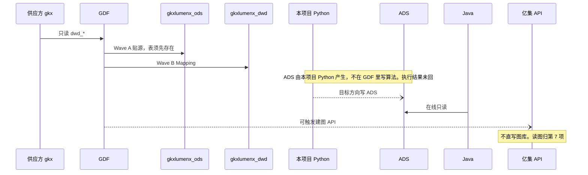
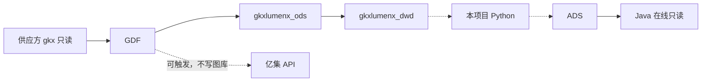

# 系统集成技术方案 · GDF 数据治理集成

> **状态**：待签收 · 2026-10-22 落盘 · 未 `done`  
> **任务**：`SYSINT-SCHEME-06-L01`（`tech_task`）· WBS-06-00  
> **签收操作人**：`human:淮政玮`。签收前本文不是已定方案。  
> **开始时间**：无已记录开始时间。**完成日期要求**：暂无截至时间。这两列不是对端承诺，本文不补截止日期。  
> **过程位置**：`工程过程/04-系统集成/06-GDF数据治理集成/`。本项不进统一用户中心。  
> **2026-10-26**：施工包分类以 [`派单包/README.md`](../../../data/GDF/派单包/README.md) 为准。现行可投递：企业 v4.0、产业链 v2.0、政策 v2（索引 v2.0，包头 v2.0.3）。历史且禁止当现行施工包：企业 v1–v3、产业链 v1、政策 v1.0.4。企业建表 / ALTER 只认企业 v4 的 `10/`。各域 Mapping 只认该现行包 README 点名的 `09` 明细。  
> **2026-10-26**：政策派单包 v2 定义任务 `GDF-POLICY-WORKPACK-V2-L01` 挂为 [WBS](./WBS.md) 的 WBS-06-03B。目录已落盘，现行政策包改为 v2，不并进 WBS-06-17 / 06-18。跑通仍是 WBS-06-03。v2 原样继承 v1.0.4 的 Wave A/B，取数不过滤 `is_deleted` / `is_history`。  
> **2026-10-26**：WBS-06-03C `SYSINT-06-03-DDL-L01` 在产线库建政策 ODS / DWD / ADS 空表。结构认政策 v2 的 `10/`（主表 + `policy_industry_rel`），不按政策 v1 的 37 列。口令里的 DWS 落在 DWD。不灌数，不代替 WBS-06-03。  
> **2026-10-26**：政策包 v2.0.3 写入 Wave D 说明（`17`–`20`）。WBS-06-03D～H 见 [WBS](./WBS.md)。MDC 脚本未进包。口径未闭合不建作业。不代替 06-03 的跑通。  
> **2026-10-26**：WBS-06-03I `GDF-POLICY-LINEAGE-L01`。血缘需求在政策包 `21`。实时指标计算不在 GDF 展开时，血缘导入工位后由接口对外提供。接口未接通。不代替 06-03。  
> **拆解思路**：[2026-10-26-要素指标加工与图谱拆解思路](./对接文档/我方/2026-10-26-要素指标加工与图谱拆解思路.md)。政策为样例。其他要素照第一节拆。未对 GDF、未对燕大发出。  
> **读规约**：正文依据 [`系统集成整体过程规约.md`](../../../系统集成整体过程规约.md) v1.0（2026-10-22 定稿）§2 第 6 项、§6、§7、§13。同目录讨论稿不作为本稿依据。  
> 过程夹 README 在建档时写过「方案任务未建」。以本文件和任务登记为准。本单不改 scope-baseline，不在 GDF 里配作业。WBS 里已经写上任务号的行以 WBS 为准，本方案不新开开发叶。

可投递包和预填 DRAFT 不是可对端。三个现行包下都没有回传的 `执行结果/`。任何域都不写成已跑通。

图只描述第 6 项：供应方只读进 GDF，落到自建 ODS / DWD；在线只读 ADS。不替代 [`architecture-baseline.md`](../../../architecture-baseline.md) 的 `ARCH-TOPO-LUMEN`，不另画企业或产业链存储域 L2。实线是本项写死的调用方向，不是执行结果。虚线是目标方向，执行结果未回。

## 1. 背景、集成需求、对接系统说明

### 1.1 背景

第 6 项是三方要素库和总集采购库的数据治理集成。供应方库只读进入 GDF，映射到项目自建 DWD。ADS 由本项目 Python 作业产生，不在 GDF 里写算法。Java 只读 ADS。页面不直接接三方源。

架构 D7：三方源不进契约面。工厂路径是 ODS 贴源 → DWD 清洗 → ADS。D3：Java 业务 API 只读 `*_ads`（外加 `app_user` 读写），不扫 ODS / DWD，不写 ADS。D12：`demo-*` 只做原型；lumen 前端调用链不打任何 `demo-*` 服务。GDF 写产线库，不写中台库。

智树范围以 [`scope-baseline.md`](../../../scope-baseline.md) §0 为准，本稿不改范围。数据处理中台这一块是「数据 Mapping 过程实施」。报价表写明智树完成的是企业机构 / 科研机构、市场研究、政策。论文和项目报告是培训加产线 / Mapping 模板，实施由具体负责团队做。科研机构、技术链、人才的深度分析在 §0.2，只分析、不作为智树实现。那三维对接归规约第 2 项，不在本方案开实现叶。

工作计划里「企业机构 / 科研机构 · 国内机构库」的现行施工包是企业 v4。服务机构、国外机构库、国内政策、国外政策在 2026-10-22 晚纳入本方案（WBS-06-15～18），工作计划这四行仍是未填。没有派单包之前写「还没有」，不算已排期。

### 1.2 集成需求

1. 供应方 MySQL `gkx` 只读。只取 `dwd_*`。不读供应方内部 `ods_*`。
2. GDF 做离线贴源（Wave A）和 Mapping（Wave B）。目标表由我方先建在产线库。缺表停工，不另开库，不在中台库建产线表。
3. 在线读数仍是前端 → 网关 → Java → ADS。GDF 不向页面提供在线接口。
4. GDF 可以触发亿集 API，不直写图库，不写 nGQL。读图、查图、图指标归第 7 项，不写进本方案。
5. 现行可施工包是企业 v4、产业链 v2、政策 v2。历史包企业 v1–v3、产业链 v1、政策 v1.0.4 不施工。企业 v3 的加工逻辑由 v4 全继承，`stock_base`、国外母子、专利侧表以 v4 覆盖项为准。政策 v2 任务 `GDF-POLICY-WORKPACK-V2-L01`（WBS-06-03B）目录已落盘；跑通仍看 WBS-06-03，不把包落盘当成已灌数。政策取数不过滤 `is_deleted` / `is_history`。
6. 无派单包的域保持「还没有」。不估进度，不建开发叶。
7. 指标口径不在 CDC 作业里发明。政策离线加工的归宿写在政策包 v2 的 `17` / `18` / `19`：GDF 执行包内脚本，公式以 `calc-logic` 为准，不把 `metrics/repro` 拷进包。口径未闭合的不进作业。企业、产业链还没有按同一拆法列完。
8. 密码、callback 密钥不进 git。

### 1.3 对接系统说明

| 系统 | 在本项的角色 | 现状 |
|---|---|---|
| 供应方库 `gkx` | 只读源。运行时入站真源 | 连接元数据在 [`CONNECTION.md`](../../../data/third-party-source/gkx-mysql-raw/CONNECTION.md)。只读账号。口令不在该文件 |
| GDF | 表 ETL 和编排平面。辜少彬管平台和调度；胡森泉管配作业技能 | 不向页面提供接口。不改前端、Java、算法仓 |
| 产线库 `gkxlumenx_ods` / `gkxlumenx_dwd` / `gkxlumenx_ads` | GDF 只往已有 ODS、DWD 表贴源和洗数。ADS 不是 GDF 的写库 | 库边界见 [`库边界-产线与中台-2026-10-19.md`](../../../data/GDF/库边界-产线与中台-2026-10-19.md) |
| 中台库 `demo_gkxlumenx_*` | 当前开发代码只连这套 | GDF 不连接、不修改、不验收。不把中台库画进 lumen 在线链 |
| Java `gkxlumen-*` | 在线只读 ADS | 不读 `gkx`，不扫 ODS / DWD，不写 ADS，不写 nGQL |
| 本项目 Python | 写 ADS；企业包里的 ES 写库方是 `lumen-etl-es-py` | 执行结果未回。不写成已跑通 |
| 亿集 API | GDF 可触发。不直写图库 | 企业包当前投递态是飞书通知，不是已上线的 callback。读图不在本项 |
| 统一用户中心 | 不进本项 | 第 6 项来稿未要求菜单收口。还没有本项的菜单配置 |
| 页面 | 只经 Java 读 ADS | 不直接接三方源 |

人的分工以 [`GDF协作指南.md`](../../../data/GDF/GDF协作指南.md) §3 为准：徐滕强管项目 DWD / ADS 契约，不在 GDF 里配作业；辜少彬不替甲方拍口径、不改业务仓代码；胡森泉不创建任务、不改公约、前端、Java、算法。指南 §6 仍把企业现行包写成 v2。施工以 [`派单包/README.md`](../../../data/GDF/派单包/README.md) 为准：现行包是企业 v4、产业链 v2、政策 v2。

双方约定时点还没有。[`约定时点.md`](./约定时点.md) 第一节为空。第二节的日期是智树内部需要日，不是对端承诺。系统-02 有计划窗，实际开始和实际结束都是空栏，不写成供数已就绪。

## 2. 应用对接技术架构、对接时序、实现方式

### 2.1 应用架构

在线链遵守架构基线，不在这里重画全局拓扑：

`前端 → 网关 → Java（只读 ADS）`

Java 不写算法，不直连 nGQL。lumen 前端不打 `demo-svc-platform`、`demo-platform-*`、`demo-algo-*`、`demo-svc-topic-py`。

离线链是本项自己的：

`供应方 gkx（只读 dwd_*）→ GDF → gkxlumenx_ods → gkxlumenx_dwd`

ADS 在 DWD 之后，由本项目 Python 写。GDF 不在作业里写指标算法。企业域另有写 ES、触发图谱，见 §3.3，不画进下面两张总图，避免把政策包和产业链包写成也写 ES。

与基线的边界：[`architecture-baseline.md`](../../../architecture-baseline.md) D6（2026-10-15）不引入亿集查图 API，图客户端仍指向 graphd，`source=nebula`。协作指南里「在线查图走 Java → Python → 亿集」与 D6 不一致。在线查图以 D6 为准，归第 7 项，本方案不落地那一句。GDF 触发亿集 API 只保留为建图侧的可触发关系，且不直写图库。

### 2.2 对接时序

```yaml
diagram_id: SYSINT-SCHEME-06-SEQ
signoff_status: draft
```



实线是调用方向。`PY--)ADS` 和 `GDF--)YJ` 是虚线：目标方向，不是已跑通。Java 只读 ADS，不读供应方，不读 ODS / DWD。图中没有页面到三方源的边，没有 GDF 写入图库的边，没有亿集查图的边。

### 2.3 实现方式

| 事项 | 写法 |
|---|---|
| 贴源 | CDC 模板 `SRC_DB_CDC_TEMPLATE`（`1、贴源_*.xlsx`）。源 `gkx` 只读，目标 `gkxlumenx_ods` 同名表。企业、产业链按各自现行包的过滤规则。政策现行包取数不过滤 `is_deleted` / `is_history`，两列原样进 DWD |
| Mapping | CDC 模板 `DWD_CDC_TEMPLATE`（`2、明细数据_*.xlsx`）。字段只认该域现行包 README 点名的 `09` 明细。短版导读不作施工真源。企业建表 / ALTER 只认企业 v4 的 `10/` |
| 预填 | 本侧可生成带 `预填-DRAFT` 的作业。DRAFT 不是可对端。禁止脚本写入 `执行结果/` |
| 可对端 | 该包 `执行结果/` 回传，并且 Java 能只读到相应 ADS。三包都还没有回传 |
| 库授权 | 产线库与中台库分开授权、分开验收、互不写入。口令线下，不进 git |
| 缺表 | 停工，把表名交我方补结构。不在作业里 `CREATE DATABASE`，不在 `demo_gkxlumenx_*` 建产线表 |
| 在线鉴权 | 经网关（架构 D6）。业务服务不各自做一套登录。本项没有统一用户中心菜单要配 |
| 企业 ES / 图谱触发 | 当前只认企业包 `15` §6.1：飞书值班、本侧转发、轮询 status。§4 的 Java / callback **未上线**。GDF 不直连 Python，不配 `/ent/v1`，不写 ES，不写 Nebula |
| 页面 | 本项各叶都不改页面去接三方源。缺数用空态，见 §6 |

GDF 成员的 Git 权限是编排仓 Developer，不要 `lumen-*` / `demo-*` 写权限。这是人的仓库权限，不是库口令。

## 3. 数据存储与流转

### 3.1 对接数据需求

包的现行 / 历史只认 [`派单包/README.md`](../../../data/GDF/派单包/README.md)：

| 包 | 索引地位 | 版本 |
|---|---|---|
| 企业 v4 | 现行，可对外投递。Owner 徐滕强 | v4.0（2026-10-20）。10-19 基线：`stock_base` 移出；国外母子换源 `dwd_agg_subsidiary_info`；专利侧表 +5 且 `mirror_only`。含继承的 `16` |
| 产业链 v2 | 现行，可对外投递 | v2.0（2026-10-20）。四表贴源并洗链树 / `entity_rel`；分析六表只贴不洗。四表行数相对 10-19 不变；链树 live 有 `parent_name` |
| 政策 v2 | 现行。Owner 淮政玮。任务 `GDF-POLICY-WORKPACK-V2-L01` | 索引 v2.0，包头 v2.0.3（2026-10-26）。洗进一张 `policy_base_info`。B 成功后 GDF 节点跑包内两份 Python（产业抽取、条款结构化）。离线归宿见 [拆解思路](./对接文档/我方/2026-10-26-要素指标加工与图谱拆解思路.md)，施工说明在包内 `17`–`20`。取数不过滤 `is_deleted` / `is_history`。不含 ES |
| 企业 v3 | 历史。加工逻辑被 v4 全继承；上述三项范围被 v4 覆盖 | v3.1.6 |
| 政策 v1 | 历史。v2 原样继承其 Wave A/B（含 v1.0.4 的删除 / 历史贯穿） | v1.0.4 |
| 企业 v2 | 历史。禁止施工 | v2.1（2026-08-13） |
| 企业 v1 | 历史。建表已作废 | v1.3 |
| 产业链 v1 | 历史。v2.0 继承 | v1.0 |

| 范围 | 需求 | 包 |
|---|---|---|
| 企业 | 贴源 + Mapping 到项目 DWD，并按包通知本侧写 ES（检索别名 `gkx_enterprise`）、触发图谱日批 | [GDF-ENT-WORKPACK-v4](../../../data/GDF/派单包/企业/GDF-ENT-WORKPACK-v4/README.md)。可投递。Owner 徐滕强。任务 `GDF-ENT-WORKPACK-V4-L01` 包内写「待建」，本方案不建。建表只认该包 `10/`。Mapping 只认 `09-企业域-ETL-Mapping明细-源表到DWD.md` |
| 产业链 | 四表贴源。洗链树和 `entity_rel`。产品标签表、资讯表、行业分析六表只贴不洗 | [GDF-CHAIN-WORKPACK-v2](../../../data/GDF/派单包/产业链/GDF-CHAIN-WORKPACK-v2/README.md)。可投递。Mapping 只认 `09-产业链域-ETL-Mapping明细-源表到DWD.md`。包内写明当前不代表已建表或已灌数 |
| 政策 v1 | 历史包。Wave A/B 已由 v2 原样继承 | [GDF-POLICY-WORKPACK-v1](../../../data/GDF/派单包/政策/GDF-POLICY-WORKPACK-v1/README.md)。禁止当现行施工包。跑通叶仍是 WBS-06-03，施工文本认 v2 |
| 政策 v2 | 两张源表贴源，洗进一张 `policy_base_info`。B 当日 `success` 之后抽取产业、条款结构化。取数不过滤 `is_deleted` / `is_history`。不含 ES、Nebula。指标与图谱拆法见 [拆解思路](./对接文档/我方/2026-10-26-要素指标加工与图谱拆解思路.md) | [GDF-POLICY-WORKPACK-v2](../../../data/GDF/派单包/政策/GDF-POLICY-WORKPACK-v2/README.md)。任务 `GDF-POLICY-WORKPACK-V2-L01`，WBS-06-03B。目录已落盘。Mapping 只认该包 `09`。不代表已建表或已灌数 |
| 市场研究金融 / 宏观 / 行业分析 | 还没有派单包 | WBS-06-04～06。工作计划未填 |
| 产业资讯 | 还没有派单包 | WBS-06-07。见 §3.3 禁令 |
| 培训、论文、专利、项目报告、全球科技人才 | 还没有派单包 | WBS-06-08～14 |
| 服务机构、国外机构库、国内政策、国外政策 | 还没有派单包 | WBS-06-15～18。国内政策、国外政策不并进政策 v2 |

10-19 Excel 纪要里 live 库没有的列（企业 / 产业链包已点名的 `t_id`、区划码等）不作源。三方源结构以 live `gkx` 为准。

### 3.2 数据流

```yaml
diagram_id: SYSINT-SCHEME-06-FLOW
signoff_status: draft
```



与 §2 时序同一条链。实线：供应方只读进 GDF，Wave A 到 ODS，Wave B 到 DWD，Java 在线只读 ADS。虚线：Python 写 ADS，以及 GDF 可触发亿集 API。虚线不是已跑通。亿集节点没有指向图库的边，也没有指向 Java 的查图边。本图没有 ES 节点。本图没有 `demo_gkxlumenx_*` 节点。

### 3.3 加工与融合

**企业 v4**

- Wave A：`gkx` → `gkxlumenx_ods` 同名表。清单只认该包 `02`。
- Wave B：按 `10/` 建或改 `gkxlumenx_dwd`，按 `09-企业域-ETL-Mapping明细-源表到DWD.md` 洗。不洗 `mirror_only`，不自造 `org_id`，不建宽表 `enterprise`。
- 写 ES：写库方只 `lumen-etl-es-py`。检索别名 `gkx_enterprise`；ETL 写物理索引 `gkx_enterprise_v1`（国内）与 `gkx_enterprise_global_v1`（国外），不写别名。17 个模块分开触发，规则在包内 `12`。GDF 只通知。当前握手是 `15` §6.1。包内写明产线 sync **未跑**，未洗行为空，不假装灌绿。
- 缺口分析回复在本包 `16`（从 v3 继承）。对外口径以本包 CHANGELOG v4.0 为准。
- 图谱：按 `14` 表→op 通知。GDF 不写 nGQL。包内写明 Java 未接 Feign，`dry_run` 不写库，零写入 `gkx_chain`。合作 / 供应链 / 股东不触发。这四条 op 的预览是企业包 as-built，不是本方案的建图交付。读图归第 7 项。
- v4 相对历史包的范围，只认派单包索引和该包 CHANGELOG：`stock_base` 移出；国外母子换源 `dwd_agg_subsidiary_info`（`09` §3.21）；专利侧表增加 5 张且 `mirror_only`。`10/` 目录说明若仍写旧母子源，施工不回退到 `dwd_forg_subsidiary_info`。
- 包 README 写 ODS 表结构已建 56 张（2026-10-20 终验）；验收检查表按 `02` 重做为 62 张。两句都是包内声明。没有 `执行结果/`，不把任一数字写成产线已灌完。

**产业链 v2**

10-19 基线：四表行数不变。贴源四表（`02` 的 `chain_core`）：

| 源表 | 加工 |
|---|---|
| `dwd_industry_chain_info` | 洗入 `industry_chain` / `industry_chain_node` / `industry_chain_node_rel`。live 已有 `parent_name`，直接映射。`t_id` / `id` / `code_company_count` live 没有，不作源 |
| `dwd_org_industry_tags` | 洗 `industry_chain_entity_rel`。`entity_id` = `org_id`。不自造 `org_id` |
| `dwd_org_industry_product_tags` | 只贴。产品指标走企业域产品表 |
| `dwd_industry_chain_news_info` | 只贴。禁止洗入 `industry_chain_news_event` |

行业分析六表只贴到 `gkxlumenx_ods`，禁止写入项目 DWD（`CHAIN-B2-INDANA` / B2 关闭）：

`dwd_industry_analysis_documents`、`dwd_industry_analysis_companies`、`dwd_industry_analysis_industries`、`dwd_industry_analysis_topics`、`dwd_industry_analysis_content_types`、`dwd_industry_analysis_countries`。

本期不要求建 `industry_analysis_*`，也不要求建齐 v5 其余十张 `industry_chain_*`。`enterprise_base` 未就绪时只阻塞企业挂接，不得编造 `org_id`。通用 `parse_workpack.py` 尚未识别本包字段矩阵（包 README：Wave B 解析为 0）。空矩阵不是完成。

**政策 v2（WBS-06-03B，现行施工包；不代替 WBS-06-03 的跑通）**

索引版本 v2.0，包头 v2.0.2。v1.0.4 只留对照。

- Wave A：`gkx.dwd_policy_base`、`gkx.dwd_global_policy_base` → `gkxlumenx_ods` 同名镜像。`02` 的 `default_filter` 为空。取数不过滤 `is_deleted` / `is_history`，两列原样进 DWD。`is_history` 的 `NULL` 不改写成 `0`。应用读 DWD 时自行过滤。
- Wave B：两源洗进一张 `gkxlumenx_dwd.policy_base_info`。`policy_id` 取 ODS `id` 原文。`source_plane` 切片。UK 永远是 `(source_plane, policy_id)`。禁止第二张主表，禁止给键加前缀。09 继承 v1.0.4，不重开 MAP-01。`16` 只核对字典实值，不改 `09` 列规则，实值不是白名单。
- Wave C：两张平面当日都 `success` 之后才跑。C 失败不回滚已成功的 B。产业抽取只写 `policy_industry_rel`（DWD 同一事务同步 ADS 同名表），不改主表，不用 Mapping 从 ODS 灌入。条款结构化只合并 ADS `policy_text_parse` 的条款。不清表，不写 ES，不回写 DWD。C 不进 `09`，也不进 CDC 字段矩阵。加工是包内两份 Python，GDF 复制到自己的 Python 节点后执行。不配置内部 HTTP。流程图在包内 `12`。本项未在 GDF 上跑通。
- 国内政策、国外政策（WBS-06-17、06-18）不并进这张包。不补企业包的 `07` / `08` / `14`。
- 通用 `parse_workpack.py` 能读出 Wave A=2、Wave B 目标表 1 张（`policy_base_info`），字段行仍为 0。空字段矩阵不是完成。预填须先补解析规则，或按 `09` 人工配置。未回签不得宣称 CDC 闭环。包落盘不代表已建表或已灌数。CDC 预填归胡森泉下一叶；导入核对归辜少彬。本包不出 xlsx。禁止用 Demo `polan/ods_sync.py`、`demo_gkxlumenx_*`、旧 v1 的 37 列当产线目标。
- Wave D（v2.0.3，`17`–`20`）：两张平面 B 都 `success` 之后，在 C1/C2 之外另跑第一批 STAT 全量刷新。脚本还没有，GDF 先不要建 MDC 作业。落表只认 `17` 点名的已有 ADS。口径未闭合的指标不建作业、不建表、不灌数。106/107 的脚本未配，不代替 C1。匹配和推演不进 T+1。灌数见 `20`，负责人确认前不做。`mt_policy_` 空表见 WBS-06-03H，未点头不建。不改 `09`。执行结果未回。

**无包域**

市场研究三条、产业资讯、培训三课、论文、专利、项目报告、全球科技人才、服务机构、国外机构库、国内政策、国外政策：加工规则还没有。不把产业链 v2 的六表禁令改成「本叶要洗」。不把政策 v2 扩成国内 / 国外政策全库。

产业资讯：客户决策清单 §2.y 背景（2026-08-25）写明 `dwd_industry_chain_news_info` 合规交付、禁止业务使用。同文件检索未见解除记录。未解除则不上屏。清单背景里的替代源（`dwd_org_important_news_info` 与行业分析要素库）没有资讯派单包，替代接入还没有。不用大模型把资讯补成业务表。

### 3.4 存储设计（相对原表要增加的字段）

新增或变更字段只认现行包的 `10-DWD-MySQL-DDL` 和该包 `09` Mapping 明细。本文不另增列，不把列清单再抄一张。

| 域 | 库和表 | 字段以哪份为准 | 本文是否加列 |
|---|---|---|---|
| 企业 | `gkxlumenx_dwd`。表集以 `10/` 三份快照为准：工商 v3.1、模块风险 v3.0、指标汇总 v3.1 | `09` 明细 + `10/` + CHANGELOG v4.0 / v4.0.2 | 否 |
| 产业链 | 本期必须有 `industry_chain`、`industry_chain_node`、`industry_chain_node_rel`、`industry_chain_entity_rel`。表名无 `dwd_` 前缀 | v5 设计稿，指针在该包 `10/`；字段矩阵只认 `09` | 否。`parent_name` 是 live 已有列的直接映射，不是新源列 |
| 政策 | `gkxlumenx_dwd.policy_base_info`（Wave B）与 `policy_industry_rel`（Wave C；DWD 与 ADS 各一张，不由 Mapping 从 ODS 灌入）。条款落在已有 ADS `policy_text_parse`。UK `(source_plane, policy_id)`。表名无 `dwd_` 前缀 | 现行包 v2 的 [10/](../../../data/GDF/派单包/政策/GDF-POLICY-WORKPACK-v2/10-DWD-MySQL-DDL/README.md) 与该包 `09`。v1 的 `10/` 只对照 | 否。禁止按旧 v1 的 37 列建表。本文不加列 |
| 其余域 | 还没有 | 还没有 | 不加 |

企业包 CHANGELOG v4.0.2 已经写明、并且写了正式库已执行的结构事项，施工只认那一节，包括：`enterprise_tag` 唯一键改为 `(org_id, tag_code)`；指标汇总快照补 `enterprise_risk_summary` 的 as-built；`enterprise_patent_org_rel` 的 DDL 复核在位。`tag_dict` 的 7 行种子也只认该节，本文不改名单。这些都不是本方案新加的列。

目标引擎只 MySQL。禁止把 PostgreSQL、`demo_gdf_data`、`demo_gkxlumenx_*` 当产线目标。Demo 不写桶 `gkx-lumen`（架构 D14）；本项不改对象存储目录。

## 4. 对接涉及的指标、实现方式、与指标库对齐、缺项

GDF 作业不定义指标口径，不算 8 件套。企业包 `00` §9 已写：GDF 不算 8 件套、STAT 公式、算法分；`10/` 指标汇总只对照结构，口径待核，不替甲方拍。第 4 类不洗的列以该节为准：`brand_score`、`customer_concentration`、`market_share`、`core_tech_coverage`、`tech_transaction_amount`。ES 上的计数覆盖不是指标计算闭环。

血缘规约 [`data-lineage-policy.md`](../../../data-lineage-policy.md)：指标身份证在 `D1=aligned` 时才是齐备态（含 `algorithm_type`，共 9 项）。`source_tables` 的 ODS→DWD 映射在 Phase 2 由 GDF 产出，再由血缘子协调验证后改 `mapping_status`。本方案没有做这条验证，没有把任何 `metric_id` 改成已映射。

| 问题 | 写法 |
|---|---|
| 实现方式 | 贴源和 Mapping 在 GDF。口径在指标库。政策第一批 STAT 由包内脚本写入已有 ADS，脚本未进包前不调度。Java 不写算法。CDC 里不发明公式。`metrics/repro` 只作对照，不进派单包 |
| 口径归谁 | 协作指南写指标口径归王惠。血缘规约 §2 的现行梳理工作流：口径和 8 件套适用性是 `human:淮政玮`，公式和 `algorithm_type` 是 `human:唐绍祖`。两边都不是本方案可以改的。本方案不拍板 |
| 与指标库是否对齐 | 政策 35 条的离线归宿已写在包内 `17`–`19` 和 [拆解思路](./对接文档/我方/2026-10-26-要素指标加工与图谱拆解思路.md)。这不是 `mapping_status` 已升级，也没有逐条对过 seed。企业、产业链还没有按同一拆法列完。不把企业汇总表或 ES 计数写成已对齐 |
| 缺项 | 无派单包的域，供数还没有。有包但 `执行结果/` 未回的域，页面按缺数，不估进度。`mapping_status` 从待 ODS 升到已映射，还没有 |
| 不上屏 | 产业资讯在 2026-08-25 的禁令未解除则不上屏。禁止用 Mock 冒充该域已经接入 |

## 5. 分模块对接实现、本维 WBS、前端、算法、数据加工

已建任务号以 [`WBS.md`](./WBS.md) 为准。下表对上 WBS-06-00～06-18，以及 2026-10-26 增加的 06-03D～I。各行开始时间都是「无已记录开始时间」，完成日期要求都是「暂无截至时间」，不是对端承诺。06-03D～I 不代替 06-03 的跑通。

市场研究里的「产业链」仍是 WBS-06-02，不在 06-04～06 再列一叶。GDF 产品迭代未填目标，不列叶。建图算法和读图页面不列叶。

| WBS | 子项 | 监管人 | 前端 | 算法 | 数据加工 | 可对端 |
|---|---|---|---|---|---|---|
| WBS-06-00 | 技术方案设计，即本任务 | 淮政玮 | 无页面开发 | 无 | 现行三个包是输入。本文是方案，不是跑数 | 五段写在本文件。未签收。执行结果未回，不把本行当成跑通 |
| WBS-06-01 | 企业：包跑通到 ADS | 徐滕强。外部建设负责人辜少彬，不是第二监管人 | 不改页面。页面只经 Java 读 ADS | 企业指标不在 GDF 里算。建图算法不在本方案 | 按企业 v4 贴源、Mapping。建表只认该包 `10/`。ES 只通知 `lumen-etl-es-py`，检索别名 `gkx_enterprise`。图谱只通知，不写图库。历史包 v1–v3 不施工 | 还没有。`执行结果/` 未回 |
| WBS-06-02 | 产业链：包跑通到 ADS | 同上 | 无。不改页面接三方源 | 无。不在本叶做链上指标 | 四表贴源。洗链树和 `entity_rel`。产品标签表和资讯表只贴。分析六表只贴不洗。产业链 v1 不施工 | 还没有。包内声明未建表未灌数 |
| WBS-06-03 | 政策现行包 v2 的 Wave A/B 跑通到 `policy_base_info` | 淮政玮 | 无 | 无 | 两张源表洗进一张主表。取数不过滤 `is_deleted` / `is_history`。不含 ES，不执行 Wave C。不由 06-03B 或 06-03C 代替。贴源前空表见 06-03C。政策 v1 不施工 | 还没有。未回签 |
| WBS-06-03C | 政策产线库初始化 ODS / DWD / ADS 空表。任务 `SYSINT-06-03-DDL-L01` | 淮政玮 | 无 | 无。本叶不写算法 | 只在 `gkxlumenx_ods` / `gkxlumenx_dwd` / `gkxlumenx_ads` 建空表或核对已有表。DWD 认政策 v2 的 `10/`（主表 + `policy_industry_rel`），不按 v1 的 37 列。口令 DWS 落在 DWD，不新建 DWS 库。不灌数 | 还没有。空表核对不是可对端 |
| WBS-06-03B | 政策派单包 v2。任务 `GDF-POLICY-WORKPACK-V2-L01` | 淮政玮 | 无 | 包内两份 Python，本叶不写算法仓 | 只出包。Wave A/B 原样继承 v1.0.4。`16` 不改 `09`。两张平面 B 都成功后，GDF 在自己的节点上跑包内脚本。不配内部 HTTP。不含 ES。目录已落盘。v2.0.3 的 `17`–`20` 不在本叶 | 还没有。不是跑通，也不是可对端 |
| WBS-06-03D | 政策包 v2.0.3 的 MDC / Graph / MRC 说明。任务 `GDF-POLICY-MDC-DOC-L01` | 淮政玮 | 无 | 本叶不写脚本 | 只写 `17`–`20`、`15` 文末和 CHANGELOG。不改 `09`。不生成 `scripts/mdc/` | 包内能读到 `17`–`20` 四章。不是跑通，不代替 WBS-06-03 |
| WBS-06-03E | 政策 MDC 第一批 STAT 脚本。任务 `GDF-POLICY-MDC-STAT-L01` | 淮政玮 | 无 | 按 `17` 生成脚本，不抄 repro | 读产线 DWD，写 `17` 点名的 ADS。全量刷新。脚本未进包前 GDF 不建作业 | 还没有。`--self-check` 通过也不是可对端 |
| WBS-06-03F | 政策实体识别与关系抽取脚本。任务 `GDF-POLICY-GRAPH-EXT-L01` | 淮政玮 | 无 | 106 / 107。不代替 C1，不写 nGQL | 脚本未配前不建作业。图侧只触发引擎 API | 还没有 |
| WBS-06-03G | 政策灌数闸门。任务 `GDF-POLICY-MOCK-GATE-L01` | 淮政玮 | 无 | 无 | 负责人确认批次上限、词表、提示词之前不写脚本，不向 ODS 写 mock | 确认前不可对端 |
| WBS-06-03H | 政策扶持事实空表 `mt_policy_`。任务 `GDF-POLICY-MT-SUPPORT-L01` | 淮政玮 | 无 | 无。不加工 `M_POLICY_SUPPORT_STRENGTH` | 另行点头后才在 demo 与 lumen 的 ODS 建空表。不灌数 | 未点头不建 |
| WBS-06-03I | 数据血缘追溯接口。任务 `GDF-POLICY-LINEAGE-L01` | 淮政玮 | 无 | 无。本叶不写算法 | 需求在政策包 `21`。三类：平台 Python 脚本自身可知的血缘；经 API 导入的血缘（含图上三元组与原始数据）；业务实时指标。计算不在 GDF 展开的先导入工位，再由接口对外提供。不改 `09` | 还没有。需求落盘不是接口已接通 |
| WBS-06-04 | 市场研究 · 金融数据同步 | 淮政玮 | 无 | 无 | 还没有派单包。工作计划该行未填 | 还没有。不算已排期 |
| WBS-06-05 | 市场研究 · 宏观行业同步 | 淮政玮 | 无 | 无 | 还没有 | 还没有 |
| WBS-06-06 | 市场研究 · 行业分析同步 | 淮政玮 | 无 | 无 | 还没有单独派单包。六表维持 v2 只贴不洗。不把六表洗进项目 DWD，除非将来的包另行写明 | 还没有 |
| WBS-06-07 | 资讯 · 产业资讯同步 | 淮政玮 | 未解除禁令则不上屏 | 不用大模型补资讯 | 还没有资讯包。产业链 v2 对 `dwd_industry_chain_news_info` 只贴不洗。不洗成业务资讯表 | 还没有 |
| WBS-06-08 | 培训 1：ODS 贴源 + Mapping | 智谱。工作计划原表未指定人，以 WBS 草案为准 | 无 | 无 | 先有已跑通的贴源和 Mapping 再开课。未回传的执行结果不当教材 | 还没有。次数不少于 2 次、课时 10–30 小时仍是问号，不写成已承诺 |
| WBS-06-09 | 培训 2：DWD 之后的生产调度，以及上线典型场景 | 智谱 | 无 | 无 | 讲已有调度和已有上线场景。不把未填域编成案例 | 还没有。课时问号同上 |
| WBS-06-10 | 培训 3：团队协作管理平台的使用 | 智谱 | 无 | 无 | 讲平台用法。教材还没有 | 还没有。课时问号同上 |
| WBS-06-11 | 论文：中文论文、外文论文 | 智谱 | 无 | 无 | 智树：培训、产线开发、Mapping 模板。填写和实施由具体负责团队做。智谱：模板上传。GDF：数据产线开发。派单包还没有 | 还没有 |
| WBS-06-12 | 专利：全球专利数据 | 智谱 | 无 | 无 | 智树提供培训。不负责 Mapping 模板填写和实施。智谱：模板上传。GDF：数据产线开发。派单包还没有 | 还没有 |
| WBS-06-13 | 项目报告：中文 / 外文、国内项目 / 国外项目 | 智谱 | 无 | 无 | 口径同 WBS-06-12。派单包还没有 | 还没有 |
| WBS-06-14 | 全球科技人才 | 智谱 | 无 | 无 | 智数提供培训。智树完成产线开发和 Mapping 模板，不负责填写和实施。GDF 工作内容是「无，或疑难技术问题支持」。派单包还没有 | 还没有 |
| WBS-06-15 | 服务机构：贴源加 Mapping 到 ADS | 徐滕强 | 无 | 无 | 2026-10-22 晚纳入方案。工作计划未填。派单包还没有 | 还没有。不算已排期 |
| WBS-06-16 | 国外机构库：贴源加 Mapping 到 ADS | 待指定。工作计划未填人 | 无 | 无 | 同 06-15。不并进企业 v4 的 `enterprise_forg_*` | 还没有 |
| WBS-06-17 | 国内政策：贴源加 Mapping 到 ADS | 淮政玮 | 无 | 无 | 不并进 WBS-06-03 的 `policy_base_info` 包。派单包还没有 | 还没有 |
| WBS-06-18 | 国外政策：贴源加 Mapping 到 ADS | 待指定。工作计划未填人 | 无 | 无 | 同 06-17 | 还没有 |

前端在本项的共同约束：不把三方源接到页面；不读 ODS / DWD 填页面；缺数用空态；Mock 不得冒充已接入；本项不配置统一用户中心菜单。

算法在本项的共同约束：Java 不算指标；GDF 不算 8 件套；建图算法和读图页面不在本方案展开。

## 6. 必须能答出的口径

| 问题 | 答案 |
|---|---|
| 调用方向 | 供应方 `gkx` 只读 `dwd_*` → GDF → `gkxlumenx_ods` → `gkxlumenx_dwd`。ADS 由本项目 Python 写，Java 在线只读 ADS。页面不接三方源。GDF 可触发亿集 API，不直写图库。读图归第 7 项。在线查图不走亿集 API（架构 D6）。见 `SYSINT-SCHEME-06-SEQ`、`SYSINT-SCHEME-06-FLOW` |
| 鉴权 | 供应方是只读账号，口令在 `.env.local` 或本地密钥库，不进 git。产线库与中台库分开授权。在线鉴权经网关。企业 callback 密钥线下给，不进派单包。本项不进统一用户中心 |
| 数据落点 | 企业、产业链：GDF 落到产线 ODS / DWD；ADS 是目标落点，执行结果未回。企业 ES 检索别名 `gkx_enterprise`，只由 `lumen-etl-es-py` 写物理索引，产线 sync 未跑。政策 v2：GDF 落到 ODS 与 `policy_base_info`；产业关联与条款由 GDF 节点上的包内 Python 写 `policy_industry_rel`（DWD 同步 ADS）与 ADS `policy_text_parse`，执行结果未回。第一批 STAT 的目标表写在包内 `17`，脚本未进包。历史包不作为落点。无包域落点还没有 |
| 缺数时界面表现 | 空态。不读三方源填数，不用 Mock 冒充该域已接入。产业资讯禁令未解除则不上屏。缺表则 GDF 停工，页面仍空态 |
| 智树不做 | 不在 GDF 产品里开发业务功能；不把三方源接到前端；不把本项收口到统一用户中心；不直写图库；不在本方案写建图算法和读图页面；不发明指标口径；不把未回传写成已跑通；不施工历史包；论文的实施、专利和项目报告的模板填写与实施不由智树做；全球科技人才不负责填写和实施，GDF 只写疑难支持；不在过程夹改 scope-baseline；密码不进 git |
| 我方对接文档清单 | 正式发出件还没有。[拆解思路](./对接文档/我方/2026-10-26-要素指标加工与图谱拆解思路.md) 已落盘，未对 GDF、未对燕大发出。索引见 [`对接文档/我方/README.md`](./对接文档/我方/README.md) |
| 对端对接文档清单 | 还没有。索引 [`对接文档/对端/README.md`](./对接文档/对端/README.md) 为暂无。三个现行包都没有 `执行结果/`。Wave A 回签完成证据还没有 |

## 7. 还没有（签收时不要读成已完成）

- 双方约定时点。
- 对端对接文档，以及三个现行包的 `执行结果/`。
- 企业、产业链、政策的产线跑通，以及它们的 ADS 供数。
- 政策 v2 的产线跑通和执行结果回传。目录已落盘，不是已灌数。政策包的 ES（现行包不含 ES）。国内政策、国外政策的包。
- 用企业 v1–v3、产业链 v1、政策 v1 当现行施工包。索引已改挂到企业 v4、产业链 v2、政策 v2。
- 市场研究三条、产业资讯、服务机构、国外机构库的派单包。
- 培训教材、培训次数和课时的承诺。
- 论文、专利、项目报告、全球科技人才的派单包。
- 与指标库的逐条对齐，以及 `mapping_status` 升级。政策离线归宿已列表，不是 seed 已对齐。
- 政策 MDC 的 `scripts/mdc/`、106/107 脚本、灌数、`mt_policy_` 空表。说明在包 v2.0.3，作业未配。
- 数据血缘追溯接口。需求在政策包 `21`。工位导入和对外接口都还没有。
- 产业资讯禁令的解除。
- 统一用户中心在本项的菜单。本项不做。
- 建图算法、读图页面。归第 7 项。
- 本方案新开的开发叶。WBS 里已经写上任务号的行以 [WBS](./WBS.md) 为准；执行结果未回仍不算跑通。
