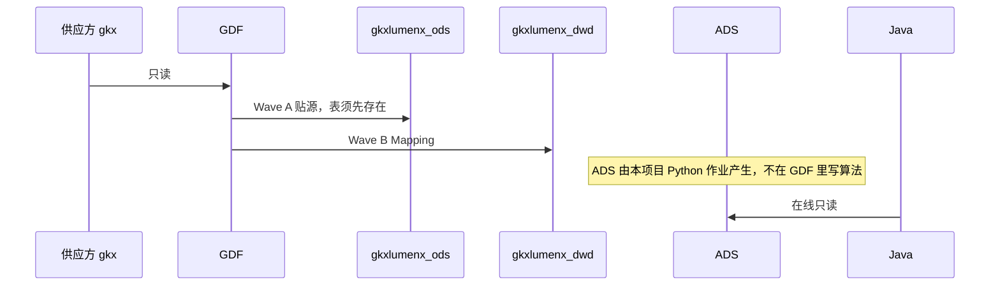

# 系统集成技术方案 · GDF 数据治理集成

> **状态**：草案 · 2026-10-22 · 未签收  
> **WBS**：WBS-06-00  
> **过程位置**：工程过程卷 03。协作指南和现行派单包只作输入。  
> 本项不进统一用户中心。可投递包不是执行结果。

## 1. 背景与集成需求

三方要素库和总集采购库只读进入 GDF，映射到自建 DWD / ADS。Java 只读 ADS，页面不直接接三方源。

对接系统：供应方库 `gkx`（只读 `dwd_*`）、GDF（辜少彬调度，胡森泉配作业）、产线库 `gkxlumenx_*`、中台库 `demo_gkxlumenx_*`（开发代码只连中台库，不在中台建产线表）。

现行包：企业 v4、产业链 v2、政策 v1。服务机构、国外机构在工作计划里未填，不列叶。市场研究（金融数据、宏观行业、行业分析）和产业资讯已列入 WBS 草稿，包还没有。

## 2. 应用对接技术架构

GDF 不向页面提供在线接口。在线读数仍是前端 → Java → ADS。GDF 只做离线贴源和 Mapping。建图时 GDF 可调亿集 API，不直写图库。

鉴权：产线库与中台库分开。密码不进 git。缺表停工，不另开库。

## 3. 数据存储与数据流转

加工与融合：企业、产业链按现行包的 Mapping。产业链分析六表只贴不洗。政策只到 `policy_base_info`，不含 ES。10-19 Excel 多出而 live 库没有的列不作源。

存储设计：新增或变更字段只认现行包 `10-DWD-MySQL-DDL` 和该包 Mapping 明细。本文不另增列。历史包 v1–v3、产业链 v1 不施工。

## 4. 指标

GDF 作业不定义指标口径。指标在 ADS 之上由 Python 按指标库计算。

| 问题 | 现状 |
|---|---|
| 实现方式 | 贴源和 Mapping 在 GDF；口径不在 CDC 里发明 |
| 与指标库对齐 | 还没有用本方案做逐条对齐。口径仍归指标负责人 |
| 缺项 | 未填域没有包，对应供数是缺项。执行结果未回传的域，页面侧按缺数，不估进度 |

## 5. 分模块实现与 WBS

| 模块 | WBS | 前端 | 算法 | 数据加工 |
|---|---|---|---|---|
| 方案本身 | WBS-06-00 | 无 | 无 | 现行三个包是已有输入。市场研究与产业资讯已列入 WBS，包未到不算已排期 |
| 企业 v4 | WBS-06-01 | 不改页面。页面只读 ADS | 企业指标不在 GDF 作业里算 | 辜少彬侧跑通贴源、Mapping、写 ES `gkx_enterprise`。验收看执行结果 |
| 产业链 v2 | WBS-06-02 | 无 | 无 | 四表贴源并洗链树 / `entity_rel`。分析六表只贴 |
| 政策 v1 | WBS-06-03 | 无 | 无 | 只到 `policy_base_info`。不在本叶加 ES |
| 市场研究 | WBS-06-04～06 | 无 | 无 | 金融数据、宏观行业、行业分析各一叶。无派单包前不施工。行业分析六表维持 v2 只贴不洗 |
| 产业资讯 | WBS-06-07 | 无 | 无 | 只同步。不洗成业务表。2026-08-25 未解除则不上屏 |
| 培训三课 | WBS-06-08～10 | 无 | 无 | 最佳实践之后再开课。次数和课时的问号不写成承诺 |
| 论文 / 专利 / 项目报告 | WBS-06-11～13 | 无 | 无 | 智树做培训、产线、模板。论文的实施由负责团队做。专利和项目报告不负责模板填写与实施 |
| 全球科技人才 | WBS-06-14 | 无 | 无 | 智数培训。智树做产线与模板，不负责填写和实施。GDF 只写疑难支持 |

智树不做：在 GDF 产品里开发业务功能；把三方源接到前端；本项的统一用户中心菜单。
