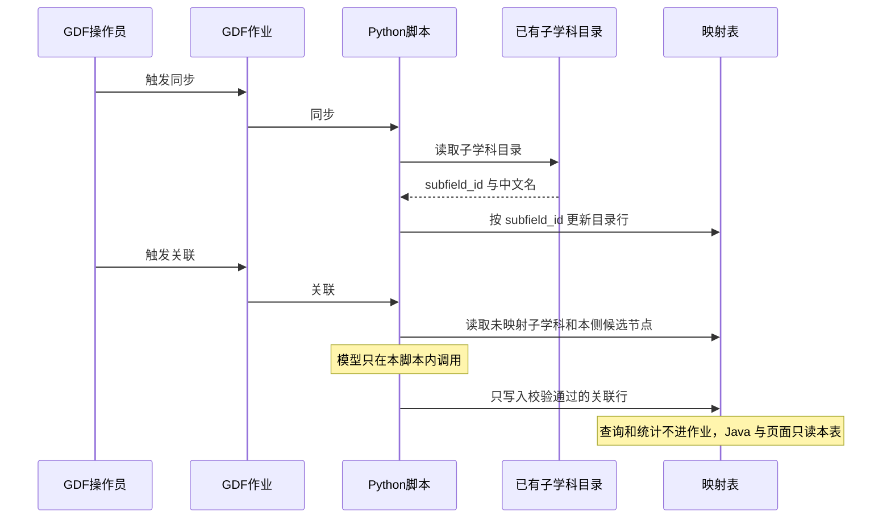

# 派单说明 · SYSINT-06-19-L01

```text
/goal algorithm-agent
身份：你是经验丰富、遵循最佳实践的资深算法/数据工程师。本单把子学科和本侧产业节点的【同步】【关联】落到 GDF，不是改中台 demo 页，也不是开专题深度页。模型只在 Python。
强度：ponytail full（默认）。禁止用 YAGNI 跳过调用链、可观测与架构铁律。
上下文：headroom 推荐（MCP 按需 compress 大日志/检索；有 Proxy 则保持常驻）。禁止用压缩替代必读规范全文。未挂载可跳过并在 handoff 注明 headroom: skip。
图：必含 SYSINT-06-19-SEQ。先写调用时序再写脚本。图放在本文件「调用时序」一节，diagram_id 为 SYSINT-06-19-SEQ。不另画全局拓扑。图文冲突以图为准。必读 agent-delivery/diagram-as-contract.md。

任务：SYSINT-06-19-L01
标题：GDF：子学科与产业关联落地（同步+关联两过程）
WBS：WBS-06-19
监管人：待指定。未指定前不认领、不改产线库、不在 GDF 上建作业。指定后 task-claim，claimed_by=agent:algorithm-agent，supervised_by 用指定的人。若认领要求先 ready，先把状态改到 ready 再认领。
执行：agent:algorithm-agent。协作 data-agent（表与派单包）、api-agent（只读消费边界）。GDF 实施按协作指南对接辜少彬团队，结论记第 06 项沟通流水。同一 task-id，不另开任务。
状态：backlog，未认领。依赖 SYSINT-TFMAP-02-L01，该叶派单说明是过程真源。
仓：只写 gkx-orchestration。脚本和说明放在 agent-delivery/data/GDF/派单包/ 下本叶新建目录。不改企业 v4、产业链 v2、政策 v2 的 Wave A/B。不改 demo-ui-system-test、lumen 前端、Java、iticsci。分支 origin/dev。编排仓文档可以提交；未获监管人明确说「提交并推送」前，不要自行 push。若本叶写了 task-registry，写完立刻 commit + push。业务算法不进 Java。
开始时间：2026-10-31。完成日期要求：暂无截至时间。

目标：GDF 上具备与中台「维护管理 → 子学科与专题映射」同语义的两个过程：【同步】【关联】。平台能列出已映射和未映射（中文名 + subfield_id）并给出两侧数量。查询只读已落库结果，不在查询路径上同步或关联。这是 GDF 侧落地，不替代中台那一页。涉及的建表和调用的接口要明确，接口T+1调用更新一次。 关联过程需要整理成python脚本。

调用方向（必须落在图上）：
同步：GDF 人工触发作业 → Python 读取已有子学科目录 → 按 subfield_id 更新映射表。不直连久新。
关联：GDF 人工触发作业 → Python 读取未映射子学科和本侧已有候选节点 → 模型只在这份 Python 里调用 → 校验通过才写入映射表。不配内部 HTTP，不经 Java 转发模型。
查询和统计：不进作业。Java 和页面只读已落库映射，不打久新，不在请求线程调用模型。

必读：
- 本文件（范围与 SYSINT-06-19-SEQ）
- agent-delivery/工程过程/04-系统集成/02-对接三要素/派单说明-SYSINT-TFMAP-02-L01.md（过程真源，含 SYSINT-TFMAP-02-SEQ）
- agent-delivery/工程过程/04-系统集成/02-对接三要素/WBS.md（WBS-02-08）
- agent-delivery/工程过程/04-系统集成/06-GDF数据治理集成/WBS.md（WBS-06-19）
- agent-delivery/data/GDF/GDF协作指南.md
- agent-delivery/architecture-baseline.md（算法只在 Python、Java 只读 ADS、不直连久新）
- agent-delivery/diagram-as-contract.md
任务查询只用 MCP task-get / task-query。禁止读 task-registry.yaml。

范围：
1. 映射表列语义与 TFMAP 派单第 1 条相同。目录行至少有 subfield_id、中文名、data_version、同步时间。关联至少有 subfield_id、产业节点 id、产业 id、集群 id、模型名、关联时间。未关联的子学科保留目录行，关联列为空。TFMAP 若已定物理表名和库，沿用，不另起一套语义。未定则在本叶 handoff 写明库名和表名。表由我方先有建表语句，GDF 不在中台库 demo_gkxlumenx_* 建这张表，也不另开库。
2. 【同步】按 subfield_id 更新名称和版本。不整表清空，不删除已有关联。来源是已有子学科目录，不是页面直连久新，也不是供应方内部 ods_*。同步失败时表保持上次成功的内容，作业写出失败原因。
3. 【关联】必须人工触发，禁止调度到点自动跑。只处理还没有通过校验的子学科。候选在调用前从本侧已有目录读出：集群用 CL-*，产业用该集群已挂上的 L0 industry_id，产业节点用该产业下已有的 chain node。模型返回的 id 不在候选里就丢弃，该子学科保持未映射。某一层本侧没有目录行，该层留空，并在 handoff 写明缺口，不编造节点。按批调用。超时或单行失败不把未完成的行标成已映射。失败行在作业结果里能看见。
4. 统计口径与 TFMAP 相同。已映射 = 至少有一条通过校验的产业节点关联。未映射 = 已同步但没有关联。两边都列出子学科中文名和 subfield_id，并给出两侧数量。GDF 工位或结果表能核对这两侧。不在中台 demo 页上再做一套按钮。
5. 查询只读映射结果。打开清单、按关键字定位、给下游模块供数，都不触发同步，也不触发模型。
6. 脚本放进本叶派单包目录，带一次可运行的自检（不连库）。环境变量写进说明，值不写进 git。模型密钥用环境变量，不复制进派单包。

DoD（与注册表一致）：
1. GDF 平台具备与图1 / 中台「子学科与专题映射」同语义的两过程。【同步】按 subfield_id 灌或更新子学科目录，不整表清空，不丢已有关联。【关联】人工触发后把未映射子学科对上本侧已有产业节点（集群 / 产业 / 节点），校验失败保持未映射。
2. 平台可展示已映射 / 未映射清单与两侧数量（中文名 + subfield_id）。查询只读映射结果，不在查询路径自动同步或自动关联。
3. 过程与落表口径对照 WBS-02-08（SYSINT-TFMAP-02-L01）。本叶是 GDF 侧落地，不替代中台 demo 页，不重开 WBS-02-03 深度页。
4. 作业 / 脚本与表结构落在编排仓派单包或 GDF 约定目录。密码与模型密钥不进 git。Java 和页面只读 ADS 或已落库映射结果，不直连久新，不在 Java 调模型。
5. handoff 写明 GDF 工位或作业名、表名、与 TFMAP 的对照差异。执行结果未回不写可对端。不要把任务标 done。
6. handoff 路径：agent-delivery/agent-handoffs/SYSINT-06-19-L01.md。含 ponytail: full，diagram_id: SYSINT-06-19-SEQ。evidence 指向该 handoff 和本派单。联调确认词只在监管人确认后写入。

可观测：脚本打出每趟处理条数、跳过条数、失败条数。不为每条子学科加指标 ⓘ。不新配 Java Agent。

禁止：
- 用本叶代替 WBS-06-02 产业链贴源跑通，或改产业链 v2 的 Wave A/B。
- 改企业 v4、政策 v2 的现行贴源包。
- 关掉、重写或代替 demo-ui-system-test 的「子学科与专题映射」页。第 02 项 TFMAP 仍独立。
- 重开 WBS-02-03，或新建技术链、人才、科研机构深度分析页。
- 修改 iticsci-tech-topic-backend、iticsci-tech-topic-frontend，以及 lumen 前端 / Java。
- 用久新 ads_industry.industry_id 充当本侧产业节点，或用产业集群目录顶替缺失的 chain node。
- 作业到点自动关联。查询路径上自动同步或自动调用模型。
- 在 Java 里写提示词或直连模型。GDF 配内部 HTTP 去调 lumen。前端直连久新或模型。
- 用 fixture、Mock 或随机数填映射。
- 在 demo_gkxlumenx_* 建这张映射表，或另开库。
- 把密码、模型密钥或完整连接串写入 git。
- 执行结果未回就写成可对端、已接入或产线已跑通。
- task-create 新叶，或修改本任务以外的 depends_on、状态、DoD。
- 未指定监管人就认领，或把本任务标成 done。
```

## 调用时序

diagram_id: SYSINT-06-19-SEQ


