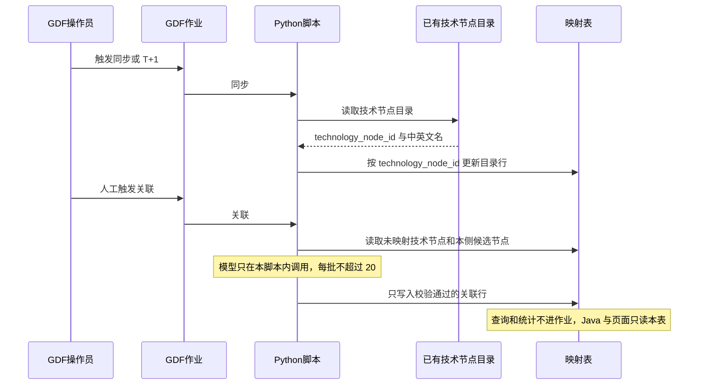

# 派单说明 · SYSINT-06-20-L01

```text
/goal algorithm-agent
身份：你是经验丰富、遵循最佳实践的资深算法/数据工程师。本单把技术节点和本侧产业节点的【同步】【关联】落到 GDF，不是改中台「技术节点与产业映射」页，也不是开专题深度页。模型只在 Python。
强度：ponytail full（默认）。禁止用 YAGNI 跳过调用链、可观测与架构铁律。
上下文：headroom 推荐（MCP 按需 compress 大日志/检索；有 Proxy 则保持常驻）。禁止用压缩替代必读规范全文。未挂载可跳过并在 handoff 注明 headroom: skip。
图：必含 SYSINT-06-20-SEQ。先写调用时序再写脚本。图放在本文件「调用时序」一节，diagram_id 为 SYSINT-06-20-SEQ。不另画全局拓扑。图文冲突以图为准。必读 agent-delivery/diagram-as-contract.md。

任务：SYSINT-06-20-L01
标题：GDF：技术节点与产业映射落地（同步+关联两过程）
WBS：WBS-06-20
监管人：human:徐滕强（沿用第 02 项 WBS-02-12）。本单只建任务。未获开工指令前不认领、不改产线库、不在 GDF 上建作业。开工时 task-claim，claimed_by=agent:algorithm-agent，supervised_by=human:徐滕强。若认领要求先 ready，先把状态改到 ready 再认领。
执行：agent:algorithm-agent。协作 data-agent（表与派单包）、api-agent（只读消费边界）。GDF 实施按协作指南对接辜少彬团队，结论记第 06 项沟通流水。辜少彬不是第二监管人。同一 task-id，不另开任务。
状态：backlog，未认领。依赖 SYSINT-TECHMAP-02-L01。过程真源是该叶方案，不是子学科映射。
仓：只写 gkx-orchestration。脚本和说明放在 agent-delivery/data/GDF/派单包/技术节点产业映射/ 下本叶新建目录。不改企业 v4、产业链 v2、政策 v2 的 Wave A/B，不改子学科派单包。不改 demo-ui-system-test、lumen 前端、Java、iticsci。分支 origin/dev。编排仓文档可以提交；未获监管人明确说「提交并推送」前，不要自行 push。若本叶写了 task-registry，写完立刻 commit + push。业务算法不进 Java。
开始时间：2026-10-31。完成日期要求：暂无截至时间。

目标：GDF 上具备与中台「维护管理 → 技术节点与产业映射」同语义的两个过程：【同步】【关联】。平台能列出已映射和未映射（有中文名则显示中文名，否则显示英文名，列上仍能看出中文为空；主键 technology_node_id）并给出两侧数量。查询只读已落库结果，不在查询路径上同步或关联。这是 GDF 侧落地，不替代中台那一页。涉及的建表和调用的接口要明确。同步作业每天 T+1 调用一次，也可以人工触发。关联过程整理成 Python 脚本，只允许人工触发。

调用方向（必须落在图上）：
同步：GDF 人工或 T+1 触发作业 → Python 读取已配置的技术节点目录 → 按 technology_node_id 更新映射表。不直连久新，不配内部 HTTP 去打 lumen-topic-py。
关联：GDF 人工触发作业 → Python 读取未映射技术节点和本侧已有候选节点 → 模型只在这份 Python 里调用 → 校验通过才写入映射表。不配内部 HTTP，不经 Java 转发模型。
查询和统计：不进作业。Java 和页面只读已落库映射，不打久新，不在请求线程调用模型。

必读：
- 本文件（范围与 SYSINT-06-20-SEQ）
- agent-delivery/工程过程/04-系统集成/02-对接三要素/方案-SYSINT-TECHMAP-02-L01.md（过程真源）
- agent-delivery/工程过程/04-系统集成/02-对接三要素/派单说明-SYSINT-TECHMAP-02-L01.md
- agent-delivery/工程过程/04-系统集成/02-对接三要素/WBS.md（WBS-02-12）
- agent-delivery/工程过程/04-系统集成/06-GDF数据治理集成/WBS.md（WBS-06-20）
- agent-delivery/data/GDF/GDF协作指南.md
- agent-delivery/architecture-baseline.md（算法只在 Python、Java 只读 ADS、不直连久新）
- agent-delivery/diagram-as-contract.md
任务查询只用 MCP task-get / task-query。禁止读 task-registry.yaml。

范围：
1. 技术路线的主键是候选技术节点 technology_node_id。正式 tech_id、路径、簇群、子学科都不是这条关联的主键。产线表 gkxlumenx_dwd.dwd_tech_node_industry_map。一行是一个技术节点的一条产业关联。未关联的节点保留目录行，node_id 为空。逻辑键 technology_node_id + 本侧产业节点 node_id + 集群。目录行至少有 technology_node_id、name_zh、name_en、data_version、同步时间。关联至少有 technology_node_id、产业节点 id、产业 id、集群 id、模型名、关联时间。中文名原样写入 name_zh，英文写入 name_en，空中文不抄英文。不写入 subfield_topic_map，不复用 WBS-06-19 的子学科表。表由我方先有建表语句。GDF 不在中台库 demo_gkxlumenx_* 建这张表，也不另开库。中台 demo 库里已有的同名表不搬来当产线。
2. 【同步】只同步节点画像目录，不同步论文、专利、边、路径、簇群、评估结果。按 technology_node_id 更新名称和版本。不整表清空，不删除已有关联。来源是派单包写明的本侧技术节点目录（列 technology_node_id、name_zh、name_en、data_version），不是作业直连久新 Doris，也不是供应方内部 ods_*。目录未配置或为空则不改表，作业写出原因。同步失败时表保持上次成功的内容。约 1.9 万个节点按页写，某一页失败时已写入的页保留。
3. 【关联】必须人工触发，禁止调度到点自动跑。只处理还没有通过校验的技术节点。每批不超过 20 个。一次人工触发可以连续跑多批，失败就停下，未完成的节点不标成已映射。候选在调用前从本侧已有目录读出：集群用 CL-*，产业节点用 industry_chain / industry_chain_node 里已有的 chain node。模型返回的 node_id 不在候选里就丢弃，该技术节点保持未映射。没有候选节点时不调用模型。某一层本侧没有目录行，该层留空，并在 handoff 写明缺口，不编造节点。企业不是科研机构。
4. 统计口径与中台菜单相同。已映射 = 至少有一条通过校验的产业节点关联。未映射 = 已同步但没有关联。两边都列出展示名和 technology_node_id，并给出两侧数量。GDF 工位或结果表能核对这两侧。不在中台 demo 页上再做一套按钮。
5. 查询只读映射结果。打开清单、按关键字定位、给下游模块供数，都不触发同步，也不触发模型。关键字留空只看已关联。
6. 脚本放进本叶派单包目录，带一次可运行的自检（不连库）。环境变量写进说明，值不写进 git。模型密钥用环境变量，不复制进派单包。

DoD（与注册表一致）：
1. GDF 平台具备与中台「技术节点与产业映射」同语义的两过程。【同步】按 technology_node_id 灌或更新节点目录，不整表清空，不丢已有关联。【关联】人工触发后把未映射技术节点对上本侧已有产业节点（集群 / 产业 / 节点），校验失败保持未映射。
2. 平台可展示已映射 / 未映射清单与两侧数量（展示名 + technology_node_id）。查询只读映射结果，不在查询路径自动同步或自动关联。
3. 过程与落表口径对照 WBS-02-12（SYSINT-TECHMAP-02-L01）。本叶是 GDF 侧落地，不替代中台 demo 页，不并进 WBS-06-19，不重开 WBS-02-03 深度页。
4. 作业 / 脚本与表结构落在编排仓派单包或 GDF 约定目录。密码与模型密钥不进 git。Java 和页面只读 ADS 或已落库映射结果，不直连久新，不在 Java 调模型。
5. handoff 写明 GDF 工位或作业名、表名、与中台技术节点映射的对照差异。执行结果未回不写可对端。不要把任务标 done。
6. handoff 路径：agent-delivery/agent-handoffs/SYSINT-06-20-L01.md。含 ponytail: full，diagram_id: SYSINT-06-20-SEQ。evidence 指向该 handoff 和本派单。联调确认词只在监管人确认后写入。

可观测：脚本打出每趟处理条数、跳过条数、失败条数。不为每个技术节点加指标 ⓘ。不新配 Java Agent。

禁止：
- 用本叶代替 WBS-06-02 产业链贴源跑通，或改产业链 v2 的 Wave A/B。
- 改企业 v4、政策 v2、子学科派单包的现行作业。
- 关掉、重写或代替 demo-ui-system-test 的「技术节点与产业映射」页。第 02 项 TECHMAP 仍独立。
- 把本叶并进 SYSINT-06-19，或把子学科 subfield_id 写成技术路线主键。
- 重开 WBS-02-03，或新建技术链、人才、科研机构深度分析页。
- 修改 iticsci-tech-topic-backend、iticsci-tech-topic-frontend，以及 lumen 前端 / Java。
- 用久新 ads_industry.industry_id 充当本侧产业节点，或用产业集群目录顶替缺失的 chain node。
- 把企业当成科研机构。把英文名抄进 name_zh。
- 作业到点自动关联。查询路径上自动同步或自动调用模型。
- 在 Java 里写提示词或直连模型。GDF 配内部 HTTP 去调 lumen。前端直连久新或模型。
- 用 fixture、Mock、随机数，或 ads_technology_commercial_value_simulation 的模拟行填映射。
- 在 demo_gkxlumenx_* 建这张映射表，或另开库。
- 把密码、模型密钥或完整连接串写入 git。
- 执行结果未回就写成可对端、已接入或产线已跑通。
- task-create 新叶，或修改本任务以外的 depends_on、状态、DoD。
- 未获开工指令就认领，或把本任务标成 done。
```

## 调用时序

diagram_id: SYSINT-06-20-SEQ


