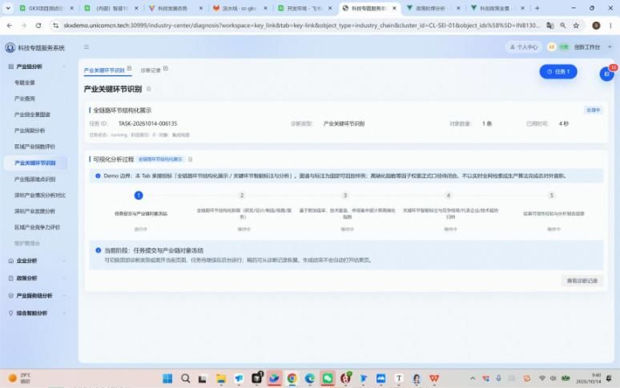
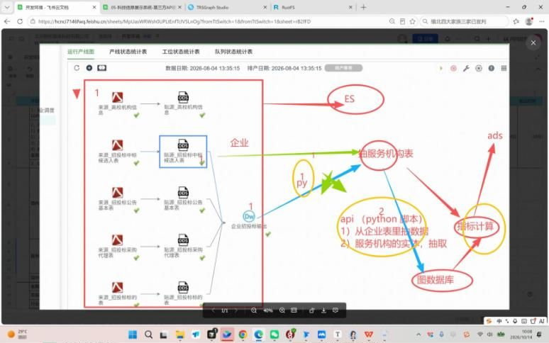
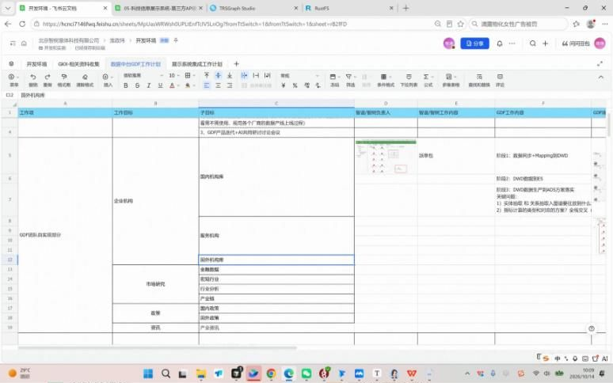

# 深圳国科信GDF工作内容和GDF迭代+AI共同研讨讨论会议

录制：深圳国科信GDF工作内容和GDF迭代+AI共同研讨讨论会议  
日期：2026-10-14 09:32:30  
录制文件：https://meeting.tencent.com/crm/2jerpEpbbc  
访问密码：XNLJ

纪要：https://meeting.tencent.com/rs/KEr8WPzO4b

图文纪要：

来源：腾讯会议录制纪要页面原文（https://meeting.tencent.com/rs/KEr8WPzO4b ）。下面六张图是该页「来自会议截图」，按页面出现顺序存放在 `2026-10-14-图/`。

**科创数据平台指标计算方案研讨**

发言人：淮政玮、辜少彬、徐滕强-发言人2、wagt、Yellow等6人

主题摘要：本次会议围绕科创数据平台指标计算展开，明确了指标分类与计算逻辑，重点研讨了GDF平台对接及数据血缘追踪方案，并规划了后续AI协同开发与交付节点。

### 核心结论

- 明确科创数据平台指标分类逻辑与数据加工链路，总计涉及超千项计算指标。
- 确立GDF平台对接方案，明确预计算与实时计算的分工及数据血缘追踪机制。
- 规划AI协同开发模式，通过智能体接管机械工作，并明确算力与环境准备计划。

### 指标分类与核心架构

1. **统计类指标**：形态简单但数据量大；进行计数、去重等基础操作；需进行工程化改造。
2. **二次计算类指标**：依赖基础统计或模型得分；任务间存在顺序性依赖。
3. **模型类指标**：涉及庞大计算公式或小型算法；需汇总多维度数据进行计算。
4. **图谱类指标**：严重依赖图谱结构；必须在实体和边关系上链后计算。

### GDF平台对接与血缘追踪方案

| 计算类型 | 执行平台 | 血缘追踪机制 |
|---|---|---|
| 预计算 | GDF平台 | 通过配置来源表、目标表及加工逻辑，天然保证血缘清晰可追溯 |
| 实时计算 | K8s服务集群 | 双方约定特定格式，抽取算法内部血缘传递给GDF以动态构建调用链 |

### AI协同开发与交付规划

- 智能体协同模式：AI接管Mapping等机械工作，双方通过GitLab目录进行AI对AI的交流与交接。
- 数据质量验证：采用AI审核代码、人工少量抽样及AI整体质量评估的三步策略。
- 算力与环境准备：开发阶段调用公网大模型，生产环境部署在客户超算环境并落实算力资源。

### 待办事项（页首）

- 提供GDF团队人员列表（含手机号），以便开通GitLab账号 @辜少彬
- 提供GitLab地址及生成的Markdown产出PDF路径 @淮政玮
- 在群内同步GDF公网及内网环境的服务器访问信息 @淮政玮
- 接收智数侧提供的派单包后，分析并评估GDF平台的建模与对接方案，并约定后续会议 @辜少彬

### 一、项目背景与数据链路概览

**1. 项目整体架构**

- 纯数据分析项目：该项目基于纯数据加工分析，无复杂业务操作，核心目标是通过用户选择条件或订阅，最终辅助生成数据报告或战略咨询报告。
- 算法中台桥接：系统以算法中台作为桥接核心，前端应用分为垂向专题分析与综合宏观分析两部分，通过算法中台实现数据加工与最终展示。

科技专题服务系统产业关键环节识别界面（来自会议截图）

**2. 核心数据域与指标规模**

- 四大核心数据域：项目负责企业、科研机构、人才及综合四个核心垂向数据域的专题分析，涵盖产业落地、政策及服务链等维度。
- 指标计算量庞大：项目涉及约560条核心计算指标，加上综合展示系统需求，总计需处理的指标数量超过1000个，且指标类型复杂多样。
- 底层数据源规模：原始数据量庞大，包含约两亿条论文与专利数据，以及约2000万条政策数据，数据血缘链路涉及ODS、DWS、算法及ES图谱。

科创项目ODS到ES图数据库数据血缘流程图（来自会议截图）

### 二、指标计算逻辑与工程化改造

**1. 指标分类与计算逻辑**

- 统计类指标：包含计数、去重、占比及分布等简单形态，需考虑千万级数据量下的高效实现，通常需要定时调度计算。
- 二次计算类指标：基于统计类或模型类的得分进行二次计算，任务之间存在顺序性依赖，需依赖前置指标的计算结果。
- 模型类指标：涉及庞大计算公式或小型算法，如产业竞争力指数需汇总企业数量、类型及专利数量等，计算逻辑较为复杂。
- 图谱类指标：严重依赖图谱结构，如产业链边数、供应链中心性等，必须在实体与边关系上图后才能进行计算。

企业分析算法库指标总览清单（来自会议截图）

**2. 工程化与调度策略**

- T+1调度机制：系统采用T+1调度策略，每天晚上处理前一天的所有数据，需确保当晚完成所有指标的重新计算。
- 代码编排需求：针对具体指标口径，需进一步细化工程实现形式，提供类似伪代码的精确化描述，以便GDF平台直接参考使用。

### 三、GDF平台与AI智能体协同方案

**1. 工作界面与参数化封装**

- 标准化Mapping流程：来源数据到Mapping的过程已高度标准化，只要提供来源表、目标表及加工逻辑，AI即可快速生成模板并完成映射。
- 算法参数化封装：智数侧需将算法逻辑封装为参数化程序，明确输入、输出及来源数据，GDF平台通过广义Mapping节点承接并配置这些参数。

GDF平台数据中台Mapping工作计划表（来自会议截图）

**2. 预计算与实时计算链路**

- 预计算链路：大部分指标采用预计算模式，算力消耗在GDF服务器上，由平台自动化跑批完成，数据血缘关系清晰可追溯。
- 实时计算链路：针对用户端实时调整模型权重或参数的场景，通过API调用触发，需在GDF平台生成动态调用链以维系血缘关系。

企业技术力评估API接口联调页面（来自会议截图）

**3. AI智能体对接机制**

- AI to AI交付：智数侧通过编程智能体生成包含所有算法逻辑、Mapping派单及血缘关系的Markdown文件，作为派单包交付给GDF侧的AI智能体。
- 任务回执与验收：GDF侧跑批完成后，需将执行结果、回执及数据库位置整理为Markdown文件，回传给智数侧智能体进行闭环验收。

### 四、环境与交付计划

**1. 算力与环境规划**

- 开发环境：开发阶段调用公网大模型，内部测试与生产环境部署在客户的超算环境，目前正逐步落实910C算力卡。
- 代码托管：项目代码托管在智谱内部GitLab，双方将通过开放GitLab账号及目录权限进行协同开发与文件交互。

智谱侧开发环境与GitLab组件配置表（来自会议截图）

**2. 数据质量验证策略**

- 分阶段验证：10月15日首要目标是跑通整体流程并产出结果，数据质量验证工作将安排在流程跑通之后进行。
- AI辅助验证：后续将采用AI审核代码、人工抽样及AI整体质量评估的三步法，结合真实数据探查，对指标计算结果进行质量核查。

### 五、待办事项

- 整理并提供包含算法逻辑、Mapping派单及血缘关系的Markdown派单包，供GDF侧分析对接。 @淮政玮
- 提供人员列表及手机号，以便开通GitLab账号及目录访问权限。 @辜少彬
- 提供GitLab地址及生成的Markdown产出PDF路径，供GDF侧下载与对接。 @淮政玮
- 在10月15日前完成整体数据加工与指标计算流程的跑通。 @淮政玮 @辜少彬

页末另附同一场录制入口：时长 01:25:14，会议名「深圳国科信GDF工作内容和GDF迭代+AI共同研讨讨论会议」，10/14 09:32。录制链接与口令见文首。