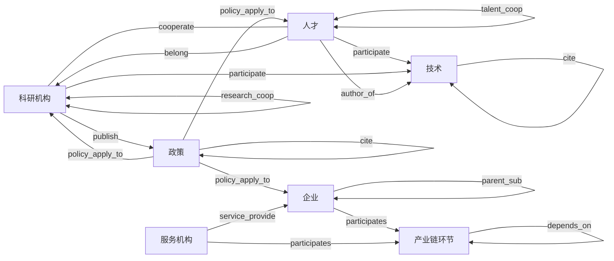

# KG-7ELEM-BUILD-REQ-L03 · 必须三元组与关系总图

> 日期：2026-10-30  
> 任务：`KG-7ELEM-BUILD-REQ-L03`  
> 输入只认重写后的 `KG-7ELEM-BUILD-REQ-L02-消费与归并.md`：查询 46、算法 36，合计 82。编号以该文为准，不沿用旧消费编号。  
> 查询侧数字只用 v1.2 §1.5 / §9：保留 98、转背景 16、不相关 457、飞书收回 84。  
> 收进必须表的条件：该行两端都已归入七要素，关系名已写死，且关系名、终点、方向都没有标待确认。  
> 燕大 EDGE 只对照 `SYSINT-SCHEME-07-L04`。该文未签收。附近有边只写「新建，对照某 EDGE」，不写复用放行。

七要素：企业、产业链环节、科研机构、技术、人才、服务机构、政策。技术只含论文、专利、项目。技术点、领域、主题、数据集、事件、活动、创新载体不进。`chain` 不是产业链环节。`industry` 在 L02 里没有归入七要素。

同名不同端点拆开，不互相覆盖。同一七要素端点、同一关系名、方向已写死的多行并成一条必须边，消费来源并记。

## 1. 图 KG-7ELEM-MUST-EDGES

本图不是 L0。`ARCH-TOPO-LUMEN` 的节点是仓名和服务名，边回答调用链。本图节点只用七要素中文名，只画必须建的关系。

边语义沿用图规约：实线是本叶认可的路径。在本叶里，实线只表示「必须建」这一定义，不授权改 Nebula 空间，也不授权写库。无向画 `---`，有向画 `-->`，双向画 `<-->`。不画虚线。可选没有。待确认和不建不画。禁止事项写在图下，与虚线同等。

| 职责 | 不做 |
|---|---|
| 标出七要素之间必须建的关系 | 不画 L0 拓扑，不复制 ENT / CHAIN / SVC 存储流图，不画不建和待确认 |

禁止事项：

- 不把技术点、领域、主题、数据集、事件、活动、创新载体画成节点。
- 不把 `chain`、`industry` 画成节点。
- 不画 L02 §6 已标关系名、终点或方向待确认的行。其中 A07 企业 cooperate 企业、A08 企业 invest 企业、A09 parent_sub、A10 supply 的方向未写死，不画；同名且方向已写死的 A32、A33、A34 另画。
- 不画服务机构 participates 服务机构。新编号 A21 的方向是待确认。
- 不把政策 `cite`（A17）并进技术 `cite`。两端不同。
- 本图不是 `ARCH-TOPO-LUMEN`，也不是存储流图。

图文若冲突，以这张图为准。下表 24 条必须边与图上 24 条实线一致。

## 2. 必须三元组

方向抄 L02 该行。基数 L02 没有写，全部待确认。档只有必须。可选 0 条。

归并：查询侧 institution 按 L02 第 5 节是科研机构。segment、以及写明「产业环节」的终点，归产业链环节。`service`、`service_institution` 归服务机构。`research` 归科研机构，`talent` 归人才。论文、专利、项目都在技术里，不拆出技术点。

| 编号 | 起点 | 关系 | 终点 | 方向 | 基数 | 档 | 消费来源 | 燕大对照（未签收，不复用） |
|---|---|---|---|---|---|---|---|---|
| M01 | 人才 | cooperate | 人才 | 无向 | 待确认 | 必须 | Q01 | 新建。L04 有 `COAUTHOR_WITH`，只覆盖合著 |
| M02 | 科研机构 | cooperate | 科研机构 | 无向 | 待确认 | 必须 | Q02 | 新建。L04 无机构间合作边 |
| M03 | 人才 | cooperate | 科研机构 | 无向 | 待确认 | 必须 | Q03 | 新建。`AFFILIATED_WITH` 是任职 |
| M04 | 人才 | belong | 科研机构 | 有向 | 待确认 | 必须 | Q04 | 新建。对照 `AFFILIATED_WITH`（任职，Person→Organization）。Organization 不单是科研机构 |
| M05 | 科研机构 | belong | 科研机构 | 有向 | 待确认 | 必须 | Q05 | 新建。`SUBSIDIARY_OF` 写的是企业子公司 |
| M06 | 技术 | cite | 技术 | 有向 | 待确认 | 必须 | Q10、Q11、Q12 | 论文→论文对照 `CITES`。专利引用 L04 未列，新建 |
| M07 | 人才 | participate | 技术 | 有向 | 待确认 | 必须 | Q13 | 新建。对照 `HAS_PARTICIPANT`、`LEADS`，方向是项目指向人 |
| M08 | 科研机构 | participate | 技术 | 有向 | 待确认 | 必须 | Q14 | 新建。对照 `FUNDED_BY`，方向是项目指向机构 |
| M09 | 人才 | author_of | 技术 | 有向 | 待确认 | 必须 | Q19、Q20 | 新建。对照 `AUTHORED_BY`、`INVENTED_BY`，方向相反 |
| M10 | 科研机构 | publish | 政策 | 有向 | 待确认 | 必须 | Q22 | 新建。L04 无政策 EDGE |
| M11 | 政策 | policy_relate | 政策 | 无向 | 待确认 | 必须 | Q23 | 新建。L04 无政策 EDGE |
| M12 | 政策 | policy_apply_to | 企业 | 有向 | 待确认 | 必须 | Q25 | 新建。L04 无政策 EDGE |
| M13 | 政策 | policy_apply_to | 人才 | 有向 | 待确认 | 必须 | Q26 | 新建。L04 无政策 EDGE |
| M14 | 政策 | policy_apply_to | 科研机构 | 有向 | 待确认 | 必须 | Q27 | 新建。L04 无政策 EDGE |
| M15 | 产业链环节 | depends_on | 产业链环节 | 有向，segment→segment | 待确认 | 必须 | A02、A27 | 新建。`DOWNSTREAM_OF` 是上下游，L04 记 0 边；`CHILD_OF` 是上下级。两行都只缺表名 |
| M16 | 政策 | cite | 政策 | 有向，policy→policy | 待确认 | 必须 | A17 | 新建。L04 无政策 EDGE。不并进 M06 |
| M17 | 企业 | participates | 产业链环节 | 有向，enterprise→segment | 待确认 | 必须 | A24 | 新建。`BELONGS_TO_NODE` 是归属，不是参与。A03 终点待确认，不并进本行 |
| M18 | 服务机构 | participates | 产业链环节 | 有向，service_institution→segment | 待确认 | 必须 | A26 | 新建。A26「同 A25」只沿用表名未写；混装句写在 A25 的 institution 上，不套到本行 |
| M19 | 科研机构 | research_coop | 科研机构 | 双向 | 待确认 | 必须 | A29 | 新建。L02 写灌入未验证，没有标关系名、终点或方向待确认。不并进 M02 |
| M20 | 人才 | talent_coop | 人才 | 双向 | 待确认 | 必须 | A30 | 新建。对照 `COAUTHOR_WITH` 只覆盖合著。不并进 M01。A13 终点待确认，不并进本行 |
| M21 | 服务机构 | service_provide | 企业 | 有向，service→enterprise | 待确认 | 必须 | A31 | 新建。L04 服务机构无独立 EDGE。A16 终点待确认，不并进本行 |
| M22 | 企业 | cooperate | 企业 | 双向 | 待确认 | 必须 | A32 | 新建。L04 企业间是投资、收购、子公司。A07 方向待确认，不并进本行 |
| M23 | 企业 | supply | 企业 | 有向，enterprise→enterprise | 待确认 | 必须 | A33 | 新建。L04 无供给边。A10 方向待确认，不并进本行 |
| M24 | 企业 | parent_sub | 企业 | 有向，enterprise→enterprise | 待确认 | 必须 | A34 | 新建。对照 `SUBSIDIARY_OF`。A09 方向待确认，不并进本行 |

必须 24 条，可选 0 条。图上只画这 24 条。

## 3. 七类两两

含自身一对，共 28 对。不建的原因只有三类：无消费、已有边覆盖、待确认。本表没有用「已有边覆盖」。同名不同端点的边不能互相覆盖。

| 要素对 | 结论 | 原因或必须边 |
|---|---|---|
| 企业 — 企业 | 必须建 | M22、M23、M24。A07、A08、A09、A10 方向待确认，不另增必须边。`invest` 不进必须 |
| 产业链环节 — 产业链环节 | 必须建 | M15 |
| 科研机构 — 科研机构 | 必须建 | M02、M05、M19 |
| 技术 — 技术 | 必须建 | M06 |
| 人才 — 人才 | 必须建 | M01、M20 |
| 服务机构 — 服务机构 | 不建 | 待确认。A21 方向待确认 |
| 政策 — 政策 | 必须建 | M11、M16 |
| 企业 — 产业链环节 | 必须建 | M17。A03、A11 终点待确认。A28 的 `industry` 未归入七要素 |
| 企业 — 科研机构 | 不建 | 待确认。A14 终点待确认 |
| 企业 — 技术 | 不建 | 待确认。A12 终点待确认 |
| 企业 — 人才 | 不建 | 待确认。A13 终点待确认 |
| 企业 — 服务机构 | 必须建 | M21 |
| 企业 — 政策 | 必须建 | M12。A15 关系名待确认，A18 终点未写成单一七要素 |
| 产业链环节 — 科研机构 | 不建 | 待确认。A04 终点与起点 tag 待确认。A25 写明 institution 是企业/机构混装 |
| 产业链环节 — 技术 | 不建 | 无消费。`CHAIN_RE_INDUSTRY_TECH` 明文不写。技术点不是技术 |
| 产业链环节 — 人才 | 不建 | 无消费。`CHAIN_RE_INDUSTRY_TALENT` 明文不写 |
| 产业链环节 — 服务机构 | 必须建 | M18。A05 终点待确认，不并进 |
| 产业链环节 — 政策 | 不建 | 待确认。A06 关系名待确认，终点是 chain 或 segment |
| 科研机构 — 技术 | 必须建 | M08 |
| 科研机构 — 人才 | 必须建 | M03、M04 |
| 科研机构 — 服务机构 | 不建 | 无消费。没有一条两端已经分成这两类 |
| 科研机构 — 政策 | 必须建 | M10、M14 |
| 技术 — 人才 | 必须建 | M07、M09 |
| 技术 — 服务机构 | 不建 | 无消费。`SVC_RE_TECH` 明文不写 |
| 技术 — 政策 | 不建 | 无消费 |
| 人才 — 服务机构 | 不建 | 无消费。`SVC_RE_TALENT` 明文不写 |
| 人才 — 政策 | 必须建 | M13 |
| 服务机构 — 政策 | 不建 | 待确认。A19 终点写成机构或服务，没有限定 |

必须建 15 对，不建 13 对。不建且无消费 6 对，不建且待确认 7 对，已有边覆盖 0 对。

## 4. 没进必须表的 L02 行

关系名、终点或方向标了待确认，或有一端没有归入七要素。这些行不能补成必须边。

| L02 编号 | 为什么不进 |
|---|---|
| Q06–Q09、Q15–Q18、Q21、Q24、Q28–Q41 | 一端是领域、主题、技术点、数据集、事件、活动或创新载体 |
| Q42–Q45 | 关系名和方向待确认，起点是技术点 |
| Q46 | 关系名、终点类型、方向待确认 |
| A01、A23 | 终点是 `chain`，不是产业链环节 |
| A03、A04、A05、A11、A12、A13、A14、A16、A20 | 终点或起点 tag 待确认 |
| A06 | 关系名待确认，终点是 chain 或 segment |
| A07、A08、A09、A10 | 方向待确认。同名且方向已写死的行见 M22、M23、M24；`invest` 没有方向已写死的行 |
| A15 | 关系名待确认 |
| A18、A19 | 终点不是单一七要素 |
| A21 | 方向待确认。服务机构之间这条不升必须 |
| A22 | 终点是 chain 或 segment，不是单一七要素 |
| A25 | institution 端点是企业/机构混装，没有归入单一七要素 |
| A28 | `industry` 没有归入七要素 |
| A35 | 起点写 institution，用途却是服务机构写图，没有归入单一七要素 |
| A36 | 「产业」的 tag 待确认 |

L02 第 4 节明文不写、只写点、以及没形成一行的缺口，继续不算消费。
