# KG-COMPLY-SDD-L01 · 展示与图算法详细设计说明书（含燕大编排智能体细任务清单）

> **任务**：`KG-COMPLY-SDD-L01`（Epic `E-SCI-INT`，definition，P0）
> **日期**：2026-11-07
> **认领 / 确认**：执行 `agent:architect-agent`，负责人与交付确认人均为 `human:徐滕强`；交付落 `07-图数据库集成` 目录，按登记册 DoD 经 `human:徐滕强` 确认（2026-11-08 明示；唐绍祖为 ALGO 会签人）
> **登记册执行角色**：`algorithm-agent`（按派单说明不改该字段）
> **仓**：`gkx-orchestration`，分支 `dev`。本单只写过程文档，不改业务仓、不改图空间、不 commit / push

## 一分钟说明（给非图谱同事）

这份文件回答四个问题：**本期合规验收到底覆盖哪些页面叶子；哪些算法要在 `demo_gkx_chain` 上跑出结果、跑不出来算 501 还是空态；燕大的入图过程怎么复用到正式加工线；后台接口落在哪个项目（只写两案与取舍，不选定）。** 文末的细任务清单是给燕大六位同学在与智树共用的编排环境里、交给编排智能体逐条执行的施工单，每条不靠口头补充。

- 图算法「跑出结果」的主责是唐绍祖（WBS 第 3 条），本单只写清怎么跑；入图可复用与后台接口的主责是燕大（WBS 第 2 条），本单不替燕大写图、不定接口落点。
- 本期是**合规验收线**，不是 GDF 正式加工派单，不替代 `WBS-07-00G / 00H`。
- 空间与验收面**已采用上游书面结论**：空间 = `demo_gkx_chain`（[STRUCT](./KG-COMPLY-STRUCT-L01-结构与空间选定.md) §4 选定放法 B）；验收叶子与算法清单边界 = [ACCEPT 验收面](./KG-COMPLY-ACCEPT-L01-验收面.md) + [算法实跑结果](./KG-COMPLY-ACCEPT-L01-算法实跑结果.md)。本单不再标「待结论」。

## 输入真源（只消费，不重开）

| 输入 | 用途 |
|---|---|
| [WBS-全景维护与知识图谱分工.md](./WBS-全景维护与知识图谱分工.md) | 四条分工与两条主责，本单不改派 |
| [WBS-全景维护与知识图谱分工-背景.md](./WBS-全景维护与知识图谱分工-背景.md) | 合规范围草稿、点数与缺口（「只读 demo_gkx_chain、燕大不入图」等旧口径已停用，本单按 WBS 新口径执行） |
| [KG-7ELEM-BUILD-REQ-L01](./KG-7ELEM-BUILD-REQ-L01-七要素必须三元组与建图需求.md) | 必须三元组 M01–M24，不增不减不改 |
| [KG-COMPLY-STRUCT-L01-结构与空间选定.md](./KG-COMPLY-STRUCT-L01-结构与空间选定.md) | **空间 = `demo_gkx_chain`（放法 B）**；14 Tag / 24+6 Edge / VID 规则 |
| [KG-COMPLY-ACCEPT-L01-验收面.md](./KG-COMPLY-ACCEPT-L01-验收面.md) | **验收面 = 三菜单 + 四类图算法**；三档验收方式；空态规则 |
| [KG-COMPLY-ACCEPT-L01-算法实跑结果.md](./KG-COMPLY-ACCEPT-L01-算法实跑结果.md) | 实跑基线：19,430 点 / 541,428 边 / Louvain 113 社群（模块度 0.5198）/ 路径 10 对 35,018 步；M22 企业合作网碎片化不可用 |
| [科学技术全景.md](../../../bid-reference/srs/02-科技信息展示系统/科技发展态势/科学技术全景.md) | 需规序号 17–47 |
| [科技知识图谱 README](../../../bid-reference/srs/02-科技信息展示系统/科技知识图谱/README.md) 及四子页 | 需规序号 400–454 |
| [diagram-as-contract.md](../../../diagram-as-contract.md) | 图即契约：实线=本期授权施工，虚线=他期/待定，禁止只改文不改图 |

---

## 图 KG-COMPLY-SDD-FLOW（先看图，再读正文；图文冲突以图为准）

```mermaid
flowchart TB
    SRC["需规基线：M01-M24 七要素必须三元组（不增不减）+ 技术点层 B1-B6 夹带"]

    subgraph SPACE["空间 demo_gkx_chain（STRUCT 放法 B，已书面选定，不新建空间）"]
        TP["技术点层 · 已有 · 夹带\n19,430 点 / 541,428 边 / 35,018 路径步"]
        SEVEN["七要素层 · 燕大按 M01-M24 补数\n已能供数：M01-M04 · M06部分 · M07-M09 · M15 · M17建桥 · M19 · M20\n空态（本期无供数）：M05 · M10-M14 · M16 · M18 · M21 · M23 · M24\n有数据但形态不可用（501）：M22 · 企业合作网碎片化（§2.2 #5）"]
    end

    subgraph TANG["主责一 · 唐绍祖 · 指定空间上算法跑出结果（只读）"]
        A1["路径搜索 423-427\n已实跑 10 对"]
        A2["中心性 428-432\n已实跑，weighted_degree 可用"]
        A3["社群 433-435 · 437\nLouvain 定案 B′ res8.0 · 178 成形社群"]
        A4["关键路径与节点 28-29\n35,018 步已实跑"]
        A5["社群演化 436\n501 · 缺多期快照"]
        AM["算法中台图能力 6 条\nweighted_degree · tech_rel · tech_path_step\ncommunity_id · cooperate · depends_on"]
    end

    subgraph LOAD["主责二 · 燕大 · 入图过程可复用"]
        L1["入图执行器 · 参数化\nspace 名 / props.batch / VID 规则外置"]
        L2["本期合规入图 → demo_gkx_chain\n按本说明书 §5 细任务清单"]
        L3["正式加工线 gkx_chain\n复用同一执行器，结构至少盖住 M01-M24\n属 WBS-07-00G / 00H 另一条线"]
    end

    subgraph API["后台接口落点 · 两案并列，本单不选定"]
        C1["案 1 · 整体集成项目侧\nJava 平台内开发"]
        C2["案 2 · 燕大自己的项目内开发"]
        DEC["取舍标准：以运行效率为准\n过程与任务分解由燕大与徐滕强或唐绍祖沟通确定"]
    end

    SRC --> SEVEN
    SRC --> TP
    L1 --> L2
    L2 --> SEVEN
    L1 -.->|"同一执行器复跑 · 本单只写可复用性 · 不派正式加工"| L3
    TP --> A1
    TP --> A2
    TP --> A3
    TP --> A4
    TP --> AM
    SEVEN -.->|"M01-M24 灌数后补验"| A1
    SEVEN -.->|"灌数后补验"| A2
    SEVEN -.->|"灌数后补验"| A3
    SEVEN -.->|"灌数后补验"| A4
    A3 --> A5
    AM --> A1
    AM --> A4
    L2 --> C1
    L2 --> C2
    C1 --- DEC
    C2 --- DEC
```

**图读法（按 diagram-as-contract 边语义）**

| 边 | 含义 |
|---|---|
| 实线 `-->` | 本期合规验收授权施工路径：燕大按细任务清单往 `demo_gkx_chain` 入图；唐绍祖在只读实跑基线上继续把算法跑出结果 |
| 虚线 `-.->` | 他期 / 待定：正式线 `gkx_chain` 复跑（属 WBS-07-00G / 00H，本单只保证执行器可复用与结构覆盖，不派工）；七要素层灌数后的算法补验 |
| 无向连线 `---` | 两案并列挂同一取舍标准，最终落点由人沟通确定，本单不选定 |

**图回答的三件事**

1. **算法在 `demo_gkx_chain` 怎么跑出结果**：技术点层现在就能跑（路径 / 中心性 / 社群 / 关键路径，实跑基线见上）；七要素层要等燕大按 M01–M24 灌数后补验；436 社群演化缺多期数据，本期 501。
2. **燕大入图怎么复用到正式线**：入图执行器参数化（space 名 / `props.batch` / VID 规则外置），本期写 `demo_gkx_chain`，同一执行器可复跑到 `gkx_chain`；正式线结构至少盖住 M01–M24（细任务 T11 出对照清单），两线不混淆、不互拷。
3. **后台接口两种落点**：案 1 整体集成项目 / 案 2 燕大自己的项目，并列不选定，以运行效率为准（§4）。

**本单施工 | 不做**

| 本单施工（实线） | 本单不做 |
|---|---|
| 写详细设计 + 细任务清单（经徐滕强确认后由 coordinator 建单） | 替燕大写图 / 写 nGQL / 定接口仓库并实现 |
| 按已选定空间 `demo_gkx_chain` 与已定验收面写死设计 | 新建空间、切换空间、重开 STRUCT / ACCEPT |
| 写明入图过程复用方式与正式线结构覆盖要求 | 把本期写成 GDF 正式加工，替代 WBS-07-00G / 00H |
| 写后台接口两案与效率取舍 | 选定最终仓库、写接口实现 |

---

## 1. 范围逐叶（验收叶子已采用 ACCEPT 书面结论）

### 1.1 科学技术全景 `/trend/tech-panorama`（序号 17–33，本期展示 + 验收）

三个功能组全部**只读** `demo_gkx_chain`。页面不接收数据导入：序号 17 的「数据输入」与序号 26 的「实体之间的网 / 按时间看变化」按已裁定返回 501（见 §1.1 ①组 17 行、②组 26 行说明），不用 mock 补满。

**① 展示技术点图谱（17–21）**

| 需规序号 | 叶子 | 怎么实现（读什么） | 验收看什么 |
|---|---|---|---|
| 17 | 技术点图谱数据输入 | **501**：页面不接收手动输入 / 文件导入；数据由中台侧灌入 `demo_gkx_chain`（技术点层已有；七要素层燕大按 M01–M24 入图） | 接口返回 501「未实现」，不显示 0 或假图 |
| 18 | 图结构自动生成 | 只读图：技术点层 `tech_point` + `tech_rel`（19,430 点 / 541,428 边）+ 七要素层已灌部分；前端渲染，不在页面现算结构 | 图上有点有连线；不同类型点用颜色 / 形状区分 |
| 19 | 图谱交互操作 | 纯前端：缩放、平移、节点拖拽、展开 / 折叠、路径高亮，不触发后端算法 | 交互可用、不掉帧、不白屏 |
| 20 | 技术点搜索定位 | 读图节点列表按名称检索（模糊 + 精确），命中后在图上高亮居中 | 能搜到、能定位高亮 |
| 21 | 技术点详情查看 | 读图节点属性（`props` JSON + `weighted_degree` / `community_id` 等），弹窗 / 侧边栏展示 | 点开有详情；数字与接口一致 |

**② 展示技术点关联实体（22–27）**

| 需规序号 | 叶子 | 怎么实现（读什么） | 验收看什么 |
|---|---|---|---|
| 22 | 默认实体展示 | 读技术点关联实体边：`tech_has_person` / `tech_has_institution` / `tech_has_paper` / `tech_has_patent`，默认出 Top5 | 初始加载出 Top5；类型齐全 |
| 23 | 节点点击交互 | 同一组边按选中节点即时查询；前端视觉反馈 | 点击换批，高亮反馈 |
| 24 | 实体详情查看 | 读节点属性 + 反向关联技术点列表 | 详情含属性、关联技术点、时间线 |
| 25 | 实体筛选功能 | 查询参数带实体类型 + 时间范围过滤（读边属性 `first_year` / 实体属性） | 能按类型 / 时间筛 |
| 26 | 实体关联关系展示 | **501**（已裁定空态 + 501）：实体之间的网、按时间看变化，不补实体间边、不做两期图 | 501 或「暂无数据」，不显示假网 |
| 27 | 实体排序与优先级 | 排序键 = 关联强度（边属性）+ 影响力（`ads_technology_panorama_score` mock 行，S4）；没有行就空，不造强度 | 能按强度 / 时间 / 名称 / 类型排序 |

**③ 展示关键路径和关键节点（28–33）**

| 需规序号 | 叶子 | 怎么实现（读什么） | 验收看什么 |
|---|---|---|---|
| 28 | 关键路径数据接收与处理 | 读 `tech_path_step`（实测 35,018 步；旧记录 47,909 步差异已登记，等 LOAD 侧说明，不擅自改数） | 路径序列能解析并并进图；能画出来 |
| 29 | 关键节点识别与标记 | 读中心性结果：`weighted_degree`（已有字段）+ 现算 PageRank / 紧密 / 中介（实跑基线见 §2）；按重要性特殊标记 | 关键节点有特殊样式并与其他节点区分 |
| 30 | 路径详情查看 | 读路径节点序列 + 节点属性 | 点节点 / 连线有详情弹窗 |
| 31 | 关键路径筛选与过滤 | 按 `path_id` 聚合后按路径类型、重要性级别、时间范围过滤 | 能筛选、能组合条件 |
| 32 | 路径比较分析 | 多条 `path_id` 并排对比展示 | 能同时对比多条 |
| 33 | 关键路径动态演示 | 按 `step_order` 播放单条路径；播放按步，不做两个年份各一张图 | 能播放、可暂停继续、可调速 |

### 1.2 维护管理 `/trend/tech-situation-maintain`（序号 41–47；34–40 不做）

挂在科技发展态势菜单下，不另开一级。前端现状：`FE-TS-10A` 页面在 integration，**维护管理目标页路由未落地**（ACCEPT §1 实测），A 档页面验收对 41 暂不可执行，按 B 接口档验。

| 需规序号 | 功能 | 本期 | 怎么实现（读什么） | 验收看什么 |
|---|---|---|---|---|
| 41 | 关键实体推荐列表展示 | **验（读）** | 只读 `demo_gkx_chain` 已相连邻居（`tech_has_*` 边）或 `ads_technology_panorama_score` 分数；不新做推荐模型 | B 档：接口 200 且契约字段齐全；有数非空；能排序筛选 |
| 42 | 实体添加到全景图操作 | 不验（写） | — | 本期不做写操作 |
| 43 | 全景图实体删除操作 | 不验（写） | — | 同上 |
| 44 | 实体关系删除操作 | 不验（写） | — | 同上 |
| 45 | 实体属性编辑功能 | 不验（写） | — | 同上 |
| 46 | 实体关系编辑功能 | 不验（写） | — | 同上 |
| 47 | 实体及关系批量管理 | 不验（写） | — | 同上 |

- 34–40（维护技术图谱：增删技术点 / 改关系 / 改属性 / 撤销 / 版本）**双方都不做**，报价工作量 0，已会签，不落库不建单，本页不提供增删改。
- 42–47 写操作留待定人后（王建峰 / 刘剑锋 / 燕大同学协商）**另立项**，不混进本期，也不写进 §5 细任务清单。
- 本期目标仍是把数补进 `demo_gkx_chain`（燕大入图 + 智树 S1–S4），不是在这张菜单上改图。

### 1.3 科技知识图谱（55 叶收成 4 行消费，本期验 400–407 与 423–437）

前端现状：四个菜单项已挂，页面全部落到「开发中」占位页（ACCEPT §1 实测）。数据层与接口层按 B 档验收，A 档页面验收待前端补页后单独立项。未就绪 HTTP 501；查询执行了但没有命中才是空态；无权限是降级；Java 不写 nGQL。

| 子页 | 需规序号 | 叶子数 | 本期 | 读什么 |
|---|---|---|---|---|
| 分析展示 | 400–407 | 8 | **验（图相关）** | 动态查询 / 过滤 / 多维分析 / 可视化：查空间里已有产业链层（`chain` / `segment` / `enterprise` / `institution` / `depends_on` / `participates` / `belongs_to`）+ 技术点层；技术点写进去后同一条读图也能查到；不在页面现算聚类。**405 预测、407 推荐保持 501** |
| 指标展示 | 408–422 | 15 | 不验（非图功能） | 需规原文是异常监测 / 规则 / 黑名单 / 权重 / 综合分 / 学习 / 闭环，不是读图；图相关 seed 几乎全 mock；并入 WBS-07-02。415 / 417 沾图不扩进来，若徐滕强要求再单列 |
| 算法展示 | 423–437 | 15 | **验（路径 / 中心性 / 社群）** | 读法逐条见 §2 算法清单 |
| 服务展示 | 438–454 | 17 | 不验（非图功能） | 入口可点；打开后的图与 400–407 同一空间不另造图；凭证不下发前端；449–450 多源建模不在本页做成建图按钮；并入 WBS-07-03 |

**空态与缺数规则（全表通用，沿用 ACCEPT §7）**

| 情况 | 正确表现 | 禁止 |
|---|---|---|
| 该层没有数据（M05、M10–M14、M16、M18、M21、M23、M24） | 显式 501「未实现」或「暂无数据」并说明原因 | 显示 0、显示假图、静默空白 |
| 有数据但形态不可用（M22 企业合作网：`cooperate` 边实测 94,824 条，但最大连通片仅 220/208,394，碎片化） | 明示「数据形态不支持，本期不支持」；实跑判定细节见 §2.2 #5 | 用碎片化结果冒充全量排名、把有数据当可用 |
| 有部分数据 | 有多少显示多少，标明数据范围 | 用 mock 补满、凑数量 |
| 算法跑不出（如 436 社群演化、M22 合作网） | 明示「需多期数据 / 数据形态不支持，本期不支持」 | 用单期数据假装演化、用碎片化结果冒充排名 |
| 边端点缺失 | 跳过该条，计数记「因端点缺失跳过」 | 自动补点凑边 |
| `USE_MOCK=false` | 禁止 fixture 填数 | — |

---

## 2. 算法清单（两列；「跑出结果」主责 = 唐绍祖，本单只写清怎么跑）

**通用运行方式**（沿用 ACCEPT 实跑基线）：连 `demo_gkx_chain`，`MATCH` / `GO` 分页读点边，**只读**，不在页面请求里写库；算法在本机 / 离线计算后落结果（结果表或直接返回），不向图写点边索引。「无结果 → 501 还是空态」的判定分界：**该算法依赖的数据层整个不存在（Tag / Edge 空、本期明确不建）→ 501 未实现；数据层存在但本次查询 / 计算没有命中 → 空态（显示「暂无数据」，禁 0 / 假图）**。

### 2.1 第 1 列 · 需规里图相关的算法（科学技术全景 28–29 + 算法展示 423–437）

| # | 需规序号 | 算法 / 功能 | 在 `demo_gkx_chain` 读什么 | 怎样算跑出结果 | 没有结果时 |
|---|---|---|---|---|---|
| 1 | 423 | BFS / DFS / Dijkstra / Bellman-Ford / A* 多算法路径搜索 | `tech_point` 点 + `tech_rel` 边（证据等级读 `e.evidence_level`，强度读 `e.relation_confidence_score`，做加权权重）；七要素层灌数后可扩展到 M01–M24 端点对 | 指定起终点对，`MATCH` / `GO` 导出子图到本机，`networkx` 跑五种算法各出一条路，结果可比（加权 vs 无权差异即算法差异，如实展示） | 起终点不存在或不在同一连通片 → **空态**（返回「不可达」，不显示 0 条路径充数）；输入图层不存在 → **501** |
| 2 | 424 | 最优路径发现与展示 | 同上 | 按权重（证据置信度）跑 Dijkstra 取代价最低路径，落成节点 + 连线序列返回 | 同上：不可达 → **空态**；层缺失 → **501** |
| 3 | 425 | 路径多样性分析 | 同上 | 同起点终点跑 k 条备选路径（去边 / 去点多样性策略），每条带长度、节点数、权重 | 同上 |
| 4 | 426 | 场景化路径应用（合作链 / 成果传播路径） | 技术点图（能跑）；人才合作网（M01/M20 灌数后） | 技术点图上按 1–3 套现成场景跑路径；人才合作网等 M01–M04 / M19 / M20 入图后同法补跑 | 技术点图无路 → **空态**；合作网层未灌数 → **501**（实跑已证：M22 企业合作网碎片化不可用，不得用它冒充场景结果） |
| 5 | 427 | 交互式路径查询与可视化 | 同 423 | 页面选点发起查询 → 后端同 1–3 执行 → 结果高亮跟踪展示；查询执行即算跑出结果 | 查询无命中 → **空态**；页面占位未上线不影响 B 档判过 |
| 6 | 428 | 度中心性 | `tech_point` 全量 + `tech_rel` | 直接读已有字段 `weighted_degree`（19,430/19,430 全覆盖，与现算度数相关 0.9515，已实跑 Top20）；无需重算 | 字段覆盖率正常 → 必有结果；图层缺失 → **501** |
| 7 | 429 | 紧密中心性 | 同上 | 本机 `networkx` 现算；全图精确代价过高，按度数取前 1,500 点子图计算（**有意识抽样，如实标注**，实跑已出 Top20） | 子图为空 → **空态**；已实跑基线在手，重算以复现实跑为准 |
| 8 | 430 | 中介中心性 | 同上 | 同 1,500 点子图，300 源点采样近似（如实标注），实跑已出 Top20 | 同上 |
| 9 | 431 | PageRank | 同上 | 全图 `networkx` PageRank（α=0.85，阈值 1e-8），实跑已出 Top20，分值和=1.0 已校验 | 图层缺失 → **501** |
| 10 | 432 | 多维度中心性综合 | 428–431 四项结果 | 各指标 min-max 标准化后等权相加（支持自定义权重），实跑已出 Top20 | 上游 429–431 无结果 → 本条**空态**并列出依赖缺失项，不造数 |
| 11 | 433 | 多算法社群发现（模块度 / 谱聚类 / K-means / LPA / Infomap / Louvain） | `tech_point` + `tech_rel` | **Louvain 必须跑出**（定案 B′：resolution 8.0、种子 42，178 个成形社群，模块度同分辨率自检约 0.2791；res 1.0 旧基线 113 社群 / 0.5198 仅备查，见 §2.2 #4）；其余算法按需补跑对比，跑几个如实报几个 | 图层缺失 → **501**；某算法未跑 → 该算法**空态**标注「未计算」，不得只拿 Louvain 冒充「多算法支持」全过 |
| 12 | 434 | 社群结构自动识别 | 同上 | Louvain 现算结果落到成员清单（`community_id` 字段实测 0/19,430 全空，**不可依赖**，需自算并落表 / 写回，写回属 LOAD / 数据侧，本任务只读） | 未算出 → **空态**（不得引用全空字段冒充） |
| 13 | 435 | 社群属性与特征分析 | Louvain 成员清单 | 从成员表汇总每社群规模、核心节点、内部边数、平均度（实跑已出前 6 社群明细） | 无成员表 → **空态** |
| 14 | 436 | 社群动态演化追踪 | 需多期快照，当前只有单份 | **本期跑不出**：缺多期数据，如实标注「需多期数据，本期不支持」 | **501**（不接受单期数据假装演化） |
| 15 | 437 | 可视化社群划分结果 | Louvain 成员清单 | 依 12–13 的结果做颜色分区渲染；展示依赖 434 出数 | 434 无结果 → **空态** |
| 16 | 28 | 关键路径数据接收与处理 | `tech_path_step`（实测 35,018 步，带 `path_id` / `step_order`） | 按 `path_id` 聚合成路径序列返回，页面解析并进图（实跑已出路径明细） | 步表为空 → **空态**；35,018 vs 47,909 差异已登记，按实测数验收 |
| 17 | 29 | 关键节点识别与标记 | `weighted_degree` + 429–431 中心性结果 | 按 6–9 的结果自动标关键节点（放大 / 变色 / 图标），依赖 §2.1 #6–9 先出数 | 中心性无结果 → **空态**并列依赖 |

> #16–17 属科学技术全景页（ACCEPT §2.4），因同属「跑出结果」清单与算法展示同列；实现上同读 `tech_path_step` 与中心性结果，不另起一套。

### 2.2 第 2 列 · 算法中台上图相关的算法

算法中台（`demo-ui-system-test` 合规展示台）上与图相关的能力，逐条在本空间跑出结果；其中「算法实跑已出参考结果」的条目以 2026-11-07 实跑为验收基线，重跑结果允许在合理参数差异内浮动，但结论形态（有榜单 / 有社群 / 有路径）必须一致。

| # | 能力 | 在 `demo_gkx_chain` 读什么 | 怎样算跑出结果 | 没有结果时 |
|---|---|---|---|---|
| 1 | 加权度（`weighted_degree`，度中心性） | `tech_point.weighted_degree`（全量覆盖） | 直接读字段出 Top 榜单（实跑 Top20 已出） | 字段空 → **空态** |
| 2 | 技术点关系网（`tech_rel` 推断边） | 541,428 条边（证据 HIGH 15.1% / MEDIUM 16.7% / LOW 68.2%） | `GO` 抽样导出 + 本机建图（实跑 0 重复边，图规模校验通过） | 边空 → **空态** |
| 3 | 关键路径步（`tech_path_step`） | 35,018 步 | 按 `path_id` 聚合出路径清单（实跑已出） | 步空 → **空态** |
| 4 | 社群编号（`community_id`） | 字段 0/19,430 全空（且为**空串**非 NULL——校验用 `<> ''` 判空，不要用 `IS NULL`） | **已定案 B′（human:徐滕强 2026-11-09 确认）**：我方自算 Louvain，`python-louvain`（与基线同库）、seed 42、**resolution 8.0**，得 **178 个成形社群、成形中位 63、最大 622（占 3.2%）、零伪单点**；写回时 `props.batch` 记 algorithm/seed/resolution。落选方案备查：A 久新 1,731 簇（98.7% 伪单点、成形仅 23、ARI 0.072 与我方划分基本无关——是 HIGH+MEDIUM 子图结果，不可贴全量图）、B 基线 res1.0（113 中仅 6 个成形，过粗）。详见 [KG-COMPLY-COMM-L01-社群口径选型调研与建议.md](./KG-COMPLY-COMM-L01-社群口径选型调研与建议.md)；落成员表供 434/435/437 消费；字段写回属 LOAD / 数据侧 | 未自算 → **空态**（禁止引用全空字段） |
| 5 | 企业合作网（`cooperate`，M22） | 94,824 条边 / 208,394 企业点 | **本期跑不出有意义结果**：最大连通片仅 220/208,394，图碎片化，中心性与社群结论不可用，**如实标注** | **必为 501**，返回「数据形态不支持，本期不支持」（禁止拿 220 家连通片的排名冒充全量结论；不返回空态——该边有数据，形态不可用与无数据是两回事） |
| 6 | 产业链依赖网（`depends_on`，M15） | 1,414 环节点 / 1,073 依赖边 | 已验证 DAG、32 层、341 连通片（对应 12 条链各自成树），可做层级 / 溯源展示（实跑已出） | 边空 → **空态** |

**算法清单合计：第 1 列 17 条 + 第 2 列 6 条 = 23 条。**

**501 / 空态速查（两列合并后必为 501 的条目）**：需规列 #14（436 社群演化）、中台列 #5（M22 企业合作网）——前者缺多期数据，后者数据碎片化；M22 的 501 语义 =「明示数据形态不支持，本期不支持」（非「暂无数据」——该边有 94,824 条，是形态不可用不是没数），均如实标注，不造假结果。

---

## 3. 入图与正式加工线（燕大主责：入图过程可复用，不与正式线混淆）

### 3.1 复用原则

| 项 | 口径 |
|---|---|
| 执行器参数化 | 入图脚本 / 作业把三样东西外置成参数：**space 名**、**`props.batch`（批号）**、**VID 规则**（`ent:<信用代码>` / `seg:<chain_code>:<node_id>` / `tp:<technology_node_id>` 等，见 STRUCT §1）。本期跑 `demo_gkx_chain`，正式线换 space 名即可复跑 |
| 结构同一套 | 正式线 `gkx_chain` 的 Tag / Edge / VID **至少包含**七要素层合规范围 = 9 个 Tag（`enterprise` / `segment` / `research` / `person` / `paper` / `patent` / `project` / `policy` / `institution`）+ 24 条 M01–M24 必须边；技术点层 B1–B6（5 Tag + 6 边）为可选夹带，**不计入**正式线最低要求（同 §3.2）；不得删改 M01–M24 的边型、方向与端点 |
| 不混淆 | 两线不双写、不互拷：`demo_gkx_chain` 的点边不拷进 `gkx_chain`，反向也不拷；`gkx_chain` 仍归 WBS-07-00G / 00H，本期不派工 |
| 过程记录 | 每批入图带 `props.batch`，端点缺失跳过并计数，便于验收时对账（沿用 STRUCT §5 下游口径） |

### 3.2 正式线结构覆盖对照（T11 细任务的输入）

正式线结构至少盖住本期合规范围，对照关系：

| 合规范围（本期，`demo_gkx_chain`） | 正式线 `gkx_chain` 至少要有 |
|---|---|
| 七要素层 M01–M24（24 条必须边 + 边属性 `weight` / `props` / `first_year`） | 同名同端点同方向的 24 条边型，一字不改 |
| 七要素层 9 Tag（`enterprise` / `segment` / `research` / `person` / `paper` / `patent` / `project` / `policy` / `institution`） | 同名 Tag + VID 规则一致；属性可升列，不得删除 |
| 技术点层 B1–B6（`tech_point` / `tech_paper` / `tech_patent` / `tech_institution` / `tech_person` 5 Tag + `tech_rel` / `tech_has_*` / `tech_path_step` 边，**可选夹带，不计入最低覆盖**） | 夹带层可复用可不复用；若正式线不用技术点层，需一句书面说明——不影响「结构至少盖住 M01–M24」的验收口径 |
| `props.batch` 批号纪律 | 正式线同样执行（批号体系可与本期不同） |

> 本节只写「复用什么、至少盖住什么」，不把本期任何细任务写成正式加工派单。WBS-07-00G / 00H、`KG-CHAIN-GRAPH-LOAD-L01`、企业维正式派单均为已签收的另一条线，本单不重开。

### 3.3 与已有任务的边界

| 已有 | 关系 |
|---|---|
| `KG-COMPLY-LOAD-L01`（燕大，backlog） | 本单 §5 细任务清单经徐滕强确认后，由 coordinator 建为该单下游执行叶；执行器参数化要求写进该单 |
| WBS-07-00G / 00H | 正式加工线，不属本期；本单只约束「结构至少盖住 M01–M24」 |
| `KG-7ELEM-BUILD-REQ-L01`～L05 | 已签收，只消费，不重开；M01–M24 不增不减 |
| `SYSINT-TECHGRAPH-02-L01/L03`、`TS-L2-DS02-*` | 智树侧补数（S1–S4）已有任务号，本单不重复拆 |

---

## 4. 后台接口落点（两案并列，本单不选定、不写实现）

后台接口由**燕大提供**。两种允许的落点做法与取舍如下；最终落在哪个仓库，由燕大与 `human:徐滕强` 或 `human:唐绍祖` 沟通确定，过程和任务分解也在那次沟通里定。本单不替燕大定接口落点，不写接口实现。

| | 案 1 · 整体集成项目内开发 | 案 2 · 燕大自己的项目内开发 |
|---|---|---|
| 做法 | 接口开发在项目组统一的集成工程里（Java 平台侧新增图查询门面模块），燕大按契约提供实现 | 接口连同燕大的图执行器一起留在燕大自有的工程体系内，以服务形式对外暴露 |
| 运行效率考量 | 离 Nebula 与 Java 网关近，链路少一跳；但燕大的算法作业（community / path 等）若也在燕大侧，需跨网络回取结果 | 算法作业与接口同进程 / 同内网，图算法重计算离数据近，回传面小；但前端调用链多一跳，需网关转发稳定 |
| 工程管理 | 与展示系统现有 CI/CD、可观测（OTel）、网关鉴权天然一致，联调走 `SYSINT-*` 既有链 | 燕大自主迭代快；但需补接入网关、鉴权与可观测，联调面更大 |
| 对调用链铁律 | 完全符合：前端 → Java REST → Python `/internal/*`，Java 不写 nGQL | 需保证：对外仍经 `gkxlumen-platform-gateway` 一类统一入口，燕大服务按 `/internal/*` 语义提供数据，不越层直连前端 |
| 验收影响 | B 档接口验收直接在集成环境做 | B 档接口验收在燕大环境做，验收判据不变 |

**取舍标准（派单原文）**：以**运行效率**为准——哪个落点让「页面读图 + 算法结果查询」端到端更快、更稳，选哪个。其余工程管理差异作为参考，不作为唯一依据。

**无论落在哪案，契约都要守住**：

1. 接口出入参不新增 Tag / Edge（出入参以 STRUCT §1 结构为基线）；
2. 缺数返回 501 或空态，不返回 0 / 假图（§1 空态规则）；
3. 密码 / 连接串 / Key 不进 git，凭证走 Secret 或主机环境文件；
4. 前端只调 Java REST，不直连 Nebula，不直连燕大服务（调用链铁律）。

---

## 5. 细任务清单（给燕大编排智能体；本单不 task-create）

**使用方式**：本清单先落在本说明书内。经 `human:徐滕强` 确认后，由 coordinator 按条建单（挂 `KG-COMPLY-LOAD-L01` 下游），燕大同学在与智树共用的编排环境里逐条把「编排环境话术」交给编排智能体执行。每条自带读图对象、验收判据、禁做项与依赖，**不靠口头补充**。

**全清单共同前提（每条任务默认继承，编排话术里不再重复）**：

| 项 | 值 |
|---|---|
| 空间 | `demo_gkx_chain`（STRUCT 放法 B，已选定；禁止写 `gkx_chain` / `gkx_local_1` / `gkx_full_1` / `entan`，不双写不互拷） |
| 结构基线 | STRUCT §1：14 Tag / 24+6 Edge / VID 规则；出入参不新增 Tag / Edge |
| 边属性 | 每条边带 `weight double`（没有就 0，不造；**例外：M17 落在存量 `participates` 边上，该边无 `weight`，用 `chain_score` 作强度，不另加 `weight`**）、`props`（JSON：`source_table / source_record_id / batch / confidence / match_method / evidence`）；`first_year`：存量 24+6 边型实测**全库均无此字段**，本期入图不强制新建（避免 DDL 膨胀拖期）；若后续需要按首年筛，作为 STRUCT 结构增补项走 T01 待补清单同一 DDL 授权通道 |
| 批号 | 每批入图带 `props.batch`（如 `comply-20261107-t02`）；端点缺失跳过并计数，不自动补点 |
| **VID 规则（本期必读）** | **不得按 STRUCT §1.1 的规范前缀硬编码**。本期 `demo_gkx_chain` 一律用**现网实际前缀**：`ent:<org_id>` / `segment:<segment_key>` / `institution:<org_id>` / `pol:<policy_id>`（实测存量 208,394 / 1,414 / 43,296 / 20,000 点）；`ent:` 后缀**不是信用代码**（`enterprise_code` 实测 0/208,394 非空），真实后缀在 `props.org_id`。5 个新 Tag（`research`/`person`/`paper`/`patent`/`project`）无存量，沿用规范前缀（`inst:`/`person:`/`paper:`/`patent:`/`proj:`）。VID 从源表字段拼、不重算；执行器按 `demo` / `prod` 两套 profile 外置，**本期只允许 `demo`**。详见 [KG-COMPLY-VID-L01](./KG-COMPLY-VID-L01-VID前缀实测与裁定.md) |
| **存量已满足项** | `depends_on` 1,073 条（全 `segment→segment`，M15）与 `participates` 178,731 条（`enterprise→segment`，M17）**已存在于现网**，只回读核对、**不得重灌**（重灌即翻倍、T07 无法对账）；存量边无 `props.batch` 字段，**禁止回写**（属改写既有数据） |
| **结构补建（DDL）属性底线** | 补建 Tag / Edge **必须带 `props string`**，否则与「边属性」「批号」两行自相矛盾：`CREATE EDGE IF NOT EXISTS xxx ();` 这类空属性结构没有 `props` 列，`props.batch` 无处可写，T07 对账、T05/T06 批次拆分全部失效。具体：**Edge 至少 `weight double` / `props string`**（`first_year` 按上一行口径不强制）；**Tag 至少 `name string` / `props string`**（业务属性按 STRUCT §1.1 一律先进 `props` JSON，不逐项升列，与「不为加属性重建 Tag」的结论一致——但 `props` 列本身必须有，否则 JSON 无处落）。基准 `KG-7ELEM-SCHEMA-DDL-L01` 中 5 个 Tag + 11 种 Edge 的空括号写法视为**该文件的缺项**，按本行补齐后再报 DBA；现网 `cooperate` / `participates` 已自带 `props`（历史补列），证明空结构在实际写入时必然被绕过 |
| 凭证 | Nebula 连接凭证走主机环境文件 / Secret，**不进 git、不进编排话术** |
| 执行环境 | 与智树共用 `lumen-algo-py` 编排环境；入图执行为离线作业，不进页面请求链路 |
| **属性读写约定（本引擎特有，必读）** | **节点属性必须带 Tag 前缀**：`v.<tag>.<field>`（如 `v.tech_point.name_zh`）；写成 `v.name_zh` 返回全 NULL。**边属性必须不带边名前缀**：`e.<field>` 或 `properties(e)`（如 `e.evidence_level`）；写成 `e.<edge_name>.<field>`（如 `e.tech_rel.evidence_level`）返回**全 NULL 且不报错**，会让加权算法静默退化成无权算法。所有抽样核验与算法作业按本约定写，不得沿用原生 Nebula 的 `e.<edge_name>.<field>` 习惯 |
| 验收档位 | 数据档（C 档）为主：在空间里查得到、数量与上游记录一致；接口条目另按 B 档 |

### T01 入图环境与结构核验（含 schema 缺口升级闸）

| 项 | 内容 |
|---|---|
| 建议执行人 | `human:白鑫凤` |
| 依赖 | STRUCT §1 结构基线（已定，无需等待） |
| 编排环境话术 | 「连 `demo_gkx_chain`，只读核对：14 个 Tag 与 24+6 条 Edge 是否都已存在、VID 规则抽查各 Tag 前缀是否与**现网实际前缀**一致（`ent:` / `segment:` / `institution:` / `pol:` / `tech_point:` 为存量基准；`person:` / `paper:` / `patent:` / `proj:` / `inst:` 为新 Tag 规范前缀；判据见 KG-COMPLY-VID-L01，**不要拿 `seg:` / `svc:` / `policy:` / `tp:` 去比**，那几个是正式线目标、本期不适用）；Edge 端点组合与方向不在 SHOW EDGES 结果里，另对各 Edge 名抽样各 20 条核对端点 Tag 对与方向是否与 STRUCT §1.2 一致；输出核对表（Tag/Edge/VID/端点方向四列，逐项 ✅/❌），不改任何 schema。**预期此闸门开局不会全绿**：2026-11-08 实测空间为 10 Tag / 15 Edge，预计缺 5 个 Tag 与 11 种 M 边型（清单见下「预期缺口」）。核对结果与预期一致属正常，不等于做错。若存在缺失 Tag / Edge：列『待补清单』（缺失项 + 对应 STRUCT §1 定义 + 建议 DDL 语句摘自 KG-7ELEM-SCHEMA-DDL-L01），**立即停止下游灌数任务**；待补清单里的 DDL 要逐条检查属性定义，**空属性结构（括号里什么都没有）不得直接提交 DBA**，须按 §5 共同前提「结构补建（DDL）属性底线」补齐 `props`（Edge 另需 `weight`）后再报；清单**先交唐绍祖确认内容对不对**，再报 `human:徐滕强`，由**项目组授权的 DBA 通道执行 DDL**——唐绍祖只做内容确认，不是 DDL 授权人，编排侧不得自行执行任何 DDL。补建完成并复验 ✅ 后 T02–T04 才开工。」 |
| 读哪张图 | `demo_gkx_chain` 的 schema（`SHOW TAGS` / `SHOW EDGES`）+ 各 Tag 抽样点 + 各 Edge 抽样边（端点与方向） |
| 验收看什么 | 核对表全绿或差异逐条列出；七要素层缺失的 Tag / Edge 列成「待补清单」并附 DDL 摘要；待补清单的 DDL 须逐条核对属性定义（空属性结构不得提交 DBA，见 §5 共同前提）；VID 列按**现网实际前缀**判（KG-COMPLY-VID-L01）；**待补清单非空时，T02–T04 处于 blocked 等待，不得带缺灌数** |
| 不做什么 | 不建空间、不改 schema、不灌数；schema 补建**不经编排话术执行**——统一走 DDL / DBA 授权通道（脚本真源 KG-7ELEM-SCHEMA-DDL-L01，内容经唐绍祖确认 → 报徐滕强 → 项目组授权 DBA 执行）；凭证不落盘进 git |

**T01 预期缺口（2026-11-08 实测基线，供核对表对账）**

空间实测 **10 Tag / 15 Edge**，对照 STRUCT §1 的 14 Tag / 24+6 Edge：

| 预期缺 Tag（5 个） | 用途 |
|---|---|
| `research` | 科研机构 |
| `person` | 人才 |
| `paper` | 论文 |
| `patent` | 专利 |
| `project` | 项目 |

| 预期缺 Edge（11 种） | 对应 M 编号 |
|---|---|
| `participate` | M07 / M08 |
| `author_of` | M09 |
| `belong` | M04 |
| `publish` | M10（2026-11-09 补：首版误记为 10 种，漏此条） |
| `policy_relate` | M11 |
| `policy_apply_to` | M12–M14 |
| `research_coop` | M19 |
| `talent_coop` | M20 |
| `service_provide` | M21 |
| `supply` | M23 |
| `parent_sub` | M24 |

> 15 种边型覆盖 24 条 M 关系的对应：`cooperate`=M01/M02/M03/M22、`belong`=M04/M05、`cite`=M06/M16、`participate`=M07/M08、`author_of`=M09、`publish`=M10、`policy_relate`=M11、`policy_apply_to`=M12/M13/M14、`depends_on`=M15、`participates`=M17/M18、`research_coop`=M19、`talent_coop`=M20、`service_provide`=M21、`supply`=M23、`parent_sub`=M24（4+2+2+2+1+1+1+3+1+2+1+1+1+1+1=24）。

> 现有 15 Edge 为：`apply_to` / `belongs_to` / `cite` / `cooperate` / `depends_on` / `participates` / `regulate` / `supplies` / `support` / `tech_has_institution` / `tech_has_paper` / `tech_has_patent` / `tech_has_person` / `tech_path_step` / `tech_rel`。其中 `cite` / `regulate` / `supplies` 实测 0 条边，`apply_to` 与 `support` 完全重复（见 T06），`belongs_to` 仅覆盖 25% 环节——核对表须如实记录边数，不得把「边型存在」等同于「可用」。

### T02 七要素入图 · 产业链与机构合作组（M15 / M17 / M02；M19 本期 0 条）

> **2026-11-11 17:50 分工调整**：M02（科研机构 `cooperate` 科研机构）由 T03 移交 T02 执行（陈芸飞已独立完成 M19 源表核验与 dry-run 方案，M02 与 M19 同源同表；T03 专注 M01 + M04）。详见 [KG-COMPLY-LOAD-T03-裁定](./KG-COMPLY-LOAD-T03-裁定-人才与机构四条关系.md) §7.2。

| 项 | 内容 |
|---|---|
| 建议执行人 | `human:陈芸飞` |
| 依赖 | T01 核对表；`industry_chain_entity_rel` 等关系表（抽取来源占位见 L01 §5） |
| 编排环境话术 | 「按 STRUCT §1 结构，先补齐端点再灌边：`segment` / `enterprise` / `research` 点按源表存在才建（**VID 按 `demo` profile 用现网前缀**：`segment:<segment_key>` / `ent:<org_id>` / `inst:<institution_id>`，不得用 `seg:` / `ent:<信用代码>`，见 KG-COMPLY-VID-L01；属性最小集），已存在的点跳过并计数。**M15 与 M17 已由存量满足，只核对不重灌**：存量 `depends_on` 1,073 条全部 `segment→segment`、存量 `participates` 178,731 条 `enterprise→segment`，重灌会导致边数翻倍与 T07 对账失配，请先回读计数确认、再把这些存量记入对账单「存量已满足」行。然后**M19 本期 0 条（2026-11-11 裁定）**：`ads_institution_collaboration_yearly` 同时是 M02 与 M19 的源，两端点与证据完全重合，只由 T03 建 M02 一条 `cooperate`（跨年合并、排除 `company` 端点），本节**不再新灌 M19**，对账单写「与 M02 同源重复，本期只建 M02」，详见 [KG-COMPLY-LOAD-T03-裁定](./KG-COMPLY-LOAD-T03-裁定-人才与机构四条关系.md)；**M02 改由本节执行（2026-11-11 17:50 分工调整）**：`ads_institution_collaboration_yearly` 1,438 万行 / 2015–2026，按「机构对」**跨年聚合成一条边**（不按年建边，`rank=0` 同起点同终点同边型会互相覆盖），`weight` 取**累加 `co_paper_count`**，**禁用 `collaboration_strength` 作权重**（该字段逐年单独归一：2015 分母 1,593、2025 分母 10,873，跨年不可比，按年取平均即混淆量纲）；各年 strength 可留 `props.strength_by_year` 并标注禁止跨年比较；双向去重取 `institution_id < collaborator_institution_id` 一侧（实测 A→B 与 B→A 严格各 50%）；**排除 `company` 类型端点**（1,243,012 行）后 13,137,234 行、约 **6,568,617 对**上限；`props` 含 `first_year` / `latest_year` / `year_count` / `co_paper_count_total` / `match_method=coauthor` / `batch`。`research` 点**由 T03 单方全量建**，本节只做「已存在跳过并计数」，不得自行 `INSERT VERTEX`（同 VID 重复写为覆盖语义，会冲掉 T03 的完整属性）。若后续补号确需写边，带 `props.batch=comply-<日期>-t02`（存量边无 `batch` 字段，禁止回写）；端点缺失跳过并计数；完成后按各边数与源表行数出对账单。」 |
| 读哪张图 | 写入后回读 `depends_on` / `participates` / `cooperate`（仅 `research`→`research` 一组，且必须与存量 94,824 条 `enterprise`→`enterprise` 分组区分）与 `segment` / `enterprise` / `research` 点；`research_coop` 应为 0 条 |
| 验收看什么 | 对账单：存量已满足项（M15 1,073 / M17 178,731 回读计数与基线一致）+ **M19 记 0 条并附「与 M02 同源重复」理由** + **M02 新灌边数 vs 应灌子集（约 6,568,617 对）、跳过计数**；`cooperate` 必须按端点 Tag 对分组计数（存量 94,824 条 `enterprise`→`enterprise` 属 M22，不得混入 M02 计数）；`participates` 按端点分组核对（`enterprise`→`segment` 178,731 属 M17、`institution`→`institution` 34,769 不属 M17/M18）；抽样边方向与端点 Tag 正确；每对机构只一条边（跨年已聚合）；`depends_on` 保持无环（DAG，实跑基线 1,073 边 32 层可作量级参照） |
| 不做什么 | 不新增边型；**不得重灌 M15 / M17**（存量已满足，重灌翻倍）；**不得新灌 M19**（与 M02 同源重复，见 KG-COMPLY-LOAD-T03-裁定）；**不得按年建 M02 边**（`rank=0` 会互相覆盖）；**不得用 `collaboration_strength` 作 `weight` 或跨年平均**（逐年单独归一，分母 1,593→10,873）；**不得把 `company` 端点写进 M02**；**不得自行 `INSERT VERTEX research`**（归 T03）；不把 `apply_to` / `support` 记成 M12–M14 已建（两条边实测 100% 重复，须停读一条，语义对齐归 T06）；不把 `institution`→`institution` 的 `participates`（34,769）记成 M02 / M19（M17 由 `enterprise`→`segment` 的 178,731 条对应，与本节无关）；不给存量边补 `props.batch`（改写既有数据，禁止）；不碰技术点层 |

### T03 七要素入图 · 人才与机构组（M01 / M04；M03 / M20 本期 0 条，M02 已移交 T02）

> **2026-11-11 17:50 分工调整**：M02 由本节移交 T02（陈芸飞执行），本节专注 M01 + M04；`research` 点仍由本节单方全量建，T02 只跳过不重建。详见 [KG-COMPLY-LOAD-T03-裁定](./KG-COMPLY-LOAD-T03-裁定-人才与机构四条关系.md) §7。

| 项 | 内容 |
|---|---|
| 建议执行人 | `human:宋飞扬` |
| 依赖 | T01 核对表；人才 / 机构合作与任职关系数据（抽取来源待确认项按 L01 §5 占位执行，来源没到位的边先不灌并登记） |
| 编排环境话术 | 「按 STRUCT §1 结构，先补齐端点再灌边：`person` / `research` 点按源表存在才建（**VID 按 `demo` profile 用规范前缀**：`person:<talent_id>` / `inst:<institution_id>`，见 KG-COMPLY-VID-L01；`person` 全量 100,000 行；`research` 点全表建自 `ads_institution_profile` 83,745 行（内含 15,392 个 `company`），`institution_type_id` 原值写 `props`，**不剔除、不与存量 `institution` 合并**），已存在跳过并计数。**四条关系已按 2026-11-11 裁定钉死，不得再按 M 编号一刀切；M02 不在本节，已移交 T02**（详见 [KG-COMPLY-LOAD-T03-裁定](./KG-COMPLY-LOAD-T03-裁定-人才与机构四条关系.md)）：**① M01 与 M20 同源重复，只建 `cooperate` 一条**——`ads_talent_collaborator` 505 万行，`co_project_count` 整列为空、只有 `co_paper_count` 有值（`co_patent_count` 仅 4,520 行），不存在「两路」；表内 A→B、B→A 严格 2 倍，按无向去重取 `talent_id < collaborator_talent_id` 一侧，**2,525,789 条**，`props.match_method=coauthor`；`talent_coop` 本期 0 条。**② M02 已移交 T02 执行（2026-11-11 17:50 分工调整）**——M02 与 M19 同源同表（`ads_institution_collaboration_yearly` 1,438 万行 / 2015–2026），只建 `cooperate` 一条、跨年聚合成一条边、排除 `company` 端点，口径详见 T02 任务卡与裁定文书 §3.2 / §7.4；本节不建 M02、`research_coop` 本期 0 条。**③ M03 本期 0 条**——`ads_talent_institution_cooperation` 现 202,795 行（旧清单记 0），8,784 个机构 `institution_type_id` **100% 为 `company`**（辉瑞/礼来/再生元等），是人才-企业合作、端点类型不符，不得算进 M03；缺口上报需规补编号。**④ M04 只灌工作经历**——`experience_type=1` 是学历（56,304 行，不进图）、`2` 是工作（84,589 行）；`is_current` 99.98% 为空不可用于筛选，改按 `end_year` 推导；同人对同机构多段（7,573 对）**合并成一条边**、`props.stint_count` 记段数；排除 `company` 420 行后 84,169 行、去重 **72,099** 条（原估 72,503 含 404 个 `company` 唯一对，2026-11-12 执行实测修正）；方向 `person`→`research` 不反转。所有科研机构端点排除 `company`；每条新边带 `props.batch=comply-<日期>-t03`，`props` 保留 `institution_type_id` 原值；完成后出对账单。」 |
| 读哪张图 | 写入后回读 `cooperate`（**仅 `person`→`person` 一组**）与 `belong` 边、`person` / `research` 点；`research`→`research` 的 `cooperate` 属 T02，本节不建 |
| 验收看什么 | 对账单同 T02；`cooperate` 必须按端点 Tag 对分组计数（存量 94,824 条 enterprise→enterprise 属 M22，不得混入 M01/M02 计数）；M01 无向去重后 2,525,789、M04 72,099（M02 归 T02 验收）；M03/M20 记 0 条并附理由；M04 方向 person→research、每对只一条边 |
| 不做什么 | 不得把 M01 与 M20 各灌两条（同源双灌，等效 100% 重合）；**不得建 M02（归 T02）**；不得把 `company` 端点写进 M03/M04（会把药企当科研机构）；不得用 `is_current` 筛当前经历；不用 `COAUTHOR_WITH` 名义直接覆盖 M01；不造人才-技术直连边（B5 仍走代表论文替代口径）；不碰 M05（本期数据不可用） |

### T04 七要素入图 · 技术组（M06 部分 / M07 / M08 / M09）

| 项 | 内容 |
|---|---|
| 建议执行人 | `human:韩梦蕊` |
| 依赖 | T01 核对表；`ads_project_institution`（真隶属 17,426 行）、`ads_talent_patent`（85,069 行）、`ads_institution_profile`、`ads_talent_profile`；M06 已裁定本期不建，不再等专利引用定案 |
| 编排环境话术 | 「按 STRUCT §1 结构，先补齐端点再灌边，**点的灌入量按「本期有没有必须边落在它身上」定，不按源表行数全灌**：`research` 全量建（`ads_institution_profile` 83,745 行，七要素主数据、T03 也要用）、`person` 全量建（`ads_talent_profile` 100,000 行）、`project` 只建 M08 用到的 **17,402** 个、`patent` 只建 M09 用到的 **70,496** 个、**`paper` 本期 0 点**（无任何必须边落在 paper，400 万孤立点会污染点统计与算法遍历，对账单须写明「结构已建、本期 0 点」）。**VID 按 `demo` profile**，见 KG-COMPLY-VID-L01，已存在跳过并计数。**边按源表分建，不许按 M 编号一刀切**：**M07 本期不建（无源）**——`ads_talent_project` 7,702,366 行经核 `relation_type` 只有 `funded_output_author` 一种（受资助论文署名），`is_lead` / `is_direct_investigator` 全为 0，不是参与项目，**不得用资助署名冒充参与**；**M08 只建真隶属 17,426 行**（`institution_role_code` 非空：lead/investigator），`ads_project_institution` 另 22,553,929 行 `funded_output_affiliation` 是「论文的机构署名」、终点是论文不是项目，不得计入 M08（差 1300 倍，灌了即污染）；M09 只建**专利**部分（`ads_talent_patent` 85,069 行，person→patent）。**M09 论文部分无源不建**——`ads_paper_profile` 只有 `author_count`、无作者字段。**M06 本期不建**：`ads_patent_cited_paper` 只覆盖专利→论文，与 M06「论文→论文」定义不一致，单列待定。方向按 M 编号表不反转；新写入边带 `props.batch=comply-<日期>-t04`；对账按「应灌子集数」对，不按源表行数对；完成后出对账单。」 |
| 读哪张图 | 写入后回读 `cite` / `participate` / `author_of` 边与 `paper` / `patent` / `project` / `person` / `research` 点 |
| 验收看什么 | 对账单同 T02；点数对「应灌子集」（project 17,402 / patent 70,496 / paper 0）而非源表行数；M06 本期未建（单列「专利→论文有源但与定义不符，待定」）；M07 本期未建（单列「参与项目无源」）；M08 只 17,426 条、22,553,929 条资助署名不灌；M09 只含专利段、论文段列「无源缺口」；方向抽查（M08/M09 均 机构或人才→技术） |
| 不做什么 | 不反转方向迁就燕大既有 `AUTHORED_BY` / `FUNDED_BY` 旧方向；**不用 `funded_output_author` / `funded_output_affiliation` 冒充参与关系**（前者是受资助论文署名、后者是论文机构署名，都不是「参与项目」）；不用 `author_count` 倒推作者关系；不拿技术点层 `ads_technology_paper` 顶替 M09；不建 paper 孤立点、不建无边可挂的实体点；不给技术点层新编必须边；不碰 M10–M14 / M16（政策无数据） |

### T05 空态层入图核验（M05 / M10–M14 / M16 / M18 / M21 / M23 / M24）

| 项 | 内容 |
|---|---|
| 建议执行人 | `human:白鑫凤`（2026-11-11 分工调整接手，原 `human:兰天驰` 退出） |
| 依赖 | T01 核对表 |
| 编排环境话术 | 「对 M05、M10–M14、M16、M18、M21、M23、M24 共 11 条边，在 `demo_gkx_chain` 逐条只读核数并出空态报告：边型是否存在、实测边数（预期 0 或接近 0）；确认 `policy` / `institution` 七要素层供数状态为空（⚠️ 注意：两个 Tag 本身已有历史/混装数据——ACCEPT 实测 `policy` 20,000 点、`institution` 43,296 点，报告须区分『Tag 有数据』与『本期七要素合规层无供数』两层事实，不得写成空 Tag）；报告逐条给出『无供数，本期空态』结论。」 |
| 读哪张图 | `demo_gkx_chain` 回读上述 11 条边 + `policy` / `institution` Tag 计数（区分历史数据与本期批次） |
| 验收看什么 | 空态报告 11 行全出；每行结论为「无供数，本期空态」或列出实际可得行数；页面/接口侧据此按 §1 空态规则显式 501 或「暂无数据」 |
| 不做什么 | 不为凑数灌 mock 边；不从 `gkx_chain` 拷数据；不把 `apply_to` / `support` 改造成 M12–M14 |

### T06 四条边语义对齐报告

| 项 | 内容 |
|---|---|
| 建议执行人 | `human:陈芸飞`（与 T02 同人，因其掌握 participates 灌数细节） |
| 依赖 | T02 / T03 / T04 完成 |
| 编排环境话术 | 「对 `apply_to` / `support` / `participates` / `belongs_to` 四条现存边出对齐报告，**必须含跨边重合度比对，不能只各自抽样**（分开抽 20 条看不出 `apply_to` / `support` 是同一批数据）。三步做：① 各边按端点 Tag 对 + 方向分组计数；② 对 `apply_to` 与 `support` 用『起点+终点』同对连接计数（`MATCH (a)-[e1:apply_to]->(b) MATCH (a)-[e2:support]->(b) RETURN count(e1)`），与各自总量比对给出重合率——**重合率 >90% 判为同批数据双灌，结论写「建议停读一条」，不写「两条边分别映射」**（2026-11-08 实测该值为 9,279，与 `apply_to`→segment 总量 9,279 相等，即 100% 重合）；③ `participates` 必须按端点拆两层：`enterprise`→`segment` **178,731（即 M17 候选，可用）**、`institution`→`institution` **34,769（服务公司之间的关联，不属 M02 / M19）**，两者合计 213,500，**不得把 213,500 整体写成「机构→机构」**；`belongs_to` 仅作端点确认，不强行映射。结论须分三类并指明条数：可映射哪个 M 编号 / 需改名保留 / 不得映射，交唐绍祖与徐滕强裁定。」 |
| 读哪张图 | `demo_gkx_chain` 的 `apply_to`（10,957）/ `support`（10,957）/ `participates`（213,500，**须拆两层：`enterprise`→`segment` 178,731 + `institution`→`institution` 34,769**）/ `belongs_to`（359，覆盖仅 25% 环节）抽样 |
| 验收看什么 | 报告四节齐全，每节有抽样明细 + 映射结论；**须含 `apply_to` / `support` 跨边重合率数值，及 `participates` 按端点拆分的两层条数**；不得把语义不符的边记成「必须关系已建」；不得把 213,500 整体写成「机构→机构」 |
| 不做什么 | 不自行改图改名；不在报告里替人裁定（裁定归唐绍祖 / 徐滕强） |

### T07 入图验收总表

| 项 | 内容 |
|---|---|
| 建议执行人 | `human:李周` |
| 依赖 | T02–T06 全部完成 |
| 编排环境话术 | 「汇总 T02–T06 的对账单与报告，出 M01–M24 验收总表：24 行，每行列边型、灌入数、跳过数、空态/可用结论、对应批号；总表口径以 STRUCT §1 与 T02–T06 各任务卡对账单为准（不引用本说明书 §2 算法清单）；M22 单行标注『有数据但形态不可用（501），依据 §2.2 #5 实跑判定』。」 |
| 读哪张图 | `demo_gkx_chain` 全量边计数（`SUBMIT JOB STATS` 或按边 `FIND` 计数） |
| 验收看什么 | 总表 24 行全出；「已能供数」组（M01–M04、M06 部分、M07–M09、M15、M17 建桥、M19、M20）有真实行数；「无供数空态」组与 T05 报告一致；M22 按 §2.2 #5 标「有数据但形态不可用（501）」，不与空态组混排；总表作为 ACCEPT 补验与正式线 T11 的输入 |
| 不做什么 | 不改上游结论文件；不把空态行标成可用 |

### T08 图算法作业 · 路径搜索批（423–427）

| 项 | 内容 |
|---|---|
| 建议执行人 | `human:宋飞扬` |
| 依赖 | T01（结构核验过即可跑技术点层；不依赖 T02–T07） |
| 编排环境话术 | 「在 `demo_gkx_chain` 只读复跑路径搜索批：抽 10 对技术点，跑 BFS 与 Dijkstra（权重取 `e.relation_confidence_score`，**禁止写 `e.tech_rel.relation_confidence_score`**——本引擎该写法返回全 NULL 且不报错，权重会静默退化为 1.0），各出最短路；结果含每对跳数、备选路径数、节点序列；输出格式对齐 2026-11-07 实跑结果 JSON，允许数值浮动但结论形态一致。」 |
| 读哪张图 | `tech_point` + `tech_rel`（19,430 点 / 541,428 边） |
| 验收看什么 | 10 对路径全出；加权 vs 无权差异如实保留；不可达点对返回空态不造路；**权重自检**：`e.relation_confidence_score` 空值率必须为 0，加权与无权结果必须有差异（若完全一致即说明权重没读到，判不通过） |
| 不做什么 | 不把结果写回图（不写点边索引）；不用 M22 企业合作网冒充场景化路径（实跑已证不可用） |

### T09 图算法作业 · 中心性批（428–432）

| 项 | 内容 |
|---|---|
| 建议执行人 | `human:陈芸飞` |
| 依赖 | T01 |
| 编排环境话术 | 「在 `demo_gkx_chain` 只读复跑中心性批：度中心性读 `weighted_degree` 字段；PageRank 全图（α=0.85，阈值 1e-8）；紧密（度前 1,500 子图）与中介（同子图 300 源采样）按实跑口径现算；四项 min-max 等权合成综合分；输出四个 Top20 + 综合表，格式对齐实跑结果 JSON。」 |
| 读哪张图 | `tech_point` + `tech_rel` |
| 验收看什么 | 四榜单 + 综合表全出；PageRank 分值和=1.0 校验通过；与实跑基线相关性在合理区间（度中心性 vs `weighted_degree` ≥0.95）；抽样口径（子图 / 采样）在输出里如实标注；**权重自检**：`e.relation_confidence_score` 空值率必须为 0（写成 `e.tech_rel.*` 会全 NULL 且不报错，加权中心性会静默退化为无权） |
| 不做什么 | 不做全图精确紧密 / 中介（按实跑口径执行）；不写回图；不为「权威排名」自行过滤低证据边重算（如需另立单） |

### T10 图算法作业 · 社群批（433–435 / 437）

| 项 | 内容 |
|---|---|
| 建议执行人 | `human:韩梦蕊` |
| 依赖 | T01 |
| 编排环境话术 | 「在 `demo_gkx_chain` 只读复跑社群批（**定案 B′：resolution=8.0**）：`python-louvain` best_partition、random_state=42、resolution 8.0，出社群成员清单与模块度（预期 285 组 = **178 个成形社群** + 107 个真孤立点；成形中位 63、最大 622 占 3.2%、零伪单点）；汇总每社群规模 / 核心节点（按 `weighted_degree`）/ 内部边数 / 密度 / 平均连接强度（`relation_confidence_score` 均值）/ 跨社群边数 / 论文数 / 专利数；输出社群明细对齐 COMM-L01 的 B′ 跑批结果（`KG-COMPLY-COMM-L01-结果-Bprime-res8.json`）；成员表落成本地结果文件供 434/435/437 消费，不写回图（写回属 LOAD / 数据侧，写回时 `props.batch` 记 algorithm/seed/resolution）。**注意模块度仅作同分辨率自检（res 8.0 预期 0.2791 附近），不得与 res 1.0 基线 0.5198 跨分辨率比较**。433 其余算法（谱聚类 / K-means / LPA / Infomap）同图各跑一遍做对比展示，跑几个如实报几个。」 |
| 读哪张图 | `tech_point` + `tech_rel`（全量边，**不得只取 HIGH/MEDIUM 子图**——久新 1,708 伪单点即子图成因） |
| 验收看什么 | 成员清单覆盖 19,430 点；模块度与簇数在基线合理浮动区间；每社群四项属性齐全；436 演化保持 501 不做；**权重自检**：建图时 `e.relation_confidence_score` 空值率必须为 0（写成 `e.tech_rel.*` 会全 NULL 且不报错，边权全等会让 Louvain 退化成纯拓扑划分） |
| 不做什么 | 不依赖 `community_id` 字段（实测全空）；其余算法只做同图对比展示，不以其结果替换 B′ 成员表；不写回图（写回属 LOAD / 数据侧） |

### T11 正式线结构覆盖对照清单

| 项 | 内容 |
|---|---|
| 建议执行人 | `human:李周`（2026-11-11 分工调整接手，原 `human:兰天驰` 退出；与 T07 / T12 同人成组） |
| 依赖 | T07 验收总表 |
| 编排环境话术 | 「以 STRUCT §1 与 T07 总表为基线，出正式线 `gkx_chain` 结构覆盖对照清单：七要素层最低覆盖 = 9 Tag + 24 条 M01–M24 边，逐行列『正式线已有 / 待补 / 不适用』；技术点层 B1–B6（5 Tag + 6 边）为可选夹带单列说明，不计入最低覆盖（同本说明书 §3.1/§3.2 口径）；清单交 WBS-07-00G / 00H 责任人消费，本任务不改 `gkx_chain`。」 |
| 读哪张图 | 只读：`gkx_chain` schema（若有权限）+ 本地基线文件；无权限则基于 STRUCT 文档对照 |
| 验收看什么 | 对照清单 24+9 行全出（另有技术点层可选段单列，不计入行数口径）；「结构至少盖住 M01–M24」可逐行核对；不适用项有书面理由 |
| 不做什么 | 不往 `gkx_chain` 写任何点边；不把本期合规入图记成正式线进度 |

### T12 后台接口契约与压测建议（两案通用）

| 项 | 内容 |
|---|---|
| 建议执行人 | `human:李周` |
| 依赖 | T08 / T09 / T10（知道结果形态才能定契约）；接口落点由燕大与徐滕强或唐绍祖沟通定，本任务只出契约 |
| 编排环境话术 | 「按本说明书 §2 算法清单与 §4 两案约束，出后台接口契约建议书：每类算法结果一个查询端点的出入参 JSON 结构（读图 / 路径 / 中心性 / 社群 / 关键路径），标注 501 与空态返回形态；附两案效率压测要点（读图端到端延迟、算法结果查询并发），不写实现。」 |
| 读哪张图 | 不读图（消费 T08–T10 结果形态与 §1/§2 契约约束） |
| 验收看什么 | 契约建议书覆盖 §2 全部 23 条算法的结果形态；每个端点写明成功 / 501 / 空态三态返回；出入参不出现新 Tag / Edge 名 |
| 不做什么 | 不选定落点仓库；不写任何实现代码；契约里不出现连接串 / 密码 |

### T13 入图过程复用手册（执行器参数化）

| 项 | 内容 |
|---|---|
| 建议执行人 | `human:白鑫凤` |
| 依赖 | T02–T04（执行器在三条入图任务里已经跑通；T05 为只读核数，不产生执行器经验） |
| 编排环境话术 | 「把 T02–T04 使用的入图执行器整理成复用手册：参数表（space 名 / props.batch / VID 规则 / 源表映射 / 建点与跳过策略）+ 复跑步骤 + 对账单模板；手册明确『换 space 名即可复跑到 gkx_chain』的复用路径；落到 07-图数据库集成目录。」 |
| 读哪张图 | 不读图（整理执行器与对账单） |
| 验收看什么 | 手册含参数表 / 复跑步骤 / 对账模板三件；任何人按手册不靠口头能在另一空间复跑同一套结构 |
| 不做什么 | 不实际在 `gkx_chain` 复跑；不把手册写成正式加工派单 |

### T14 维护管理读接口（序号 41）

| 项 | 内容 |
|---|---|
| 建议执行人 | **待协商**：`human:王建峰` / `human:刘剑锋` / 燕大同学（王建峰尚未入册，定人时先登记再执行；刘剑锋为花名册维护管理现监管人） |
| 依赖 | T01；`ads_technology_panorama_score` 分数表（S4 mock 行）与 `tech_has_*` 邻居边 |
| 编排环境话术 | 「按 B 档口径出关键实体推荐列表读接口的验收脚本：调接口，校验 200 与契约字段（名称 / 类型 / 关联强度 / 排序筛选参数）；校验排序键只来自邻居边或分数表；无数据时按空态规则返回。」 |
| 读哪张图 | 经接口读 `demo_gkx_chain` 邻居边（不直连）；分数表走 ADS |
| 验收看什么 | B 档：接口 200、契约字段齐全、有数非空、排序筛选可用；无权限是降级不是白屏 |
| 不做什么 | 不做 42–47 写操作；不做推荐模型；页面路由缺口（前端另立项）不在本任务 |

**清单汇总**：共 **14 条**。执行人分布——燕大在册五人（2026-11-11 分工调整：兰天驰退出，T05 移交白鑫凤、T11 移交李周）：白鑫凤 3（T01 / T05 / T13）、陈芸飞 3（T02 / T06 / T09）、宋飞扬 2（T03 / T08）、韩梦蕊 2（T04 / T10）、李周 3（T07 / T12 / T11）；待协商 1（T14，王建峰 / 刘剑锋 / 燕大同学）。依赖拓扑：T01 → {T02, T03, T04, T05, T08, T09, T10, T14}；{T02, T03, T04} → T06 → T07 → T11；{T08, T09, T10} → T12；**T02–T04 → T13**（T05 只读核数，不产生执行器经验，不进 T13 依赖）。

> ⚠️ **关键路径警示（排期必读）**：T01 开局必然产出「待补清单」（实测缺 5 Tag + 11 边型），因此 **T02–T04 的工期从「DDL 补建并复验完成」起算，不是从 T01 开工起算**。排期须为 DDL 授权与执行单独留窗口：T01 核对 → 清单经唐绍祖确认内容 → 报徐滕强 → 项目组授权 DBA 执行 DDL → T01 复验 ✅ → T02/T03/T04 开工。这段等待期内 T05（只读核数）、T08 / T09 / T10（技术点层算法，不依赖七要素层）、T14（只读接口）可并行推进，不必空等。

---

## 6. 本单不含什么（禁止项对照）

按派单说明与分工表逐条对照，以下内容**不在本说明书交付范围**：

| 不做 | 原因 / 归属 |
|---|---|
| 替燕大写图、写 nGQL、灌数据 | 燕大主责（WBS 第 2 条）；本单只写细任务清单供其执行 |
| 替燕大选定后台接口落点仓库并实现 | 两案并列（§4），落点由燕大与徐滕强 / 唐绍祖沟通确定 |
| 把技术点并进七要素「技术」，或给技术点新编必须边 | 七要素「技术」= 论文 / 专利 / 项目只此三者；技术点单独一层（B1–B6 夹带） |
| 把不建的边写上，或猜待确认的边 | M05 / M10–M14 / M16 / M18 / M21 / M23 / M24 本期空态；基数「待确认」不猜 |
| 把 GDF 正式加工、WBS-07-00G / 00H 写成本期交付 | 本期是合规验收线；正式线只要求「结构至少盖住 M01–M24」（§3.2） |
| 重开已签收的 `KG-7ELEM-BUILD-REQ-L01`～L05 | 只消费 |
| task-create 新叶 | 细任务清单只在本说明书内；经徐滕强确认后由 coordinator 建单 |
| 把唐绍祖「跑出结果」、燕大「入图可复用 / 后台接口」两条主责改派 | 本单保持两条主责归属（WBS 第 2、3 条） |
| 把维护管理写操作（42–47）写成本期任务 | 本期只验读（41）；写操作定人后另立项 |
| 密码、连接串、API Key 写入 git | 凭证走 Secret 或主机环境文件 |
| 修改 STRUCT / ACCEPT 已书面结论（空间、验收面、M01–M24） | 已锁定，本单直接采用；执行中不得改口 |

## 7. 变更记录

| 日期 | 说明 |
|---|---|
| 2026-11-07 | 初稿（agent:architect-agent，监管 human:徐滕强）：FLOW 图 `KG-COMPLY-SDD-FLOW` + 范围逐叶（§1）+ 算法清单 23 条（§2）+ 入图与正式线（§3）+ 接口两案（§4）+ 细任务 14 条（§5）。空间采用 STRUCT 放法 B 结论（`demo_gkx_chain`），验收面采用 ACCEPT 结论（三菜单 + 四类算法），不再标「待结论」 |
| 2026-11-08 | 复审修订（两轮评审修复，同日完成）：① T05 空态边数量 10→11；② FLOW 图 M22 移出「已能供数」组、错边 A2→A5 改 A3→A5、SEVEN 节点分三组（已能供数 / 无供数空态 / 有数据形态不可用 501）；③ 悬空引用 §1.1①②改正规引用；④ T06 四边语义比对口径拆分；⑤ 正式线最低覆盖修正为 9 Tag + 24 边（技术点层可选不计入，§3.1/§3.2/T11 三处对齐）；⑥ T02–T04 补「先建点后灌边」；⑦ T05 不再写空 Tag（区分 Tag 历史数据与本期无供数）；⑧ T13 依赖 T02–T05→T02–T04；⑨ T01 补 Edge 端点方向抽样核验；⑩ M22 返回语义统一为「必为 501·形态不支持」（§2.2#5/速查/handoff）；⑪ T07 口径改引 STRUCT §1 与 T02–T06 对账单；⑫ diagram-as-contract 链接层级修正。handoff 同步更新 |
| 2026-11-09 | **签收前文字对齐**：㉑ 开头确认人改为徐滕强；FLOW 图 A3 与 §2.1 #11 社群数字对齐 B′（178 / res8.0，113 / 0.5198 仅备查）；T10「不做什么」去掉与话术矛盾的「不做多算法对比」；§5 边属性补 M17 例外（`participates` 用 `chain_score` 作强度，会签 P1-4） |
| 2026-11-09 | **T01 交付评审回修（唐绍祖，2 项）**：㉒ **预期缺口 10→11 种边型**——首版漏记 `publish`（M10，科研机构→政策），按白鑫凤 2026-11-09 只读核对结果补正，并补「15 种边型 ↔ 24 条 M 关系」完整对应关系；㉓ **§5 共同前提新增「结构补建（DDL）属性底线」**——基准 `KG-7ELEM-SCHEMA-DDL-L01` 中 5 Tag + 11 Edge 的空属性写法（`CREATE EDGE IF NOT EXISTS belong ();`）与本节「边属性」「批号」两行自相矛盾：无 `props` 列则 `props.batch` 无处可写，T07 对账 / T05–T06 批次拆分全部失效。据此明确：空属性结构不得提交 DBA，补建 **Edge 至少 `weight` / `props`、Tag 至少 `name` / `props`**；`first_year` 按 ⑲ 口径不强制。评审全文见 [会签/KG-COMPLY-LOAD-T01-REVIEW-ALGO.md](./会签/KG-COMPLY-LOAD-T01-REVIEW-ALGO.md) |
| 2026-11-10 | **T01 v2 评审与 VID 裁定（唐绍祖）**：㉔ **VID 前缀裁定（P0）**——白鑫凤 §9 抽查发现现网与规范大面积不符，ALGO 复核确认且更严重：`ent:` 后缀非信用代码（`enterprise_code` 0/208,394 非空，真实后缀在 `props.org_id`）。裁定本期一律用现网前缀（`ent:`/`segment:`/`institution:`/`pol:`）、VID 从源表字段拼不重算、规范前缀留作正式线目标，§5 共同前提新增「VID 规则」行，T01 判据改为对照现网前缀；详见 [KG-COMPLY-VID-L01](./KG-COMPLY-VID-L01-VID前缀实测与裁定.md)。㉕ **存量已满足项入表**——`depends_on` 1,073（M15）/ `participates` 178,731（M17）已在现网，T02 改为「只核对不重灌」，`不做什么` 补禁止重灌与禁止回写 `props.batch`。㉖ **T03/T04 数据源口径钉死**——`research` 全表建自 `ads_institution_profile` 83,745 行（与存量 43,296 服务机构不同源、不合并）；M07 只出 `ads_talent_project`、不出论文署名行；M09 只建专利段，论文段无源（`ads_paper_profile` 无作者字段）列缺口；M06 本期不建。详见 [KG-COMPLY-LOAD-T01-答复-科研机构判定与M07署名.md](./KG-COMPLY-LOAD-T01-答复-科研机构判定与M07署名.md)。㉗ **T04 口径补正（2026-11-11，答韩梦蕊）**——M07 数据源判断更正：`ads_talent_project` 7,702,366 行经核 `relation_type` 只有 `funded_output_author`，`is_lead`/`is_direct_investigator` 全为 0，**M07 本期不建**（此前「署名=参与、角色入属性」的口径作废）；M08 只建真隶属 17,426 行，`funded_output_affiliation` 22,553,929 行（论文机构署名）不计入；点灌入量按「有无必须边落在其上」定：project 17,402 / patent 70,496 / person 100,000 / research 83,745 / **paper 0 点**；对账按应灌子集数而非源表行数 |
| 2026-11-11 | **T03 四问裁定（唐绍祖，答宋飞扬）**：㉘ **M01/M20 只建一条**——`ads_talent_collaborator` 5,051,578 行实测 `co_project_count` 整列为空、仅 `co_paper_count` 有值（`co_patent_count` 4,520），**「合著只是两路之一」的旧口径作废，另一路无数据**；按无向去重 2,525,789 条写 `cooperate`，`talent_coop` 本期 0 条。㉙ **M02/M19 只建一条且跨年必须合并**——`ads_institution_collaboration_yearly` 1,438 万行 / 2015–2026，单年内一对仅一行但跨年重复，按年建边会因 Nebula「起点+终点+边型+rank」唯一而互相覆盖；合并后写 `cooperate`，年份入 `props`（first_year/latest_year/year_count），排除 `company` 端点后 13,137,234 行、无向折半约 6,568,617 对上限；`research_coop` 本期 0 条，T02 同步改为不再新灌 M19。㉚ **M03 本期 0 条**——`ads_talent_institution_cooperation` 现 202,795 行（旧清单记 0），8,784 个机构 `institution_type_id` **100% 为 `company`**（辉瑞/礼来/再生元等），属人才-企业合作、端点类型不符；不得因 `research` 整表含企业就算进 M03，缺口上报需规补「人才—企业」编号。㉛ **M04 只灌工作经历**——`experience_type` 1 学历（56,304 行）不进图、2 工作（84,589 行）进；`is_current` 99.98% 为空不可筛，改按 `end_year` 推导；同人对同机构多段（7,573 对）合并为一条边、`stint_count` 记段数；排除 `company` 420 行后 84,169 行、去重 72,503 条；2026-11-12 执行实测修正为 **72,099**（原估含 404 个 `company` 唯一对未扣除）。详见 [KG-COMPLY-LOAD-T03-裁定](./KG-COMPLY-LOAD-T03-裁定-人才与机构四条关系.md) |
| 2026-11-11 | **T02/T03 分工调整与三问补充裁定（唐绍祖，答陈芸飞）**：㉜ **M02 由 T03 移交 T02**——M02 与 M19 同源同表，陈芸飞已独立完成源表核验与 dry-run 方案（实测 M15 1,073 条无环、M17 178,731 条、`research` 点与 `research_coop` 边均 0，与独立实测一致），按原分工将作废重做；T02 范围改为 M15/M17 存量核对 + M02 新建，T03 专注 M01 + M04，`research` 点仍由 T03 单方全量建、T02 只跳过不重建（同 VID 重复 `INSERT VERTEX` 为覆盖语义会冲掉属性）。㉝ **`collaboration_strength` 禁止作 `weight` 或跨年平均**——实测该字段逐年单独归一，各年分母（`MAX(co_paper_count)`）从 2015 年 1,593 涨到 2025 年 10,873，差 6.8 倍，故 2015 年的 0.5 与 2025 年的 0.5 不等价；跨年聚合后 `weight` 改取累加 `co_paper_count`，各年 strength 可留 `props.strength_by_year` 并标注禁止跨年比较。㉞ **M02 无可复用执行器**——`repos/` 内 4 处 `research_coop` 全为企业域（起点写死 `ent:<org_id>`，取数 `enterprise_cooperation`，`nebula_loader.py` 文件头明写不新建 `research` Tag），须新写，不得复名改造。详见 [KG-COMPLY-LOAD-T03-裁定](./KG-COMPLY-LOAD-T03-裁定-人才与机构四条关系.md) §7 |
| 2026-11-12 | **T03 / T08 技术验收通过并签收（唐绍祖）**：㉟ **T03 → done**——2026-11-12 现场只读重跑 `demo_gkx_chain`：M01 `cooperate` 2,525,789（本批 `props.batch` 全覆盖、非 0 rank 0、非规范方向 0）、M04 `belong` 72,099（`belong` 全边型总数亦 72,099，无历史残留）、`person` 100,000、`research` 83,745、M03/M19/M20 均 0、M22 存量 94,824 未动。**M04 分母 72,503 → 72,099**：原估算在「行」层扣 420 行企业经营，未在「唯一对」层扣 404 个企业对（84,589 行 → 唯一对 72,503 → 其中企业对 404 → 72,099），责任在预估口径不在执行方，T07 按 72,099 对账；详见 [T03 裁定](./KG-COMPLY-LOAD-T03-裁定-人才与机构四条关系.md) §8。㊱ **T08 → done，代价公式 `1/x` 归档为本批口径**——`cost = 1 / relation_confidence_score`（x 有限且 > 0），依据：旧 11-07 材料只给字段名与算法名、从未发布公式；1/x 单调递减、语义正确（置信度越高代价越低）；本批 10 对 BFS 与 Dijkstra **跳数全相同**但 **6 对代价严格更低**（`weighted_cost_improved_pairs=6`，容差 1e-12+1e-9 相对量），权重确已读入、未退化为 1.0。**据此更正 2026-11-08 会签第 3 条**：原写「加权与无权结果必须有差异，完全一致即不通过」不严谨——差异应看**代价**不是**跳数**，同跳数不同代价是正确行为；判据改为 `weighted_cost_improved_pairs > 0` 且权重空值率 0。㊲ **旧基线差异接受不返工**——BFS 跳数 10 对全一致；Dijkstra 第 2、7、9 对由旧 2/2/3 变今 1/1/2；旧 Markdown 称「4 对加权跳数更大」而其自身 JSON 仅 3 对，旧侧文实不符且未存加权路径序列与总代价，不具备判定基准资格；跳数变少非缺陷（加权目标是代价最小，旧基线那 3 对给出的并非最优点）。㊳ **遗留不阻塞**——`actual_tokens`/`actual_cost` 待平台账单回填；`1/x` 在小置信度段会放大（x→0 时 cost→∞），本期最小置信度 27.08 尚在安全区，若后续出现 < 5 的边建议改有界变换（`1−x/100` 或分档），属口径演进不在本期改。详见 [KG-COMPLY-ACCEPT-T03-T08](./KG-COMPLY-ACCEPT-T03-T08-技术验收记录.md) |
