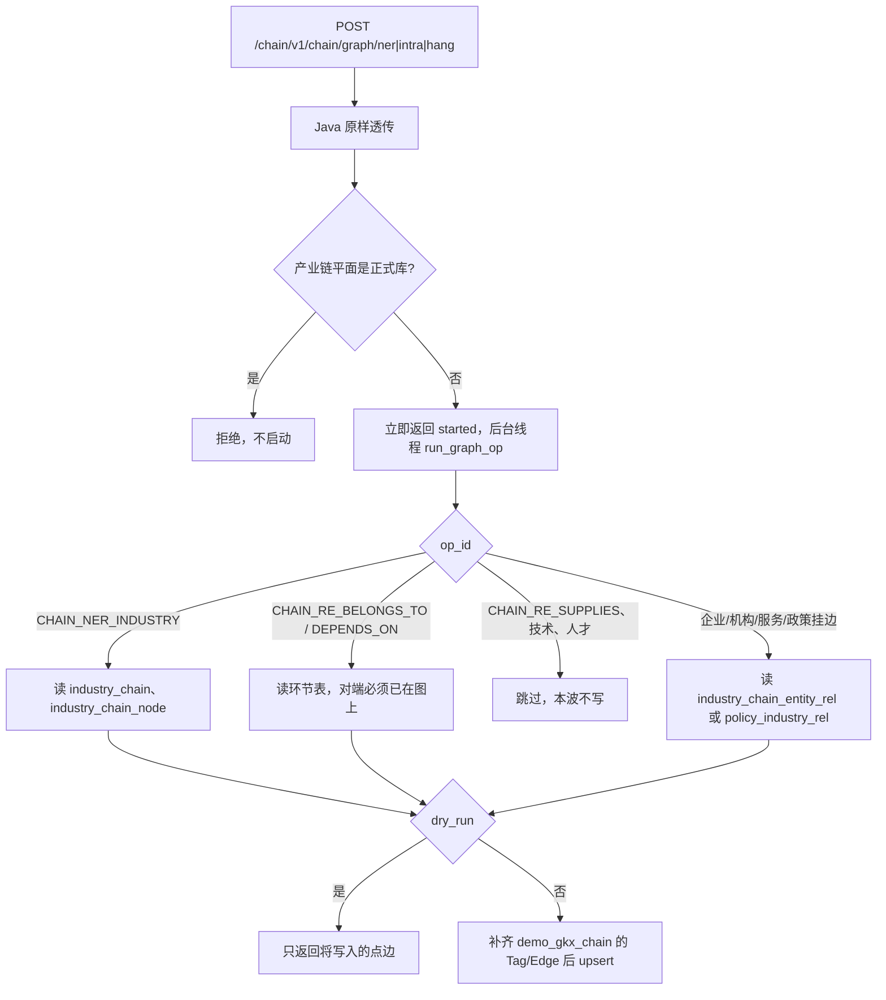
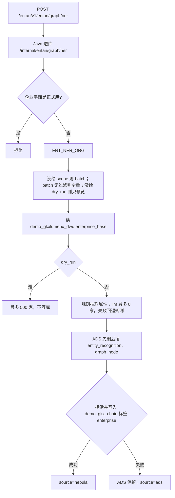
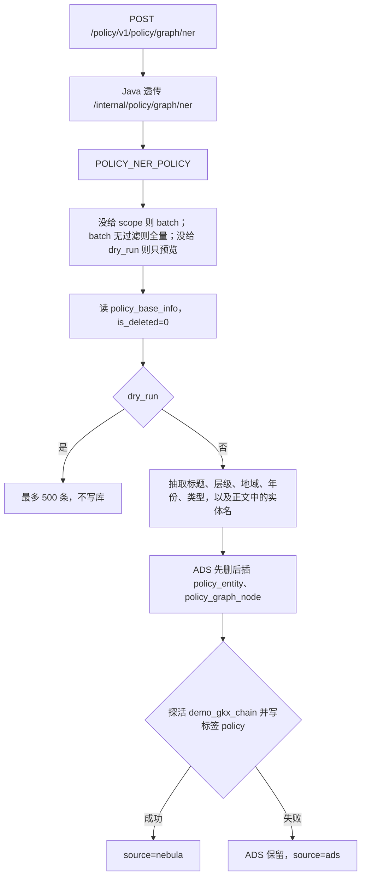
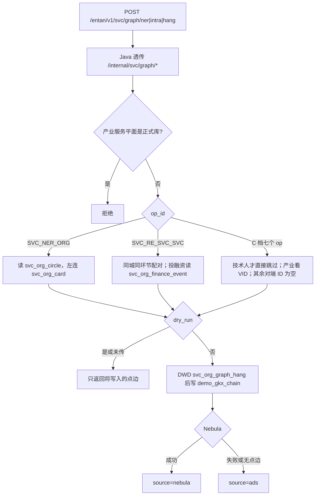

# SYSINT-SCHEME-07-L06 · 算法中台入图流程（产业链 / 企业 / 政策 / 产业服务）

> **任务**：`SYSINT-SCHEME-07-L06`
> **日期**：2026-10-30
> **和 L03 的分工**：L03 是七要素「有没有写图代码」的台账。本文件写产业链、企业、政策、产业服务四条**现行入图怎么走**。L03 写于 2026-10-27，其中「政策无 Nebula 写图」已被现行 A/B/C 接口取代，以本文件为准。
> **2026-10-30 补**：产业服务图谱四档（算法中台「产业服务图谱」页）已接入，见 §5。

## 1. 共同约定

四条都写同一张 Demo 图：Nebula space **`demo_gkx_chain`**（graphd `10.50.75.136:9669`）。正式空间 `gkx_chain`、`entan` 不在这四条的写入目标里。线上目前只有 `demo_gkx_chain`，已有标签 `chain`、`segment`、`enterprise`、`institution`、`policy`。

调用链固定为：

```text
前端 → 网关 → Java REST（透传，不写 nGQL）→ Python 图谱接口
```

Java 不改边名、不做抽取。四条都不进 `gkxlumenx_cfg.analysis_task`。那张表是企业评估 / 风险洞察 / 引育推荐的异步任务表，和这四条入图不是一条队列。

三档算子：

| 档 | 路径后缀 | 做什么 |
|---|---|---|
| A | `/graph/ner` | 只写本域的点 |
| B | `/graph/intra` | 只写本域内部的一类边 |
| C | `/graph/hang` | 只挂到图上已有的另一类点；对端没有稳定 ID 就跳过 |
| D | `GET /graph` | 只读，不写库 |

`dry_run=true` 只预览，不写 ADS、不写图。企业、政策和产业服务在 body 里**没给** `dry_run` 时默认预览。产业链没给 `dry_run` 时按 `false` 处理，会真写图。中台产业服务页的 `dry_run` 勾选默认是开的，要真写必须去掉勾选。

灌数流水线（`run-pipeline` / `run_all` / `run_seed`）禁止调用这些写图模块。入图只能从下面的图谱接口进来。

## 2. 产业链

### 2.1 入口

| 层 | 地址 |
|---|---|
| 网关 | `POST /chain/v1/chain/graph/ner`（intra / hang / `ops/{op_id}` 同前缀） |
| Java | `ChainGraphController`：`/v1/chain/graph/*`、`/internal/chain/graph/*` |
| Python | `demo-algo-science` `api/main.py`：`/v1/chain/graph/*`、`/internal/chain/graph/*` |
| 算子 | `chainan/graph/graph_ops.py` `run_graph_op()` |

Python 收到后**先返回** `{started: true}`，在 API 进程的后台线程里跑。同一进程同时只允许一条图谱操作。顶栏产业链平面是正式库（`is_live("chain")`）时直接拒绝，不启动线程。

另有 `POST /internal/graph-schema-init`：图空间不存在则建 `demo_gkx_chain`，再补产业链 Tag/Edge。不灌点边，不 DROP。

### 2.2 流程



### 2.3 点、边、来源

| 算子 | 点 / 边 | VID | 来源表 |
|---|---|---|---|
| `CHAIN_NER_INDUSTRY` | 点 `chain`、`segment` | `chain:{chain_id}`、`segment:{node_id}` | `industry_chain`、`industry_chain_node` |
| `CHAIN_RE_BELONGS_TO` | 边 `belongs_to`：segment → chain | 两端都必须已在图上，否则 `no_stable_id` | `industry_chain_node.chain_id` |
| `CHAIN_RE_DEPENDS_ON` | 边 `depends_on`：segment → segment | 同上 | 环节上下游 |
| `CHAIN_RE_INDUSTRY_ENTERPRISE` | 边 `participates` | 企业端 `ent:` | `industry_chain_entity_rel` |
| `CHAIN_RE_INDUSTRY_RESEARCH` / `_SERVICE` | 边 `participates` | 机构端 `inst:` | 同上 |
| `CHAIN_RE_INDUSTRY_POLICY` | 政策挂到链或环节 | `pol:` | `policy_industry_rel` |
| `CHAIN_RE_SUPPLIES` | 不写 | — | 本波没有供给边表 |
| `CHAIN_RE_INDUSTRY_TECH` / `_TALENT` | 不写 | — | `not_in_wave` |

`scope=one` 要 `id=chain_id`。`scope=batch` 要 `filter.chain_ids` 或 `filter.all=true`。L0 编码会带上子环节（`INB13` 覆盖 `INB1301`），不会把「一条」扫成全表，除非 `all=true`。

成功时 `source=nebula`。这条链路不先落 MySQL 镜像再补图。

## 3. 企业

### 3.1 入口

| 层 | 地址 |
|---|---|
| 网关 | `POST /entan/v1/entan/graph/ner`（intra / hang / `ops/{op_id}` 同前缀） |
| Java | `EntanGraphController`：`/v1/entan/graph/*` |
| Python | `demo-algo-ent-analysis` `api/entan_graph_routes.py` |
| 算子 | `entan/graph/ops.py` `execute()`，span 名 `ent.graph.write` |

请求在接口进程里同步做完再返回。顶栏企业平面是正式库时拒绝，提示切回 Demo。MySQL 只允许 `demo_gkxlumenx_*`。

### 3.2 流程



### 3.3 点、边、来源

A 档 `ENT_NER_ORG` 只写企业点，不写边。VID = `ent:{org_id}`。没有 `org_id` 或 VID 超过 80 字符则跳过。属性来自工商字段（名称、行业、城市、法人、注册资本、营收、研发人数、授权专利、高新/上市/专精特新）。

| 档 | 算子 | 边 |
|---|---|---|
| B | `ENT_RE_COOP` / `INVEST` / `BELONG` / `SUPPLY` | `cooperate` / `invest` / `parent_sub` / `supply` |
| C | `ENT_RE_INDUSTRY` / `TECH` / `TALENT` / `POLICY` / `RESEARCH` / `SERVICE` | `industry_belong` / `produces` / `talent_coop` / 政策 / `research_coop` / `service_provide` |

B/C 一次只写一类边。对端不在 `enterprise_base` 或图上没有稳定 ID 时记 `no_stable_id`，不用名称猜 VID。

ADS 表：`entity_recognition`、`graph_node`、`graph_edge`（库 `demo_gkxlumenx_ads`）。插入按 500 行一批；图写入按 80 点一批。

### 3.4 图写入失败时

`source=ads` 表示 MySQL 已经写入，Nebula 没写成。写图前的探活若打到配置空间 `demo_entan`，会失败：这个 space 在线上不存在。失败后函数直接返回，不会再写 `demo_gkx_chain`。

2026-10-30 已在 `demo-algo-ent-analysis` 把企业入图、挂边和读图的探活改成 `demo_gkx_chain`。该改动还在本地，未发布。未发布前重跑企业 NER，仍会停在 ADS。

## 4. 政策

### 4.1 入口

| 层 | 地址 |
|---|---|
| 网关 | `POST /policy/v1/policy/graph/ner`（intra / hang / `ops/{op_id}` 同前缀） |
| Java | `PolicyGraphController`：`/v1/policy/graph/*` |
| Python | `demo-algo-ent-analysis` `api/policy_routes.py` |
| 算子 | `polan/graph/ops.py` `execute()`，span 名 `policy.graph.write` |

同步返回。图谱接口本身不读「政策平面是否正式库」开关。图空间被锁成 `demo_gkx_chain`：`POLAN_NEBULA_SPACE` 若不是这个名字，连接配置会直接拒绝。政策点挂到产业链那张图上，不另建政策空间。

### 4.2 流程



### 4.3 点、边、来源

| 算子 | 点 / 边 | VID | 说明 |
|---|---|---|---|
| `POLICY_NER_POLICY` | 点 `policy` | `pol:{policy_id}` | 不写边。属性进 ADS `policy_entity` |
| `POLICY_RE_CITE` | 边 `cite` | 两端都是 `pol:` | 谱系里的上位政策必须能解析成已有 `policy_id` |
| `POLICY_RE_SUPPORT` | 边 `support` | 政策 → 产业或企业 | 对端必须已在图上 |
| `POLICY_RE_APPLY_TO` | 边 `apply_to` | 政策 → 机构或服务 | 同上 |
| `POLICY_RE_REGULATE` | 边 `regulate` | 政策 → 受规范对象 | 同上 |

空名称、无法对齐的实体记 `empty_field` 或 `no_stable_id`，不另造一套点。`chain` / `segment` / `enterprise` / `institution` 复用图上已有顶点。

ADS 表：`policy_entity`、`policy_graph_node`、`policy_graph_edge`。

## 5. 产业服务

中台页「产业服务图谱」四档已经接到现行接口：A 机构实体识别、B 服务-服务、C 跨域挂接、D 只读浏览。页面上的边表和算子以本节代码为准。

### 5.1 入口

| 层 | 地址 |
|---|---|
| 网关 | `POST /entan/v1/svc/graph/ner`（intra / hang / `ops/{op_id}` 同前缀；兼容 `/innov/v1/svc/graph/*`） |
| Java | `demo-svc-platform` `SvcGraphController`：`/v1/svc/graph/*`，透传 `/internal/svc/graph/*` |
| Python | `demo-algo-ent-analysis` `api/svc_routes.py` |
| 算子 | `entan/svcgraph_ops.py` `execute()`，span 名 `svc.graph.write`；点边语句在 `entan/svcgraph.py` |

同步返回。顶栏产业服务平面是正式库时拒绝。MySQL 只允许 Demo 库。不 `CREATE` / `DROP SPACE`，也不新建 Tag / Edge：`institution` 用 `DESCRIBE` 看已有列再写，`participates` / `belongs_to` 不在 `SHOW EDGES` 里则整批跳过。

`POST /internal/svc/run-graph` 只是把 A 档全量再调一次。它不传 `dry_run`，因此按默认只预览，不会真写图。

### 5.2 流程



### 5.3 点、边、来源

A 档 `SVC_NER_ORG` 只写机构点，不写边。VID = `institution:{org_id}`（现网前缀，不是 `inst:`）。没有 `org_id` 或 VID 超过 80 字符则跳过。`DESCRIBE TAG institution` 里有的列才写入，候选列是 `name`、`institution_type`、`node_type`、`weight`、`props`、`role`。`props` 里 `role=service`。

| 档 | 算子 | 图上实际写什么 |
|---|---|---|
| B | `SVC_RE_SVC_SVC` | 边 `participates`。合作：本批内同城且同环节的机构两两配对。投资：`svc_org_finance_event.ext.inv_org_id` 也在本批才写，否则 `no_stable_id`。边上 `chain_role=service`，`props.mapped_from` 为 `cooperation` 或 `investment` |
| B | 人才流动、竞争 | 不写，记 `not_in_wave`（`OPEN-SVC-GRAPH-01`） |
| C | `SVC_RE_INDUSTRY` | 边 `belongs_to`。只有机构的行业字段本身已是 `chain:` / `segment:` 时才 `FETCH` 后写入；普通行业名记 `no_stable_id` |
| C | `SVC_RE_ENTERPRISE` / `SVC_RE_GOV` / `SVC_RE_RESEARCH` | 页面标了上图。组装对端时没有填 `org_id` / `institution_id`，一律 `empty_field`，不 `FETCH`、不写边 |
| C | `SVC_RE_TECH` / `SVC_RE_TALENT` | 不写，记 `not_in_wave` |
| C | `SVC_RE_POLICY` | 不带 `dest_types=policy` 时记 `not_in_wave`（不造反向）。中台选「政策」会带上该字段，但同样没有政策 ID，仍是 `empty_field`。页面表上的边名「消费 apply_to」没有写边语句 |

政府、科研的候选前缀写成了 `inst:`，和 A 档点的 `institution:` 不一致。当前对端 ID 没有被填上，这条 `FETCH` 走不到。

D 档 `GET /svc/graph` 只读 DWD `svc_org_graph_hang` 和机构卡面，不查 Nebula。边上的关系来自 `ext.peers`。

镜像表：`demo` DWD `svc_org_graph_hang`（A 先删后插；B 把对端记进该行的 `ext.peers`）。图写入按 80 条一批。`llm` 失败回退规则，`llm_fallback=true`。

## 6. 四条对照

| 项 | 产业链 | 企业 | 政策 | 产业服务 |
|---|---|---|---|---|
| 网关前缀 | `/chain/v1/chain/graph/*` | `/entan/v1/entan/graph/*` | `/policy/v1/policy/graph/*` | `/entan/v1/svc/graph/*` |
| Python 仓 | `demo-algo-science` | `demo-algo-ent-analysis` | `demo-algo-ent-analysis`（`polan`） | `demo-algo-ent-analysis`（`svcgraph_ops`） |
| 执行方式 | 后台线程，接口先返回 | 同步 | 同步 | 同步 |
| 未传 `dry_run` | 真写 | 只预览 | 只预览 | 只预览 |
| 正式平面 | 产业链平面为正式库则拒绝 | 企业平面为正式库则拒绝 | 图谱接口不看该开关；空间仍锁 Demo 图 | 产业服务平面为正式库则拒绝 |
| 图空间 | `demo_gkx_chain` | `demo_gkx_chain` | `demo_gkx_chain` | `demo_gkx_chain` |
| A 档点 | `chain`、`segment` | `enterprise` | `policy` | `institution`（VID `institution:`） |
| 图写失败 | 后台线程记 `graph_op_error` | `source=ads`，ADS 保留 | `source=ads`，ADS 保留 | `source=ads`，DWD hang 保留 |

产业链、企业、政策的读图（D 档）在图库不可用时回退 ADS 镜像，不把回退结果说成 Nebula 命中。产业服务 D 档读的是 DWD hang，不查 Nebula。
