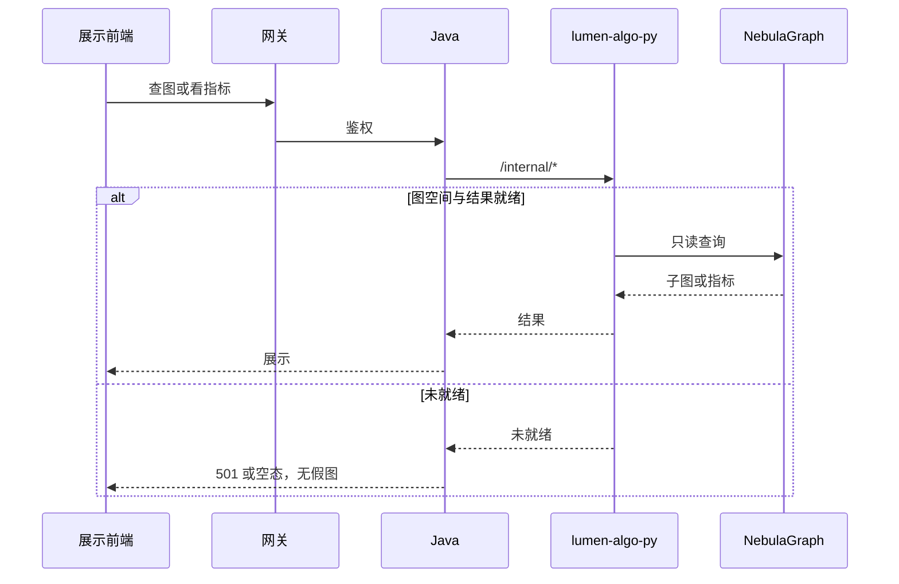

# 系统集成技术方案 · 图数据库集成

> **状态**：草案 · 2026-10-22 · 未签收  
> **WBS**：WBS-07-00  
> **过程位置**：工程过程卷 03。跨系统 SAD v0.3 只作输入，会签前不是生产契约。  
> 本项不进统一用户中心。不在本文决定把图空间从 `demo_gkx_chain` 改到 `gkx_chain`。

## 1. 背景与集成需求

图数据库（NebulaGraph / TRSGraph，graphd `10.50.75.136:9669`）与展示侧读图、查图、图指标一起集成。不嵌图库管理界面，不在本仓写图算法。

展示四页：分析展示、指标展示、算法展示、服务展示。第 5 项保留这些菜单上读图以外的对接对象时，读图部分仍以本方案为准，不建第二套页。

对接系统：亿集能力面、燕大（字段级需求是我方稿，能力清单还没有）、展示前端、展示 Java、`lumen-algo-py`。GDF 只负责触发建图 API，归第 6 项边界，不在本方案里配 GDF 作业。

## 2. 应用对接技术架构

前端 → 网关 → Java → Python `/internal/*` → 图库。Java 不写 nGQL。未就绪返回 HTTP 501，不返回假图。

实现方式：建图走离线作业（GDF 调亿集或 Python 作业），不塞进页面请求。SAD 未会签的路径不当生产接口。

## 3. 数据存储与数据流转

加工与融合：一张七要素本体是 SAD 草稿里的说法，未会签。不在本文新定义点类型和边类型。

存储设计：还没有签收的新增 tag / edge / 字段。`INT-C-X-490` 记录的正式空间仍是 `demo_gkx_chain`。要改空间，先改本方案再改调用，不单开一叶。

## 4. 指标

图指标是读已算好的结果，不是在页面上现算一套新口径。

| 问题 | 现状 |
|---|---|
| 实现方式 | 算法在 Python 或亿集能力面。页面只展示。黑名单未定则不告警 |
| 与指标库对齐 | 还没有。SAD 和展示详设卷 08 未会签成指标库条目 |
| 缺项 | 燕大现有能力清单还没有。预测、社群在页面计划里默认 501，算缺项而不是零 |

## 5. 分模块实现与 WBS

| 模块 | WBS | 前端 | 算法 | 数据加工 |
|---|---|---|---|---|
| 方案本身 | WBS-07-00 | 先列展示、专题界面上所有用图的页面 | 无 | 无。写明图空间是否切换；SAD 未会签的接口不抄进本文当契约。用图清单未齐，本方案不算可签收 |
| 分析展示 | WBS-07-01 | 查图主路径可点。孔东按页面计划，不另开叶 | 查询在 Python。无结果则 501 | 不在请求里建图 |
| 指标与算法结果 | WBS-07-02 | 指标、路径、中心性、社群有结果或空态 | 只展示已有结果。不做算法平台 | 快照从表或图库读，不在本文加列 |
| 服务展示 | WBS-07-03 | 分享 / 查询 / 分析入口。无权限则降级 | 无新算法 | 无新表 |

智树不做：亿集管理界面、本仓图算法、Neo4j。第 3 项不碰 Nebula 的 overlay 要写进 §5.1，并标明不走本项读图。

## 5.1 界面用图清单

2026-10-22 晚确认：这张清单是 WBS-07-00 的方案章节。清单确认前不另开开发行。知识图谱四页不能代替全量。

每一处写四列：页面、图上展示什么、用的是 Nebula 读图还是页面上的关系图（G6 / ECharts 等）、归第 7 项读图还是只读已有接口。

| 范围 | 现状 |
|---|---|
| 展示 · 分析展示、指标展示、算法展示、服务展示 | 已点名，对应 WBS-07-01～03。这是清单的种子，不是全量 |
| 展示其余菜单上的读图、查图、图指标 | 还没有逐页登记。与第 5 项交叉的读图归本项 |
| 专题 · 产业链、企业、服务等页上的图 | 还没有逐页登记 |
| 第 3 项不碰 Nebula 的图谱 overlay | 要列入，并标明不走本项读图。还没有逐页登记 |

输入：[跨系统-知识图谱](../../../agent-handoffs/产品整体定义/跨系统-知识图谱/INDEX.md) SAD v0.3（未会签）、`srs/07`。不按未会签的接口形状派编码。

全量清单还没有。确认后再决定要不要加行。
