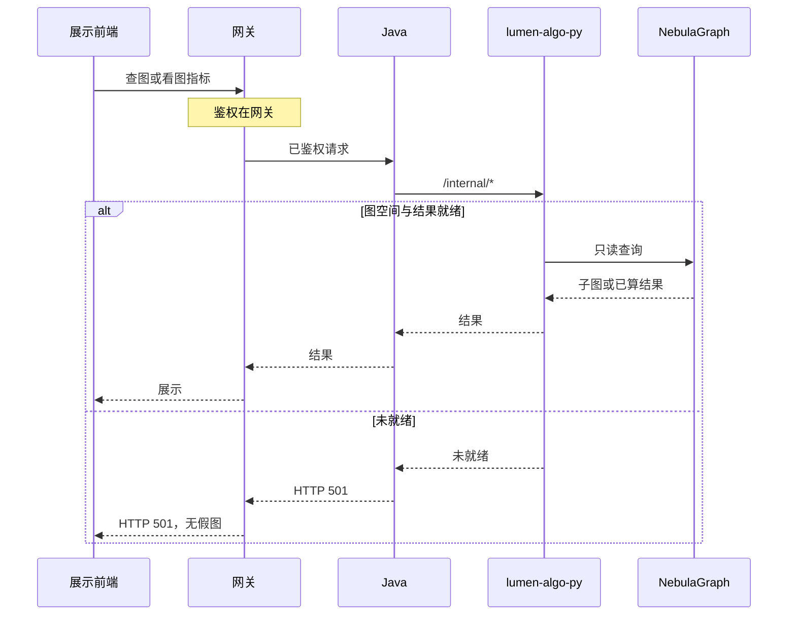
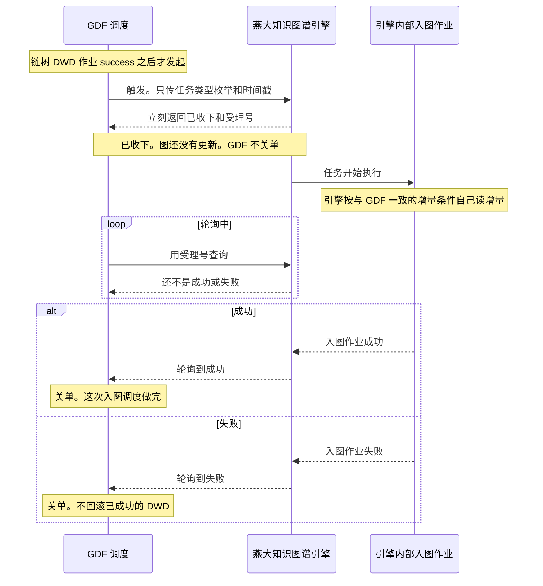
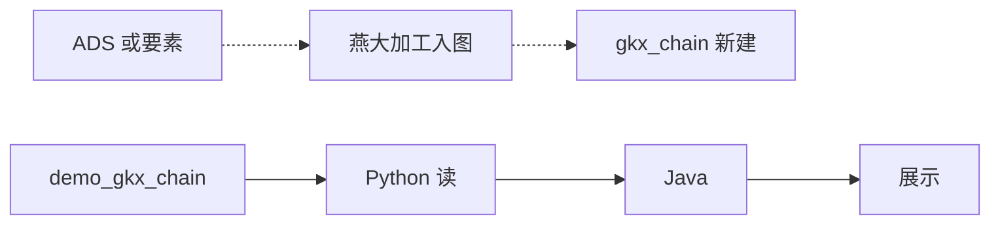

```mermaid
sequenceDiagram
  participant GDF as GDF 调度
  participant ENG as 燕大知识图谱引擎
  participant JOB as 引擎内部入图作业
  Note over GDF: 链树 DWD 作业 success 之后才发起
  GDF->>ENG: 触发。只传任务类型枚举和时间戳
  ENG-->>GDF: 立刻返回已收下和受理号
  Note over GDF,ENG: 已收下。图还没有更新。GDF 不关单
  ENG->>JOB: 任务开始执行
  Note over JOB: 引擎按与 GDF 一致的增量条件自己读增量
  loop 轮询中
    GDF->>ENG: 用受理号查询
    ENG-->>GDF: 还不是成功或失败
  end
  alt 成功
    JOB-->>ENG: 入图作业成功
    ENG-->>GDF: 轮询到成功
    Note over GDF: 关单。这次入图调度做完
  else 失败
    JOB-->>ENG: 入图作业失败
    ENG-->>GDF: 轮询到失败
    Note over GDF: 关单。不回滚已成功的 DWD
  end
```

# 系统集成技术方案 · 图数据库集成

> **状态**：五段与 §5.1 已按 DoD 写齐，送 `human:淮政玮` 签收。人尚未签收。本文不是 `done`。  
> **任务**：`SYSINT-SCHEME-07-L01`（`tech_task`）· WBS-07-00  
> **日期**：2026-10-22。2026-11-02 补记：燕大加工入图写入新建空间 `gkx_chain`，与 demo 的 `demo_gkx_chain` 隔离。展示在线读图仍读 `demo_gkx_chain`。本任务不执行建空间。  
> **开始时间**：无开始时间。**完成日期要求**：2026-11-09。这个日期取知识图谱功能开发出门日，不是燕大承诺。  
> **签收操作人**：`human:淮政玮`  
> **过程位置**：工程过程卷 03。本项不进统一用户中心。  
> **读规约**：[`系统集成整体过程规约.md`](../../../系统集成整体过程规约.md) v1.0（2026-10-22 定稿）§2 第 7 项、§6、§7、§13。读的是这份定稿，不是讨论稿。  
> **不改范围**：[`scope-baseline.md`](../../../scope-baseline.md)。本页不改范围，不在过程夹里改基线。  
> **图**：在线查图和离线来向仍是下面两张，不另画与 [`architecture-baseline.md`](../../../architecture-baseline.md) `ARCH-TOPO-LUMEN` 冲突的全局拓扑。两张图的节点不改。  
> - `SYSINT-SCHEME-07-SEQ`：§2 在线读图时序  
> - `SYSINT-SCHEME-07-FLOW`：§3 离线来向与在线读图  
> 两张图的会签态都是 `draft`。人签收本文之前，不把图上的边当成已经放行的施工令。  
> **2026-11-02**：§2.2 与 §2.3 另加产业链入图调度转发，图 `SYSINT-GDF-GRAPH-SCHED-SEQ`，与 GDF 集成方案和详细设计是同一张。转发还没有跑通。本注不关闭 `SYSINT-SCHEME-07-L01`。

本任务只写方案。不建开发叶，不改图空间，不配 GDF 作业，不把未会签的接口形状抄进本文当契约。

---

## 1. 背景、集成需求、对接系统说明

### 1.1 背景

第 7 项把图数据库和展示系统里的读图、查图、图指标放在同一份方案里。图库是 NebulaGraph 协议上的 TRSGraph，graphd 地址按架构基线 D6 与 [`graph-engine.md`](../../../graph-engine.md) 2026-10-15 决议为 `10.50.75.136:9669`。账号和口令只进 Secret 或环境变量，不进本文、不进 git。

展示在线读图的空间仍是 `demo_gkx_chain`。依据是三要素集成汇总 [`SCI-INT-Z02.md`](../../../agent-handoffs/展示系统三要素集成-SCI-INT/SCI-INT-Z02.md) 记载的 `INT-C-X-490`（NebulaGraph TRSGraph，space `demo_gkx_chain`）。

燕大的加工入图写入新建空间 `gkx_chain`，与 demo 隔离。建空间、写 Tag、写 Edge 都在 `gkx_chain`。不写 `demo_gkx_chain`，不把 demo 空间里的点或边拷进 `gkx_chain`，也不把 `gkx_local_1`、`gkx_full_1` 当作本包入库空间。我方 demo 写图继续只写 `demo_gkx_chain`。两套空间不互相覆盖。本任务不执行建空间，不双写，不迁 `entan` / `demo_entan`。密码和连接串不进本文。这条同时是燕大派单包的空间规约。

范围以 [`scope-baseline.md`](../../../scope-baseline.md) §0.1 为准，本文不改它：展示侧「知识图谱」是界面加对接；专题战略 4 要素的报价含产业全要素图谱 API。报价表划掉且工作量为 0 的行仍然不实现。

已点名的展示四页是分析展示、指标展示、算法展示、服务展示，对应详设 [`08-功能-科技知识图谱.md`](../../../agent-handoffs/产品整体定义/科技信息展示系统-完整详细设计/08-功能-科技知识图谱.md) 的 DS-21～DS-24，并收成 WBS-07-01～07-03。这三行是种子，不是全量用图清单。全量写法在 §5.1。未逐页登记的页面，本文写「还没有」，不写成已覆盖。

### 1.2 集成需求

在线只做读图、查图、展示已经算好的图指标。一次用户动作沿架构基线的调用链走完：前端 → 网关 → Java → Python `/internal/*` → NebulaGraph。Java 不写 nGQL，不直连 graphd。

未就绪返回 HTTP 501，响应里没有假图。预测未就绪是 501。社群未就绪是 501。这两种都不是数字 0。查询已经执行、只是没有命中，才是空态。无权限是降级，不是白屏。

建图不放进页面请求。第 6 项只负责触发建图。本方案不配 GDF 作业，不展开图谱写入与构建那 15 叶。10-21 专题会纪要记了燕大暂未对外暴露节点删除和修改权限；写侧不能靠对端现有读接口完成，仍归第 6 项边界，不在本文设计写接口。

与第 5 项菜单交叉时，读图、查图、图指标归本项。该菜单上其余对接对象仍留在第 5 项。第 3 项里不碰 Nebula 的图谱 overlay 要出现在 §5.1，并标明不走本项读图。

本项不进统一用户中心。不嵌亿集管理界面。不在本仓写图算法。不改用 Neo4j。不引入亿集查图 API（架构基线 D6，2026-10-15）。lumen 正式调用链不落到任何 `demo-*` 服务（D12）。

### 1.3 对接系统说明

| 对接方 | 在本项里做什么 | 还没有的 |
|---|---|---|
| 展示前端 `lumen-ui-science-pc` | 已点名四页的读图入口。主入口在详设 08 写作 `/display` 下的知识图谱。编码按页面计划为孔东 | 四页各自的路由字面还没有。其余展示菜单上有没有读图，见 §5.1，逐页还没有 |
| 专题前端 `lumen-ui-topic` | 产业链、企业、服务等页上的图属于待盘点范围 | 逐页还没有。未登记前不写成已覆盖 |
| 网关 | 鉴权、转发、回传 trace 头。架构基线图上的名字是 `gkxlumen-gateway`，D12 写 `gkxlumen-platform-gateway`。本文视为同一网关角色，不新造第二个网关 | 本项的角色码、图权限矩阵还没有 |
| Java（已有 `gkxlumen-*`） | 只读门面。把已鉴权请求转到 Python `/internal/*`，把结果或 501 交回网关。不写算法，不写 nGQL | 读图落在 `gkxlumen-innov`、`gkxlumen-topic` 还是 `gkxlumen-display`，还没有钉死。不为此新造服务 |
| `lumen-algo-py` | 在线只读图库，返回子图或已经算好的结果。WBS-07-01～03 点名这个仓 | `/internal/*` 下面的路径字面还没有签收。不从 SAD v0.3 或 demo 的 `/v1/graph` 抄进来当契约 |
| NebulaGraph / TRSGraph | 展示在线读图落在 `demo_gkx_chain`。燕大加工入图落在新建空间 `gkx_chain` | 新增 tag、edge、字段还没有签收。本任务不执行建空间 |
| 亿集能力面、燕大（对接人白鑫凤） | 对端。加工入图只写新建空间 `gkx_chain`，与 demo 隔离。图算法和建图能力在对端或 Python，不在本仓重写，也不把对端管理界面嵌进展示页 | **燕大现有能力清单还没有。** 封装完成时间在 [`约定时点.md`](./约定时点.md) 仍是待确认。10-21 纪要里的模块口述、九类测试样例，都不是这份清单 |
| 第 6 项 GDF | 只触发离线建图 | 作业配置还没有，而且不在本方案里写 |
| 第 5 项已点名菜单 | 保留该菜单除读图以外的对接对象 | 这些菜单上的读图逐页还没有，见 §5.1 |
| 第 3 项 CMS overlay | 不碰 Nebula 的图谱运营覆盖，不走本项读图 | 子模块已点名，画面逐页还没有，见 §5.1 |
| 统一用户中心 | 本项不配置菜单、不配置用户权限 | 无。这是排除，不是待补材料 |

跨系统知识图谱 SAD v0.3（[`INDEX.md`](../../../agent-handoffs/产品整体定义/跨系统-知识图谱/INDEX.md)，2026-08-16，状态 v0.3-draft）只作输入。01 本体和 02 四平面都未会签。本文不引用其中的路径、点类型、边类型作为生产契约。

`srs/07` 有落盘，路径是 [`bid-reference/srs/07-亿级科技知识图谱引擎/`](../../../bid-reference/srs/07-亿级科技知识图谱引擎/README.md)，不是仓库根下的裸目录 `srs/07`。该册只有一张四级：「科技专家/人才知识推理构建服务」，九个叶子：直接关系、单节点间接关系、两点合作成果、同事关系、校友关系、论文合作关系、重点关注科技企业关系、产业链点 TOP-N 事件关系、产业链全景图。这是招标能力面，用来对照验收缺口。它不是燕大已交付能力清单，也不是本仓要实现的图算法，更不是生产接口形状。

---

## 2. 应用对接技术架构、对接时序、实现方式

### 2.1 应用架构

在线读图只走架构基线已经锁定的那一条链，不另画全局拓扑：

`前端 → 网关 → Java（只读门面，不写 nGQL）→ lumen-algo-py 的 /internal/* → NebulaGraph（space demo_gkx_chain）`

前端不直连 Python，不直连 Nebula，不直连燕大测试读端点。Java 不写算法，不扫 ODS/DWD 来现算一张图。lumen 前端和 Java 下游都不回落到 `demo-svc-platform`、`demo-platform-*`、`demo-algo-*`、`demo-svc-topic-py`。

展示和专题以后若都要读同一张图，仍走这条共享链，不各造一套算法调用（架构基线 D1、D2）。专题侧哪些页真的读图，§5.1 还没有逐页登记，所以本段不把专题页写成已经接上。

鉴权在网关完成。业务服务不各自再做一套登录。本项角色码还没有，见 §6。

### 2.2 对接时序

> **diagram_id**：`SYSINT-SCHEME-07-SEQ`  
> **图种**：时序（一次查图或看图指标）  
> **会签态**：`draft`  
> **节点**：展示前端、网关、Java、`lumen-algo-py`、NebulaGraph。与正文同一条链。



| 生产者 | 消费者 | 触发 | 失败语义 | 禁止事项 |
|---|---|---|---|---|
| 展示前端 | 网关 → Java → `lumen-algo-py` → NebulaGraph | 用户查图，或打开已经算好的图指标 | 空间、结果或算法未就绪：整链返回 HTTP 501，正文没有假图。预测、社群未就绪同样是 501，不是 0 | 前端直连图库或燕大读端点；Java 写 nGQL；把 501 包成 200 空图；lumen 调用链落到 `demo-*` |
| `lumen-algo-py` | Java → 网关 → 展示前端 | 同上，只读 | Java 不把「未就绪」改写成成功 | 在页面请求里建图；引入亿集查图 API；改用 Neo4j |

无命中的空态、无权限的降级，都不是这条「未就绪」支路。空态表示查询已经执行且没有命中。降级表示没有权限，页面仍在，不铺一条假的邻居。两种的界面句子见 §6，不画进本图，避免和 501 混成同一种返回。

#### 入图调度转发

本段在 `agent-delivery/工程过程/04-系统集成/GDF-GRAPH-SCHED-CONTRACT-L01-调度转发接口设计.md`、`agent-delivery/工程过程/04-系统集成/06-GDF数据治理集成/技术方案.md` 的 §2.2 与 §2.3、`agent-delivery/工程过程/04-系统集成/07-图数据库集成/技术方案.md` 的 §2.2 与 §2.3 五处原文相同。还没有跑通。

GDF 调度在链树 DWD 作业 `success` 之后，调用燕大知识图谱引擎。引擎再启动自己的内部入图作业。GDF 不调用入图脚本。

触发：GDF 调度把任务类型枚举和时间戳两项交给引擎。不传表名、图空间、脚本路径、schemaId，也不传 definition id、schedule id。引擎立刻返回两件事：已经收下，以及一个受理号。内部入图作业这时开始执行。收下只说明任务已经开始，图还没有更新，GDF 不关单。

轮询：GDF 调度用受理号反复向引擎查询。查询还不是成功或失败时，称为轮询中，单子继续开着。查询到成功，GDF 关单，这次入图调度做完。查询到失败，GDF 关单，不回滚已经 `success` 的 DWD，也不把图说成已经更新。

枚举字面值在详细设计第 5 节给定。闭集是 `enterprise_point`、`enterprise_supply`、`enterprise_parent_sub`、`industry_segment`、`industry_depends_on`、`industry_participates`、`service_org_point`、`policy_point`、`policy_cite`。GDF 一次只传其中一个。本版实际转发只有 `industry_segment`：`gkxlumenx_dwd.industry_chain_node` 当天 Wave B `success` 之后一次，引擎内部写正式空间 `gkx_chain` 的 Tag `segment`。其余字面值已编号，企业三支现网仍是飞书值班，服务机构与政策还没有入图触发契约，`industry_depends_on` 与 `industry_participates` 本版不发起。科研机构、技术、人才不分配枚举。definition id、schedule id 仍不进 git。

时间戳：字段名、格式、时区都还没有。它不是入向量库回执里的 `index_version`，也不是未上线 Java 路径里的 `dwd_success_at`。

增量：必读文档里没有水位列名，也没有 cron。原则是与 GDF 一致，由引擎自己判断要读哪些增量。GDF 不在这次请求里带水位列。

受理号：这就是锁定口径里说的「任务号」，GDF 只拿它去轮询。它不叫任务中心任务号。任务中心任务号形如 `PI-…`，只在禁止使用的 §2.7 方式 A 里出现。受理号是不是执行号 `EXEC-…`，还没有对应。方式 B 会返回执行号，但不创建任务中心任务号，而且请求形状对不上「只传枚举和时间戳」。现有执行记录查询不会把运行中更新成成功或失败，所以用现有 HTTP 还轮询不到终态。

禁止配进 GDF 的 DAG：`POST /api/v1/task-center/trigger`；`POST /internal/v1/chain/graph/project`；`POST /chain/v1/graph/jobs/{job}/sync`（Java 受理，未上线）；在 GDF 节点跑 `script/` 入图实现；写 Nebula；直连 graphd。

```yaml
diagram_id: SYSINT-GDF-GRAPH-SCHED-SEQ
signoff_status: draft
```




### 2.3 实现方式

在线实现停在「读」。Python 用 Nebula 协议读 `demo_gkx_chain`，Java 只做门面。具体 `/internal/*` 路径字面还没有签收。demo 仓上的 `/v1/graph` 和 [`graph-engine.md`](../../../graph-engine.md) §3.5 的 PG 镜像兜底，不作为本项生产读图。本项缺数表现是 HTTP 501。本文不改 `graph-engine.md`；两处不一致时，以本文签收结果作为第 7 项的缺数表现。

离线实现停在「来向」。ADS 或要素经离线作业进图库。作业由第 6 项触发。页面请求不调用建图。本文不写作业名、不写 cron、不写 GDF 映射。

SAD v0.3 里的 A/B/Job 路径、五套 API、点类型和边类型，都还没有会签。实现时不按那些形状派编码。详设 08 里的「A 面资源」「同一五 API」同样只作输入，不抄进本文当契约。

可观测沿用架构基线：网关和 Java 回传 trace 头，Python 侧保持现有 instrument。本方案不新定一套追踪字段。响应若带 `source`，成功读图的取值仍按引擎规范写 `nebula`。本项不把 `source=pg` 的成功体当作未就绪时的替身。

#### 入图调度转发

本段在 `agent-delivery/工程过程/04-系统集成/GDF-GRAPH-SCHED-CONTRACT-L01-调度转发接口设计.md`、`agent-delivery/工程过程/04-系统集成/06-GDF数据治理集成/技术方案.md` 的 §2.2 与 §2.3、`agent-delivery/工程过程/04-系统集成/07-图数据库集成/技术方案.md` 的 §2.2 与 §2.3 五处原文相同。还没有跑通。

GDF 调度在链树 DWD 作业 `success` 之后，调用燕大知识图谱引擎。引擎再启动自己的内部入图作业。GDF 不调用入图脚本。

触发：GDF 调度把任务类型枚举和时间戳两项交给引擎。不传表名、图空间、脚本路径、schemaId，也不传 definition id、schedule id。引擎立刻返回两件事：已经收下，以及一个受理号。内部入图作业这时开始执行。收下只说明任务已经开始，图还没有更新，GDF 不关单。

轮询：GDF 调度用受理号反复向引擎查询。查询还不是成功或失败时，称为轮询中，单子继续开着。查询到成功，GDF 关单，这次入图调度做完。查询到失败，GDF 关单，不回滚已经 `success` 的 DWD，也不把图说成已经更新。

枚举字面值在详细设计第 5 节给定。闭集是 `enterprise_point`、`enterprise_supply`、`enterprise_parent_sub`、`industry_segment`、`industry_depends_on`、`industry_participates`、`service_org_point`、`policy_point`、`policy_cite`。GDF 一次只传其中一个。本版实际转发只有 `industry_segment`：`gkxlumenx_dwd.industry_chain_node` 当天 Wave B `success` 之后一次，引擎内部写正式空间 `gkx_chain` 的 Tag `segment`。其余字面值已编号，企业三支现网仍是飞书值班，服务机构与政策还没有入图触发契约，`industry_depends_on` 与 `industry_participates` 本版不发起。科研机构、技术、人才不分配枚举。definition id、schedule id 仍不进 git。

时间戳：字段名、格式、时区都还没有。它不是入向量库回执里的 `index_version`，也不是未上线 Java 路径里的 `dwd_success_at`。

增量：必读文档里没有水位列名，也没有 cron。原则是与 GDF 一致，由引擎自己判断要读哪些增量。GDF 不在这次请求里带水位列。

受理号：这就是锁定口径里说的「任务号」，GDF 只拿它去轮询。它不叫任务中心任务号。任务中心任务号形如 `PI-…`，只在禁止使用的 §2.7 方式 A 里出现。受理号是不是执行号 `EXEC-…`，还没有对应。方式 B 会返回执行号，但不创建任务中心任务号，而且请求形状对不上「只传枚举和时间戳」。现有执行记录查询不会把运行中更新成成功或失败，所以用现有 HTTP 还轮询不到终态。

禁止配进 GDF 的 DAG：`POST /api/v1/task-center/trigger`；`POST /internal/v1/chain/graph/project`；`POST /chain/v1/graph/jobs/{job}/sync`（Java 受理，未上线）；在 GDF 节点跑 `script/` 入图实现；写 Nebula；直连 graphd。

```yaml
diagram_id: SYSINT-GDF-GRAPH-SCHED-SEQ
signoff_status: draft
```



---

## 3. 数据存储与流转

### 3.1 对接的数据需求

在线页面需要三类已经存在的结果，不在请求里现造：

1. 子图：分析展示要看的点和边。子图族是固定查询条件的卡片包装，点击时带上条件进入图谱页。它不是一种单独的子图存储（10-21 纪要）。
2. 图指标：指标展示只读已经算好的数。口径在指标库，不在页面上新定义。见第 4 段。
3. 算法结果：路径、中心性、社群。没有就绪的结果时返回 501，不返回 0，不返回假图。

写需求不在本项。节点和关系的增删改、删除审批、修改历史，10-21 纪要记为业务要点，同时记明对端写权限未开放。这些不在本文配接口。

相对现有表要增加的字段：还没有。见 §3.4。

### 3.2 数据流

> **diagram_id**：`SYSINT-SCHEME-07-FLOW`  
> **图种**：数据流  
> **会签态**：`draft`  
> **读法**：虚线是离线来向，归第 6 项触发，本方案不配作业、不授权本项施工。实线是本项在线只读。末节点「展示」只代表已经登记的读图去向。§5.1 里写着「还没有」的页面不在本图上单独成节点。



| 生产者 | 消费者 | 触发 | 失败语义 | 禁止事项 |
|---|---|---|---|---|
| ADS 或要素 | 燕大加工入图 → 新建空间 `gkx_chain` | 离线。第 6 项触发，不由页面请求触发 | 建图失败时，页面走 §2 的 501，不拿半成品当成功图 | 不写 `demo_gkx_chain`；不拷 demo 的点或边；不以 `gkx_local_1` / `gkx_full_1` 入库。本方案不配 GDF 作业；不在本文加列；不把虚线画成第 7 项的开发行 |
| 图库 `demo_gkx_chain` | `lumen-algo-py` → Java → 展示 | 在线只读 | 未就绪 HTTP 501，无假图 | Java 写 nGQL；前端直连图库；用未登记页面填充「展示」节点；读图改去 `gkx_chain` |

展示在线读图在 `demo_gkx_chain`。燕大加工入图在新建空间 `gkx_chain`。两套空间隔离，图上不连边。本图不再拆 `entan`、`gkx_policy`、`gkx_innov`。那些 space 的现状以 [`graph-engine.md`](../../../graph-engine.md) §3.1 为准，不在本项改用途。

### 3.3 加工与融合

离线加工的说法以现有材料为输入，不在本文升成新本体：

- 「一张七要素本体，产业链为底图」写在 SAD v0.3 的导读里。该卷未会签。本文不新定义点类型和边类型，也不把草稿里的类型表写成已签收字段。
- 10-21 纪要记了抽取方式（Python 脚本加大模型、高置信度入库、低置信度人工审核）、政策类关联不足、实体消歧在测试阶段由燕大审核。这些是会议事实，不是已经签收的加工规程。逐项核对还没有开始（纪要未决第 1 条，等我方需求清单签收后由唐绍祖比对 schema）。
- 关系的中英文两套命名、产业链节点 ID 的两种前缀、空串和占位值，都记在 [`沟通流水.md`](./沟通流水.md) 和 [`风险.md`](./风险.md)，状态仍是开放。本文不选定其中一套作为存储编码。

在线不融合。页面不把多套来源在浏览器里拼成一张「新图」，也不在页面上改口径。

### 3.4 存储设计（相对原表要增加的字段）

还没有签收的新增 tag、edge 或字段。本文不加列，不新造表名。

| 落点 | 本文怎么用 | 扩展 |
|---|---|---|
| NebulaGraph space `demo_gkx_chain` | 展示在线读图空间。`INT-C-X-490` | 我方 demo 写图只写这里。不加尚未签收的 tag/edge |
| NebulaGraph space `gkx_chain` | 燕大加工入图空间。新建，与 demo 隔离 | 本任务不执行建空间。不写 `demo_gkx_chain`，不从 demo 拷点边 |
| ADS 或要素 | 离线建图的来向，虚线，归第 6 项 | 不在本文加列，不配作业 |
| 图指标快照 | WBS-07-02 写「从表或图库读」 | 具体表还没有在本方案指定。不把三要素数据卡里的表名提升为本项新存储 |
| CMS 业务库 `gkxlumenx_cms` 的 overlay | 第 3 项的运营覆盖 | 本项读图不写这个库。见 §5.1 |
| 对象存储桶 | 架构基线 D14 的桶不承担图库 | 本项不把子图指定进某个目录。还没有这种需求 |
| 燕大测试环境 | 对端材料，地址和三个读端点已记在 [`约定时点.md`](./约定时点.md) | 不是生产图库。凭据不进本文 |

---

## 4. 对接涉及的指标

图指标只展示已经算好的结果。统计口径的身份证在指标库（[`data-lineage-policy.md`](../../../data-lineage-policy.md) 的 8 件套，含 `algorithm_type`），由口径主责拍板。页面展示这个结果，不在页面上新定义口径，不改公式，不把未批口径写成已确认。

有统计数字时，数字旁的 ⓘ 读指标库里已经登记的说明。本方案不手写一套并行口径，也不为了界面干净去掉 ⓘ。某个图指标还没有 `metric_id` 时，不在本文补一个看起来像正式 ID 的编号。

| 问题 | 结论 |
|---|---|
| 指标范围 | 已点名的是图指标，以及路径、中心性、社群的结果。预测在未就绪时不是本页默认可跑能力 |
| 实现方式 | 计算在 Python，或在亿集能力面，离线或事先算完。页面只展示。Java 不算图指标，不写 nGQL。本仓不做算法平台，不写图算法 |
| 与指标库是否对齐 | **还没有。** SAD v0.3 和详设卷 08 都未会签成指标库条目。本文不声明任何 `metric_id` 已经 `D1=aligned` |
| 缺项 | **燕大现有能力清单还没有。** 预测未就绪是 501，不是 0。社群未就绪是 501，不是 0。未注册指标是 501。黑名单规则未签收，页面不发出告警。逐条 `metric_id` 清单还没有 |
| 规则与审计 | 详设 08 对 DS-22 标了「规则/审计【算法补】」。补齐文本还没有。本文不补写成已有算法 |
| 血缘角标 | 遵守数据血缘规约的展示要求。就绪度状态不在本文改绿 |

`algorithm_type` 里存在枚举值 `GRAPH`，只说明指标库允许这类算法，不说明本项哪一条指标已经登记、已经会签。

---

## 5. 分模块对接实现与本维 WBS

开发行在方案被 `human:淮政玮` 签成 `done` 之前不进 registry。这是规约 §6、§13。除此之外，§5.1 里还有多行「还没有」。那些行逐页登记完之前，不新增 WBS 开发行，也不把未登记页面写成已覆盖。WBS-07-01～07-03 只保留在 [`WBS.md`](./WBS.md) 草案里，本任务不建叶。已点名的三行不能代替全量清单。

完成日期要求 2026-11-09 是知识图谱功能开发出门日，写在 WBS 的我方栏位里，不是燕大承诺。开始时间无开始时间。表中的仓是 WBS 建议，建叶时仍由该行监管人定。

| 模块 | WBS | 前端 | 算法 | 数据加工 | 可对端（草案，未建叶） |
|---|---|---|---|---|---|
| 方案本身 | WBS-07-00。监管人淮政玮。仓 `gkx-orchestration`。依赖无。SAD v0.3 只作输入 | 清单写在 §5.1。先有这一节，再谈别的页。未登记的写「还没有」 | 无。不在本仓写图算法 | 展示读 `demo_gkx_chain`。燕大加工入图写新建 `gkx_chain`，与 demo 隔离。不配 GDF 作业 | 五段和 §5.1 按 DoD 可送签收。清单未齐不另开开发行 |
| 分析展示 | WBS-07-01。监管人李伟（LT-5-KG-DS21）。建议仓：`lumen-ui-science-pc`、展示 Java、`lumen-algo-py`。依赖本方案任务。第 5 项不重复建这四页 | 查图主路径可点。孔东按页面计划，不在本任务另开叶。路由字面还没有 | 查询在 Python。无结果或未就绪则 HTTP 501，无假图 | 不在请求里建图 | 查图主路径可点。Java 不写 nGQL |
| 指标与算法结果 | WBS-07-02。监管人李伟（LT-5-KG-DS22、DS23）。仓同上。依赖本方案任务 | 指标展示与算法展示：有结果就展示，查询成功但无命中则空态。预测、社群未就绪是 501，不是 0 | 只展示已有结果。不做算法平台。不因未定义的黑名单发出告警 | 快照从表或图库读。不在本文加列。具体表还没有 | 图指标、路径、中心性、社群有结果或空态或 501。三者不混用 |
| 服务展示 | WBS-07-03。监管人李伟（LT-5-KG-DS24）。仓同上。依赖本方案任务 | 分享、查询、分析入口可点。无权限则降级，不是白屏。不嵌亿集管理界面 | 无新算法 | 无新表 | 入口可点。凭证不下发到前端的具体做法还没有签成接口，原则见详设 08 §6，只作输入 |

上表四行对得上 WBS-07-00～07-03。分组标题不是行，不建任务。

---

## 5.1 界面用图清单

这一节是 WBS-07-00 的方案章节。每一处四列：页面、图上展示什么、用的是 Nebula 读图还是页面上的关系图（G6 / ECharts 等）、归第 7 项读图还是只读已有接口。

写「还没有」的格子，表示还没有逐页登记。这些页面未被本方案覆盖。清单未齐之前，不另开开发行，不新增 WBS 行。

知识图谱四页不能代替全量。详设 08 和 10-21 纪要只支撑这四页的已点名事实。G6 出自详设 08 §5「前端自绘 G6」，该卷未在本方案会签，所以 G6 不是唯一画布的生产契约。数据来源仍然是 Nebula 读图，不是浏览器里另造一套关系数据。

### 5.1.1 已点名的展示四页

| 页面 | 图上展示什么 | Nebula 读图还是页面关系图 | 归第 7 项还是只读已有接口 |
|---|---|---|---|
| 分析展示（DS-21，WBS-07-01）。已点名。控件和路由还没有 | 工作台检索后展开的子图（详设 08 §2）。子图族是固定查询条件的卡片，不是子图存储（10-21 纪要）。列表、网络两类视图是纪要要点，控件清单还没有 | Nebula 读图。画面侧详设写 G6 自绘，未会签成唯一画布 | 第 7 项读图。未就绪 HTTP 501，无假图 |
| 指标展示（DS-22，并入 WBS-07-02）。已点名。逐个指标还没有 | 已经算好的图指标。不在页面上新定义口径。规则与审计的算法说明还没有 | 读已算结果。结果在表还是在图库，逐个指标还没有。是不是 G6，逐卡还没有 | 第 7 项。未注册指标 HTTP 501。不把三要素页的指标卡写成这一页已经对齐 |
| 算法展示（DS-23，并入 WBS-07-02）。已点名。每种算法的画面还没有 | 路径、中心性、社群的已有结果。预测未就绪是 501。社群未就绪是 501，不是 0。查询成功但无命中才是空态 | Nebula 读图，或读已经算好的结果。不是页面上现算的关系图。不做算法平台 | 第 7 项读图 |
| 服务展示（DS-24，WBS-07-03）。已点名。赋能接口清单还没有 | 分享、查询、分析入口。入口打开后若仍是读图，展示内容与分析展示相同，不另造一张图。对内接口清单还没有，不从详设「五 API」抄契约 | 入口本身不是关系图。打开后的图是 Nebula 读图。不嵌亿集管理界面 | 读图归第 7 项。无权限是降级，不是白屏，也不是 501 |

### 5.1.2 待盘点：展示其余菜单

下面每个菜单只表示「要去看有没有读图」。四列里写「还没有」的，没有被覆盖。第 5 项菜单名单来自规约 §2 第 5 项。与第 5 项交叉的读图，一旦逐页登记，归本项；该菜单其余对接对象留在第 5 项。第 1 项自研菜单可能也有读图，同样还没有逐页看过。

| 页面 | 图上展示什么 | Nebula 读图还是页面关系图 | 归第 7 项还是只读已有接口 |
|---|---|---|---|
| 科学技术全景（DS-02）。2026-11-05 按需规登记基线，画面控件仍以复刻页为准 | 技术点之间的关联、技术点到人/机构/论文/专利的关联实体、技术点序列上的关键路径。关键节点是点上的角色或加权度，不是另一种点 | Nebula 读图（基线见 [科学技术全景-建图基线.md](./科学技术全景-建图基线.md)）。缩放、拖拽、路径对比和播放是页面操作，不是另一套关系数据 | 读图归第 7 项。技术点不并进七要素「技术」，也不写进 M01–M24。维护写回、导入留在第 5 项。中台按实体、边上图、挂产业写入，不代替本行的展示读图 |
| 待盘点：技术发展追踪。是否有读图还没有 | 还没有 | 还没有 | 同上。现在还没有 |
| 待盘点：科技人才态势。是否有读图还没有 | 还没有 | 还没有 | 同上。现在还没有。不把三要素分析稿里的人才图卡片写成这一菜单已经逐页登记 |
| 待盘点：科技数据资源。是否有读图还没有 | 还没有 | 还没有 | 同上。现在还没有 |
| 待盘点：科技成果展示。是否有读图还没有 | 还没有 | 还没有 | 同上。现在还没有 |
| 待盘点：科技创新生态服务。是否有读图还没有 | 还没有 | 还没有 | 同上。现在还没有 |
| 待盘点：智库服务。是否有读图还没有 | 还没有 | 还没有 | 同上。现在还没有 |
| 待盘点：科技交流、科技竞赛、科技传播。是否有读图还没有 | 还没有 | 还没有 | 同上。现在还没有 |
| 待盘点：第 1 项自研菜单上的读图。菜单逐页还没有 | 还没有 | 还没有 | 若以后登记为 Nebula 读图，归第 7 项。现在还没有 |

### 5.1.3 待盘点：专题侧

专题战略里智树实现的是企业、产业链、产业服务、政策，另加综合分析。本清单按派单点名产业链、企业、服务。政策和其他专题页单列一行，避免被默认为已经看过或已经被排除。

| 页面 | 图上展示什么 | Nebula 读图还是页面关系图 | 归第 7 项还是只读已有接口 |
|---|---|---|---|
| 待盘点：专题 · 产业链页上的图。页面名单还没有 | 还没有 | 还没有 | 若是 Nebula 读图，归第 7 项。现在还没有逐页登记，不写成已覆盖 |
| 待盘点：专题 · 企业页上的图。页面名单还没有 | 还没有 | 还没有 | 同上。现在还没有 |
| 待盘点：专题 · 服务页上的图。页面名单还没有 | 还没有 | 还没有 | 同上。现在还没有 |
| 待盘点：专题其他页（含政策、综合）上的图。不在上述三块里单列成已覆盖 | 还没有 | 还没有 | 同上。现在还没有 |

全要素图谱若出现在专题或展示的读图页面上，归第 7 项。这样的页面还没有逐页登记。它和第 3 项的 overlay 不是同一处，见下一小节。

### 5.1.4 第 3 项不碰 Nebula 的图谱 overlay

[`CMS-JX-OVERLAY-A5-L01`](../../../agent-handoffs/平台基建-PLATFORM/CMS-JX-OVERLAY-A5-L01.md) §3.1 已点名：全要素图谱管理，3 个子模块，工单 KG-STAGE / KG-REL / KG-ATTR，写侧是 overlay CRUD，不写 Nebula，graph-editor 不做。三个子模块里的画面还没有逐页登记。下表只登记到子模块，不把每个画面写成已覆盖。

| 页面 | 图上展示什么 | Nebula 读图还是页面关系图 | 归第 7 项还是只读已有接口 |
|---|---|---|---|
| 全要素图谱管理 · 阶段（KG-STAGE）。子模块已点名。画面还没有 | 运营侧对图谱阶段的覆盖数据。不是 Nebula 子图。字段逐屏还没有 | 不碰 Nebula。不是本项的 G6 读图页 | **不走本项读图。** 读写走第 3 项已有 CMS overlay 接口。本文不改那些接口 |
| 全要素图谱管理 · 关系（KG-REL）。子模块已点名。画面还没有 | 运营侧对关系覆盖的数据。不是 Nebula 子图。字段逐屏还没有 | 不碰 Nebula | **不走本项读图。** 同上 |
| 全要素图谱管理 · 属性（KG-ATTR）。子模块已点名。画面还没有 | 运营侧对属性覆盖的数据。不是 Nebula 子图。字段逐屏还没有 | 不碰 Nebula | **不走本项读图。** 同上 |

专家知识管理在 A5 里是另一组纯 overlay（EK-INDUSTRY / ENT / POLICY / SVC / REGION）。本文不把它登记成用图页。若以后某屏确实在画关系图，再补一行。现在还没有逐页登记。

---

## 6. 签收时要能直接答出的七件事

### 6.1 调用方向

已登记读图页：浏览器 → 网关 → 已有 Java → `lumen-algo-py` 的 `/internal/*` → NebulaGraph space `demo_gkx_chain`。

离线来向：ADS 或要素 → 燕大加工入图 → 新建空间 `gkx_chain`。不写入 `demo_gkx_chain`。本方案不配作业。

不走的方向：前端直连 Python、Nebula 或燕大读端点；Java 写 nGQL；lumen 落到 `demo-*`；页面请求里建图；亿集查图 API；Neo4j。`/internal/*` 的路径字面还没有。读图落在哪一个 Java 服务还没有。

### 6.2 鉴权

浏览器请求的鉴权在网关，业务服务不各自实现一套登录（架构基线 D6）。本项角色码和图权限矩阵还没有。

无权限：服务展示降级，不是白屏。详设 08 §6 写「无权不泄露邻居」，只作输入，权限矩阵还没有。

对端测试环境使用 Header `X-Client-Id` / `X-API-Key`，权限名 `kg-open:read`。这是燕大测试读接口的认证，不是展示用户的登录态。凭据不进本文、不进 git。基址和端点以 [`约定时点.md`](./约定时点.md) 为准，不在本文再抄一遍，也不把那三个读端点写成生产契约。

### 6.3 数据落点

展示在线读图落在 NebulaGraph space `demo_gkx_chain`，graphd `10.50.75.136:9669`。口令不进 git。

燕大加工入图落在新建空间 `gkx_chain`，与 demo 隔离。不写 `demo_gkx_chain`，不把 demo 的点或边拷进去，不以 `gkx_local_1`、`gkx_full_1` 入库。本任务不执行建空间。作业本身还没有在本文配置。

图指标从已经算好的表或图库读。具体表还没有在本文新增。

第 3 项 overlay 落在 `gkxlumenx_cms`，不写 Nebula，不作为本项读图落点。

对象存储不作为本项图库。还没有把子图指定进 D14 的某个目录。

### 6.4 缺数时界面表现

| 情况 | 界面 |
|---|---|
| 图空间、结果或算法未就绪，含预测、社群、未注册指标 | HTTP 501。不返回假图。不返回 0 |
| 查询已执行，没有命中 | 空态 |
| 无权限 | 降级，不是白屏。不铺假邻居 |
| 黑名单规则未签收 | 不告警 |
| Nebula 不可用 | 仍是 501。不用 PG 镜像兜底冒充成功图 |

### 6.5 智树不做的部分

- 不嵌亿集或燕大的图库管理界面。
- 不在本仓写图算法，不把 `srs/07` 的九个叶子实现成一套新算法。
- 不改用 Neo4j，不引入亿集查图 API。
- 不进统一用户中心。
- 不配第 6 项的 GDF 作业，不在本项做图谱写入和构建。
- 不在本任务执行建空间或迁空间。燕大加工入图的目标空间是新建 `gkx_chain`，与 `demo_gkx_chain` 隔离。不加尚未签收的 tag、edge、字段。
- 不把第 3 项不碰 Nebula 的 overlay 做成读图。
- 不实现对方系统后台，不把未接入写成已接入。
- 不在过程夹里改 [`scope-baseline.md`](../../../scope-baseline.md)。
- 不把未逐页登记的页面写成已覆盖，不因清单未齐新增开发行。

### 6.6 智谱对接文档清单

收口目录是 [`对接文档/智谱/README.md`](./对接文档/智谱/README.md)。目前只有索引，没有把散落稿复制进该目录。

| 文档 | 状态 |
|---|---|
| [《06-统一接口需求对接文档（久新+燕大）》](../../02-策划与监控/01-总集大项目整体计划/外部接口依赖/06-统一接口需求对接文档（久新+燕大）.md) | 2026-10-19 已发出。索引在智谱目录 |
| [知识图谱-实体关系属性需求清单 v1.1](../../02-策划与监控/01-总集大项目整体计划/外部接口依赖/KG-YANDA-SCHEMA-REQ/知识图谱-实体关系属性需求清单.md) | 已落盘，**待 `human:淮政玮` 签收后才发给燕大**。未发出前不是对端已接收的契约。其中的实体、关系、属性不在本文写成已签收字段 |

下列材料只作输入，签收前不是本夹里的对接文档：SAD v0.3、`srs/07`、详设卷 08、06d 字段级需求稿。本文不把它们改名为已签收方案。

### 6.7 燕大对接文档清单

收口目录是 [`对接文档/燕大/README.md`](./对接文档/燕大/README.md)。燕大原文在飞书的，仓内是索引。企业维入图回签概要在同目录 [2026-11-02-企业维入图-回签概要](./对接文档/燕大/2026-11-02-企业维入图-回签概要.md)。

| 收到 | 文档 | 本文怎么用 |
|---|---|---|
| 2026-10-20 | 燕大图查询接口（飞书），3 个读端点 | 已读。不抄成生产契约，不引入亿集查图 API |
| 2026-10-21 | 七链图谱构建专题会纪要 | 已读。会议口述不是能力清单签收 |
| 2026-10-21 | 内网测试环境 | 地址已记在约定时点。凭据不进 git。不是生产图库 |
| 2026-10-22 | 九类业务查询测试数据，另有 nGQL 样例 | 已读。说明对端给了样例。**不是燕大现有能力清单** |

燕大现有能力清单还没有。能力接口封装的完成日期还没有。Q-KG01～12 的书面回复还没有。schema 逐项比对还没有开始。
