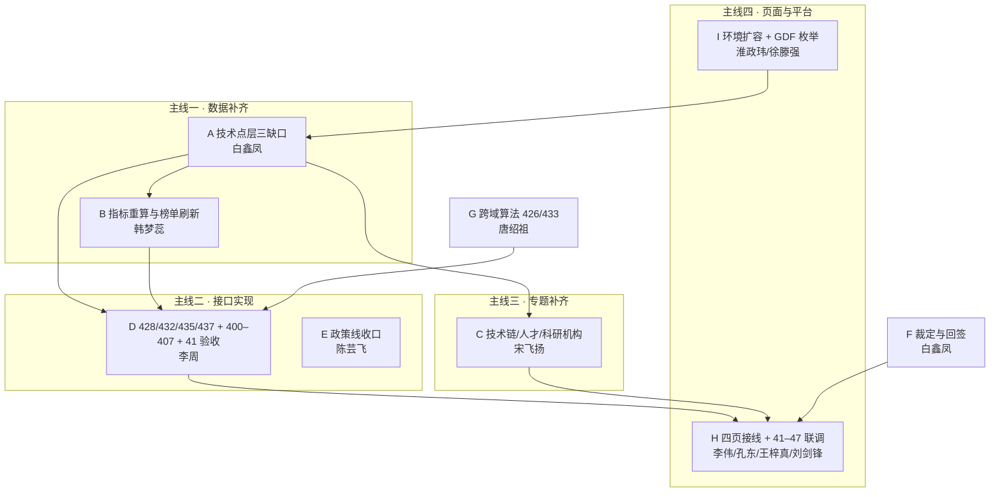

# 总计划 · 两套系统图谱需求 100% 满足（2026-11-13 派单）

- 出具：淮政玮（大项目架构师）
- 时点：2026-11-13
- 依据：`01`–`04` 四份调研 + 项目总计划 S4/S5/S6 里程碑
- 范围：科技专题服务系统（全要素图谱 102–116）+ 科技信息展示系统（17–33、34–47、400–454 中的图相关叶）
- 不在范围：408–422 指标展示、438–454 服务展示（SDD 判非图）；正式线 `gkx_chain` 建设（本期不建）

---

## 一、一句话

**7 个工作日（11-13 至 11-23）补 4 类缺口——技术点层数据、跨域算法、接口实现、页面接线——把 69 个用图叶子逐叶归到「有数 / 空态 / 501 / 不做」四档，不留悬空。**

---

## 二、目标怎么算达成（验收口径）

| 指标 | 目标值 | 怎么验 |
|---|---|---|
| 叶子归档率 | 69 / 69 = 100% | 差距矩阵每一行都有档位与包号，无第 5 档 |
| A 档（有数） | ≥ 55 叶 | 接口 200 + 命中 > 0 + 页面截图（写操作：可保存且落点正确） |
| B/C 档（空态/501） | ≤ 7 叶 | 接口返回与契约一致 + 书面理由 |
| D 档（不做） | 7 叶（34–40） | 书面裁定 + 页面文案 |
| 技术点层数据 | 机构边 ≥ 95%、关系边 ≥ 99%、路径步按规则补齐、`community_id` 100% 回填 | 对账 SQL + 与源表比值 |
| 接口可用 | 中心性 5 + 社群 2 + 分析 4 + 41 验收 1 = 12 个可用端点（另 4 个 501） | 经网关 curl 通过 |
| 环境 | 内存 ≤ 60%，全表扫恢复可用 | 环境方确认 + 一次全表 `count` 通过 |
| 专题三域 | 104/105、110/111、114/115 六叶可点 | 页面四档 + 每 `op_id` 有契约 |

---

## 三、四条主线



---

## 四、批次与时间表

| 批次 | 窗口 | 包 | 出门条件 |
|---|---|---|---|
| **P0-1 环境先行** | 11-13 ～ 11-14 | I（扩容报批） | 环境方回「已扩容/已调水位」；一次全表 `count` 通过 |
| **P0-2 数据补齐** | 11-14 ～ 11-17 | A（三缺口 + 回填）→ B（重算） | 机构边 ≥ 95%、关系边 ≥ 99%、榜单重算完且 diff 有记录 |
| **P0-3 接口实现** | 11-14 ～ 11-18 | D（41 + 算法 + 分析）、F（裁定与回签） | 12 个可用端点经网关 curl 通过；裁定文档落盘 |
| **P0-4 页面接线** | 11-16 ～ 11-19 | H（骨架 + 每页 1 个真实叶子）+ 41–47 联调 | 四页可点、41–47 可验、每页至少 1 项 A 档实证 |
| **S4 系统测试** | **11-19** | A/B/D/F/H 全量 | 黄敬洲走系统测试 |
| **S5 总集核验** | **11-20** | 同上 | 总集按差距矩阵逐叶点验 |
| **P1-1 专题补齐** | 11-20 ～ 11-25 | C（三域三元组） | 三域页面四档 + `/internal` 成对 |
| **P1-2 跨域算法** | 11-20 ～ 11-25 | G（426 合作链、433 第二算法） | 合作网路径可查；第二社群算法可跑 |
| **P1-3 收尾** | 11-25 ～ 11-27 | E 尾 + F 手册增补 + I 契约修订 | 全部叶子归档率 100% |
| **S6 培训** | **11-27** | 全量 | 交付 |

```text
11-13  11-14  11-15  11-16  11-17  11-18  11-19  11-20  11-25  11-27
  |      |      |      |      |      |      |      |      |      |
  I----I                                                       环境扩容
         A-----------A                                           数据补齐
                      B-----B                                    重算
         D------------------D                                    接口
                H----------------H                               页面
                             [S4]  [S5]         C------C         专题
                                               G------G          算法
                                                     [S6]
```

---

## 五、依赖关系（谁等谁）

| 包 | 依赖 | 为什么 |
|---|---|---|
| A | I（扩容） | 247 万条边写入，不扩容必失败 |
| B | A | 不灌满就重算，算完还得再算一次 |
| D | A、B（428/432/435/437 取数） | 接口读的是重算后的榜 |
| D | G（426） | 426 跨域路径能力由 G 提供 |
| H | D、I（41–47 写回目标） | 页面没有接口就是空壳；写回目标未裁定不能点保存 |
| C | A（`tech_has_institution`） | 技术链 105 的「关联机构」依赖机构边补满 |
| E | 久新/需规（源侧） | 政策 ID 列不在我方 |
| F | A（回签要知道灌了多少） | 回签内容来自 A 的实际写入量 |

---

## 六、建单清单（交 coordinator 执行，本会话不建单）

> 本会话无 task-registry MCP，按公约不手改 `task-registry.yaml`。下表字段齐备，coordinator 逐条 `task-create` 即可。

| # | 任务 ID | 标题 | 优先级 | 类型 | supervised_by | 建议 claimed_by | repo | depends_on | 工时 |
|---|---|---|---|---|---|---|---|---|---|
| A | `KG-GRAPH-COVER-01` | 技术点层覆盖补齐（机构边/关系边/路径步/社群字段） | P0 | data_task | human:淮政玮 | human:白鑫凤 | gkx-orchestration | `KG-GRAPH-PLAT-09` | 3d |
| B | `KG-GRAPH-RECALC-02` | 技术点层指标重算与榜单刷新 | P0 | data_task | human:唐绍祖 | human:韩梦蕊 | gkx-orchestration | `KG-GRAPH-COVER-01` | 2d |
| C | `KG-GRAPH-TRIPLE-03` | 专题三域图谱三元组（技术链/人才/科研机构） | P1 | feature | human:徐滕强 | human:宋飞扬 | gkx-orchestration | `KG-GRAPH-COVER-01` | 4d |
| D | `KG-GRAPH-API-04` | 展示图接口实现（428/432/435/437 + 400–407 + 41 验收） | P0 | feature | human:淮政玮 | human:李周 | gkx-orchestration | `KG-GRAPH-COVER-01`、`KG-GRAPH-RECALC-02`、`KG-GRAPH-PLAT-09` | 4d |
| E | `KG-GRAPH-POLICY-05` | 政策线图谱收口与 M12–M14 裁定 | P1 | analysis | human:徐滕强 | human:陈芸飞 | gkx-orchestration | — | 2d |
| F | `KG-GRAPH-SIGNOFF-06` | 34–40 不做裁定 + 合规入图回签 + 手册增补 | P0 | definition | human:唐绍祖 | human:白鑫凤 | gkx-orchestration | `KG-GRAPH-COVER-01` | 1.5d |
| G | `KG-GRAPH-ALGO-07` | 跨域算法（426 合作链、433 第二社群算法、跨域中心性） | P1 | algorithm | human:唐绍祖 | agent:algorithm-agent | gkx-orchestration | — | 3d |
| H | `KG-GRAPH-FE-08` | 展示端四页接线 + 41–47 联调 | P0 | feature | human:李伟 | agent:frontend-agent | lumen-ui-science-pc | `KG-GRAPH-API-04`、`KG-GRAPH-PLAT-09` | 5d |
| I | `KG-GRAPH-PLAT-09` | 图库扩容、GDF 三域枚举、正式线预案与两个口径裁定 | P0 | infra | human:淮政玮 | human:淮政玮 | gkx-orchestration | — | 1.5d |

**总工时**：26 人日 → 5 人并行 + 我方 3 人，P0 合计 17 人日，6 条线并行，11-19 前可收口。

---

## 七、每包一句话（详细派单见本目录 `派单-*.md`）

| 包 | 一句话 |
|---|---|
| A | 把技术点层的三条边灌满、社群字段回填，先小批量验证再分批全量 |
| B | A 灌完立刻重算四张榜，diff 记录留档，数字变了要能解释 |
| C | 照 SVC 范式把技术链/人才/科研机构三域的四步（data→algo→api→UI）各走一遍 |
| D | 照自己签的 T12 契约把 12 个可用端点实现出来，先用案 2 |
| E | 政策线能补的补、不能补的写成 501 裁定，不留「看看再说」 |
| F | 把「不做」的 7 叶（34–40）写成书面裁定，再交合规入图回签 |
| G | 让算法走出技术点图，合作链上也能跑路径和中心性 |
| H | 四页从占位变可点，每页先做 1 个真实叶子；41–47 按 M10 已有实现联调 |
| I | 让图库能写进去、让 GDF 能触发三个新域，并裁定 41 与 42–47 两个口径 |

---

## 八、风险与应对

| # | 风险 | 应对 |
|---|---|---|
| R1 | 环境不扩容 | 11-14 前升级到项目组；A 包先跑 10 万条小批量，能写多少写多少并留证据 |
| R2 | 路径步缺口是数据缺陷 | A 包先出「规则确认单」，未确认前不灌，按 B 档（空态）交付 |
| R3 | 页面 5 天做不完 | H 包先骨架 + 每页 1 叶，其余列 P1，11-20 总集核验时如实说明 |
| R4 | 政策源侧不给 ID | E 包 11-18 前出 501 裁定，页面按「本期不可用」交付 |
| R5 | 案 2 多一跳压测不过 | D 包先压测，超阈值即改缓存 + 分页，不改契约 |
| R6 | 多人改同一文档 | 一包一目录；`README.md` 与 `沟通流水.md` 只由我或唐绍祖改 |
| R7 | 42–47 写回打到不存在的 `gkx_chain` | I 包 11-16 前裁定「本期写 `demo_gkx_chain`」；H 包按裁定联调；未裁定前不点保存 |
| R8 | 41 有两条实现（M10 R1 / T14） | I 包裁定以 M10 R1 为准，T14 改为验收读接口一致性，不新建第二套 |

---

## 九、下一步

1. **11-13 当天**：本计划与 9 份派单说明落盘，飞书发结论（只发结论，细节指向本目录）。
2. **11-13 当天**：coordinator 按 §六 建 9 张单，状态 `ready`，燕大 5 人各自认领。
3. **11-14 09:00**：环境扩容结论到位，A 包开工。
4. **11-19 / 11-20**：系统测试与总集核验，按差距矩阵逐叶点验。

---

## 十、出处

| 结论 | 出处 |
|---|---|
| 叶子清单与分档 | `01-调研-两套系统图谱功能清单.md` |
| 图库五维体检 | `02-调研-图数据库能力现状与差距.md` |
| 人员与派单规矩 | `03-调研-执行力量与派单方式.md` |
| 逐叶差距与包号 | `04-调研-差距矩阵-100%满足还差什么.md` |
| 里程碑日期 | `project-plan.md` S4/S5/S6 |
| 案 2 选择 | `03-调研-执行力量与派单方式.md` §七 |
