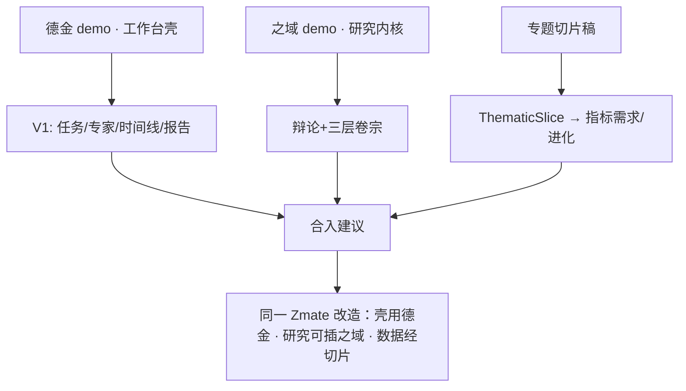

# 之域 / 德金 Demo 分析

> 日期：2026-11-16  
> 文件：  
> - `08-MCP外部服务/之域demo/strategy-agent-team-prototype.html`（约 100KB）  
> - `08-MCP外部服务/德金demo/高端智库报告工作台4.0_首页重做版.html`（约 151KB）  
> 对照：[战略分析整体建设方案](./2026-11-16-战略分析整体建设方案.md) · [三方对照](./2026-11-16-德金-乐之域-专题切片三方对照.md) · [乐之域材料](./乐之域分析材料-HP8G.md) · [德金材料](./德金分析材料-NM5b.md)

两份都是**单文件 HTML 原型**（内联 CSS/JS，零依赖），可浏览器直接打开。定位不同：之域演示**研究范式**；德金演示**工作台产品壳**。

---

## 1. 总览

| | 之域 demo | 德金 demo |
|---|---|---|
| 标题 | 战略咨询 Agent Team · 辩论式战略研究台 | 战略报告创作工作台 · 4.0 首页 |
| 舞台 | 左会话三 chunk + 右预览（金字塔/制品） | 左导航 + 项目轨 + 首页创作 / 任务工作区 |
| 演示命题 | 集团东南亚扩张（2027–2029） | Query 驱动报告任务（低空经济等示例） |
| 与文档关系 | **高度落实**乐之域 HP8G | **高度落实**德金 NM5b 的 V1～V3 壳，辩论未做成主流程 |
| 数据真实性 | 预置 4 轮 8 回合 21 论点 + 可追加第 5 轮；信源 S1–… 为假数据 | 专家/技能/任务流/报告多为假数据与状态机动画 |

---

## 2. 之域 demo：辩论研究台

### 已实现（对齐乐之域稿）

1. **三阶段 UI**：①命题澄清 → ②辩论研究 → ③制品产出；顶栏可跳转。  
2. **辩论约束**：新论点、论据不重复、须质疑/证伪等（界面强制校验徽章）。  
3. **轮内正反交替**：每回合 Agent loop 展示检索/测算/推理链；多论点（新增/反驳/延伸）。  
4. **动态卷宗**：右侧三层金字塔（结论 / 推理 / 信源）；辩论期双方**读写**；论点关联芯片。  
5. **人控轮次**：开始新一轮 / 引导轮（只给方向）；结束辩论进制品。  
6. **制品只读**：Word/PPT/HTML 等形态勾选 + 观点偏向；锁卷宗、禁止新 research；可链回辩论。  
7. **明确无 Judge**：小结文案写「无 Judge · 分歧保留至制品阶段」。

### 未做 / 弱

- 无真实 MCP / Skill / 指标库；「内部卷宗」是信源类型标签，≠ 专题切片。  
- 澄清阶段较静态（材料勾选），无结构化澄清卡片状态机。  
- 无合规闸（`metric_id` / mock / 人闸 Default-FAIL）。

### 可本地打开验证

浏览器打开 `之域demo/strategy-agent-team-prototype.html`，看第 2 段辩论卡与右侧金字塔联动；点「引导轮 / 结束辩论」看阶段切换。

---

## 3. 德金 demo：报告创作工作台 4.0

### 已实现（对齐德金 V1～部分 V2/V3 壳）

1. **首页**：报告类型 Tab、Query 区、技能 picker、领域行、召唤专家网格（战略/产业/技术/政策/证据/写作/深度研究等）。  
2. **写作项目轨**：文件夹 + 报告任务两级；项目/最近；归属状态；折叠。  
3. **安装 ≠ 本次使用**：专家卡「安装 Skill」与任务侧已选芯片分离。  
4. **任务工作区**：左实时任务流（阶段进度、暂停）、右报告输出；**生成中不展示未完成正文**。  
5. **数据资产弹层**：上传 / 个人知识 / 公共知识 / 指标库 / 专题系统 / 展示系统（四象限+系统结论的产品表达）。  
6. **审阅抽屉（偏 V3）**：目录 + 溯源（原文引用示例、角标思路）；`data-review` 评审高亮模式。  
7. **需求澄清**：任务状态 pill 含「需求澄清」；流式阶段含澄清→检索→生成（动画为主）。

### 未做 / 弱

- **无正反辩论主舞台**；「观点论证专家」仅专家卡文案，不是之域式多轮卷宗。  
- 无「边辩边写指标/卷宗」的中间态可视化。  
- 指标/专题系统仅为资产说明卡，无 `metric_id` 绑定、无专题切片/研判卡实体。  
- 对抗审查问题清单、可解释质量分项：壳有「审阅」，完整 V3 对抗流未做实。

### 可本地打开验证

打开 `德金demo/高端智库报告工作台4.0_首页重做版.html`：首页选专家 → 提交进任务区 → 看左流右「生成中」→ 完成后报告与审阅抽屉。

---

## 4. 两 demo 对照 + 与专题切片稿

| 维度 | 之域 | 德金 | 专题切片稿应接哪边 |
|---|---|---|---|
| 产品壳（项目/任务/专家/技能） | 弱 | **强（V1 真源）** | 跟德金壳 |
| 深度研究（正反辩论+三层卷宗） | **强** | 弱 | 跟之域；挂 V2/V3，勿挡 V1 |
| 制品与只读知识体系 | 强（阶段锁） | 报告阅读+下载 | 之域阶段语义 + 德金阅读壳 |
| Judge | 研究阶段无 | 成文后审阅 | **分职**：研究无胜负裁判；成文对抗+全程合规闸 |
| 指标 / 切片 | 无 | 资产文案级 | **另建** ThematicSlice / ScopeCard，勿混称「卷宗」 |
| MCP / 三系统 | 无 | 资产条点名专题/展示 | 切片批准后调业务 MCP |

---

## 5. 结论与建议

1. **两 demo 互补，不是重复**：德金 = 交付壳；之域 = 研究内核；与三方对照中的分工一致。  
2. **V1 门禁应以德金 demo 能力为验收参照**（端到端任务+报告+基础溯源壳），不要把之域辩论做成 11-30 阻断。  
3. **V2+** 把之域辩论嵌进德金任务流第二段（或独立「研究」模式），卷宗只读进报告；同时引入 `slice_id` / 研判卡，避免「卷宗」一词混指辩论知识与指标场景包。  
4. **工程注意**：单文件巨页难维护；落地时应拆组件，并对接真实 MCP/Skill，替换预置 `D.args` / 假进度条。

---

## 6. 修订记录

| 日期 | 说明 |
|---|---|
| 2026-11-16 | 初稿：通读两份 HTML 原型并对照材料/三方表 |
