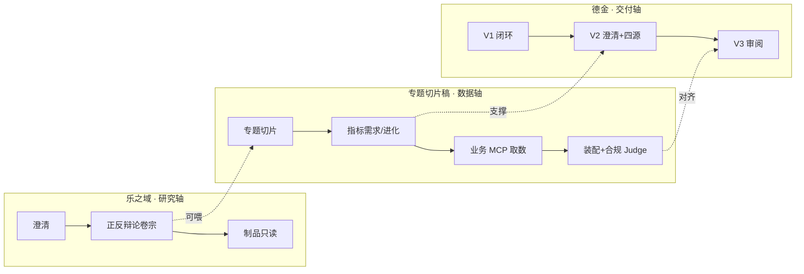

# 德金 × 乐之域 × 专题切片稿 · 三方对照

> 日期：2026-11-16  
> 用途：对齐战略报告 / Zmate 改造的产品节奏、研究范式与数据层，供拍板与排期。  
> 真源：  
> - 德金：[德金分析材料-NM5b.md](./德金分析材料-NM5b.md) · https://zhipu-ai.feishu.cn/docx/NM5bdtntcogA8lxoNh3cirSgnif  
> - 乐之域：[乐之域分析材料-HP8G.md](./乐之域分析材料-HP8G.md) · https://zhipu-ai.feishu.cn/docx/HP8Gd88BOo5RMUxbPFecyLiVndg  
> - 淮侧架构笔记：[2026-11-16-战略咨询报告Agent设计模式-graph-loop-harness.md](./2026-11-16-战略咨询报告Agent设计模式-graph-loop-harness.md)

---

## 1. 一句话定位

| 来源 | 一句话 |
|---|---|
| **德金** | 以 Zmate 改造报告工作台：**V1 跑通 → V2 澄清+四源 → V3 审阅**，偏产品交付与溯源体验 |
| **乐之域** | 战略无定解：重心在 **正反辩论 + 动态战略知识体系（卷宗）**，制品只读卷宗、再注入人的倾向 |
| **专题切片稿** | Agent **不直怼指标库**；中间是 **专题切片 / 研判卡**（`ThematicSlice` / `ScopeCard`），驱动指标需求与指标库进化，再取数装配 |

---

## 2. 主流程对照

| 阶段 | 德金（产品版） | 乐之域（研究范式） | 专题切片稿（数据/编排） |
|---|---|---|---|
| 入口 | Query → 报告任务；选类型/专家/技能；项目文件夹 | 命题澄清：扩写、材料范围 | Brief → 澄清 → **选定/生成专题切片** |
| 问清问题 | **V2** 澄清卡片（对象/行业/范围/时间/受众/深度/决策） | 澄清阶段；辩论中可「只给方向」追加轮 | 人闸确认切片范围与报告组件开关 |
| 深度研究 | V1 通用智能体执行时间线；开篇点到「辩论、边辩边总结指标/卷宗」，**未落成 V1 P0** | **核心**：正反多轮辩论；新论点+证伪；信源/推理/结论三层写入卷宗 | 切片 Skills 展方面域 → 指标需求状态机 →（进化 MCP）→ 并行域 Seeker |
| 中间态 | 任务进展、研判摘要、工具调用摘要（不露思维链） | **动态战略知识体系 / 辩论论点卷宗**（每轮可读写） | 工作区：`slice` / `metric_demand` / `evo_jobs` / `evidence` |
| 成文 | 完成后右侧出报告；基础→完整溯源 | **制品阶段只读卷宗**；不再 research；形态开放（doc/ppt/html） | Writer → **HV-11 装配**；数字挂 `slice_id` + `metric_id` |
| 质检/审阅 | **V3** 对抗审查 + 质量体检 + 三类溯源 | **研究阶段不要 Judge**；倾向/总结放写作；人控辩论轮次 | **Judge = 合规闸**（Default-FAIL：缺 id/mock 假 live/绕过人闸），≠ 战略胜负裁判 |

---

## 3. 数据层对照

| 概念 | 德金 | 乐之域 | 专题切片稿 |
|---|---|---|---|
| 知识 | 官方/个人 **知识库**（非结构化） | 卷宗内 **信源层**（论据） | 业务/检索 MCP → evidence；不替代切片 |
| 指标 | 官方/个人 **指标库**（口径/时间/计算关系） | 开篇未展开；与「边辩边总结成指标」同向 | **metric-registry**（8 件套+D1–D4）可进化；**非** Agent 直接入口 |
| 中观场景包 | 开篇「卷宗层」待细化；产品侧偏任务/来源选择 | **辩论论点卷宗**（按轮累积的知识金字塔） | **专题切片 ThematicSlice** + UI **研判卡 ScopeCard** |
| 四象限权限 | 个人/官方 × 知识/指标，V2 深化，禁止混淆 | 未写权限模型 | 切片批准可取数集合；mock/缺口显式 `known_gaps` |
| 溯源 | 角标：原文 / 指标口径 / 推断（V2–V3） | 下探：论点 → 推理方式 → 信源 | `slice_id` + `metric_id` + 信封 `data_status` / evidence |

**命名提醒：** 乐之域「卷宗」≈ 辩论过程知识库；专题切片稿已弃用「卷宗」作正式名。德金「卷宗层」若采纳，建议拆成：**(a) 辩论知识卷宗** vs **(b) 专题切片/研判卡**，避免一词两义。

---

## 4. Agent / 协同对照

| 点 | 德金 | 乐之域 | 专题切片稿 |
|---|---|---|---|
| 协同模式 | 待确认：多 Agent、辩论落点、他系统 Skill 介入环节 | 正方/反方；同方继承、对方证伪；人控大轮次 | 外层 Graph + 节点 Loop；切片 Skills 居中 |
| Judge | V3 **对抗审查**（成文后）+ 质量分 | 研究阶段 **明确不要** Judge/第三方仲裁 | 有 Judge，但职责是 **指标/装配/人闸合规**，不是判谁辩赢 |
| Skill | 专家入口；安装 ≠ 本次使用；MVP 基础链路 | AaaS 重做 research；澄清/制品扩智库写作方案 | 三阶 Skill **挂在专题切片**；一/二阶经切片批准后调用 |
| Harness | 基于现有 Zmate 改造，不重造底层 | 知识体系可改招商经营分析构建 | zmate/openclaw + MCP（业务 + 指标查询/进化） |

---

## 5. 版本节奏 vs 能力落点（建议合入方式）

| 能力 | 建议挂版 | 主要吸收谁 | 说明 |
|---|---|---|---|
| 任务/项目/专家技能/执行时间线/完成后阅读 | **V1** | 德金 | 不变；辩论不做 V1 阻断 |
| 四类来源最小接入 + 基础溯源角标 | **V1** | 德金 | 指标先「能调能标」，不要求进化闭环 |
| 结构化澄清卡片 | **V2** | 德金（形态）+ 乐之域/切片（命题/切片范围） | 澄清结果应能落到 `slice_id` 或等价场景包 |
| 正反辩论 + 动态知识卷宗 | **V2 试点 / V3 加深** | 乐之域 | 与德金开篇「边辩边总结指标和卷宗」对齐；V1 可只留扩展点 |
| 专题切片 + 指标需求状态机 | **V2 起** | 专题切片稿 | 先固态电池主题切片；与官方指标库打通 |
| 指标库进化 MCP（定义/加工） | **V2 后半～V3** | 专题切片稿 | 须 D9 治理闸；V1 禁止静默伪造成熟指标 |
| 对抗审查 + 质量体检 | **V3** | 德金 | 可复用辩论卷宗中的反方论点作「对抗材料」 |
| 合规 Judge（metric/装配） | **V1 最小规则 → V2 强化** | 专题切片稿 | 与乐之域「研究无 Judge」不冲突：分阶段、分职责 |

---

## 6. 共识 / 张力 / 待拍板

### 已较一致
- 战略报告不能黑盒一步成文；要过程可见、可追溯。  
- 知识与指标要分开治理；不足要明示。  
- 成文与研究可分段：研究沉淀中间态，制品再消费。  
- 基于 Zmate / AaaS，不从零造平台。

### 主要张力

| # | 张力 | 德金 | 乐之域 | 切片稿 |
|---|---|---|---|---|
| T1 | 深度研究何时做 | V1 通用执行；辩论未进 P0 | 辩论即核心 | 切片+取数为核心数据链 |
| T2 | Judge 要不要 | 成文后要审阅/对抗 | 研究阶段不要 | 要合规闸、不要战略裁判 |
| T3 | 「卷宗」指什么 | 数据层待写的卷宗层 | 辩论论点卷宗 | 正式名用专题切片；辩论态另称 |
| T4 | 指标从哪来 | 官方/个人指标库选用 | 边辩边总结成指标 | 切片动态需求 + 库可进化 |

### 建议会上拍板（5 条）

1. **V1 是否只做德金 P0**，辩论/切片进化一律不进 11-30 门禁？  
2. **「卷宗」拆名**：辩论知识卷宗 vs 专题切片（`ThematicSlice`）是否接受？  
3. **Judge 分职**：研究阶段无胜负 Judge；成文后对抗审查（德金 V3）+ 全程合规闸（切片）是否接受？  
4. **V2 是否强制**「澄清 → 绑定/生成一个 `slice_id`」再生成？  
5. **边辩边沉淀指标**：试点挂 V2 还是 V3？与指标进化 MCP、D9 治理如何接闸？

---

## 7. 修订记录

| 日期 | 说明 |
|---|---|
| 2026-11-16 | 初稿：德金 NM5b × 乐之域 HP8G × 专题切片/研判卡设计稿 |
