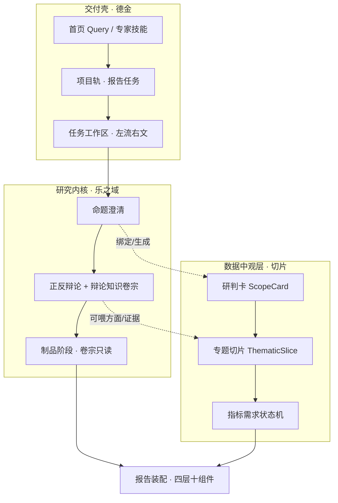

# 战略分析整体建设方案

> 日期：2026-11-16  
> 状态：**草案（供评审与 Demo 对齐）**  
> 编制依据：德金 NM5b · 乐之域 HP8G · 专题切片/研判卡设计 · Graph/Loop/Harness 对照 · 顶尖报告四层十组件 · AI 战略 Skill/MCP 建设方案 · 需规「新型高端智库 / 战略咨询报告」· 之域/德金 HTML 原型通读  
> 关联任务：`ZMATE-FE-INTEGRATED-DEMO-L01`（纯前端综合 Demo，须与本方案对齐）  
> 同目录真源：  
> - [三方对照](./2026-11-16-德金-乐之域-专题切片三方对照.md)  
> - [之域德金 demo 分析](./2026-11-16-之域德金demo分析.md)  
> - [Agent 设计模式](./2026-11-16-战略咨询报告Agent设计模式-graph-loop-harness.md)  
> - [报告结构与评价](./2026-11-13-顶尖战略报告结构与评价方法.md)  
> - [Skill/MCP 建设方案](./AI战略skill-mcp建设方案/2026-11-13-AI战略skill-mcp建设方案.md)

---

## 0. 一句话

**在 Zmate（AaaS）上改造「战略报告创作工作台」：外壳跟德金交付节奏，研究内核跟乐之域辩论范式，数据经「专题切片 / 研判卡」接指标库与三系统 MCP；报告按四层十组件装配，禁止黑盒一步成文。**

纯前端综合 Demo（`demo-ui-topic`）是本方案的**产品形态验收样机**，不挡 V1 真后端门禁，但**信息架构、阶段语义、命名与三段主路径必须与本方案一致**。

---

## 1. 为什么建

| 驱动 | 要点 |
|---|---|
| **需规** | 门户「新型高端智库」含战略咨询报告：定向推送、成果分类展示、可读详细内容（技术方向 / 分析 / 建议）。本方案解决的是**如何生成与审阅**这类报告，而不是门户入口本身。 |
| **业务本质** | 战略问题**无定解**（乐之域）：价值在命题剖析、猜想、推理对抗；最终形态（Word/PPT/HTML）是制品，不是研究本身。 |
| **平台现实** | 不重造底层；以 **Zmate / openclaw** 为 Harness，Skill 不写死 API，统一走 MCP；展示 / 专题 / 算法经 Java → Python `/internal/*` 既有调用链。 |
| **数据血缘** | D9：关键数字须有 `metric_id`（或显式缺口）；Agent **不直怼** metric-registry 做业务编排，中间必须有**专题切片**。 |

---

## 2. 建设目标与非目标

### 2.1 目标

1. **可演示的端到端创作闭环**：Query → 任务 →（可选澄清）→ 研究/执行可见 → 报告可读可溯源。  
2. **研究有深度**：对无定解命题支持正反多轮辩论 + 三层知识金字塔（辩论知识卷宗），人控轮次与引导轮。  
3. **数据有场景**：中观问题先落**专题切片 / 研判卡**，再驱动指标需求与（后续）指标库进化、业务 MCP 取数。  
4. **报告有骨架**：对齐「四层十组件」装配（HV-11）与五维评分 / 出厂质检闸（HV-12）；样板主题优先**固态电池**。  
5. **版本可门禁**：德金 V1→V2→V3 节奏不变；辩论与切片进化**不挡** 11-30 V1，但方案与 Demo 预留插槽。

### 2.2 非目标（本阶段明确不做）

- 从零自研 Agent 运行时 / 替代 Zmate。  
- V1 强制上线完整辩论主舞台或指标进化闭环。  
- Agent 运行时静默改绿 D1–D4 或绕过人闸冒充 live。  
- 把「辩论知识卷宗」与「专题切片」混成同一个产品对象。  
- Demo 直连 lumen 正式后端或写入 `lumen-*` 仓（D12）。

---

## 3. 产品总览：三轴合一

| 轴 | 主责方材料 | 产品落点 | Demo 必须可见 |
|---|---|---|---|
| **交付轴** | 德金 NM5b | 项目/任务、专家技能、执行时间线、报告阅读、四源资产、审阅 | ① 首页+任务轨+工作区 |
| **研究轴** | 乐之域 HP8G | 澄清 → 正反辩论 → 制品只读卷宗 | ② 辩论区+三层金字塔 |
| **数据轴** | 专题切片稿 | ThematicSlice / ScopeCard → 指标需求 → MCP 取数 → 合规 Judge | ③ 研判卡占位+状态机 Mock |



---

## 4. 术语铁律（Demo 与文档同名）

| 正式名 | 英文 / ID | 含义 | 禁止混称 |
|---|---|---|---|
| **专题切片** | `ThematicSlice` / `slice_id` | 中观场景包：方面域 + 三阶 Skill + 指标需求 | 勿叫「卷宗」 |
| **研判卡** | `ScopeCard` | 切片的 UI 卡片形态 | — |
| **辩论知识卷宗** | Debate Dossier | 正反辩论累积的结论/推理/信源金字塔 | 勿叫专题切片 |
| **合规 Judge** | Compliance Judge | Default-FAIL：缺 id / 假 live / 绕过人闸 | ≠ 战略胜负裁判 |
| **对抗审查** | Adversarial Review | 成文后审阅（德金 V3）；可复用反方论点 | ≠ 研究阶段 Judge |
| **四象限来源** | 个人/官方 × 知识/指标 | 德金数据资产模型 | 展示时不得混淆归属 |

---

## 5. 目标用户旅程（主路径）

```text
① 创作入口（德金壳）
   Query + 报告类型 + 专家/技能（安装 ≠ 本次使用）+ 可选项目文件夹
        ↓
② 任务工作区
   左：阶段进展 / 研判摘要 / 工具调用摘要（不露思维链）
   右：生成中占位 → 完成后报告
        ↓
③ 澄清（V2 强化；Demo 可简化卡片）
   对象 / 行业 / 范围 / 时间 / 受众 / 深度 / 决策
   → 选定或生成一张研判卡（slice_id）
        ↓
④ 深度研究（V2+；Demo 必做可点验）
   正反多轮：新论点 + 证伪；读写辩论知识卷宗
   人控：新一轮 / 引导轮 / 结束辩论
   （并行或之后）切片 Skills 展开方面 → 指标需求 Mock 状态
        ↓
⑤ 制品 / 报告
   卷宗只读；按组件装配；关键结论角标溯源
   数字：metric_id 或 known_gaps；可回溯 slice_id
        ↓
⑥ 审阅（V3；Demo 可降级为壳）
   目录 + 三类溯源；对抗审查问题清单；质量分项
```

门户侧「推送 / 分类浏览已完成报告」不在本工作台主路径内，由展示/门户对接另轨；本方案产出物应能被门户消费。

---

## 6. 架构分层

### 6.1 Harness · Graph · Loop

| 层 | 选型 | 战略分析中的职责 |
|---|---|---|
| **Harness** | Zmate / openclaw：Persona · Skills · MCP · Extensions · Sandbox | 工具面鉴权、工作区制品、事件推前端（大纲 / task_plan / 研判卡） |
| **外层 Graph** | 澄清 → 切片编排 →（可选辩论子图）→ 并行 Seeker → Writer → Assembler → Judge | 阶段顺序、人闸、可恢复；禁止单会话 ReAct 写完全文 |
| **节点内 Loop** | 专科 ReAct / 有界 Reflection | 单域检索、单章补证、单轮辩论 Agent |

### 6.2 数据三层（Agent 只看见上两层的场景契约）

1. **专题切片**：方面 Aspects · 指标需求（可用 / 新建 / 真接 / 外网补数）· 三阶 Skill  
2. **指标库**（可进化）：8 件套 + D1–D4；进化 MCP 仅切片 Skills + 治理闸  
3. **业务 MCP**：展示 / 专题等 → ADS；信封带回 `metric_ids` / `data_status`

### 6.3 报告装配

- **测算 / 机会 / 叙事** 三引擎 + **四层十组件**（前置结论 · 分析主体 · 结论动作 · 信任件）。  
- 装配节点**确定性**（HV-11），不是模型黑盒拼长文。  
- 质检：五维评分卡 + 10 项出厂清单；Default-FAIL（HV-12）。

### 6.4 与国科信三系统关系

```text
工作台前端（Zmate 壳 / Demo）
    → Java REST（lumen）
        → Python /internal/*（算法/分析）
        → MCP 配置面（业务取数 + 指标查询/进化）
    → 指标身份只读消费 metric-registry（经切片/Judge，非写手直连）
```

Demo 阶段：以上全部 **Mock / fixture**；接口形状按本方案预留。

---

## 7. 版本路线图（与德金对齐，能力落点已合入）

| 版本 | 窗口 | 建设重点 | 本方案能力落点 | 门禁 |
|---|---|---|---|---|
| **V1 MVP** | ~11-16 → 11-30 | 任务闭环、专家技能、执行可见、报告阅读、四源最小接入、基础溯源 | 交付壳完整；合规 Judge **最小规则**；辩论/切片进化**扩展点 only** | 端到端可演示；至少一条真实工具链；11-25 提测 |
| **V2** | 12-01 → 12-10 | 澄清卡片、四源深化、溯源三类、权限不混淆 | **强制**澄清结果绑定 `slice_id`；辩论试点嵌入任务第二段；指标需求状态机；边辩边沉淀指标试点 | 来源分类与溯源一致 |
| **V3** | 12-11 → 12-22 | 对抗审查、质量体检、阅读/批注体验 | 反方卷宗喂对抗材料；Judge 强化；指标进化 MCP + D9 闸 | 审阅可用、评测可解释 |
| **试运行** | 12-23 → 12-31 | 稳定与反馈 | 科技企业 / 政府 / 院所场景 | 任务完成率与溯源核验入需求池 |

Skill/MCP 批次（固态电池样板等）仍按 [建设方案](./AI战略skill-mcp建设方案/2026-11-13-AI战略skill-mcp建设方案.md) 与 WBS 推进；本方案管**产品形态与编排**，不替代批次清单。

---

## 8. 角色与协同（研究 vs 合规）

| 角色 | 阶段 | 做什么 | 明确不做 |
|---|---|---|---|
| 澄清 Agent | 入口 | 命题扩写、澄清卡片、候选研判卡 | 不直接写终稿 |
| 正方 / 反方 | 辩论 | 新论点、证伪、读写辩论知识卷宗 | 不由第三方判输赢 |
| 切片 Skills | 切片编排 | 方面域、指标需求分类、调进化 MCP | 不代替业务取数 |
| 域 Seeker | 取数 | 只取切片已批准指标 | 不改 kit |
| Writer / Assembler | 成文 | 组件装配、挂 id | 不黑盒成文 |
| 合规 Judge | 全程抽检 / 出厂 | Default-FAIL | 不做战略胜负裁判 |
| 对抗审查 | 成文后 | 缺口、跳跃、反方观点、假设边界 | 不替代研究辩论 |

**已拍板口径（方案默认，除非会上否决）：**

1. V1 门禁 = 德金 P0；辩论与切片进化不进 11-30 阻断。  
2. 「卷宗」拆名：辩论知识卷宗 vs 专题切片。  
3. Judge 分职：研究无胜负裁判；成文对抗审查 + 全程合规闸。  
4. V2 起澄清须能落到 `slice_id`（或等价场景包）。  
5. 「边辩边沉淀指标」挂 V2 试点，进化正式闭环偏 V2 后半～V3，且过 D9。

---

## 9. 综合 Demo 对齐规范（`ZMATE-FE-INTEGRATED-DEMO-L01`）

> Demo = 本方案的**可点击说明书**。实现栈：`demo-ui-topic` · React + Vite + Arco · Design.md（D8）。强度：ponytail full。

### 9.1 必须贯通的三段（与 DoD 一致）

| 段 | 对齐方案章节 | 交互最低标准 |
|---|---|---|
| **① 交付壳** | §3 交付轴 · §5①② | 项目轨两级；Query；专家网格；安装 Skill ≠ 本次使用芯片；进任务区后左流右「生成中」 |
| **② 研究内核** | §3 研究轴 · §5④ | 正反回合可点验；三层金字塔（结论/推理/信源）；辩论期可读写示意；结束辩论后卷宗只读；无胜负 Judge 文案 |
| **③ 切片 + 报告** | §3 数据轴 · §5③⑤ · §4 术语 | 至少一张研判卡；方面域 + 指标需求四态 Mock；报告完成后基础溯源角标；数字旁示意 `slice_id` / `metric_id` 或缺口 |

### 9.2 Demo 信息架构（建议路由）

```text
/zmate-strategy-demo          → 首页创作（德金壳）
/zmate-strategy-demo/task/:id → 任务工作区
  tabs 或阶段条：澄清 | 辩论研究 | 切片/研判 | 报告 | 审阅(壳)
```

左侧会话三 chunk（澄清 / 辩论 / 制品）与德金左导航+任务轨可同屏分区，**不要做两套互斥产品**。

### 9.3 视觉与工程约束

- Token / 控件：主色 `#165DFF`、控件高 32px、Arco 组件优先（仓 AGENTS 复刻经验适用处照做）。  
- `USE_MOCK=true`：零真实后端；禁止 `@/mock` 在关 Mock 时填数。  
- 不把互斥 `display` 叠同一节点；生成中**不**渲染未完成正文。  
- V3 对抗审查允许降级为抽屉壳 + 静态问题清单。  
- handoff 必附：与两份 HTML 原型的能力映射表 + 本方案章节对照表。

### 9.4 Demo 验收对照表（方案 → 页面）

| 方案条款 | Demo 验收点 |
|---|---|
| 三轴合一 | 同工作区内能切到壳 / 辩论 / 切片，无「三个无关 Demo」感 |
| 术语铁律 | UI 文案用「专题切片/研判卡」「辩论知识卷宗」；不出现混用「卷宗」指切片 |
| Judge 分职 | 辩论区标明无胜负裁判；报告/审阅区可有合规或对抗壳 |
| V1 不挡 | 首页→任务→报告路径可独立走完，不强制先辩完 |
| 数据诚实 | 指标四态与 Mock 角标可见；无「已对齐 live」假绿 |

---

## 10. 工程与协作分工（建议）

| 工作包 | 主责 | 产物 |
|---|---|---|
| 纯前端综合 Demo | frontend-agent（本机 demo-ui-topic） | `ZMATE-FE-INTEGRATED-DEMO-L01` |
| Zmate V1 真流程改造 | 德金 / 平台侧 | 任务、专家、时间线、报告、四源最小 |
| 辩论研究 AaaS 化 | 乐之域 / 研究侧 | 正反 Agent、卷宗读写、阶段锁 |
| 专题切片 + 指标需求 | 架构 / data / algorithm | slice 模型、进化 MCP、D9 闸 |
| 一/二/三阶 Skill·MCP 批次 | 各系统按 WBS | 固态电池样板可跑 |
| 报告骨架与质检 | 产品 + 评测 | 四层十组件、五维卡、出厂 10 项 |
| 门户推送与成果库 | 展示 / 门户轨 | 消费本工作台产出（另单） |

---

## 11. 风险与依赖

| 风险 | 缓解 |
|---|---|
| 辩论拖垮 V1 排期 | 方案与 Demo 把辩论放第二段；V1 门禁不含辩论 P0 |
| 「卷宗」一词混乱 | §4 术语强制；评审走查文案 |
| 指标未就绪却成文 | 合规 Judge + known_gaps；Demo 先演四态 |
| 单文件 HTML 难维护 | Demo 拆组件进 demo-ui-topic，HTML 仅参考 |
| MCP/Skill 批次滞后 | Demo Mock 先行；真链按批次替换 fixture |

---

## 12. 修订记录

| 日期 | 说明 |
|---|---|
| 2026-11-16 | 初稿：汇合三方讨论、需规高端智库、报告骨架、Skill/MCP 计划与 Demo 对齐规范；供 `ZMATE-FE-INTEGRATED-DEMO-L01` 执行真源 |
