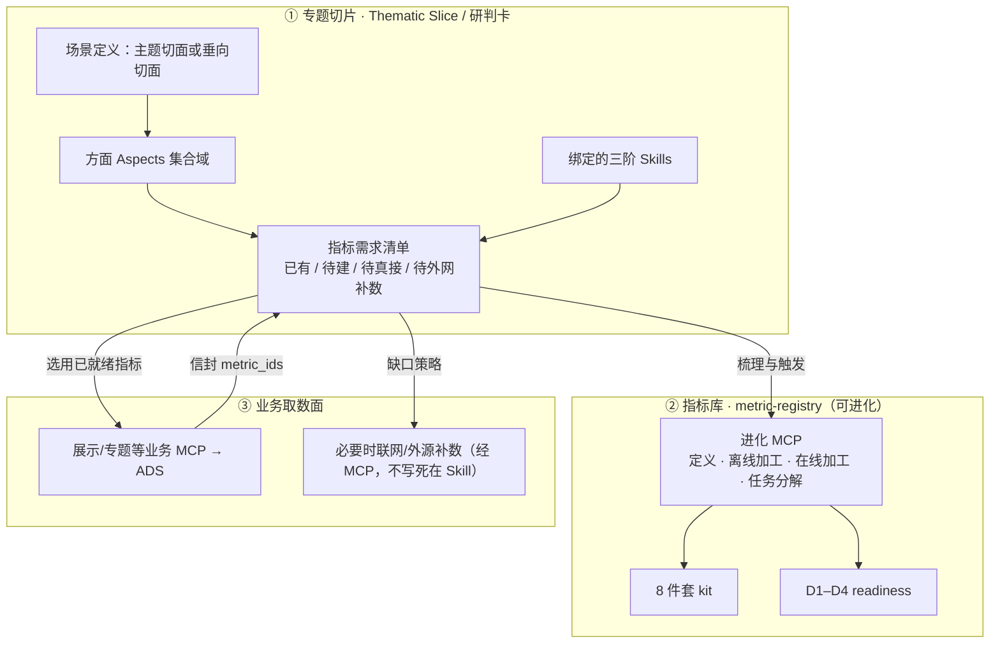
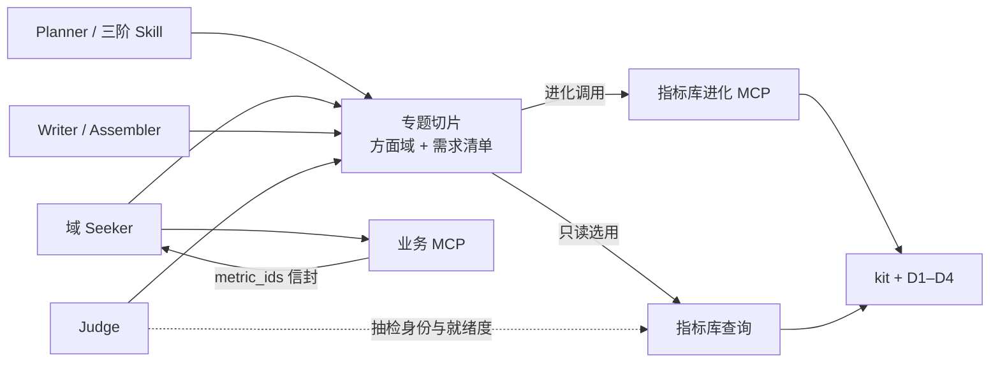
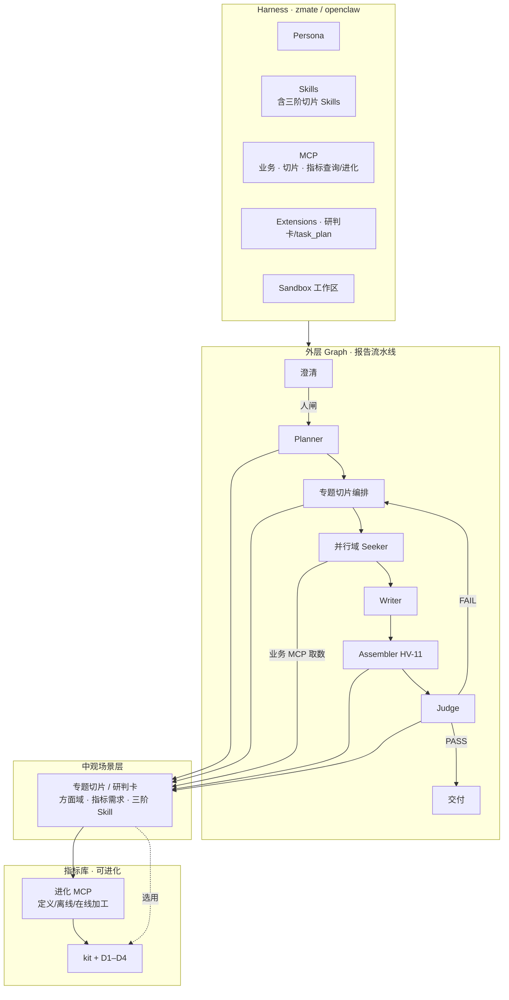
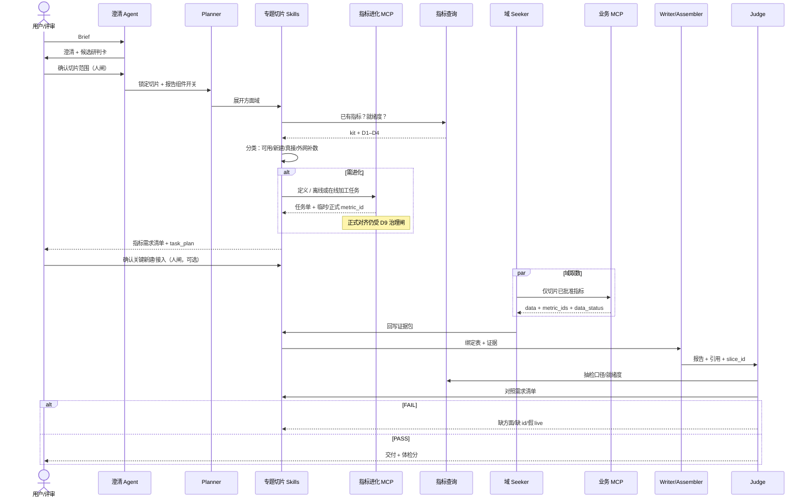
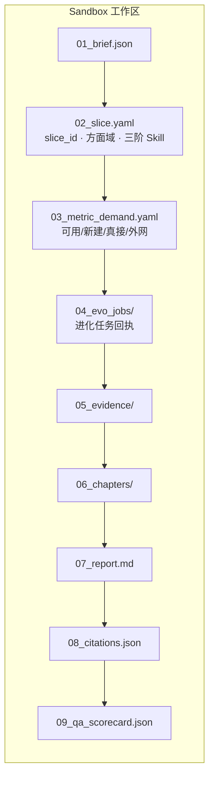
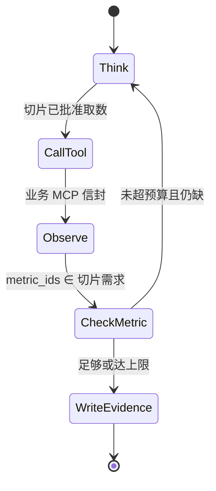

# 战略咨询报告视角：Agent 设计模式（Graph / Loop / Harness）业界主流与项目对照

> 日期：2026-11-16  
> 用途：为国科信「zmate Skill 编排 + 三系统 MCP 取数 → 战略咨询报告」选型提供业界对照。  
> 相关：[`2026-11-13-顶尖战略报告结构与评价方法.md`](./2026-11-13-顶尖战略报告结构与评价方法.md)、zmate AaaS / 场景 Tutorial、WBS-08 Skill-MCP 技术标准与评测标准、D9 `data-lineage-policy` / metric-registry。  
> 方法：联网检索 2025–2026 主流框架/论文/厂商实践后归纳；非厂商白皮书照搬。

---

## 1. 先对齐三个词（业界常用语义）

写战略报告时，这三个词经常混用。建议按**职责分层**理解，而不是三选一互斥：

| 词 | 一句话 | 管什么 | 不管什么 |
|---|---|---|---|
| **Loop（环）** | 单 Agent「想 → 调工具 → 观察 → 再想」的运行核 | 单角色内的推理与工具调用节奏（典型 ReAct） | 多角色怎么串、失败怎么跨会话恢复 |
| **Graph（图）** | 把流程显式成节点/边/共享状态 | 阶段顺序、分支、并行、人审闸门、可恢复检查点 | 模型怎么在单步里「想清楚」 |
| **Harness（挽具/运行时）** | 包住模型的整套契约与运行环境 | 系统提示、工具/MCP、权限、上限、沙箱、hooks、评测与改进飞轮 | 业务章节写得好不好本身 |

OpenAI Agents cookbook 把 harness 定义为围绕模型的完整契约：instructions、tools、routing、输出要求与校验。Anthropic 侧则把 Claude Agent SDK / Claude Code 明确称为 **agent harness**：核心仍是 turn 循环，外加工具、上下文、权限、预算上限等。Zmate 文档里的 openclaw / Opensandbox / Persona·Skills·MCP·Extensions·Plugin，本质就是在选和扩一套 **harness**。

```text
                    ┌─────────────────────────────────────┐
                    │  Harness（运行时 + 安全 + 工具面）     │
                    │  Persona / Skills / MCP / Hooks / 沙箱 │
                    │                                     │
                    │   ┌─────────── Graph（可选）──────┐ │
                    │   │  澄清 → 调研 → 撰写 → 质检     │ │
                    │   │     ↑______loop______↓        │ │
                    │   │   （节点内多为 ReAct loop）     │ │
                    │   └───────────────────────────────┘ │
                    └─────────────────────────────────────┘
```

---

## 2. 业界主流模式（按「报告生成」相关性排序）

### 2.1 Loop 族：单 Agent 推理环

| 模式 | 要点 | 代表 | 适合战略报告的哪一段 |
|---|---|---|---|
| **ReAct** | Thought → Action(tool) → Observation 循环，直到给出最终文本 | Yao et al.；几乎所有 Agent SDK 默认核 | 单章检索补证、单指标口径核对、局部改写 |
| **Reflection / Critic 环** | 生成 → 独立评判 → 修订；评判者宜「新鲜上下文」 | Anthropic long-running harness（builder ≠ evaluator） | 章节质检、五维评分卡自动闸门 |
| **Plan-then-Execute / ReWOO 变体** | 先规划工具调用再批量执行，减少交织观察膨胀 | 部分 research workbench | 已知 MCP 工具清单的批量取数 |

**行业共识：** Loop 是必要底座，但**不能单独扛长文战略报告**——上下文膨胀、角色纠缠、错误沿程传播是 Deep Research 文献里反复出现的失败模式。

### 2.2 Graph 族：显式流程与多 Agent 编排

| 模式 | 要点 | 代表 | 适合战略报告的哪一段 |
|---|---|---|---|
| **Stateful Graph（状态图）** | 节点 + 条件边 + 共享 Typed State；可 checkpoint / interrupt | LangGraph | 固定流水线：澄清表单 → 大纲确认 → 分章撰写 → 装配 → 质检 |
| **Supervisor + Subagents-as-Tools** | 主 Agent 动态调用专科子 Agent（子 Agent 常自带 loop） | LangChain Subagents 文档；业界「Orchestrator+ReAct」主张 | 主报告官调度「测算 / 政策 / 产业链 / 竞品」专科 |
| **Role Crew / Hierarchical** | 研究员·写手·审稿等角色 + 任务队列；Flows 补显式顺序 | CrewAI Crews + Flows | 快速原型「调研-撰写-评审」三角色 |
| **Planner → Parallel Seekers → Writer（+ Verifier）** | Deep Research 主流拆分；经**共享工作区文件**交接，而非塞满对话历史 | DeepDiver-DR、PANINI-DR、开源 research workbench | **整份深度战略报告**的默认骨架 |
| **Durable Workflow 外包** | 图/环负责「想什么」；Temporal 等负责崩溃恢复、长等待人审、跨框架子工作流 | Temporal × LangGraph plugin | 报告跑 30–90 分钟、中途人确认大纲、节点失败重试 |

**行业张力（要写进选型会）：**

- **显式 Graph**：路径可测、可审计、好人审；但每加能力要改拓扑，LLM 动态路由空间被压缩。  
- **Orchestrator + 专科 ReAct**：扩展靠「注册新子 Agent=新工具」；路由靠模型；生产侧更依赖 trace/eval，而不是边条件代码。  
- 实践上多数深度报告系统是 **外层 Graph（或 durable workflow）+ 内层 Loop**，而不是二选一。

### 2.3 Harness 族：运行时与改进飞轮

| 模式 | 要点 | 代表 | 对战略报告的含义 |
|---|---|---|---|
| **Tool / MCP Harness** | 工具面统一鉴权、超时、会话绑定；模型不直持业务密钥 | Claude Agent SDK、OpenAI Agents、τ²-bench MCP bridge；zmate「Skill 不写 API，统一走 MCP」 | 三系统 MCP 必须挂在 harness，而不是写进 Skill 正文 |
| **Sandbox Harness** | 文件工作区、egress、权限、制品归档 | Opensandbox / gVisor / openclaw PVC | 报告中间稿、图表、引用表落工作区，可审计可清理 |
| **Default-FAIL + Fresh Evaluator** | 验收项默认失败；独立评判 Agent 无写权限 | Anthropic Effective Harnesses for Long-Running Agents | 对齐你们「五维评分卡 / 10 项出厂质检」：未举证不得标绿 |
| **Trace → Feedback → Eval → Harness 改动** | 改进飞轮，而不是一次性 prompt 调参 | OpenAI agent improvement loop cookbook | 固态电池样板跑通后，用评测集固化 HV-11/HV-12 |

---

## 3. Deep Research / 战略报告：业界「默认流水线」

综合 2025–2026 Deep Research 论文与开源工作台，长报告主流收敛到类似结构：

```text
用户意图 / Brief
    → Planner（任务树 / 子问题 / 依赖）
    → 并行 Researcher / Information Seeker（检索 + 证据摘要入库）
    → Critic / Verifier（无引用索赔打回；有预算上限）
    → Writer（大纲 → 分章 → 合并）
    → 质检 / Rubric（全局质量 + 点状 rubric）
    → 交付物（Markdown / 结构化组件 / 引用表）
```

关键工程习惯：

1. **共享工作区（文件或语义工作区）** 交接计划、证据、发现、章节草稿——避免把全文塞进单一 context。  
2. **角色隔离**：Seeker 只采证，Writer 只写，Verifier 不写文件。  
3. **有界回环**：Critic→Research 最多 N 次，超时则带着「已知缺口」交付（对齐你们信封里的 `known_gaps` / `data_status`）。  
4. **人在环**：大纲/关键口径/行动建议确认后再进入长撰写（对齐 zmate Tutorial 里「需求澄清员工 → 报告生成员工」）。

---

## 4. 映射到「写战略咨询报告」（结合本项目）

### 4.1 你们已有的产品约束（真源摘要）

| 项目侧已定 | 含义 |
|---|---|
| 四层十组件 + 测算/机会/叙事三引擎 | 报告是**组件装配**，不是黑盒一次成文（HV-11） |
| Skill 一二三阶 + MCP 清单 | 取数走 MCP；装配与分析分层 |
| zmate：Persona / Skills / MCP / Extensions / Plugin | Skills 不内嵌 API/Key；MCP 上传配置即时生效；Extensions 推前端事件（大纲/计划） |
| 国科信报告写作 = 无状态 AaaS | 适合「应用形态」Deep Research，而非个人助手长会话 |
| 评测：章节完备、跨源口径、人工确认点不可绕过、引用溯源 | 需要 **Graph 闸门 + Harness 评测**，单靠 Loop 不够 |

### 4.2 建议的分层落位（选型结论草案）

| 层 | 推荐主流模式 | 项目落点 | 不建议 |
|---|---|---|---|
| **Harness** | openclaw（或后续第二 harness）+ MCP + 沙箱 + hooks | 元虾：Persona + skills.tar + MCP 配置；Plugin 做收尾清理；Extensions 推 `report.task_plan` 等事件 | 在 Skill 里写死 URL/Key；让模型直连业务库 |
| **外层编排 Graph** | Planner→澄清→并行取数→分章写→装配→质检；关键节点 **interrupt 等人** | 无状态双员工（澄清 / 生成）或显式 StateGraph；人确认大纲后再写正文 | 单会话 ReAct 从 Brief 直接写到终稿 |
| **节点内 Loop** | 专科 ReAct / 有界 Reflection | 每个 MCP 域（展示态势、产业链、政策、企业）一个子 Agent 或一阶/二阶 Skill 包 | 一个万能 Agent 同时检索+测算+写五章 |
| **质检环** | Fresh-context Critic + Default-FAIL rubric | 五维评分卡 / 10 项质检 / HV-12 引用；独立 Judge（可对齐 zmate 评测模块） | 让写手 Agent 自评「写完了」 |

### 4.3 与报告组件的对应（便于拆 Skill）

| 报告工作包 | 更像 Graph 节点还是 Loop | 主要工具面 |
|---|---|---|
| Brief / 需求澄清表单 | Graph 入口 + 人审 | 表单 Extensions、会话 |
| 大纲与任务计划 | Graph（可并行展开） | 规划 Skill；前端 `report.task_plan` |
| 专题切片 / 研判卡选定 | Graph 入口后的中观场景节点 | 三阶 Skill；方面域；指标需求状态机 |
| 测算引擎章节（市场/规模/指标） | 切片批准后的并行子图 + Loop | 业务 MCP；`metric_ids` 须 ∈ 切片需求 |
| 机会 / 竞争 / 政策章 | 并行 Seeker 子图（对齐切片「方面」） | 政策、产业链、企业 MCP + 检索 |
| 叙事 / 案例血肉 | Loop 检索 + 受控写入 | 智库/案例库类能力（若有） |
| 报告装配 HV-11 | **确定性 Graph 节点**（规则拼装） | 组件 × 切片绑定；禁止黑盒成文 |
| 出厂质检 | 独立 Critic 环 | 对照切片需求清单 + 口径/就绪度 + 评分卡 |

---

## 5. 专题切片 → 指标库（不要让 Agent 直怼指标库）

战略报告的测算能力，**不应**让 Planner/Seeker/Judge 直接把 `metric-registry` 当业务入口。中间必须有一层：**面向科创「中观」研究的指标集合场景**——承载三阶 Skill、梳理/触发指标需求，再驱动指标库进化与取数。

### 5.0 怎么称呼这一层？（「卷宗」是否合适）

「卷宗」偏办案/归档，弱化了「切面 + 场景卡 + 动态产指标」；建议产品名与工程名分开：

| 中文 | 英文（已定稿） | 适用 |
|---|---|---|
| **专题切片** | **`ThematicSlice`**（文案 *Thematic Slice*） | 产品/架构主名；`slice_id` |
| **研判卡** | **`ScopeCard`**（文案 *Scope Card*） | 界面卡片；一张卡 = 一个中观场景 |
| 研究切面 | — | 对内可与「方面 Aspects」混用，不作对外主名 |
| ~~卷宗~~ | — | 仅口语别名，不作正式术语 |

**定稿（2026-11-16）**：对外 **专题切片 / Thematic Slice**；界面 **研判卡 / Scope Card**。不采用 *Meso Scope Card*（易与「区域中观指数」混淆）。

### 5.1 三层数据面（Agent 只看见上面两层的「场景契约」）



| 层 | 回答什么问题 | 谁主要操作 |
|---|---|---|
| **专题切片** | 这个中观问题要看哪些「方面」？需要哪组原子指标组合？现有够不够？ | 三阶 Skill / 切片 Planner |
| **指标库** | 这条数身份是什么？算不算得出？要不要新建/加工？ | 指标进化 MCP（接受切片 Skill 调用）；正式口径仍受 D9 治理 |
| **业务 MCP** | 这个已定义指标现在具体值是多少？ | 一/二阶域 Seeker |

**铁律修订：** 报告 Graph 上的 Agent **默认只对专题切片**（读场景、跑切片 Skills、消费「指标需求/绑定」结果）；**不直接**把 `metric-query` 当规划入口。指标库对上暴露「查询 + 进化」MCP，由**切片 Skills** 调用，而不是由写手 Agent 随手改库。

### 5.2 专题切片是什么

面向科创领域**中观**研究的一个**横向或纵向切面**的场景定义；界面通常是一张**研判卡**。它服务的是「要用哪一包指标集合」，而不是单条指标本身。

| 形态 | 例子 | 切面性质 |
|---|---|---|
| **主题型** | 「固态电池」技术研究与产业发展情况 | 横向主题包，多域方面组合 |
| **垂向型** | 产业链 / 政策 / 企业情况切面 | 纵向专业切面 |
| **空间×产业型** | 深圳地区企业覆盖的产业情况；龙头在相关产业链上的位置 | 地理 + 主体 + 链位组合 |

切片内通常包含：

1. **方面（Aspects）集合域**：本切面要覆盖的分析维度（技术路线、产能、政策工具、龙头链位…）。  
2. **三阶 Skill 绑定**：具体承载「如何把方面展开成指标组合分析」。  
3. **指标集合状态机**（动态，非静态清单）：  
   - 已有且可用（kit 齐 + 就绪度允许）  
   - 需新建定义（触发指标库「定义」）  
   - 需真实接入（D4 从 mock → ingesting → live）  
   - 需联网/外源补数（经受控 MCP，写入 evidence / known_gaps）  
4. **组合分析意图**：原子指标单独不够，必须组合才构成中观结论（对齐测算/机会/叙事引擎）。

### 5.3 指标库为何不能静态、又为何要可进化

| 原则 | 含义 |
|---|---|
| **非静态** | 指标集合由切片的「方面域」+ Skills **动态产生/裁剪**，不是报告开工前写死一张表就结束 |
| **可进化** | 指标库接受切片 Skills 调用进化 MCP：触发**定义 / 离线加工 / 在线加工**，并做指标任务分解与实现跟踪 |
| **治理不丢** | 进化产出仍落 8 件套 + D1–D4；正式口径变更不能绕过 data 治理（Agent 可提单/跑加工，不能「口头改绿」） |
| **取数分离** | 「有没有这条指标、缺哪一环」走指标库；「当前业务值」走业务 MCP → ADS |

权威身份模型仍是 D9 / `metric-registry`（`kit` ≠ `readiness` ≠ `srs_refs`）。禁止为查询整文件读 registry YAML。

### 5.4 协作挂点（经专题切片，不再五直连）



1. **澄清 / Planner**：先选定或生成**专题切片**（主题或垂面），展开方面域；跑切片 Skills 产出「指标需求清单」。  
2. **切片 → 指标库**：对清单逐条判定可用 / 新建 / 真接 / 外网补数；需进化则调进化 MCP（定义与加工任务可异步）。  
3. **Seeker**：只取「切片已批准可取数」的指标，走业务 MCP；信封 `metric_ids` 回写切片证据包。  
4. **Writer / HV-11**：按切片的组件×指标绑定装配；数字旁挂 `metric_id`，并保留切片 id（研判卡溯源）。  
5. **Judge**：对照切片需求清单 Default-FAIL——未覆盖方面、缺 id、口径冲突、mock 未暴露、进化任务未闭环却冒充 live → 打回。

### 5.5 与 Skill / MCP 阶的对应（修订）

| 阶 / 能力 | 关系 |
|---|---|
| **专题切片 + 三阶 Skill** | 中观场景的主载体；动态梳理指标集合；调用指标进化 MCP |
| 一阶垂向查询 MCP | 原子取数；挂 `metric_ids`；由切片批准后调用 |
| 二阶专题分析 MCP | 多指标组合分析；对齐切片某一「方面」 |
| 报告装配 HV-11/12 | 多切片或单切片结果 → 报告组件；引用链到 `slice_id` + `metric_id` |
| 指标库查询 MCP | **仅切片 Skills / Judge** 使用；非写手直连入口 |
| 指标库进化 MCP | **仅切片 Skills**（+ 人审/数据治理闸）触发定义与加工 |

### 5.6 铁律（写进评测）

- Agent **不对指标库做业务编排入口**；入口是**专题切片**。  
- 关键数字：`metric_id` 或显式 `known_gaps` 二选一；并应能回溯到 `slice_id`。  
- `aligned` + `D4=mock` 合法，须在切片状态与信封中暴露。  
- 新建/真接/加工：走进化 MCP + 治理流程；禁止运行时偷改 kit 冒充已对齐。

---

## 6. 建议的整体 Agent 协作框架（图）

外层 Graph + 人闸，节点内 Loop，Harness=zmate；**专题切片居中**，指标库在其下可进化，业务 MCP 在侧取数。

### 6.1 总览：Harness · Graph · 切片 · 指标库



### 6.2 协作时序（切片优先，指标库其次）



### 6.3 工作区制品（切片成为一等文件）



**角色边界：**

| 角色 | 可写 | 可调 | 不可做 |
|---|---|---|---|
| 澄清 | brief、候选切片 | 表单 / 研判卡 | 直接改指标库 |
| Planner | 组件开关、切片选择 | 切片 Skills | 把 metric-registry 当规划主入口 |
| **切片 Skills** | `02_slice` / `03_metric_demand` / `04_evo_jobs` | 指标查询 + **进化 MCP** | 无治理闸把 D1 改成 aligned |
| 域 Seeker | `05_evidence` | 业务 MCP（Loop） | 擅自扩大切片外指标 |
| Writer / Assembler | 章节与报告 | 只读切片绑定 | 发明无 id 数字 |
| Judge | qa 卷 | 指标查询 + 读切片清单 | 改正文；直连进化写库 |

### 6.4 节点内 Loop（域 Seeker，仍成立）



---

## 7. 主流框架怎么选（只作对照，不绑定采购）

| 框架 / 运行时 | 心智模型 | 何时对照有用 |
|---|---|---|
| **LangGraph** | 显式状态图、checkpoint、interrupt | 需要可恢复、可审计的报告流水线 |
| **Orchestrator + Subagents** | 主 Agent 调专科工具 | MCP 工具很多、路由难穷举时 |
| **CrewAI** | 角色 Crew + Flows | 快速演示三角色；生产关键路径仍要收紧 |
| **OpenAI / Claude Agent SDK** | 厂商 harness + tools/MCP | 对齐「工具契约 + 改进飞轮」 |
| **Temporal（+ LangGraph）** | 持久化执行 | 长跑报告、跨服务、人审等待 |
| **zmate openclaw AaaS** | 产品化 harness + 无状态应用 | **当前交付主路径**；第二 harness 需评测后横向迁移 |

AutoGen 经典「群聊」模式已过时（仓库维护迁移至 Microsoft Agent Framework）；新系统不要以 AutoGen 群聊为默认。

---

## 8. 对当前冲刺的可执行建议（一页纸）

1. **承认分层**：Harness（zmate）+ Graph 报告链 + 节点 Loop；**中间加专题切片**，Agent 不直怼指标库。  
2. **主链按 §6**：澄清选研判卡 → 切片 Skills 出方面域与指标需求 →（必要时）进化 MCP → 并行业务取数 → 分章 → HV-11 → Judge。  
3. **指标库可进化、非静态**：仅切片 Skills 调查询/进化 MCP；正式口径仍走 D9；业务值仍走业务 MCP。  
4. **三阶 Skill = 切片承载**：固态电池等样板先落成「主题型专题切片」+ 指标需求状态机。  
5. **命名已定稿**：专题切片=`ThematicSlice`；研判卡=`ScopeCard`；「卷宗」仅口语。  
6. **第二 harness 后置**：openclaw 跑通样板 + 评测后再谈迁移。

---

## 9. 参考（检索来源，2026-11 查阅）

- LangChain：Subagents / Subgraphs 文档；LangGraph runtime 设计博客  
- 编排对比：LangGraph vs CrewAI vs AutoGen（2026 综述）；Arize agent frameworks 对比  
- Orchestrator + ReAct vs 纯 Graph 的工程争论（The Agentic Review 等）  
- Deep Research：DeepDiver-DR（planner / seeker / writer + 共享工作区）；PANINI-DR（Orchestrator + Verifier + 语义工作区）  
- Harness：OpenAI *Agent Improvement Loop* cookbook；Anthropic long-running agent harness primitives；Claude Agent SDK / MCP 评测环境实践  
- Durable execution：Temporal × LangGraph  
- 项目内：zmate 场景 Tutorial / AaaS / MCP 鉴权方案；本目录《顶尖战略报告结构与评价方法》；`data-lineage-policy` D9；metric-registry MCP / `gkx-metric-lookup`

---

## 10. 修订记录

| 日期 | 说明 |
|---|---|
| 2026-11-16 | 初稿：联网归纳 Graph/Loop/Harness 主流，并映射国科信战略报告 + zmate/MCP |
| 2026-11-16 | 补 §5 与指标库关系；§6 Mermaid 总览/时序/工作区/节点 Loop |
| 2026-11-16 | 修正：Agent 不直连指标库；插入「专题切片/研判卡」层；指标库可进化；重绘 §5–§6 |
| 2026-11-16 | 英文定稿 ThematicSlice / ScopeCard；回写阶标注草稿与 WBS / Excel 规则表 |
