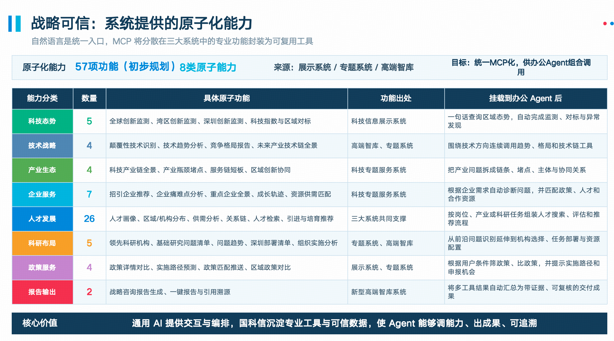
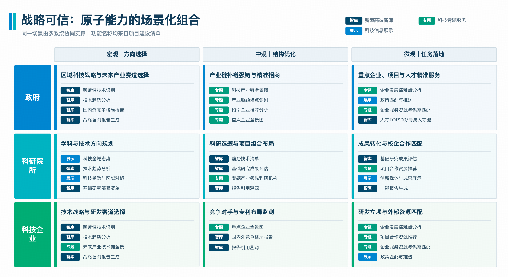
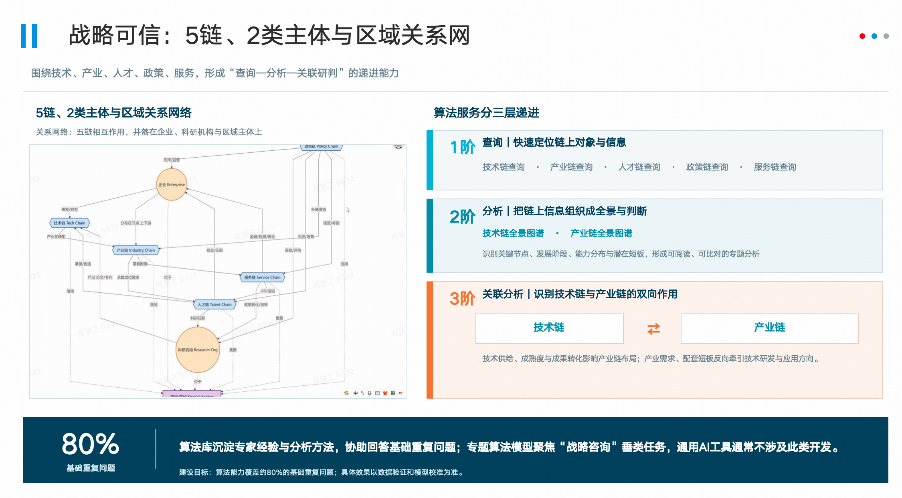

# AI战略 skill/mcp 建设方案

> 来源飞书知识库：https://zhipu-ai.feishu.cn/wiki/ST7QwCThAipGnAkbpS9cCeL4nNd  
> 对应在线文档：https://zhipu-ai.feishu.cn/docx/E1hSdnUvHoRDY6x1saqcUN3znjf  
> 入库：2026-11-13 · 目录 `08-MCP外部服务/对接文档/对端/AI战略skill-mcp建设方案/`  
> 用途：zmate + MCP 建设总计划与紧急 todo 真源之一（与 WBS 第〇节同源）。  
> 仓内另有解出副本：`德金提供的参考材料/AI战略skill_mcp建设方案.md`（图在其 `图片和附件/`）。

## 附件（飞书）

| 附件 | 说明 | 链接 |
|---|---|---|
| AI战略咨询体系V6.mov | 体系演示视频（约 248MB，**不入 git**） | https://zhipu-ai.feishu.cn/file/QtMrbHRzSoKkc8x93Bwcp8Lpnrh |
| 固态电池发展战略研究报告.docx | 第一批样板报告 | https://zhipu-ai.feishu.cn/file/FcdWbKxEUosBHNxfY0Sc5lNLneg |
| 仓内转出 md | 同上报告可读版 | [固态电池发展战略研究报告.md](../../../德金提供的参考材料/固态电池发展战略研究报告.md) |

---

## 一、背景

写好命题作文：将 AI 战略组件化封装成 mcp/skill，给个人 Agent 赋能。

---

## 二、实施与计划

| 步骤 | 工作项 | 说明和原则 |
|---|---|---|
| 1 | 确认总体建设范围 | 总体建设范围：[AI战略咨MCP清单](https://zhipu-ai.feishu.cn/sheets/C5Los0X2sh8nSHt97HeczDckn6c?sheet=jn3qMZ)；建设范围评估原则：[GKX-12-01](https://zhipu-ai.feishu.cn/file/Xy2Jb6BKMoenzbxOTZCc7tmXnh5) |
| 2 | 确认建设批次 | 建设批次：[GKX-12-02](https://zhipu-ai.feishu.cn/file/LTFFbJjXJoOQ3Ex7qvbcVQ1knnd)；首批建设方案：[GKX-12-03](https://zhipu-ai.feishu.cn/file/LOqWbZQRsoKVVtxn3z2cIyz2nrh) |
| 4 | skill/mcp 评测规范 | [GKX-12-04](https://zhipu-ai.feishu.cn/file/DIKGbv8FUo2ujwxbE85cVsVWnOf) |

| 步骤 | 工作项 | 时间安排 | 交付物 |
|---|---|---|---|
| 1 | 确认总体建设范围 | 1110 | 经供应商确认的 Skill/MCP 建设范围清单（含数据依赖、能力边界及异议处理结果） |
| 2 | 确认建设批次 | 1110 | 四批建设计划及首批三系统重点场景方案（含范围、排期和责任分工） |
| 3 | 第一批 skill/mcp 建设 | 1205 | 第一批可运行 Skill/MCP、接口文档、固态电池全流程演示版本及评测验收报告 |
| 4 | 第二批 skill/mcp 建设 | 1220 | 第二批可运行 Skill/MCP、接口文档、测试评测报告及问题整改清单 |
| 5 | 第三批 skill/mcp 建设 | 0110 | 第三批可运行 Skill/MCP、接口文档、测试评测报告及问题整改清单 |
| 6 | 第四批 skill/mcp 建设 | 0125 | 第四批可运行 Skill/MCP、接口文档、总体评测验收报告及完整交付清单 |

---

## todo

1. 各系统负责人根据实际情况，评估建设 skill 和 mcp 建设范围 **1110**
   1. skill/mcp 的技术标准 @李瑞 **1111**
   2. 每个 skill 需要根据实际业务场景，制定评测标准 @淮政玮，出个草稿讨论一下 **1112**
      - 业务指标：通用标准 / 纯业务标准
      - 技术指标
      - 用户反馈
2. 实际场景：固态电池
   1. 基于 1 的结果，围绕「固态电池战略报告」确定第一批相关的 skill 和 mcp 的建设范围 **1112**（能接受使用私有数据把完整流程跑起来 MVP），可参考 [GKX-12-02](https://zhipu-ai.feishu.cn/file/LTFFbJjXJoOQ3Ex7qvbcVQ1knnd)
   2. 根据 a，梳理高优先级的数据需求，同步给大项目组（刘斌）**1113** @李瑞
   3. 把固态电池的战略报告的目录，输出一个权威的 @闫德金 **1112**
3. 根据 1、2，标注 skill/mcp 的一阶、二阶、三阶 **1120**  
   （三阶可以少，但不能没有）  
   一阶、二阶是通用能力、三阶特定领域
4. 搭建一套 WBS 进行过程管理

---

## 与当前仓落地对照（入库补记）

| 方案项 | 现状 |
|---|---|
| 技术标准 @李瑞 | [Skill与MCP技术标准-草稿](../../我方/Skill与MCP技术标准-草稿v0.1.md) · 飞书 [MCP Skills 技术规范](https://zhipu-ai.feishu.cn/docx/IuTyd49PRoPC2axET7JcWOwsnAd) |
| 评测标准 @淮政玮 | [业务场景评测标准](../../我方/业务场景评测标准-草稿v0.1.md) · 飞书 [SKILL和MCP_业务场景评测标准](https://zhipu-ai.feishu.cn/file/SeyQbCvRcoekl1xf3EucjoyKnxd) |
| 一二三阶标注 | [阶标注草稿](../../我方/Skill-MCP一二三阶标注-草稿v0.1.md) |
| WBS | [WBS.md](../../../WBS.md) |
| 报告骨架/质检 | [顶尖战略报告结构与评价方法](../2026-11-13-顶尖战略报告结构与评价方法.md) · [源报告收集](../行业前沿市场认可战略报告收集/) |
