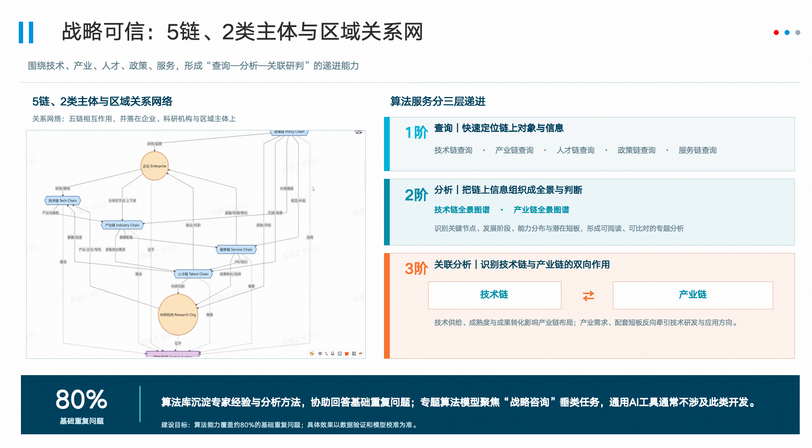

# AI战略skill/mcp建设方案

# 一、背景：

写好命题作文：将AI战略组件化封装成mcp/skill，给个人Agent赋能

[AI战略咨询体系V6\.mov](图片和附件/AI战略咨询体系V6.mov)

[固态电池发展战略研究报告\(AI战略咨询 新型高端智库系统生成\)\(3\)\(2\)\.docx](图片和附件/固态电池发展战略研究报告%28AI战略咨询%20新型高端智库系统生成%29%283%29%282%29.docx)

# 二、实施与计划：

|步骤|工作项|说明和原则|
|---|---|---|
|1|确认总体建设范围|- 总体建设范围：[AI战略咨MCP清单](https://zhipu-ai.feishu.cn/sheets/C5Los0X2sh8nSHt97HeczDckn6c?sheet=jn3qMZ) - 建设范围评估原则：[GKX\-12\-01\_Skill与MCP建设范围公示及确认\.md](https://zhipu-ai.feishu.cn/file/Xy2Jb6BKMoenzbxOTZCc7tmXnh5)|
|2|确认建设批次 |- 建设批次：[GKX\-12\-02\_Skill四批建设计划\.md](https://zhipu-ai.feishu.cn/file/LTFFbJjXJoOQ3Ex7qvbcVQ1knnd) - 首批建设方案：[GKX\-12\-03\_首批三系统重点场景建设方案\.md](https://zhipu-ai.feishu.cn/file/LOqWbZQRsoKVVtxn3z2cIyz2nrh)|
|4|skill/mcp评测规范|[GKX\-12\-04\_Skill统一评测与验收规范\.md](https://zhipu-ai.feishu.cn/file/DIKGbv8FUo2ujwxbE85cVsVWnOf)|

|步骤|工作项|时间安排|交付物|
|---|---|---|---|
|1|确认总体建设范围|1110|经供应商确认的Skill/MCP建设范围清单（含数据依赖、能力边界及异议处理结果）|
|2|确认建设批次 |1110|四批建设计划及首批三系统重点场景方案（含范围、排期和责任分工）|
|3|第一批skill/mcp建设 |1205|第一批可运行Skill/MCP、接口文档、固态电池全流程演示版本及评测验收报告|
|4|第二批skill/mcp建设|1220|第二批可运行Skill/MCP、接口文档、测试评测报告及问题整改清单|
|5|第三批skill/mcp建设|0110|第三批可运行Skill/MCP、接口文档、测试评测报告及问题整改清单|
|6|第四批skill/mcp建设|0125|第四批可运行Skill/MCP、接口文档、总体评测验收报告及完整交付清单|

todo：

1. 各系统负责人根据实际情况，评估建设skill和mcp建设范围 1110 

    1. skill/mcp的技术标准 @李瑞1111

    2. 每个skill需要根据实际业务场景，制定评测标准 @淮政玮，出个草稿讨论一下 1112

        1. 业务指标：

            1. 通用标准

            2. 纯业务标准

        2. 技术指标：

        3. 用户反馈：（）

2. 实际场景：固态电池

    1. 基于1的结果，围绕“固态电池战略报告”确定第一批相关的skill和mcp的建设范围  1112 （能接受使用私有数据把完整流程跑起来MVP），可参考[GKX\-12\-02\_Skill四批建设计划\.md](https://zhipu-ai.feishu.cn/file/LTFFbJjXJoOQ3Ex7qvbcVQ1knnd) 

    2. 根据a，梳理高优先级的数据需求，同步给大项目组（刘斌）1113 @李瑞

    3. 把固态电池的战略报告的目录，输出一个权威的 @闫德金1112

3. 根据1、2，标注skill/mcp的一阶、二阶、三阶 1120

（三阶可以少，但不能没有）

一阶、二阶是通用能力、三阶特定领域

4. 搭建一套WBS进行过程管理 

