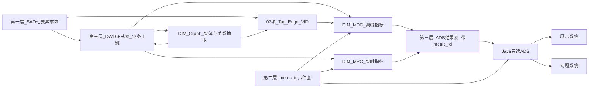

# 方案框架 · 基于本体论的数据治理 v0.1

| 项 | 内容 |
|---|---|
| 版本 | v0.1 · 框架讨论稿 |
| 日期 | 2026-11-13 |
| 主责 | human:李瑞、human:徐滕强 |
| 起草 | agent:architect（按用户 2026-11-13「1C + 2A」裁定起草） |
| 状态 | **讨论稿，未会签**。会签人名单待定（见第八节）。签收前不是已定方案，不得据此派开发叶 |
| 交付范围 | 本框架 + [附录-POLICY试点对照表](./附录-POLICY试点对照表.md) + [附录-EntityMetric索引模板](./附录-EntityMetric索引模板.md) |

本文是框架级文件：写规则、边界和写作契约，不写各域的完整技术方案。路径一律链接，不复制原文。

---

## 一、问题与反模式

项目里同时有专题系统的七要素分析、展示系统的各菜单、GDF 数据治理、燕大的图谱引擎、科学数据资源、主题数据中心的运营维护。每一块都会产出「数字」。如果各块各自建表、各自写公式，交付后会出现三类典型问题：

| 反模式 | 表现 | 后果 |
|---|---|---|
| 同名不同口径 | 展示和专题都显示「政策总数」，一个算国内国际合计，一个只算国内 | 评审现场两个数对不上，无法解释哪个对 |
| 各系统自算 | 前端或 Java 在页面里自己 `COUNT`、自己加权；算法服务另算一份写到自己的表 | 同一个 `metric_id` 有两套公式，改口径只改了一处 |
| 无法审计 | 数字旁边没有身份证；源表写的是供应方库，中间加工没有落表 | 甲方问「这个数从哪来」时只能凭记忆回答 |

第三类问题已经由 D9《数据血缘规约》部分解决（每个统计数字旁有 ⓘ，可查八件套）。但 D9 只管「指标」这一层。它没有规定：指标描述的对象是哪个实体、这个实体的主键在每一层叫什么、图上的点和表里的行如何对上。本框架补的就是这一段。

## 二、目标与非目标

**目标**：

1. 每个要素的数据都挂在唯一的真源实体上，实体的语义只有一处定义。
2. 每个统计数字都有唯一的 `metric_id`，口径只有一处定义。
3. 每个 `metric_id` 只有一张 ADS 结果表承载它的数值，各系统只读这张表。
4. 三层之间用 ID 互相引用，从页面上任何一个数字都能走回实体和源表。

**非目标**（明确不做）：

- 不重做 GDF 加工拆法。三包 `{DIM}-MDC`（离线调度指标）、`{DIM}-Graph`（实体识别、关系抽取、上图）、`{DIM}-MRC`（用户触发的实时指标）照旧，见 [拆解思路](../06-GDF数据治理集成/对接文档/工程侧/2026-10-26-要素指标加工与图谱拆解思路.md)。
- 不嵌图谱管理界面，不建本体编辑器。
- 不另建 Ontology Catalog，不建第二套实体类型表，不建本体库。
- 不改 Nebula schema；Tag / Edge / VID 以第 07 项已签收件为准。
- 不改 GDF 派单包、指标 seed、就绪度矩阵。发现的不一致只登记缺口，由各自 owner 按原流程改。

## 三、三层真源（2A 铁律）

「本体」在本项目里不是一个新系统，而是把已有的三份真源钉死，规定谁说了算。

| 层 | 管什么 | 真源 | 维护方 |
|---|---|---|---|
| 第一层 实体与关系 | 有哪些实体类型、实体之间有哪些关系、产业链是底图 | 跨系统知识图谱 SAD：「一张七要素本体，产业链为底图；展示与专题只读同一张图，禁止第二套本体」。见 [SAD INDEX](../../../agent-handoffs/产品整体定义/跨系统-知识图谱/INDEX.md) 与 [01-系统分析](../../../agent-handoffs/产品整体定义/跨系统-知识图谱/01-系统分析.md) §5、§6。物理落地（Tag 名、VID 前缀、必须边 M01～M24）以第 07 项已签收件为准 | 架构 + 算法；物理层燕大 |
| 第二层 指标身份证 | 每个统计数字叫什么、口径、公式、算法类型、源表、更新频率、版本 | D9 八件套 + 全局 `metric_id`。见 [data-lineage-policy.md](../../../data-lineage-policy.md) §2、§3。查询只经 MCP `metric-registry` | 口径主责 + 算法 lead + data-agent |
| 第三层 业务主键与落表 | 实体在表里的主键、指标数值落在哪张表 | 各域 DWD 正式表主键 → ADS 结果表。DWD / ADS 的表名和主键以各域现行 GDF 派单包为准（政策见 [17 POLICY-MDC](../../../data/GDF/派单包/政策/GDF-POLICY-WORKPACK-v2/17-指标离线加工-POLICY-MDC.md)） | 数据 lead + GDF |

配套铁律（沿用团队公约，不另立）：Java 只读 ADS；前端只调 Java；算法只在 Python；禁止页面或任何系统自算第二套数。

### 3.1 冲突裁决表

三层各管一件事。出现冲突时按下表裁决，不在会上临时商量谁大。

| 冲突类型 | 例子 | 听谁 | 处理 |
|---|---|---|---|
| 实体冲突 | 「创新载体」是不是独立实体；论文是点还是属性 | 第一层：SAD 本体 | SAD 未定的格（标「算法补」）不得由下游自行新增实体类型；登记待决，必要时进客户决策清单 |
| 关系冲突 | 政策与产业环节的关联是图上的边还是表里的行 | 第一层定语义；第 07 项必须边清单定是否上图 | 不上图的关系仍落 DWD 关系表（如 `policy_industry_rel`），不另造边表 |
| 口径冲突 | 两个页面对「政策总数」的范围理解不同 | 第二层：`metric_id` 八件套 | 同一业务口径只有一个 `metric_id`；口径确有不同则另起 `VARIANT`，不复用旧 ID |
| 数值冲突 | 展示和专题显示的同一 `metric_id` 数值不同 | 第三层：ADS 落表 | 以 ADS 当批 `calc_batch_id` 的值为准；读面不一致按缺陷处理，查读面是否自算 |
| 主键冲突 | DWD 唯一键与图上 VID 拼法不一致 | 第三层 DWD 主键为业务键；VID 由它拼出 | VID 规则由第 07 项裁定，必须能从 DWD 主键无损还原 |

### 3.2 三层之间怎么互相引用 ID

每一层只存「指向别层的 ID」，不复制别层的内容。

| 从 | 到 | 引用方式 |
|---|---|---|
| 指标（八件套） | 实体 | 八件套 `source_tables[]` 写到 DWD 正式表；对象范围写在 `definition` 里，用 SAD 的实体类型名 |
| 指标（八件套） | 落表 | ADS 行上带 `metric_id` 列与 `calc_batch_id` 列；一张 ADS 表可承载多个 `metric_id`，替换时只删本指标的行 |
| ADS 行 | 实体 | 实体粒度的结果行带 DWD 业务主键（如 `policy_id`）；汇总粒度的行带分组键（如 `level`、`province`） |
| 图上的点 | DWD 实体 | VID = 第 07 项裁定的前缀 + DWD 业务主键（政策现网为 `pol:{policy_id}`） |
| 图指标 | 边 | 边只在 `{DIM}-Graph` 生产；MDC 读边再算度类指标，不平行建第二张边表 |
| 页面数字 | 指标 | ⓘ 按 `metric_id` 查八件套；数值来自 Java 读 ADS |

图中 `GRAPH --> DWD` 表示抽取出的关系先落本要素的 DWD 关系表，再经图谱引擎 API 增量上图。`TAG --> MDC` 表示度类图指标等边落地后由 MDC 读边计算。

## 四、各 Team 写作契约

每个 Team 的方案（无论叫技术方案、详设还是派单包）都必须有一节「本体挂接」，至少写明下表五列。写不出来的格写「待查」或「不涉及」并说明理由，不得留空。

| Team | 引用哪些实体类型 | 引用哪些 `metric_id` | 结果落哪张 ADS | 加工包 | 禁止自算项 |
|---|---|---|---|---|---|
| 专题系统七要素 | 本要素对应的 SAD 七要素之一，及其挂接的产业环节 | 本要素 `calc-logic/{DIM}/README.md` 全量 | 各域 GDF 派单包的 ADS 清单 | MDC / Graph / MRC 三包都要列归宿 | 页面加权、页面排名、Java 汇总 |
| 展示系统 | 页面上出现的实体（只读引用，不新增） | 页面每个统计数字的 `metric_id` | 不写 ADS，只列读哪张 | 不涉及（消费方） | 任何前端或 Java 侧公式；同一 `metric_id` 与专题不同的筛选默认值 |
| GDF 数据治理 | 本包覆盖的实体及其 DWD 主键 | 本包 MDC 第一批与口径未闭合名单 | 派单包 `14` 类 ADS DDL | 三包按拆解思路 | 在 CDC / SeaTunnel 里另写实体或关系规则 |
| 图谱（燕大） | SAD 七要素对应的 Tag，及第 07 项必须边 | 图类指标（`algorithm_type=GRAPH`）的输入边 | 图指标结果落 ADS 或离线 JSON，按第 07 项已签收件 | Graph（上图）；度类指标交 MDC | 自定点类型；用名称当 VID；从图上重算业务统计数 |
| 科学数据资源 | 能挂七要素的对象挂七要素；挂不上的标 M（纯指标或检索） | 资源统计类数字也要有 `metric_id` | 待查（供方未定） | 待查 | 自建与七要素平行的「资源本体」 |
| 主题数据中心运营维护 | 运营对象（主题库、接口、调用量）只作 M，不作实体类型 | 运营指标若上页面也要有 `metric_id` | 待查 | 待查 | 用运营统计替代业务指标；自建第二份指标目录 |

表外说明：

- 「引用实体类型」写 SAD 的中文名（企业、产业链与产业环节、科研机构、技术、人才、服务机构、政策），再写物理 Tag 名与 VID 前缀。SAD §6 把论文、专利、项目、仪器等口语对象映射为属性或 M，不得在本节新增为实体类型。
- 科学数据资源（展示 DS-17～20）在 SAD 里默认不扫全。本框架只要求它不另造本体，是否纳入第一批由第八节待决。现有材料见 [能力对照-科技数据资源-科学数据中心](../05-展示系统集成/能力对照-科技数据资源-科学数据中心.md) 与 [第 09 项](../09-跨团队集成信息收集/README.md)。
- 「主题数据中心运营维护」在仓内没有找到同名文件，Team 边界待确认。
- 每个 Team 照抄 [附录-EntityMetric索引模板](./附录-EntityMetric索引模板.md) 填自己的索引。

## 五、与第 05、06、07 项及 D9 的边界

| 对象 | 归属 | 本框架只做 |
|---|---|---|
| 第 05 项 展示系统集成 | 菜单对接、页面排期、多方对接 | 规定展示读面只读 ADS，同一 `metric_id` 与专题一致 |
| 第 06 项 GDF 数据治理集成 | DWD 之后的 MDC / Graph / MRC 施工与派单包 | 规定三包产出必须挂 DWD 主键与 `metric_id` |
| 第 07 项 图数据库集成 | 读图、查图、Tag / Edge / VID 物理定义、必须边 | 引用其裁定，不改 schema，不重写抽取规则 |
| D9 数据血缘规约 | 八件套字段、D1～D4 定义、UI 角标 | 只引用。本框架不给八件套加字段，实体挂接写在索引里而不是 seed 里 |
| 客户决策清单 | 业务口径 | 口径未闭合的指标只登记，不建表、不灌数、不发布 |

## 六、落地节奏

| 阶段 | 时点 | 内容 | 产物 |
|---|---|---|---|
| 一 框架与试点 | 2026-11-20（内部需要日） | 本框架 v0.1 + 政策试点对照表 + 索引模板 | 本目录三份文件 |
| 二 会签 | 待定 | 主责与会签人评审三层真源与冲突裁决表；待决事项逐条出结论 | 会签记录，版本升 v0.2 或 v1.0 |
| 三 各域填索引 | 会签后，日期待定 | ENT、CHAIN、SVC、人才、技术、科研机构等按模板填索引；暴露的缺口回各域 owner | 各域索引表 |
| 四 DoD 强制 | 会签后新开发叶 | 新开发叶的 DoD 必须挂 `metric_id` 与实体主键（DWD 主键或 VID） | 写入派单模板（是否写入由 PM 定） |

第二阶段之前，本框架不约束已在执行的叶。

## 七、验收口径

1. **读面一致**：同一个 `metric_id`，在展示与专题的读面上数字一致。允许一方为空态（未接入、未授权），但禁止出现第二个公式算出的不同数。
2. **可回溯**：页面数字旁的 ⓘ 能按 `metric_id` 查到八件套；八件套 `source_tables` 能指到 DWD 正式表；DWD 主键能对到图上 VID 或 ADS 行。
3. **口径未闭合不发布**：挂未关闭客户决策项的指标，不以正式数发布；临时默认要在结果上写明限定（如「仅计国内」）。
4. **同表多指标不互删**：一张 ADS 承载多个 `metric_id` 时，替换只删本指标行。

验收方法（谁出对拍脚本、按什么频率核）待定，见第八节。

## 八、待决事项（只列，不拍板）

以下事项需要主责或会签人给出结论；涉及业务口径的仍走客户决策清单。

| # | 事项 | 建议由谁定 |
|---|---|---|
| 1 | 第一层真源 SAD 仍是 v0.3-draft、未会签。本框架以它为实体真源，是否先推动 SAD 01 卷会签 | 李瑞、徐滕强；SAD 会签人 |
| 2 | 实体类型的「编号级」以谁为准：SAD 七要素中文名、第 07 项必须边 M01～M24 与 Tag 名、燕大需求清单 v1.1 的 14 实体。三份并存时各自定位如何写 | 架构 + 燕大对口 |
| 3 | 实体主键跨层规则：政策 DWD 唯一键是 `(source_plane, policy_id)`，图上 VID 是 `pol:{policy_id}`，国内国际同号时是否冲突 | 数据 lead + 第 07 项 |
| 4 | 八件套 `source_tables` 现写供应方表（如 `dwd_policy_base`），是否统一改指项目 DWD 正式表（如 `policy_base_info`），由谁正式化 | 数据 lead + data-agent |
| 5 | D1=`aligned` 与未关闭决策项并存（政策多条挂 QPOL-0x 或 `GAP-ALGO-TYPE-UNSIGNED` 仍为 aligned），是否需要 D9 owner 复核 | D9 维护方（架构 + 数据 lead + PM） |
| 6 | 不上图的关系（如政策—产业环节 `policy_industry_rel`）是否在本体里登记为「表承载的关系」 | 架构 + 算法 |
| 7 | 科学数据资源、主题数据中心运营维护是否纳入第一批；后者的 Team 边界与对口人 | 主责 + PM |
| 8 | 读面一致的验收由谁出对拍脚本、在哪个环境核 | QA 监管人 |
| 9 | 是否建方案任务、任务名、会签人名单 | PM |
| 10 | 新开发叶 DoD 强制挂 `metric_id` 与实体主键，是否写进派单模板 | PM + coordinator |
