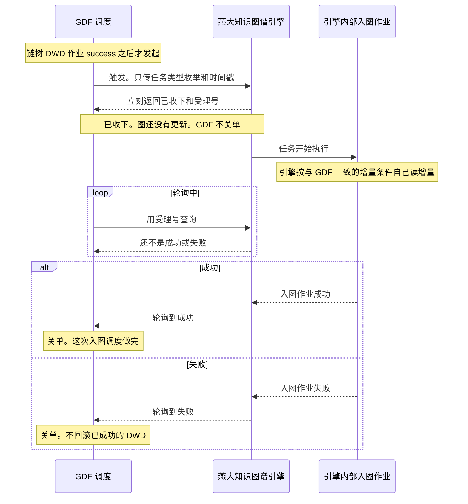

# GDF 与知识图谱引擎 · 调度转发接口设计

> **任务**：`GDF-GRAPH-SCHED-CONTRACT-L01`（`definition`）  
> **日期**：2026-11-02  
> **读者**：GDF 产线、燕大知识图谱引擎、我方架构  
> **状态**：详细设计。调度转发还没有跑通。不关闭 `SYSINT-SCHEME-06-L01`、`SYSINT-SCHEME-07-L01`。  
> **会签**：`draft`。本文不代替那两份集成方案的签收。  
> **图**：`SYSINT-GDF-GRAPH-SCHED-SEQ`。不改 `SYSINT-SCHEME-06-SEQ`、`SYSINT-SCHEME-07-SEQ` 的节点。

本文把 2026-11-02 已经锁定的基本方案写成可以照着对接的步骤。口径以锁定的四条为准。现有接口文档对不上这四条的地方，写成「还没有」或「待燕大配置」，不编成已经能调的字段。

同一段契约摘要和同一张时序图写入：

- `agent-delivery/工程过程/04-系统集成/06-GDF数据治理集成/技术方案.md` 的 §2.2 与 §2.3
- `agent-delivery/工程过程/04-系统集成/07-图数据库集成/技术方案.md` 的 §2.2 与 §2.3

五处文字相同，不各写一套。

## 1. 参与方

| 参与方 | 是谁 | 在这次对接里做什么 | 不做什么 |
|---|---|---|---|
| GDF 调度 | GDF 数据中台的作业调度 | 链树 DWD 作业 `success` 之后，向引擎发起一次调度转发；之后用受理号轮询，到成功或失败才关单 | 不跑入图脚本，不写 Nebula，不直连 graphd，不判断图里的增量水位 |
| 燕大知识图谱引擎 | 知识图谱引擎平台上已经配好的调度入口 | 收下转发，立刻返回已收下和受理号，并启动内部入图作业；按受理号回答轮询 | 不要求 GDF 再传表名、图空间、脚本路径、schemaId、definition id、schedule id |
| 引擎内部入图作业 | 引擎上已经配好的入图调度任务，在引擎自己的运行环境里执行 | 独立读取增量数据，增量判断与 GDF 一致，写入正式图空间 | 不暴露给 GDF 当成本地脚本；GDF 不登录引擎机器去跑 `script/` |

正式图空间名是 `gkx_chain`。这是引擎内部作业的目标，不是 GDF 这次请求的必传字段。具体调度任务号、definition id 由燕大配置后线下给，不写进 git。

企业维入图不在本接口里当成已经能调。企业包现网仍是飞书值班，见企业入图包 `06-GDF触发契约.md`。

## 2. 锁定的四条基本方案

2026-11-02 用户锁定。详细设计不得改这四条。

1. GDF 和知识图谱引擎平台只通过「任务调度转发」接口通讯。
2. 实际的入图调度任务在知识图谱引擎平台完成。
3. 引擎收到任务后，独立读取增量数据。增量判断条件与 GDF 一致。
4. GDF 发起时只传两项：任务类型枚举、时间戳。不另加必传字段。

由此直接排除的传参：表名、图空间、脚本路径、schemaId，以及 definition id、schedule id。这些可以存在于引擎自己的配置里，但不能变成 GDF 发起时必须带上的字段。

## 3. 契约摘要（五处原文相同）

#### 入图调度转发

本段在 `agent-delivery/工程过程/04-系统集成/GDF-GRAPH-SCHED-CONTRACT-L01-调度转发接口设计.md`、`agent-delivery/工程过程/04-系统集成/06-GDF数据治理集成/技术方案.md` 的 §2.2 与 §2.3、`agent-delivery/工程过程/04-系统集成/07-图数据库集成/技术方案.md` 的 §2.2 与 §2.3 五处原文相同。还没有跑通。

GDF 调度在链树 DWD 作业 `success` 之后，调用燕大知识图谱引擎。引擎再启动自己的内部入图作业。GDF 不调用入图脚本。

触发：GDF 调度把任务类型枚举和时间戳两项交给引擎。不传表名、图空间、脚本路径、schemaId，也不传 definition id、schedule id。引擎立刻返回两件事：已经收下，以及一个受理号。内部入图作业这时开始执行。收下只说明任务已经开始，图还没有更新，GDF 不关单。

轮询：GDF 调度用受理号反复向引擎查询。查询还不是成功或失败时，称为轮询中，单子继续开着。查询到成功，GDF 关单，这次入图调度做完。查询到失败，GDF 关单，不回滚已经 `success` 的 DWD，也不把图说成已经更新。

枚举字面值在详细设计第 5 节给定。闭集是 `enterprise_point`、`enterprise_supply`、`enterprise_parent_sub`、`industry_segment`、`industry_depends_on`、`industry_participates`、`service_org_point`、`policy_point`、`policy_cite`。GDF 一次只传其中一个。本版实际转发只有 `industry_segment`：`gkxlumenx_dwd.industry_chain_node` 当天 Wave B `success` 之后一次，引擎内部写正式空间 `gkx_chain` 的 Tag `segment`。其余字面值已编号，企业三支现网仍是飞书值班，服务机构与政策还没有入图触发契约，`industry_depends_on` 与 `industry_participates` 本版不发起。科研机构、技术、人才不分配枚举。definition id、schedule id 仍不进 git。

时间戳：字段名、格式、时区都还没有。它不是入向量库回执里的 `index_version`，也不是未上线 Java 路径里的 `dwd_success_at`。

增量：必读文档里没有水位列名，也没有 cron。原则是与 GDF 一致，由引擎自己判断要读哪些增量。GDF 不在这次请求里带水位列。

受理号：这就是锁定口径里说的「任务号」，GDF 只拿它去轮询。它不叫任务中心任务号。任务中心任务号形如 `PI-…`，只在禁止使用的 §2.7 方式 A 里出现。受理号是不是执行号 `EXEC-…`，还没有对应。方式 B 会返回执行号，但不创建任务中心任务号，而且请求形状对不上「只传枚举和时间戳」。现有执行记录查询不会把运行中更新成成功或失败，所以用现有 HTTP 还轮询不到终态。

禁止配进 GDF 的 DAG：`POST /api/v1/task-center/trigger`；`POST /internal/v1/chain/graph/project`；`POST /chain/v1/graph/jobs/{job}/sync`（Java 受理，未上线）；在 GDF 节点跑 `script/` 入图实现；写 Nebula；直连 graphd。

```yaml
diagram_id: SYSINT-GDF-GRAPH-SCHED-SEQ
signoff_status: draft
```



### 编写示例（企业维度）

下例只写在本详细设计、这张时序图下面，不复制进两份集成方案里那五处相同的摘要。它用来看清同一张图落到企业维时，各方各写什么。企业维现网仍是飞书值班。本例不表示转发入口已经能调，也不配进 GDF 的 DAG。枚举字面值、时间戳字段名仍是还没有，下面用中文占位，不编 HTTP 字段，也不把未上线 Java 路径里的作业名当成枚举。

企业点这一次，按图上的顺序写。供给边、母子边各是另一次转发，不并进同一次请求。

**前置。** `gkxlumenx_dwd.enterprise_base` 当天 Wave B 作业 `success` 之后，GDF 调度才发起。表失败、没跑、只做完贴源，都不发起。

**触发。** GDF 调度交给燕大知识图谱引擎的只有两项：

| 项 | 本例怎么写 | 本例不写进请求 |
|---|---|---|
| 任务类型枚举 | 「企业点入图」。字面值待燕大配置，不进 git。不把未上线 Java 的 `enterprise_vertex` 写成枚举 | 表名 `enterprise_base`、图空间 `gkx_chain`、VID 规则、脚本路径、schemaId、definition id、schedule id |
| 时间戳 | 跟着这次 DWD `success` 交出去的那个时刻，供引擎自己判断增量。格式、时区还没有，不写成 `dwd_success_at` | 水位列名、cron |

**立刻回执。** 引擎返回已收下，并给出这一次的受理号。内部入图作业开始。GDF 不关单。图还没有更新。受理号不编成 `PI-…` 或 `EXEC-…`。

**引擎内部自己做。** 这些不出现在 GDF 的请求里。引擎按已经配好的企业点调度任务，用与 GDF 一致的增量条件自己读 `enterprise_base`，写入正式空间 `gkx_chain` 的 Tag `enterprise`，VID `ent:{org_id}`。

**轮询。** GDF 只用这个受理号查。还不是成功或失败时，称为轮询中，单子继续开着。轮询到成功，GDF 关单，这次企业点入图做完。轮询到失败，GDF 关单，不回滚已经 `success` 的 `enterprise_base`，也不把图说成已经更新。

**后两支分开写。** 企业点这一次关单成功之后，才允许另两次转发。每一次仍然只传枚举和时间戳，各自换一个受理号。企业点还没成功，这两次不发起。

| 另一次转发 | 何时发起 | 枚举在本例里表示 | 引擎内部写入（不进 GDF 请求） |
|---|---|---|---|
| 供给边 | `gkxlumenx_dwd.enterprise_supply_chain` 当天 Wave B `success`，且企业点已关单成功 | 供给边入图。字面值待燕大配置 | Edge `supply`，企业 → 企业 |
| 母子边 | `gkxlumenx_dwd.enterprise_parent_subsidiary` 当天 Wave B `success`，且企业点已关单成功 | 母子边入图。字面值待燕大配置 | Edge `parent_sub`，母公司 → 子公司 |

`enterprise_cooperation`、`enterprise_industry_chain`、`enterprise_invest` 本版不写进示例，不分配枚举。

## 4. 一步一步：谁调用谁

下面按时间顺序写。每一步都写明调用方、被调用方、立刻能看到什么、怎样才算这一步做完。路径只作对照，不代替这几句中文。

### 4.1 前置：DWD 先成功

谁做完：GDF 自己的链树 DWD 作业。  
什么叫做完：该作业当天状态是 `success`。  
没做完会怎样：作业失败、没跑、只做完贴源，都不发起调度转发。

产业链第一批只认 `gkxlumenx_dwd.industry_chain_node` 的当天 Wave B `success`。这与产业链入图包 `06-GDF触发契约.md`、贴源包 `12` §5.1 一致。`12` 把这一步放在每日批 `CHAIN-B1-TREE` 的 `success` 之后。

### 4.2 触发

谁调用谁：GDF 调度调用燕大知识图谱引擎的调度转发入口。  
GDF 交出什么：任务类型枚举、时间戳。只有这两项。  
引擎立刻返回什么：已收下，以及受理号。内部入图作业开始执行。  
什么叫做完：GDF 已经拿到受理号，并把这次转发记成「已开始」。这不是关单。图还没有更新。

引擎收到后自己去读增量，不回头向 GDF 要表名或水位列。

### 4.3 轮询中

谁调用谁：GDF 调度用受理号调用燕大知识图谱引擎的状态查询。  
引擎立刻返回什么：当前还不是成功，也还不是失败。  
什么叫做完：这一次查询做完了，单子仍开着。GDF 过一段时间再查。不把「已收下」「正在跑」写成图已经更新。

### 4.4 成功

谁调用谁：仍是 GDF 调度查询引擎。引擎侧的内部入图作业已经成功，查询才能给出成功。  
引擎立刻返回什么：成功。  
什么叫做完：GDF 把这次调度关单为成功。这时才表示本次入图调度做完，图按这次作业更新。

关单之后要不要跑入向量库，按产业链贴源包 `12` §5.4，由 GDF 自己的下一步作业处理。那一步不在本次转发的请求里，也不调用我方 HTTP。

### 4.5 失败

谁调用谁：仍是 GDF 调度查询引擎。  
引擎立刻返回什么：失败。  
什么叫做完：GDF 把这次调度关单为失败。已经 `success` 的 DWD 保持原样，不回滚。不跑入向量库脚本。不把图说成已经更新。

## 5. 任务类型枚举

枚举表示「引擎上哪一类已经配好的调度任务」。GDF 只传枚举。引擎用燕大线下配置的对照，找到自己平台上已经配好的那一个调度任务，再启动它。对照表不进 git。definition id、schedule id 都不作为 GDF 的必传字段。

| 业务 | 何时由 GDF 转发 | 引擎内部写入（已有文档能确定的） | 枚举字面值 |
|---|---|---|---|
| 环节点入图 | `gkxlumenx_dwd.industry_chain_node` 当天 Wave B `success` 之后，转发一次 | 正式空间 `gkx_chain`，Tag `segment`，VID `segment:{node_id}`。同一次识别若带出链，不把链写入图 | 待燕大配置，不进本文 |
| 链、环节关系、企业到环节 | 本版不触发 | `industry_chain` 写出的是 Tag `chain`。`industry_chain_node_rel` 的正式行是 `parent_child`，不能当成 `depends_on`。`industry_chain_entity_rel` 要等企业点先在 `gkx_chain` 上 | 不分配 |
| 企业点、供给边、母子边 | 不走本接口当成已经能调 | 企业入图包仍是飞书或工单交接 | 不在本文给出 |

未上线的 Java 路径里，`job` 曾写成 `segment_vertex`。那是 Java 受理路径上的作业名，不是引擎调度转发的枚举。本文不把它当成已经能传的枚举值。

「待燕大配置」的交付方式：燕大在引擎上配好环节点入图的调度任务之后，线下把「枚举字面值 → 该调度任务」告诉 GDF。配置正文不进 git，也不写进本文。

## 6. 时间戳

锁定要求 GDF 发起时带一个时间戳，和枚举一起，一共两项。

对照现有文档，没有一个已经能调、而且只接收这一项的时间字段：

| 现有写法 | 出现在哪 | 和本次时间戳的关系 |
|---|---|---|
| `since` | 《亿级科技知识图谱API文档》§2.7 方式 A。可选。说明是增量游标或时间，当前未强制格式。示例形如 `2026-08-01 00:00:00` | 方式 A 禁止使用。不能把 `since` 写成这次已经能传的字段名 |
| 方式 B 的 `payload` | §2.7 方式 B。自由对象，没有名为时间戳的必填字段 | 请求形状对不上「只传枚举和时间戳」 |
| Schedule 立即触发 | §3.9 `POST /api/v1/workflow-system/schedules/{schedule_id}/trigger`。无 Body | 接不住时间戳，还要求路径上的 schedule id |
| `dwd_success_at` | 产业链入图包 `06` 的 Java 目标请求，示例 `2026-11-02T03:10:00+08:00` | 该 Java 路径未上线，禁止配进 DAG。不把它当成引擎字段 |
| `index_version` | 贴源包 `12` §5.2，`yyyyMMddHHmmss` | 这是入向量库脚本成功后的回执，问 11 写明不从入图调度任务里取 |

因此：时间戳的字段名、格式、时区都还没有。

它的作用只按锁定口径理解：交给引擎，让引擎按与 GDF 一致的增量条件自己判断这次要读哪一段。本文不规定它等于某个水位列，也不规定时区写法。

## 7. 增量条件如何与 GDF 一致

原则：增量判断条件与 GDF 一致，由引擎收到任务后自己判断、自己读。GDF 不在转发请求里描述水位。

在本文必读材料里能找到的，只有触发门槛，没有读增量用的列：

- 贴源包 `12` §2、§5.1、§5.4：Wave B / 链树 DWD `success` 之后才触发，轮询到成功才进入后面的入向量库。
- 产业链入图包 `06`：只在 `industry_chain_node` 当天 Wave B `success` 之后触发。失败、没跑、只做完贴源，都不触发。
- 问 8：引擎自己的调度任务内部做入图。GDF 只转发和接收结果。
- 《亿级科技知识图谱API文档》§2.7 的 `since` 写过「增量游标或时间」，但属于禁止使用的方式 A，而且未强制格式。
- GDF 集成方案 §2.1～§2.3、图数据库集成方案 §2.1～§2.3：没有水位列名，图数据库方案写明本文不写 cron。

水位列名还没有。cron 还没有。本文不补一个列名，也不写 cron 表达式。

引擎内部入图作业读哪些 DWD 行，按该调度任务在引擎上的既有配置。配置由燕大维护。GDF 只保证：没到 DWD `success` 不转发；转发时带上第 6 节那个尚未定格式的时间戳。

## 8. 触发请求与立刻回执

### 8.1 锁定行为

GDF 调度发起一次调用。请求里只有任务类型枚举和时间戳。  
引擎在这次 HTTP 返回里同时做完两件事：告诉 GDF 已经收下，给出受理号。返回之后，内部入图作业已经开始，不等到图写完才返回。

立刻回执里至少要让 GDF 分得清：

| GDF 此时知道的 | 含义 |
|---|---|
| 已收下 | 引擎接受了这次转发，内部作业已开始 |
| 受理号 | 后面轮询只用这个号 |
| 还不知道 | 图是否已经更新。收下不等于更新 |

忙、拒绝、调度服务不可用，都不是已收下。这类回执不进入「轮询到成功」的路径，GDF 不关成成功。现有文档里的 `QUEUED`（Temporal 不可用、只保存本地待下发）按 §2.7、§2.11 的思路，视为还没有进入可成功轮询的运行，不是成功。这条只作读文档时的对照。能返回「已收下 + 受理号」的字段名还没有。

### 8.2 和现有三条入口为什么都还不能直接配

《亿级科技知识图谱API文档》§2.7 有两个触发方式，§3.9 另有一个 Schedule 立即触发。三条都对不上第 2 节的四条锁定，所以 GDF 现在不配任何一条进 DAG。

**方式 A，禁止。** `POST /api/v1/task-center/trigger`。它启动内置图谱构建 `kg.graph.build`，默认可选实体是 `paper`、`scholar`、`patent`、`organization`，默认关系是 `authorship`、`employment`、`citation`、`cooperation`。空数组表示全部默认实体。这不是产业链环节点入图。§2.11 示例的第一步写的就是这条路径，不要照抄。方式 A 同时造出任务中心任务号和执行号，那两个号都不是本契约的受理号来源。

**方式 B，形状对不上。** `POST /api/v1/workflow-system/definitions/{definition_id}/execute`。路径上要 definition id。正文是 `payload` 和可选的 `workflowId`，不是「枚举 + 时间戳」。返回的是执行记录，不创建任务中心任务号。定义不存在时 HTTP 404。这条不能当成已经满足锁定口径的触发。

**Schedule 立即触发，形状对不上。** `POST /api/v1/workflow-system/schedules/{schedule_id}/trigger`。无 Body，所以没有枚举，也没有时间戳。目录写明只返回 Schedule ID，不返回 taskId，也不返回 executionId。GDF 拿到的是路径里那个 schedule id，不是一个新的受理号。schedule id 又属于「不进 git、不作为 GDF 必传字段」的配置号。

因此：「只传枚举和时间戳，立刻返回已收下和受理号」这条转发入口还没有。待燕大按锁定口径配好之后，线下说明受理号落在哪一种标识上。在此之前，不把方式 A、方式 B、Schedule 立即触发写进 GDF 的 DAG。

### 8.3 受理号、执行号、任务中心任务号

三个号分开叫，避免都叫成「任务号」。

| 名称 | 现有文档里的样子 | 谁产生 | 本契约里 GDF 用不用来轮询 |
|---|---|---|---|
| 受理号 | 字段名还没有 | 锁定口径要求触发回执里给出。口头说的「任务号」只指这一个 | 用。这是唯一拿去轮询的号 |
| 任务中心任务号 | `PI-` 加日期加 6 位大写十六进制，例如 `PI-20260804-A1B2C3` | 只有方式 A 的 `data.task.id` | 不用。方式 A 禁止 |
| 执行号 | `EXEC-` 加 16 位大写十六进制 | 方式 B 的 `data.id`；方式 A 的 `data.execution.id` 也是执行号，但整条方式 A 禁止 | 还没有。要等燕大说明受理号是不是执行号。说明之前，GDF 不拿执行号代替受理号 |

Schedule ID 也不是受理号。它标识一个已经配好的调度，不是这一次执行的回执。

## 9. 轮询到成功或失败

### 9.1 锁定行为

谁调用谁：GDF 调度用受理号查询燕大知识图谱引擎。  
查询立刻返回的是状态，不是一张新图。  
轮询中：状态还不是成功，也还不是失败。GDF 继续查，不关单。  
成功：GDF 关单为成功。这次入图调度做完。  
失败：GDF 关单为失败。见第 10 节。

GDF 不调用第二套查询。问 10 写明上图只调两个调度接口：触发和状态轮询。

### 9.2 对照 §2.9 和 §2.11 时，哪一条能用

§2.9 有两种查询：

- 任务中心任务号：`GET /api/v1/task-center/tasks/{task_id}`。任务不存在时 HTTP 404，正文 `任务不存在`。页面级状态有 `执行中`、`执行出错`、`等待人工审核`、`执行完成`。
- 执行号：`GET /api/v1/workflow-system/executions/{execution_id}`。记录不存在时 HTTP 404。

§2.11 的轮询思路可以借用这几步，但第一步不要换成方式 A：

1. 触发之后先看下发有没有真正进入运行。若只是调度服务不可用（文档里的 `QUEUED`），不进入成功轮询，也不关成成功。
2. 否则用「这一个」号反复查询，直到成功或失败。
3. 查询不到号（404）不是成功。

因为受理号和执行号、任务中心任务号的对应还没有，所以上面的 GET 路径现在都不能配进 DAG。思路先固定，路径等燕大确认受理号的种类后再接。

### 9.3 现有查询还看不到终态

§2.10 写明：这两个 GET 读的是本地下发快照。查询时不调用 Temporal 的 Describe，也没有完成回调去改 `RUNNING`、`taskStatus`、`output`、`completedAt`。`COMPLETED` 在数据结构里有，当前 HTTP 下发链路不会等作业跑完再写入。因此，即使用执行号去查，现有接口也还不能把「运行中」更新成「成功」或「失败」。

「轮询到成功或失败」在现有 HTTP 上还没有。待燕大提供能反映内部入图作业终态的查询之后，GDF 才按该查询关单。在此之前，不把 `RUNNING`、`执行中`、已收下写成成功，也不要改去 Temporal UI 当正式关单接口。

成功、失败这两个关单词，是问 8 的关单词。它们和 §2.10 的 `执行完成`、`执行出错`、`COMPLETED` 怎么逐字对应，还没有。

## 10. 失败不回滚 DWD

内部入图作业失败，或 GDF 关单为失败时：

- 已经 `success` 的链树 DWD 不回滚，不重跑 Wave B 来「配合」这次失败。
- 不把 `gkx_chain` 说成已经按这次调度更新。
- 不跑贴源包 `12` 的入向量库脚本。当日入向量库回执按该包写 `skip`，那是向量作业自己的规则，不是本接口的回执字段。
- 失败不连带把别的已经成功的 GDF 作业判失败。贴源包 `12` 与政策包的失败语义一致：只记本环节。

收下之后、尚未关单之前失败，同样不回滚 DWD。收下从来都不是 DWD 的提交点。DWD 在第 4.1 步已经独立成功。

## 11. 什么叫做完

| 说法 | 算不算做完 |
|---|---|
| DWD 作业 `success` | 只表示可以发起转发。图还没动 |
| 引擎返回已收下和受理号 | 转发已开始。图不一定更新。GDF 不关单 |
| 轮询中 | 没做完 |
| 轮询到成功 | 这次入图调度做完。GDF 关单为成功 |
| 轮询到失败 | 这次转发做完，结果是失败。GDF 关单为失败。DWD 仍保持 success |
| 入向量库脚本跑完 | 不是本接口的做完条件。它在关单成功之后，按 `12` §5.4 另走 |

## 12. 禁止事项

1. 禁止 `POST /api/v1/task-center/trigger`（§2.7 方式 A），包括 §2.11 示例里的第一步。禁止用默认实体 `paper` / `scholar` / `patent` / `organization` 去触发产业链入图。
2. 禁止把方式 B 或 Schedule 立即触发配进 GDF DAG，在「只传枚举和时间戳」的入口还没有之前。
3. 禁止 GDF 调用 `POST /internal/v1/chain/graph/project`。`12` §5.1 里那段 JSON 是引擎任务内部入图实现的返回，不是 GDF 的接口。
4. 禁止在 GDF 节点跑 `script/` 里的入图实现，禁止 GDF 写 Nebula，禁止 GDF 直连 graphd。
5. 禁止把 Java 受理路径配进 DAG。`POST /chain/v1/graph/jobs/{job}/sync` 未上线。它的请求体还有图空间、源表、`gdf_job_id`，和「只传两项」不是同一件事。不另写一套 Java 受理路径当成已经能调。企业侧 `POST /ent/v1/graph/jobs/{job}/sync` 同样未上线，而且企业交接仍是飞书值班。
6. 禁止把 definition id、schedule id、具体调度任务号写进 git。
7. 禁止把收下、`QUEUED`、`RUNNING`、`执行中` 写成图已更新或关单成功。
8. 禁止失败时回滚已成功的 DWD。
9. 禁止执行 nGQL，禁止在本任务里建或改图空间。
10. 禁止关闭 `SYSINT-SCHEME-06-L01` 和 `SYSINT-SCHEME-07-L01`。

## 13. 时序图

图即 §3 那一张，`diagram_id` 为 `SYSINT-GDF-GRAPH-SCHED-SEQ`，会签态 `draft`。参与方是 GDF 调度、燕大知识图谱引擎、引擎内部入图作业。图上分开画出触发、已收下、轮询中、成功、失败。不另画第二张，避免和两份集成方案里的副本分成两套契约。

`SYSINT-SCHEME-06-SEQ` 仍是贴源总图，节点不改。其中 GDF 到亿集 API 的虚线改为指向这次调度转发，句子写在 GDF 集成方案 §2.1，虚线仍然表示还没有跑通。`SYSINT-SCHEME-07-SEQ` 仍是在线查图，节点不改。在线查图不走本转发。

## 14. 还没有

| 项 | 状态 |
|---|---|
| 只接收「任务类型枚举 + 时间戳」、并立刻返回已收下和受理号的转发入口 | 还没有。方式 A 禁止；方式 B 与 Schedule 立即触发的形状对不上 |
| 枚举字面值，以及它对应哪一个已配好的引擎调度任务 | 待燕大配置，不进本文 |
| 时间戳的字段名、格式、时区 | 还没有 |
| 增量水位列名、cron | 还没有。原则仍是与 GDF 一致、由引擎自己判断 |
| 受理号是不是执行号 | 还没有 |
| 用现有 §2.9 的 GET 轮询到成功或失败 | 还没有。§2.10 的查询不更新终态 |
| 成功/失败与 `执行完成` / `执行出错` / `COMPLETED` 的逐字对应 | 还没有 |
| Java `POST /chain/v1/graph/jobs/{job}/sync` | 未上线，禁止配进 DAG |
| 企业维走本转发 | 不写成已经能调。现网仍是飞书值班 |
| 本接口在产线上跑通 | 还没有 |

## 15. 本文不改的范围

- 不关闭、不签收 `SYSINT-SCHEME-06-L01` 与 `SYSINT-SCHEME-07-L01`。
- 不改两张已有时序图的节点，不改 `SYSINT-SCHEME-07-FLOW`。
- 不执行 nGQL，不连 graphd，不建 `gkx_chain`。
- 不把调度任务号、definition id、schedule id 写进 git。
- 不改企业包 `15` 的飞书值班句子。
- 入向量库仍按贴源包 `12` 和 `script/industry_embed.py`，不并进这次触发请求。
