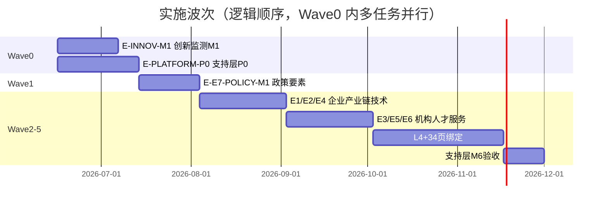

# 科技信息展示系统 — 整体工作计划

> **文档用途**：供项目负责人检查 **Wave 工程波次**、并行关系、交付物与当时进度（2026-06 稿）。  
> **交付阶段真源（对智谱/总集/预生产）**：[`project-plan.md`](./project-plan.md) · [`project-plan.yaml`](./project-plan.yaml)（S1–S6，当前阶段以 YAML `current_stage_id` 为准）。  
> **执行真源**：`${GKX_ROOT}\agent-delivery\task-registry.yaml`（机器可读队列）  
> **更新日期**：2026-06-16（本文 Wave 叙述未随 2026-08-21 计划层重写）

---

## 一、项目目标

在智树负责范围内，通过多智能体协作，将 **lumen 正式三仓**（`lumen-svc-platform`、`lumen-ui-science-pc`、`lumen-ui-science-mobile`）与 **Python 算法仓** 工程化交付，实现：

1. **Wave 0**：七要素支持层横切脚手架 + 创新监测 M1（全球创新实时数据 / EventMap）端到端跑通  
2. **Wave 1**：政策要素 E7 首条垂向（指标 + 图谱 + 3 核心模型 + 专题页 + 展示绑定）  
3. **Wave 2–5**：其余要素、34 页 W6 绑定、支持层整体验收（见 `system-wbs.yaml#waves`）

---

## 二、目录与仓库布局

### 2.1 双根目录

| 类型 | 路径 | 说明 |
|---|---|---|
| 代码根 | `${GKX_ROOT}` | 所有 Git 仓 + 本编排目录 |
| 文档根 | `${GKX_DOCS_ROOT}` | V6、2-1需求分析（澄清台账） |
| **范围 MD** | `agent-delivery/bid-reference/` | **工作出发点**；功能点 ±10% 见 `scope-baseline.yaml` |

### 2.2 正式交付仓库

| 角色 | 仓库 | 本地路径 | CI 状态 |
|---|---|---|---|
| Java 业务 API | lumen-svc-platform | `${GKX_ROOT}/repos/lumen-svc-platform` | ❌ 待 L02b |
| 展示前端（中屏） | lumen-ui-science-pc | `${GKX_ROOT}/repos/lumen-ui-science-pc` | ✅ 有 CI |
| 专题前端 | lumen-ui-topic | `${GKX_ROOT}/repos/lumen-ui-topic` | ❌ 待 P0-L00（fork pc） |
| 移动端 | lumen-ui-science-mobile | `${GKX_ROOT}/repos/lumen-ui-science-mobile` | 后续 |
| 创新监测 Python | demo-algo-science | `${GKX_ROOT}/repos/demo-algo-science` | ✅ |
| 图谱 Python | demo-algo-ent-analysis | `${GKX_ROOT}/repos/demo-algo-ent-analysis` | 参考 demo |

### 2.3 只读参考（不 merge）

- demo2 UI：`https://skxrules.unicomcn.tech:30999/`
- demo 源码：`demo-ui-system-test`、`demo-svc-platform`

---

## 三、架构铁律（验收必查）

| # | 铁律 | 检查点 |
|---|---|---|
| 1 | 算法只在 Python | Java 无 NLP/模型/图谱计算 |
| 2 | 调用链 | 前端 → Java → Python `/internal/*` |
| 3 | 图谱 | NebulaGraph（`192.168.88.43:9669`），禁止 Neo4j |
| 4 | 可观测性 | Java Agent + Python instrument + 前端 traceId |
| 5 | 工程化 | 每任务 push → GitLab Pipeline 绿 → K8s dev rollout |
| 6 | 共享聚合核心（方案 A） | 展示/专题两前端共享 `gkxlumen-topic`+`gkxlumen-metrics`；Java 只读 ADS、不写算法、不直连 nGQL（详见 `architecture-baseline.md`） |

---

## 四、实施波次总览



> 日期为估算占位，实际以 task-registry 任务 `done` 为准。

---

## 五、Wave 0 详细计划

### 5.1 Epic E-INNOV-M1 — 创新监测 M1

**目标**：demo2「全球创新监测 → 全球创新实时数据」在 lumen dev 环境可演示（`:30891/innov`）。

| 阶段 | 任务 | Agent | 状态 | 依赖 |
|---|---|---|---|---|
| A 仓就绪 | L01 Clone 三仓 | coordinator | ✅ done | — |
| A 数据 | L02 Python P1–P4 | algorithm | ⏳ pending | L01 |
| A 工程 | L02b backend CI/Helm | devops | ⏳ pending | L01 |
| B Java | L03 迁入 gkx-innov | api | ⏳ pending | L01,L02,L02b |
| B 网关 | L04 /innov 路由 K8s | integration | ⏳ pending | L03 |
| C 测试 | L05 事件 API 全套 | qa | ⏳ pending | L04 |
| C 字典 | L06 event-types | api | ⏳ pending | L05 |
| C 前端 | L07 innov UI 迁入 | frontend | ⏳ pending | L01 |
| C 联调 | L08 EventMap 真 API | frontend | ⏳ pending | L05,L07 |
| C 对照 | L09 demo2 diff 清单 | frontend | ⏳ pending | L08 |
| D 验收 | L10 M1 签收 | coordinator | ⏳ pending | L06,L08,L09 |

**并行建议**（L01 完成后）：

```
        ┌─ L02  (Python) ──────────────┐
L01 ────┼─ L02b (backend CI) ── L03 ──┼── L04 ── L05 ── L06 ──┐
        └─ L07  (frontend UI) ── L08 ──┘                        ├── L10
                        L09 ────────────────────────────────────┘
```

**M1 签收标准（L10）**：

- 三仓 CI 全绿，dev K8s rollout 成功  
- `http://192.168.88.50:30891/innov` EventMap 有真实数据  
- Grafana：抽样 traceId 在 Tempo/Loki 可查  
- 验收文档：`验收文档/创新监测-M1-端到端演示记录.md`

---

### 5.2 Epic E-PLATFORM-P0 — 七要素支持层

**目标**：P-01~P-07 脚手架就绪，供 Wave1 政策及后续要素复用。

| 包 | 任务 | 交付物 | 状态 |
|---|---|---|---|
| P-01 | L01 数据底座 | ODS/DWD/DWS schema 文档 | ⏳ pending |
| P-02 | L02 指标注册 | gkxlumen-metrics + `/metrics/v1/catalog` | ⏳ pending |
| P-03 | L03 图谱引擎 | Nebula subgraph API + PG 兜底 | ⏳ pending |
| P-04 | L04 模型注册 | cfg_model_registry + `/internal/models/registry` | ⏳ pending |
| P-05 | L05 专题 Java | gkxlumen-topic + `/topic/v1/**` | ⏳ pending |
| P-06 | L06 平台部署 | metrics/topic dev rollout | ⏳ pending |
| P-07 | L07 专题 UI 壳 | `/topic` 路由 + 通用组件 | ⏳ pending |
| 签收 | L08 P0 评审 | signoff 文档 | ⏳ pending |

**与 E-INNOV-M1 共享**：L02b 的 backend CI/Helm 成果供 P-02、P-05、P-06 复用。

**并行建议**（L01 完成后）：

```
L01 ──┬─ L03 图谱 ──┐
      ├─ L04 模型 ──┼── L08 签收
      └─ L02 指标 ── L05 专题 Java ── L06 部署
L01 ─── L07 专题 UI 壳（可与 L02 并行）
```

---

## 六、Wave 1 — 政策要素 E7

**前置**：E-PLATFORM-P0-L08 签收（P-02/P-05/P-07 就绪）

| 任务 | 内容 | 状态 |
|---|---|---|
| L01 | 5 个政策一级指标 ETL → ADS | pending |
| L02 | 政策 NER/RE → Nebula `gkx_policy` | pending |
| L03 | 3 核心深度模型（焦点/力度/效果） | pending |
| L04 | Java `/topic/v1/policy/*` | pending |
| L05 | 专题页 `/topic/policy` | pending |
| L06 | 绑定 M2 科创政策全景展示页 | pending |
| L07 | qa + 政策 M1 签收 | pending |

**DEMO 登记项**（已预置）：政策推演等见 `demo-fallback-registry.yaml`。

---

## 七、Wave 2–5 概要（未入 task-registry 明细）

| Wave | Epic（规划） | 目标 |
|---|---|---|
| Wave2 | E-E1-ENT / E-E2-IND / E-E4-TECH | 企业、产业链、技术链 |
| Wave3 | E-E3-ORG / E-E5-TALENT / E-E6-SVC | 机构、人才(INTEG)、服务(INTEG) |
| Wave4 | E-L4-SYN / E-DISPLAY-BIND | 综合分析 + 34 页 W6 绑定 |
| Wave5 | E-SUPPORT-M6 | 167 指标 ≥95%、58 模型 ≥80% |

明细任务待 Wave1 签收后写入 `task-registry.yaml`。

---

## 八、展示系统 7 模块 × 34 页

| 模块 | V6 章节 | 页数 | 责任 | 当前 Epic 关联 |
|---|---|---|---|---|
| M1 科技发展态势 | 3.2 | 9 | 智树主责 | E-INNOV-M1（1.4 全球创新监测） |
| M2 科技政策跟踪 | 3.3 | 3 | 智树主责 | E-E7-POLICY-M1 |
| M3 科技人才态势 | 3.4 | 4 | 三方集成 | Wave3 / INTEG |
| M4 科技数据资源 | 3.5 | 4 | 前端+BFF | Wave4 |
| M5 科技知识图谱 | 3.6 | 4 | 共建 | P0 图谱 + Wave4 |
| M6 科技成果展示 | 3.7 | 5 | 三方集成 | Wave3 / INTEG |
| M7 科技服务全景 | 3.8 | 5 | 三方集成 | Wave3 / INTEG |

功能点索引：`requirements-master-index.yaml`、`docs_root/.../01-展示系统-功能全量清单.md`

---

## 九、验收与合规体系

| 组件 | 文件 | 状态 |
|---|---|---|
| 架构基线 | `architecture-baseline.md` | ✅ 方案 A（与范围基线并列 P0） |
| 范围基线 | `scope-baseline.yaml` | ✅ 58 项 ±10% |
| 验收策略 | `acceptance-compliance-policy.md` | ✅ v3 |
| 招标 MD | `bid-reference/*.md` | ✅ 范围真源 |
| 功能点目录 | `acceptance-catalog/catalog-*.yaml` | ✅ 已从 CSV 生成（221 条） |
| DEMO 登记 | `demo-fallback-registry.yaml` | ✅ |
| 追溯矩阵 | `acceptance-traceability.yaml` | 🟡 骨架 |
| 需规/V6 | `formal-docs-registry.yaml` + docs_root | ✅ 引用 |

**验收底线**：MD 基线范围内 100% 叶子有 route；活跃功能点 **52~64**；不读 PDF。

---

## 十、当前进度快照

| 指标 | 数值 |
|---|---|
| Epic 已定义 | 3（INNOV / PLATFORM-P0 / E7-POLICY） |
| Leaf 任务总数 | 25 |
| 已完成 | 1（L01） |
| 可立即并行 | 5（L02, L02b, L07, P0-L01, P0-L07） |
| lumen backend CI | ❌ |
| `/innov` 路由 | ❌ |
| dev EventMap | ❌ |

---

## 十一、近期行动清单（建议执行顺序）

### 第一批（立即，可开 3–5 个 Agent 会话并行）

1. **E-INNOV-M1-L02b** — 移植 `demo-svc-platform` CI/Helm/OTel 到 `lumen-svc-platform`  
2. **E-INNOV-M1-L02** — `demo-algo-science` P1–P4 + ADS 数据 + Python OTel  
3. **E-INNOV-M1-L07** — 从 `demo-ui-system-test` 复制 innov 到 `lumen-ui-science-pc`  
4. **E-PLATFORM-P0-L01** — 数据底座 schema 设计文档（无 CI 要求）  
5. **E-PLATFORM-P0-L00** — 创建专题前端仓 `lumen-ui-topic` + CI（解锁 P0-L07）

> 注：`/topic` 前端壳 **E-PLATFORM-P0-L07** 现依赖 P0-L00，移至第二批。各 Epic 首任务开工前先由 **architect-agent** 做设计评审（`architecture-baseline.md`）。

### 第二批（L02 + L02b 完成后）

6. **E-INNOV-M1-L03** → L04 → L05 → L06  
7. **E-INNOV-M1-L08**（依赖 L05 + L07）  
8. **E-PLATFORM-P0-L02/L03/L04/L05** 按依赖推进

### 第三批（M1 签收）

9. **E-INNOV-M1-L09/L10** — demo2 对照 + 里程碑签收  
10. **E-PLATFORM-P0-L08** — 平台 P0 签收  
11. 启动 **E-E7-POLICY-M1**

---

## 十二、检查清单（人工 Review）

- [ ] `${GKX_ROOT}\agent-delivery` 目录完整，路径指向 `paths.yaml` 双根  
- [ ] `task-registry.yaml` 中 L01 为 done，其余 pending 依赖正确  
- [ ] `repo-registry.yaml` 三仓 local 路径与实际 clone 一致  
- [ ] 范围边界 `scope-and-responsibility.md` 与合同理解一致  
- [ ] DEMO 登记项已与甲方/内部对齐  
- [ ] 新 Coordinator 会话已读 `${GKX_ROOT}\COORDINATOR-START.md`  
- [ ] `acceptance-catalog` 已从 2-1需求分析 CSV 生成（`extract_feature_catalog.py`）

---

## 十三、相关文档索引

| 文档 | 路径 |
|---|---|
| Coordinator 启动 | `${GKX_ROOT}\COORDINATOR-START.md` |
| 编排 README | `agent-delivery/README.md` |
| 总控 Prompt | `agent-delivery/项目工程化交付模式.md` |
| 架构基线 | `agent-delivery/architecture-baseline.md` |
| 派单手册（含 architect 角色/话术） | `agent-delivery/智能体编排与派单手册.md` |
| 任务队列 | `agent-delivery/task-registry.yaml` |
| WBS | `agent-delivery/system-wbs.yaml` |
| 范围说明 | `agent-delivery/scope-and-responsibility.md` |
| 需规 | `docs_root/2-概要设计/2-1需求分析/正式文件/需规-科技信息展示系统.md` |
| 功能全量清单 | `docs_root/2-概要设计/2-1需求分析/需求调研和澄清/01-展示系统-功能全量清单.md` |

---

*本文档随 task-registry 状态更新；签收 milestone 时请同步修订「当前进度快照」一节。*
