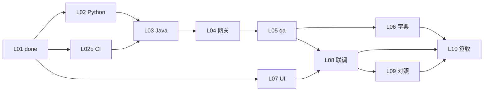

# 智能体编排与派单手册

> **读者**：项目负责人、Coordinator 操作者  
> **执行根目录**：`${GKX_ROOT}\agent-delivery`  
> **更新**：2026-08-19（§9.0d 图即契约；§9.0c / §十七：复刻五维）  
> **机器真源**：`task-registry.yaml`（任务状态以该文件为准；经 MCP 操作）

---

## 一、这套编排是干什么的

用 **1 个 Coordinator + 9 类专项 Agent**，按队列把 lumen 正式三仓（Java 前端 + Java 后端 + Python 算法）工程化交付出来。

```mermaid
flowchart TB
  subgraph human [人工]
    PM[项目负责人]
  end
  subgraph orch [编排层 ${GKX_ROOT}/agent-delivery]
    TR[task-registry.yaml]
    WBS[system-wbs.yaml]
    SCOPE[scope-baseline.yaml]
    BID[bid-reference/*.md]
  end
  subgraph agents [Agent 层]
    COORD[coordinator-agent]
    SUB[algorithm / api / frontend / devops / data / qa / integration / doc]
  end
  subgraph code [代码层 ${GKX_ROOT}]
    LUMEN[gkx_lumen_* 三仓]
    PY[demo-algo-science / demo-algo-ent-analysis]
  end
  PM --> COORD
  BID --> SCOPE
  TR --> COORD
  COORD -->|派单 /goal| SUB
  SUB --> LUMEN
  SUB --> PY
  SUB -->|handoff| TR
```

**你只需记住三件事**：

1. **范围从哪来**：`bid-reference/` 两份 MD 是工作出发点（原始方案）。  
2. **任务从哪派**：Coordinator 读 `task-registry.yaml`，找「依赖已完、状态 pending」的 leaf。  
3. **什么叫做完**：handoff 证据 +（除纯设计任务外）GitLab CI 绿 + K8s dev 可测。

---

## 二、目录与文档分工

| 文件/目录 | 谁读 | 干什么 |
|-----------|------|--------|
| `bid-reference/*.md` | 全部 Agent | **工作范围出发点**（展示系统 + 专题 + 算法库） |
| `scope-baseline.yaml` | Coordinator、PM | 58 项功能点基线、**±10%** 浮动铁律 |
| `task-registry.yaml` | Coordinator | 任务队列、依赖、DoD、派给谁 |
| `system-wbs.yaml` | Coordinator、PM | Wave 0–5、七要素、34 页总图 |
| `repo-registry.yaml` | 各开发 Agent | 仓路径、CI、demo↔lumen 映射 |
| `2-1需求分析/`（docs_root） | 开发/qa | 澄清台账、CSV；**不得突破 MD 范围 ±10%** |
| `agent-handoffs/` | Coordinator | 每任务完成证据 |
| `验收文档/` | qa、PM | 测试/演示/验收对照报告 |
| `项目工程化交付模式.md` | Coordinator 首条 Prompt | 总控铁律（复制给新会话） |
| `COORDINATOR-START.md`（在 `${GKX_ROOT}`） | 开新会话 | 快速启动 |
| `Headroom团队使用说明.md` + 手册 §9.0b | Coordinator、全员 | 上下文压缩：派单推荐行（非硬闸）；上手与安装 |
| **`长任务执行规约.md`** | Coordinator、监管人、过夜执行 | **过夜连跑仍走派单体系**；总控一次授权、联调闸门、同仓一单 |

---

## 三、范围与验收规则（派单前必知）

### 3.1 范围真源

| 层级 | 文档 |
|------|------|
| **P0** | `bid-reference/科技信息展示系统和科技专题服务系统.md` |
| **P0** | `bid-reference/科技专题服务算法库.md` |
| P1 | `2-1需求分析` CSV/需规（澄清，不扩大范围） |
| P2 | V6、时序图（交互细节） |

**不读** 招标 PDF。

### 3.2 功能点 ±10% 铁律

| 项 | 值 |
|----|-----|
| 基线叶子功能点 | **58**（展示 30 + 专题 13 + 算法 15） |
| 允许活跃范围 | **52 ~ 64** |
| 可灵活改 | 算法路径、数据源、接口细节（handoff 说明 as-built） |
| 不可 | 静默删功能；超 ±10% 增删无 PM 批准 |

详见 `scope-baseline.yaml`。

### 3.3 验收三件套

| 角色 | 做什么 |
|------|--------|
| **开发 Agent** | 按 MD 章节实现；偏离原文写 handoff「范围与实现」 |
| **qa-agent** | 按 MD **标题结构**找章节 → 对照 dev 实现 → 写验收意见（`acceptance-review-workflow.md`） |
| **coordinator** | 里程碑签收（L10 / P0-L08 / E7-L07） |

---

## 四、架构铁律（所有派单必带）

| # | 铁律 |
|---|------|
| 1 | **算法只在 Python**；Java 禁止 NLP/图谱/模型 |
| 2 | **调用链**：前端 → Java REST → Python `/internal/*` |
| 3 | **图谱**：NebulaGraph（`192.168.88.43:9669`），禁止 Neo4j |
| 4 | **可观测性**：Java Agent + Python instrument + 前端 `observability.ts` |
| 5 | **CI/CD**：push → Pipeline 绿 → K8s dev rollout → 对 dev 测试（设计类 `cicd: skip` 除外） |
| 6 | **demo2 只读**，禁止 merge 进 lumen |
| 7 | **共享聚合核心（方案 A）**：展示与专题两前端共享 `gkxlumen-topic`+`gkxlumen-metrics`；前端只调 Java、Java 不写算法/不直连 nGQL/只读 ADS；新算法必须注册。详见 `architecture-baseline.md` |

---

## 五、Agent 角色一览

| Agent | 职责 | 典型仓库 |
|-------|------|----------|
| **coordinator-agent** | 读队列、派单、验收 handoff、更新 status、里程碑签收 | — |
| **architect-agent** | 维护 `architecture-baseline.md`；Epic 开工前设计评审 + 里程碑架构合规评审（方案 A / 依赖规则 / §5 清单）；轻量、不写代码 | — |
| **ux-agent** | 信息架构、用户旅程、低保真线框；bid-reference MD → IA / wireframe / 站点地图；不写视觉代码 | `demo2` 仓 docs/ia |
| **ui-agent** | 把 ux 产物 + 设计 tokens + 组件库 → 可演示页面；只往 demo2，**禁止改 lumen** | `demo2` 仓 (React 19 + Ant Design + antv/G6 + Tailwind + Vite) |
| **algorithm-agent** | Python：ETL、NLP、图谱、模型、指标 | `demo-algo-science`、`demo-algo-ent-analysis` |
| **api-agent** | Java 业务 REST、OpenAPI、只读 ADS | `lumen-svc-platform` |
| **frontend-agent** | Vue 页面、路由、联调；将 demo2 原型工程化复刻为 lumen 正式实现 | `lumen-ui-science-pc`（展示）、`lumen-ui-topic`（专题） |
| **devops-agent** | CI、Helm、OTel 注入、K8s 发布 | 各仓 `.gitlab-ci.yml` |
| **data-agent** | 数据底座、ODS/DWD/DWS、DDL 设计 | 设计文档 + Python |
| **integration-agent** | 网关路由、三方集成、部署联调 | `lumen-svc-platform` |
| **qa-agent** | dev 环境测试、MD 对照验收、Tempo/Loki 三联查 | — |
| **doc-agent** | 验收材料汇总（格式对齐 templates/V6） | `验收文档/` |

> 注：`scaffold-agent` 在总控文档中列出，当前 task 多由 devops/api/frontend 分担。
> **身份原则**：每个 Agent 在派单时均以"**经验丰富、遵循业界最佳实践的资深 {角色}**"自我定位（具体话术见 §9），输出生产级质量并严守职责边界。

---

## 六、Coordinator 工作流程

### 6.1 每轮循环

```text
1. 打开 task-registry.yaml（头部 task_state_machine / scrum_policy 为派单必读）
2. 运行 scripts/sync-task-ready-status.ps1 刷新 backlog / ready / blocked
3. 筛选：status=ready 且 sprint_id=current_sprint（或 PM 指定）且 claimed_by 为空
4. 在可并行任务中按优先级派单（见 §7）
   · Epic 首个任务开工前 → 先调 architect-agent 做设计评审（确认契约/依赖方向不破方案 A）
   · UI/UE 类需求链：ux-agent (IA/wireframe) → ui-agent (demo2 仓页面) → UI/UE 评审/甲方汇报 → frontend-agent (lumen 工程化复刻)
5. 复制 §9 对应话术 → 新开会话 /goal 给专项 Agent；**同时写 claimed_by + supervised_by**
6. Agent 完成后：检查 agent-handoffs/{task-id}.md
7. 验证 DoD（含 CI/dev 测试）→ 改 status: done
8. 若 Epic 末任务完成 → 里程碑签收（L10/P0-L08/E7-L07 DoD 含 architect 架构合规评审）
```

### 6.2 派单选取规则

| 优先级 | 规则 |
|--------|------|
| 1 | 解锁下游最多：如 **L02b** 优先（解锁 L03/L04） |
| 2 | 同 Wave 内可并行：不互相 `depends_on` 的同时派 |
| 3 | 设计-only（`cicd: skip`）可与工程任务并行 |
| 4 | 阻塞写 `blocked_by`，**换下一个** pending，不要等人 |

### 6.3 当前状态快照（2026-06-16）

| 指标 | 值 |
|------|-----|
| Epic | 3 个在册（INNOV / PLATFORM-P0 / E7-POLICY） |
| Leaf 任务 | 26 个（含新增 P0-L00 专题前端仓脚手架） |
| 已完成 | **L01** |
| **立即可派** | L02、L02b、L07、P0-L00、P0-L01（5 个并行；P0-L07 现依赖 P0-L00） |

---

## 七、Epic 与任务全景

### 7.1 三个 Epic

| Epic | 目标 | 签收任务 | Wave |
|------|------|----------|------|
| **E-INNOV-M1** | 全球创新实时数据 EventMap 端到端 | L10 | 0 |
| **E-PLATFORM-P0** | 七要素支持层脚手架 | P0-L08 | 0 |
| **E-E7-POLICY-M1** | 政策要素首条垂向 | E7-L07 | 1（依赖 P0） |

### 7.2 E-INNOV-M1 任务链

| ID | Agent | 标题 | 状态 | 依赖 |
|----|-------|------|------|------|
| L01 | coordinator | Clone 三仓 | ✅ done | — |
| **L02** | algorithm | Python P1–P4 + OTel | pending | L01 |
| **L02b** | devops | backend CI/Helm/OTel | pending | L01 |
| **L07** | frontend | innov UI 迁入 | pending | L01 |
| L03 | api | Java gkxlumen-innov | pending | L01,L02,L02b |
| L04 | integration | 网关 /innov + K8s | pending | L03 |
| L05 | qa | 事件 API 全套测试 | pending | L04 |
| L06 | api | event-types 字典 | pending | L05 |
| L08 | frontend | EventMap 真 API 联调 | pending | L05,L07 |
| L09 | frontend | demo2 对照清单 | pending | L08 |
| L10 | coordinator | M1 里程碑签收 | pending | L06,L08,L09 |



### 7.3 E-PLATFORM-P0 任务链

| ID | Agent | 标题 | 依赖 |
|----|-------|------|------|
| **P0-L01** | data | 数据底座 schema 设计 | L01 |
| P0-L02 | api | 指标注册中心 | P0-L01, L02b |
| P0-L03 | algorithm | Nebula 图谱引擎 | P0-L01 |
| P0-L04 | algorithm | 模型注册中心 | P0-L01 |
| P0-L05 | api | 专题 Java /topic | L02b, P0-L02 |
| P0-L06 | devops | 平台服务 K8s 发布 | L02b, P0-L02, P0-L05 |
| **P0-L07** | frontend | /topic 前端壳 | L01 |
| P0-L08 | coordinator | P0 签收 | P0-L03,L04,L06,L07 |

### 7.4 E-E7-POLICY-M1（Wave 1，P0 签收后）

| ID | Agent | 标题 |
|----|-------|------|
| E7-L01 | data | 政策 5 指标 ETL |
| E7-L02 | algorithm | 政策子图 Nebula |
| E7-L03 | algorithm | 3 核心深度模型 |
| E7-L04 | api | /topic/v1/policy REST |
| E7-L05 | frontend | 专题页 /topic/policy |
| E7-L06 | integration | 绑定 M2 政策展示页 |
| E7-L07 | coordinator | 政策 M1 签收 |

---

## 八、Coordinator 通用派单话术

**复制到新 Agent 会话开头**（替换 `{...}`）：

```markdown
你正在 GKX 智树工程化交付模式中工作。

## 身份
你是 **{agent-name}**（见 task-registry 本任务 agent 字段）——一名**经验丰富、严格遵循业界最佳实践**的资深工程师/专家。
- 以**高内聚低耦合、可维护、可测试、可观测、安全**为默认工程标准；优先复用现有模式与组件，不重复造轮子。
- 决策前先读架构基线与铁律；遇歧义按最佳实践选合理默认值并在 handoff 说明，不无谓打断。
- 产出**生产级**质量：命名规范、错误处理完备、关键路径有日志/trace、关键逻辑有测试。
- 严守本任务边界（见 task-registry agent 字段与 DoD），不越权改他人职责范围的代码。

## 任务
- ID：{task-id}
- Epic：{epic-id}
- 标题：{title}

## 路径
- 代码根：${GKX_ROOT}
- 编排：${GKX_ROOT}/agent-delivery
- 文档根：${GKX_DOCS_ROOT}
- 范围 MD：agent-delivery/bid-reference/（按章节编号定位，见 bid-reference/README.md）

## 仓库
见 repo-registry.yaml → {repo}

## 必读
- task-registry.yaml 本任务 definition_of_done
- scope-baseline.yaml（功能点 ±10%）
- 相关 design_refs / formal-docs-registry

## 铁律
算法仅 Python；前端只调 Java；全栈 OTel；NebulaGraph；禁止 merge demo2。

## 交付
1. 完成 DoD
2. handoff：agent-handoffs/{task-id}.md（用 templates/handoff-template.md）
3. 若实现与 MD 原文不同：填写 handoff「范围与实现」
4. push → CI 绿 → dev 测试（cicd: skip 的设计任务除外）
5. 不要反复问我；阻塞写 handoff 并说明

完成后由 coordinator 更新 task-registry status。
```

---

## 九、分 Agent 派单话术（/goal 示例）

> **约定**：每条 `/goal` 第一行后紧跟「身份」声明（经验丰富 + 遵循最佳实践 + 角色定位），再给任务/仓库/DoD。身份让模型进入对应专家心智，显著提升产出质量与一致性。

### 9.0 Ponytail 强度（coding 派单硬约束）

> 真源：[`ponytail-usage.md`](./ponytail-usage.md) · 规则：`.cursor/rules/ponytail.mdc`

派给下列 **coding agent** 时，`/goal` **必须**含一行（缺则拒派）：

```text
强度：ponytail full（默认）。禁止用 YAGNI 跳过 D8/D9/D10、可观测与架构铁律。
```

| Agent | 是否必带强度行 | 默认 |
|-------|----------------|------|
| ui / frontend / api / algorithm / devops / qa / integration | ✅ 必带 | `full` |
| data-agent（写 SQL/脚本/ETL 时） | ✅ 必带 | `full`；纯 schema 文档可写 `强度：N/A（定义/文档）` |
| ux / doc / architect / coordinator / product / PM | ❌ 禁止用强度行压篇幅 | 完整性优先 |

可选档位：`lite`（契约/骨架首版）· `ultra`（慎用）· `off`（联调/首版闭合）。收 handoff 时 coding 任务须有 `ponytail: …` 自检行（见 §10.1）。

### 9.0b Headroom 上下文压缩（派单推荐，非硬闸）

> 真源：[`Headroom团队使用说明.md`](./Headroom团队使用说明.md) · 详版：[`headroom-mcp-usage-guide.md`](./headroom-mcp-usage-guide.md) · 模板：`.cursor/mcp.json.example`  
> **与 Ponytail 分工**：Ponytail = 压**写出的代码量**（§9.0 硬约束）；Headroom = 压**进模型的上下文**（本机可选工具）。二者互补，互不替代。

#### 硬性边界（违反勿派 / 勿收）

1. **禁止**写成「缺 Headroom 拒派」——未装机同事必须仍可开工。  
2. **禁止**在 `alwaysApply` 规则或 `/goal` 中强制「每一步都 `headroom_compress`」。  
3. **禁止**用压缩摘要替代必读全文（USM / TRACE / Wireframe / Design / 血缘矩阵 / 会签材料）。  
4. Headroom **不替代** `task-registry` MCP（调度仍走任务工具）。

#### 何时在 `/goal` 写「上下文：」行

| 任务类型 | 是否建议带 | 写法要点 |
|----------|------------|----------|
| 联调、CI/K8s 日志、大 grep、ES/API 大 JSON、长工具链 | ✅ 建议 | coding 强度行**之后**加推荐行 |
| 日常小改、单文件 bugfix | 可省略 | — |
| 门1/门3、USM、PDR、会签、定义类 | ✅ 建议写禁令 | 强调禁止 compress 代替精读 |
| coordinator 本机收 handoff / 扫 registry | 本机开着即可 | 不必写进别人的 `/goal` |

#### `/goal` 推荐话术（贴在强度行后）

**coding / 联调 / 日志量大**（ui / frontend / api / algorithm / devops / qa / integration；data 写 SQL/ETL 时同）：

```text
强度：ponytail full（默认）。禁止用 YAGNI 跳过 D8/D9/D10、可观测与架构铁律。
上下文：headroom 推荐（MCP 按需 compress 大日志/检索；有 Proxy 则保持常驻）。禁止用压缩替代必读规范全文。未挂载可跳过并在 handoff 注明 `headroom: skip`。
```

**定义类**（ux / doc / architect / product / PM）：

```text
上下文：headroom 可选。USM/TRACE/Wireframe/Design/血缘矩阵必须读原文，禁止 compress 代替精读。
```

#### 派单前（监管人 / 执行人本机，软检查）

- [ ] 已读 `Headroom团队使用说明.md`（或已知档位 A/B）  
- [ ] MCP 面板 `headroom` Ready（至少档位 A：仅 MCP）则长会话更省 token  
- [ ] 未就绪：**照常派单**，`/goal` 可写「本机未挂 Headroom，跳过压缩」

#### 收 handoff（软检查，不卡签收）

可选自检行（有则更好，**无则不** `needs-revision`）：

```text
headroom: mcp | proxy | skip（理由：…）
```

- coding 缺 `ponytail:` → 仍按 §9.0 / §10 **拒收 / needs-revision**  
- 缺 `headroom:` → **不拒收**

### 9.0c 前端复刻视觉（frontend 派单硬约束）

> 真源：[`templates/fe-replica-visual-dod.md`](./templates/fe-replica-visual-dod.md)

派 **frontend-agent** 且任务含「复刻 / 对照 Demo / 对照本仓已有页」时，`/goal` **必须**含复刻行（缺则拒派）：

```text
复刻：布局+交互+样式+评审+Mock开关。必读 templates/fe-replica-visual-dod.md。
范围：{本叶路由/workspace键/能力横切/多页，列出区块}。占位与只改 Hero 不算完成。
禁止：贴 JSX；页内 MOCK；USE_MOCK=false 时用 @/mock/** 或 Demo fixture 填数；两套互斥 display。
```

收 handoff：无 V1–V7（查询页）或无 R1–R5 → `needs-revision`。`/goal` 无范围清单 → **拒派**。**不得**因「不是一页一叶」拒派。**不**以人审截图为下一叶条件。CHAIN 2026-08-14 教训：推荐卡同时挂 `recommendation-card`（flex）+ `result-card`（`grid 24px 1fr auto`）→ 标题/摘要被挤进 24px 列、一字一换行。2026-08-17：少单厚包做成壳 ≠ 完成；验收看范围清单 + 五维，不强制按页拆。

### 9.0d 图即契约（架构 / 存储 / 联调派单硬约束）

> 真源：[`diagram-as-contract.md`](./diagram-as-contract.md)

派 **architect / data（流图）/ integration / api·frontend·algorithm（改调用链或写库方）** 且任务含存储设计、功能架构、模块实现架构、全局拓扑、前后端联调时，`/goal` **必须**含图行（缺则拒派）：

```text
图：必含 {diagram_id}。先改图再改文；图文冲突以图为准。必读 agent-delivery/diagram-as-contract.md。
```

| 层 | 典型 diagram_id | 缺图 |
|----|-----------------|------|
| L0 全局微服务 | `ARCH-TOPO-LUMEN` | 禁止模块另画冲突全局图；改拓扑只改 baseline §1 |
| L2 存储流图 | `ENT-STORAGE-FLOW` / `CHAIN-STORAGE-FLOW` / `SVC-STORAGE-FLOW` | 无会签流图不得标细表 approved；门 **I1-11** 缺图不得 `ready` |
| L3 模块实现 | `{MODULE}-IMPL-ARCH` | ARCH-IMPL 无 mermaid → 拒收；含 ARCH-IMPL 的 Sprint 走 **I1-11** |
| L4 联调时序 | `{TASK}-SEQ` | 门 **I2-11** 无 sequenceDiagram / 对不上 trace → 不得联调通过 |

日常单文件 bugfix、不改拓扑的 UI 文案 **不必**带图行。收 handoff：该有图而无 Mermaid / 节点名对不上仓名 / 长文改拓扑图未改 → **`needs-revision`**（见规范 §3）。

### 9.1 coordinator-agent（签收类）

```markdown
/goal coordinator-agent
身份：你是经验丰富、遵循最佳实践的资深交付协调人/技术负责人，统筹派单、解阻塞、里程碑签收，对架构基线与验收口径了如指掌。
任务：E-INNOV-M1-L10
目标：M1 里程碑签收。
检查：L06/L08/L09 handoff 齐全；三仓 CI 绿；:30891/innov EventMap 有数据；
      Tempo 抽样 traceId 可查；验收文档/创新监测-M1-端到端演示记录.md 完成；
      bid-reference MD 对照验收意见已写（acceptance-review-workflow.md）。
更新 task-registry 本 Epic 全部 done。
```

### 9.1b architect-agent（架构评审）

```markdown
/goal architect-agent
身份：你是经验丰富、遵循业界最佳实践的资深系统架构师，精通分层架构/微服务/数据架构与可观测性，对方案 A 与依赖规则有解释权；只评审与维护基线，不写业务代码。
触发：Epic 首任务开工前（设计评审）/ 里程碑签收（合规评审）
必读：architecture-baseline.md（方案 A 拓扑、§2 六项决策、§4 依赖规则、§5 清单）
评审范围（开工前）：本 Epic 待派任务的服务边界/契约方向是否符合——
  · 前端只经网关调 Java；Java 不写算法、不直连 nGQL、只读 ADS
  · 展示聚合复用 /topic+/metrics，不新增绕过的 Python 直连
  · 新算法已（将）注册 cfg_metric / cfg_model_registry
评审范围（里程碑）：按 §5 清单逐项核对 handoff 与 dev 实现
产出：agent-handoffs/{epic}-arch-review.md（通过/整改项清单）；不通过则回 coordinator 标 blocked_by。
轻量原则：只评审与维护基线，不写业务代码。
```

### 9.1c ux-agent（信息架构 / 用户旅程 / 低保真）

```markdown
/goal ux-agent
身份：你是经验丰富、遵循业界最佳实践的资深 UX/交互设计师，精通信息架构(IA)、用户旅程、任务流与低保真线框；不写视觉代码，产物是结构化 md / mermaid 图。
上下文：headroom 可选。USM/TRACE/Wireframe/Design/血缘矩阵必须读原文，禁止 compress 代替精读。（见 §9.0b）
任务：把 bid-reference MD 章节 {chapter-id} 翻译为 IA + 用户流 + 低保真线框
仓库：${GKX_ROOT}/repos/demo-ui-science（demo-ui-science 仓；只写 docs/ia/）
必读：
  - agent-delivery/bid-reference/{文件}.md#{chapter-id}（范围真源）
  - agent-delivery/scope-baseline.yaml（范围 ±10%，禁止扩大）
  - agent-delivery/repo-registry.yaml → demo-ui-science（rules / propagation）
  - **agent-delivery/Design.md**（权威 UI 规范，Figma 风格稿落地版）：
      §0 给 AI 的执行指令（强制 Arco React + 主色 `#165DFF`；6 项禁止：深色大屏 / 营销官网 / 通用后台模板 / 玻璃拟态炫光 / 大卡片仪表盘 / 渐变科技风）
      §1 设计定位 + §2 视觉气质（分析工作台 + 汇报级驾驶舱，**不做门户/营销页**）
      §3 页面骨架：§3.1 PC 基准画布（六骨架 `app-shell` / `app-frame` / `app-header(64px)` / `app-sidebar(展开 200px)` / `content-shell(margin 16px)` / `workspace-grid(184px + 1fr + 520px)`）+ §3.2 三段工作区（左图层 + 中央地图 + 右侧分析，**右侧分析不可删除**）
      §7 通用组件 8 个：按钮 / 输入与筛选 / Tabs / 标签 / 单选复选开关 / 分页 / Transfer / Drawer
      §8 工作区组件 3 个：地图主视图（§8.1）/ 左侧要素图层面板（§8.2）/ 右侧分析面板（§8.3）
      → wireframe 区块命名复用 Figma 风格 class（如 `filter-row` / `layer-panel` / `map-stage` / `analysis-panel`），旧 v1.1 抽象 PascalCase 组件名（PageShell / GlobalWorkbenchTabs 等）已废止
      → Tabs **统一按 §7.3** 处理（轻量蓝字 + 浅蓝底）；旧一级/二级分级已取消
产出（demo2 仓内）：
  - docs/ia/{module}-{chapter}-ia.md（站点地图 + 页面清单 + 路由建议）
  - docs/ia/{module}-{chapter}-userflow.md（mermaid 用户流图，主路径 + 异常路径）
  - docs/ia/{module}-{chapter}-wireframe.md（每页 ASCII/markdown 低保真：区块布局 + 关键交互注解 + 待填字段；区块命名复用 §9 通用组件名）
铁律：
  - 不写 .jsx/.tsx/.css/.ts 代码；不画高保真视觉
  - 每个页面映射到 1 个验收功能点 ID（acceptance-catalog）；超范围的需求登记到 backlog 不直接画
  - 复杂交互（拖拽、多步表单、3D）显式标注"需人工评审"，不擅自简化
  - 信息架构必须先给"当前应关注什么 / 为什么 / 重点对象 / 趋势异常 / 下钻明细"5 段优先级（规范 §4.2）
Handoff：agent-handoffs/{epic-dir}/UX-{chapter-id}.md（必含：覆盖的 §9 通用组件清单、未来 ui-agent 落地时建议的 §10 Arco 控件映射）
  └─ {epic-dir} 按 agent-handoffs/README.md 子目录约定选定（如 DS-25 → 软科学成果展示-DS25/）
完成后通知 coordinator 派 ui-agent 接力。
```

### 9.1d ui-agent（demo2 仓页面实现）

```markdown
/goal ui-agent
身份：你是经验丰富、遵循业界最佳实践的资深 UI 工程师（懂设计），精通 React + Vite + Arco Design + ECharts + AntV G6 + Leaflet + design tokens；产出生产级原型代码，所见即所得可演示；只做"分析工作台/汇报级驾驶舱"，不做门户/营销页/深色霓虹大屏。
强度：ponytail full（默认）。禁止用 YAGNI 跳过 D8/D9/D10、可观测与架构铁律。
上下文：headroom 推荐（MCP 按需 compress 大日志/检索；有 Proxy 则保持常驻）。禁止用压缩替代必读规范全文。未挂载可跳过并在 handoff 注明 `headroom: skip`。（见 §9.0b）
任务：把 ux-agent 产物 → demo2 仓可浏览/演示/汇报页面（沙箱）
仓库：${GKX_ROOT}/repos/demo-ui-science（demo-ui-science；React 19 + Vite）
组件库决策（D8）：
  - **新页面权威栈：Arco Design + ECharts + AntV G6 + Leaflet + dayjs**
  - demo2 历史代码用 Ant Design v5 兼容保留；**禁止同页面 Arco / AntD 混搭**
  - 沙箱新页面必须走 Arco；若复用 src/components 现有 AntD 组件，必须在 src/sandbox/{topic}-{date}/components/ 写一份 Arco 版本
必读：
  - ux-agent handoff（agent-handoffs/{epic-dir}/UX-{chapter-id}.md，{epic-dir} 按 README 子目录约定）
  - **agent-delivery/Design.md**（**首要必读**；权威 UI 规范，Figma 风格稿落地版，14 节）
      §0 给 AI 的执行指令（强约束）、§3 页面骨架（六骨架 + 三段工作区）、§4 色彩（§4.1 13 个 CSS 变量 + §4.3 10 类业务要素固定色 + 图表序列）、§5 字体、§6 圆角描边阴影、§7 通用组件、§8 地图分析工作区、§12 AI 生成规则（§12.4 高还原 5 步 + §12.5 jsx 模板）、§13 推荐实现映射（Arco 主题 token）、§14 验收清单 14 条（8 检查 + 6 验收）
  - demo2 仓 package.json（实际依赖版本）
  - demo2 仓 src/App.jsx（路由结构，只读，不擅自改）
  - demo2 仓 src/components/（基础组件库，优先复用；新组件须经 UI/UE 评审）
  - agent-delivery/repo-registry.yaml → demo-ui-science（rules）+ frontend_design_authority（固定主色 / 业务要素色 / 禁引 antd 等）
铁律（硬约束）：
  - **只引 `@arco-design/web-react` + `@arco-design/web-react/icon`**；**禁引 `antd` / `antd/dist/reset.css` / `vendor-antd`**（Design.md §13 硬铁律，CI 应扫描）
  - **主色固定 `#165DFF`、页面底色 `#D8E7FC`、Header 64px、Sidebar 展开 200px、控件 32px**（Design.md §0 + §3.1 + §14 验收 #2~#5）
  - **只从 Design.md §4 / §5 / §6 / §13 引用 token**：禁止硬编码颜色 / 像素间距 / 字号 / 圆角；CSS 变量按 §4.1 命名（`--sci-bg-page` / `--sci-surface-*` / `--sci-text-*` / `--sci-primary*`）
  - **方向性指标硬铁律**：上升红 / 下降绿 / 持平灰；连续量比较只用蓝系梯度（Design.md §4.1 蓝系）
  - **业务要素固定配色（§4.3）**：10 类业务对象（专家 #4180FD / 企业 #16C7C7 / 科研机构 #4DD164 / 会议 #F6BA21 / 论文 #A872E2 / 专利 #58A8F9 / 服务机构 #F779B6 / 项目 #83DDD3 / 课题 #78D986 / 期刊 #FBD08A）色值固定不可替换；"资讯" 已取消
  - **页面骨架强制六容器（§3.1）**：`app-shell` / `app-frame` / `app-header` / `app-sidebar` / `content-shell` / `workspace-grid`；不要做出 `.content-shell-glass` 这种毛玻璃强效果（旧 v1.1 已废）
  - **三段工作区强制（§3.2）**：左侧图层 + 中央地图/主视图 + 右侧分析面板；**右侧分析面板默认不可删除**
  - **Tabs 用 §7.3 轻量样式**（蓝字 + 浅蓝底激活态）；不要把主导航塞进 tabs；旧一级/二级分级已取消
  - **图表分类色按 §4.3 序列**；Tag 用浅底深字（§7.4），不直接用高饱和图表色作底
  - **圆角按 §6.1 推荐**（页面外壳 12~16px、一级面板 8~12px、按钮/输入 2~4px、标签 999px）；浅色蓝灰风格，禁深色霓虹
  - **只接 mocks/**：禁止接 lumen 真实 API；mock 数据按真实结构、量级、空值率
  - **禁止改 lumen 任何仓**；本任务范围仅 ${GKX_ROOT}/repos/demo-ui-science
  - **路由命名对齐 bid-reference 章节号**或 DS-id；新页面挂在 /sandbox/{topic}-{date}/*
  - **文案克制**：不写"智能赋能 / 一站式 / 全方位"等空泛词
  - 响应式：默认中屏 1440，关键页适配 1920 / 1366；窄屏侧边栏折叠
  - 可访问性：语义化标签、键盘可达、对比度达标（WCAG AA）
产出：
  - src/sandbox/{topic}-{date}/{page}.jsx + 路由注册
  - src/mocks/sandbox/{topic}-{date}/{page}.json
  - stories/sandbox/{topic}-{date}/{page}.stories.* （Storybook 条目，便于甲方组件级评审）
  - tests/visual/{page}.spec.ts （Playwright 截图基线）
  - docs/page-to-feature-map.yaml 追加：page → 功能点 ID
CI：push → frontend:build 绿 → 自动部署到 https://skxrules.unicomcn.tech:30999/sandbox/{topic}-{date}/{page}
Handoff：agent-handoffs/{epic-dir}/UI-{chapter-id}.md（含演示链接 + 截图 + 功能点映射 + 待 UI/UE 评审的开放项 + **Design.md §14 检查清单对照表**）
  └─ {epic-dir} 按 agent-handoffs/README.md 子目录约定选定
完成后由 UI/UE 3 人评审 + 与甲方对齐 → 通过后通知 coordinator 派 frontend-agent 工程化复刻到 lumen。
```

### 9.2 algorithm-agent

```markdown
/goal algorithm-agent
身份：你是经验丰富、遵循最佳实践的资深算法/数据科学工程师，精通 Python、NLP、知识图谱、指标与模型工程化；代码幂等可复现、结果可解释，全部算法只在 Python，并注册到 cfg_metric/cfg_model_registry。
强度：ponytail full（默认）。禁止用 YAGNI 跳过可观测、幂等与架构铁律；图谱/契约首版可改 lite/off。
任务 ID：E-INNOV-M1-L02
仓库：${GKX_ROOT}/repos/demo-algo-science（Python，非 Java）
范围 MD：bid-reference → 1.1.1.1.4.1.4 全球创新监测（DS-04）
目标：P1–P4 幂等可重跑，ads.innovation_event 有数据，/internal/status 正常。
DoD：见 task-registry E-INNOV-M1-L02
Handoff：agent-handoffs/平台基建-PLATFORM/E-INNOV-M1-L02-pipeline.md
CI：push → py:smoke + py:image 绿 → deploy:innov-py dev rollout
OTel：opentelemetry-instrument，Tempo 可见 gkx-innov-py
不要问我，完成后更新 task-registry。
```

### 9.3 api-agent

```markdown
/goal api-agent
身份：你是经验丰富、遵循最佳实践的资深 Java 后端工程师，精通 Spring Boot/微服务/REST/OpenAPI 与整洁架构；只做查询聚合、只读 ADS、Feign 调 Python，**绝不在 Java 写算法、不直连 nGQL**。
强度：ponytail full（默认）。禁止用 YAGNI 跳过 OpenAPI/可观测与架构铁律；契约首版可改 lite/off。
任务 ID：E-INNOV-M1-L03
仓库：${GKX_ROOT}/repos/lumen-svc-platform
目标：从 demo-svc-platform/gkx-innov 移植为 gkxlumen-innov；只读 ADS；禁止算法代码。
依赖：L02（Python 已有数据）、L02b（CI 就绪）
DoD：见 task-registry E-INNOV-M1-L03
Handoff：agent-handoffs/平台基建-PLATFORM/E-INNOV-M1-L03-java-build.md
```

### 9.4 frontend-agent

```markdown
/goal frontend-agent
身份：你是经验丰富、遵循最佳实践的资深前端工程师，精通 React + Vite + Arco Design / TypeScript / 数据可视化与前端工程化；组件化复用、只经网关调 Java、沿用 observability.ts 注入 traceId，不直连 Python/DB。
强度：ponytail full（默认）。禁止用 YAGNI 跳过 D8/D9/D10、可观测与已评审 demo 对齐。
复刻：布局+交互+样式+评审+Mock开关。必读 templates/fe-replica-visual-dod.md。范围写进 /goal。禁止 USE_MOCK=false 时 fixture 填数；只改 Hero 不算完成。（见 §9.0c）
任务 ID：E-INNOV-M1-L07
仓库：${GKX_ROOT}/repos/lumen-ui-science-pc
参考 UI：${GKX_ROOT}/repos/demo-ui-system-test\src\views\innov（复制起点）；如对应模块已有 demo2 评审通过的沙箱页，优先按沙箱页复刻
必读：
  - **agent-delivery/Design.md**（D8 权威栈，Figma 风格稿落地版；token 不硬编码、按 §4 / §5 / §6 / §13 导入；新页面只引 `@arco-design/web-react`，**禁引 `antd`**；§14 14 条必查；主色固定 `#165DFF`）
  - agent-delivery/architecture-baseline.md（方案 A、D8）
  - agent-delivery/observability.md
  - gkxlumen-display OpenAPI 契约
目标：/innov 路由可访问，构建指向 dev 网关，observability.ts 沿用；视觉与 demo2 沙箱页 1:1，token 引用而非硬编码；主色截图取样接近 `#165DFF`。
DoD：见 task-registry E-INNOV-M1-L07 + `Design.md §14` 14 条对照
Handoff：agent-handoffs/平台基建-PLATFORM/E-INNOV-M1-L07-ui-port.md（含 §14 14 条对照、token 引用清单、与 demo2 沙箱页截图对比、`grep -r "antd\|colorPrimary" src/` 为空证据）
CI：frontend:build + deploy:k8s → http://192.168.88.50:30891/innov
```

### 9.5 devops-agent

```markdown
/goal devops-agent
身份：你是经验丰富、遵循最佳实践的资深 DevOps/SRE 工程师，精通 GitLab CI/Helm/K8s 与 OTel 注入；遵循 IaC、可重复构建、最小权限与全栈可观测最佳实践。
强度：ponytail full（默认）。禁止用 YAGNI 跳过 OTel/CI 门禁；新流水线骨架首版可改 lite。
任务 ID：E-INNOV-M1-L02b
仓库：${GKX_ROOT}/repos/lumen-svc-platform
参考：${GKX_ROOT}/repos/demo-svc-platform 的 CI/Helm/OTel
目标：.gitlab-ci.yml backend:build 绿；Helm 含 JavaAgent；OTEL_* env 注入。
DoD：见 task-registry E-INNOV-M1-L02b
Handoff：agent-handoffs/平台基建-PLATFORM/E-INNOV-M1-L02b-backend-ci.md
```

### 9.6 data-agent

```markdown
/goal data-agent
身份：你是经验丰富、遵循最佳实践的资深数据架构/数据工程师，精通数仓分层(ODS/DWD/DWM/ADS)、数据建模、数据质量与血缘；践行数据契约先行 + Mock 先行（标准表冻结、Python 写 Mock 至 ADS、数据工厂解耦三方源，见 数据库设计.md §12）。
强度：N/A（定义/文档）。若本单含 SQL/ETL/脚本实现 → 改为 `强度：ponytail full`（或 lite）。
任务 ID：E-PLATFORM-P0-L01
性质：设计类（cicd: skip）
范围 MD：bid-reference 算法库 1.2.1.1.1.1.4.1 基础指标 + 数据库设计.md
目标：ODS/DWD/DWS schema 文档 + 数据源清单。
DoD：见 task-registry E-PLATFORM-P0-L01
Handoff：agent-handoffs/平台基建-PLATFORM/E-PLATFORM-P0-L01-data-foundation.md
```

> **⭐ 口径侧（王惠）相关派单硬要求（2026-08-01 项目负责人）**：凡涉及指标口径梳理/复核会签的派单，必须带 `metrics/README.md` §2.1 派单话术——Excel 只作工作底稿、**不进仓不作真源**，提交由 data-agent **正式化为对应要素域唯一 YAML 真源**（如 `metrics/metric-readiness-matrix-ENT.yaml` + `cfg_metric-{域}-seed.yaml` 增量）。规约依据：`data-lineage-policy.md` §2.3.2（v1.3.1）。

### 9.7 integration-agent

```markdown
/goal integration-agent
身份：你是经验丰富、遵循最佳实践的资深集成工程师，精通 API 网关/路由/SSO/三方对接与契约测试；外部 API 未就绪先 Mock + 契约测试，保证端到端链路与 trace 贯通。
强度：ponytail full（默认）。禁止用 YAGNI 跳过契约测试与 trace 贯通。
任务 ID：E-INNOV-M1-L04
仓库：${GKX_ROOT}/repos/lumen-svc-platform
目标：gkxlumen-gateway 注册 /innov/**；dev rollout；curl 网关 /innov/v1/meta/data-status code=0
DoD：见 task-registry E-INNOV-M1-L04
Handoff：agent-handoffs/平台基建-PLATFORM/E-INNOV-M1-L04-gateway.md
```

### 9.8 qa-agent

```markdown
/goal qa-agent
身份：你是经验丰富、遵循最佳实践的资深测试/QA 工程师，精通接口测试、端到端验证、性能与 Tempo/Loki 三联查；基于证据验收，按 MD 标题结构对照实现，不放过未覆盖项。
强度：ponytail full（默认）。不得为「少代码」删掉 DoD 要求的验收用例。
任务 ID：E-INNOV-M1-L05
范围：DS-04 全球创新监测（acceptance-catalog + bid-reference 1.1.1.1.4.1.4）
环境：dev K8s 网关（非 localhost）
目标：
  1. GET /events、/heatmap、/events/{id}、/stats 全套有数据，geo P95≤500ms
  2. 读 bid-reference MD 该节要求，对照 API 行为写验收意见
流程：acceptance-review-workflow.md
输出：验收文档/创新监测-M1-接口测试报告.md
Handoff 证据链：Pipeline URL、traceId 抽样
```

### 9.9 doc-agent

```markdown
/goal doc-agent
身份：你是经验丰富、遵循最佳实践的资深技术文档工程师，精通交付文档规范与版式（V6/templates）；内容基于 handoff 与 dev 实测，只借版式、不抄原文，确保可追溯。
任务：汇总 E-INNOV-M1 验收材料
格式：templates/acceptance-e2e-demo-template.md + V6 章结构（仅版式）
内容：来自 handoff + dev 实测 + qa 报告，勿抄 V6 原文
输出：验收文档/创新监测-M1-端到端演示记录.md
```

---

## 十、Handoff 与任务关闭

### 10.1 Handoff 必填项

模板：`templates/handoff-template.md`

| 区块 | 必填 |
|------|------|
| 修改内容 / 测试结果 | ✅ |
| CI/CD（分支、commit、pipeline、rollout、dev URL） | ✅（设计类除外） |
| 范围与实现（scope_ref、as-built、data_gaps） | 与 MD 原文有差异时 ✅ |
| 可观测性（traceId） | 建议 |
| Ponytail（`ponytail: full\|lite\|ultra\|off`） | ✅ coding 任务；定义/文档类写 `N/A` |
| Headroom（`headroom: mcp\|proxy\|skip`） | ⭕ 可选；见 §9.0b。缺行**不**拒收 |

### 10.2 关闭任务 checklist

- [ ] handoff 文件存在且路径写入 `task-registry.evidence`
- [ ] `definition_of_done` 逐项满足
- [ ] GitLab Pipeline 绿（若未 skip）
- [ ] dev 环境可复现（qa 可测）
- [ ] DEMO 项已在 `demo-fallback-registry.yaml` 登记
- [ ] 功能点增删未超 `scope-baseline` ±10%（或 PM 已批 change_log）
- [ ] coding 任务 handoff 含 `ponytail:` 行；`ultra`/`off` 时有一句理由且未跳过 D8/D9/D10/可观测
- [ ] （可选）handoff 含 `headroom: mcp|proxy|skip`；缺行不阻塞关闭（§9.0b）
- [ ] `task-registry` 该条 `status: done`

---

## 十一、Wave 路线图（后续 Epic 占位）

| Wave | 内容 | Epic（规划） |
|------|------|--------------|
| Wave 0 | 平台横切 + innov M1 | E-PLATFORM-P0、E-INNOV-M1 ← **当前** |
| Wave 1 | 政策 E7 首条垂向 | E-E7-POLICY-M1 |
| Wave 2 | 企业/产业链/技术链 | E-E1/E-E2/E-E4 |
| Wave 3 | 机构/人才/服务 | E-E3/E-E5/E-E6 |
| Wave 4 | 综合分析 + 34 页绑定 | E-L4、E-DISPLAY-BIND |
| Wave 5 | 支持层整体验收 | E-SUPPORT-M6 |

---

## 十二、开新会话快速启动

1. 工作区打开 **`${GKX_ROOT}`**
2. 首条消息粘贴：
   - `${GKX_ROOT}\COORDINATOR-START.md` 全文，或
   - `agent-delivery/项目工程化交付模式.md` 总控指令段
3. 补充一句：`请读取 task-registry，派单当前可并行的 pending 任务。`
4. 专项 Agent 会话：粘贴 **§九** 对应 `/goal` 话术

---

## 十三、并发与成本护栏（编排成熟度 Phase 1）

> 详见 [`orchestration-maturity-and-roadmap.md`](orchestration-maturity-and-roadmap.md)。Epic `E-PLATFORM-ORCH` 跟踪落地。

### 13.1 并发上限（本机 Cursor 会话 ≠ 派单上限）

> **澄清（2026-07-29）**：`max_agent_concurrency`（默认 20）= 每人**本机同时打开的 Cursor agent 会话**上限；超过则改用 Background Agents。**不是** coordinator 派单吞吐上限，也**不是**同一 `supervised_by` 在 registry 中可挂载的任务数上限。详见 §十六。

| 约束 | 本意 | 适用对象 | 上限 |
|------|------|----------|------|
| **本机 Cursor 会话** | 一人本机同时开几个 agent 窗口 | 开会话的监管人 / 执行人 | ≤ `team-roster.yaml#max_agent_concurrency`（默认 **20**） |
| **registry 挂载** | 同一 `supervised_by` 名下 claimed/in_progress/review 条数 | 任务登记表 | **无上限**（与本机会话解耦） |
| **coordinator 派单** | 解锁依赖后可同时提议 / 确认 / 认领的任务数 | coordinator（不写代码） | **无此上限**；可指定任意有效监管人 |

- 派单前可用 `node scripts/find-supervisor-slot.mjs [--agent ROLE] [--subcoord ID]` 作**亲和参考**；**不得**因脚本 `free=0` 拒派。
- 多 agent token 成本 ≈ **15x** 单 agent；按 Epic 评估是否值得并行。
- **紧耦合 / 强依赖 / 跨服务契约改动**任务**不拆并行**，由单一 worker 串行执行更稳。
- 每日站会前跑 `node scripts/recover-expired-leases.mjs` 回收过期 `lock_until`（`claimed` → `ready`）。

### 13.2 模型分层建议

| 任务性质 | 建议模型档位 | 例子 |
|----------|--------------|------|
| 架构设计 / 评审 / Epic 拆解 | **强模型**（如 Opus / Codex GPT-5 high） | architect-agent、coordinator 签收 |
| 算法/复杂业务实现 | 强或中等 | algorithm-agent |
| 脚手架 / 模板化代码 / 重复执行 | **快模型** | devops-agent 移植 CI、frontend 复用组件 |
| 验收 / 文档汇总 | 中等 | qa-agent、doc-agent |

### 13.3 任务认领（claimed_by / supervised_by）

> **完整名词解释 + 流程 + FAQ**：[`task-claiming-guide.md`](task-claiming-guide.md)（团队统一真源，新人 10 分钟必读）

#### 名词速查

| 字段 | 含义 |
|------|------|
| `claimed_by` | 谁认领了这条 task（`human:张三` 或 `agent:frontend-agent`） |
| `supervised_by` | **监管人真名**（`human:张三`）；用 Agent 执行时**必填** |
| `claimed_at` / `lock_until` | 认领时间与 lease 超时（默认 +4h） |
| `claim_type` | `pull`（主动领取）或 `coordinator_dispatch`（协调员代派） |

**口诀**：Agent 动手，`supervised_by` 填真人；人自己干，`claimed_by` 填真人。

#### 状态机

```text
backlog → ready → claimed → in_progress → review → done
              ↘ blocked ↗
```

（历史任务仍可能为 `pending`；新任务依赖满足后用 `ready`。）

#### 5 步流程

1. coordinator 扫描依赖 → task 变 `ready`
2. 工程师 Pull 认领，或 coordinator Dispatch 代派
3. **先写 registry**（`claimed_by` + `supervised_by` + 时间戳），再开 Agent（默认在 `${GKX_ROOT}/repos/{repo}` 主工作区；冲突时再开 worktree）
4. 执行 → handoff → `review`
5. coordinator 7 项验收 → `done`

#### 防双派铁律

- 仅 `status=ready` 且 `claimed_by` 为空时可认领
- 同 Convoy 组内前序未 `done` 时，后序不可认领
- 未认领就提交 handoff → `needs-revision` 拒收
- 真名格式与花名册：见 `team-roster.yaml`
- 每日站会前运行 `scripts/sync-task-ready-status.ps1` 刷新 `backlog`/`ready`

### 13.4 Scrum 节拍（双周 Sprint）

> 完整仪式与 burndown：[`scrum-sprint.yaml`](scrum-sprint.yaml) · [`sprints/2026-W28.md`](sprints/2026-W28.md) · [`task-claiming-guide.md` §12](task-claiming-guide.md)

| 仪式 | coordinator 动作 |
|------|----------------|
| Planning | 投影 `ready`；PM 写 `sprint_id` 到 committed tasks |
| Daily | 跑 `sync-task-ready-status.ps1`；更新 Sprint burndown |
| Review | 汇总 Sprint 内 `done` + demo 链接 |
| Retro | 检查双派/过期 lock；提议改 rules |

---

## 十四、Git 作业与 Worktree（可选并行）

> **长期默认**（见 `00-team-constitution.mdc` §4.2）：在 `${GKX_ROOT}/repos/{repo}` 主工作区作业；**demo-*** / **lumen-*** / 编排仓一律直推 `origin/dev`**（禁 `main`）。**不强制** feature 分支 / worktree。

### 14.1 默认模式：主工作区 + 目标分支直推

- 派单话术默认：**repo 主目录 + push `origin/dev`**（含 demo 仓）
- 不要求创建 `worktree_branch`；字段可选

### 14.2 冲突时可选：worktree-per-task

同仓多 agent 并行、Convoy 冲突风险、或监管人明确要求时启用：

```powershell
# 在仓库根目录（或使用 scripts/worktree-helper）
git worktree add ${GKX_ROOT}/worktrees/{repo}--{task-id} -b feat/{task-id}
# agent 在该 worktree 下作业
git worktree remove ${GKX_ROOT}/worktrees/{repo}--{task-id}   # 完成后清理
```

- 派单话术此时可加可选字段：`worktree_branch: feat/{task-id}`

### 14.3 Convoy 分组规则（防合并冲突）· B3 自动检测

- 同 Wave 中**触碰同一目录/同一文件集**的 leaf 任务打包给同一个 worker，串行执行。
- 不同 Convoy 之间可并行；仅当同仓文件冲突风险高时再开 worktree。
- **机器检测**（2026-07-28）：
  - 字段：`touched_files: [glob…]`（同仓并行**必填**）+ 可选 `convoy: GROUP`
  - 组定义：`dispatch-queue.yaml#convoy_groups`
  - 命令：`node scripts/detect-convoy-conflicts.mjs`（全量） / `--task ID`（认领门禁）
  - 硬冲突：同组 serial / `touched_files` glob 重叠 → 不可并行认领
  - 软警告：同仓缺 `touched_files` → 默认告警；`--strict` 失败（`agent-delivery` 文档仓豁免 soft_warn）
- 派单前：`coordinator-loop.mjs` 已串联 convoy 门禁；或单独跑 detect 脚本。

### 14.4 合并 / 推送纪律

- lumen-*：默认 push `origin/dev`；里程碑级变更仍须 coordinator 验收 +（必要时）architect 评审。
- **禁止** force push 到 main / dev；push reject → `pull --rebase` 后再推。
- 优先 **rebase** 而非 merge，保留线性历史。
- **Refinery（B5）**：可选合并队列，默认关闭；见 `refinery-merge-queue.md`（先靠 Convoy 减冲突，不默认启用）。

---

## 十五、人工检查清单

- [ ] `bid-reference/` 两份 MD 与源目录同步
- [ ] `task-registry` L01=done，可并行 5 项仍 pending
- [ ] 范围 58 项 ±10% 策略与合同理解一致（`scope-baseline.yaml`）
- [ ] demo-fallback 5 条 DEMO 已与 PM 对齐
- [ ] `repo-registry` 三仓 local 路径正确
- [ ] dev 环境：`:30891` 前端、网关、innov-py 可达
- [ ] 站会前：`recover-expired-leases.mjs` + `sync-task-ready-status.ps1` + `find-supervisor-slot.mjs`（容量巡检）

---

## 十六、Graph Engineering 拓扑与子协调域

> **真源纪要**：`agent-handoffs/编排方法论/Graph-Engineering-ODS解耦-会话纪要-2026-07-28.md`  
> **机器字段**：`task-registry.yaml#graph_engineering_policy`（`subcoord` / `graph_role` / `ods_dependency_phase`）  
> **血缘 Phase**：`data-lineage-policy.md` v1.2（ODS/DWD 解耦；8/20 前 Phase 1）

### 16.1 心智

Graph Engineering ≠ Nebula 图工程。此处指多智能体**协作拓扑**：扇出（fan-out）并行工人 → 汇聚（fan-in）签收/文档；层级子协调域分担横切风险。

### 16.2 七个子协调域

```text
coordinator（编排者 · 不写代码 · 派单无并发上限）
├── platform-subcoord      平台基建：devops / api / integration
├── data-algo-subcoord     数据算法：data / algorithm —— 产数据
├── lineage-subcoord       数据血缘 —— 诊断/治理，前置闸门（独立成域）
├── metric-subcoord        指标定义 —— 定口径；横切消费 lineage
├── ui-subcoord            交互交付：ux / ui / frontend
├── assurance-subcoord     质量保障：qa
└── doc-subcoord           文档编写：doc —— Epic 末尾 fan-in
```

| subcoord | 典型 agent | 职责边界 |
|----------|------------|----------|
| `platform-subcoord` | devops / api / integration | CI/Helm/网关/Java 聚合；不写算法 |
| `data-algo-subcoord` | data / algorithm | 项目自研 DWD→ADS、Python 算法；不替甲方定 ODS 映射 |
| `lineage-subcoord` | data（血缘）/ architect（闸门） | 表级 + 指标级血缘；Phase 1 标 `⏳ pending_ods`；风险升级甲方决策清单 |
| `metric-subcoord` | algorithm / data / doc（口径） | metric 8 件套；依赖 lineage 闸门 |
| `ui-subcoord` | ux / ui / frontend | IA→demo 沙箱→lumen 复刻；角标互斥见 Design.md §7.4.1 |
| `assurance-subcoord` | qa | MD 对照 + Tempo/Loki 三联查 |
| `doc-subcoord` | doc | Epic 末 fan-in 汇编验收材料 |

**lineage 独立成域原因**：时序前置于指标定义；横切供水（data-algo / metric / ui / qa / PM）；风险直通甲方决策清单。不归入 data-algo，也不归入 metric。

### 16.3 ODS/DWD 解耦（派单必知）

| Phase | 窗口 | 派单约束 |
|-------|------|----------|
| **Phase 1** | 现在 ~ 2026-08-20 | 全速项目自研 DWD；`ods_dependency_phase: phase1_pending_ods`；不做 ODS→DWD 映射 |
| **Phase 2** | 8/20 后 | GDF 映射 + lineage 验证；升级 `mapping_status` |

### 16.4 任务元数据（新 leaf 宜填）

| 字段 | 取值 | 说明 |
|------|------|------|
| `subcoord` | 上表七域之一 | 派单时按 agent 默认映射，可覆盖 |
| `graph_role` | `leaf` / `fan-out` / `fan-in` / `gate` | 拓扑角色；里程碑签收多为 `fan-in`，lineage 闸门为 `gate` |
| `ods_dependency_phase` | `phase1_pending_ods` / `phase2_mapped` / `n/a` | 数据相关 task 必填；纯平台/UI 壳可用 `n/a` |

### 16.5 派单操作清单（coordinator）

**路径 A（推荐 · 飞书派单门控）**

1. `node scripts/coordinator-loop.mjs --propose-dispatch`（或 K8s A3 Cron，默认已开 propose）  
   → `pending-dispatch.yaml` + 飞书「派单门控=待确认」+ IM 通知 **淮政玮**
2. 淮政玮在看板将「派单门控」改为 **已确认** → 自动化 B → `action=dispatch_confirm` → confirm 完成，任务可派
3. 监管人按手册 §9 **人工**开 worker 会话（loop **不会**自动开 Cursor agent）

**路径 B（CLI 人工 confirm）**

1. `node scripts/coordinator-loop.mjs`（lease → ready → convoy → 空位建议 → scan）  
   或分步：`recover-expired-leases` → `ready-engine` → `detect-convoy-conflicts`
2. 选 `status=ready` 且 `claimed_by` 空、且 **convoy 门禁通过** 的 leaf
3. 写 `subcoord` / `graph_role` / `ods_dependency_phase` / **`touched_files`**（同仓并行必填）
4. 填 `supervised_by`；`node scripts/coordinator-dispatch.mjs confirm --all --approved-by human:真名`
5. 写 `claimed_by` + `lock_until` → 人工开 worker 会话

### 16.6 coordinator-loop 与 Refinery（B4/B5）

| 能力 | 脚本 | 自动化程度 |
|------|------|------------|
| Mayor 轻量循环 | `scripts/coordinator-loop.mjs` | 建议包 + scan；可选 `--propose-dispatch`（门控+IM）；**不**自动 confirm / 不开 agent |
| A3 本机定时 | `coordinator-loop-watch.ps1` + `register-coordinator-loop-watch.ps1` | 默认每 120min；只写 `_tmp/…`；加 propose 需自行传参 |
| A3 K8s Cron | `gkx-feishu-sync-coordinator-loop` | 工作时段每 2h；默认 `PROPOSE_DISPATCH=1` → 淮政玮门控确认；看 `kubectl logs` |
| 派单门控确认 | 飞书自动化 B → `dispatch_confirm` | 淮政玮改「已确认」后任务可派 |
| Convoy 检测 | `scripts/detect-convoy-conflicts.mjs` | 硬冲突 exit 1 |
| Refinery | `refinery-merge-queue.md` + `refinery-enqueue.mjs` | 默认关闭；仅 soft-record |

---

## 十七、长任务（过夜连跑 · 仍在派单体系内）

> **真源**：[`长任务执行规约.md`](长任务执行规约.md)。本节只给 coordinator 操作摘要。

**可以直接跑**：总控写明授权人 +「后续认领不必再问」后，不要每叶再问聊天。  
**仍要派单**：每叶 registry ID、MCP 认领、厚包、`/goal`、handoff、AV。禁止无 ID 连夜改代码。

| 要点 | 做法 |
|------|------|
| 切法 | 按仓 A 灌数 → B Python → C Java → D 前端 → **E 闭环冒烟**。A/B 仍按能力少叶；**C 一 REST 路径一叶**；**D（CHAIN/SVC）一实施权威故事一叶**（五维 + V1–V7，规约 §5 / §9.1） |
| D loop | 规约 **§9.1 五闸**。同仓 CHAIN/SVC 互斥；C 按路径叶解锁 D；收单无五维/V1–V7 不放行下一张；ENTRY 厚包不进队列；旧 E `ready_to_sign` 不算本轮完成 |
| 同仓 | 同时只派一张 coding 单 |
| 解锁 | 前序 handoff + `integration`/`pending_test` 即可，**不等签收 `done`** |
| 锁 | `lock_hours=24` · `claim_type=coordinator_dispatch` |
| 段 E | E0 devops 发布门 → E1 GitLab `e2e:chain-gold`（只认 K8s 已发布前端）；QA 不改代码；**期望未发生必红**；先失败分类再由 coordinator 派修（分诊助手无提交权）。C1 后点名 deploy 绿 = E0，随后 `e2e:chain-gold` 复测（Python api+worker；Java topic-chain + async-service）。CI 红才派 qa-agent 抄 trace。禁止等黄敬洲领取 |
| 停 | 环境不通 / 正式库误写 / 结构歧义升级 / E 超 3 轮；已拍板禁止回问 |

模板：`templates/long-task-control-template.md`。产业链案例见规约附录 A。

---

## 附录：关键路径速查

```yaml
code_root: ${GKX_ROOT}
docs_root: ${GKX_DOCS_ROOT}
orchestration: ${GKX_ROOT}/agent-delivery
dev_pc: http://192.168.88.50:30891
demo2: https://skxrules.unicomcn.tech:30999/
nebula: 192.168.88.43:9669
harbor: harbor.htmisoft.net/gkx
gitlab: https://gitlab.htmisoft.net/gkx-lumen
```

**相关文档**：`整体工作计划.md` · `scope-and-responsibility.md` · `acceptance-review-workflow.md` · `cicd-pipeline.md` · `长任务执行规约.md` · `自动派单与确认规约.md`  
**对外介绍**：`培训/编排智能体对外介绍.md` · `培训/编排智能体一页纸.md` · `培训/2026-08-18_编排智能体介绍.pptx`（16 页，含定义/实现双轨与飞书看板）· `培训/2026-08-18_编排智能体介绍_讲稿.md`（索引见 `培训/README.md`）
