# 国际科技信息中心项目 · 科技专题服务系统 · 用户手册

| 项 | 值 |
|---|---|
| 文档编号 | SUM-GKX-2026-v1.0 |
| 文档名称 | 科技专题服务系统 · 用户手册 |
| 版本号 | v1.0 |
| 适用项目 | 国际科技信息中心项目 |
| 密级 | 内部公开 |
| 编制日期 | 2026年11月 |

深圳市科技创新局 · 国际科技信息中心项目

---

## 1 引言

### 1.1 标识

- **系统名称**：科技专题服务系统
- **所属项目**：国际科技信息中心项目 · 智能服务集群
- **文档编号**：SUM-GKX-2026-v1.0

### 1.2 文档概述

#### 1.2.1 编写目的

本文档旨在帮助系统用户全面了解科技专题服务系统的功能、掌握标准操作流程，可作为日常操作指导、岗前培训资料及问题查阅依据，保障系统规范、高效使用。

#### 1.2.2 适用读者

本手册面向科技决策部门、产业研究员、智库研究人员等业务用户。

#### 1.2.3 文档范围

本文档主要介绍科技专题战略分析五大维度（产业链分析、企业分析、政策分析、产业服务链分析、综合智能分析）的界面功能与操作指南，不包含系统部署、代码开发、数据库维护等底层技术内容。

### 1.3 缩略词

| 缩略词 | 全称 | 说明 |
|---|---|---|

---

## 2 系统概述

### 2.1 系统简介

科技专题服务系统是面向政府科技决策部门、产业研究员、智库研究人员的专题战略分析内部门户。系统以企业要素库、产业链图谱、政策库、服务机构库为核心数据源，提供产业链分析、企业分析、政策分析、产业服务链分析、综合智能分析五个维度的战略研判工具，支撑深圳科技创新服务链补链、企业招引培育、产业瓶颈堵点识别等实际工作场景。

### 2.2 主要功能

| 编号 | 功能维度 | 主要功能项 |
|---:|---|---|
| 2.2.1 | 产业链分析 | 产业查询、产业链全景图谱、产业周期分析、区域产业指数评价、产业关键环节识别、产业瓶颈堵点识别、深圳产业情况分析对比、深圳产业发展分析、区域产业竞争力评价 |
| 2.2.2 | 企业分析 | 企业查询、重点企业类型分析、重点企业领域分布分析、企业技术力评估对比分析、企业商业力评估对比分析、深圳企业现状分析、招引企业推荐分析、培育企业推荐分析、企业供应链关系分析、企业发展痛难点分析、企业竞争力分析 |
| 2.2.3 | 政策分析 | 政策查询、政策时序分析、区域政策对比、深圳政策现状分析 |
| 2.2.4 | 产业服务链分析 | 服务机构查询、服务机构产业领域分析、服务机构新增趋势分析、服务机构技术力评估分析、服务链短板分析、服务链图谱分析、引入服务机构推荐分析、培育服务机构推荐分析、深圳服务链现状分析 |
| 2.2.5 | 综合智能分析 | 区域创新活力分析、区域创新要素分析、区域创新协同分析 |

### 2.3 运行环境

#### 2.3.1 硬件环境

PC 端：普通办公计算机，CPU 4 核及以上，内存 ≥8GB，硬盘剩余空间 ≥30GB，支持常规网络接入。

#### 2.3.2 软件环境

- 操作系统：支持 Windows 10/11、macOS 12+ 系统
- 浏览器：支持 Chrome 90+、Edge 90+、360 安全浏览器 13+（推荐 Chrome）
- 无需安装插件

#### 2.3.3 网络环境

客户端需接入内网，网络带宽 ≥10Mbps，网络稳定无断连。

---

## 3 使用指南

### 3.1 通用交互规则

科技专题战略分析各页面的操作框架统一为四步：选择分析对象 → 配置参数 → 发起分析 → 查看结果。不同页面按自身分析类型对四步做了取舍，交互逻辑保持一致。

**页面页签结构**

- 分析类页面顶部为两个页签：左侧为当前页面的分析页签（名称与菜单一致，如"产业周期分析""深圳政策现状分析"），右侧为历史记录页签，名称随页面类型不同，分别叫"分析记录""诊断记录""对比记录"或"最近评估"。历史页签按时间倒序列出此前发起过的任务，点击操作列的"查看结果"（部分页面为"恢复结果"）即可打开该次分析的结果页。
- 推荐类页面（企业招引、企业培育、服务机构引入、服务机构培育）顶部为三个页签：条件筛选推荐（默认，配置条件并发起新分析）、候选工作台（对候选清单做进一步筛选与调整）、最近分析（查看历史推荐结果）。
- 检索类页面（产业查询、企业查询、政策查询、服务机构查询）顶部为三种检索方式：智能检索、查对应对象、高级筛选。
- 部分页面（重点企业类型分析、区域创新活力分析等）进入即展示默认分析结果，无需配置参数，页面顶部直接呈现结果与"分析记录"入口。

**参数配置区**

- 顶部为分析对象选择区，按"产业领域 → 产业链 → 环节"逐级选择产业，或选择区域、时间范围等基础条件。
- 中部为指标权重表，表头固定为"指标名称 / 分组维度 / 数据状态 / 权重 / 数据来源 / 指标说明"。数据状态为"可用"表示该指标当前有数据；权重可逐项微调，也可"一键均分"，合计为 100% 且校验通过后才能发起分析；标注为只读的模型（如四维对比模型、五维诊断维度）不能增删指标，确认后即可分析。
- 底部为"重置参数"和"开始分析"（个别页面为"开始评估""生成招引名单""生成培育名单"）。

**对比篮机制**

企业类、服务机构类的多数分析页面不直接选择对象，而是从"对比篮"取数：先在查询页点击"加入对比篮"，再到分析页点击"前往对比篮选择企业"带入分析对象。对比篮对数量有要求，例如服务机构技术力评估需勾选 2～5 家机构。

**结果查看**

分析完成后页面直接展示任务结果快照，包含核心指标卡、综合得分与权重构成、分项明细表以及图谱或图表；部分页面提供"查看 HTML 报告"或"生成分析报告"，可导出完整报告。历史页签中的结果与当前页结果展示一致，便于复现与比对。

---

### 3.2 产业链分析

#### 3.2.1 产业查询

页面提供三种检索方式：智能检索、查产业、高级筛选。智能检索框中可直接输入产业、产业链、链位方向或同义词（例如"光刻""低空交通"），系统自动匹配并给出候选产业。

首次进入时页面下方给出推荐产业（默认 6 条），每条包含所属领域、覆盖的产业链环节与推荐理由，可点击"查看摘要"了解概况，或"进入全景图谱"直接跳转到该产业的产业链全景。

页面还提供示例查询（人工智能、集成电路、生物医药）与热门场景（重点产业、未来产业）作为检索起点，并在"最近检索"中保留个人近期查询记录，可一键清空。

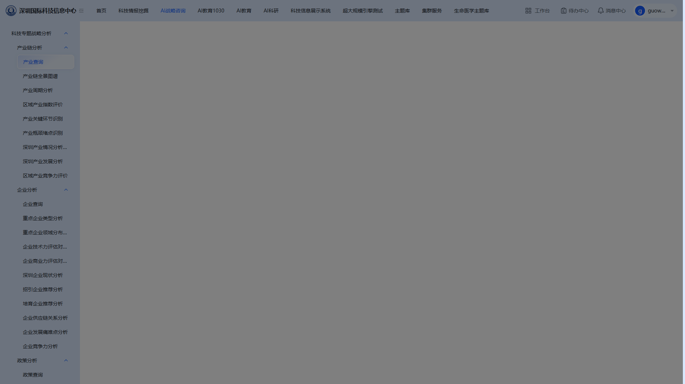

#### 3.2.2 产业链全景图谱

进入页面时若未指定分析对象，系统默认打开目录中首个可用产业的最新快照，无需创建分析任务。页面左上展示当前分析对象（产业领域 / 产业链 / 所属环节）与数据截至时间。

图谱区提供三个视图：图谱、结构列表、动态演进。图谱按上游、中游、下游展示产业链各环节及环节间关系，页面会说明当前结构包含的环节数与关系数；结构列表以清单方式列出环节信息；动态演进支持"当前状态 / 状态对比 / 演进时间轴"三种查看方式，底部图例标注新增、退出、关系变化、主体变化、技术替代五类变化。

选中环节或节点后可"查看画像"、加入对比篮，或直接"发起分析"跳转到对应分析页面；也可把节点企业加入招引候选、培育候选。"查看引育名单"可查看该产业已收录的招引与培育对象，"清空对比篮""重置"用于清理当前工作状态。

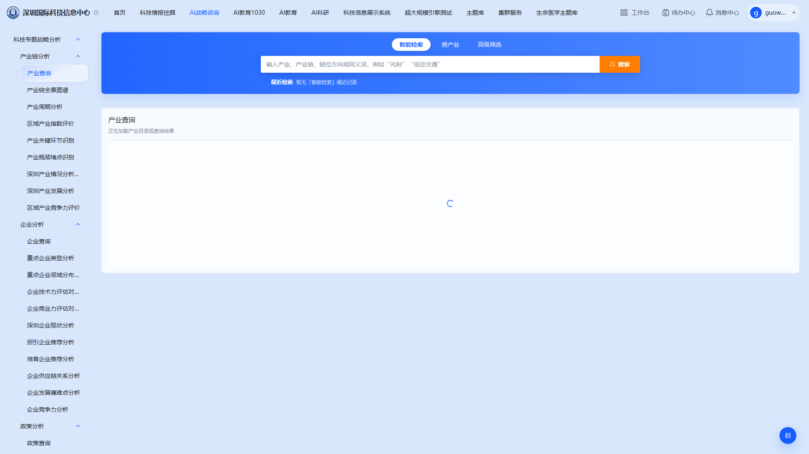

#### 3.2.3 产业周期分析

页面顶部为"产业周期分析"与"诊断记录"两个页签。

**分析配置**：先逐级选择分析对象（产业领域 → 产业链 → 环节），再选择分析时间范围（如"近5年"）。

**产业关键参数**：这是一组固定指标，不可增删，但可调整参数值：

| 指标名称 | 分组/维度 | 参数范围 | 数据来源 |
|---|---|---|---|
| 市场规模 | 产业关键参数 | 0–100000 亿元 | 产业市场快照 |
| 市场增长率 | 产业关键参数 | -50–100 % | 产业景气快照 |
| 利润率 | 产业关键参数 | -30–100 % | 产业盈利快照 |
| 技术成熟度 | 产业关键参数 | 0–100 分 | 技术成熟度快照 |

每项指标均可点击"查看"核对原始数据与指标说明。参数填写完毕后系统自动校验，显示"参数范围校验通过"方可点击"开始分析"；"重置参数"可恢复默认基准值。

**结果**：系统结合关键参数与内置模型判定产业所处周期阶段，并给出阶段判定依据与趋势说明，可查看完整分析报告。历史任务在"诊断记录"中查看。

在"诊断记录"页签中点击历史记录的"查看结果"，可打开该次分析的结果页：

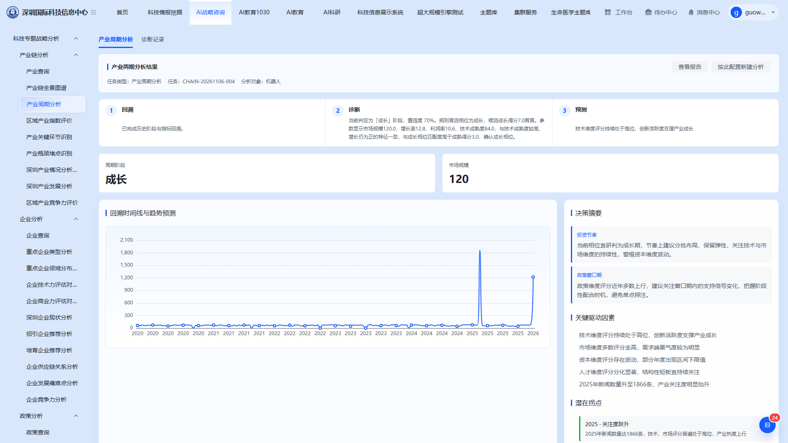

#### 3.2.4 区域产业指数评价

页面顶部为"区域产业指数评价"与"分析记录"两个页签。

**评价模式**：支持"单产业 × 多区域"与"多产业 × 单区域"两种模式，单产业模式需选择 1 个产业。

**分析对象与评价区域**：选择目标产业（如"新一代信息技术"），再选择 1–5 个评价区域（如"深圳市"）。

**评估模板**：默认使用"区域产业指数官方模板"。对官方模板的调整仅对本次任务生效，如需长期复用可通过"保存为个人模板"命名保存，下次直接选择个人模板；也可"添加指标"扩充指标集。

**指标与权重**：工作集内的指标默认全部计入，按商业力、技术力、学术力、支撑力四组归类，例如企业商业化能力、融资事件属于商业力，专利、技术成熟度属于技术力。每项指标可查看数据来源（企业与市场库、投融资库、知识产权库、技术评估库等）与指标说明，也支持"一键均分"。

**结果**：按综合评价模型给出各区域的综合指数与排名，并分四力维度展示各区域得分与指标贡献。历史任务在"分析记录"中查看。

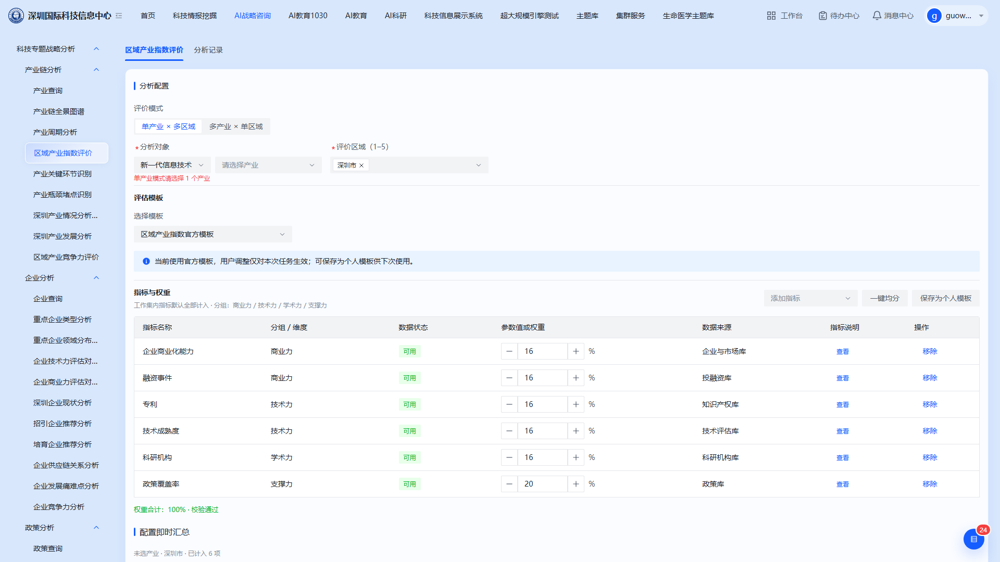

在"分析记录"页签中点击历史记录的"查看结果"，可打开该次分析的结果页：

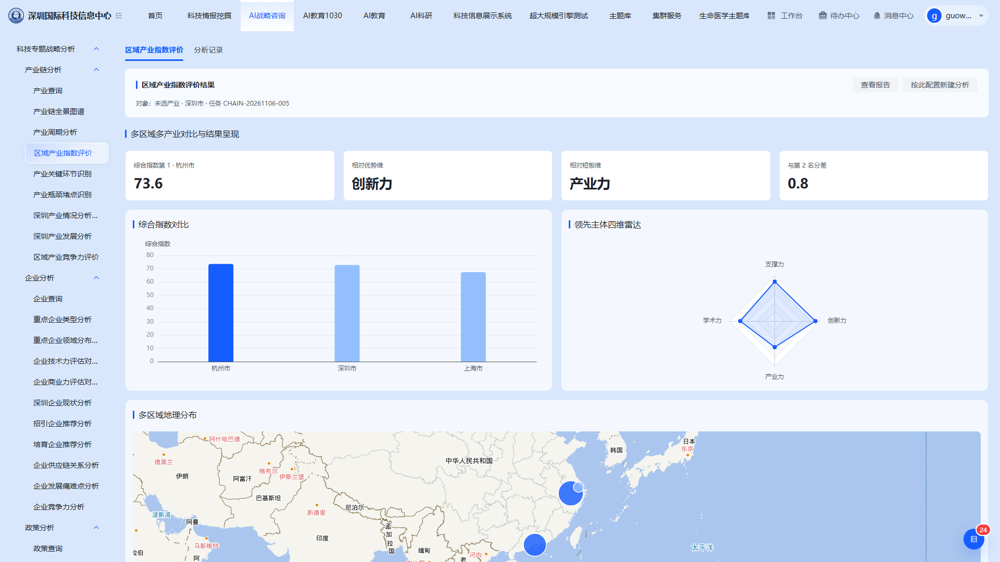

#### 3.2.5 产业关键环节识别

页面顶部为"产业关键环节识别"与"诊断记录"两个页签。

选择分析对象后，页面列出"注册识别因子"——附加值率、技术壁垒、市场集中度，三者的分组维度均为"关键环节识别因子"，数据分别取自环节价值结构、专利与工艺门槛、市场主体结构。该组指标为只读，确认权重合计为 100% 且校验通过后即可生成分析，无需逐项调整。

**结果**：输出全链路各环节的关键度评分与排序，标注识别出的关键环节，并给出每个环节的判定依据与数据来源，可对照查看指标说明。历史任务在"诊断记录"中查看。

在"诊断记录"页签中点击历史记录的"查看结果"，可打开该次分析的结果页：

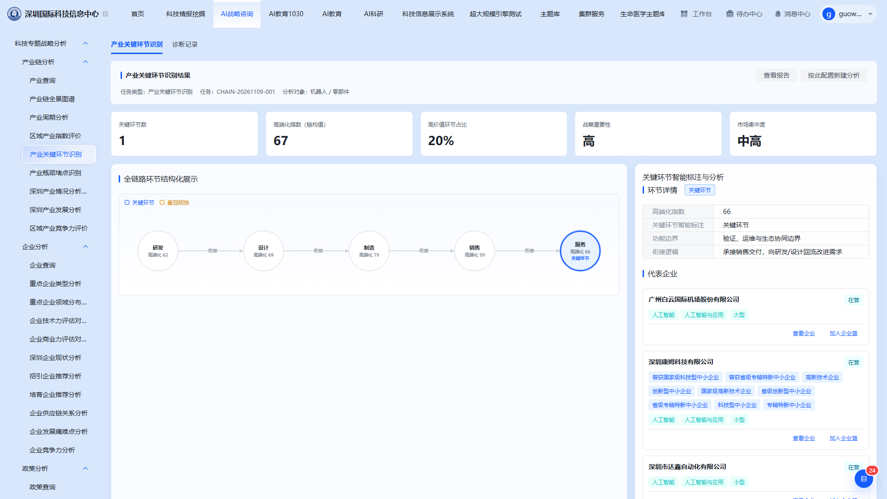

#### 3.2.6 产业瓶颈堵点识别

页面顶部为"产业瓶颈堵点识别"与"诊断记录"两个页签。

选择分析对象与所属产业链后，页面列出"注册诊断维度"——技术、人才、市场需求、资本、政策，五者分组维度均为"五维诊断维度"，数据分别取自技术供给快照、人才供给快照、需求景气快照、融资与投入快照、政策覆盖快照。该组指标为只读，权重合计 100% 校验通过后即可分析。

**结果**：以五维诊断结果定位产业链中的瓶颈堵点，标明堵点所在环节、成因与影响面，并给出可对照的优化方向。历史任务在"诊断记录"中查看。

在"诊断记录"页签中点击历史记录的"查看结果"，可打开该次分析的结果页：

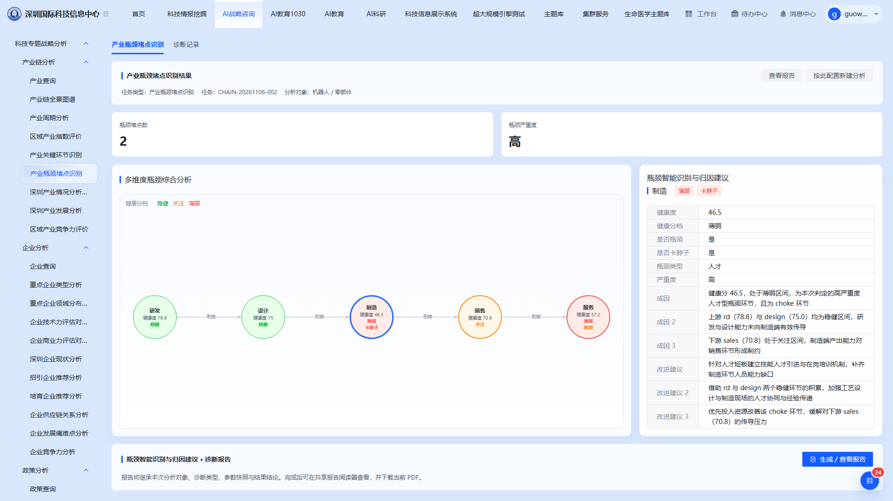

#### 3.2.7 深圳产业情况分析对比

该页面用于配置深圳与 1～5 个标杆区域的多维对比。

**分析对象**：选择目标产业（如"新一代信息技术"）。

**区域设置**：主体区域固定为"深圳"，不可更换；下方选择 1～5 个标杆区域，未选择时页面提示"请选择 1～5 个标杆区域"。

**四维模型**：对比维度为只读确认项，固定为企业、专利、政策、人才四维，分组维度标注为"对比四维"，数据来源为深圳对比模型，每项可查看指标说明。

确认区域后点击"开始分析"，**结果**展示深圳与各标杆区域在四个维度上的对比情况与差距说明。历史任务在"分析记录"中查看。

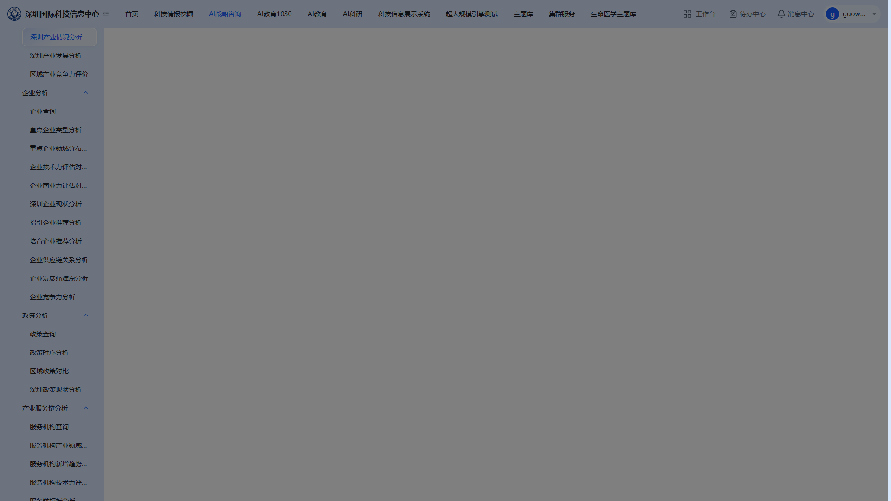

在"分析记录"页签中点击历史记录的"查看结果"，可打开该次分析的结果页：

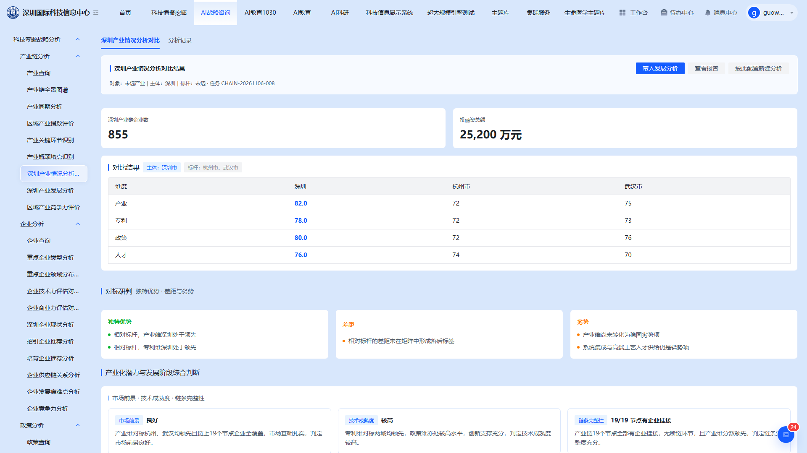

#### 3.2.8 深圳产业发展分析

该页面以"深圳产业情况分析对比"的结果为输入，进一步做专项发展分析。

**前置条件**：页面要求先完成一次"深圳产业情况分析对比"并查看结果，然后在"有效的深圳产业情况分析对比结果"下拉框中选择该结果；若没有可用结果，页面会给出提示并引导先完成对比。主体区域固定为"深圳"。

**分析配置**：选择分析对象与来源结果，再选择发展目标——政策、技术、人才，可多选。

点击"开始分析"后，**结果**围绕所选发展目标，结合对比结论给出深圳该产业的发展路径、重点突破方向与建议措施。历史任务在"分析记录"中查看。

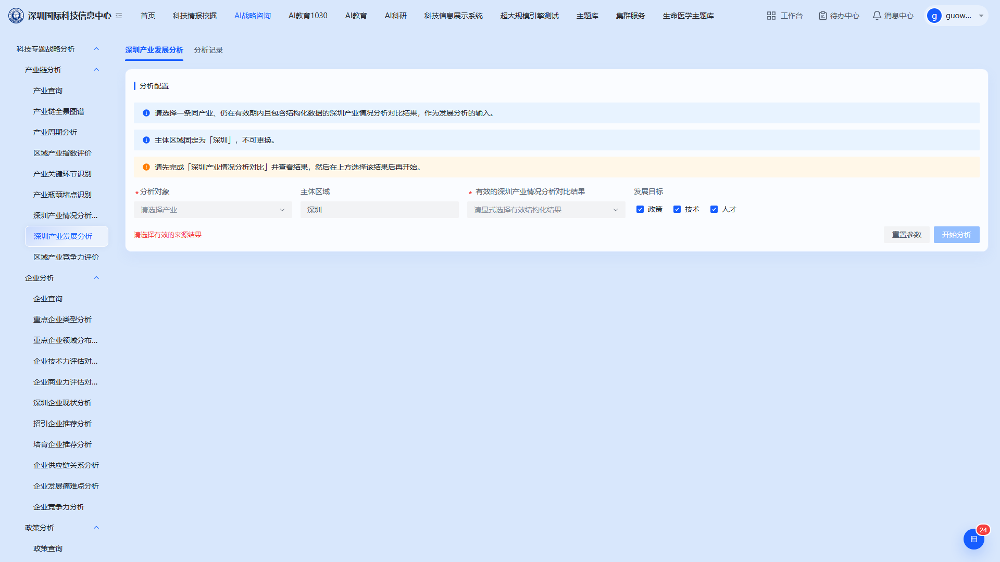

在"分析记录"页签中点击历史记录的"查看结果"，可打开该次分析的结果页：

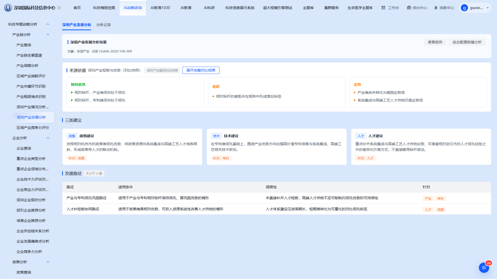

#### 3.2.9 区域产业竞争力评价

页面顶部为"区域产业竞争力评价"与"分析记录"两个页签。

**评价模式**：支持"单产业 × 多区域"与"多产业 × 单区域"两种模式。

**分析对象与评价区域**：选择目标产业，再选择 1–5 个评价区域。

**三大一级维度权重**：指标体系精简为三个一级维度——企业能力、学术生态、配套生态力，数据来源为竞争力模型。三项权重可直接调节，也可"一键均分"，同样支持保存为个人模板。

**结果**：输出各区域的综合竞争力指数与排名，同时按三大一级维度展开对比，说明各区域的强项与短板。历史任务在"分析记录"中查看。

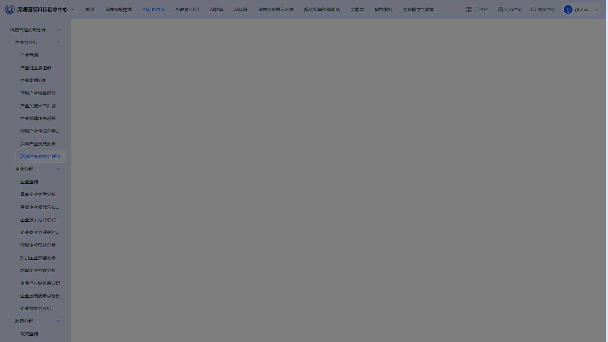

在"分析记录"页签中点击历史记录的"查看结果"，可打开该次分析的结果页：

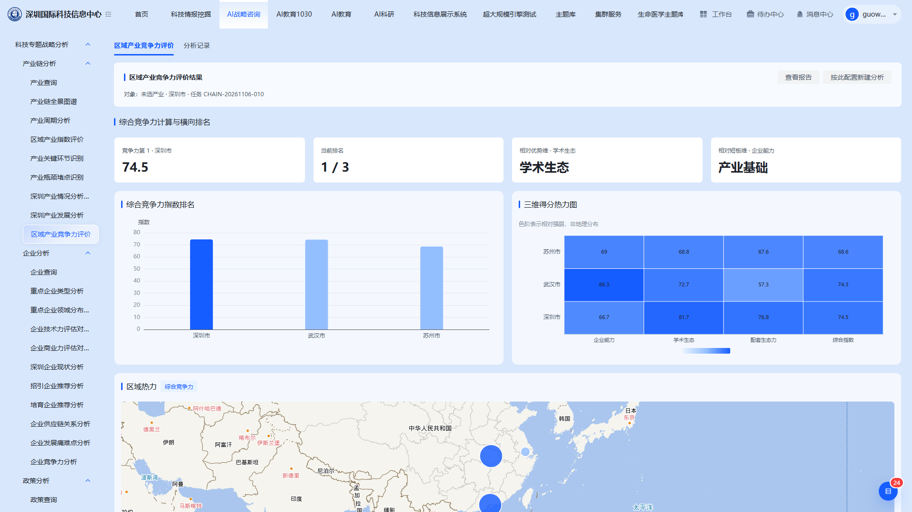

---

### 3.3 企业分析

#### 3.3.1 企业查询

页面提供三种检索方式：智能搜索、查企业、高级筛选。智能搜索框中可输入企业名、产业、资质、区域或专利关键词，系统自动关联多字段匹配企业。

首次进入时页面下方展示推荐企业，每条包含企业经营状态、资质标签、规模、所属产业、所在区域与推荐理由（按综合竞争力倒排的重点/明星企业推荐，不使用个人行为数据），可"查看画像"或"加入对比篮"。页面同时提供示例查询（人工智能、集成电路、生物医药、新能源、高端装备）、热门场景（深圳高新技术企业、深圳头部科技企业、专精特新小巨人、上市科技企业）与"最近检索"记录。

#### 3.3.2 重点企业类型分析

页面进入即展示默认分析结果，无需配置任务。顶部为查询条件区：区域（全国热门科创城市，可下钻到深圳等城市）、时间（开始年份 / 结束年份）、产业（如"新一代信息技术"）、企业类型（默认全部类型），并标注数据更新时间。

**结果区**包含：核心指标卡（匹配企业数、覆盖企业类型数、覆盖区域数）、重点企业空间分布（支持地图视图与列表视图切换，按区县列出企业数量并支持"显示热力"查看企业数量强度）、区域洞察（当前区域企业类型结构、同级区域分布排名）、关联企业清单。点击"查看企业清单"可展开完整名单，点击"查看 HTML 报告"可导出报告。

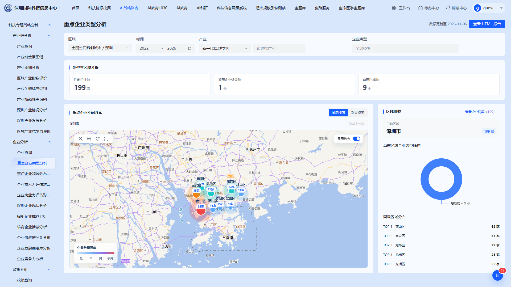

#### 3.3.3 重点企业领域分布分析

分析对象来自对比篮：先在查询页把目标企业加入对比篮，再回到本页点击"打开对比篮"或"前往对比篮选择企业"带入。未选择对象时页面显示"尚未选择分析对象"并给出引导。

选定企业后，**结果**展示所选企业在各产业领域的分布情况与领域结构占比，可点击"查看 HTML 报告"导出完整报告。

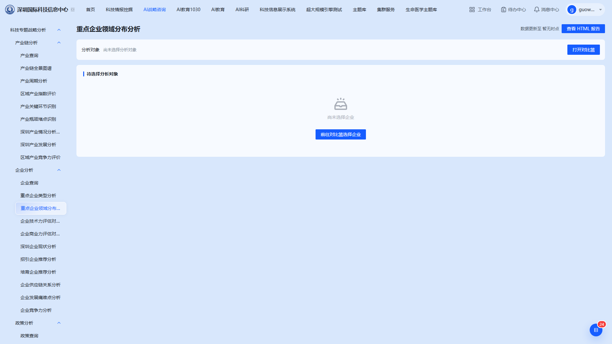

#### 3.3.4 企业技术力评估对比分析

页面顶部为"当前分析"与"最近评估"两个页签。

**评估对象**：需先在对比篮中选择企业，再进入评估配置；未选择时页面提示"请先在对比篮选择企业"。

**评估模板**：默认"技术力标准模板"，调整后可"保存为个人模板"供下次复用。

**指标与权重**：技术力五维为技术人才、技术创新、技术转化、技术合作、技术投入，数据来源分别为评估模型、专利数据与经营数据。每项可勾选是否计入、可调节权重，支持"一键平均分配"；权重合计 100% 且校验通过后，"数据覆盖与可信度"面板会给出所选企业的数据完整度提示。

点击"开始分析"后，**结果**输出所选企业的技术力综合得分、五维得分对比与排名，并说明各维度得分依据。历史任务在"最近评估"中查看。

在"最近评估"页签中点击历史记录的"恢复结果"，可打开该次分析的结果页：

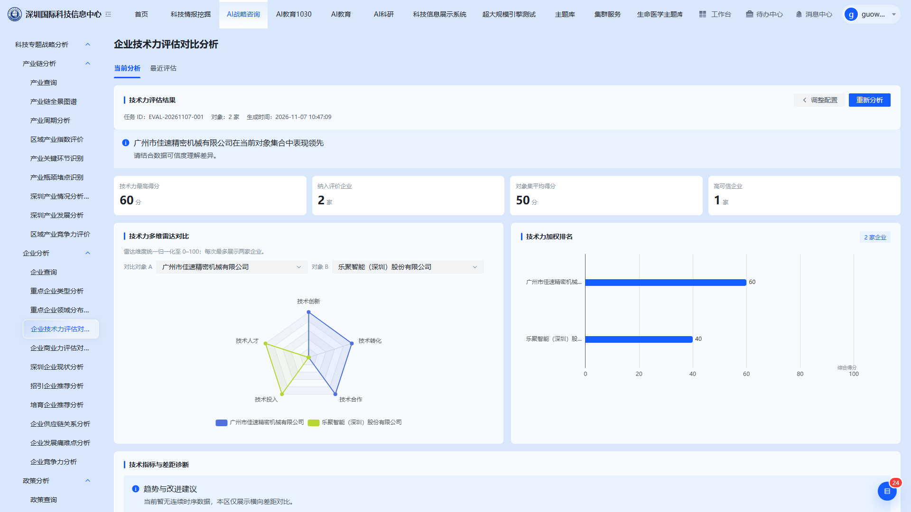

#### 3.3.5 企业商业力评估对比分析

操作流程与技术力评估一致，区别在于评估模型与指标构成。

**指标与权重**：商业力六维为市场、产品、品牌、技术合作、产业链覆盖率、关键环节参与度，数据来源为评估模型与产业链数据。同样支持勾选、调权、一键平均分配与保存个人模板，权重合计 100% 校验通过后可分析。

**结果**：输出所选企业的商业力综合得分、六维对比与排名，并结合产业链覆盖率、关键环节参与度说明其市场化水平。历史任务在"最近评估"中查看。

在"最近评估"页签中点击历史记录的"恢复结果"，可打开该次分析的结果页：

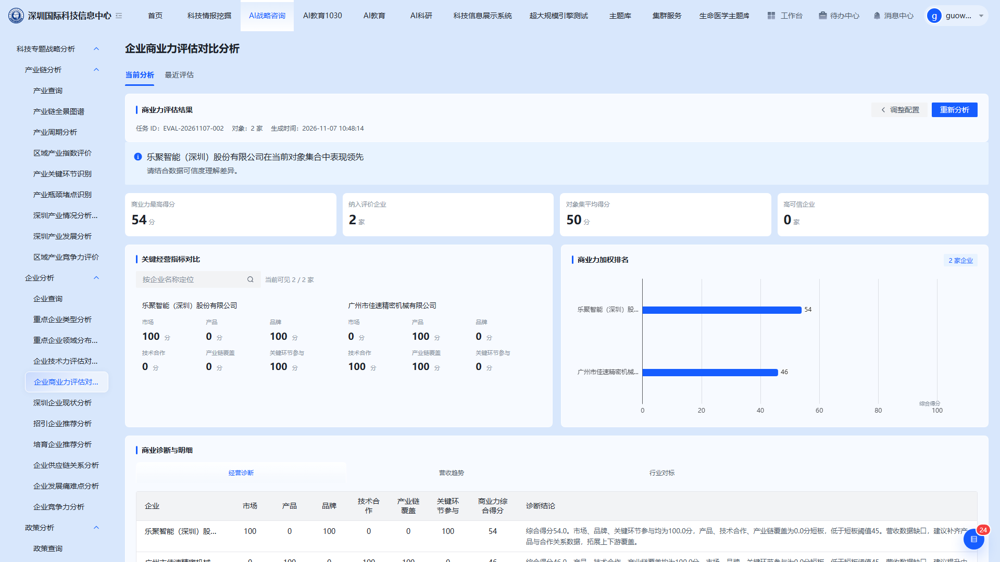

#### 3.3.6 深圳企业现状分析

页面提供"产业链定位"与"多城市横向对标"两个视图。区域固定为深圳市。

选择产业链后加载分析内容（未选择时提示"请先选择产业链以加载深圳现状分析"）。**产业链定位**展示深圳企业在产业链各环节的分布与位置；**多城市横向对标**将深圳与对标城市在企业数量、结构、竞争力等方面做横向比较，并说明竞争力差距与生态完整性。页面标注数据更新时间，可点击"查看 HTML 报告"导出。

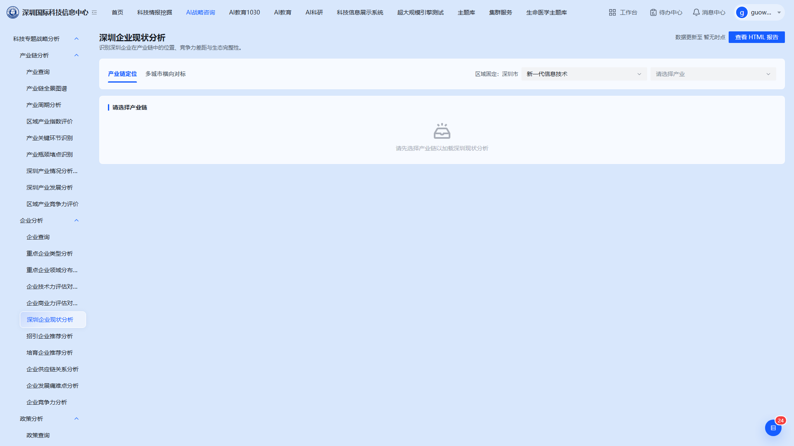

#### 3.3.7 招引企业推荐分析

页面顶部为三个页签：条件筛选推荐、候选工作台、最近分析。

**招引推荐条件**：企业范围（全国企业）、企业标签（可多选）、行业领域（如"新一代信息技术"）、地域来源（如"全国"）。

**统一判定模型**：三个判定维度固定，不可增删：

| 判定维度 | 支撑因子 |
|---|---|
| 技术匹配度 | 产业相关度、技术领域/产业链环节匹配 |
| 成长性 | 营收与研发增速、企业成长潜力 |
| 区域适配性 | 政策匹配度、深圳生态连接、落地与合作条件 |

设置条件后点击"开始分析"，下方"推荐分析结果"区即输出候选企业清单，按判定模型给出匹配说明；可把中意企业加入招引候选清单，在"候选工作台"中继续筛选与调整。历史推荐任务在"最近分析"中查看。

在"最近分析"页签中点击历史记录的"恢复结果"，可打开该次分析的结果页：

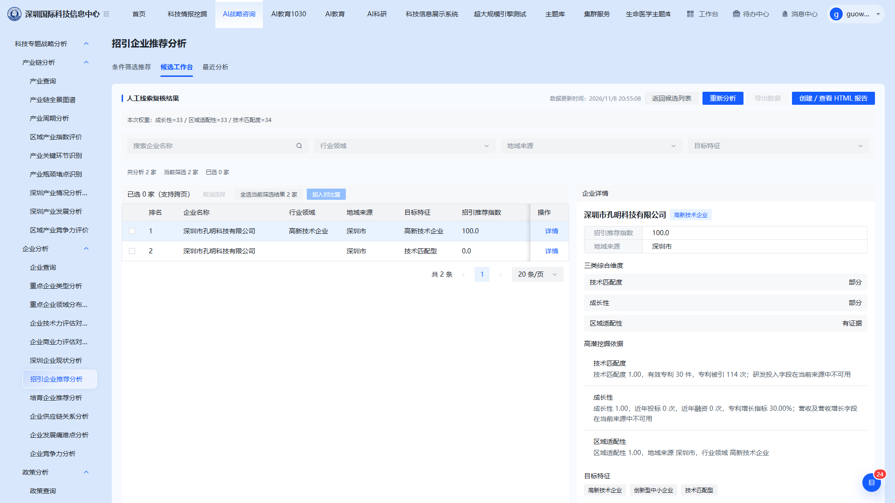

#### 3.3.8 培育企业推荐分析

页面顶部同样为三个页签：条件筛选推荐、候选工作台、最近分析。

**培育推荐条件**：企业范围固定为"深圳市内企业"，另可选择产业类别（如"新一代信息技术"）、政策导向与企业规模。

**统一判定模型**：三个判定维度固定，不可增删：

| 判定维度 | 支撑因子 |
|---|---|
| 技术壁垒 | 技术积累、创新与差异化能力 |
| 市场增速 | 营收与订单增速、企业成长潜力 |
| 团队背景 | 核心团队经历、研发与产业化能力 |

设置条件后点击"开始分析"，"推荐分析结果"区输出深圳本地培育候选企业清单及判定说明，可加入培育候选清单后在"候选工作台"中处理。历史任务在"最近分析"中查看。

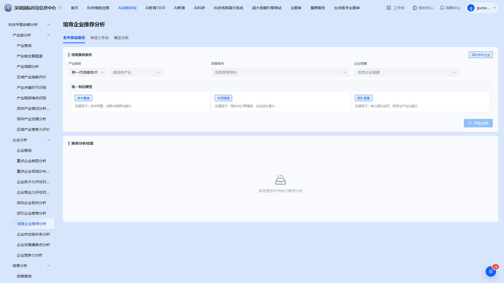

在"最近分析"页签中点击历史记录的"恢复结果"，可打开该次分析的结果页：

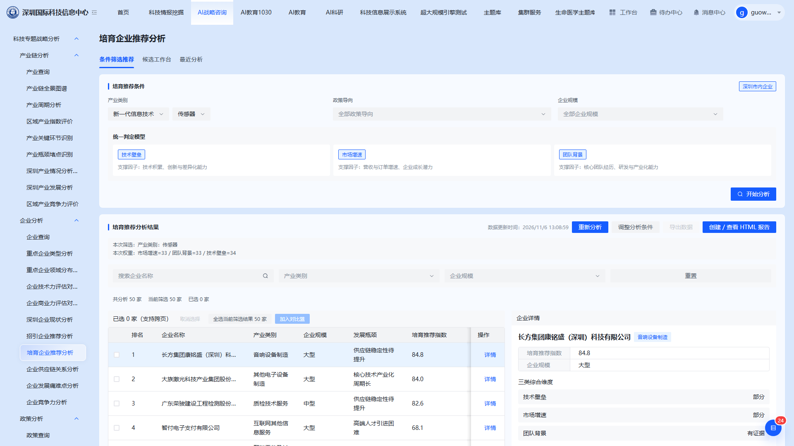

#### 3.3.9 企业供应链关系分析

页面顶部为"当前分析"与"最近分析"两个页签。

**分析对象**：从对比篮选择企业（未选择时提示"请先在对比篮选择企业"）。

**关系范围**：可勾选供应商、客户、合作伙伴。页面说明结果默认展示一级关系，可在图谱中按节点逐层展开。选择企业后"数据与权限预检"面板会展示数据可用性。

点击"开始分析"后，**结果**以关系图谱呈现企业的供应链上下游关系，节点按类型区分供应、客户与合作方，支持逐层展开查看链路。历史任务在"最近分析"中查看。

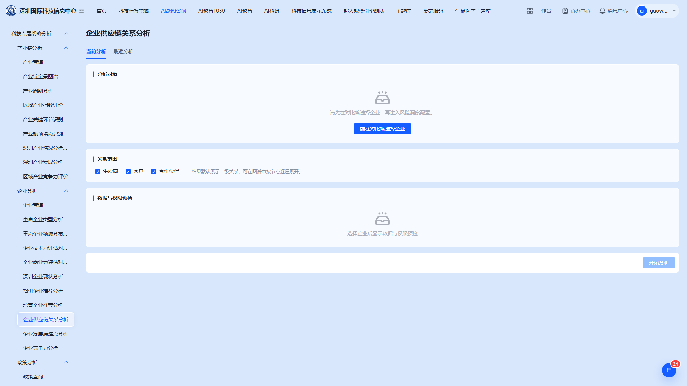

在"最近分析"页签中点击历史记录的"恢复结果"，可打开该次分析的结果页：

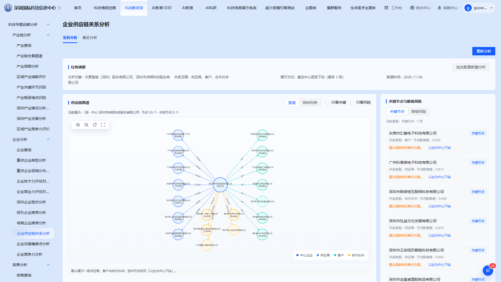

#### 3.3.10 企业发展痛难点分析

页面顶部为"当前分析"与"最近分析"两个页签。

**分析对象**：从对比篮选择企业。**诊断范围**：可勾选技术研发、市场拓展、融资、管理。选择企业后同样展示"数据与权限预检"。

点击"开始分析"后，**结果**按所选诊断范围输出企业发展的痛难点清单，标注问题类型、成因与影响程度。历史任务在"最近分析"中查看。

在"最近分析"页签中点击历史记录的"恢复结果"，可打开该次分析的结果页：

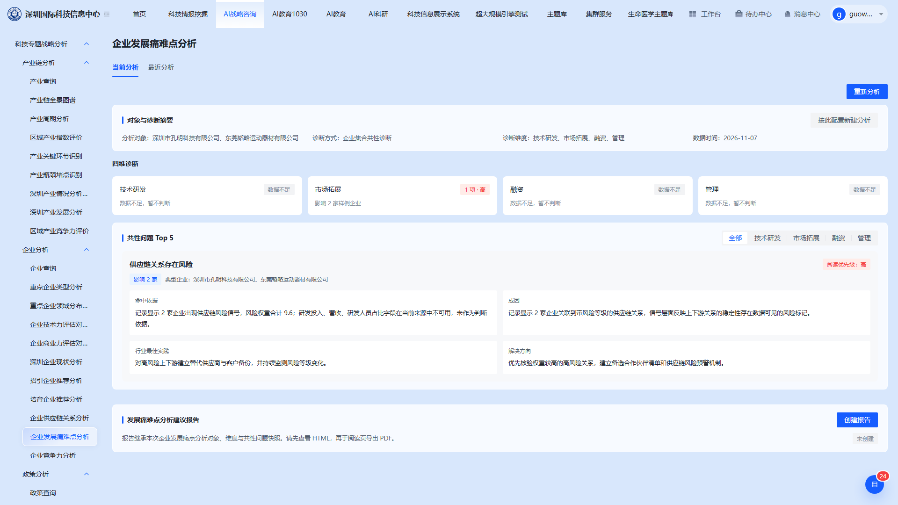

#### 3.3.11 企业竞争力分析

页面顶部为"当前分析"与"最近评估"两个页签。

**评估对象**：从对比篮选择企业。**评估模板**：默认"综合竞争力标准模板"，可保存为个人模板。

**指标与权重**：综合竞争力三域为创新能力、经营能力、成长能力，数据来源分别为创新指标模型与综合评估模型。支持勾选、调权、一键平均分配，权重合计 100% 校验通过后可分析。

**结果**：输出所选企业的综合竞争力得分、三域对比与排名，可结合数据覆盖与可信度判断结论可靠度。历史任务在"最近评估"中查看。

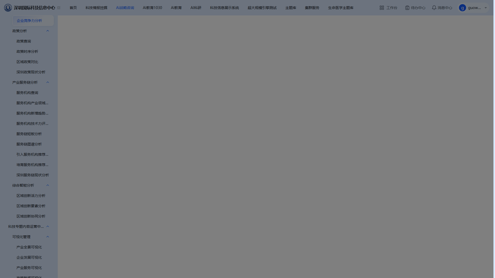

在"最近评估"页签中点击历史记录的"恢复结果"，可打开该次分析的结果页：

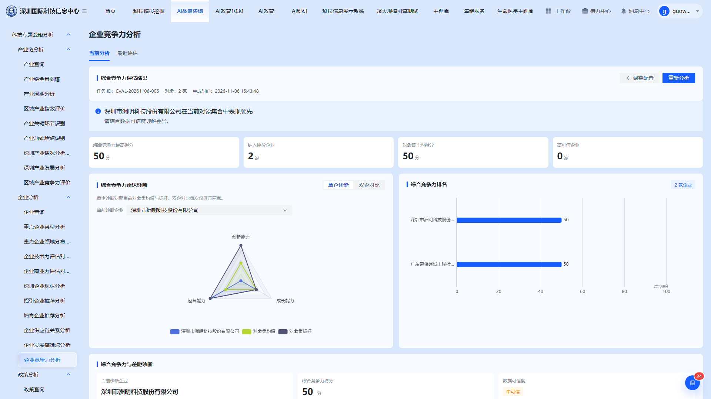

---

### 3.4 政策分析

#### 3.4.1 政策查询

页面提供三种检索方式：智能检索、查政策、高级筛选。智能检索支持用一句话描述政策需求，例如"深圳近三年固态电池扶持政策"，系统据此匹配相关政策。

页面提供示例查询（深圳近三年固态电池扶持政策、合成生物 专项资金、广东 省级 科创政策、高层次人才 安居）与热门场景（国家级政策、科创政策、人才政策、广东政策、深圳政策）。未检索时下方展示"最新发布政策"列表，每条包含政策标题、类型、效力状态、摘要、发布机关、地区与发布时间，可"查看详情"。

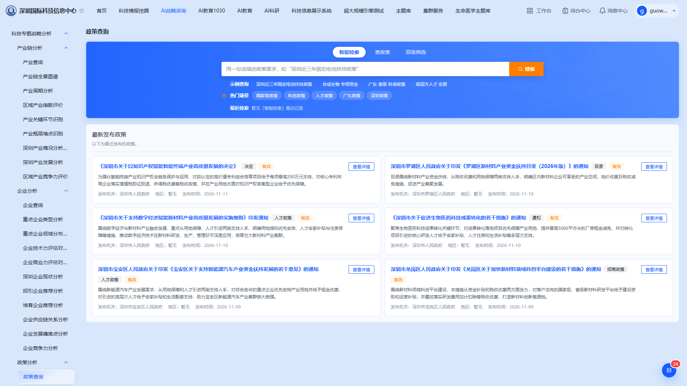

#### 3.4.2 政策时序分析

页面顶部为"政策时序分析"与"分析记录"两个页签。

**分析配置**：对象类型支持"产业"与"技术领域（可多选）"；选择对象后设置时序粒度（年 / 季 / 月）与权威渠道（国家部委、地方政府）。未选择分析对象时，权威渠道选项灰显，不可生成分析。

**时序三维**：发布时间、效力层级、支持力度，三项为固定分析维度。

点击"开始分析"后，**结果**以时序方式呈现政策发布节奏、层级构成与支持力度变化，可据此判断政策供给的连续性与强度。历史任务在"分析记录"中查看。

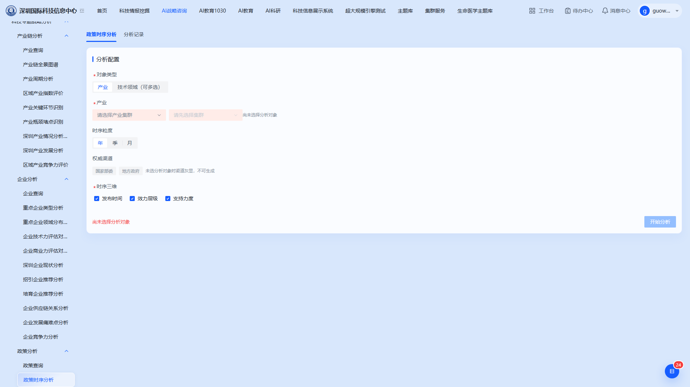

在"分析记录"页签中点击历史记录的"查看结果"，可打开该次分析的结果页：

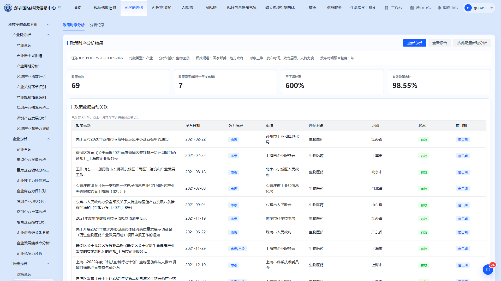

#### 3.4.3 区域政策对比

页面顶部为"区域政策对比"与"对比记录"两个页签。

**分析配置**：对象类型支持产业与技术领域（可多选）。

**对比区域**：对比基准固定为"深圳（大湾区）"，不可去掉；可勾选长三角、粤港澳大湾区作为主要对比区域，并追加京津冀、成渝等对标区域（可选）。

**评价维度**：资金规模、土地供给、税收优惠、人才政策、创新激励，五项可勾选。

点击"开始分析"后，**结果**按所选维度对比各区域的政策力度与结构差异，凸显深圳的相对优势与不足。历史任务在"对比记录"中查看。

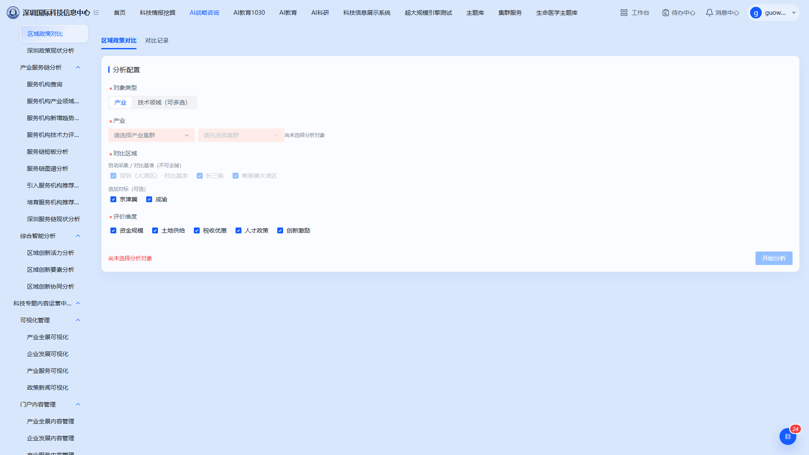

在"对比记录"页签中点击历史记录的"查看结果"，可打开该次分析的结果页：

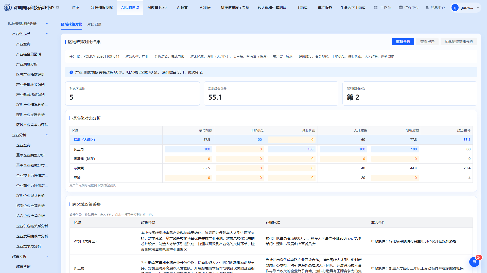

#### 3.4.4 深圳政策现状分析

页面顶部为"深圳政策现状分析"与"分析记录"两个页签。

**分析配置**：选择对象类型与产业/技术领域对象。

**指标体系构建**：三维框架固定，勾选核心指标入模；维内等权自动均分，行内可调节一级权重。页面会提示当前已入模的核心指标数量与一级权重合计（默认 8 项、100%），可"一键均分"或"恢复默认模型"。

**指标示例**：支持力度维度下含政策数量、资金规模、创新激励、政策层级覆盖面；产业适配性维度下含政策-产业需求匹配、产业链覆盖广度、细分领域命中率。未勾选的指标标注"未入模"，不计入综合得分。

**结果**：输出深圳在所选产业下的政策供给综合得分与维度构成，并逐项列出原始指标表现与说明，可查看完整报告。历史任务在"分析记录"中查看。

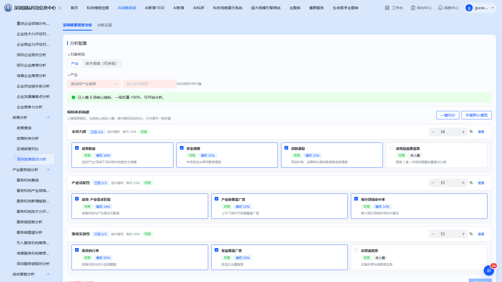

在"分析记录"页签中点击历史记录的"查看结果"，可打开该次分析的结果页：

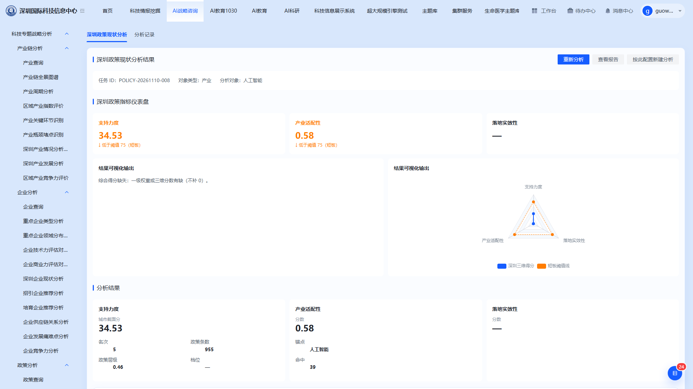

---

### 3.5 产业服务链分析

#### 3.5.1 服务机构查询

页面提供三种检索方式：智能检索、查机构、高级筛选。智能检索支持用一句话描述机构需求，例如"深圳 检验检测"。

未检索时页面展示"技术力领先机构"，默认给出技术力分领先的 6 家机构作为查询起点，每条包含机构名称、行业分类、城市、省份、区域与技术力分，可"加入对比篮"或"加入分析集合"。页面提供示例查询（深圳 检验检测、科技创新服务 南山、知识产权 广东）与最近检索记录。

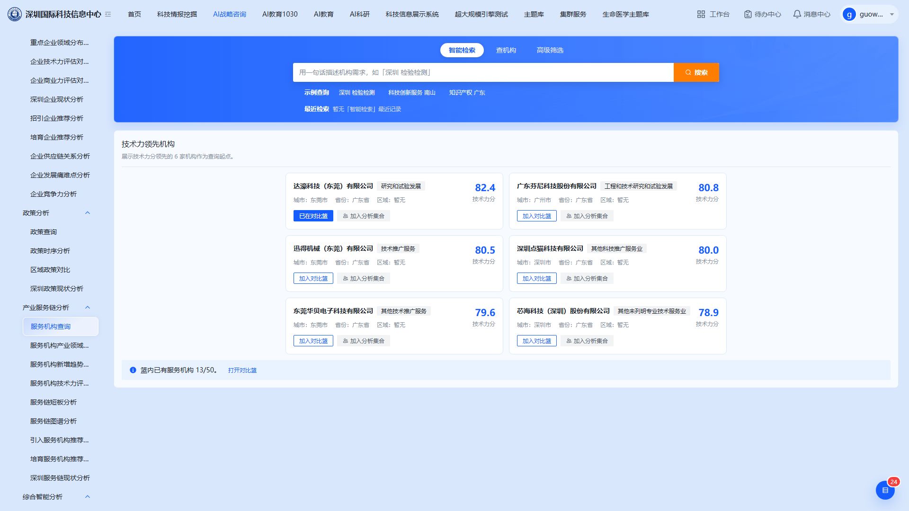

#### 3.5.2 服务机构产业领域分析

页面顶部为"服务机构产业领域分析"与"分析记录"两个页签。

**分析对象**：从对比篮选择机构，页面显示"当前分析机构数"与"已选机构"数量；未选择时提示先在对比篮中组装分析对象，并提供"打开对比篮"入口。

选定机构后点击"开始分析"，**结果**展示所选机构的服务产业领域覆盖情况与领域结构，用于判断其服务范围与产业契合度。历史任务在"分析记录"中查看。

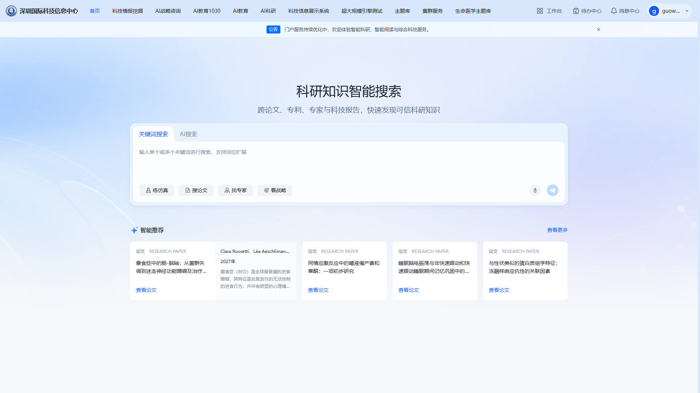

在"分析记录"页签中点击历史记录的"查看结果"，可打开该次分析的结果页：

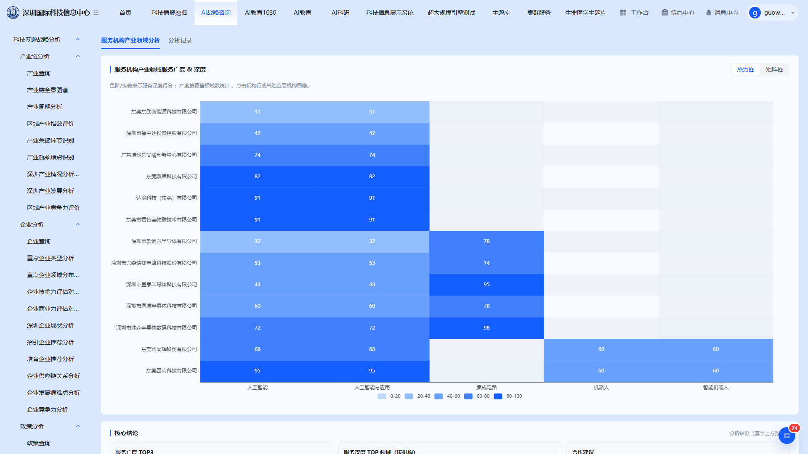

#### 3.5.3 服务机构新增趋势分析

页面顶部为"服务机构新增趋势分析"与"分析记录"两个页签。

**分析配置**：选择主领域（如"新一代信息技术 / 集成电路"）。页面特别说明：主领域参与分析条件，切换后须重新分析。

点击"开始分析"后，**结果**按时间展现该领域服务机构的增长趋势、新增节奏与结构变化。历史任务在"分析记录"中查看。

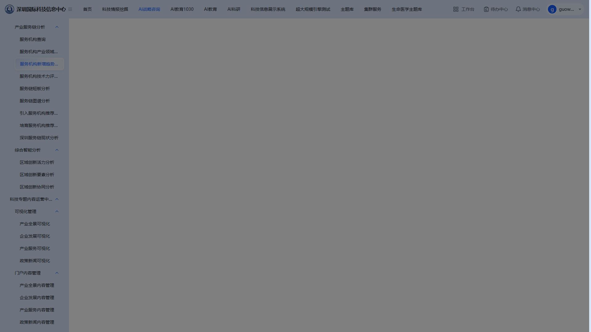

在"分析记录"页签中点击历史记录的"查看结果"，可打开该次分析的结果页：

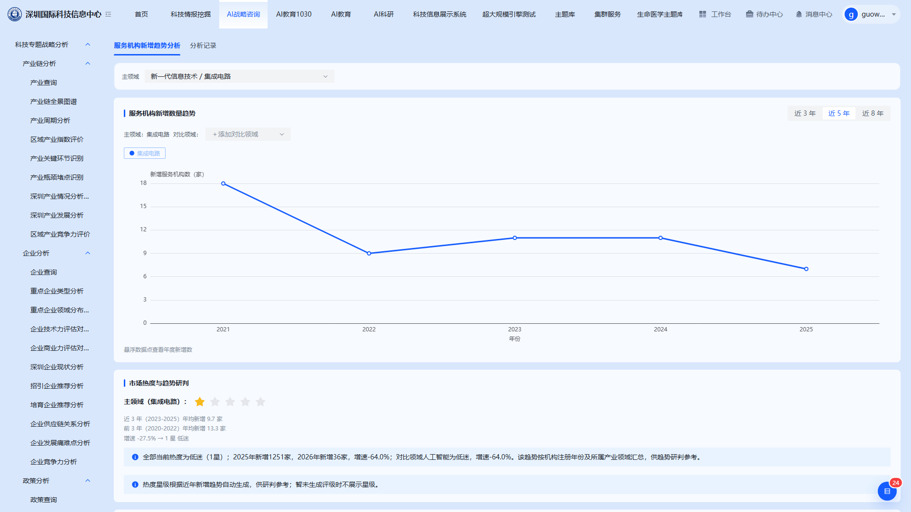

#### 3.5.4 服务机构技术力评估分析

页面顶部为"服务机构技术力评估分析"与"分析记录"两个页签。

**对比机构**：从系统对比篮中勾选 2～5 家机构（页面注明"对比机构须为 2～5 家"），也可点击"从对比篮带入"批量导入。

**技术力评价模型**：默认包含专利数量、研发投入、核心专家、成功案例、标准制定五个维度，可"添加自定义维度"；权重合计需为 100%（页面显示"已对齐"）。

点击"开始评估"后，**结果**输出各机构的综合技术力得分、五维对比与排名，并说明得分依据。历史任务在"分析记录"中查看。

在"分析记录"页签中点击历史记录的"查看结果"，可打开该次分析的结果页：

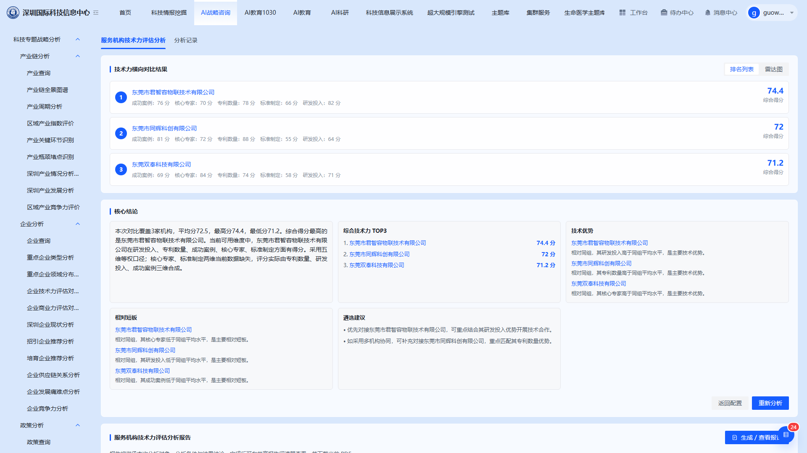

#### 3.5.5 服务链短板分析

页面顶部为"服务链短板分析"与"分析记录"两个页签。

**分析配置**：选择产业领域（如"新一代信息技术 / 集成电路"）。分析条件按当前产业生成，切换产业不会自动开始分析，需确认后手动点击"开始分析"。

**结果**：定位该产业服务链中的薄弱环节与缺口类型，给出短板环节的服务供需对比。历史任务在"分析记录"中查看。

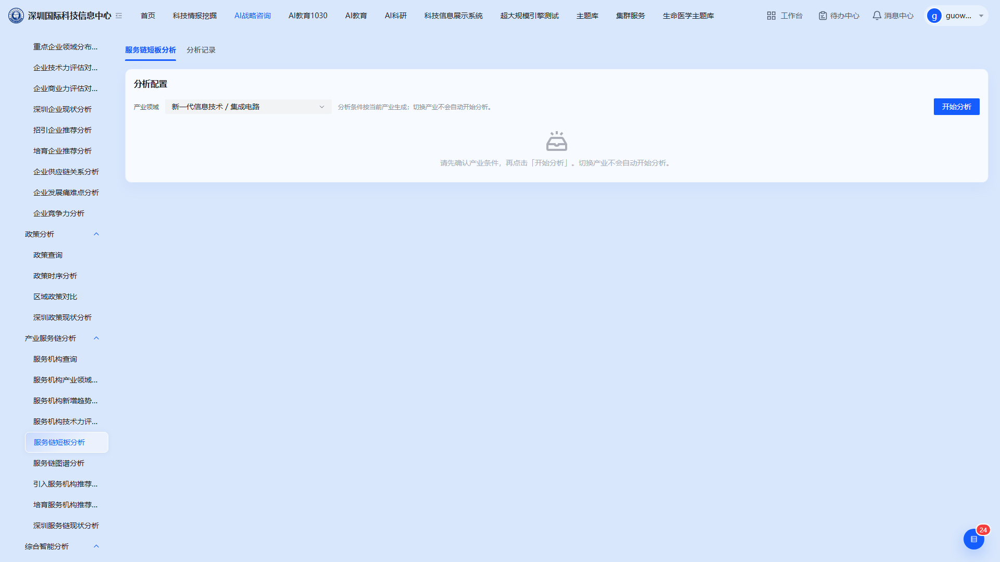

在"分析记录"页签中点击历史记录的"查看结果"，可打开该次分析的结果页：

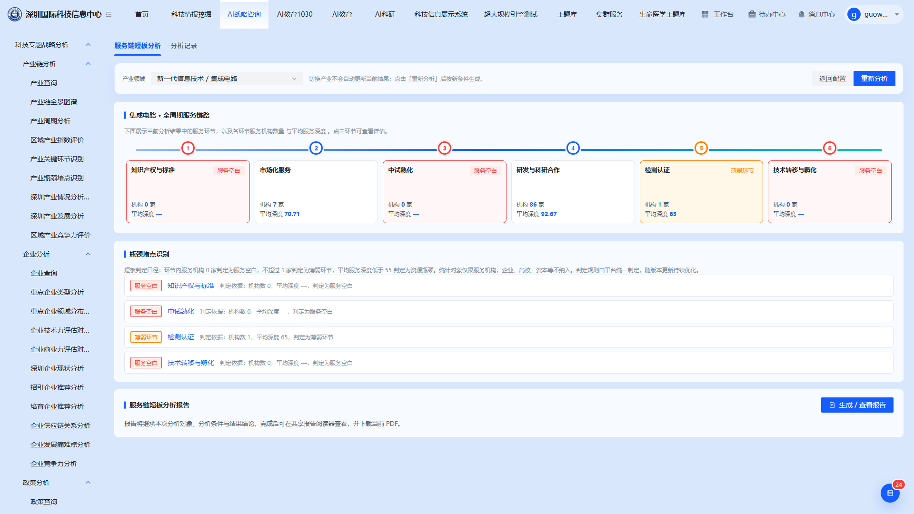

#### 3.5.6 服务链图谱分析

页面顶部为"服务链图谱分析"与"分析记录"两个页签。

**分析配置**：选择产业领域，并设置显示范围——"仅服务机构"或"服务机构及关联主体"。切换页面或显示范围不会自动开始分析，查看结果时按当前选择展示图谱。

**结果**：以图谱形式呈现该产业的服务链结构，节点为服务机构及其关联主体，连线表示服务关系，可据此观察服务链的层级与覆盖。历史任务在"分析记录"中查看。

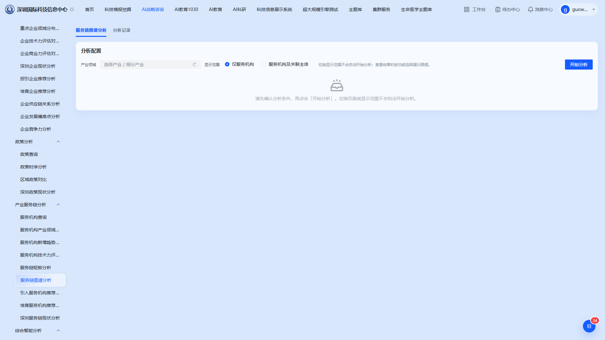

在"分析记录"页签中点击历史记录的"查看结果"，可打开该次分析的结果页：

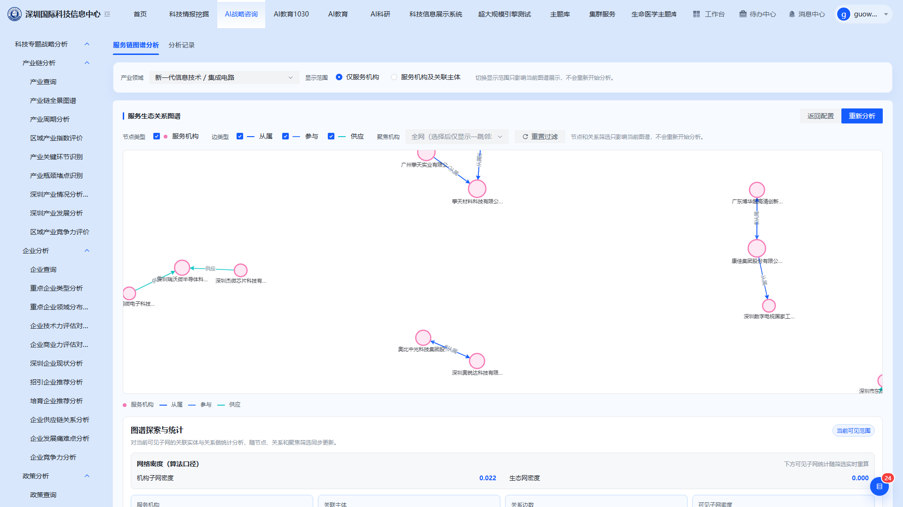

#### 3.5.7 引入服务机构推荐分析

页面顶部为"引入服务机构推荐分析"与"分析记录"两个页签。

**分析配置**：选择重点产业方向（如"新一代信息技术 / 集成电路"），名单按所选产业切片，切换产业会重新请求名单并生成新分析。

**招引推荐模型**：四个维度权重固定——产业匹配度 35%、技术领先性 30%、发展潜力 20%、对外合作意愿 15%。

点击"生成招引名单"后，**结果**输出可引入的服务机构候选名单及推荐理由，便于形成招引目标清单。历史任务在"分析记录"中查看。

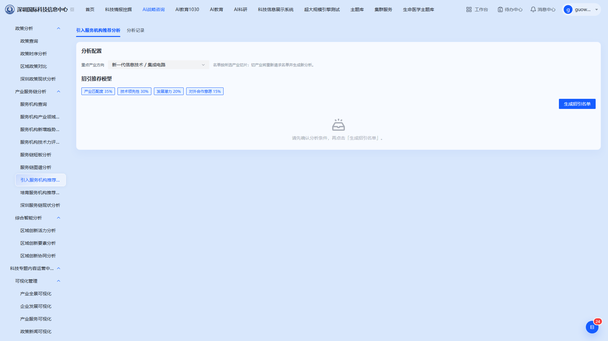

在"分析记录"页签中点击历史记录的"查看结果"，可打开该次分析的结果页：

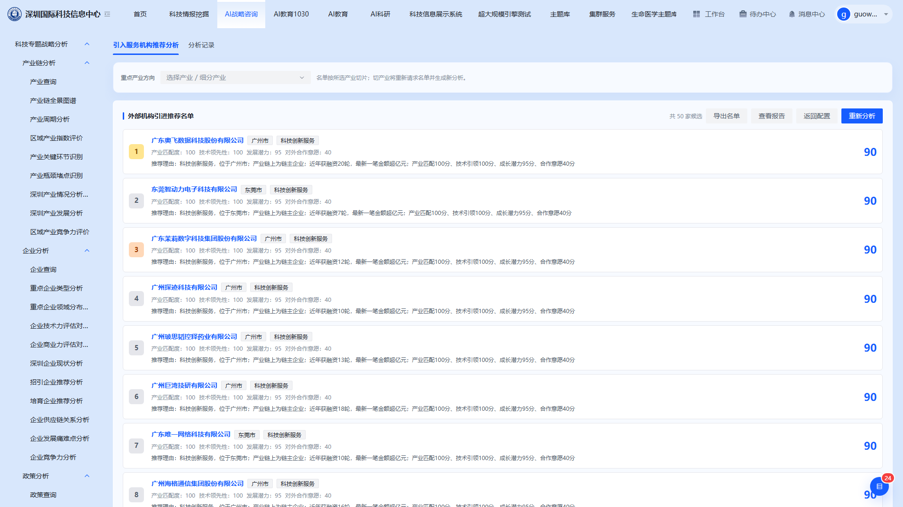

#### 3.5.8 培育服务机构推荐分析

页面顶部为"培育服务机构推荐分析"与"分析记录"两个页签。

**分析配置**：选择重点产业方向与服务环节（如"上游·研发"）。切换产业方向会发起新的分析任务；页面说明所列权重仅作说明，不参与前端重算排名。

**培育评估模型**：四个维度——现有规模 25%、技术创新能力 30%、服务成效 25%、市场缺口 20%。

点击"生成培育名单"后，**结果**输出值得培育的服务机构名单与培育方向建议。历史任务在"分析记录"中查看。

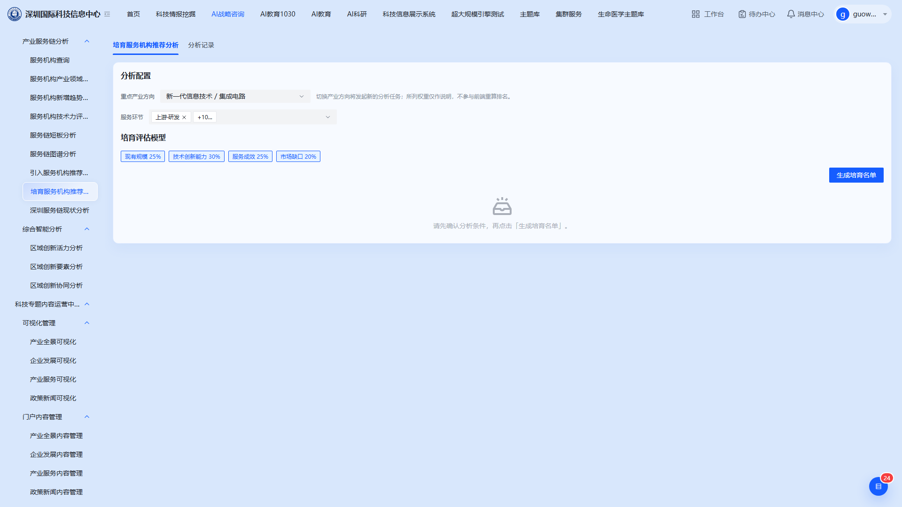

在"分析记录"页签中点击历史记录的"查看结果"，可打开该次分析的结果页：

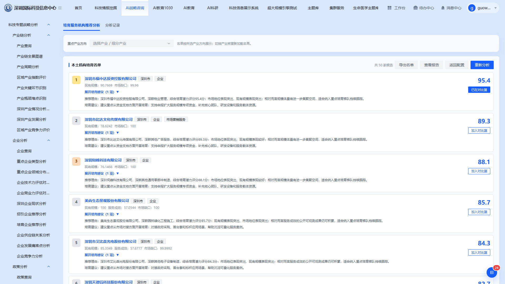

#### 3.5.9 深圳服务链现状分析

页面顶部为"深圳服务链现状分析"与"分析记录"两个页签。

**分析配置**：选择产业领域。分析条件按当前产业生成，切换产业不会自动开始分析，需确认后手动点击"开始分析"。

**结果**：面向深圳，展示该产业服务链的整体现状，包括各环节服务机构规模、覆盖情况与相对薄弱处，可与服务链短板分析结合使用。历史任务在"分析记录"中查看。

在"分析记录"页签中点击历史记录的"查看结果"，可打开该次分析的结果页：

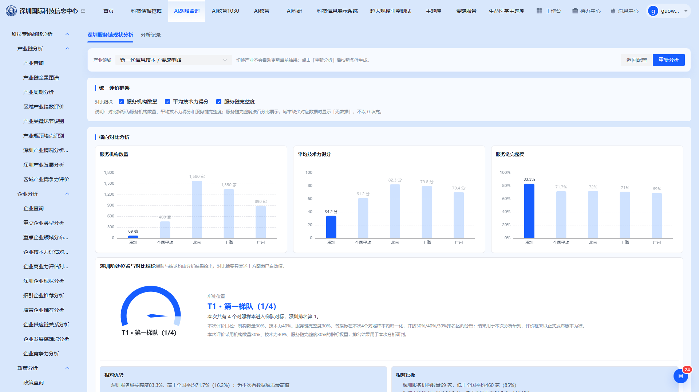

---

### 3.6 综合智能分析

#### 3.6.1 区域创新活力分析

页面进入即展示默认分析结果。查询条件区包括目标区域（默认"深圳"）、对比范围（默认"全国重点城市"）、时间窗（默认"最近3年"，系统默认值）。

**结果区**包含：

- **区域活力指数**：综合得分、与对比均值的差值、同比情况（无可比期时给出说明）。
- **综合评价模型**：科技、产业、人才、政策四个维度及各自权重（默认 30% / 30% / 20% / 20%），并展示各维度得分。
- **指标体系构建**：按维度分项列出指标、口径、原始值与得分，例如专利授权量、高质量论文数量、技术转化成效等。
- **区域排名**：与对比城市并列排名（如深圳、广州、东莞、惠州），可点击"下钻要素分析"进入区域创新要素分析，或"查看协同分析"进入区域创新协同分析。

点击"生成分析报告"可导出完整报告，"分析记录"中可查看历史任务快照。

#### 3.6.2 区域创新要素分析

页面进入即展示目标区域（如深圳）的要素分析结果，查询条件与活力分析一致（对比范围、时间窗）。

**要素全景数据库**：按企业、机构、人才、资金、空间五类汇总要素数量，并可切换查看各类要素的 Top5 明细（如企业注册资本、机构科研项目数、人才 H 指数）。

**要素评分**：展示各要素的得分与临时权重、结构、成熟度与均衡度，标注是否达标；下方按产业领域、技术领域列出指标、口径、透镜、权重、原始值等明细。

页面提供"重新分析""返回活力分析""查看协同分析""生成分析报告"等操作，"分析记录"中可查看历史任务。

#### 3.6.3 区域创新协同分析

页面进入即展示目标区域（如深圳）的协同分析结果，并标注计算方法与发布时间。

**核心指标**：区域创新协同指数、与全国重点城市均值的差值、同比情况，以及网络完整度、中心度、密度三项构成指标（分别对应有关系主体覆盖比、核心辐射力、合作紧密度）。

**合作关系输入构成**：联合专利、合作项目、人才流动等关系数量。

**创新主体关系图谱**：以节点和连线呈现创新主体之间的合作关系，支持拖拽节点探索关系、滚轮缩放查看全局，可按产业领域、主体类型（企业、科研机构、人才、产业园区、服务机构）与关系类型筛选；下方以表格列出源、目标、关系与权重。

**建议**：结合集群与主体明细给出协同提升建议。点击"生成协同效率报告"可导出完整报告，"分析记录"中可查看历史任务。

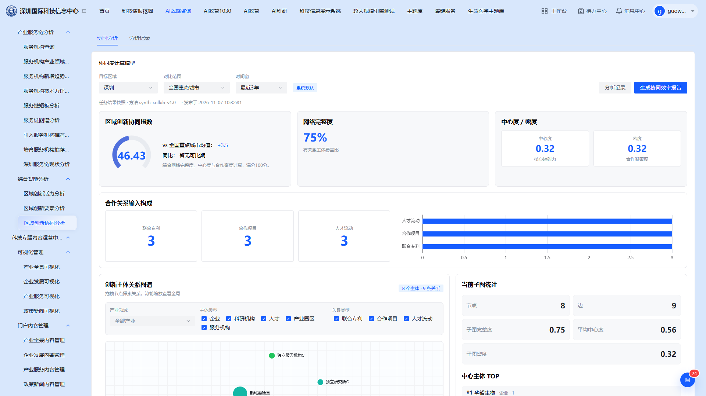

## 4 用户操作常见问题及处理

### 4.1 登录后权限不足部分菜单不可见

- **现象**：登录后发现某些维度菜单不可见
- **原因**：用户角色权限未配置；系统按角色矩阵控制菜单可见性
- **处理**：联系系统管理员分配对应角色权限

### 4.2 开始分析后一直 loading 不出结果

- **现象**：点击"开始分析"后页面长时间停留在加载状态
- **原因**：网络波动或后端任务排队
- **处理**：检查网络连接；刷新页面后从历史记录 Tab 查看是否已有结果；仍无结果时联系系统管理员

### 4.3 参数权重无法提交

- **现象**：权重合计不等于 100%，按钮置灰无法点击
- **原因**：部分指标被移除或权重调整后合计偏离
- **处理**：点击"重置参数"或"一键均分"快速修正权重分布

### 4.4 历史记录为空

- **现象**：切换到"分析记录"/"诊断记录"Tab 没有历史列表
- **原因**：该页面此前未发起过分析任务，或历史数据因数据重建被清空
- **处理**：发起一次新分析后即可在记录 Tab 中查看；如确信之前有记录但现在消失，联系系统管理员排查
