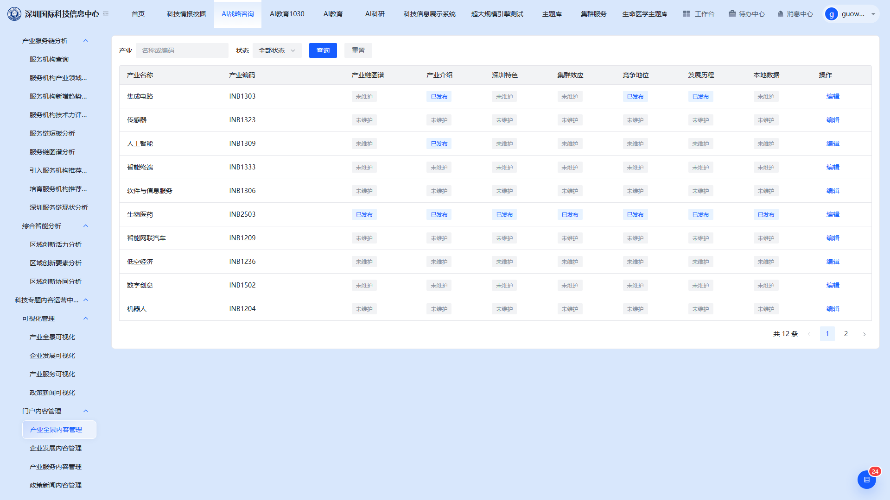
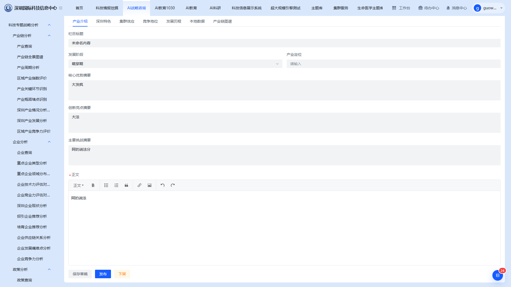
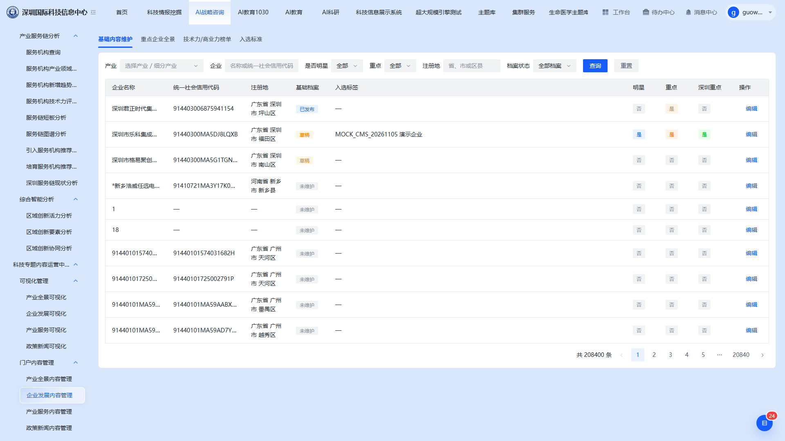
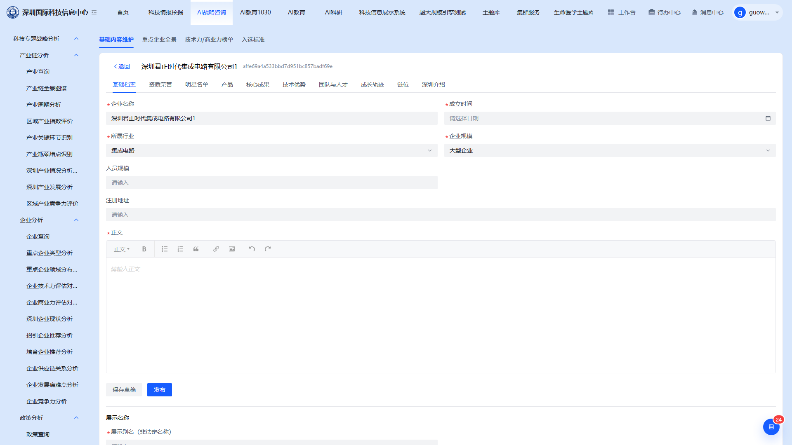
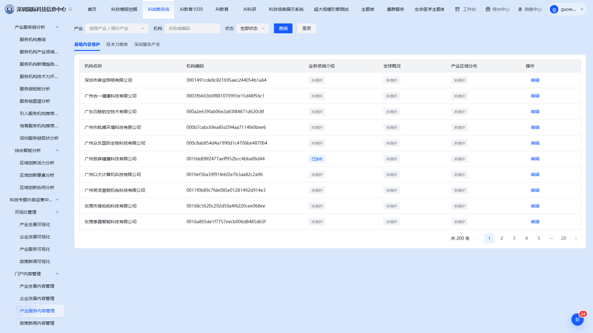
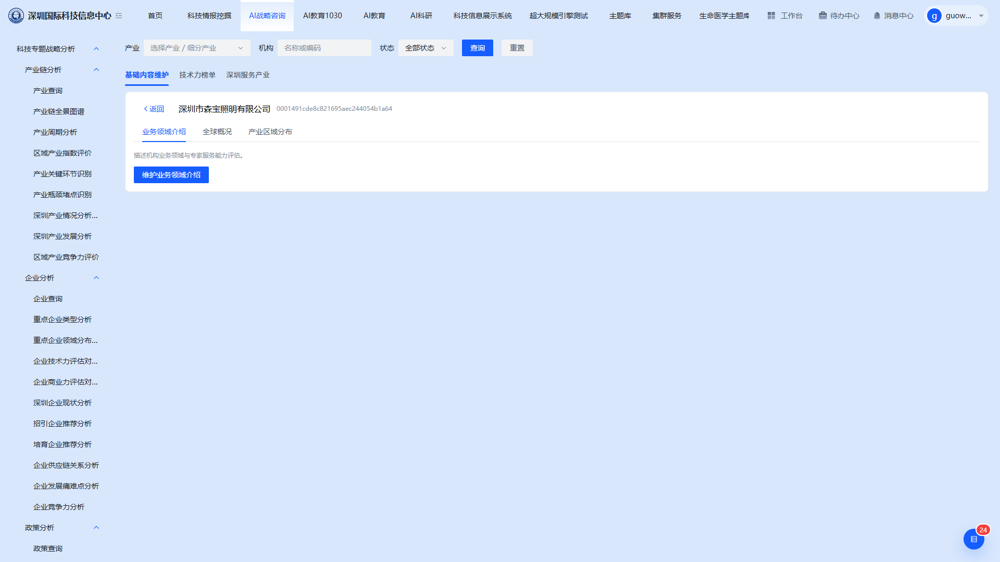
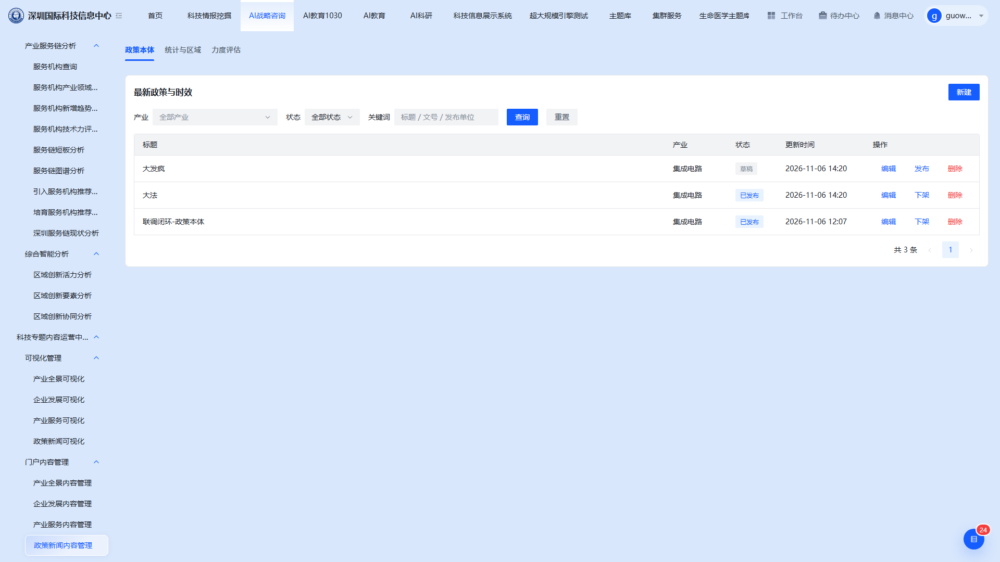
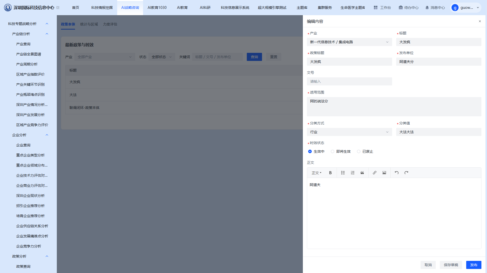

# 国际科技信息中心项目 · 科技专题服务系统 · 管理员手册

| 项 | 值 |
|---|---|
| 文档编号 | SUM-GKX-2026-v1.0 |
| 文档名称 | 科技专题服务系统 · 管理员手册 |
| 版本号 | v1.0 |
| 适用项目 | 国际科技信息中心项目 |
| 密级 | 内部公开 |
| 编制日期 | 2026年11月 |

深圳市科技创新局 · 国际科技信息中心项目

---

## 1 引言

### 1.1 标识

- **系统名称**：科技专题服务系统 · 管理员后台
- **所属项目**：国际科技信息中心项目 · 智能服务集群
- **文档编号**：SUM-GKX-2026-v1.0

### 1.2 文档概述

#### 1.2.1 编写目的

本文档旨在帮助管理员全面了解系统后台功能、掌握标准管理操作流程、明确系统维护规范。本手册可作为管理员操作指导、岗前培训资料及问题查阅依据，保障系统规范、高效使用。

#### 1.2.2 适用读者

本手册面向系统管理员、运营管理员、内容管理员等后台管理人员。

#### 1.2.3 文档范围

本文档介绍系统管理员后台的功能界面、各项业务功能的后台管理操作、系统配置方法及基础故障处理说明，不包含系统部署、代码开发等底层技术内容。

### 1.3 缩略词

| 缩略词 | 全称 | 说明 |
|---|---|---|
| 角色权限矩阵 | Role-Permission Matrix | 系统按角色控制菜单可见性与操作权限 |
| 分析任务 | Analysis Task | 用户点击"开始分析"后系统生成的计算单元（含参数快照） |
| 任务快照 | Task Snapshot | 分析任务固化后的只读结果，不随源数据变化 |

---

## 2 系统概述

### 2.1 系统简介

科技专题服务系统管理员后台面向系统管理员与运营管理员，提供 **内容运营中心、系统管理中心、任务运维监控、预计算跑批管理、历史快照清理** 等管理员能力，支撑专题系统的日常运行与系统健康巡检。

### 2.2 系统主要功能

| 编号 | 功能模块 | 主要功能项 |
|---:|---|---|
| 1 | 内容运营中心 · 基础数据管理 | 数据源配置、全要素入库监控、跑批日志查看 |
| 2 | 内容运营中心 · 全要素图谱管理 | 图谱节点/边编辑、图谱可视化配置、关系维护 |
| 3 | 内容运营中心 · 专家知识管理 | 专家库维护、知识库管理、专家关联配置 |
| 4 | 内容运营中心 · 可视化管理 | 产业全景可视化、企业发展可视化、产业服务可视化、政策新闻可视化 |
| 5 | 内容运营中心 · 门户内容管理 | 产业全景内容管理、企业发展内容管理、产业服务内容管理、政策新闻内容管理 |
| 6 | 系统管理中心 · 账户管理 | 用户账号创建/停用/重置密码、角色分配 |
| 7 | 系统管理中心 · 工单管理 | 工单列表、工单流转、工单审批 |
| 8 | 系统管理中心 · 消息管理 | 系统消息推送、通知配置 |
| 9 | **任务运维管理员** | 全量任务监控、失败任务重试、预计算跑批触发、历史快照清理、运维仪表盘、日志导出 |
| 10 | 系统管理中心 · 历史关注管理 | 用户历史关注/收藏列表管理 |

### 2.3 运行环境

#### 2.3.1 硬件环境

PC 端：普通办公计算机，CPU 4 核及以上，内存 ≥8GB，硬盘剩余空间 ≥30GB，支持常规网络接入。

#### 2.3.2 软件环境

- 操作系统：支持 Windows 10/11、macOS 12+ 系统
- 浏览器：支持 Chrome 90+、Edge 90+（推荐 Chrome）
- 无需安装插件

#### 2.3.3 网络环境

客户端需接入内网与 VPN，网络带宽 ≥10Mbps，网络稳定无断连。

---

## 3 使用指南

### 3.1 业务流程

管理员后台操作流程总体包括：用户或运营人员提交分析任务 → 任务进入执行队列（状态为"待执行"）→ 算法引擎执行计算并更新任务状态 → 任务完成或失败 → 管理员可在全量任务监控页面查看与干预（失败重试、快照清理、手动触发预计算跑批）。综合智能分析三个页面采用预计算模式，系统每日凌晨自动完成全量更新，管理员可在预计算管理页手动触发。

[截图：管理员业务流程示意 待补]

### 3.2 内容运营中心 · 基础数据管理

> 本节由内容运营中心承建方负责，内容运营中心包含以下模块：基础数据管理、专家知识管理、全要素图谱管理、可视化管理、工单申请管理、门户内容管理。

[待补充：基础数据管理操作指南]

### 3.3 内容运营中心 · 全要素图谱管理

[待补充：全要素图谱管理操作指南]

### 3.4 内容运营中心 · 专家知识管理

[待补充：专家知识管理操作指南]

### 3.5 内容运营中心 · 可视化管理

### 3.6 内容运营中心 · 门户内容管理

门户内容管理用于维护对外展示的产业、企业、产业服务、政策新闻内容，入口为"科技专题内容运营中心 → 门户内容管理"。各页面的内容块均以"已发布 / 未维护"标识状态，编辑后须执行"发布"才会在用户侧生效，草稿状态不对外展示。

#### 3.6.1 产业全景内容管理

列表按产业维度展示九个内容块的维护进度：产业链图谱、产业介绍、深圳特色、集群效应、竞争地位、发展历程、本地数据，每块标注"已发布"或"未维护"；右侧操作为"编辑"。

查询区支持按产业名称、产业编码与状态（全部状态 / 已发布 / 未维护）筛选。

操作建议：优先补齐标记为"未维护"的产业介绍、深圳特色等基础内容；产业链图谱需先在产业链图谱管理中维护完成，再回到本页发布。全部内容块为"已发布"后，该产业在用户侧产业全景中才会呈现完整信息。

点击列表行的"编辑"，进入该产业的栏目维护页：

- 左侧为栏目清单：产业介绍、深圳特色、集群效应、竞争地位、发展历程、本地数据、产业链图谱，点击切换当前编辑的栏目。
- 右侧为栏目编辑表单，以产业介绍为例，包含栏目标题、发展阶段（萌芽期等）、产业定位、核心优势摘要、创新亮点摘要、主要挑战摘要与正文。
- 页面右上"保存草稿"用于暂存，不对外展示；"发布"提交后对外生效；已发布的内容可"下架"撤回。左上"返回"回到内容列表。

#### 3.6.2 企业发展内容管理

页面含四个页签：基础内容维护、重点企业全景、技术力/商业力榜单、入选标准。

**基础内容维护**：查询条件包括产业（选择产业 / 细分产业）、企业名称或统一社会信用代码、是否明星（全部 / 明星 / 重点）、注册地、档案状态（全部档案 / 已发布 / 草稿 / 未维护）。列表展示企业名称、统一社会信用代码、注册地、基础档案状态、入选标签、明星、重点、深圳重点标记及操作入口。

点击"编辑"进入正文编辑页，可修改企业档案正文，并提供"保存草稿""发布""返回"三种操作。档案状态为"草稿"时仅后台可见，"发布"后对外生效。

**重点企业全景**：维护用户侧重点企业全景展示所需的展示名称与内容。

**技术力/商业力榜单**：维护企业技术力、商业力榜单的展示内容。

**入选标准**：维护明星企业、重点企业、深圳重点企业的入选规则说明，该说明会展示给用户，需与业务口径保持一致。

点击"编辑"进入企业档案维护页：

- 左侧为内容块清单：基础档案、资质荣誉、明星名单、产品、核心成果、技术优势、团队与人才、成长轨迹、链位、深圳介绍，点击切换编辑的内容块。
- 右侧上方展示企业基本信息（企业名称、成立时间、所属行业、企业规模、人员规模、注册地址），下方为当前内容块的正文编辑区。
- 每个内容块可单独"保存草稿"或"发布"。在"重点企业全景"页签下另有"展示名称""展示别名（非法定名称）"两项，需分别保存并发布。
- 左上"返回"回到内容列表。

#### 3.6.3 产业服务内容管理

页面含三个页签：基础内容维护、技术力榜单、深圳服务产业。

**基础内容维护**：查询条件包括产业（选择产业 / 细分产业）、机构名称或编码、状态（全部状态 / 已发布 / 未维护）。列表展示机构名称、机构编码、业务领域介绍、全球概况、产业区域分布及操作入口，内容块状态为"已发布"或"未维护"。

点击"编辑"可维护业务领域介绍等字段，也可通过"维护业务领域介绍"补充机构服务能力说明。

**技术力榜单**：维护服务机构技术力榜单的展示内容与排序。**深圳服务产业**：维护面向深圳的服务产业专题内容。

点击"编辑"进入机构内容维护页：

- 左侧为内容块清单：业务领域介绍、全球概况、产业区域分布，点击切换。
- 右侧编辑区提示"描述机构业务领域与专家服务能力评估"，点击"维护业务领域介绍"进入该内容块的编辑。
- 修改完成后保存并发布，内容块状态由"未维护"变为"已发布"。左上"返回"回到内容列表。

#### 3.6.4 政策新闻内容管理

页面含三个页签：政策本体、统计与区域、力度评估。

**政策本体**：查询条件包括产业、状态、关键词（标题 / 文号 / 发布单位）。列表展示政策标题、所属产业、状态、更新时间与操作，右上角"新建"用于录入新政策。

操作按钮随状态变化：

- **草稿**：可"编辑""发布""删除"；草稿不对外展示。
- **已发布**：可"编辑""下架""删除"；已发布状态的政策会出现在用户侧政策查询与政策新闻时间轴中。
- **已下架**：可再次编辑并发布，用户侧不再展示。

**统计与区域**：维护政策统计口径与区域归属信息。**力度评估**：维护政策支持力度的评估内容。

删除为不可恢复操作，执行前请确认该政策不再需要留档；一般下架即可满足停止展示的需求。

点击列表行的"编辑"，打开"编辑内容"表单，可修改该政策的本体信息：

- 字段包括产业（可多选，如新一代信息技术 / 集成电路）、标题、发布单位、文号、适用范围、分类方式（如行业）与分类值、时效状态（生效中 / 即将生效 / 已废止）、正文。
- 底部操作为"取消""保存草稿""发布"。保存草稿不对外展示；发布后该政策进入用户侧政策查询与政策新闻时间轴。
- 已发布政策重新编辑后再次发布即覆盖原有内容，若需停止展示请使用"下架"。

### 3.7 系统管理中心 · 账户管理

> 本节由系统管理中心承建方负责，系统管理中心包含以下模块：账户管理、消息管理、工单管理、任务管理、历史关注管理。

[待补充：账户管理操作指南]

### 3.8 系统管理中心 · 工单管理

[待补充：工单管理操作指南]

### 3.9 系统管理中心 · 消息管理

[待补充：消息管理操作指南]

### 3.10 任务运维管理员

#### 功能简介

面向管理员提供全量任务监控、失败任务重试、预计算跑批手动触发、历史快照清理、运维仪表盘、日志导出六大管理员能力。

#### 全量任务列表查看

进入"全量任务监控"页面，顶部提供多维筛选：按分析维度（企业 / 产业链 / 政策 / 服务机构 / 综合智能）、任务状态（待执行 / 执行中 / 成功 / 失败 / 超时）、时间范围（近一天 / 近七天 / 近三十天 / 自定义）、任务编号或创建人精确搜索。

任务列表展示以下字段：任务编号、所属维度、分析对象摘要、创建人账号、创建时间、执行状态、总耗时、操作入口（查看详情 / 重试）。

[截图：全量任务监控列表 待补]

#### 任务详情追溯

在任务列表中点击"查看详情"，进入任务详情页。页面展示三部分：基本信息区（任务编号、创建人、起止时间、执行耗时）、参数快照区（该任务创建时的完整参数：产业 / 区域 / 指标权重 / 分析对象等，与用户当时看到的完全一致）、执行日志区（系统后台执行过程，含调用的算法服务、每步耗时、中间状态）。页面底部提供结果快照链接，可直接跳转到固化后的用户结果页。

用于失败任务原因排查、算法输入验证与用户疑问答复。

[截图：任务详情页（含参数快照 + 执行日志） 待补]

#### 失败任务重试

在任务列表中找到状态为"失败"或"超时"的任务，点击右侧的"重试"按钮，系统弹出确认窗口。确认后任务重新进入执行队列，状态变为"待执行"，完成后自动更新。重试会生成新的任务编号（原编号末尾追加重试序号），原始任务记录完整保留。

[截图：任务重试按钮 + 确认弹窗 待补]

#### 历史快照清理

进入"清理配置"子页面，设置快照保留天数（建议不低于 90 天），选择清理范围（已完成任务的结果快照 / 失败与超时任务的完整记录），点击"预估清理量"查看将清理的快照数量与预计释放的存储空间。确认后点击"执行清理"（建议非工作时段操作）。

已清理的快照不可恢复，执行前请先确认用户侧无历史任务查询需求，建议每月定期执行一次。

[截图：快照清理配置页 + 预估结果 待补]

#### 预计算跑批手动触发

综合智能分析三个页面（区域创新活力 / 创新要素 / 创新协同）采用预计算模式，系统每日凌晨自动完成全量更新。管理员可在"预计算管理"子页面查看当前跑批状态（最新完成时间、上次耗时、下次自动触发时间），点击"立即触发跑批"可手动启动一次。手动触发在后台串行队列中执行，不影响其他正常任务，预计耗时 15–30 分钟。同一时间只能有一个跑批任务在执行，系统自动串行化。

[截图：预计算跑批状态页 + 手动触发按钮 待补]

#### 任务运行状态仪表盘

任务运维管理首页默认展示运维总览仪表盘，包含以下卡片：

- **今日任务总量**：近 24 小时全部任务数量与各维度分布饼图
- **任务成功率**：成功 / 失败 / 超时占比环形图
- **平均耗时趋势**：近七天每日平均执行耗时折线图
- **待执行任务队列**：当前等待执行的任务数量与预估等待时间
- **失败任务 Top 5**：最近五个失败任务的快速入口

日常巡检快速总览系统健康度，无需逐条排查。

[截图：任务运维总览仪表盘 待补]

#### 日志导出

在全量任务列表页设置好筛选条件后，点击右上角"导出日志"，系统生成 CSV 文件并下载，包含当前筛选条件下所有任务的完整执行记录，用于离线分析或批量问题排查。

### 3.11 系统管理中心 · 历史关注管理

[待补充：历史关注管理操作指南]

---

## 4 用户操作常见问题及处理

### 管理员登录后看不到任务运维菜单

- **现象**：使用管理员账号登录，但系统管理中心中找不到"全量任务监控"入口
- **原因**：角色权限矩阵中未分配对应角色
- **处理**：联系超级管理员在账户管理模块分配相关角色权限

### 全量任务列表加载慢（10 秒以上）

- **现象**：任务列表默认加载近七天全量任务，数据量大时响应变慢
- **原因**：全量查询涉及多维度关联，数据量随时间积累增长
- **处理**：缩小筛选范围（如近一天 + 特定维度），或联系技术团队排查数据库索引优化

### 失败任务重试后仍然失败

- **现象**：手动点击重试后，任务仍以相同错误失败
- **原因**：通常是任务参数本身有问题（如选定了不存在的产业节点）或依赖的上游数据源异常
- **处理**：进入任务详情页查看执行日志；若为参数问题通知创建人修正，若为数据问题联系数据团队排查

### 手动触发预计算跑批时提示"有其他跑批在执行"

- **现象**：点击"立即触发跑批"后系统提示串行化冲突
- **原因**：系统设计为单跑批队列，避免并发计算资源争抢
- **处理**：等待当前跑批完成（通常 15–30 分钟），或在深夜非高峰时段再触发

### 快照清理时误清理了重要历史记录

- **现象**：用户反馈历史任务找不到结果
- **原因**：快照清理保留天数设置过短或误操作
- **处理**：当前版本快照清理不可恢复；建议将保留天数设为 180 天以上，并在清理前导出重要快照备份

### 任务监控页面显示"暂无任务"

- **现象**：进入全量任务监控后列表为空
- **原因**：可能当前没有新任务提交，或筛选条件设置过严（如筛选今天但今天无任务）
- **处理**：将时间范围放宽至近三十天 + 全维度筛选；确认后仍为空则联系技术团队排查后端服务

[截图：管理员操作问题提示示例 待补]
