# 国际科技信息中心项目 · 科技专题算法库 · 用户手册

| 项 | 值 |
|---|---|
| 文档编号 | SUM-GKX-2026-v1.0 |
| 文档名称 | 科技专题算法库 · 用户手册 |
| 版本号 | v1.0 |
| 适用项目 | 国际科技信息中心项目 |
| 密级 | 内部公开 |
| 编制日期 | 2026年11月 |

深圳市科技创新局 · 国际科技信息中心项目

---

## 1 引言

### 1.1 标识

- **系统名称**：科技专题算法库
- **所属项目**：国际科技信息中心项目 · 智能服务集群
- **文档编号**：SUM-GKX-2026-v1.0

### 1.2 文档概述

#### 1.2.1 编写目的

本文档旨在帮助算法调用方与联调人员了解科技专题算法库的算法构成、接口信息与在线联调方式，掌握"查算法—看接口—配参数—跑测试—取代码"的标准操作流程，可作为联调指导、算法验收依据与问题查阅资料。

#### 1.2.2 适用读者

本手册面向专题系统的前后端开发人员、算法联调人员、算法验收人员及需要调用算法能力的数据分析人员。

#### 1.2.3 文档范围

本文档介绍算法库总览、算法页通用结构、七大类算法页的接口信息与在线测试操作，不包含算法内部实现、模型训练过程、部署与运维内容。

### 1.3 缩略词

| 缩略词 | 全称 | 说明 |
|---|---|---|
| API | Application Programming Interface | 应用程序编程接口 |
| SDK | Software Development Kit | 软件开发工具包 |
| REST | Representational State Transfer | 一种接口设计风格 |
| JSON | JavaScript Object Notation | 一种数据交换格式 |
| KPI | Key Performance Indicator | 关键指标 |
| ADS | Application Data Service | 应用数据服务层 |

---

## 2 系统概述

### 2.1 系统简介

科技专题算法库是科技专题服务系统的算法能力中台，把产业链、企业、政策、产业服务、区域创新等专题分析所需的计算能力统一封装为可调用的接口，并提供与接口一一对应的在线联调工作台。

算法库按分析对象组织为七个功能分类：基础指标分析模型、产业全要素图谱、产业链深度分析模型构建、企业深度分析模型构建、政策深度分析模型构建、产业服务深度分析模型构建、产业综合分析模型构建；此外单列技术链分析、人才分析、机构分析三个专题分类。每个算法页对应一类分析能力，页内以"接口信息 / 模型构建流程图 / 算法数据库管理 / 算法测试"四个页签呈现该能力的全貌，接口说明与测试台同页，避免文档与实现脱节。

算法库的价值在于：调用方无需阅读离线接口文档，即可在页面上确认参数含义、验证返回结构、复制调用代码并直接跑通一次真实请求，缩短专题系统各分析页面的联调周期。

### 2.2 主要功能

| 编号 | 功能分类 | 主要功能项 |
|---:|---|---|
| 2.2.1 | 基础指标分析模型 | 产业链基础指标模型构建、企业基础指标模型构建、政策基础指标模型构建、服务机构基础指标模型构建、技术基础指标、人才基础指标、科研机构基础指标 |
| 2.2.2 | 产业全要素图谱 | 产业实体识别构建、产业实体关系抽取、政策实体识别构建、政策实体关系抽取、企业实体识别构建、企业实体关系抽取、服务机构实体识别构建、服务机构实体关系抽取、产业全要素图谱API服务开发、技术/人才/科研机构实体识别构建与关系抽取 |
| 2.2.3 | 产业链深度分析模型构建 | 产业链全景、深圳产业链、产业发展路线历程、产业热点领域识别、深圳产业优势识别、产业周期分析、产业阶段分析、产业链关键环节识别、产业瓶颈堵点识别、区域产业指数、深圳问题识别、深圳机遇分析、重点布局产业推荐 |
| 2.2.4 | 企业深度分析模型构建 | 深圳企业竞争力水平分析、企业发展历程、企业发展痛难点识别、企业供应链关系分析、企业技术力评估、企业商业力评估、招引企业综合推荐、培育企业综合推荐 |
| 2.2.5 | 政策深度分析模型构建 | 政策焦点识别、政策力度评估、政策效果评估、政策短板识别、政策机遇识别、政策布局推荐 |
| 2.2.6 | 产业服务深度分析模型构建 | 服务链短板分析、服务关系链、六类服务机构技术力评价、服务机构引入推荐、服务机构培育推荐 |
| 2.2.7 | 产业综合分析模型构建 | 区域科技创新成果/产业创新成果/产业创新人才/产业创新政策综合评价、区域创新活力综合分析、区域创新要素类型/层次/领域/综合分析、区域创新协同分析 |
| 2.2.8 | 技术链分析 | [待补充]（协同承建范围） |
| 2.2.9 | 人才分析 | [待补充]（协同承建范围） |
| 2.2.10 | 机构分析 | [待补充]（协同承建范围） |

### 2.3 运行环境

#### 2.3.1 硬件环境

PC 端：普通办公计算机，CPU 4 核及以上，内存 ≥8GB，硬盘剩余空间 ≥30GB，支持常规网络接入。

#### 2.3.2 软件环境

- 操作系统：支持 Windows 10/11、macOS 12+ 系统
- 浏览器：支持 Chrome 90+、Edge 90+（推荐 Chrome，算法测试区图表渲染效果最佳）
- 无需安装插件

#### 2.3.3 网络环境

客户端需接入内网并具备算法库访问权限，网络带宽 ≥10Mbps。算法页首屏加载会拉取接口元数据，网络不稳定时首次进入可能较慢，稍候或将页面刷新即可。

---

## 3 使用指南

### 3.1 业务流程

#### 3.1.1 算法库业务流程（按业务阶段）

算法库支撑的专题业务整体划分为五个分析阶段，各阶段与分析模块的对应关系如下。

**① 基础能力构建。** 建立涵盖产业链、技术、企业、人才、科研机构、政策、服务机构七大维度的基础指标体系，并构建产业全要素知识图谱，提供节点重要性分析、社群发现、路径分析等图结构计算能力及标准化 API 服务，为后续深度分析提供统一的数据底座。

**② 产业要素分析。** 聚焦产业链与技术链：梳理上下游关系、价值链分布与关键环节，识别产业热点、深圳产业优势、产业周期与阶段、瓶颈堵点及区域产业指数；同时描绘技术发展历程、深圳细分领域分布，识别前沿热点、产业化潜力与技术转化瓶颈。

**③ 创新主体分析。** 围绕企业、科研机构、人才三类主体开展多维度评估：分析企业竞争力、发展历程、痛难点、供应链关系与技术力/商业力，评估科研机构布局、优势短板与合作链条，识别重点人才、追踪人才流动、评价人才学术力与产业力，并输出招引、培育与布局推荐结果。

**④ 政策服务分析。** 构建政策效能评估与产业服务生态分析框架：识别政策焦点、评估政策力度与实施效果、发现政策短板与机遇、给出政策布局建议；同时诊断服务链短板、绘制服务关系链，对金融、知识产权、人力资源、市场营销、咨询、科技创新六类服务机构开展技术力评价与引入培育推荐。

**⑤ 综合评价分析。** 整合前期各模块成果，构建区域科技创新成果、产业创新成果、创新人才、创新政策等综合评价模型，以及区域创新活力、创新要素类型/层次/领域/综合与区域创新协同分析模型，服务于产业发展态势研判、区域优势短板分析、政策效果评估与资源配置优化。

#### 3.1.2 算法库使用路径（按调用方操作）

算法库的典型使用路径为五步：**定位算法 → 阅读接口信息 → 配置测试参数 → 执行并判读结果 → 获取调用代码**。

1. **定位算法**：从左侧导航按分类展开，点击目标算法页；或从"算法库总览"按分类浏览页面与接口规模。页面顶部"总览"按钮可随时回到总览看板。
2. **阅读接口信息**：默认停留在"接口信息"页签，确认接口路径、功能依据、请求参数与响应参数，判断该接口是否满足需求。
3. **配置测试参数**：切到"算法测试"页签，按表单填写参数（或展开"高级 JSON"直接粘贴整个请求体）。页面已预置一组可运行示例值，可直接微调。
4. **执行并判读结果**：点击"执行接口"，右侧"运行结果"区展示本次调用的耗时、执行步骤日志、指标卡与图表，可对照响应参数释义核对字段。
5. **获取调用代码**：在接口信息区点击「复制 curl」「复制 Python SDK」「复制 TS SDK」，把代码粘贴到本地工程中，替换参数后即可集成。

#### 3.1.3 通用界面结构与操作步骤（各节通用）

所有算法页遵循统一的界面结构与操作步骤，各节不再重复叙述。

**① 查看接口定义**：页面顶部列出模型名称与说明、请求方式、请求地址，以及入参字段表（字段名、类型、是否必填、约束说明），下方给出返回结果 JSON 示例。调用前先核对必填项与字段类型；接口入参与各节的「请求参数列表」表对应。

**② 配置查询条件**：在「算法测试」页签左侧的参数与筛选区设置该模型对应的条件项，点击「执行接口」触发分析。参数区支持按字段逐项填写或展开「高级 JSON」直接粘贴整个请求体；修改条件后须重新执行，结果才会刷新。

**③ 读取统计结果**：右侧上方为执行状态、总耗时与分步日志；中部为统计指标卡（总量、占比、均值、指数等）；下部为可视化图表，包括柱状／条形图、折线与面积趋势图、环形／饼图、雷达图、地图及关系网络图等，按图表下方图例区分数据系列。

**④ 查看明细与结论**：继续向下滚动查看明细数据表格、底部分页控件，以及分析结论与建议文字；明细表工具栏提供列设置、导出与打印入口。

**⑤ 留存与复用**：使用报告区右上角的导出／打印功能保存报告；如需接入业务系统，在接口信息页签点击「复制 curl」「复制 Python SDK」「复制 TS SDK」获取调用代码，替换参数后即可集成。

> 使用提示：业务用户日常以查询、分析和导出操作为主；指标体系构建、知识图谱入库、模型训练与数据同步由系统后台按统一流程执行。界面截图中的数值为示例数据，实际结果随数据更新与参数配置变化。引用分析结论时请同时关注数据更新时间与模型版本。

### 3.2 算法库总览

进入算法库后默认停留在"算法库总览"。看板顶部给出三项总量指标——功能分类数、算法页数、接口总数（当前为 7 个功能分类、60 个算法页、113 个接口）；中部按分类列出各分类的页面数与接口数；下部以卡片形式列出每个分类下的算法页及各自接口数量，点击卡片可直接进入对应算法页。

当需要快速判断"某类分析是否有现成接口"时，先用总览定位分类，再进入具体算法页，比逐级翻菜单更快。

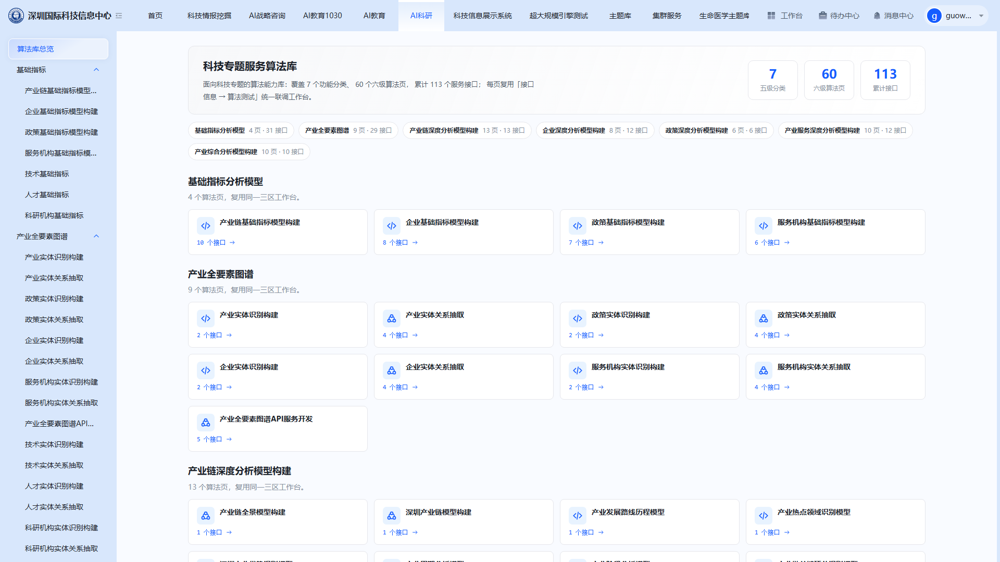

### 3.3 算法页通用结构

所有算法页共用同一套四页签工作台，理解一次即可通用到全部页面。

#### 3.3.1 接口信息

接口信息页签回答"这个接口做什么、怎么传参、返回什么"：

- **当前接口**：显示本页当前选中的接口名称，多接口页面在此切换。
- **能力标签**：提供 API 服务调用、授权 API、结果下载、本页即调用台、仅看要求等入口；"查看调用说明"给出该接口的调用约定。
- **依据信息**：功能依据（对应的需求条目）、指标口径与设计（指标定义与计算口径）、模型设计参考文献（算法依据的文献篇数）。
- **调用方式**：说明支持 RestfulAPI 与 SDK 两种方式，并提供"复制 curl""复制 Python SDK""复制 TS SDK"。
- **请求参数列表**：逐项列出参数名、类型、是否必填、约束（枚举值、数值范围）、说明。
- **响应参数列表释义**：逐项列出返回字段、类型与含义，并注明"与算法测试运行结果同源"，即字段结构与实际返回完全一致。
- **请求/响应参数示例**：给出可直接使用的 JSON 示例，与算法测试页的默认配置一致。

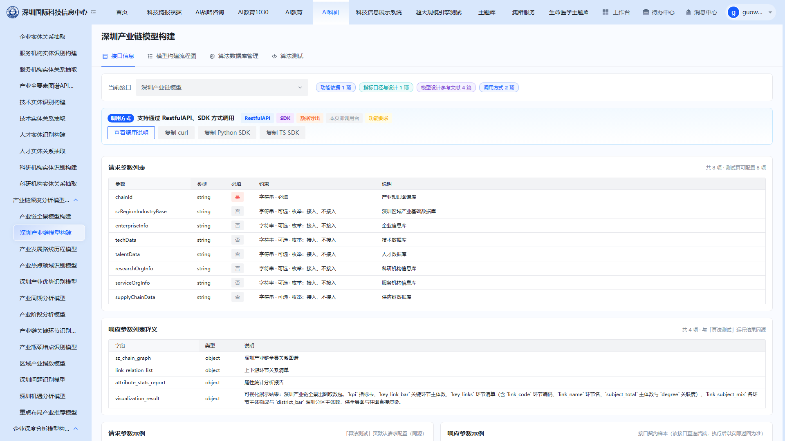

#### 3.3.2 模型构建流程图

模型构建流程图页签以图形方式呈现该算法的处理链路：数据输入 → 中间处理环节 → 输出结果的流转关系，以及各环节依赖的数据源。用于确认算法口径、排查"结果里为什么没有某类数据"时对照。

#### 3.3.3 算法数据库管理

算法数据库管理页签列出该算法依赖的数据源及其接入状态（如图谱库、企业库、技术库、人才库、科研机构库、服务机构库、供应链库、市场库、行业库）。调用方如需判断"某类数据是否可以纳入计算"，在此查看即可，无需询问研发。

#### 3.3.4 算法测试

算法测试页签是页内联调台，左右两栏：

- **请求配置（左）**：顶部显示请求方法与接口路径；中部按请求参数逐项生成表单控件（下拉选择、数字输入等），标注参数含义与默认取值；底部"高级 JSON"可展开为原始请求体编辑；"重置示例"恢复默认值。
- **运行结果（右）**：未执行时提示"尚无运行结果，请先执行对应接口"；点击"执行接口"后依次展示执行状态、总耗时与分步日志、指标卡、图表与列表数据。
- 结果区上方的"调用方式·查询"筛选条件用于切换结果的聚合视图（如全部维度、单一维度）与数据导出。

判读要点：先看执行状态是否为成功，再看耗时是否在可接受范围，最后核对指标数量级是否符合业务预期。

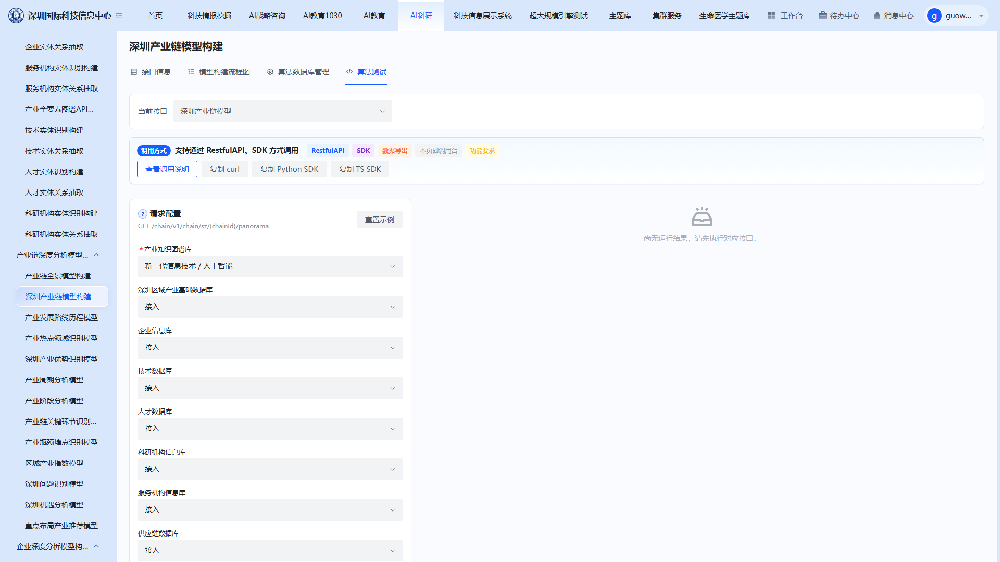

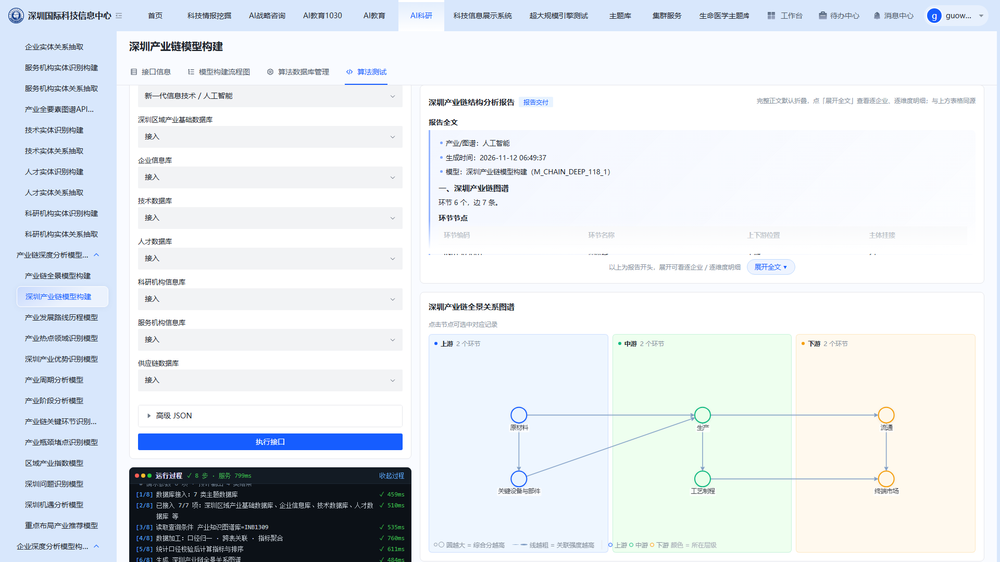

### 3.4 基础指标分析模型

基础指标分析模型库以单因子、单指标维度对产业链相关各领域要素进行量化计算与模型构建，为上层业务应用提供高质量、可复用的指标服务支撑。模型库以产业链和技术链为起点，向下延伸至企业、政策与服务机构等创新实体的基本属性、状态属性及事件属性，通过标准化数据处理流程将多源基础数据转化为结构化指标。

所有基础指标模型统一遵循五步处理流程：①数据源对接——从产业链环节、企业库、政策库、服务机构库等多源接入原始数据；②数据清洗——执行去重、去噪、缺失值补全、格式标准化；③数据处理——结合领域分类、时间窗口划分、机构类型过滤等特征提取完成指标计算；④数据服务开发——以 Restful API 形式封装成可调用接口；⑤数据同步——定期更新计算结果并监测数据质量。业务用户无需执行后台处理步骤，直接按各节操作说明查询指标结果即可。

本手册按当前算法库开放范围，对产业链、企业、政策、服务机构四类基础指标模型给出操作说明；技术、人才、科研机构三类基础指标模型由协同方交付，操作方式与之相同，详见对应协同范围手册。

#### 3.4.1 产业链基础指标模型构建

**模型功能描述**

产业链基础指标模型对接产业链环节数据库、企业库与资讯数据库，完成数据采集、预处理、指标计算与服务化输出，实现对产业链各环节上中下游关系、价值链分布与关键环节覆盖度的系统量化与动态更新。模型以产业链环节为节点、企业为载体，结合论文、专利、技术交易等多源数据指标进行关联计算，为产业链全景分析、瓶颈堵点诊断与区域产业指数评价提供统一的指标底座。

**指标清单（产业链基础指标）**

| 序号 | 指标名称 | 统计口径 | 主要查询条件与输出 |
|---|---|---|---|
| 1 | 产业市场规模 | 对接产业数据库获取销售额、销售量、价格等，形成年/月市场规模与环比增长率 | 产业标签、时间范围；输出市场规模与增长率 |
| 2 | 产业企业规模 | 对接产业数据库获取企业名称、注册时间、行业分类，形成产业企业成立数量与趋势变化 | 产业标签、时间范围；输出企业规模与趋势 |
| 3 | 产业机构规模 | 对接产业数据库获取机构名称、注册时间、机构类型，形成机构成立数量、增长率和趋势 | 产业标签、时间范围；输出机构规模与趋势 |
| 4 | 产业投融资规模 | 对接投融资信息数据，获取投资机构、投资时间、金额、融资企业等，形成投融资规模、增长率和趋势 | 产业标签、时间范围；输出投融资规模与趋势 |
| 5 | 全球产业区域分布 | 对接产业数据库获取企业和机构名称、所属国家或地区、所属行业，计算各国家或地区的企业和机构总数 | 产业标签、地区；输出全球分布与总数 |
| 6 | 全国产业分布 | 对接产业数据库获取企业、机构、行业分类、注册地，计算各省企业和机构总数及增长趋势 | 产业标签、地区；输出全国分布与趋势 |
| 7 | 深圳产业要素 | 对接深圳产业数据库，围绕投融资、人才引进、科技创新等形成深圳产业要素数量指标 | 指标类型、时间范围；输出深圳要素数量 |
| 8 | 深圳产业分布 | 对接深圳产业数据库获取深圳各区企业和机构数量，形成区域分布指标和增长率指标 | 区域、产业标签、时间；输出深圳区域分布与增长率 |

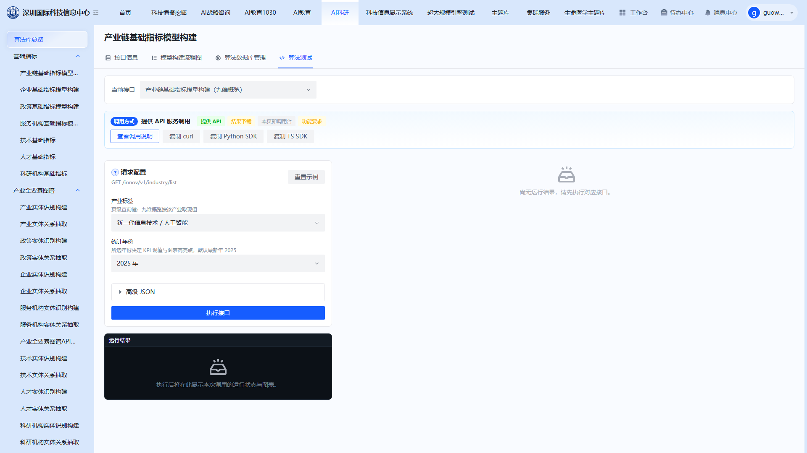

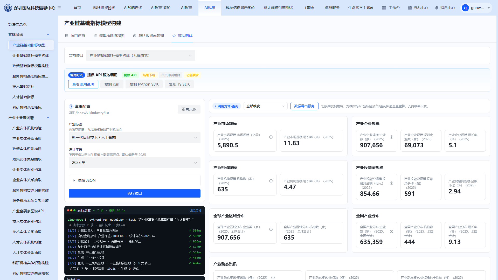

**操作指引**

按 3.1.1 节「通用界面结构与操作步骤」执行：
① 在接口信息页签核对本接口的请求参数与响应字段释义，确认参数含义与约束；
② 切换至「算法测试」页签，在参数与筛选区设置本模型对应的条件项（如产业标签、时间范围、地域范围、机构类型等），页面已预置一组可运行示例值，可在此基础上微调；
③ 点击「执行接口」，右侧运行结果区展示本次调用的执行状态、耗时、分步日志、指标卡与图表；
④ 读取统计指标卡与可视化图表，向下滚动查看明细表与分析结论；
⑤ 使用报告区右上角的导出／打印功能留存结果；如需接入业务系统，按接口信息页签的调用方式复制代码并替换参数即可集成。

**数据更新机制**

模型结果经计算、归纳与有效性验证后，通过 API 接口和数据同步机制服务化输出，支持按地域、领域、时间等条件灵活查询与下载。系统定期更新数据与指标并进行质量监测，确保指标的有效性与可靠性。

#### 3.4.2 企业基础指标模型构建

**模型功能描述**

企业基础指标模型对接企业工商库、财务库、论文库、专利库与技术交易库，完成数据采集、清洗、指标计算与服务化输出，实现对企业基本面、经营状况、技术产出与市场表现的系统量化。模型为企业画像、竞争力评估、招引培育推荐等上层分析提供可复用的指标底座。

**指标清单（企业基础指标）**

| 序号 | 指标名称 | 统计口径 | 主要查询条件与输出 |
|---|---|---|---|
| 1 | 重点企业提取 | 围绕专利数、技术交易额等指标设置阈值，筛选重点企业并统计 | 产业标签、阈值配置；输出重点企业清单与统计 |
| 2 | 企业类型分布 | 外企、高企、小微、上市等类型分类统计，形成数量、占比和趋势 | 产业标签、地区、时间；输出类型分布与趋势 |
| 3 | 企业领域分布 | 计算企业涉及的产业链/技术链领域，形成领域分布与增长率 | 产业标签、地区、时间；输出领域分布与增长率 |
| 4 | 企业重点资讯 | 抽取企业融资、并购、战略合作、新品发布等资讯，形成分类分析与指标计算 | 企业、资讯类型、时间范围；输出资讯分类与指标 |
| 5 | 新增企业数量 | 计算历年涉足某领域企业的新增数量、增长率和趋势 | 产业标签、地区、时间范围；输出新增趋势与增长率 |

**操作指引**

按 3.1.1 节「通用界面结构与操作步骤」执行：
① 在接口信息页签核对本接口的请求参数与响应字段释义，确认参数含义与约束；
② 切换至「算法测试」页签，在参数与筛选区设置本模型对应的条件项（如产业标签、时间范围、地域范围、机构类型等），页面已预置一组可运行示例值，可在此基础上微调；
③ 点击「执行接口」，右侧运行结果区展示本次调用的执行状态、耗时、分步日志、指标卡与图表；
④ 读取统计指标卡与可视化图表，向下滚动查看明细表与分析结论；
⑤ 使用报告区右上角的导出／打印功能留存结果；如需接入业务系统，按接口信息页签的调用方式复制代码并替换参数即可集成。

**数据更新机制**

模型结果经计算、归纳与有效性验证后，通过 API 接口和数据同步机制服务化输出，支持按地域、领域、时间等条件灵活查询与下载。系统定期更新数据与指标并进行质量监测，确保指标的有效性与可靠性。

#### 3.4.3 政策基础指标模型构建

**模型功能描述**

政策基础指标模型对接政策文本库、政策实施细则库与政策效果监测库，完成数据采集、预处理、指标计算与服务化输出，实现对政策发布、政策类型覆盖、政策力度与政策实施效果的系统量化。模型为政策焦点识别、力度评估、效果评价与短板诊断等上层分析提供可复用的指标底座。

**指标清单（政策基础指标）**

| 序号 | 指标名称 | 统计口径 | 主要查询条件与输出 |
|---|---|---|---|
| 1 | 政策层级分布 | 按国家、省、市、区四级对政策进行分类统计和趋势分析 | 层级、时间范围；输出层级分布与趋势 |
| 2 | 政策类型分布 | 按产业政策、人才政策、企业扶持政策等类型统计政策分布和变化趋势 | 政策类型、时间范围；输出类型分布与趋势 |
| 3 | 政策时序指标 | 统计各时期政策发布数量并形成增长率、连续性等时序指标 | 时间范围；输出时序指标与增长率 |
| 4 | 政策区域分布 | 按省份维度统计相关政策数量并形成区域分布趋势 | 地区、时间范围；输出区域分布趋势 |
| 5 | 深圳政策分布 | 按深圳各区统计政策分布情况并形成增长趋势 | 区域、时间范围；输出深圳政策分布与增长趋势 |

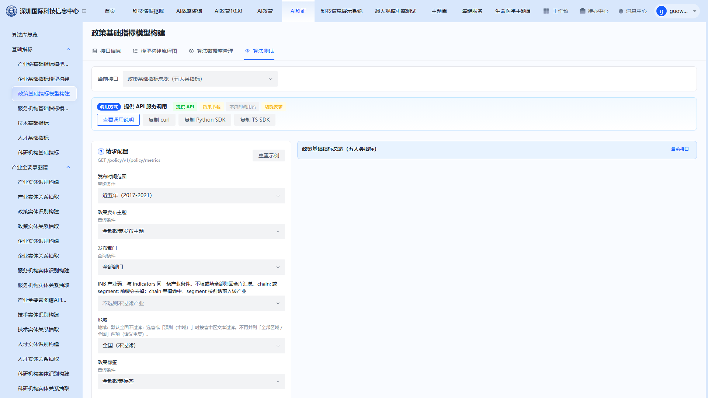

**操作指引**

按 3.1.1 节「通用界面结构与操作步骤」执行：
① 在接口信息页签核对本接口的请求参数与响应字段释义，确认参数含义与约束；
② 切换至「算法测试」页签，在参数与筛选区设置本模型对应的条件项（如产业标签、时间范围、地域范围、机构类型等），页面已预置一组可运行示例值，可在此基础上微调；
③ 点击「执行接口」，右侧运行结果区展示本次调用的执行状态、耗时、分步日志、指标卡与图表；
④ 读取统计指标卡与可视化图表，向下滚动查看明细表与分析结论；
⑤ 使用报告区右上角的导出／打印功能留存结果；如需接入业务系统，按接口信息页签的调用方式复制代码并替换参数即可集成。

**数据更新机制**

模型结果经计算、归纳与有效性验证后，通过 API 接口和数据同步机制服务化输出，支持按地域、领域、时间等条件灵活查询与下载。系统定期更新数据与指标并进行质量监测，确保指标的有效性与可靠性。

#### 3.4.4 服务机构基础指标模型构建

**模型功能描述**

服务机构基础指标模型对接服务机构工商库、资质认定库、行业年报与服务记录库，完成数据采集、清洗、指标计算与服务化输出，实现对六类服务机构（金融/知识产权/人力资源/市场营销/咨询/科技创新）的机构规模、资质等级、服务能力与市场表现的系统量化。模型为服务链短板诊断、机构技术力评价与引入培育推荐等上层分析提供可复用的指标底座。

**指标清单（服务机构基础指标）**

| 序号 | 指标名称 | 统计口径 | 主要查询条件与输出 |
|---|---|---|---|
| 1 | 服务机构领域分布 | 计算服务机构涉及的产业链/技术链领域，形成领域覆盖、增长率和查询服务 | 机构类型、地区、时间；输出领域分布与增长率 |
| 2 | 重点服务机构 | 围绕资质认定、技术交易、服务记录等指标设定阈值，识别重点服务机构并形成查询服务 | 机构类型、阈值配置；输出重点机构清单 |
| 3 | 服务机构新增动态 | 统计历年涉足领域服务机构的新增数量、变化趋势及查询服务 | 机构类型、地区、时间范围；输出新增趋势 |
| 4 | 金融服务机构基础 | 对接工商登记、资质认定与服务记录，统计金融类服务机构的数量、区域分布与服务规模 | 地区、时间；输出金融机构分布与规模 |
| 5 | 知识产权服务机构基础 | 对接工商登记、资质认定与服务记录，统计知识产权类服务机构的数量、区域分布与服务规模 | 地区、时间；输出知产机构分布与规模 |
| 6 | 人力资源服务机构基础 | 对接工商登记、资质认定与服务记录，统计人力资源类服务机构的数量、区域分布与服务规模 | 地区、时间；输出人力机构分布与规模 |
| 7 | 市场营销服务机构基础 | 对接工商登记、资质认定与服务记录，统计市场营销类服务机构的数量、区域分布与服务规模 | 地区、时间；输出营销机构分布与规模 |
| 8 | 咨询服务机构基础 | 对接工商登记、资质认定与服务记录，统计咨询类服务机构的数量、区域分布与服务规模 | 地区、时间；输出咨询机构分布与规模 |
| 9 | 科技创新服务机构基础 | 对接工商登记、资质认定与服务记录，统计科技创新类服务机构的数量、区域分布与服务规模 | 地区、时间；输出科创机构分布与规模 |

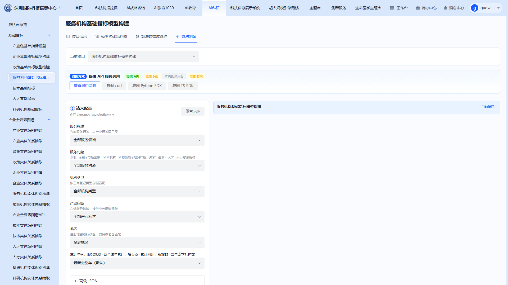

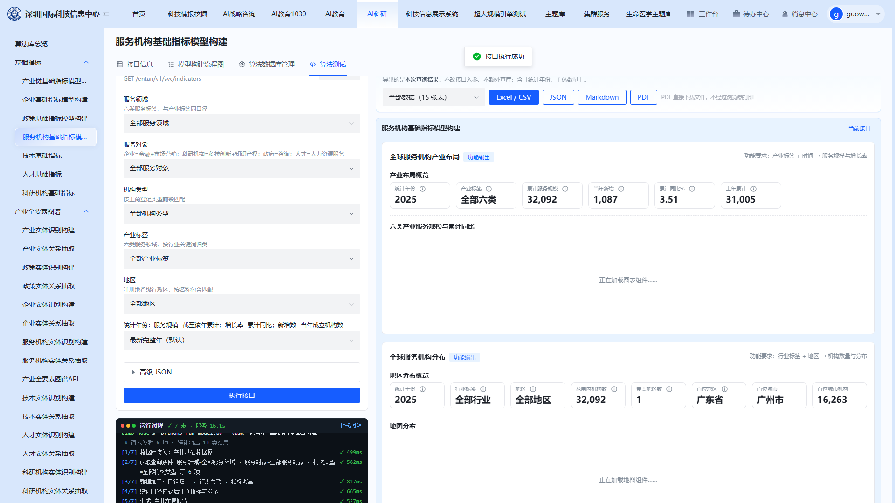

**操作指引**

按 3.1.1 节「通用界面结构与操作步骤」执行：
① 在接口信息页签核对本接口的请求参数与响应字段释义，确认参数含义与约束；
② 切换至「算法测试」页签，在参数与筛选区设置本模型对应的条件项（如产业标签、时间范围、地域范围、机构类型等），页面已预置一组可运行示例值，可在此基础上微调；
③ 点击「执行接口」，右侧运行结果区展示本次调用的执行状态、耗时、分步日志、指标卡与图表；
④ 读取统计指标卡与可视化图表，向下滚动查看明细表与分析结论；
⑤ 使用报告区右上角的导出／打印功能留存结果；如需接入业务系统，按接口信息页签的调用方式复制代码并替换参数即可集成。

**数据更新机制**

模型结果经计算、归纳与有效性验证后，通过 API 接口和数据同步机制服务化输出，支持按地域、领域、时间等条件灵活查询与下载。系统定期更新数据与指标并进行质量监测，确保指标的有效性与可靠性。

### 3.5 产业全要素图谱

产业全要素图谱是面向产业信息融合与创新生态分析的核心基础模块，以产业链和技术链为主线，将产业、企业、政策、服务机构等关键实体及其属性、关系进行系统化抽取、融合与建模，形成统一、准确、可扩展的知识网络。图谱依托图数据库与推理规则支持知识推理与关系延展，并通过数据服务 API 对外开放。

**图谱构建五步流程**

| 序号 | 流程 | 说明 |
|---|---|---|
| 1 | 产业链与技术链环节定义 | 确定节点及上下游关系，形成图谱骨架 |
| 2 | 相关实体要素与属性提取 | 采集企业、政策、服务机构等实体及其关联属性 |
| 3 | 实体构建与消歧 | 对多源数据执行消歧、标准化与融合，确保统一与准确 |
| 4 | 知识推理 | 基于规则与模型生成新的实体关系与链路 |
| 5 | 图谱入库与更新 | 在图数据库中结构化存储，并以增量方式持续更新 |

图谱形成后提供节点重要性分析、社群发现、路径分析等图结构分析及计算能力，并支持实体检索、关系查询、语义分析、可视化展示与聚类关联分析等智能化应用。

#### 3.5.1 产业实体识别构建

**模型功能描述**

产业实体识别构建通过对接产业链环节数据库、论文库、专利库与企业库，使用规则识别、词典识别与命名实体识别模型从多源文本中自动提取产业领域的核心实体（产业链环节、产业集群、关键载体等），并按产业链环节进行结构化归类与消歧。识别结果经人工校验后纳入产业全要素图谱，为后续实体关系抽取与图计算提供统一的实体基础。

**功能要点**

| 项目 | 内容 |
|---|---|
| 处理对象 | 产业链环节、产业集群、关键载体等产业专题数据及关联的论文、专利、资讯数据 |
| 核心方法 | 基于规则（正则表达式、关键字匹配）与基于词典（分词、词性标注、NER）的双重识别，提取产业实体名称、类型、行业归属及地理位置 |
| 维护与更新 | 支持实体新增、删除、修改及定期库更新；按实体名称自动获取关联论文、专利、企业数量、区域分布等属性并周期性更新 |
| 输出结果 | 产业实体库及实体属性档案，支撑产业链全景分析、瓶颈堵点诊断与区域产业指数评价 |

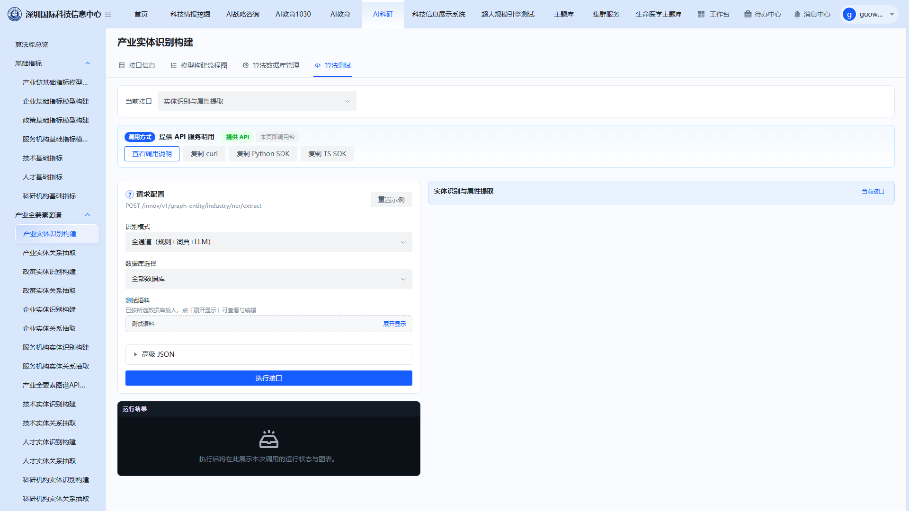

**操作指引**

按 3.1.1 节「通用界面结构与操作步骤」执行：
① 在接口信息页签核对本接口的请求参数与响应字段释义，确认参数含义与约束；
② 切换至「算法测试」页签，在参数与筛选区设置本模型对应的条件项（如产业标签、时间范围、地域范围、机构类型等），页面已预置一组可运行示例值，可在此基础上微调；
③ 点击「执行接口」，右侧运行结果区展示本次调用的执行状态、耗时、分步日志、指标卡与图表；
④ 读取统计指标卡与可视化图表，向下滚动查看明细表与分析结论；
⑤ 使用报告区右上角的导出／打印功能留存结果；如需接入业务系统，按接口信息页签的调用方式复制代码并替换参数即可集成。

**数据更新机制**

模型结果经计算、归纳与有效性验证后，通过 API 接口和数据同步机制服务化输出，支持按地域、领域、时间等条件灵活查询与下载。系统定期更新数据与指标并进行质量监测，确保指标的有效性与可靠性。

#### 3.5.2 产业实体关系抽取

**模型功能描述**

产业实体关系抽取在产业实体识别的基础上，对接产业链上下游关系数据库、论文合作关系与企业供应链关系库，使用关系分类模型从多源文本与结构化数据中抽取产业实体间的关系（上下游、支撑、替代、配套等），并形成产业实体关系网络。抽取结果经人工校验后纳入产业全要素图谱，为后续图结构分析与关键路径识别提供关系基础。

**功能要点**

| 项目 | 内容 |
|---|---|
| 处理对象 | 产业专题库及企业、政策、科研机构、服务机构等关联数据库 |
| 核心方法 | 定义关系类型并配置抽取规则，结合自然语言处理与 NER 提取产业上下游、支撑、替代、配套等关系 |
| 维护与更新 | 结果经去重、纠错、缺失值补全与格式统一后按关系类型入库，并通过定时任务同步更新 |
| 输出结果 | 产业实体关系库及产业链条图谱，呈现网络结构、核心节点及关联强度 |

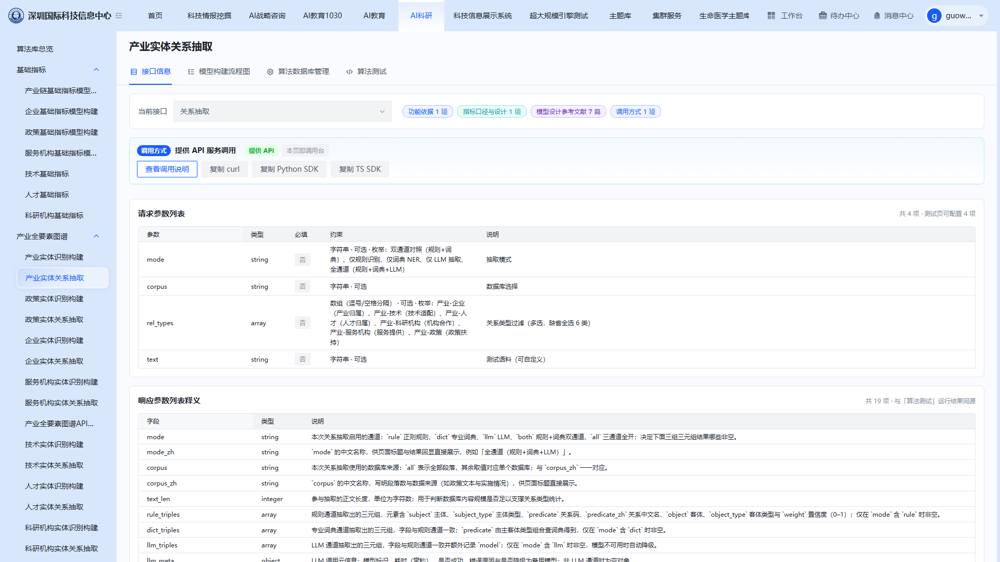

**操作指引**

按 3.1.1 节「通用界面结构与操作步骤」执行：
① 在接口信息页签核对本接口的请求参数与响应字段释义，确认参数含义与约束；
② 切换至「算法测试」页签，在参数与筛选区设置本模型对应的条件项（如产业标签、时间范围、地域范围、机构类型等），页面已预置一组可运行示例值，可在此基础上微调；
③ 点击「执行接口」，右侧运行结果区展示本次调用的执行状态、耗时、分步日志、指标卡与图表；
④ 读取统计指标卡与可视化图表，向下滚动查看明细表与分析结论；
⑤ 使用报告区右上角的导出／打印功能留存结果；如需接入业务系统，按接口信息页签的调用方式复制代码并替换参数即可集成。

**数据更新机制**

模型结果经计算、归纳与有效性验证后，通过 API 接口和数据同步机制服务化输出，支持按地域、领域、时间等条件灵活查询与下载。系统定期更新数据与指标并进行质量监测，确保指标的有效性与可靠性。

#### 3.5.3 政策实体识别构建

**模型功能描述**

政策实体识别构建通过对接政策文本库与政策实施细则库，使用规则识别、词典识别与命名实体识别模型从政策文本中自动提取政策实体（政策名称、政策发布机构、政策主题领域、政策支持对象等），并按政策主题进行结构化归类与消歧。识别结果经人工校验后纳入产业全要素图谱，为后续政策关系抽取与政策语义分析提供统一的实体基础。

**功能要点**

| 项目 | 内容 |
|---|---|
| 处理对象 | 政策文本库、政策实施细则库与政策效果监测库 |
| 核心方法 | 自动识别政策文本中的实体及属性，抽取名称、级别、类型、发布时间、发布地点等信息 |
| 维护与更新 | 支持政策实体新增、删除、修改及定期库更新；按政策编号自动获取实施效果、企业感知、关联产业等属性并周期性更新 |
| 输出结果 | 结构化政策实体库及属性档案，为政策焦点识别、力度评估与效果评价提供基础数据 |

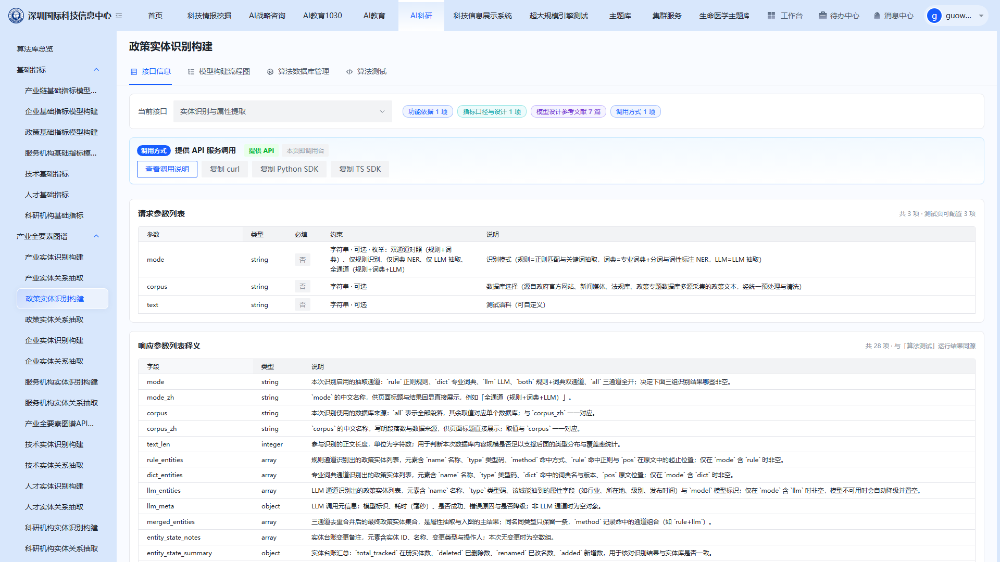

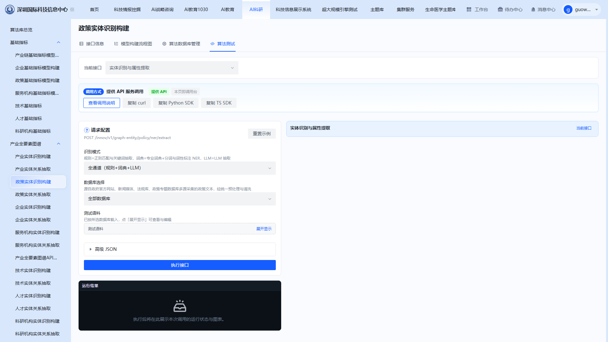

**操作指引**

按 3.1.1 节「通用界面结构与操作步骤」执行：
① 在接口信息页签核对本接口的请求参数与响应字段释义，确认参数含义与约束；
② 切换至「算法测试」页签，在参数与筛选区设置本模型对应的条件项（如产业标签、时间范围、地域范围、机构类型等），页面已预置一组可运行示例值，可在此基础上微调；
③ 点击「执行接口」，右侧运行结果区展示本次调用的执行状态、耗时、分步日志、指标卡与图表；
④ 读取统计指标卡与可视化图表，向下滚动查看明细表与分析结论；
⑤ 使用报告区右上角的导出／打印功能留存结果；如需接入业务系统，按接口信息页签的调用方式复制代码并替换参数即可集成。

**数据更新机制**

模型结果经计算、归纳与有效性验证后，通过 API 接口和数据同步机制服务化输出，支持按地域、领域、时间等条件灵活查询与下载。系统定期更新数据与指标并进行质量监测，确保指标的有效性与可靠性。

#### 3.5.4 政策实体关系抽取

**模型功能描述**

政策实体关系抽取在政策实体识别的基础上，对接政策文本库与政策引用关系数据库，使用关系分类模型从政策文本中抽取政策实体间的关系（制定→发布、发布→支持、支持→领域、引用→被引用等），并形成政策关系网络。抽取结果经人工校验后纳入产业全要素图谱，为后续政策图谱可视化与政策关联分析提供关系基础。

**功能要点**

| 项目 | 内容 |
|---|---|
| 处理对象 | 政策专题库及产业、技术、企业、人才、科研机构、服务机构等关联数据库 |
| 核心方法 | 抽取政策与主题、目标、实施主体、受益对象、监管机构及各要素之间的关系 |
| 维护与更新 | 结果经去重、纠错、缺失值补全与格式统一后按关系类型入库，并通过定时任务同步更新 |
| 输出结果 | 政策实体关系库及政策关联图谱，呈现政策协同网络、覆盖范围及执行链路 |

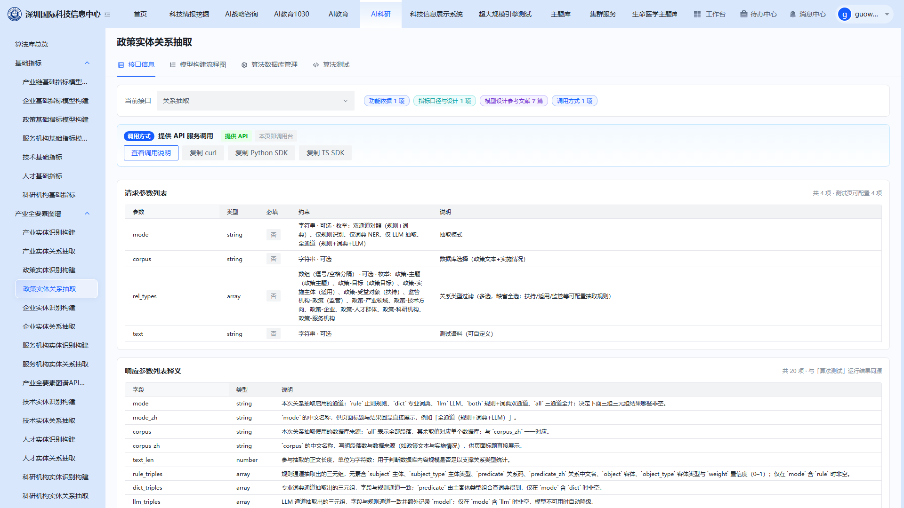

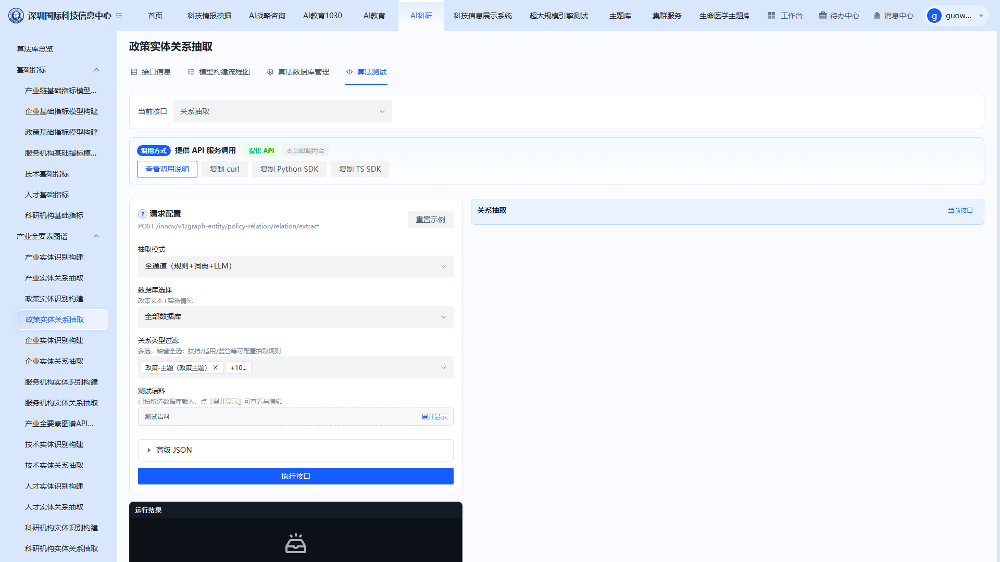

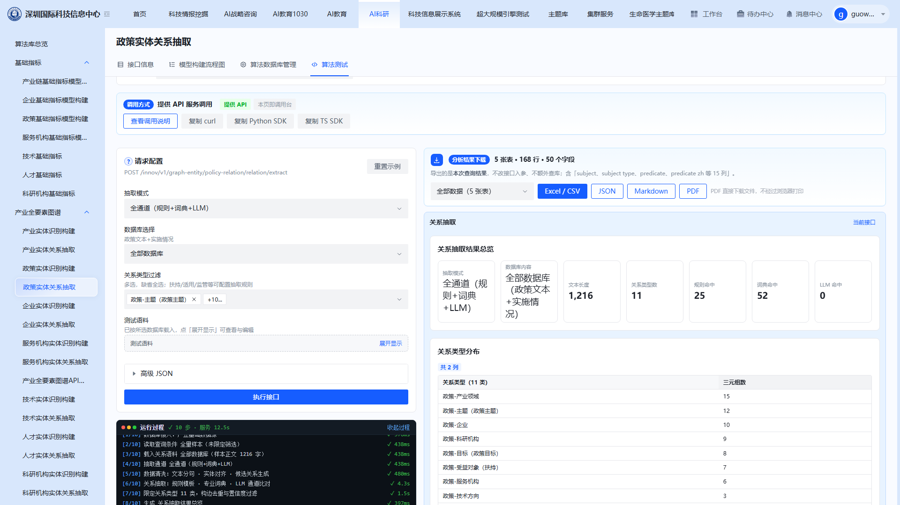

**操作指引**

按 3.1.1 节「通用界面结构与操作步骤」执行：
① 在接口信息页签核对本接口的请求参数与响应字段释义，确认参数含义与约束；
② 切换至「算法测试」页签，在参数与筛选区设置本模型对应的条件项（如产业标签、时间范围、地域范围、机构类型等），页面已预置一组可运行示例值，可在此基础上微调；
③ 点击「执行接口」，右侧运行结果区展示本次调用的执行状态、耗时、分步日志、指标卡与图表；
④ 读取统计指标卡与可视化图表，向下滚动查看明细表与分析结论；
⑤ 使用报告区右上角的导出／打印功能留存结果；如需接入业务系统，按接口信息页签的调用方式复制代码并替换参数即可集成。

**数据更新机制**

模型结果经计算、归纳与有效性验证后，通过 API 接口和数据同步机制服务化输出，支持按地域、领域、时间等条件灵活查询与下载。系统定期更新数据与指标并进行质量监测，确保指标的有效性与可靠性。

#### 3.5.5 企业实体识别构建

**模型功能描述**

企业实体识别构建通过对接企业工商库、企业新闻库与企业年报库，使用规则识别、词典识别与命名实体识别模型从多源文本中自动提取企业实体（企业名称、法定代表人、主营业务、所属行业等），并按行业与地区进行结构化归类与消歧。识别结果经人工校验后纳入产业全要素图谱，为后续企业关系抽取与企业画像分析提供统一的实体基础。

**功能要点**

| 项目 | 内容 |
|---|---|
| 处理对象 | 企业工商库、财务库、论文库、专利库、技术交易库、投融资库 |
| 核心方法 | 依托多源数据自动识别企业名称、类型、所属行业、地理位置及营收、员工、高管、融资额、产品、技术等属性 |
| 维护与更新 | 支持实体库新增、删除、修改及周期性更新；按企业名称获取论文产出、专利数量、技术交易额、融资额等属性并按任务周期更新 |
| 输出结果 | 企业实体库及属性档案，支撑企业画像、竞争力评估与招引培育推荐 |

**操作指引**

按 3.1.1 节「通用界面结构与操作步骤」执行：
① 在接口信息页签核对本接口的请求参数与响应字段释义，确认参数含义与约束；
② 切换至「算法测试」页签，在参数与筛选区设置本模型对应的条件项（如产业标签、时间范围、地域范围、机构类型等），页面已预置一组可运行示例值，可在此基础上微调；
③ 点击「执行接口」，右侧运行结果区展示本次调用的执行状态、耗时、分步日志、指标卡与图表；
④ 读取统计指标卡与可视化图表，向下滚动查看明细表与分析结论；
⑤ 使用报告区右上角的导出／打印功能留存结果；如需接入业务系统，按接口信息页签的调用方式复制代码并替换参数即可集成。

**数据更新机制**

模型结果经计算、归纳与有效性验证后，通过 API 接口和数据同步机制服务化输出，支持按地域、领域、时间等条件灵活查询与下载。系统定期更新数据与指标并进行质量监测，确保指标的有效性与可靠性。

#### 3.5.6 企业实体关系抽取

**模型功能描述**

企业实体关系抽取在企业实体识别的基础上，对接企业供应链库、企业股权库与企业合作库，使用关系分类模型从多源文本与结构化数据中抽取企业实体间的关系（供应链上下游、股权持股、合作研发、竞争对手等），并形成企业关系网络。抽取结果经人工校验后纳入产业全要素图谱，为后续供应链分析与企业竞争格局分析提供关系基础。

**功能要点**

| 项目 | 内容 |
|---|---|
| 处理对象 | 企业专题库及产业、技术、政策、人才、科研机构、服务机构等关联数据库 |
| 核心方法 | 抽取企业与产业、技术、政策、人才、科研机构、服务机构之间的关系；构建供应链上下游、技术合作、投融资、客户供应商等关系类型 |
| 维护与更新 | 结果经去重、纠错、缺失值补全与格式统一后按关系类型入库，并通过定时任务同步更新 |
| 输出结果 | 企业实体关系库及企业关系图谱，支撑供应链分析、生态网络研判与战略合作发现 |

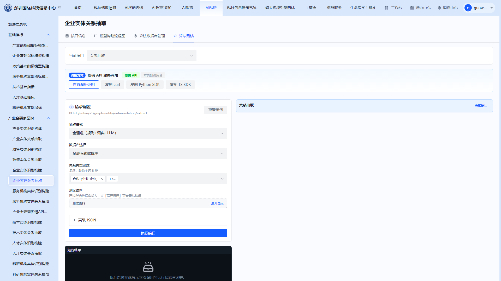

**操作指引**

按 3.1.1 节「通用界面结构与操作步骤」执行：
① 在接口信息页签核对本接口的请求参数与响应字段释义，确认参数含义与约束；
② 切换至「算法测试」页签，在参数与筛选区设置本模型对应的条件项（如产业标签、时间范围、地域范围、机构类型等），页面已预置一组可运行示例值，可在此基础上微调；
③ 点击「执行接口」，右侧运行结果区展示本次调用的执行状态、耗时、分步日志、指标卡与图表；
④ 读取统计指标卡与可视化图表，向下滚动查看明细表与分析结论；
⑤ 使用报告区右上角的导出／打印功能留存结果；如需接入业务系统，按接口信息页签的调用方式复制代码并替换参数即可集成。

**数据更新机制**

模型结果经计算、归纳与有效性验证后，通过 API 接口和数据同步机制服务化输出，支持按地域、领域、时间等条件灵活查询与下载。系统定期更新数据与指标并进行质量监测，确保指标的有效性与可靠性。

#### 3.5.7 服务机构实体识别构建

**模型功能描述**

服务机构实体识别构建通过对接服务机构工商库、资质认定库与行业年报库，使用规则识别、词典识别与命名实体识别模型从多源文本中自动提取服务机构实体（机构名称、资质等级、主营业务、服务领域等），并按机构类型进行结构化归类与消歧。识别结果经人工校验后纳入产业全要素图谱，为后续服务机构关系抽取与服务链分析提供统一的实体基础。

**功能要点**

| 项目 | 内容 |
|---|---|
| 处理对象 | 服务机构工商库、资质认定库、行业年报、技术交易库、服务记录库 |
| 核心方法 | 自动识别服务机构名称、类型、所属行业、地理位置、资质等级、服务领域等属性 |
| 维护与更新 | 支持实体库新增、删除、修改及周期性更新；按机构名称获取资质认定、技术交易、服务项目、覆盖企业数等属性并按任务周期更新 |
| 输出结果 | 服务机构实体库及属性档案，支撑服务链短板诊断与机构技术力评价 |

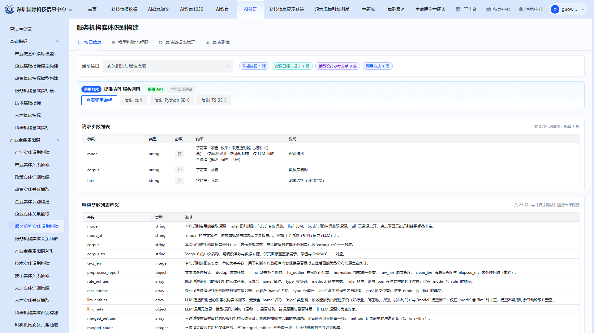

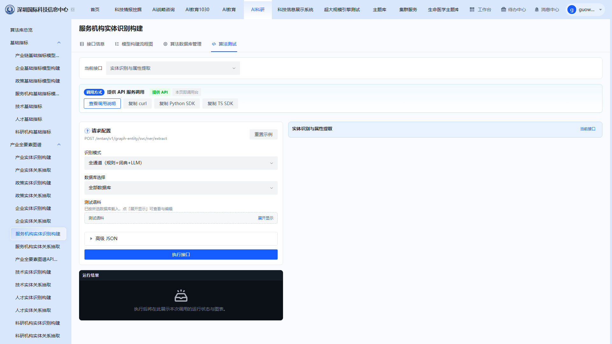

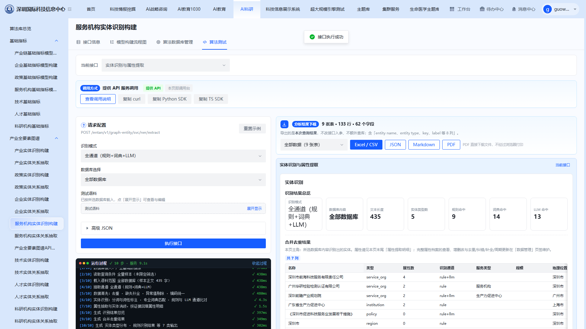

**操作指引**

按 3.1.1 节「通用界面结构与操作步骤」执行：
① 在接口信息页签核对本接口的请求参数与响应字段释义，确认参数含义与约束；
② 切换至「算法测试」页签，在参数与筛选区设置本模型对应的条件项（如产业标签、时间范围、地域范围、机构类型等），页面已预置一组可运行示例值，可在此基础上微调；
③ 点击「执行接口」，右侧运行结果区展示本次调用的执行状态、耗时、分步日志、指标卡与图表；
④ 读取统计指标卡与可视化图表，向下滚动查看明细表与分析结论；
⑤ 使用报告区右上角的导出／打印功能留存结果；如需接入业务系统，按接口信息页签的调用方式复制代码并替换参数即可集成。

**数据更新机制**

模型结果经计算、归纳与有效性验证后，通过 API 接口和数据同步机制服务化输出，支持按地域、领域、时间等条件灵活查询与下载。系统定期更新数据与指标并进行质量监测，确保指标的有效性与可靠性。

#### 3.5.8 服务机构实体关系抽取

**模型功能描述**

服务机构实体关系抽取在服务机构实体识别的基础上，对接服务机构合作库、服务记录库与企业需求库，使用关系分类模型从多源文本与结构化数据中抽取服务机构实体间的关系（服务供需、合作伙伴、竞争关系等），并形成服务机构关系网络。抽取结果经人工校验后纳入产业全要素图谱，为后续服务链图谱绘制与机构引入推荐提供关系基础。

**功能要点**

| 项目 | 内容 |
|---|---|
| 处理对象 | 服务机构专题库及企业、产业、技术、科研机构、政策等关联数据库 |
| 核心方法 | 抽取服务机构与企业、产业、技术、科研机构、政策之间的关系 |
| 维护与更新 | 结果经去重、纠错、缺失值补全与格式统一后按关系类型入库，并通过定时任务同步更新 |
| 输出结果 | 服务机构实体关系库及服务关系图谱，支撑服务链诊断与机构引入培育推荐 |

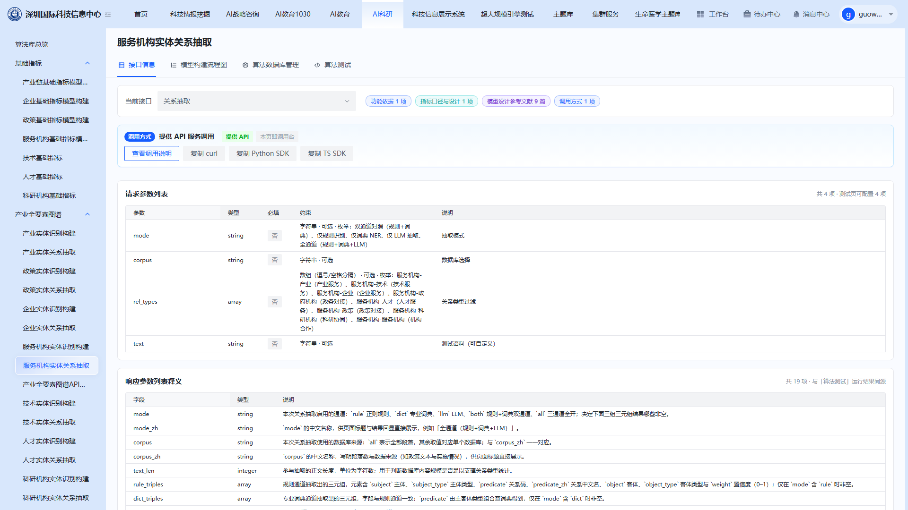

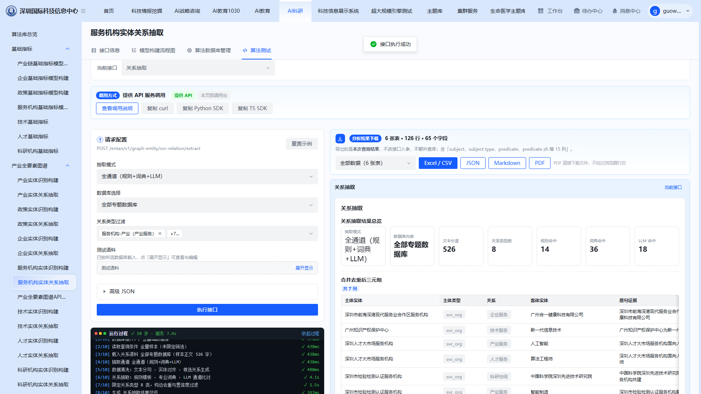

**操作指引**

按 3.1.1 节「通用界面结构与操作步骤」执行：
① 在接口信息页签核对本接口的请求参数与响应字段释义，确认参数含义与约束；
② 切换至「算法测试」页签，在参数与筛选区设置本模型对应的条件项（如产业标签、时间范围、地域范围、机构类型等），页面已预置一组可运行示例值，可在此基础上微调；
③ 点击「执行接口」，右侧运行结果区展示本次调用的执行状态、耗时、分步日志、指标卡与图表；
④ 读取统计指标卡与可视化图表，向下滚动查看明细表与分析结论；
⑤ 使用报告区右上角的导出／打印功能留存结果；如需接入业务系统，按接口信息页签的调用方式复制代码并替换参数即可集成。

**数据更新机制**

模型结果经计算、归纳与有效性验证后，通过 API 接口和数据同步机制服务化输出，支持按地域、领域、时间等条件灵活查询与下载。系统定期更新数据与指标并进行质量监测，确保指标的有效性与可靠性。

#### 3.5.9 产业全要素图谱API服务开发

**模型功能描述**

产业全要素图谱 API 服务开发在图谱构建完成后，将图数据库中的实体、属性与关系以标准化 Restful API 的形式对外提供，支持实体检索、关系查询、路径分析、节点重要性计算、社群发现与图谱可视化等能力。API 服务覆盖图谱全部实体类型与关系类型，支持按时间、地域、领域等多维条件过滤，并提供实时推理与批量计算两种服务模式。

**功能要点**

| 项目 | 内容 |
|---|---|
| 处理对象 | 产业、技术、企业、人才、科研机构、政策、服务机构七类实体及其关系数据 |
| 核心方法 | 提供节点重要性分析、社群发现、路径分析等图结构分析与计算能力，支持实体检索、关系查询、语义分析、可视化展示与聚类关联分析 |
| 维护与更新 | API 接口与图谱数据同步更新，支持图谱增量刷新与服务化监控 |
| 输出结果 | 图谱查询与分析 API 服务，支撑实体检索、关系遍历、图算法计算及可视化集成 |

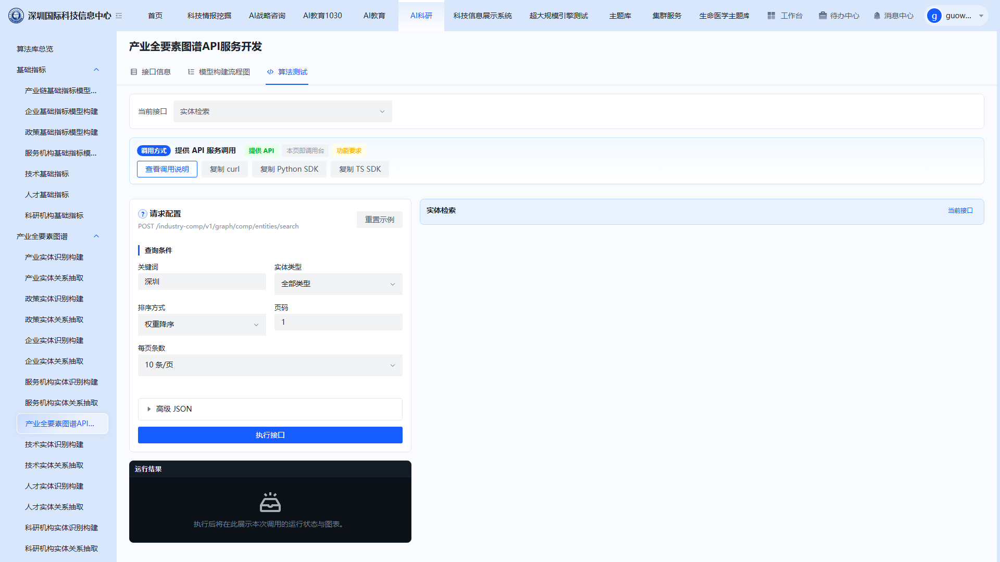

**操作指引**

按 3.1.1 节「通用界面结构与操作步骤」执行：
① 在接口信息页签核对本接口的请求参数与响应字段释义，确认参数含义与约束；
② 切换至「算法测试」页签，在参数与筛选区设置本模型对应的条件项（如产业标签、时间范围、地域范围、机构类型等），页面已预置一组可运行示例值，可在此基础上微调；
③ 点击「执行接口」，右侧运行结果区展示本次调用的执行状态、耗时、分步日志、指标卡与图表；
④ 读取统计指标卡与可视化图表，向下滚动查看明细表与分析结论；
⑤ 使用报告区右上角的导出／打印功能留存结果；如需接入业务系统，按接口信息页签的调用方式复制代码并替换参数即可集成。

**数据更新机制**

模型结果经计算、归纳与有效性验证后，通过 API 接口和数据同步机制服务化输出，支持按地域、领域、时间等条件灵活查询与下载。系统定期更新数据与指标并进行质量监测，确保指标的有效性与可靠性。

### 3.6 产业链深度分析模型构建

产业链深度分析模型围绕产业链全景描绘、关键环节识别、瓶颈堵点诊断、深圳产业链优势与机遇研判等核心场景，综合产业链上下游数据、企业布局、论文专利、政策支持与技术交易等多源信息，构建涵盖全景、深圳、周期、阶段、关键环节、瓶颈堵点、区域指数、问题识别、机遇分析与重点布局推荐的一整套分析能力。模型按"全景 → 结构分解 → 深圳聚焦 → 瓶颈识别 → 机会发现 → 布局推荐"的逻辑链组织，前序模块的分析结论作为后序模块的输入，形成可追溯的分析链路。

#### 3.6.1 产业链全景模型构建

**模型功能描述**

产业链全景模型算法基于产业知识图谱与产业基础数据，全面展示某一产业或细分产业的结构与运作全貌，涵盖上下游环节关系梳理、产业链关联数据采集与整合，以及产业链服务化功能输出。该算法通过可视化建模与数据驱动分析，帮助用户掌握产业全局、识别关键环节和主体，为产业布局优化、政策制定及协同发展提供系统支撑。

**算法输入与输出**

| 项目 | 内容 |
|---|---|
| 输入 | 产业知识图谱数据、企业信息、技术数据、人才数据、科研机构数据、服务机构数据、供应链数据、市场数据、行业数据。 |
| 输出 | 产业链全景关系图谱、上下游环节关系及主体信息清单、属性统计与分析报告、可视化展示结果。 |
| 调用方式 | 支持通过Restful API、SDK及展示平台调用，可按上下游环节或主体类别进行关系查询、数据统计与分析，并支持生成可视化图谱及数据导出服务。 |

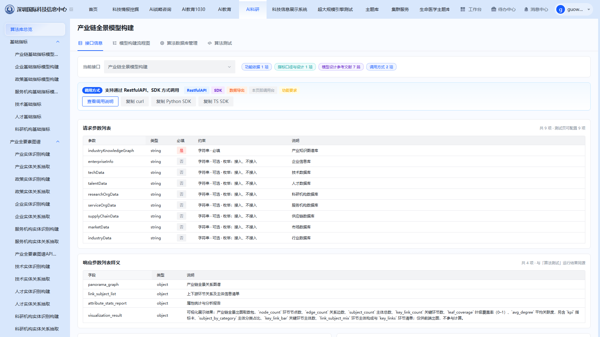

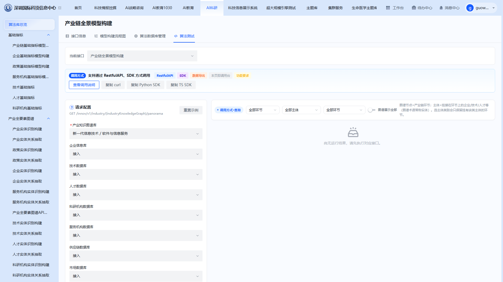

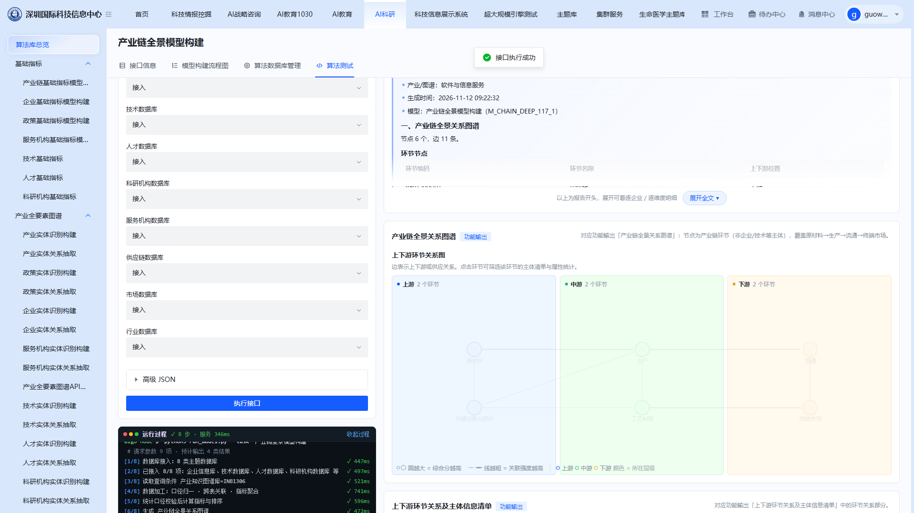

**操作指引**

按 3.1.1 节「通用界面结构与操作步骤」执行：
① 在接口信息页签核对本接口的请求参数与响应字段释义，确认参数含义与约束；
② 切换至「算法测试」页签，在参数与筛选区设置本模型对应的条件项，页面已预置一组可运行示例值，可在此基础上微调；
③ 点击「执行接口」，右侧运行结果区展示本次调用的执行状态、耗时、分步日志、指标卡与图表；
④ 读取统计指标卡与可视化图表，向下滚动查看明细表与分析结论；
⑤ 使用报告区右上角的导出／打印功能留存结果；如需接入业务系统，按接口信息页签的调用方式复制代码并替换参数即可集成。

**数据更新机制**

模型结果经计算、归纳与有效性验证后，通过 API 接口和数据同步机制服务化输出，支持按地域、领域、时间等条件灵活查询与下载。系统定期更新数据与指标并进行质量监测，确保指标的有效性与可靠性。

#### 3.6.2 深圳产业链模型构建

**模型功能描述**

深圳产业链模型算法依托产业知识图谱与产业基础数据，形成覆盖某一产业或细分产业在深圳布局的全景产业链模型，展示全链条全部节点及其属性信息。该算法可全面刻画产业链上下游关系，整合多源关联数据，并提供服务化接口，支持企业、科研机构、人才等产业要素的查询、统计与分析，帮助政府部门、产业园区及相关机构掌握深圳产业链全貌、监测产业运行状况并优化发展布局。

**算法输入与输出**

| 项目 | 内容 |
|---|---|
| 输入 | 产业知识图谱数据、深圳区域产业基础数据、企业信息、技术数据、人才数据、科研机构信息、服务机构信息、供应链数据。 |
| 输出 | 深圳产业链全景关系图谱、上下游环节关系清单、属性统计分析报告、可视化展示结果。 |
| 调用方式 | 支持通过Restful API、SDK及展示平台调用，可按上下游环节、主体类型或区域属性进行关系查询与数据分析，并支持生成可视化图谱及数据导出服务。 |

**操作指引**

按 3.1.1 节「通用界面结构与操作步骤」执行：
① 在接口信息页签核对本接口的请求参数与响应字段释义，确认参数含义与约束；
② 切换至「算法测试」页签，在参数与筛选区设置本模型对应的条件项，页面已预置一组可运行示例值，可在此基础上微调；
③ 点击「执行接口」，右侧运行结果区展示本次调用的执行状态、耗时、分步日志、指标卡与图表；
④ 读取统计指标卡与可视化图表，向下滚动查看明细表与分析结论；
⑤ 使用报告区右上角的导出／打印功能留存结果；如需接入业务系统，按接口信息页签的调用方式复制代码并替换参数即可集成。

**数据更新机制**

模型结果经计算、归纳与有效性验证后，通过 API 接口和数据同步机制服务化输出，支持按地域、领域、时间等条件灵活查询与下载。系统定期更新数据与指标并进行质量监测，确保指标的有效性与可靠性。

#### 3.6.3 产业发展路线历程模型

**模型功能描述**

产业发展路线历程模型算法用于识别与呈现产业在发展过程中的重大事件及其对产业趋势的影响。该算法基于产业基础指标与资讯基础指标，结合事件识别算法构建重大事件时间线，为产业动态分析及决策提供量化依据。算法通过接入行业统计数据、政策法规、专家观点、新闻报道等多类数据源，记录重大事件及发生时间节点，最终生成覆盖全产业发展历程的重大事件时间线。

**算法输入与输出**

| 项目 | 内容 |
|---|---|
| 输入 | 产业基础指标数据、资讯基础指标数据、行业统计信息、政策法规文本、专家观点数据、新闻报道数据、重大事件指标体系及阈值设定。 |
| 输出 | 重大事件时间线、产业发展趋势分析报告、可视化事件分布图、动态监测数据接口。 |
| 调用方式 | 支持通过Restful API、SDK方式调用，可按产业标签或行业类别查询重大事件列表及发展路线，并支持生成分析报告、趋势图表及数据导出服务。 |

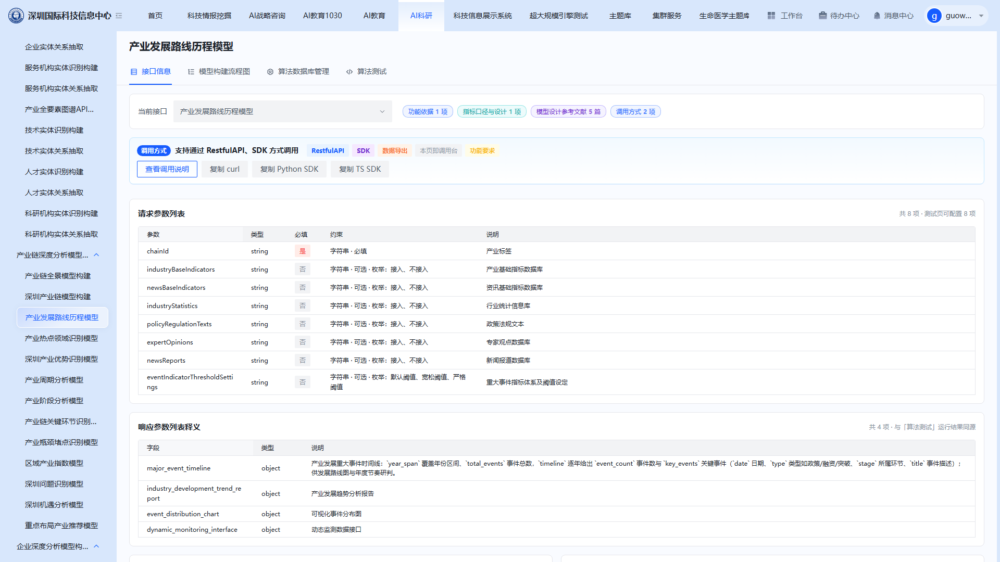

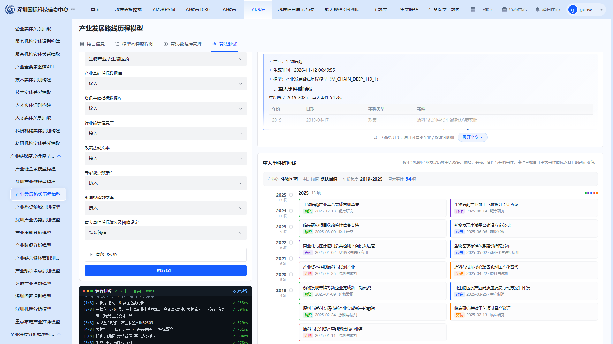

**操作指引**

按 3.1.1 节「通用界面结构与操作步骤」执行：
① 在接口信息页签核对本接口的请求参数与响应字段释义，确认参数含义与约束；
② 切换至「算法测试」页签，在参数与筛选区设置本模型对应的条件项，页面已预置一组可运行示例值，可在此基础上微调；
③ 点击「执行接口」，右侧运行结果区展示本次调用的执行状态、耗时、分步日志、指标卡与图表；
④ 读取统计指标卡与可视化图表，向下滚动查看明细表与分析结论；
⑤ 使用报告区右上角的导出／打印功能留存结果；如需接入业务系统，按接口信息页签的调用方式复制代码并替换参数即可集成。

**数据更新机制**

模型结果经计算、归纳与有效性验证后，通过 API 接口和数据同步机制服务化输出，支持按地域、领域、时间等条件灵活查询与下载。系统定期更新数据与指标并进行质量监测，确保指标的有效性与可靠性。

#### 3.6.4 产业热点领域识别模型

**模型功能描述**

产业热点领域识别模型算法通过对接资讯数据库，系统化获取目标产业的多源资讯数据，并基于热点指标与阈值设定，利用热点识别算法对产业动态进行分析，实时识别并跟踪产业热点。该算法结合数据采集、清洗、指标体系构建和服务化输出等环节，可为产业监测、市场判断及战略决策提供精确的数据支持与分析依据。

**算法输入与输出**

| 项目 | 内容 |
|---|---|
| 输入 | 新闻报道数据、行业研究报告数据、公司公告数据、市场份额指标、行业增长率指标、竞争格局指标、阈值参数。 |
| 输出 | 产业热点领域列表、热点结构分析报告、热点变化趋势图表、可视化数据接口。 |
| 调用方式 | 支持通过Restful API、SDK及在线展示平台调用，可按产业标签或细分领域获取热点识别结果，并支持生成分析报告及数据导出服务。 |

**操作指引**

按 3.1.1 节「通用界面结构与操作步骤」执行：
① 在接口信息页签核对本接口的请求参数与响应字段释义，确认参数含义与约束；
② 切换至「算法测试」页签，在参数与筛选区设置本模型对应的条件项，页面已预置一组可运行示例值，可在此基础上微调；
③ 点击「执行接口」，右侧运行结果区展示本次调用的执行状态、耗时、分步日志、指标卡与图表；
④ 读取统计指标卡与可视化图表，向下滚动查看明细表与分析结论；
⑤ 使用报告区右上角的导出／打印功能留存结果；如需接入业务系统，按接口信息页签的调用方式复制代码并替换参数即可集成。

**数据更新机制**

模型结果经计算、归纳与有效性验证后，通过 API 接口和数据同步机制服务化输出，支持按地域、领域、时间等条件灵活查询与下载。系统定期更新数据与指标并进行质量监测，确保指标的有效性与可靠性。

#### 3.6.5 深圳产业优势识别模型

**模型功能描述**

深圳产业优势识别模型算法旨在通过综合对比各领域专题库数据，构建科学的产业评价模型，并结合深圳产业数据与全国产业数据对比分析，识别深圳具有竞争力与发展优势的产业领域。该算法基于多维度指标体系（如行业增长率、市场占有率、技术创新能力等），提供实时、精准的产业优势评估结果，可服务政府决策、产业规划及企业战略制定。

**算法输入与输出**

| 项目 | 内容 |
|---|---|
| 输入 | 深圳市产业数据、全国产业数据、政策法规库数据、经济指标库数据、企业信息库数据、行业增长率指标、市场占有率指标、技术创新能力指标、权重及阈值参数。 |
| 输出 | 深圳优势产业清单、优势评分结果、详细指标分析报告、趋势变化可视化图表。 |
| 调用方式 | 支持通过Restful API、SDK方式调用，可按产业标签或行业类别获取优势产业识别结果，并支持生成分析报告及数据导出服务。 |

**操作指引**

按 3.1.1 节「通用界面结构与操作步骤」执行：
① 在接口信息页签核对本接口的请求参数与响应字段释义，确认参数含义与约束；
② 切换至「算法测试」页签，在参数与筛选区设置本模型对应的条件项，页面已预置一组可运行示例值，可在此基础上微调；
③ 点击「执行接口」，右侧运行结果区展示本次调用的执行状态、耗时、分步日志、指标卡与图表；
④ 读取统计指标卡与可视化图表，向下滚动查看明细表与分析结论；
⑤ 使用报告区右上角的导出／打印功能留存结果；如需接入业务系统，按接口信息页签的调用方式复制代码并替换参数即可集成。

**数据更新机制**

模型结果经计算、归纳与有效性验证后，通过 API 接口和数据同步机制服务化输出，支持按地域、领域、时间等条件灵活查询与下载。系统定期更新数据与指标并进行质量监测，确保指标的有效性与可靠性。

#### 3.6.6 产业周期分析模型

**模型功能描述**

产业周期分析模型算法旨在基于历史数据与行业特征构建周期阶段划分体系，对起始期、成长期、成熟期、衰退期等阶段设计相应评价指标与阈值，并结合实时产业数据计算指标值，预测所处周期阶段及未来趋势变化。该算法为政府、行业协会和企业的战略决策、投资判断及资源配置提供量化依据，并支持可视化展示与服务化调用。

**算法输入与输出**

| 项目 | 内容 |
|---|---|
| 输入 | 历史产业数据、实时产业数据、市场规模数据、行业增长率数据、利润率数据、周期阶段评价指标与阈值设定、模型训练参数。 |
| 输出 | 当前产业周期阶段识别结果、未来趋势预测报告、可视化趋势展示、产业周期对比分析结果。 |
| 调用方式 | 支持通过Restful API、SDK及展示平台调用，可按产业标签进行周期分析与趋势预测，并支持生成趋势报告、对比分析及数据导出服务。 |

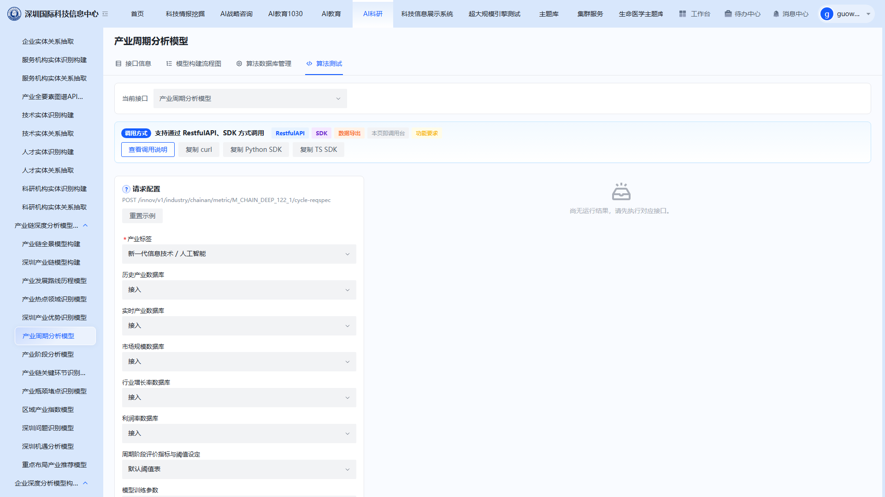

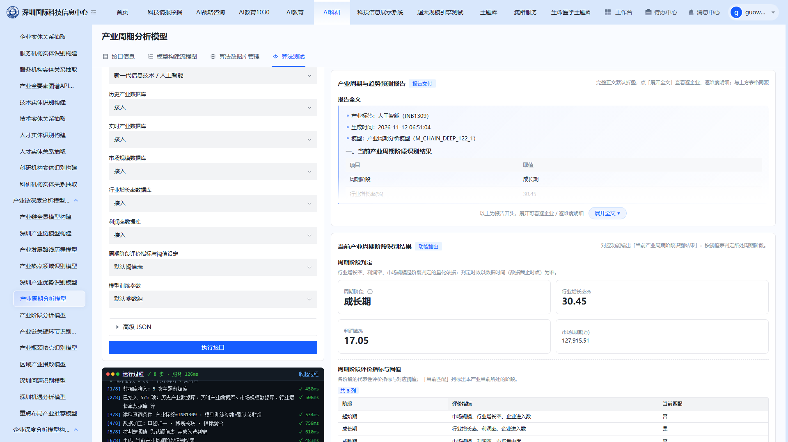

**操作指引**

按 3.1.1 节「通用界面结构与操作步骤」执行：
① 在接口信息页签核对本接口的请求参数与响应字段释义，确认参数含义与约束；
② 切换至「算法测试」页签，在参数与筛选区设置本模型对应的条件项，页面已预置一组可运行示例值，可在此基础上微调；
③ 点击「执行接口」，右侧运行结果区展示本次调用的执行状态、耗时、分步日志、指标卡与图表；
④ 读取统计指标卡与可视化图表，向下滚动查看明细表与分析结论；
⑤ 使用报告区右上角的导出／打印功能留存结果；如需接入业务系统，按接口信息页签的调用方式复制代码并替换参数即可集成。

**数据更新机制**

模型结果经计算、归纳与有效性验证后，通过 API 接口和数据同步机制服务化输出，支持按地域、领域、时间等条件灵活查询与下载。系统定期更新数据与指标并进行质量监测，确保指标的有效性与可靠性。

#### 3.6.7 产业阶段分析模型

**模型功能描述**

产业阶段分析模型算法旨在结合产业周期分析模型，依据产业关键指标值判断其所处的发展阶段，如成长期、成熟期或衰退期，为产业发展战略制定和资源配置提供量化参考。该算法通过设计具备区分度和代表性的指标体系，系统化采集并整合权威数据源，基于指标分析与周期模型映射计算产业阶段，并支持在线查询与服务化调用。

**算法输入与输出**

| 项目 | 内容 |
|---|---|
| 输入 | 生产能力数据、销售规模数据、市场份额数据、利润率数据、政策法规数据、行业统计信息、企业财报数据、指标权重参数。 |
| 输出 | 产业阶段判定结果（成长期、成熟期、衰退期）、阶段分析报告、趋势变化预测图表。 |
| 调用方式 | 支持通过Restful API、SDK及在线平台调用，可按产业标签查询当前阶段结果，并支持生成分析报告、趋势预测及数据导出服务。 |

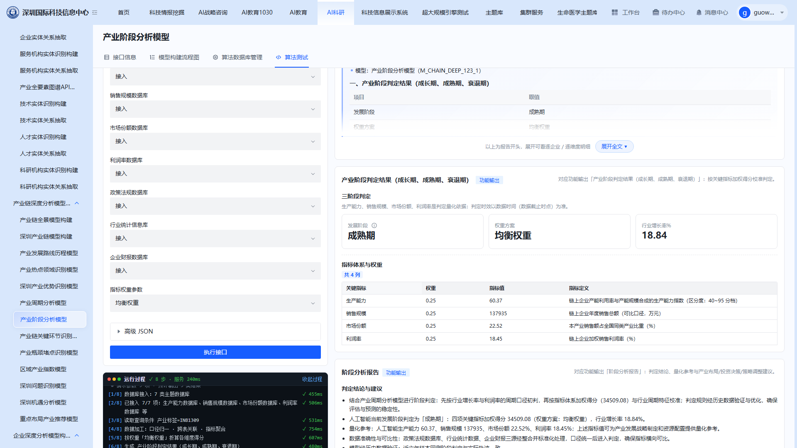

**操作指引**

按 3.1.1 节「通用界面结构与操作步骤」执行：
① 在接口信息页签核对本接口的请求参数与响应字段释义，确认参数含义与约束；
② 切换至「算法测试」页签，在参数与筛选区设置本模型对应的条件项，页面已预置一组可运行示例值，可在此基础上微调；
③ 点击「执行接口」，右侧运行结果区展示本次调用的执行状态、耗时、分步日志、指标卡与图表；
④ 读取统计指标卡与可视化图表，向下滚动查看明细表与分析结论；
⑤ 使用报告区右上角的导出／打印功能留存结果；如需接入业务系统，按接口信息页签的调用方式复制代码并替换参数即可集成。

**数据更新机制**

模型结果经计算、归纳与有效性验证后，通过 API 接口和数据同步机制服务化输出，支持按地域、领域、时间等条件灵活查询与下载。系统定期更新数据与指标并进行质量监测，确保指标的有效性与可靠性。

#### 3.6.8 产业链关键环节识别模型

**模型功能描述**

产业链关键环节识别模型算法旨在结合产业创新水平、企业规模和产业附加值等核心维度，对产业链结构进行量化分析，识别其中具有战略重要性和引领作用的关键环节。该算法通过系统采集产业相关数据，构建指标体系与阈值判定标准，经过模型训练与优化，计算各指标值并准确定位产业链的关键节点，为产业规划、政策制定及企业战略布局提供精确参考。

**算法输入与输出**

| 项目 | 内容 |
|---|---|
| 输入 | 企业财务报表数据、产业统计年鉴数据、政策法规数据、产业创新能力指标、企业规模指标、产业附加值指标、权重与阈值参数。 |
| 输出 | 产业链关键环节清单、战略重要性分析报告、可视化环节结构图、环节影响力评估结果。 |
| 调用方式 | 支持通过Restful API、SDK及可视化平台调用，可按产业标签或环节类型查询关键环节信息，并支持生成分析报告及数据导出服务。 |

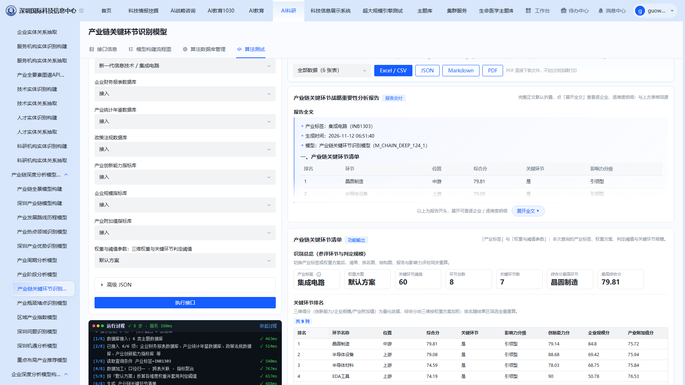

**操作指引**

按 3.1.1 节「通用界面结构与操作步骤」执行：
① 在接口信息页签核对本接口的请求参数与响应字段释义，确认参数含义与约束；
② 切换至「算法测试」页签，在参数与筛选区设置本模型对应的条件项，页面已预置一组可运行示例值，可在此基础上微调；
③ 点击「执行接口」，右侧运行结果区展示本次调用的执行状态、耗时、分步日志、指标卡与图表；
④ 读取统计指标卡与可视化图表，向下滚动查看明细表与分析结论；
⑤ 使用报告区右上角的导出／打印功能留存结果；如需接入业务系统，按接口信息页签的调用方式复制代码并替换参数即可集成。

**数据更新机制**

模型结果经计算、归纳与有效性验证后，通过 API 接口和数据同步机制服务化输出，支持按地域、领域、时间等条件灵活查询与下载。系统定期更新数据与指标并进行质量监测，确保指标的有效性与可靠性。

#### 3.6.9 产业瓶颈堵点识别模型

**模型功能描述**

产业瓶颈堵点识别模型算法面向区域与行业发展中的关键制约因素，基于技术、人才、市场需求、资金、政策五大维度构建指标体系与阈值判断机制，通过计算各维度指标值，自动提取并标识产业瓶颈堵点。该算法可为政府、研究机构和企业提供精准的产业诊断结论，支持制定针对性解决方案和发展策略，并提供服务化接口供用户随时查询最新瓶颈信息。

**算法输入与输出**

| 项目 | 内容 |
|---|---|
| 输入 | 政策法规数据、市场调研数据、专家访谈信息、行业分析数据、技术指标、人才指标、市场需求指标、资金指标、政策支持指标、权重与阈值设定。 |
| 输出 | 产业瓶颈堵点清单、瓶颈成因分析报告、影响范围评估、解决方案建议、趋势预警图表。 |
| 调用方式 | 支持通过Restful API、SDK方式调用，可按产业标签或领域类别查询最新瓶颈信息，并支持生成报告、趋势预警及数据导出服务。 |

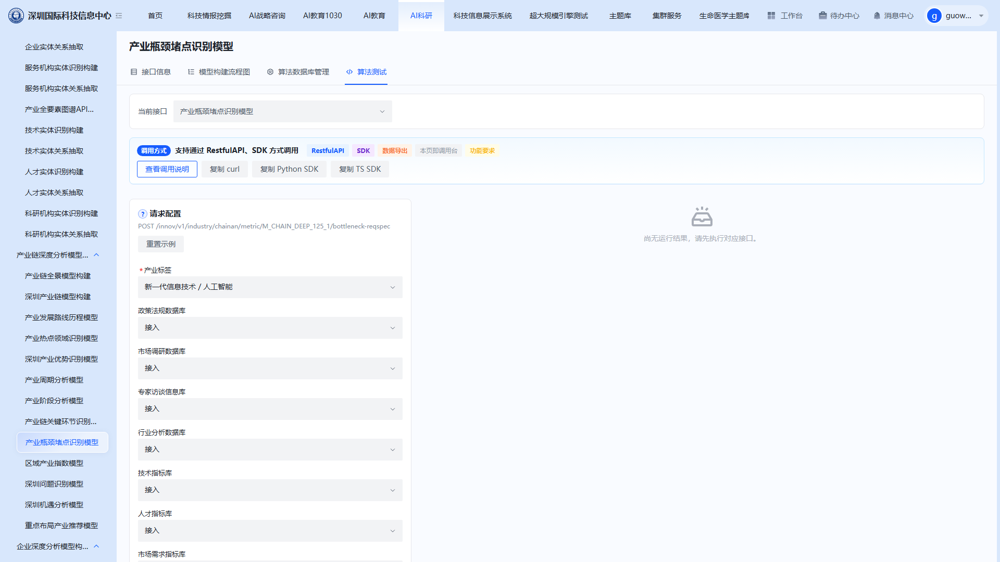

**操作指引**

按 3.1.1 节「通用界面结构与操作步骤」执行：
① 在接口信息页签核对本接口的请求参数与响应字段释义，确认参数含义与约束；
② 切换至「算法测试」页签，在参数与筛选区设置本模型对应的条件项，页面已预置一组可运行示例值，可在此基础上微调；
③ 点击「执行接口」，右侧运行结果区展示本次调用的执行状态、耗时、分步日志、指标卡与图表；
④ 读取统计指标卡与可视化图表，向下滚动查看明细表与分析结论；
⑤ 使用报告区右上角的导出／打印功能留存结果；如需接入业务系统，按接口信息页签的调用方式复制代码并替换参数即可集成。

**数据更新机制**

模型结果经计算、归纳与有效性验证后，通过 API 接口和数据同步机制服务化输出，支持按地域、领域、时间等条件灵活查询与下载。系统定期更新数据与指标并进行质量监测，确保指标的有效性与可靠性。

#### 3.6.10 区域产业指数模型

**模型功能描述**

区域产业指数模型算法用于量化评估特定区域产业的发展水平与竞争力，综合考虑企业能力竞争力、学术生态竞争力、配套生态竞争力三大核心维度，通过科学设计指标体系与阈值标准，计算区域产业指数，并为政策制定、行业研究和投资决策提供参考。该算法不仅反映当前产业生态的成熟度与潜力，还支持长期趋势分析与区域间对比。

**算法输入与输出**

| 项目 | 内容 |
|---|---|
| 输入 | 企业信息库数据、知识产权数据、高校与科研机构统计数据、人才数据、配套服务数据、指标体系与权重参数、历史产业数据。 |
| 输出 | 区域产业指数、趋势分析报告、优势与短板评估结果、区域对比分析图表。 |
| 调用方式 | 支持通过Restful API、SDK方式调用，可按区域标签进行产业指数查询，并支持生成趋势分析报告、优势短板评估及数据导出服务。 |

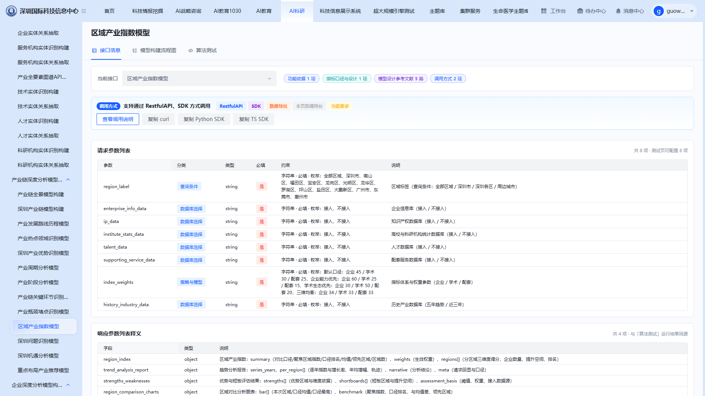

**操作指引**

按 3.1.1 节「通用界面结构与操作步骤」执行：
① 在接口信息页签核对本接口的请求参数与响应字段释义，确认参数含义与约束；
② 切换至「算法测试」页签，在参数与筛选区设置本模型对应的条件项，页面已预置一组可运行示例值，可在此基础上微调；
③ 点击「执行接口」，右侧运行结果区展示本次调用的执行状态、耗时、分步日志、指标卡与图表；
④ 读取统计指标卡与可视化图表，向下滚动查看明细表与分析结论；
⑤ 使用报告区右上角的导出／打印功能留存结果；如需接入业务系统，按接口信息页签的调用方式复制代码并替换参数即可集成。

**数据更新机制**

模型结果经计算、归纳与有效性验证后，通过 API 接口和数据同步机制服务化输出，支持按地域、领域、时间等条件灵活查询与下载。系统定期更新数据与指标并进行质量监测，确保指标的有效性与可靠性。

#### 3.6.11 深圳问题识别模型

**模型功能描述**

深圳问题识别模型算法旨在通过多领域数据对比分析，定位深圳产业在发展过程中的薄弱环节与突出问题。该算法综合对接深圳与全国各领域专题库，涵盖政策法规、新闻舆情、企业财务等多类数据，在全面掌握产业运行状况的基础上，设定代表性负面评价指标，并通过产业负面评价模型计算得出问题识别结果。结合深圳与全国的指标对比，算法可为政府管理部门、行业协会以及企业提供科学的决策参考，支持精准改进与政策优化。

**算法输入与输出**

| 项目 | 内容 |
|---|---|
| 输入 | 深圳产业数据、全国产业数据、政策法规数据、新闻舆情数据、企业财务数据、负面评价指标体系与权重参数。 |
| 输出 | 深圳产业问题识别结果、薄弱环节与风险清单、优先级排序报告、针对性解决方案建议、可视化分析图表。 |
| 调用方式 | 支持通过Restful API、SDK及数据分析平台调用，可按产业标签或领域类别查询问题识别结果，并支持生成分析报告、可视化展示及数据导出服务。 |

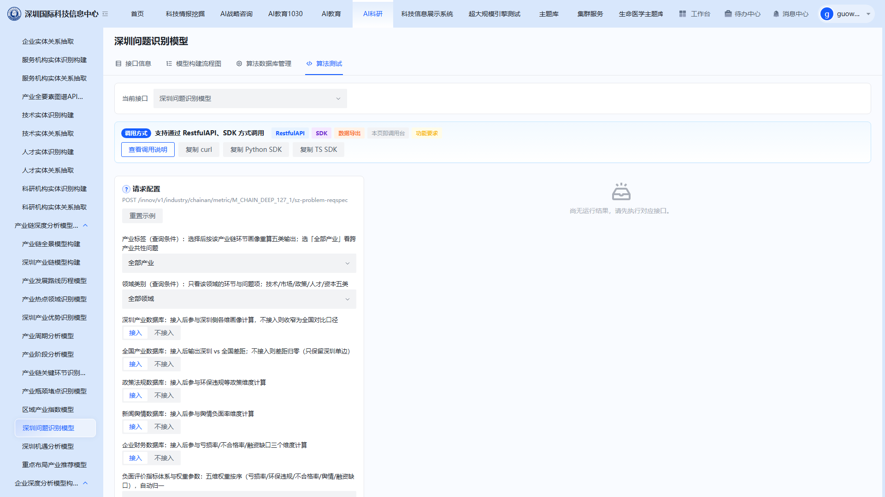

**操作指引**

按 3.1.1 节「通用界面结构与操作步骤」执行：
① 在接口信息页签核对本接口的请求参数与响应字段释义，确认参数含义与约束；
② 切换至「算法测试」页签，在参数与筛选区设置本模型对应的条件项，页面已预置一组可运行示例值，可在此基础上微调；
③ 点击「执行接口」，右侧运行结果区展示本次调用的执行状态、耗时、分步日志、指标卡与图表；
④ 读取统计指标卡与可视化图表，向下滚动查看明细表与分析结论；
⑤ 使用报告区右上角的导出／打印功能留存结果；如需接入业务系统，按接口信息页签的调用方式复制代码并替换参数即可集成。

**数据更新机制**

模型结果经计算、归纳与有效性验证后，通过 API 接口和数据同步机制服务化输出，支持按地域、领域、时间等条件灵活查询与下载。系统定期更新数据与指标并进行质量监测，确保指标的有效性与可靠性。

#### 3.6.12 深圳机遇分析模型

**模型功能描述**

深圳机遇分析模型算法基于对深圳市产业优势和发展问题的系统化分析，结合专家知识与策略配置，形成数据驱动与知识驱动相结合的机遇推荐机制。该算法通过采集、处理和分析多维度区域数据，识别核心优势产业与关键制约因素，并在专家策略指导下生成面向产业发展、政策优化和创新方向的推荐结果，为政府决策、产业布局调整和企业战略规划提供科学依据。

**算法输入与输出**

| 项目 | 内容 |
|---|---|
| 输入 | 年度经济统计数据、人口普查数据、重点产业分布数据、产业优势分析结果、发展问题识别结果、专家策略配置数据、机器学习模型参数。 |
| 输出 | 区域机遇推荐清单、产业发展建议报告、政策优化方案、创新方向分析图表。 |
| 调用方式 | 支持通过Restful API、SDK及分析报告平台调用，可按产业标签或区域领域获取机遇分析与推荐结果，并支持生成分析报告及数据导出服务。 |

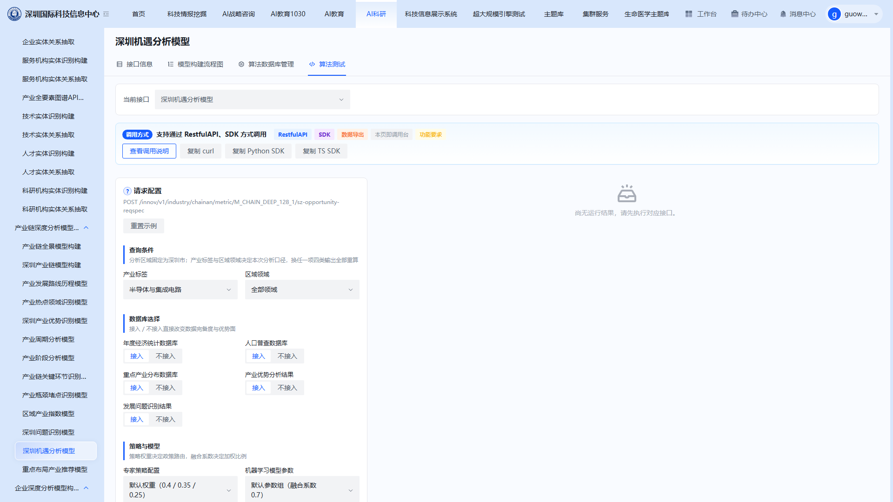

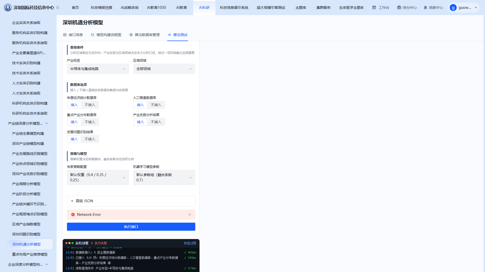

**操作指引**

按 3.1.1 节「通用界面结构与操作步骤」执行：
① 在接口信息页签核对本接口的请求参数与响应字段释义，确认参数含义与约束；
② 切换至「算法测试」页签，在参数与筛选区设置本模型对应的条件项，页面已预置一组可运行示例值，可在此基础上微调；
③ 点击「执行接口」，右侧运行结果区展示本次调用的执行状态、耗时、分步日志、指标卡与图表；
④ 读取统计指标卡与可视化图表，向下滚动查看明细表与分析结论；
⑤ 使用报告区右上角的导出／打印功能留存结果；如需接入业务系统，按接口信息页签的调用方式复制代码并替换参数即可集成。

**数据更新机制**

模型结果经计算、归纳与有效性验证后，通过 API 接口和数据同步机制服务化输出，支持按地域、领域、时间等条件灵活查询与下载。系统定期更新数据与指标并进行质量监测，确保指标的有效性与可靠性。

#### 3.6.13 重点布局产业推荐模型

**模型功能描述**

重点布局产业推荐模型算法旨在基于深圳市产业优势分析与问题识别，结合专家知识制定策略，整合多源产业数据计算产业推荐指数，科学输出重点产业布局建议。该算法不仅能够反映区域产业发展的竞争优势与潜在短板，还能够支持政府、行业协会及企业在产业布局规划、政策制定和资源配置中的决策需求。

该算法对接深圳市多渠道产业数据源，采集并标准化处理产业基础信息、市场规模、发展趋势及政策环境等数据。

**算法输入与输出**

| 项目 | 内容 |
|---|---|
| 输入 | 深圳市产业基础信息数据、市场规模数据、发展趋势数据、政策环境数据、产业优势分析结果、产业问题识别结果、专家推荐策略参数（推荐标准、权重、评估规则）。 |
| 输出 | 产业推荐指数、重点布局产业排名清单、趋势分析图表、布局建议报告。 |
| 调用方式 | 支持通过Restful API、SDK及可视化展示平台调用，可按需求标签、区域或产业类别获取产业推荐结果，并支持生成趋势分析报告及数据导出服务。 |

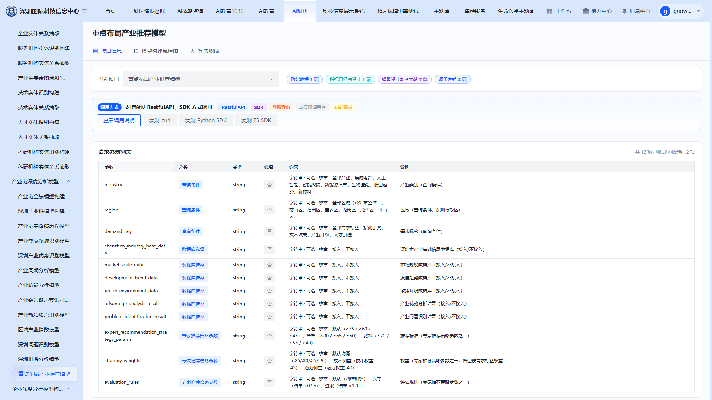

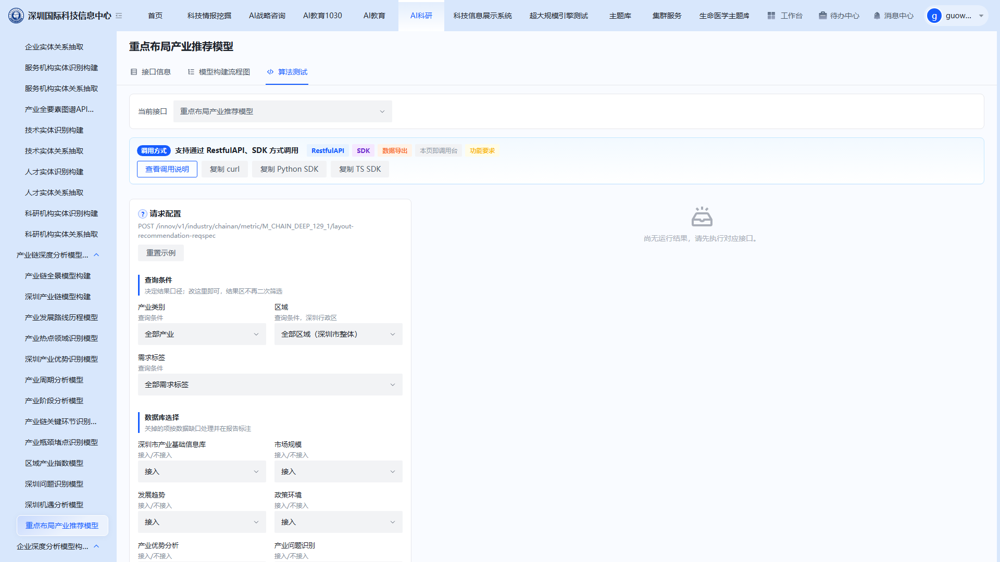

**操作指引**

按 3.1.1 节「通用界面结构与操作步骤」执行：
① 在接口信息页签核对本接口的请求参数与响应字段释义，确认参数含义与约束；
② 切换至「算法测试」页签，在参数与筛选区设置本模型对应的条件项，页面已预置一组可运行示例值，可在此基础上微调；
③ 点击「执行接口」，右侧运行结果区展示本次调用的执行状态、耗时、分步日志、指标卡与图表；
④ 读取统计指标卡与可视化图表，向下滚动查看明细表与分析结论；
⑤ 使用报告区右上角的导出／打印功能留存结果；如需接入业务系统，按接口信息页签的调用方式复制代码并替换参数即可集成。

**数据更新机制**

模型结果经计算、归纳与有效性验证后，通过 API 接口和数据同步机制服务化输出，支持按地域、领域、时间等条件灵活查询与下载。系统定期更新数据与指标并进行质量监测，确保指标的有效性与可靠性。

### 3.7 企业深度分析模型构建

企业深度分析模型围绕创新主体分析这一核心主线，从宏观到微观、从存量到增量构建企业画像与评估体系：以企业竞争力水平为基础，叠加发展历程、痛难点识别、供应链关系、技术力与商业力双维度评估，最终输出招引与培育的综合推荐结果。模型数据来源覆盖企业工商、财务、论文、专利、技术交易、投融资与产业政策等多库联动，经实体对齐与关系融合后形成可计算的企业知识网络。

#### 3.7.1 深圳企业竞争力水平分析模型

**模型功能描述**

深圳企业竞争力水平分析模型算法基于企业基础指标模型库与企业专题库，通过设计覆盖企业规模、财务状况、人力资源及市场表现等方面的指标体系，系统化对比计算深圳企业与全国企业的指标值，从多维度综合分析深圳企业的竞争力水平。该算法不仅可识别深圳企业在不同维度的优势与短板，还能为政府、行业组织、投资机构及企业自身提供竞争力提升的决策依据。

**算法输入与输出**

| 项目 | 内容 |
|---|---|
| 输入 | 财务报表数据、税务数据、人力资源信息、市场表现数据、企业调查数据、企业规模与分类信息、分析指标体系与权重设置。 |
| 输出 | 综合竞争力指数、各分析维度的优势与短板分析报告、竞争力排名、趋势变化图表。 |
| 调用方式 | 支持通过Restful API、SDK方式调用，可按企业名称、行业或区域进行竞争力水平分析与趋势监测，并支持生成报告与数据导出。 |

**操作指引**

按 3.1.1 节「通用界面结构与操作步骤」执行：
① 在接口信息页签核对本接口的请求参数与响应字段释义，确认参数含义与约束；
② 切换至「算法测试」页签，在参数与筛选区设置本模型对应的条件项，页面已预置一组可运行示例值，可在此基础上微调；
③ 点击「执行接口」，右侧运行结果区展示本次调用的执行状态、耗时、分步日志、指标卡与图表；
④ 读取统计指标卡与可视化图表，向下滚动查看明细表与分析结论；
⑤ 使用报告区右上角的导出／打印功能留存结果；如需接入业务系统，按接口信息页签的调用方式复制代码并替换参数即可集成。

**数据更新机制**

模型结果经计算、归纳与有效性验证后，通过 API 接口和数据同步机制服务化输出，支持按地域、领域、时间等条件灵活查询与下载。系统定期更新数据与指标并进行质量监测，确保指标的有效性与可靠性。

#### 3.7.2 企业发展历程模型

**模型功能描述**

企业发展历程模型算法基于企业基础指标（如财务与经营数据）及资讯基础指标（如新闻报道、行业动态），系统化采集并分析企业在发展过程中的重大事件信息。通过定义重大事件指标并设定阈值，当指标超出该阈值时，即认定为重大事件。模型据此生成企业重大事件时间线，用于刻画企业演进路径并为决策分析提供依据。

**算法输入与输出**

| 项目 | 内容 |
|---|---|
| 输入 | 企业财务报表数据、经营数据、新闻与行业资讯数据、重大事件指标体系及阈值设定。 |
| 输出 | 企业重大事件列表、重大事件时间线、发展历程可视化视图、分析报告。 |
| 调用方式 | 支持通过Restful API、SDK方式调用，可按企业标识或名称查询企业发展历程，获取重大事件分析结果，并支持导出报告及可视化图表。 |

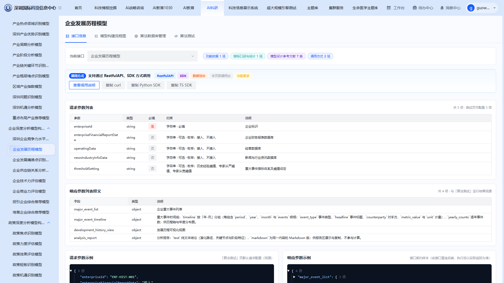

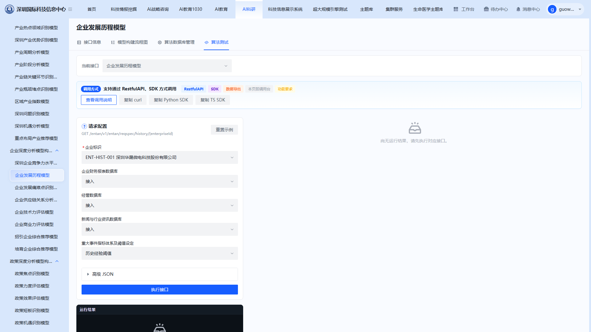

**操作指引**

按 3.1.1 节「通用界面结构与操作步骤」执行：
① 在接口信息页签核对本接口的请求参数与响应字段释义，确认参数含义与约束；
② 切换至「算法测试」页签，在参数与筛选区设置本模型对应的条件项，页面已预置一组可运行示例值，可在此基础上微调；
③ 点击「执行接口」，右侧运行结果区展示本次调用的执行状态、耗时、分步日志、指标卡与图表；
④ 读取统计指标卡与可视化图表，向下滚动查看明细表与分析结论；
⑤ 使用报告区右上角的导出／打印功能留存结果；如需接入业务系统，按接口信息页签的调用方式复制代码并替换参数即可集成。

**数据更新机制**

模型结果经计算、归纳与有效性验证后，通过 API 接口和数据同步机制服务化输出，支持按地域、领域、时间等条件灵活查询与下载。系统定期更新数据与指标并进行质量监测，确保指标的有效性与可靠性。

#### 3.7.3 企业发展痛难点识别模型

**模型功能描述**

企业发展痛难点识别模型算法旨在通过对企业经营及人力资源数据的深入分析，量化评估关键指标表现，识别制约企业发展的瓶颈与堵点。算法围绕经营竞争力、盈利能力、生产效率、人才状况等核心维度构建指标体系，并设定判断阈值，通过计算企业各项指标值，精准提取反映企业发展痛难点的要素，为企业管理优化、战略调整和持续改进提供科学依据。

**算法输入与输出**

| 项目 | 内容 |
|---|---|
| 输入 | 企业年报数据、财务报表数据、招聘信息、社保缴纳记录、核心指标体系及阈值设定。 |
| 输出 | 企业发展痛难点分析报告、瓶颈清单、优化建议方案。 |
| 调用方式 | 支持通过Restful API、SDK方式调用，可按企业标识或名称获取发展痛难点分析结果与优化建议，并支持导出报告及可视化数据。 |

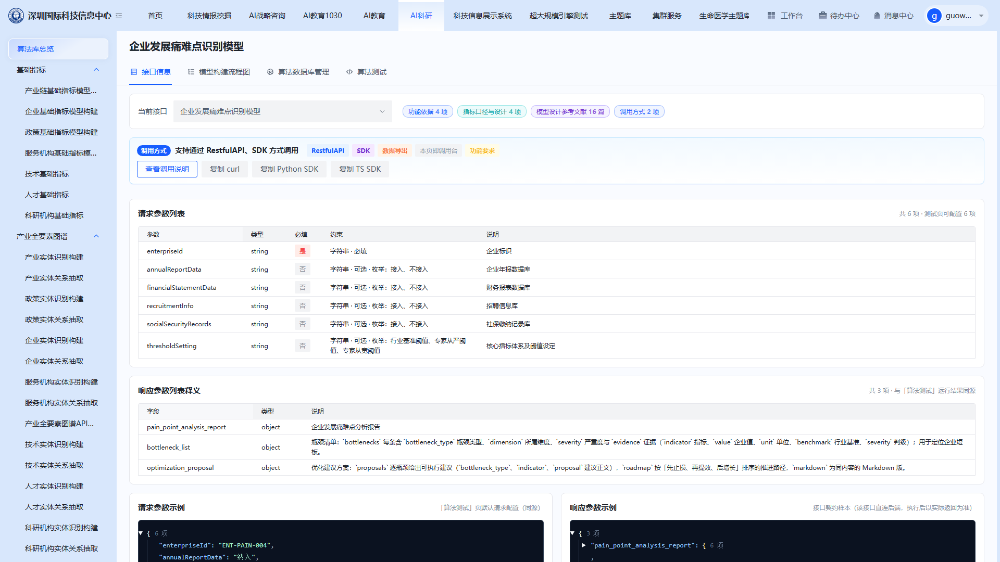

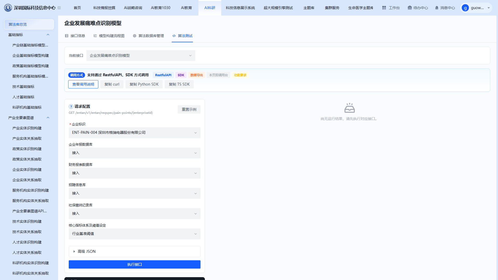

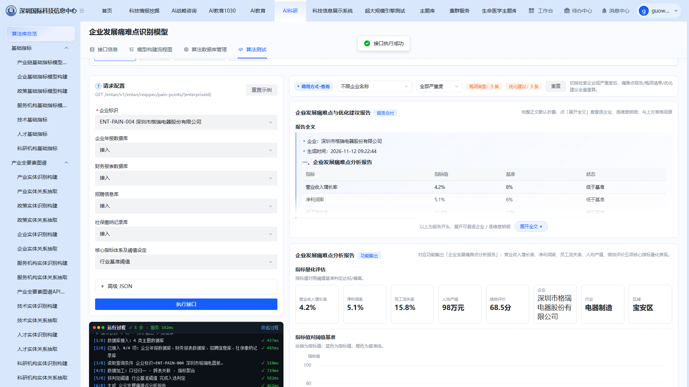

**操作指引**

按 3.1.1 节「通用界面结构与操作步骤」执行：
① 在接口信息页签核对本接口的请求参数与响应字段释义，确认参数含义与约束；
② 切换至「算法测试」页签，在参数与筛选区设置本模型对应的条件项，页面已预置一组可运行示例值，可在此基础上微调；
③ 点击「执行接口」，右侧运行结果区展示本次调用的执行状态、耗时、分步日志、指标卡与图表；
④ 读取统计指标卡与可视化图表，向下滚动查看明细表与分析结论；
⑤ 使用报告区右上角的导出／打印功能留存结果；如需接入业务系统，按接口信息页签的调用方式复制代码并替换参数即可集成。

**数据更新机制**

模型结果经计算、归纳与有效性验证后，通过 API 接口和数据同步机制服务化输出，支持按地域、领域、时间等条件灵活查询与下载。系统定期更新数据与指标并进行质量监测，确保指标的有效性与可靠性。

#### 3.7.4 企业供应链关系分析模型

**模型功能描述**

企业供应链关系分析模型算法基于产业全要素图谱的企业关系数据与企业专题数据，面向供应链关系进行结构化建模与量化分析。该算法通过对企业间的供应链联系进行网络化构建与关键指标计算，揭示供应链的分布特征与结构特点，为企业竞争力评估、合作伙伴筛选及产业链优化提供数据支撑。

该算法通过对接产业全要素图谱、企业关系数据库及专题数据集，采集并标准化处理供应链核心信息。

**算法输入与输出**

| 项目 | 内容 |
|---|---|
| 输入 | 产业全要素图谱数据、企业关系数据库信息、企业专题数据集、供应链核心信息、图论算法参数设定。 |
| 输出 | 供应链网络结构图、供应链分布特征与结构指标计算结果、企业在供应链网络中的位置与重要性分析报告、地图或拓扑可视化展示。 |
| 调用方式 | 支持通过Restful API、SDK方式调用，可按企业标识或名称获取供应链关系分析数据，并支持导出报告及可视化图表。 |

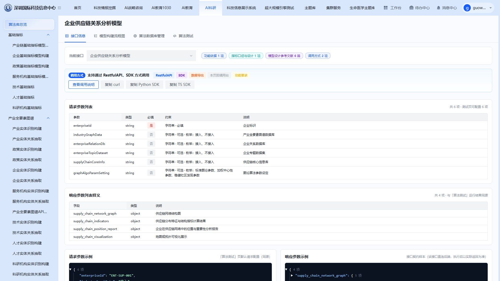

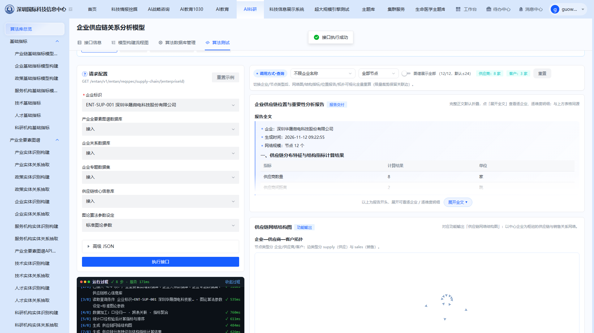

**操作指引**

按 3.1.1 节「通用界面结构与操作步骤」执行：
① 在接口信息页签核对本接口的请求参数与响应字段释义，确认参数含义与约束；
② 切换至「算法测试」页签，在参数与筛选区设置本模型对应的条件项，页面已预置一组可运行示例值，可在此基础上微调；
③ 点击「执行接口」，右侧运行结果区展示本次调用的执行状态、耗时、分步日志、指标卡与图表；
④ 读取统计指标卡与可视化图表，向下滚动查看明细表与分析结论；
⑤ 使用报告区右上角的导出／打印功能留存结果；如需接入业务系统，按接口信息页签的调用方式复制代码并替换参数即可集成。

**数据更新机制**

模型结果经计算、归纳与有效性验证后，通过 API 接口和数据同步机制服务化输出，支持按地域、领域、时间等条件灵活查询与下载。系统定期更新数据与指标并进行质量监测，确保指标的有效性与可靠性。

#### 3.7.5 企业技术力评估模型

**模型功能描述**

企业技术力评估模型算法旨在对企业在技术能力方面的综合水平进行量化评估。算法围绕技术人才、技术创新、技术转化、技术合作、技术投入五个核心维度，设计对应的指标和阈值，并通过综合计算获取企业技术力指数。评估结果不仅能反映企业在各技术维度的优势与短板，还可为技术投入决策、合作拓展及创新能力提升提供数据支撑。

**算法输入与输出**

| 项目 | 内容 |
|---|---|
| 输入 | 企业专利数据库数据、科技项目库数据、研发投入数据、企业人才结构档案、技术合作关系数据、指标体系与权重参数。 |
| 输出 | 企业技术力指数、各维度技术力分析结果、优势与短板分析报告、趋势变化及改进建议。 |
| 调用方式 | 支持通过Restful API、SDK方式调用，可按企业标识或名称进行技术力评估，并支持生成可视化报告、对标分析及数据导出服务。 |

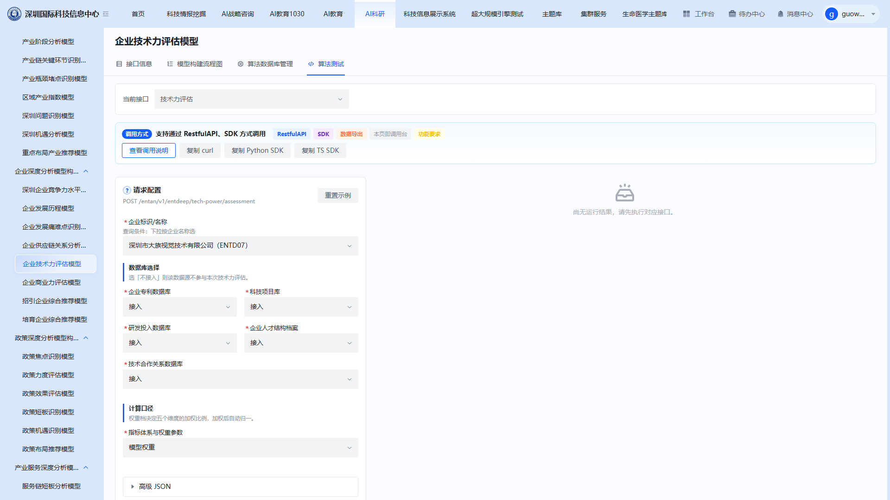

**操作指引**

按 3.1.1 节「通用界面结构与操作步骤」执行：
① 在接口信息页签核对本接口的请求参数与响应字段释义，确认参数含义与约束；
② 切换至「算法测试」页签，在参数与筛选区设置本模型对应的条件项，页面已预置一组可运行示例值，可在此基础上微调；
③ 点击「执行接口」，右侧运行结果区展示本次调用的执行状态、耗时、分步日志、指标卡与图表；
④ 读取统计指标卡与可视化图表，向下滚动查看明细表与分析结论；
⑤ 使用报告区右上角的导出／打印功能留存结果；如需接入业务系统，按接口信息页签的调用方式复制代码并替换参数即可集成。

**数据更新机制**

模型结果经计算、归纳与有效性验证后，通过 API 接口和数据同步机制服务化输出，支持按地域、领域、时间等条件灵活查询与下载。系统定期更新数据与指标并进行质量监测，确保指标的有效性与可靠性。

#### 3.7.6 企业商业力评估模型

**模型功能描述**

企业商业力评估模型算法旨在多维度量化分析企业的市场竞争能力与产业协作水平。该算法基于市场指标、产品指标、品牌指标、技术合作指标、产业链覆盖率及产业关键环节参与度六大维度构建指标体系，并设定对应阈值，通过计算企业各项指标值，生成反映综合竞争力的企业商业力指数，为企业战略规划、投资决策及行业对比分析提供科学依据。

**算法输入与输出**

| 项目 | 内容 |
|---|---|
| 输入 | 企业财务数据、行业研究数据、市场调研数据、产品指标数据、品牌影响力数据、技术合作及产业链布局信息、评价指标体系与权重参数。 |
| 输出 | 企业商业力指数、分维度分析报告、趋势变化图表、行业对比分析结果。 |
| 调用方式 | 支持通过Restful API、SDK方式调用，可按企业名称或标识进行商业力评估，并支持生成报告、对比分析及数据导出服务。 |

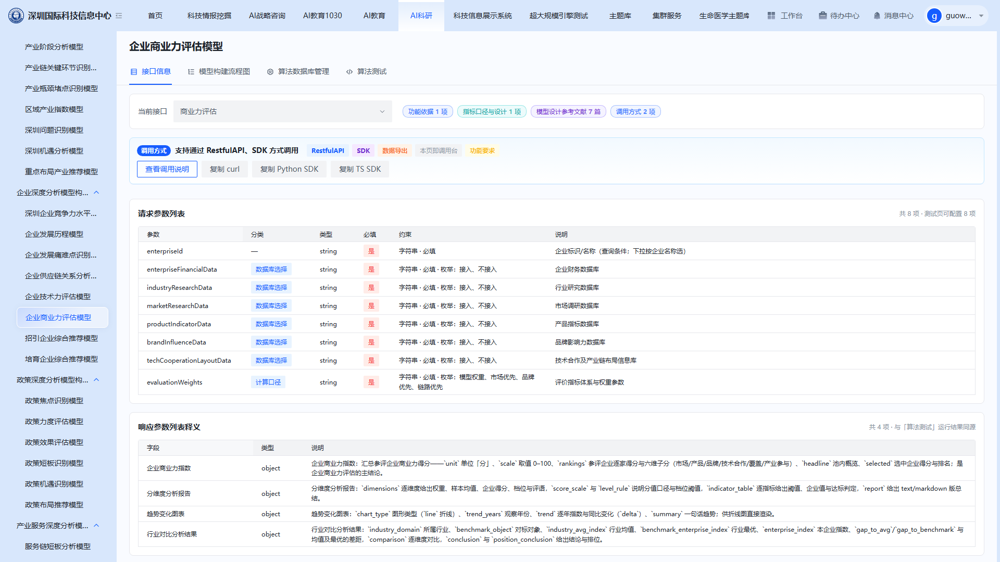

**操作指引**

按 3.1.1 节「通用界面结构与操作步骤」执行：
① 在接口信息页签核对本接口的请求参数与响应字段释义，确认参数含义与约束；
② 切换至「算法测试」页签，在参数与筛选区设置本模型对应的条件项，页面已预置一组可运行示例值，可在此基础上微调；
③ 点击「执行接口」，右侧运行结果区展示本次调用的执行状态、耗时、分步日志、指标卡与图表；
④ 读取统计指标卡与可视化图表，向下滚动查看明细表与分析结论；
⑤ 使用报告区右上角的导出／打印功能留存结果；如需接入业务系统，按接口信息页签的调用方式复制代码并替换参数即可集成。

**数据更新机制**

模型结果经计算、归纳与有效性验证后，通过 API 接口和数据同步机制服务化输出，支持按地域、领域、时间等条件灵活查询与下载。系统定期更新数据与指标并进行质量监测，确保指标的有效性与可靠性。

#### 3.7.7 招引企业综合推荐模型

**模型功能描述**

招引企业综合推荐模型算法旨在为深圳打造科学的招商引资评估和企业招引优选机制。算法基于产业相关度、政策匹配度、深圳连接度三个核心维度构建指标体系与阈值判断，并通过综合计算形成招引企业推荐指数，用于衡量企业与深圳产业发展、政策导向及经济联系的契合程度。该算法为政府招商部门、园区运营方及投资机构提供精准的企业优选依据，提升招商引资决策的科学性与执行效率。

**算法输入与输出**

| 项目 | 内容 |
|---|---|
| 输入 | 企业信用信息数据、行业协会数据、专利与知识产权数据、财务数据、业务领域信息、产业相关度及政策匹配度参数、深圳连接度参数。 |
| 输出 | 企业招引推荐指数、优选企业清单、企业行业领域排名、数据分析报告。 |
| 调用方式 | 支持通过Restful API、SDK及在线展示平台调用，可按企业标签、行业领域或地域来源进行招引推荐查询，并支持生成分析报告及数据导出服务。 |

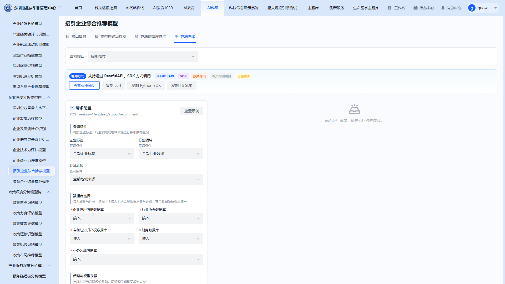

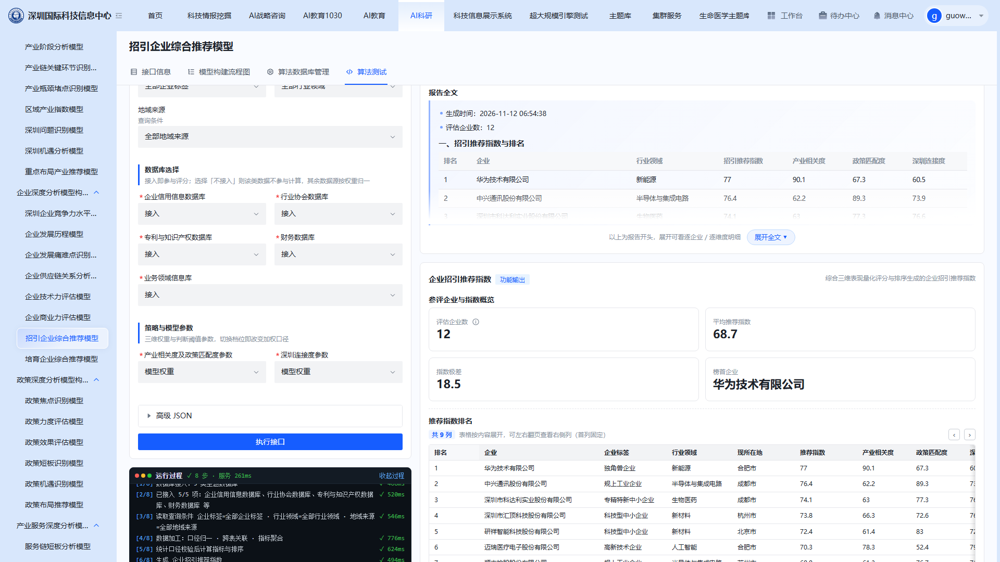

**操作指引**

按 3.1.1 节「通用界面结构与操作步骤」执行：
① 在接口信息页签核对本接口的请求参数与响应字段释义，确认参数含义与约束；
② 切换至「算法测试」页签，在参数与筛选区设置本模型对应的条件项，页面已预置一组可运行示例值，可在此基础上微调；
③ 点击「执行接口」，右侧运行结果区展示本次调用的执行状态、耗时、分步日志、指标卡与图表；
④ 读取统计指标卡与可视化图表，向下滚动查看明细表与分析结论；
⑤ 使用报告区右上角的导出／打印功能留存结果；如需接入业务系统，按接口信息页签的调用方式复制代码并替换参数即可集成。

**数据更新机制**

模型结果经计算、归纳与有效性验证后，通过 API 接口和数据同步机制服务化输出，支持按地域、领域、时间等条件灵活查询与下载。系统定期更新数据与指标并进行质量监测，确保指标的有效性与可靠性。

#### 3.7.8 培育企业综合推荐模型

**模型功能描述**

培育企业综合推荐模型用于识别并优选具有高培育价值的企业，通过产业相关度、政策匹配度、企业潜力三大维度构建评价体系，结合设定的阈值进行综合计算，生成企业培育推荐指数。该模型可为政府部门、园区管理机构、行业协会及投资平台提供科学、高效的企业筛选和资源配置依据，助力精准培育潜力企业、优化产业结构。

模型通过对接企业、政策及市场等多源数据，采集并标准化处理企业基本信息、政策解析、市场调研及行业动态，基于产业相关度、政策匹配度和企业潜力三类指标构建评价体系并设定阈值，结合模型训练与加权计算生成量化的培育推荐指数用于评估与排名；模型具备动态监测与更新能力，并通过平台或API提供按产业、政策和规模等条件的企业推荐及详细分析，支持政策制定、投资决策与合作匹配等应用。

培育企业综合推荐模型算法用于识别并优选具有高培育价值的企业。该算法基于产业相关度、政策匹配度、企业潜力三个核心维度构建评价体系，结合设定的阈值进行综合计算，生成企业培育推荐指数。评估结果可为政府部门、园区管理机构、行业协会及投资平台提供科学、高效的企业筛选和资源配置依据，助力精准培育潜力企业、优化产业结构。

**算法输入与输出**

| 项目 | 内容 |
|---|---|
| 输入 | 企业基本信息数据、政策数据、市场调研数据、行业动态数据、产业相关度参数、政策匹配度参数、企业潜力评价指标及权重。 |
| 输出 | 企业培育推荐指数、优选企业排名、详细分析报告、可视化行业分布图。 |
| 调用方式 | 支持通过Restful API、SDK及在线平台调用，可按产业类别、政策导向、企业规模等条件筛选与分析潜力企业，并支持生成分析报告及数据导出服务。 |

**操作指引**

按 3.1.1 节「通用界面结构与操作步骤」执行：
① 在接口信息页签核对本接口的请求参数与响应字段释义，确认参数含义与约束；
② 切换至「算法测试」页签，在参数与筛选区设置本模型对应的条件项，页面已预置一组可运行示例值，可在此基础上微调；
③ 点击「执行接口」，右侧运行结果区展示本次调用的执行状态、耗时、分步日志、指标卡与图表；
④ 读取统计指标卡与可视化图表，向下滚动查看明细表与分析结论；
⑤ 使用报告区右上角的导出／打印功能留存结果；如需接入业务系统，按接口信息页签的调用方式复制代码并替换参数即可集成。

**数据更新机制**

模型结果经计算、归纳与有效性验证后，通过 API 接口和数据同步机制服务化输出，支持按地域、领域、时间等条件灵活查询与下载。系统定期更新数据与指标并进行质量监测，确保指标的有效性与可靠性。

### 3.8 政策深度分析模型构建

政策深度分析模型构建政策效能评估与政策布局建议的智能框架：先识别政策焦点与关键词，再评估政策力度与实施效果，继而发现政策短板与机遇，最终给出针对性的布局推荐。模型融合政策文本、实施细则、解读文件与企业感知数据，通过语义理解、条款拆解、指标提取与效果仿真等算法链路，支撑政策制定者从"知策"到"评策"再到"优策"的全过程决策。

#### 3.8.1 政策焦点识别模型

**模型功能描述**

政策焦点识别模型旨在对政策文本及相关执行数据进行系统分析，量化政策作用特征，识别政策中的关键焦点与潜在堵点，从而为政策制定、改进及执行优化提供数据支撑。模型通过设计涵盖制定背景、目标、适用范围、措施执行情况等维度的指标体系，并设定评估阈值，计算政策对应指标值后提取焦点与堵点信息，形成可用于决策参考的结构化结果。

**算法输入与输出**

| 项目 | 内容 |
|---|---|
| 输入 | 政策文本信息、政策执行数据、辅助数据。 |
| 输出 | 政策焦点列表、政策堵点清单、政策优化建议。 |
| 调用方式 | 模型支持通过标准化Restful API及SDK接口调用，并提供基于政策标签的在线检索及分析功能。 |

**操作指引**

按 3.1.1 节「通用界面结构与操作步骤」执行：
① 在接口信息页签核对本接口的请求参数与响应字段释义，确认参数含义与约束；
② 切换至「算法测试」页签，在参数与筛选区设置本模型对应的条件项，页面已预置一组可运行示例值，可在此基础上微调；
③ 点击「执行接口」，右侧运行结果区展示本次调用的执行状态、耗时、分步日志、指标卡与图表；
④ 读取统计指标卡与可视化图表，向下滚动查看明细表与分析结论；
⑤ 使用报告区右上角的导出／打印功能留存结果；如需接入业务系统，按接口信息页签的调用方式复制代码并替换参数即可集成。

**数据更新机制**

模型结果经计算、归纳与有效性验证后，通过 API 接口和数据同步机制服务化输出，支持按地域、领域、时间等条件灵活查询与下载。系统定期更新数据与指标并进行质量监测，确保指标的有效性与可靠性。

#### 3.8.2 政策力度评估模型

**模型功能描述**

政策力度评估模型用于量化分析不同政策在效果、覆盖范围及成本等方面的综合强度，帮助政府部门、研究机构及行业用户科学评估政策的实施力度与影响力。模型通过设计指标体系与阈值标准，对政策相关数据进行结构化分析和计算，形成政策力度指数，并支持多种查询与分析服务，涵盖趋势跟踪与排行榜输出。

政策力度评估模型旨在对政策的实施效果、覆盖范围及资源投入进行综合量化，生成可对比的政策力度指数，为政策制定部门、研究机构及行业用户提供科学决策参考。

**算法输入与输出**

| 项目 | 内容 |
|---|---|
| 输入 | 政策文本信息、政策执行数据、成本与资源数据、辅助数据。 |
| 输出 | 政策力度指数、力度维度分析报告、政策力度排行榜、趋势变化图及预测分析结果。 |
| 调用方式 | 模型支持通过标准化Restful API及SDK方式调用，可根据政策 ID、政策类别或时间区间进行力度指数计算与查询。输出支持图表化和结构化数据格式，便于嵌入政府信息系统、行业分析平台或研究工具，实现对比分析和历史回溯功能。 |

**操作指引**

按 3.1.1 节「通用界面结构与操作步骤」执行：
① 在接口信息页签核对本接口的请求参数与响应字段释义，确认参数含义与约束；
② 切换至「算法测试」页签，在参数与筛选区设置本模型对应的条件项，页面已预置一组可运行示例值，可在此基础上微调；
③ 点击「执行接口」，右侧运行结果区展示本次调用的执行状态、耗时、分步日志、指标卡与图表；
④ 读取统计指标卡与可视化图表，向下滚动查看明细表与分析结论；
⑤ 使用报告区右上角的导出／打印功能留存结果；如需接入业务系统，按接口信息页签的调用方式复制代码并替换参数即可集成。

**数据更新机制**

模型结果经计算、归纳与有效性验证后，通过 API 接口和数据同步机制服务化输出，支持按地域、领域、时间等条件灵活查询与下载。系统定期更新数据与指标并进行质量监测，确保指标的有效性与可靠性。

#### 3.8.3 政策效果评估模型

**模型功能描述**

政策效果评估模型旨在量化分析政策执行效果与影响水平，通过建立科学的指标体系和阈值标准，对政策在执行效果、社会经济效应及环境影响等方面进行综合评估，并提取政策效果评估指数作为核心量化结果，为政策改进、绩效评价及决策优化提供数据支撑。

政策效果评估模型旨在以数据驱动方式全面衡量政策在执行过程中的实际成效与综合影响，并通过量化分析生成“政策效果评估指数”，为政策改进、绩效考核及决策优化提供精准参考。

**算法输入与输出**

| 项目 | 内容 |
|---|---|
| 输入 | 政策原文及相关实施文件、政策执行过程数据、宏观经济数据、社会发展指标、环境影响数据。 |
| 输出 | 政策效果评估指数、分维度评估结果、政策改进建议与绩效优化报告 |
| 调用方式 | 模型支持通过标准化 Restful API 和 SDK 接口调用，用户可按政策标签、时间区间、执行阶段等条件进行在线查询与分析，并获取实时或历史的政策效果评估指数及详细分析报告。 |

**操作指引**

按 3.1.1 节「通用界面结构与操作步骤」执行：
① 在接口信息页签核对本接口的请求参数与响应字段释义，确认参数含义与约束；
② 切换至「算法测试」页签，在参数与筛选区设置本模型对应的条件项，页面已预置一组可运行示例值，可在此基础上微调；
③ 点击「执行接口」，右侧运行结果区展示本次调用的执行状态、耗时、分步日志、指标卡与图表；
④ 读取统计指标卡与可视化图表，向下滚动查看明细表与分析结论；
⑤ 使用报告区右上角的导出／打印功能留存结果；如需接入业务系统，按接口信息页签的调用方式复制代码并替换参数即可集成。

**数据更新机制**

模型结果经计算、归纳与有效性验证后，通过 API 接口和数据同步机制服务化输出，支持按地域、领域、时间等条件灵活查询与下载。系统定期更新数据与指标并进行质量监测，确保指标的有效性与可靠性。

#### 3.8.4 政策短板识别模型

**模型功能描述**

政策短板识别模型旨在通过对政策文本、解读及执行情况的系统分析，量化评估政策的覆盖性与有效性，识别其中存在的不足，为政策改进与优化提供科学依据。模型基于指标体系与阈值标准，计算政策在各维度的评估值，自动提取短板内容，并结合原因分析，为相关部门制定改进策略提供数据支撑。

政策短板识别模型旨在通过多源数据分析与量化评估，精准定位政策在覆盖性、执行效果及合规性等方面的不足，从而为政策优化制定提供科学依据。

**算法输入与输出**

| 项目 | 内容 |
|---|---|
| 输入 | 政策文本、执行数据、辅助分析数据。 |
| 输出 | 政策短板清单、短板成因分析、改进策略建议。 |
| 调用方式 | 调用时可按政策标签、时间区间及分析维度检索短板信息，获取结构化的评估结果与改进建议，实现在线监测、趋势分析及优化策略的即时推送。 |

**操作指引**

按 3.1.1 节「通用界面结构与操作步骤」执行：
① 在接口信息页签核对本接口的请求参数与响应字段释义，确认参数含义与约束；
② 切换至「算法测试」页签，在参数与筛选区设置本模型对应的条件项，页面已预置一组可运行示例值，可在此基础上微调；
③ 点击「执行接口」，右侧运行结果区展示本次调用的执行状态、耗时、分步日志、指标卡与图表；
④ 读取统计指标卡与可视化图表，向下滚动查看明细表与分析结论；
⑤ 使用报告区右上角的导出／打印功能留存结果；如需接入业务系统，按接口信息页签的调用方式复制代码并替换参数即可集成。

**数据更新机制**

模型结果经计算、归纳与有效性验证后，通过 API 接口和数据同步机制服务化输出，支持按地域、领域、时间等条件灵活查询与下载。系统定期更新数据与指标并进行质量监测，确保指标的有效性与可靠性。

#### 3.8.5 政策机遇识别模型

**模型功能描述**

政策机遇识别模型旨在从海量政策数据中自动识别具有机遇属性的政策，建立基于关注度、影响力、稳定性等维度的评价指标体系及阈值判断标准，通过计算政策对应指标值，精准提取潜在政策机遇。模型对接多源政策数据，包括政策文件、解读材料及分析报告，结合智能分析与可视化展示，帮助政府、企业及研究机构及时洞察政策利好，为战略规划和业务发展提供支撑。

**算法输入与输出**

| 项目 | 内容 |
|---|---|
| 输入 | 政策文本信息、政策解读与行业分析数据、历史政策指标数据。 |
| 输出 | 政策机遇清单、政策机遇趋势分析报告、可视化结果、策略建议。 |
| 调用方式 | 支持通过标准化 Restful API 和 SDK 接口调用，可按政策标签、时间区间及分析维度进行查询，返回结构化机遇数据及可视化图表。 |

**操作指引**

按 3.1.1 节「通用界面结构与操作步骤」执行：
① 在接口信息页签核对本接口的请求参数与响应字段释义，确认参数含义与约束；
② 切换至「算法测试」页签，在参数与筛选区设置本模型对应的条件项，页面已预置一组可运行示例值，可在此基础上微调；
③ 点击「执行接口」，右侧运行结果区展示本次调用的执行状态、耗时、分步日志、指标卡与图表；
④ 读取统计指标卡与可视化图表，向下滚动查看明细表与分析结论；
⑤ 使用报告区右上角的导出／打印功能留存结果；如需接入业务系统，按接口信息页签的调用方式复制代码并替换参数即可集成。

**数据更新机制**

模型结果经计算、归纳与有效性验证后，通过 API 接口和数据同步机制服务化输出，支持按地域、领域、时间等条件灵活查询与下载。系统定期更新数据与指标并进行质量监测，确保指标的有效性与可靠性。

#### 3.8.6 政策布局推荐模型

**模型功能描述**

政策布局推荐模型通过整合政策机遇识别模型与政策短板识别模型的分析结果，结合政策领域专家知识设置的策略方案，并关联政策数据库，实现针对性政策布局推荐。该模型旨在帮助政策制定者在区域或产业发展规划中精准定位可利用的政策机遇和待改进的政策短板，优化政策体系布局，提高政策决策的科学性与执行效果。

**算法输入与输出**

| 项目 | 内容 |
|---|---|
| 输入 | 政策机遇识别结果、政策短板识别结果、政策数据库数据。 |
| 输出 | 政策布局建议、执行效果预测、优化策略建议。 |
| 调用方式 | 模型支持通过 Restful API 与 SDK 接口调用，允许用户在指定区域、产业或政策主题的条件下进行布局推荐分析。调用参数可包含机遇与短板分析结果的权重设定、数据库筛选条件及策略适用范围。 |

**操作指引**

按 3.1.1 节「通用界面结构与操作步骤」执行：
① 在接口信息页签核对本接口的请求参数与响应字段释义，确认参数含义与约束；
② 切换至「算法测试」页签，在参数与筛选区设置本模型对应的条件项，页面已预置一组可运行示例值，可在此基础上微调；
③ 点击「执行接口」，右侧运行结果区展示本次调用的执行状态、耗时、分步日志、指标卡与图表；
④ 读取统计指标卡与可视化图表，向下滚动查看明细表与分析结论；
⑤ 使用报告区右上角的导出／打印功能留存结果；如需接入业务系统，按接口信息页签的调用方式复制代码并替换参数即可集成。

**数据更新机制**

模型结果经计算、归纳与有效性验证后，通过 API 接口和数据同步机制服务化输出，支持按地域、领域、时间等条件灵活查询与下载。系统定期更新数据与指标并进行质量监测，确保指标的有效性与可靠性。

### 3.9 产业服务深度分析模型构建

产业服务深度分析模型聚焦科技服务生态的短板诊断与能力评价：先绘制服务关系链、识别服务链短板，再对金融、知识产权、人力资源、市场营销、咨询与科技创新六类服务机构分别开展技术力评价，最终输出引入与培育推荐结果。模型数据来源覆盖工商登记、资质认定、行业年报、技术交易与服务记录等，支持按深圳与全国两个空间尺度的对比分析。

#### 3.9.1 服务链短板分析模型

**模型功能描述**

服务链短板分析模型旨在识别服务链中影响整体效能的薄弱环节，为提升服务质量和优化服务机构运营提供科学依据。模型通过对服务机构相关数据进行采集与处理，设计涵盖服务质量、经营效益、服务类型等维度的指标体系，并基于历史数据与专业经验设定阈值，对各指标进行计算和综合分析，从而明确服务链短板所处的具体环节及形成原因。该分析结果不仅可辅助管理者制定改进策略，还可通过服务化接口实现短板监测与动态优化。

**算法输入与输出**

| 项目 | 内容 |
|---|---|
| 输入 | 服务机构基础信息、服务质量数据、经营效益数据、服务类型数据、历史指标数据及行业对标信息。 |
| 输出 | 短板环节定位结果、短板成因分析、短板优化建议。 |
| 调用方式 | 该模型支持通过RestfulAPI和SDK调用，用户可在调用时指定服务机构标签、指标分析维度及时间区间，快速获取短板定位结果及分析报告。 |

**操作指引**

按 3.1.1 节「通用界面结构与操作步骤」执行：
① 在接口信息页签核对本接口的请求参数与响应字段释义，确认参数含义与约束；
② 切换至「算法测试」页签，在参数与筛选区设置本模型对应的条件项，页面已预置一组可运行示例值，可在此基础上微调；
③ 点击「执行接口」，右侧运行结果区展示本次调用的执行状态、耗时、分步日志、指标卡与图表；
④ 读取统计指标卡与可视化图表，向下滚动查看明细表与分析结论；
⑤ 使用报告区右上角的导出／打印功能留存结果；如需接入业务系统，按接口信息页签的调用方式复制代码并替换参数即可集成。

**数据更新机制**

模型结果经计算、归纳与有效性验证后，通过 API 接口和数据同步机制服务化输出，支持按地域、领域、时间等条件灵活查询与下载。系统定期更新数据与指标并进行质量监测，确保指标的有效性与可靠性。

#### 3.9.2 服务关系链模型

**模型功能描述**

服务关系链模型基于产业全要素图谱的服务机构关系数据，结合服务机构专题库，对服务机构之间的合作、交易及信用评价等关系链进行建模与分析。模型通过定义关系强度、关系层次、关系密度等指标，对服务关系链的分布特征与结构模式进行量化计算与可视化呈现，从而揭示服务机构间网络的稳定性、合作紧密度以及潜在风险，为行业监管、业务优化与合作决策提供数据支撑。

**算法输入与输出**

| 项目 | 内容 |
|---|---|
| 输入 | 服务机构专题数据、关系数据、辅助信息。 |
| 输出 | 服务关系链结构分析报告、网络可视化图、行业合作优化建议与关键机构匹配方案。 |
| 调用方式 | 支持通过RestfulAPI及SDK方式调用。 |

**操作指引**

按 3.1.1 节「通用界面结构与操作步骤」执行：
① 在接口信息页签核对本接口的请求参数与响应字段释义，确认参数含义与约束；
② 切换至「算法测试」页签，在参数与筛选区设置本模型对应的条件项，页面已预置一组可运行示例值，可在此基础上微调；
③ 点击「执行接口」，右侧运行结果区展示本次调用的执行状态、耗时、分步日志、指标卡与图表；
④ 读取统计指标卡与可视化图表，向下滚动查看明细表与分析结论；
⑤ 使用报告区右上角的导出／打印功能留存结果；如需接入业务系统，按接口信息页签的调用方式复制代码并替换参数即可集成。

**数据更新机制**

模型结果经计算、归纳与有效性验证后，通过 API 接口和数据同步机制服务化输出，支持按地域、领域、时间等条件灵活查询与下载。系统定期更新数据与指标并进行质量监测，确保指标的有效性与可靠性。

#### 3.9.3 金融服务机构技术力评价模型

**模型功能描述**

金融服务机构技术力评估模型旨在多维度衡量机构在资金运用与服务能力方面的综合水平。模型围绕资金规模、融资成本、资金风险、服务质量四个核心维度设计评价指标与阈值，通过计算各指标值并进行综合加权，生成反映机构技术水平与绩效表现的技术力指数。该模型可为监管部门、投资主体及企业用户提供量化、客观的评估结果，用于机构筛选、战略决策与绩效比较。

**算法输入与输出**

| 项目 | 内容 |
|---|---|
| 输入 | 财务数据、融资数据、风险数据、服务数据。 |
| 输出 | 技术力指数、各维度单项分值、机构能力优势与不足分析、跨机构比较与历年趋势分析报告。 |
| 调用方式 | 模型支持通过RestfulAPI与SDK接口调用，可按机构名称、标签或时间周期进行检索并返回实时技术力指数与各维度详细结果。 |

**操作指引**

按 3.1.1 节「通用界面结构与操作步骤」执行：
① 在接口信息页签核对本接口的请求参数与响应字段释义，确认参数含义与约束；
② 切换至「算法测试」页签，在参数与筛选区设置本模型对应的条件项，页面已预置一组可运行示例值，可在此基础上微调；
③ 点击「执行接口」，右侧运行结果区展示本次调用的执行状态、耗时、分步日志、指标卡与图表；
④ 读取统计指标卡与可视化图表，向下滚动查看明细表与分析结论；
⑤ 使用报告区右上角的导出／打印功能留存结果；如需接入业务系统，按接口信息页签的调用方式复制代码并替换参数即可集成。

**数据更新机制**

模型结果经计算、归纳与有效性验证后，通过 API 接口和数据同步机制服务化输出，支持按地域、领域、时间等条件灵活查询与下载。系统定期更新数据与指标并进行质量监测，确保指标的有效性与可靠性。

#### 3.9.4 知识产权服务机构技术力评价模型

**模型功能描述**

知识产权服务机构技术力评估模型旨在对机构的综合技术实力进行量化评价，面向政府部门、企业及投资方提供科学参考。模型从专业能力、业务范围、成功案例数、合作伙伴四个核心维度设计指标与阈值，通过计算各指标值并综合加权，生成反映机构实际技术能力的技术力指数，用于机构选择与服务水平评估。

知识产权服务机构技术力评估模型旨在通过多维度量化分析，衡量机构在知识产权相关业务领域的综合技术实力，并为政府部门、企业及投资机构提供客观、可比的技术力指数。

**算法输入与输出**

| 项目 | 内容 |
|---|---|
| 输入 | 专业能力数据、业务范围数据、成功案例数。 |
| 输出 | 单项指标得分、技术力指数、横向比较报告、动态趋势报告、评估建议。 |
| 调用方式 |  |

**操作指引**

按 3.1.1 节「通用界面结构与操作步骤」执行：
① 在接口信息页签核对本接口的请求参数与响应字段释义，确认参数含义与约束；
② 切换至「算法测试」页签，在参数与筛选区设置本模型对应的条件项，页面已预置一组可运行示例值，可在此基础上微调；
③ 点击「执行接口」，右侧运行结果区展示本次调用的执行状态、耗时、分步日志、指标卡与图表；
④ 读取统计指标卡与可视化图表，向下滚动查看明细表与分析结论；
⑤ 使用报告区右上角的导出／打印功能留存结果；如需接入业务系统，按接口信息页签的调用方式复制代码并替换参数即可集成。

**数据更新机制**

模型结果经计算、归纳与有效性验证后，通过 API 接口和数据同步机制服务化输出，支持按地域、领域、时间等条件灵活查询与下载。系统定期更新数据与指标并进行质量监测，确保指标的有效性与可靠性。

#### 3.9.5 人力资源服务机构技术力评价模型

**模型功能描述**

人力资源服务机构技术力评估模型用于量化评价机构的技术能力水平，通过对人才资源、服务标准化及客户满意度等核心维度设计指标与阈值，计算对应指标值并综合生成技术力指数。该指数可反映机构在人才供给、服务质量和客户体验等方面的综合表现，为企业决策、行业监管和服务优化提供数据支撑。

人力资源服务机构技术力评估模型用于对机构在技术能力层面的综合水平进行量化评价，通过建立涵盖人才资源、服务标准化程度和客户满意度的多维指标体系，并设定相应阈值，计算各指标的数值，综合形成技术力指数。

**算法输入与输出**

| 项目 | 内容 |
|---|---|
| 输入 | 人才资源相关数据、客户反馈数据。 |
| 输出 | 技术力指数、指标分项得分及与阈值的对比结果、技术力排名及横向比较分析、趋势分析报告。 |
| 调用方式 | 支持通过标准化RestfulAPI和SDK接口调用，并可在可视化分析平台上进行机构维度或时间维度的查询与比较。 |

**操作指引**

按 3.1.1 节「通用界面结构与操作步骤」执行：
① 在接口信息页签核对本接口的请求参数与响应字段释义，确认参数含义与约束；
② 切换至「算法测试」页签，在参数与筛选区设置本模型对应的条件项，页面已预置一组可运行示例值，可在此基础上微调；
③ 点击「执行接口」，右侧运行结果区展示本次调用的执行状态、耗时、分步日志、指标卡与图表；
④ 读取统计指标卡与可视化图表，向下滚动查看明细表与分析结论；
⑤ 使用报告区右上角的导出／打印功能留存结果；如需接入业务系统，按接口信息页签的调用方式复制代码并替换参数即可集成。

**数据更新机制**

模型结果经计算、归纳与有效性验证后，通过 API 接口和数据同步机制服务化输出，支持按地域、领域、时间等条件灵活查询与下载。系统定期更新数据与指标并进行质量监测，确保指标的有效性与可靠性。

#### 3.9.6 市场营销服务机构技术力评价模型

**模型功能描述**

市场营销服务机构技术力评估模型旨在量化衡量机构在调研、策划及成功项目执行等方面的综合技术实力。模型通过对接包括机构官网、行业报告、市场研究数据等在内的多源信息库，围绕调研能力、策划能力、成功项目案例数目三项核心指标进行设计，并基于设定阈值与加权计算，生成市场营销服务机构技术力指数，用于技术力水平评估和比较分析，为企业选择合作机构或进行竞争力研究提供依据。

**算法输入与输出**

| 项目 | 内容 |
|---|---|
| 输入 | 调研能力相关数据、策划能力相关数据、成功项目案例数据、行业基准与历史数据。 |
| 输出 | 市场营销服务机构技术力指数、各维度得分明细及权重分布、技术力水平分类、趋势分析报告。 |
| 调用方式 | 该评估模型支持通过RestfulAPI和SDK的方式调用，可按机构名称、行业标签、地域范围等条件进行技术力指数计算与查询。 |

**操作指引**

按 3.1.1 节「通用界面结构与操作步骤」执行：
① 在接口信息页签核对本接口的请求参数与响应字段释义，确认参数含义与约束；
② 切换至「算法测试」页签，在参数与筛选区设置本模型对应的条件项，页面已预置一组可运行示例值，可在此基础上微调；
③ 点击「执行接口」，右侧运行结果区展示本次调用的执行状态、耗时、分步日志、指标卡与图表；
④ 读取统计指标卡与可视化图表，向下滚动查看明细表与分析结论；
⑤ 使用报告区右上角的导出／打印功能留存结果；如需接入业务系统，按接口信息页签的调用方式复制代码并替换参数即可集成。

**数据更新机制**

模型结果经计算、归纳与有效性验证后，通过 API 接口和数据同步机制服务化输出，支持按地域、领域、时间等条件灵活查询与下载。系统定期更新数据与指标并进行质量监测，确保指标的有效性与可靠性。

#### 3.9.7 咨询服务机构技术力评价模型

**模型功能描述**

咨询服务机构技术力评估模型旨在量化评判咨询服务机构的整体技术实力水平，为业务合作选择、市场竞争分析及机构内部发展规划提供科学依据。模型围绕人才密度、行业经验、成功案例数、行业声誉四个核心维度设计评价指标及阈值，通过加权计算生成技术力指数，并可输出分析报告和提供接口查询服务，实现评估过程的标准化和结果的可视化。

**算法输入与输出**

| 项目 | 内容 |
|---|---|
| 输入 | 机构基本信息、人才密度数据、行业经验数据、成功案例数据、行业声誉数据。 |
| 输出 | 技术力指数（0–100量化评分）、优势与短板分析清单、改进建议与潜在发展方向、趋势分析报告。 |
| 调用方式 | 模型支持通过标准化RestfulAPI和SDK调用。调用时可按机构名称、行业类型、评估时间范围等条件获得技术力指数与分析报告。 |

**操作指引**

按 3.1.1 节「通用界面结构与操作步骤」执行：
① 在接口信息页签核对本接口的请求参数与响应字段释义，确认参数含义与约束；
② 切换至「算法测试」页签，在参数与筛选区设置本模型对应的条件项，页面已预置一组可运行示例值，可在此基础上微调；
③ 点击「执行接口」，右侧运行结果区展示本次调用的执行状态、耗时、分步日志、指标卡与图表；
④ 读取统计指标卡与可视化图表，向下滚动查看明细表与分析结论；
⑤ 使用报告区右上角的导出／打印功能留存结果；如需接入业务系统，按接口信息页签的调用方式复制代码并替换参数即可集成。

**数据更新机制**

模型结果经计算、归纳与有效性验证后，通过 API 接口和数据同步机制服务化输出，支持按地域、领域、时间等条件灵活查询与下载。系统定期更新数据与指标并进行质量监测，确保指标的有效性与可靠性。

#### 3.9.8 科技创新服务机构技术力评价模型

**模型功能描述**

科技创新服务机构技术力评估模型用于量化分析和评价不同服务机构的技术能力。模型围绕合作科研机构数、合作企业数、科技创新成果数量、技术转化成果数量四个核心维度构建指标体系，并设定判断阈值，通过计算各机构的指标值综合形成技术力指数。该指数可反映机构在科研合作广度、产业对接能力、成果产出实力及成果转化效率等方面的整体技术竞争力。

**算法输入与输出**

| 项目 | 内容 |
|---|---|
| 输入 | 合作科研机构数量、合作企业数量、科技创新成果数量、技术转化成果数量、历史数据及行业平均水平。 |
| 输出 | 技术力指数、技术力强弱排名、各维度指标得分及权重占比、技术力变化趋势分析结果及改进建议。 |
| 调用方式 | 模型支持通过标准化RestfulAPI或SDK接口调用。调用时可指明评估周期、数据来源类型及分析维度，快速生成技术力指数、排名结果及趋势分析报告。 |

**操作指引**

按 3.1.1 节「通用界面结构与操作步骤」执行：
① 在接口信息页签核对本接口的请求参数与响应字段释义，确认参数含义与约束；
② 切换至「算法测试」页签，在参数与筛选区设置本模型对应的条件项，页面已预置一组可运行示例值，可在此基础上微调；
③ 点击「执行接口」，右侧运行结果区展示本次调用的执行状态、耗时、分步日志、指标卡与图表；
④ 读取统计指标卡与可视化图表，向下滚动查看明细表与分析结论；
⑤ 使用报告区右上角的导出／打印功能留存结果；如需接入业务系统，按接口信息页签的调用方式复制代码并替换参数即可集成。

**数据更新机制**

模型结果经计算、归纳与有效性验证后，通过 API 接口和数据同步机制服务化输出，支持按地域、领域、时间等条件灵活查询与下载。系统定期更新数据与指标并进行质量监测，确保指标的有效性与可靠性。

#### 3.9.9 服务机构引入推荐模型

**模型功能描述**

服务机构引入推荐模型旨在为产业招引和合作决策提供量化支持，通过综合评估服务机构在竞争力、产业相关度、政策匹配度、深圳连接度等方面的表现，计算服务机构推荐指数并生成优先级排序。模型结合多维度指标体系与专业阈值设定，利用历史数据、行业经验及实时信息，实现精准推荐，从而提升服务机构选取的科学性与招引效果。

**算法输入与输出**

| 项目 | 内容 |
|---|---|
| 输入 | 服务机构基本信息、财务与市场数据、产业相关度数据、深圳连接度数据。 |
| 输出 | 服务机构推荐指数、推荐优先级排序清单、各维度指标分析报告、同类机构对比分析结果。 |
| 调用方式 | 模型支持通过标准化RestfulAPI和SDK调用，开发者或应用系统可在调用时指定分析维度、时间区间或筛选条件，快速获取推荐结果及详细分析报告。 |

**操作指引**

按 3.1.1 节「通用界面结构与操作步骤」执行：
① 在接口信息页签核对本接口的请求参数与响应字段释义，确认参数含义与约束；
② 切换至「算法测试」页签，在参数与筛选区设置本模型对应的条件项，页面已预置一组可运行示例值，可在此基础上微调；
③ 点击「执行接口」，右侧运行结果区展示本次调用的执行状态、耗时、分步日志、指标卡与图表；
④ 读取统计指标卡与可视化图表，向下滚动查看明细表与分析结论；
⑤ 使用报告区右上角的导出／打印功能留存结果；如需接入业务系统，按接口信息页签的调用方式复制代码并替换参数即可集成。

**数据更新机制**

模型结果经计算、归纳与有效性验证后，通过 API 接口和数据同步机制服务化输出，支持按地域、领域、时间等条件灵活查询与下载。系统定期更新数据与指标并进行质量监测，确保指标的有效性与可靠性。

#### 3.9.10 服务机构培育推荐模型

**模型功能描述**

服务机构培育推荐模型用于评估与推荐具有发展潜力和培育价值的服务机构，基于竞争力、产业相关度、政策匹配度、机构潜力四个维度构建指标体系与阈值判断，通过综合计算形成培育推荐指数，为政府部门、行业协会、投融资平台等提供科学的机构认定与扶持依据。模型不仅适用于现有服务机构的优选推荐，也能根据不同区域、行业及政策环境，动态调整推荐结果以匹配最新发展需求。

**算法输入与输出**

| 项目 | 内容 |
|---|---|
| 输入 | 基础信息数据、业务能力指标、行业与政策数据、潜力数据。 |
| 输出 | 培育推荐指数（0–100分或分级结果）、单维度评分、推荐排序列表、推荐说明和培育建议。 |
| 调用方式 | 模型支持通过标准化RestfulAPI和SDK接口调用，并可在可视化平台上提供按地域、机构类型、产业领域等条件的推荐及详细信息查询。 |

**操作指引**

按 3.1.1 节「通用界面结构与操作步骤」执行：
① 在接口信息页签核对本接口的请求参数与响应字段释义，确认参数含义与约束；
② 切换至「算法测试」页签，在参数与筛选区设置本模型对应的条件项，页面已预置一组可运行示例值，可在此基础上微调；
③ 点击「执行接口」，右侧运行结果区展示本次调用的执行状态、耗时、分步日志、指标卡与图表；
④ 读取统计指标卡与可视化图表，向下滚动查看明细表与分析结论；
⑤ 使用报告区右上角的导出／打印功能留存结果；如需接入业务系统，按接口信息页签的调用方式复制代码并替换参数即可集成。

**数据更新机制**

模型结果经计算、归纳与有效性验证后，通过 API 接口和数据同步机制服务化输出，支持按地域、领域、时间等条件灵活查询与下载。系统定期更新数据与指标并进行质量监测，确保指标的有效性与可靠性。

### 3.10 产业综合分析模型构建

产业综合分析模型整合前述各模块的要素与结论，构建面向区域创新生态的综合评价与协同分析能力：在综合评价维度上，分别产出科技创新成果、产业创新成果、创新人才与创新政策四类综合评价；在综合分析维度上，提供创新活力、创新要素（类型/层次/领域/综合）与创新协同的多视角分析。模型以"综合评价 + 综合分析"的互补关系服务产业发展态势研判、区域优势短板分析、政策效果评估与资源配置优化等顶层决策场景。

#### 3.10.1 区域科技创新成果综合评价模型

**模型功能描述**

区域科技创新成果综合评价模型对区域内科技创新成果进行定量化、综合性评价，为政府、科研机构及企业提供决策参考。模型对接技术专题库，从基础科学、应用科技、科研机构等多个维度设计评价指标与阈值，通过加权综合计算生成科技创新成果指数，并形成评价结果。该模型不仅可反映区域科技创新的整体水平和优势领域，还能支持持续监测与优化，实现政策制定与资源配置的科学化。

**算法输入与输出**

| 项目 | 内容 |
|---|---|
| 输入 | 区域基础科学成果数据（论文、学术奖项、重大科学突破）、区域应用科技成果数据（高价值专利、新技术应用、产业化案例）、其他参考数据。 |
| 输出 | 区域科技创新成果指数、综合评价结果、趋势分析报告、政策与资源配置建议。 |
| 调用方式 | 支持通过RestfulAPI和SDK调用，调用时可按区域标签、成果类型和时间区间进行指定查询。 |

**操作指引**

按 3.1.1 节「通用界面结构与操作步骤」执行：
① 在接口信息页签核对本接口的请求参数与响应字段释义，确认参数含义与约束；
② 切换至「算法测试」页签，在参数与筛选区设置本模型对应的条件项，页面已预置一组可运行示例值，可在此基础上微调；
③ 点击「执行接口」，右侧运行结果区展示本次调用的执行状态、耗时、分步日志、指标卡与图表；
④ 读取统计指标卡与可视化图表，向下滚动查看明细表与分析结论；
⑤ 使用报告区右上角的导出／打印功能留存结果；如需接入业务系统，按接口信息页签的调用方式复制代码并替换参数即可集成。

**数据更新机制**

模型结果经计算、归纳与有效性验证后，通过 API 接口和数据同步机制服务化输出，支持按地域、领域、时间等条件灵活查询与下载。系统定期更新数据与指标并进行质量监测，确保指标的有效性与可靠性。

#### 3.10.2 区域产业创新成果综合评价模型

**模型功能描述**

区域产业创新成果综合评价模型旨在定量化评估区域在产品服务、企业运营及服务机构等方面的创新水平，为区域产业发展规划与政策制定提供科学依据。模型通过对接产业专题库，系统采集相关领域数据，在产品服务创新、企业创新、服务机构创新等维度建立评价指标及阈值，并结合加权综合计算生成产业创新成果指数，最终形成综合评价结果。该模型不仅可反映区域产业创新整体水平，还能支持持续监测与定制化分析，服务政府、企业和研究机构的决策需求。

**算法输入与输出**

| 项目 | 内容 |
|---|---|
| 输入 | 产品服务创新数据、企业创新数据、服务机构创新数据、其他辅助数据。 |
| 输出 | 产业创新成果指数、分维度创新评价结果、综合评价报告。 |
| 调用方式 | 模型支持通过标准化RestfulAPI和SDK调用，实现基于区域标签的产业创新指数查询、指标分析和趋势可视化展示。 |

**操作指引**

按 3.1.1 节「通用界面结构与操作步骤」执行：
① 在接口信息页签核对本接口的请求参数与响应字段释义，确认参数含义与约束；
② 切换至「算法测试」页签，在参数与筛选区设置本模型对应的条件项，页面已预置一组可运行示例值，可在此基础上微调；
③ 点击「执行接口」，右侧运行结果区展示本次调用的执行状态、耗时、分步日志、指标卡与图表；
④ 读取统计指标卡与可视化图表，向下滚动查看明细表与分析结论；
⑤ 使用报告区右上角的导出／打印功能留存结果；如需接入业务系统，按接口信息页签的调用方式复制代码并替换参数即可集成。

**数据更新机制**

模型结果经计算、归纳与有效性验证后，通过 API 接口和数据同步机制服务化输出，支持按地域、领域、时间等条件灵活查询与下载。系统定期更新数据与指标并进行质量监测，确保指标的有效性与可靠性。

#### 3.10.3 区域产业创新人才综合评价模型

**模型功能描述**

区域人才创新成果综合评价模型用于综合衡量区域内创新型人才的结构与产出水平，为政府、科研机构及企业制定人才政策与发展战略提供科学依据。模型对接人才专题库，并融合人才招聘信息、科技成果库等多源数据，涵盖创新人才数量、学历结构、年龄结构、成果四大维度，通过设定指标体系与阈值，综合计算人才创新成果指数，形成量化评价结果，实现区域间的人才创新成果对比与分析。

**算法输入与输出**

| 项目 | 内容 |
|---|---|
| 输入 | 人才专题库数据、科技成果库数据、历史对比数据与参考阈值。 |
| 输出 | 区域人才创新成果指数、各维度分项评价结果、区域排名与对比分析报告。 |
| 调用方式 | 算法支持通过标准RestfulAPI及SDK接口调用。用户可按区域标签、时间区间、维度类型等查询综合指数及各分项评价结果，并获取可视化图表与分析报告。 |

**操作指引**

按 3.1.1 节「通用界面结构与操作步骤」执行：
① 在接口信息页签核对本接口的请求参数与响应字段释义，确认参数含义与约束；
② 切换至「算法测试」页签，在参数与筛选区设置本模型对应的条件项，页面已预置一组可运行示例值，可在此基础上微调；
③ 点击「执行接口」，右侧运行结果区展示本次调用的执行状态、耗时、分步日志、指标卡与图表；
④ 读取统计指标卡与可视化图表，向下滚动查看明细表与分析结论；
⑤ 使用报告区右上角的导出／打印功能留存结果；如需接入业务系统，按接口信息页签的调用方式复制代码并替换参数即可集成。

**数据更新机制**

模型结果经计算、归纳与有效性验证后，通过 API 接口和数据同步机制服务化输出，支持按地域、领域、时间等条件灵活查询与下载。系统定期更新数据与指标并进行质量监测，确保指标的有效性与可靠性。

#### 3.10.4 区域产业创新政策综合评价模型

**模型功能描述**

区域政策创新成果综合评价模型旨在以数据驱动的方式评估不同区域的创新政策成效，对接政策专题库，从创新政策数量、政策类型、政策效果等维度构建指标体系，通过阈值设定与综合计算生成政策创新成果指数，实现对区域政策创新水平的全面、客观评价。该模型为政府、研究机构及企业提供决策参考，支持政策优化与资源配置。

**算法输入与输出**

| 项目 | 内容 |
|---|---|
| 输入 | 政策基础数据、执行成效数据、历史基准数据。 |
| 输出 | 政策创新成果指数、单维度评价结果、区域政策创新水平排名与趋势分析报告、政策优化建议与资源配置参考。 |
| 调用方式 | 模型支持通过标准化RestfulAPI及SDK方式调用，允许按区域标签、时间区间及政策类别进行查询。 |

**操作指引**

按 3.1.1 节「通用界面结构与操作步骤」执行：
① 在接口信息页签核对本接口的请求参数与响应字段释义，确认参数含义与约束；
② 切换至「算法测试」页签，在参数与筛选区设置本模型对应的条件项，页面已预置一组可运行示例值，可在此基础上微调；
③ 点击「执行接口」，右侧运行结果区展示本次调用的执行状态、耗时、分步日志、指标卡与图表；
④ 读取统计指标卡与可视化图表，向下滚动查看明细表与分析结论；
⑤ 使用报告区右上角的导出／打印功能留存结果；如需接入业务系统，按接口信息页签的调用方式复制代码并替换参数即可集成。

**数据更新机制**

模型结果经计算、归纳与有效性验证后，通过 API 接口和数据同步机制服务化输出，支持按地域、领域、时间等条件灵活查询与下载。系统定期更新数据与指标并进行质量监测，确保指标的有效性与可靠性。

#### 3.10.5 区域创新活力综合分析模型

**模型功能描述**

区域创新活力综合分析模型旨在基于对各领域专题库的综合比对，系统化衡量区域在科技、产业、人才、政策等方面的创新能力与发展潜力。模型通过对区域创新科技、区域创新产业、区域创新人才以及区域创新政策四大维度的分析结果，设计指标体系及对应阈值与权重，并在计算关键指标值的基础上，综合生成区域创新活力指数，输出定量化的评估结果和决策参考，支持区域创新发展战略制定与实施。

**算法输入与输出**

| 项目 | 内容 |
|---|---|
| 输入 | 区域创新科技数据（专利数量与质量、技术成果转化率）、区域创新产业数据、区域创新人才数据、区域创新政策数据。 |
| 输出 | 区域创新活力指数、单维度评分及权重分布、优势与短板分析报告、趋势预测与策略建议。 |
| 调用方式 |  |

**操作指引**

按 3.1.1 节「通用界面结构与操作步骤」执行：
① 在接口信息页签核对本接口的请求参数与响应字段释义，确认参数含义与约束；
② 切换至「算法测试」页签，在参数与筛选区设置本模型对应的条件项，页面已预置一组可运行示例值，可在此基础上微调；
③ 点击「执行接口」，右侧运行结果区展示本次调用的执行状态、耗时、分步日志、指标卡与图表；
④ 读取统计指标卡与可视化图表，向下滚动查看明细表与分析结论；
⑤ 使用报告区右上角的导出／打印功能留存结果；如需接入业务系统，按接口信息页签的调用方式复制代码并替换参数即可集成。

**数据更新机制**

模型结果经计算、归纳与有效性验证后，通过 API 接口和数据同步机制服务化输出，支持按地域、领域、时间等条件灵活查询与下载。系统定期更新数据与指标并进行质量监测，确保指标的有效性与可靠性。

#### 3.10.6 区域创新要素类型综合评价模型

**模型功能描述**

区域创新要素类型综合评价模型用于量化评估区域在创新人才、企业、政策、服务机构、科研机构、资金及空间等要素配置与发展水平。模型通过对接产业知识图谱，系统采集人才流动、企业注册、政策法规、服务与科研机构、资金投入、地理空间等多源数据，并在数据完整性、准确性与一致性保障的基础上，设计涵盖上述维度的指标体系及相应阈值。

**算法输入与输出**

| 项目 | 内容 |
|---|---|
| 输入 | 创新人才数据、企业数据、政策数据、服务机构数据、科研机构数据。 |
| 输出 | 区域创新要素类型指数、各创新要素维度量化评分及权重分析、区域创新要素配置优势与不足清单、创新资源优化与结构调整建议。 |
| 调用方式 |  |

**操作指引**

按 3.1.1 节「通用界面结构与操作步骤」执行：
① 在接口信息页签核对本接口的请求参数与响应字段释义，确认参数含义与约束；
② 切换至「算法测试」页签，在参数与筛选区设置本模型对应的条件项，页面已预置一组可运行示例值，可在此基础上微调；
③ 点击「执行接口」，右侧运行结果区展示本次调用的执行状态、耗时、分步日志、指标卡与图表；
④ 读取统计指标卡与可视化图表，向下滚动查看明细表与分析结论；
⑤ 使用报告区右上角的导出／打印功能留存结果；如需接入业务系统，按接口信息页签的调用方式复制代码并替换参数即可集成。

**数据更新机制**

模型结果经计算、归纳与有效性验证后，通过 API 接口和数据同步机制服务化输出，支持按地域、领域、时间等条件灵活查询与下载。系统定期更新数据与指标并进行质量监测，确保指标的有效性与可靠性。

#### 3.10.7 区域创新要素层次综合评价模型

**模型功能描述**

区域创新要素层次综合评价模型面向区域创新能力分析与比较，依托产业知识图谱获取并融合区域内多维度创新要素数据，从创新人才结构、企业结构、政策结构、服务机构结构、科研机构结构、资金结构、空间结构等方面设计指标与阈值，通过加权综合计算生成区域创新要素层次指数，实现对区域创新要素的定量评估与综合排名。该模型可揭示区域创新体系的优势与短板，为政府、科研机构及企业制定发展战略和优化配置资源提供科学依据。

**算法输入与输出**

| 项目 | 内容 |
|---|---|
| 输入 | 创新人才结构数据、企业结构数据、政策结构数据、服务机构结构数据、科研机构结构数据。 |
| 输出 | 区域创新要素层次指数、各结构维度评价结果及达标情况、优势要素清单与短板要素清单、综合排名与对比分析报告、针对短板的优化建议与发展路径指引。 |
| 调用方式 | 模型支持通过标准化RestfulAPI及SDK调用，可按区域标签、时间范围及指标维度参数进行查询与分析。调用结果以结构化数据或可视化图表形式输出，方便后续分析与决策使用。 |

**操作指引**

按 3.1.1 节「通用界面结构与操作步骤」执行：
① 在接口信息页签核对本接口的请求参数与响应字段释义，确认参数含义与约束；
② 切换至「算法测试」页签，在参数与筛选区设置本模型对应的条件项，页面已预置一组可运行示例值，可在此基础上微调；
③ 点击「执行接口」，右侧运行结果区展示本次调用的执行状态、耗时、分步日志、指标卡与图表；
④ 读取统计指标卡与可视化图表，向下滚动查看明细表与分析结论；
⑤ 使用报告区右上角的导出／打印功能留存结果；如需接入业务系统，按接口信息页签的调用方式复制代码并替换参数即可集成。

**数据更新机制**

模型结果经计算、归纳与有效性验证后，通过 API 接口和数据同步机制服务化输出，支持按地域、领域、时间等条件灵活查询与下载。系统定期更新数据与指标并进行质量监测，确保指标的有效性与可靠性。

#### 3.10.8 区域创新要素领域综合评价模型

**模型功能描述**

区域创新要素领域综合评价模型旨在依托产业知识图谱，对区域在产业领域与技术领域的覆盖度及结构进行系统评估。模型通过对接政府部门、企业及科研机构等多源数据，对包括经济指标、科技创新、人才结构等在内的区域创新要素进行采集与处理，设计符合区域特征的产业领域与技术领域评价指标，并结合历史数据与专家经验设定阈值。综合运算形成区域创新要素领域指数，以量化方式揭示区域在不同要素领域的优势与短板，为政策制定、战略规划及资源配置提供科学依据。

**算法输入与输出**

| 项目 | 内容 |
|---|---|
| 输入 | 区域产业知识图谱、技术领域数据、区域创新要素数据、历史指标数据与专家评估参数。 |
| 输出 | 区域创新要素领域指数及分维度得分、优势与短板清单、趋势预测与战略建议。 |
| 调用方式 | 模型支持通过RestfulAPI、SDK方式调用，可按区域标签、产业领域、技术领域等条件获取综合评价结果。调用接口可返回区域创新要素领域指数及优势短板分析，并支持在线监测、区域间横向比较及发展趋势预测功能，实现与区域决策支持系统的无缝对接。 |

**操作指引**

按 3.1.1 节「通用界面结构与操作步骤」执行：
① 在接口信息页签核对本接口的请求参数与响应字段释义，确认参数含义与约束；
② 切换至「算法测试」页签，在参数与筛选区设置本模型对应的条件项，页面已预置一组可运行示例值，可在此基础上微调；
③ 点击「执行接口」，右侧运行结果区展示本次调用的执行状态、耗时、分步日志、指标卡与图表；
④ 读取统计指标卡与可视化图表，向下滚动查看明细表与分析结论；
⑤ 使用报告区右上角的导出／打印功能留存结果；如需接入业务系统，按接口信息页签的调用方式复制代码并替换参数即可集成。

**数据更新机制**

模型结果经计算、归纳与有效性验证后，通过 API 接口和数据同步机制服务化输出，支持按地域、领域、时间等条件灵活查询与下载。系统定期更新数据与指标并进行质量监测，确保指标的有效性与可靠性。

#### 3.10.9 区域创新要素综合分析模型

**模型功能描述**

区域创新要素综合分析模型旨在基于各领域专题库的综合对比结果，对区域创新要素类型、层次及领域进行系统化分析，结合历史数据与专家经验设计合理的阈值与权重，形成科学的评价体系。模型通过对区域相关数据进行采集、处理与分析，计算各类创新要素的指标值，并综合生成区域创新要素指数，用于揭示不同区域在创新资源、研发能力和产业布局等方面的优势与不足，为政策制定、资源配置和战略规划提供依据。

**算法输入与输出**

| 项目 | 内容 |
|---|---|
| 输入 | 区域基础数据、科技创新相关数据、行业和领域统计数据。 |
| 输出 | 区域创新要素指数、创新优势与不足分析报告、各创新要素类型、领域的分项评分与排序、创新发展趋势分析及策略建议。 |
| 调用方式 | 模型支持通过标准化RestfulAPI和SDK方式调用，可指定分析区域标签、时间范围及数据源类型进行实时计算与结果获取。 |

**操作指引**

按 3.1.1 节「通用界面结构与操作步骤」执行：
① 在接口信息页签核对本接口的请求参数与响应字段释义，确认参数含义与约束；
② 切换至「算法测试」页签，在参数与筛选区设置本模型对应的条件项，页面已预置一组可运行示例值，可在此基础上微调；
③ 点击「执行接口」，右侧运行结果区展示本次调用的执行状态、耗时、分步日志、指标卡与图表；
④ 读取统计指标卡与可视化图表，向下滚动查看明细表与分析结论；
⑤ 使用报告区右上角的导出／打印功能留存结果；如需接入业务系统，按接口信息页签的调用方式复制代码并替换参数即可集成。

**数据更新机制**

模型结果经计算、归纳与有效性验证后，通过 API 接口和数据同步机制服务化输出，支持按地域、领域、时间等条件灵活查询与下载。系统定期更新数据与指标并进行质量监测，确保指标的有效性与可靠性。

#### 3.10.10 区域创新协同分析模型

**模型功能描述**

区域创新协同分析模型基于深圳市产业全要素图谱，整合企业、科研机构与人才等创新主体的合作关系数据，综合对接各领域专题库，以完整度、中心度、密度三项区域创新协同网络指标为核心，构建量化分析体系。模型通过对区域内创新网络结构进行建模与指标计算，生成区域创新协同指数，用于衡量不同区域在创新合作方面的紧密程度、核心辐射力及网络覆盖水平，为区域创新政策制定、资源配置及战略布局提供科学依据。

**算法输入与输出**

| 项目 | 内容 |
|---|---|
| 输入 | 创新主体基础数据、合作关系数据。 |
| 输出 | 区域创新协同指数、完整度、中心度、密度三类指标值及结构化分析报告、区域协同优势与不足诊断结果、趋势变化分析。 |
| 调用方式 | 模型支持通过RestfulAPI、SDK调用，并可按区域标签或时间范围进行在线查询与分析。用户可指定分析范围及输出格式，获取实时计算结果及趋势分析报告。 |

**操作指引**

按 3.1.1 节「通用界面结构与操作步骤」执行：
① 在接口信息页签核对本接口的请求参数与响应字段释义，确认参数含义与约束；
② 切换至「算法测试」页签，在参数与筛选区设置本模型对应的条件项，页面已预置一组可运行示例值，可在此基础上微调；
③ 点击「执行接口」，右侧运行结果区展示本次调用的执行状态、耗时、分步日志、指标卡与图表；
④ 读取统计指标卡与可视化图表，向下滚动查看明细表与分析结论；
⑤ 使用报告区右上角的导出／打印功能留存结果；如需接入业务系统，按接口信息页签的调用方式复制代码并替换参数即可集成。

**数据更新机制**

模型结果经计算、归纳与有效性验证后，通过 API 接口和数据同步机制服务化输出，支持按地域、领域、时间等条件灵活查询与下载。系统定期更新数据与指标并进行质量监测，确保指标的有效性与可靠性。

### 3.11 技术链分析

技术链分析为协同承建范围，本章内容待合并后补充。其下算法页包括：全景技术链、深圳技术链、技术发展历程、深圳细分领域分布、技术前沿热点领域识别、技术产业化潜力识别、技术转化瓶颈堵点原因识别、技术阶段分析、深圳技术发展问题与机遇识别、深圳技术发展重点布局领域推荐。

### 3.12 人才分析

人才分析为协同承建范围，本章内容待合并后补充。其下算法页包括：重点人才识别、人才流动追踪、高校学院新培育人才、深圳重点人才优势与短板、人才关系链、人才供需分析评价、人才学术力评估、人才产业力评估、招引人才推荐、培育人才布局。

### 3.13 机构分析

机构分析为协同承建范围，本章内容待合并后补充。其下算法页包括：科研机构重点技术领域布局、科研机构发展历程、深圳科研机构优势分析、深圳科研机构痛难点识别、科研合作关系链条、科研机构引入推荐、科研机构扶持推荐。
