# 国际科技信息中心项目 · 科技专题算法库 · 用户手册

| 项 | 值 |
|---|---|
| 文档编号 | SUM-GKX-2026-v1.0 |
| 文档名称 | 科技专题算法库 · 用户手册 |
| 版本号 | v1.0 |
| 适用项目 | 国际科技信息中心项目 |
| 密级 | 内部公开 |
| 编制日期 | 2026年11月 |

深圳市科技创新局 · 国际科技信息中心项目

---

## 1 引言

### 1.1 标识

- **系统名称**：科技专题算法库
- **所属项目**：国际科技信息中心项目 · 智能服务集群
- **文档编号**：SUM-GKX-2026-v1.0

### 1.2 文档概述

#### 1.2.1 编写目的

本文档旨在帮助算法调用方与联调人员了解科技专题算法库的算法构成、接口信息与在线联调方式，掌握"查算法—看接口—配参数—跑测试—取代码"的标准操作流程，可作为联调指导、算法验收依据与问题查阅资料。

#### 1.2.2 适用读者

本手册面向专题系统的前后端开发人员、算法联调人员、算法验收人员及需要调用算法能力的数据分析人员。

#### 1.2.3 文档范围

本文档介绍算法库总览、算法页通用结构、七大类算法页的接口信息与在线测试操作，不包含算法内部实现、模型训练过程、部署与运维内容。

### 1.3 缩略词

| 缩略词 | 全称 | 说明 |
|---|---|---|
| API | Application Programming Interface | 应用程序编程接口 |
| SDK | Software Development Kit | 软件开发工具包 |
| REST | Representational State Transfer | 一种接口设计风格 |
| JSON | JavaScript Object Notation | 一种数据交换格式 |
| KPI | Key Performance Indicator | 关键指标 |
| ADS | Application Data Service | 应用数据服务层 |

---

## 2 系统概述

### 2.1 系统简介

科技专题算法库是科技专题服务系统的算法能力中台，把产业链、企业、政策、产业服务、区域创新等专题分析所需的计算能力统一封装为可调用的接口，并提供与接口一一对应的在线联调工作台。

算法库按分析对象组织为七个功能分类：基础指标分析模型、产业全要素图谱、产业链深度分析模型构建、企业深度分析模型构建、政策深度分析模型构建、产业服务深度分析模型构建、产业综合分析模型构建；此外单列技术链分析模型构建、人才分析模型构建、科研机构分析模型构建三个专题分类。每个算法页对应一类分析能力，页内以"接口信息 / 模型构建流程图 / 算法数据库管理 / 算法测试"四个页签呈现该能力的全貌，接口说明与测试台同页，避免文档与实现脱节。

算法库的价值在于：调用方无需阅读离线接口文档，即可在页面上确认参数含义、验证返回结构、复制调用代码并直接跑通一次真实请求，缩短专题系统各分析页面的联调周期。

### 2.2 主要功能

| 编号 | 功能分类 | 主要功能项 |
|---:|---|---|
| 2.2.1 | 基础指标分析模型 | 产业链基础指标模型构建、企业基础指标模型构建、政策基础指标模型构建、服务机构基础指标模型构建、技术基础指标、人才基础指标、科研机构基础指标 |
| 2.2.2 | 产业全要素图谱 | 产业实体识别构建、产业实体关系抽取、政策实体识别构建、政策实体关系抽取、企业实体识别构建、企业实体关系抽取、服务机构实体识别构建、服务机构实体关系抽取、产业全要素图谱API服务开发、技术/人才/科研机构实体识别构建与关系抽取 |
| 2.2.3 | 产业链深度分析模型构建 | 产业链全景、深圳产业链、产业发展路线历程、产业热点领域识别、深圳产业优势识别、产业周期分析、产业阶段分析、产业链关键环节识别、产业瓶颈堵点识别、区域产业指数、深圳问题识别、深圳机遇分析、重点布局产业推荐 |
| 2.2.4 | 企业深度分析模型构建 | 深圳企业竞争力水平分析、企业发展历程、企业发展痛难点识别、企业供应链关系分析、企业技术力评估、企业商业力评估、招引企业综合推荐、培育企业综合推荐 |
| 2.2.5 | 政策深度分析模型构建 | 政策焦点识别、政策力度评估、政策效果评估、政策短板识别、政策机遇识别、政策布局推荐 |
| 2.2.6 | 产业服务深度分析模型构建 | 服务链短板分析、服务关系链、六类服务机构技术力评价、服务机构引入推荐、服务机构培育推荐 |
| 2.2.7 | 产业综合分析模型构建 | 区域科技创新成果/产业创新成果/产业创新人才/产业创新政策综合评价、区域创新活力综合分析、区域创新要素类型/层次/领域/综合分析、区域创新协同分析 |
| 2.2.8 | 技术链分析模型构建 | 全景技术链、深圳技术链、技术发展历程、深圳细分领域分布、技术前沿热点领域识别、技术产业化潜力识别、技术转化瓶颈堵点原因识别、技术阶段分析、深圳技术发展问题识别、深圳技术发展机遇识别、深圳技术发展重点布局领域推荐 |
| 2.2.9 | 人才分析模型构建 | 重点人才识别、人才流动追踪、高校学院新培育人才、深圳重点人才优势和短板分析、人才关系链、人才供需分析评价、人才学术力评估、人才产业力评估、招入人才推荐、培育人才布局 |
| 2.2.10 | 科研机构分析模型构建 | 科研机构重点技术领域布局、科研机构发展历程、深圳科研机构优势分析、深圳科研机构痛难点识别、科研合作关系链条、科研机构引入推荐、科研机构扶持推荐 |

### 2.3 运行环境

#### 2.3.1 硬件环境

PC 端：普通办公计算机，CPU 4 核及以上，内存 ≥8GB，硬盘剩余空间 ≥30GB，支持常规网络接入。

#### 2.3.2 软件环境

- 操作系统：支持 Windows 10/11、macOS 12+ 系统
- 浏览器：支持 Chrome 90+、Edge 90+（推荐 Chrome，算法测试区图表渲染效果最佳）
- 无需安装插件

#### 2.3.3 网络环境

客户端需接入内网并具备算法库访问权限，网络带宽 ≥10Mbps。算法页首屏加载会拉取接口元数据，网络不稳定时首次进入可能较慢，稍候或将页面刷新即可。

---

## 3 使用指南

### 3.1 业务流程

#### 3.1.1 算法库业务流程（按业务阶段）

算法库支撑的专题业务整体划分为五个分析阶段，各阶段与分析模块的对应关系如下。

**① 基础能力构建。** 建立涵盖产业链、技术、企业、人才、科研机构、政策、服务机构七大维度的基础指标体系，并构建产业全要素知识图谱，提供节点重要性分析、社群发现、路径分析等图结构计算能力及标准化 API 服务，为后续深度分析提供统一的数据底座。

**② 产业要素分析。** 聚焦产业链与技术链：梳理上下游关系、价值链分布与关键环节，识别产业热点、深圳产业优势、产业周期与阶段、瓶颈堵点及区域产业指数；同时描绘技术发展历程、深圳细分领域分布，识别前沿热点、产业化潜力与技术转化瓶颈。

**③ 创新主体分析。** 围绕企业、科研机构、人才三类主体开展多维度评估：分析企业竞争力、发展历程、痛难点、供应链关系与技术力/商业力，评估科研机构布局、优势短板与合作链条，识别重点人才、追踪人才流动、评价人才学术力与产业力，并输出招引、培育与布局推荐结果。

**④ 政策服务分析。** 构建政策效能评估与产业服务生态分析框架：识别政策焦点、评估政策力度与实施效果、发现政策短板与机遇、给出政策布局建议；同时诊断服务链短板、绘制服务关系链，对金融、知识产权、人力资源、市场营销、咨询、科技创新六类服务机构开展技术力评价与引入培育推荐。

**⑤ 综合评价分析。** 整合前期各模块成果，构建区域科技创新成果、产业创新成果、创新人才、创新政策等综合评价模型，以及区域创新活力、创新要素类型/层次/领域/综合与区域创新协同分析模型，服务于产业发展态势研判、区域优势短板分析、政策效果评估与资源配置优化。

#### 3.1.2 算法库使用路径（按调用方操作）

算法库的典型使用路径为五步：**定位算法 → 阅读接口信息 → 配置测试参数 → 执行并判读结果 → 获取调用代码**。

1. **定位算法**：从左侧导航按分类展开，点击目标算法页；或从"算法库总览"按分类浏览页面与接口规模。页面顶部"总览"按钮可随时回到总览看板。
2. **阅读接口信息**：默认停留在"接口信息"页签，确认接口路径、功能依据、请求参数与响应参数，判断该接口是否满足需求。
3. **配置测试参数**：切到"算法测试"页签，按表单填写参数（或展开"高级 JSON"直接粘贴整个请求体）。页面已预置一组可运行示例值，可直接微调。
4. **执行并判读结果**：点击"执行接口"，右侧"运行结果"区展示本次调用的耗时、执行步骤日志、指标卡与图表，可对照响应参数释义核对字段。
5. **获取调用代码**：在接口信息区点击「复制 curl」「复制 Python SDK」「复制 TS SDK」，把代码粘贴到本地工程中，替换参数后即可集成。

#### 3.1.3 通用界面结构与操作步骤（各节通用）

所有算法页遵循统一的界面结构与操作步骤，各节不再重复叙述。

**① 查看接口定义**：页面顶部列出模型名称与说明、请求方式、请求地址，以及入参字段表（字段名、类型、是否必填、约束说明），下方给出返回结果 JSON 示例。调用前先核对必填项与字段类型；接口入参与各节的「请求参数列表」表对应。

**② 配置查询条件**：在「算法测试」页签左侧的参数与筛选区设置该模型对应的条件项，点击「执行接口」触发分析。参数区支持按字段逐项填写或展开「高级 JSON」直接粘贴整个请求体；修改条件后须重新执行，结果才会刷新。

**③ 读取统计结果**：右侧上方为执行状态、总耗时与分步日志；中部为统计指标卡（总量、占比、均值、指数等）；下部为可视化图表，包括柱状／条形图、折线与面积趋势图、环形／饼图、雷达图、地图及关系网络图等，按图表下方图例区分数据系列。

**④ 查看明细与结论**：继续向下滚动查看明细数据表格、底部分页控件，以及分析结论与建议文字；明细表工具栏提供列设置、导出与打印入口。

**⑤ 留存与复用**：使用报告区右上角的导出／打印功能保存报告；如需接入业务系统，在接口信息页签点击「复制 curl」「复制 Python SDK」「复制 TS SDK」获取调用代码，替换参数后即可集成。

> 使用提示：业务用户日常以查询、分析和导出操作为主；指标体系构建、知识图谱入库、模型训练与数据同步由系统后台按统一流程执行。界面截图中的数值为示例数据，实际结果随数据更新与参数配置变化。引用分析结论时请同时关注数据更新时间与模型版本。

### 3.4 基础指标分析模型

基础指标分析模型库以单因子、单指标维度对产业链相关各领域要素进行量化计算与模型构建，为上层业务应用提供高质量、可复用的指标服务支撑。模型库以产业链和技术链为起点，向下延伸至企业、政策与服务机构等创新实体的基本属性、状态属性及事件属性，通过标准化数据处理流程将多源基础数据转化为结构化指标。

所有基础指标模型统一遵循五步处理流程：①数据源对接——从产业链环节、企业库、政策库、服务机构库等多源接入原始数据；②数据清洗——执行去重、去噪、缺失值补全、格式标准化；③数据处理——结合领域分类、时间窗口划分、机构类型过滤等特征提取完成指标计算；④数据服务开发——以 Restful API 形式封装成可调用接口；⑤数据同步——定期更新计算结果并监测数据质量。业务用户无需执行后台处理步骤，直接按各节操作说明查询指标结果即可。

本手册按当前算法库开放范围，对产业链、企业、政策、服务机构四类基础指标模型给出操作说明；技术、人才、科研机构三类基础指标模型由协同方交付，操作方式与之相同，详见对应协同范围手册。

#### 3.4.1 产业链基础指标模型构建

**模型功能描述**

产业链基础指标模型对接产业链环节数据库、企业库与资讯数据库，完成数据采集、预处理、指标计算与服务化输出，实现对产业链各环节上中下游关系、价值链分布与关键环节覆盖度的系统量化与动态更新。模型以产业链环节为节点、企业为载体，结合论文、专利、技术交易等多源数据指标进行关联计算，为产业链全景分析、瓶颈堵点诊断与区域产业指数评价提供统一的指标底座。

**指标清单（产业链基础指标）**

| 序号 | 指标名称 | 统计口径 | 主要查询条件与输出 |
|---|---|---|---|
| 1 | 产业市场规模 | 对接产业数据库获取销售额、销售量、价格等，形成年/月市场规模与环比增长率 | 产业标签、时间范围；输出市场规模与增长率 |
| 2 | 产业企业规模 | 对接产业数据库获取企业名称、注册时间、行业分类，形成产业企业成立数量与趋势变化 | 产业标签、时间范围；输出企业规模与趋势 |
| 3 | 产业机构规模 | 对接产业数据库获取机构名称、注册时间、机构类型，形成机构成立数量、增长率和趋势 | 产业标签、时间范围；输出机构规模与趋势 |
| 4 | 产业投融资规模 | 对接投融资信息数据，获取投资机构、投资时间、金额、融资企业等，形成投融资规模、增长率和趋势 | 产业标签、时间范围；输出投融资规模与趋势 |
| 5 | 全球产业区域分布 | 对接产业数据库获取企业和机构名称、所属国家或地区、所属行业，计算各国家或地区的企业和机构总数 | 产业标签、地区；输出全球分布与总数 |
| 6 | 全国产业分布 | 对接产业数据库获取企业、机构、行业分类、注册地，计算各省企业和机构总数及增长趋势 | 产业标签、地区；输出全国分布与趋势 |
| 7 | 深圳产业要素 | 对接深圳产业数据库，围绕投融资、人才引进、科技创新等形成深圳产业要素数量指标 | 指标类型、时间范围；输出深圳要素数量 |
| 8 | 深圳产业分布 | 对接深圳产业数据库获取深圳各区企业和机构数量，形成区域分布指标和增长率指标 | 区域、产业标签、时间；输出深圳区域分布与增长率 |

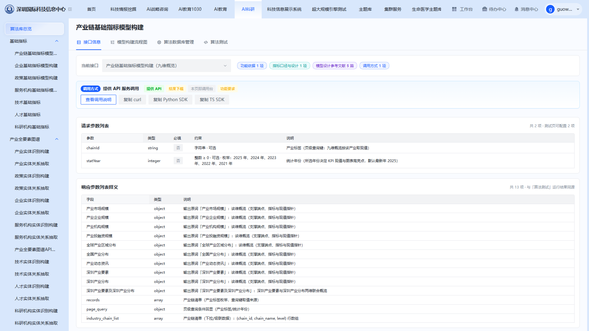

**操作指引**

按 3.1.3 节「通用界面结构与操作步骤」执行：
① 在接口信息页签核对本接口的请求参数与响应字段释义，确认参数含义与约束；
② 切换至「算法测试」页签，在参数与筛选区设置本模型对应的条件项（如产业标签、时间范围、地域范围、机构类型等），页面已预置一组可运行示例值，可在此基础上微调；
③ 点击「执行接口」，右侧运行结果区展示本次调用的执行状态、耗时、分步日志、指标卡与图表；
④ 读取统计指标卡与可视化图表，向下滚动查看明细表与分析结论；
⑤ 使用报告区右上角的导出／打印功能留存结果；如需接入业务系统，按接口信息页签的调用方式复制代码并替换参数即可集成。

**数据更新机制**

模型结果经计算、归纳与有效性验证后，通过 API 接口和数据同步机制服务化输出，支持按地域、领域、时间等条件灵活查询与下载。系统定期更新数据与指标并进行质量监测，确保指标的有效性与可靠性。

#### 3.4.2 企业基础指标模型构建

**模型功能描述**

企业基础指标模型对接企业工商库、财务库、论文库、专利库与技术交易库，完成数据采集、清洗、指标计算与服务化输出，实现对企业基本面、经营状况、技术产出与市场表现的系统量化。模型为企业画像、竞争力评估、招引培育推荐等上层分析提供可复用的指标底座。

**指标清单（企业基础指标）**

| 序号 | 指标名称 | 统计口径 | 主要查询条件与输出 |
|---|---|---|---|
| 1 | 重点企业提取 | 围绕专利数、技术交易额等指标设置阈值，筛选重点企业并统计 | 产业标签、阈值配置；输出重点企业清单与统计 |
| 2 | 企业类型分布 | 外企、高企、小微、上市等类型分类统计，形成数量、占比和趋势 | 产业标签、地区、时间；输出类型分布与趋势 |
| 3 | 企业领域分布 | 计算企业涉及的产业链/技术链领域，形成领域分布与增长率 | 产业标签、地区、时间；输出领域分布与增长率 |
| 4 | 企业重点资讯 | 抽取企业融资、并购、战略合作、新品发布等资讯，形成分类分析与指标计算 | 企业、资讯类型、时间范围；输出资讯分类与指标 |
| 5 | 新增企业数量 | 计算历年涉足某领域企业的新增数量、增长率和趋势 | 产业标签、地区、时间范围；输出新增趋势与增长率 |

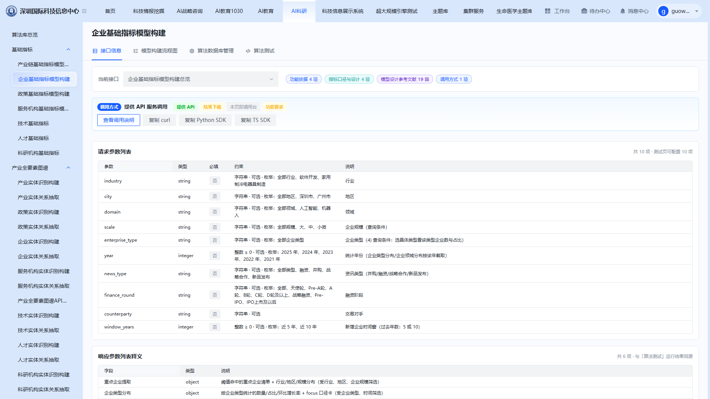

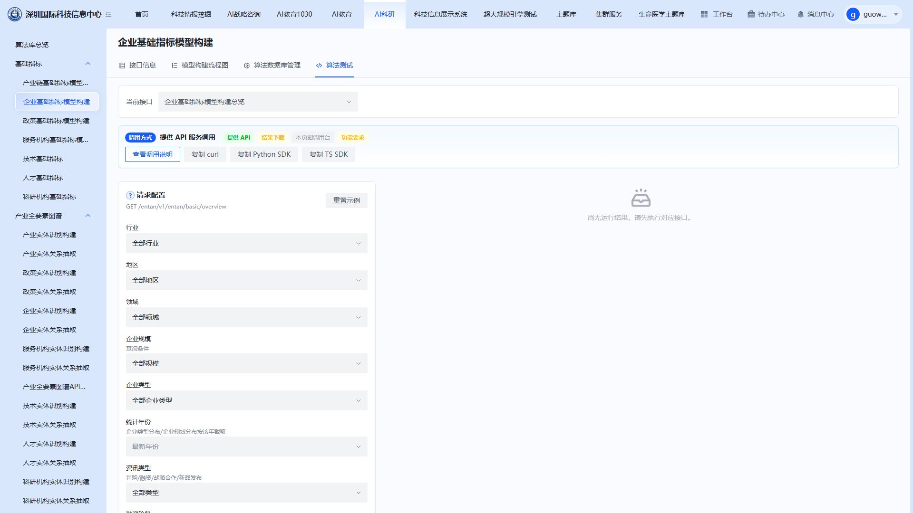

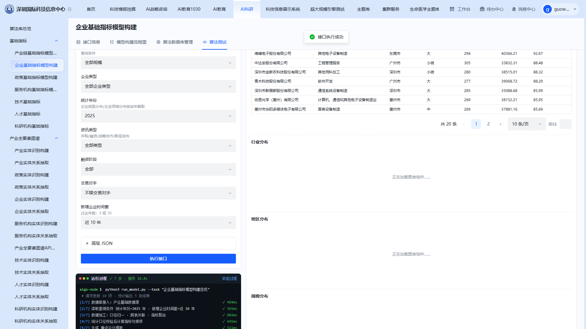

**操作指引**

按 3.1.3 节「通用界面结构与操作步骤」执行：
① 在接口信息页签核对本接口的请求参数与响应字段释义，确认参数含义与约束；
② 切换至「算法测试」页签，在参数与筛选区设置本模型对应的条件项（如产业标签、时间范围、地域范围、机构类型等），页面已预置一组可运行示例值，可在此基础上微调；
③ 点击「执行接口」，右侧运行结果区展示本次调用的执行状态、耗时、分步日志、指标卡与图表；
④ 读取统计指标卡与可视化图表，向下滚动查看明细表与分析结论；
⑤ 使用报告区右上角的导出／打印功能留存结果；如需接入业务系统，按接口信息页签的调用方式复制代码并替换参数即可集成。

**数据更新机制**

模型结果经计算、归纳与有效性验证后，通过 API 接口和数据同步机制服务化输出，支持按地域、领域、时间等条件灵活查询与下载。系统定期更新数据与指标并进行质量监测，确保指标的有效性与可靠性。

#### 3.4.3 政策基础指标模型构建

**模型功能描述**

政策基础指标模型对接政策文本库、政策实施细则库与政策效果监测库，完成数据采集、预处理、指标计算与服务化输出，实现对政策发布、政策类型覆盖、政策力度与政策实施效果的系统量化。模型为政策焦点识别、力度评估、效果评价与短板诊断等上层分析提供可复用的指标底座。

**指标清单（政策基础指标）**

| 序号 | 指标名称 | 统计口径 | 主要查询条件与输出 |
|---|---|---|---|
| 1 | 政策层级分布 | 按国家、省、市、区四级对政策进行分类统计和趋势分析 | 层级、时间范围；输出层级分布与趋势 |
| 2 | 政策类型分布 | 按产业政策、人才政策、企业扶持政策等类型统计政策分布和变化趋势 | 政策类型、时间范围；输出类型分布与趋势 |
| 3 | 政策时序指标 | 统计各时期政策发布数量并形成增长率、连续性等时序指标 | 时间范围；输出时序指标与增长率 |
| 4 | 政策区域分布 | 按省份维度统计相关政策数量并形成区域分布趋势 | 地区、时间范围；输出区域分布趋势 |
| 5 | 深圳政策分布 | 按深圳各区统计政策分布情况并形成增长趋势 | 区域、时间范围；输出深圳政策分布与增长趋势 |

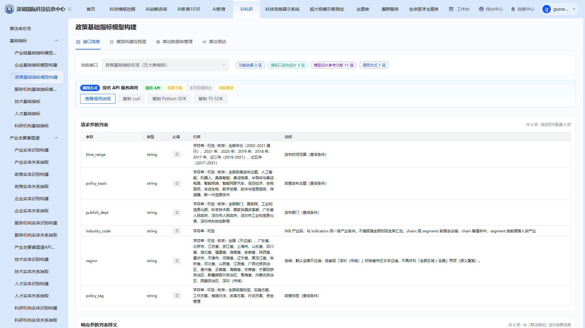

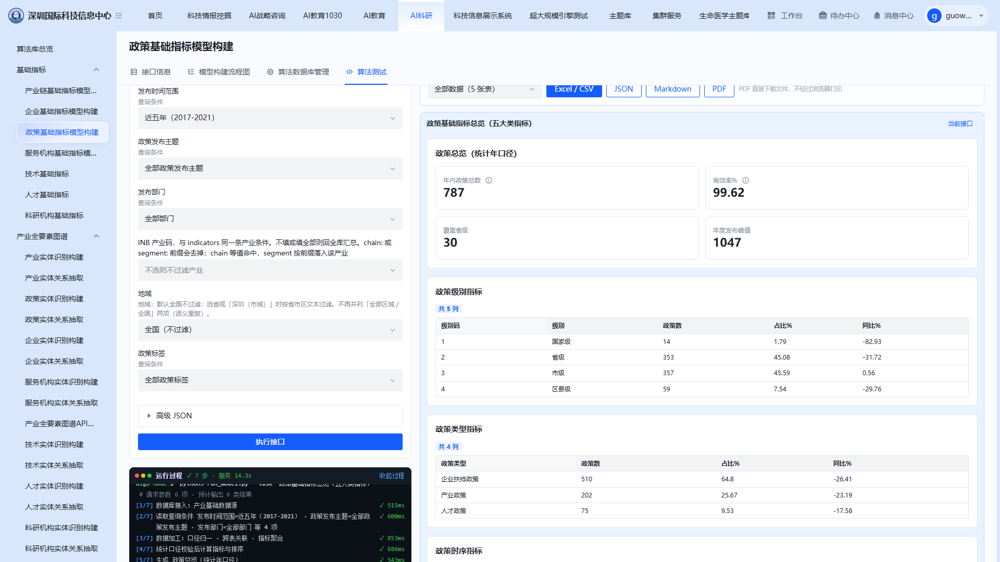

**操作指引**

按 3.1.3 节「通用界面结构与操作步骤」执行：
① 在接口信息页签核对本接口的请求参数与响应字段释义，确认参数含义与约束；
② 切换至「算法测试」页签，在参数与筛选区设置本模型对应的条件项（如产业标签、时间范围、地域范围、机构类型等），页面已预置一组可运行示例值，可在此基础上微调；
③ 点击「执行接口」，右侧运行结果区展示本次调用的执行状态、耗时、分步日志、指标卡与图表；
④ 读取统计指标卡与可视化图表，向下滚动查看明细表与分析结论；
⑤ 使用报告区右上角的导出／打印功能留存结果；如需接入业务系统，按接口信息页签的调用方式复制代码并替换参数即可集成。

**数据更新机制**

模型结果经计算、归纳与有效性验证后，通过 API 接口和数据同步机制服务化输出，支持按地域、领域、时间等条件灵活查询与下载。系统定期更新数据与指标并进行质量监测，确保指标的有效性与可靠性。

#### 3.4.4 服务机构基础指标模型构建

**模型功能描述**

服务机构基础指标模型对接服务机构工商库、资质认定库、行业年报与服务记录库，完成数据采集、清洗、指标计算与服务化输出，实现对六类服务机构（金融/知识产权/人力资源/市场营销/咨询/科技创新）的机构规模、资质等级、服务能力与市场表现的系统量化。模型为服务链短板诊断、机构技术力评价与引入培育推荐等上层分析提供可复用的指标底座。

**指标清单（服务机构基础指标）**

| 序号 | 指标名称 | 统计口径 | 主要查询条件与输出 |
|---|---|---|---|
| 1 | 服务机构领域分布 | 计算服务机构涉及的产业链/技术链领域，形成领域覆盖、增长率和查询服务 | 机构类型、地区、时间；输出领域分布与增长率 |
| 2 | 重点服务机构 | 围绕资质认定、技术交易、服务记录等指标设定阈值，识别重点服务机构并形成查询服务 | 机构类型、阈值配置；输出重点机构清单 |
| 3 | 服务机构新增动态 | 统计历年涉足领域服务机构的新增数量、变化趋势及查询服务 | 机构类型、地区、时间范围；输出新增趋势 |
| 4 | 金融服务机构基础 | 对接工商登记、资质认定与服务记录，统计金融类服务机构的数量、区域分布与服务规模 | 地区、时间；输出金融机构分布与规模 |
| 5 | 知识产权服务机构基础 | 对接工商登记、资质认定与服务记录，统计知识产权类服务机构的数量、区域分布与服务规模 | 地区、时间；输出知产机构分布与规模 |
| 6 | 人力资源服务机构基础 | 对接工商登记、资质认定与服务记录，统计人力资源类服务机构的数量、区域分布与服务规模 | 地区、时间；输出人力机构分布与规模 |
| 7 | 市场营销服务机构基础 | 对接工商登记、资质认定与服务记录，统计市场营销类服务机构的数量、区域分布与服务规模 | 地区、时间；输出营销机构分布与规模 |
| 8 | 咨询服务机构基础 | 对接工商登记、资质认定与服务记录，统计咨询类服务机构的数量、区域分布与服务规模 | 地区、时间；输出咨询机构分布与规模 |
| 9 | 科技创新服务机构基础 | 对接工商登记、资质认定与服务记录，统计科技创新类服务机构的数量、区域分布与服务规模 | 地区、时间；输出科创机构分布与规模 |

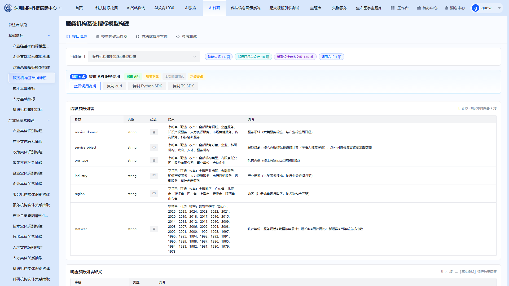

**操作指引**

按 3.1.3 节「通用界面结构与操作步骤」执行：
① 在接口信息页签核对本接口的请求参数与响应字段释义，确认参数含义与约束；
② 切换至「算法测试」页签，在参数与筛选区设置本模型对应的条件项（如产业标签、时间范围、地域范围、机构类型等），页面已预置一组可运行示例值，可在此基础上微调；
③ 点击「执行接口」，右侧运行结果区展示本次调用的执行状态、耗时、分步日志、指标卡与图表；
④ 读取统计指标卡与可视化图表，向下滚动查看明细表与分析结论；
⑤ 使用报告区右上角的导出／打印功能留存结果；如需接入业务系统，按接口信息页签的调用方式复制代码并替换参数即可集成。

**数据更新机制**

模型结果经计算、归纳与有效性验证后，通过 API 接口和数据同步机制服务化输出，支持按地域、领域、时间等条件灵活查询与下载。系统定期更新数据与指标并进行质量监测，确保指标的有效性与可靠性。

#### 3.4.5 技术基础指标模型构建

技术基础指标模型基于技术专题数据，对接产业技术数据库及资讯数据库，完成数据采集、预处理、指标计算与服务化输出，实现对全球、全国及区域技术链基础特征的系统量化与动态更新。模型采集论文、专利、交易、资讯等全量数据，统一执行去重、去噪、缺失值补全、格式标准化，并结合领域分类、时间窗口划分、机构类型过滤等特征提取。模型包括以下指标体系：论文数量、深圳论文数量、区域论文数量、前沿论文机构、专利数量、深圳专利数量、区域专利申请数、领先专利主体机构、技术交易额分析、技术交易额区域分析、技术动态资讯。

**指标清单（技术基础指标模型）**

| **序号** | **指标名称** | **统计口径** | **主要查询条件与输出** |
|----|----|----|----|
| 1 | 论文数量 | 按月/年统计全球/全国机构在该技术领域发表的论文数量，并计算环比增长率 | 技术领域、时间；输出论文数量与增长率 |
| 2 | 深圳论文数量 | 按月/年统计深圳所有机构在该技术领域发表的论文数量及环比增长率，观察论文趋势 | 时间、领域分类；输出深圳论文数量与增长率 |
| 3 | 区域论文数量 | 按论文所属机构地址提取地区信息，统计各地区论文数量及占比 | 地区；输出论文数量与占比 |
| 4 | 前沿论文机构 | 以发表论文数、影响因子、引用次数等指标设定阈值，识别前沿论文机构并统计机构及所在区域数据 | 区域、时间、领域；输出机构名单及指标数据 |
| 5 | 专利数量 | 按月/年统计全球/全国申请成功的该技术领域专利数量及环比增长率 | 技术领域标签、时间；输出专利数量与增长率 |
| 6 | 深圳专利数量 | 按月/年统计深圳申请成功的该技术领域专利数量及环比增长率 | 技术领域、时间；输出深圳专利数量与增长率 |
| 7 | 区域专利申请数 | 按地区统计申请成功的专利数，并计算环比增长率 | 地区标签、时间；输出专利申请成功数与增长率 |
| 8 | 领先专利主体机构 | 以专利数量、专利质量、专利技术覆盖范围等指标设定阈值，识别领先专利主体机构 | 领先指标、时间；输出机构名单与指标结果 |
| 9 | 技术交易额分析 | 按月/年统计技术交易额、成交量、总技术交易额、单笔技术交易额及增长率 | 技术交易标签、时间；输出交易额与增长率 |
| 10 | 技术交易额区域分析 | 按区域统计技术交易额及环比增长率，支持按技术合作、技术转让、技术服务等类型分类 | 区域标签、时间；输出区域交易额与增长率 |
| 11 | 技术动态资讯 | 统计技术热点标签频次、相关资讯数量、发布时间、阅读量及技术发展历程 | 技术热点标签、时间；输出热点标签、资讯与发展历程 |

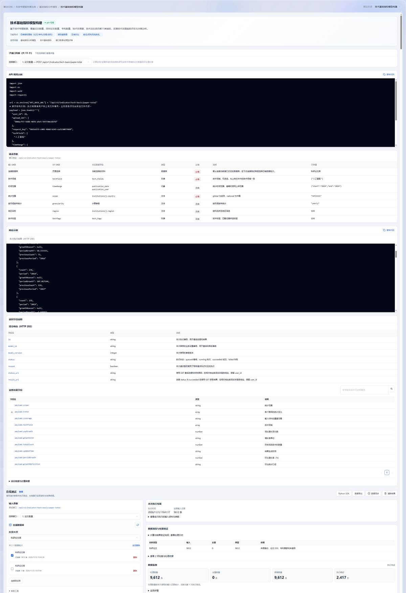

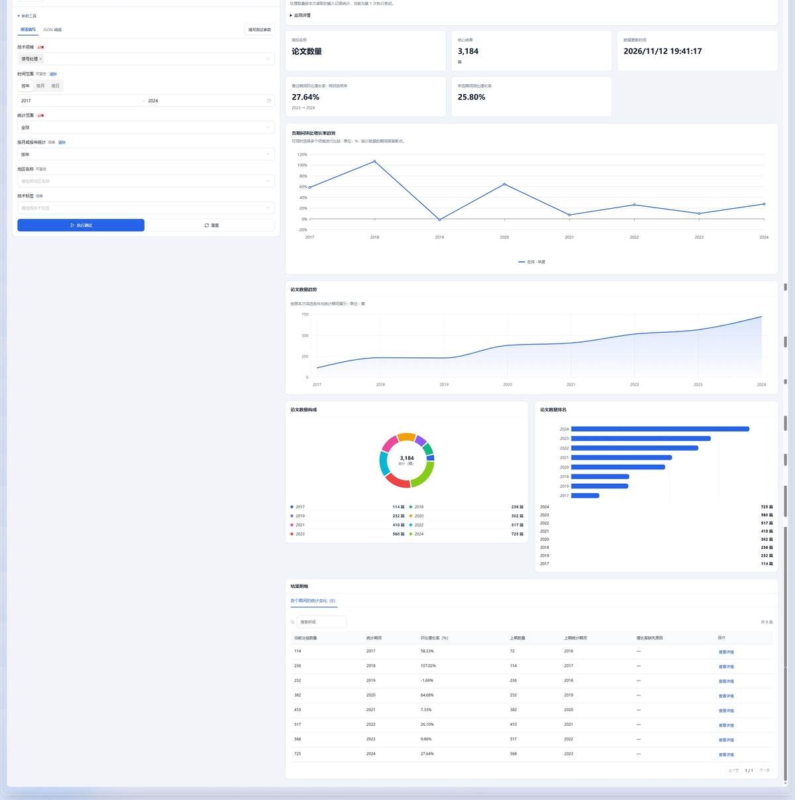

界面示意见图 3-3（共 2 页）。按 3.1.3 节「通用界面结构与操作步骤」执行：先在接口定义区核对入参字段与返回示例，再在报告页左侧设置【技术领域／学科标签】【时间范围（月／年）】【地域范围（全球／全国／深圳／指定区域）】【机构类型】等条件并生成报告；在右侧读取统计指标卡与柱状／条形图、折线趋势图与环形占比图，向下滚动查看明细表与分析结论，最后用右上角导出／打印功能留存结果。

指标结果按统一五步流程生产，经有效性验证后通过 API 接口与消息队列同步至数据服务；系统定期更新数据与指标并进行监测分析，确保指标的有效性与可靠性。

#### 3.4.6 人才基础指标模型构建

人才基础指标模型基于人才专题数据，构建人才分析和评价的核心指标体系，为区域科研水平评估、人才战略制定及产业发展分析提供数据支撑。模型与人才数据库建立稳定接口，采集人才数量、机构分布、领域分类以及历年供给情况等信息，执行去重、缺失值补全、异常值修正、编码统一及时间范围与数据质量分析。人才指标模型包含人才分布、人才机构分布、人才领域分布及人才供给数量四项指标。

**指标清单（人才基础指标模型）**

| **序号** | **指标名称** | **统计口径** | **主要查询条件与输出** |
|----|----|----|----|
| 1 | 人才分布 | 按省份/国家统计人才数量，形成全国/全球人才分布，并分析年度变化趋势 | 省份/国家、时间；输出人才数量指标 |
| 2 | 人才机构分布 | 按省份/国家与机构类型统计人才机构数量，并计算环比增长率 | 省份/国家、机构类型、时间；输出机构分布与增长率 |
| 3 | 人才领域分布 | 按细分产业/技术领域统计人才数量及环比增长率，支持领域间对比 | 细分领域、时间；输出人才数量与增长率 |
| 4 | 人才供给数量 | 按学科统计学士/硕士/博士历年毕业数量，比较不同学科趋势并分析供需状况 | 学科标签、时间、毕业层次；输出各学科历年毕业数量 |

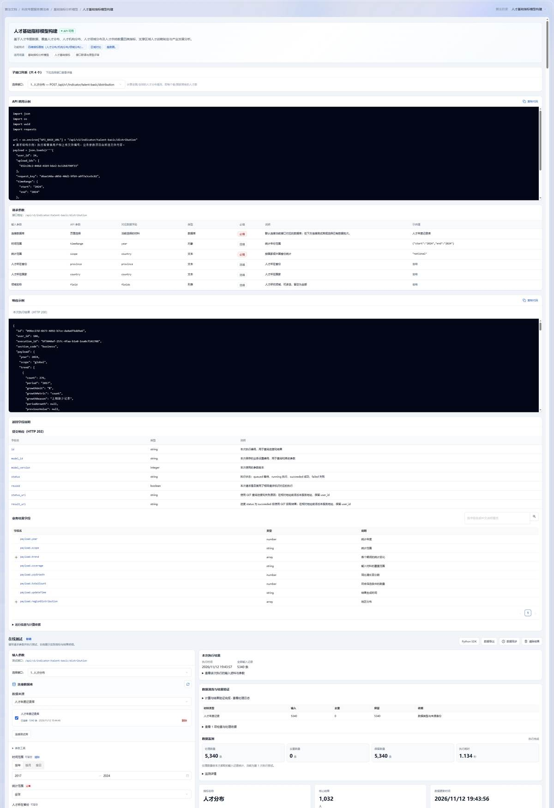

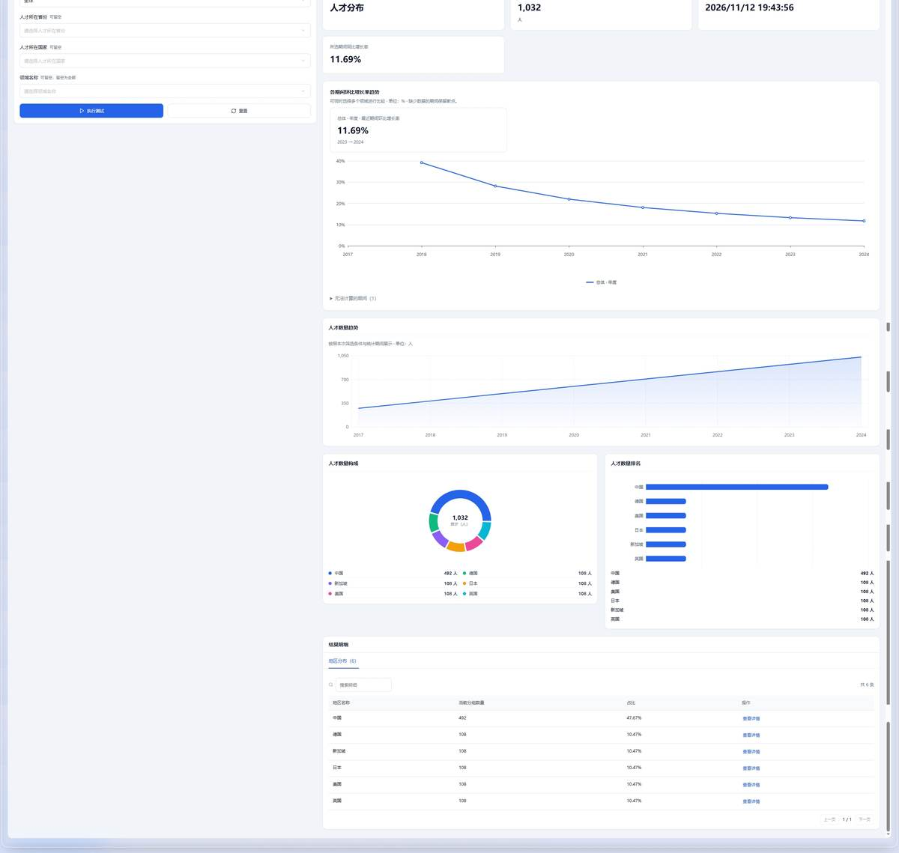

界面示意见图 3-4（共 2 页）。按 3.1.3 节「通用界面结构与操作步骤」执行：先在接口定义区核对入参字段与返回示例，再在报告页左侧设置【技术领域／学科标签】【时间范围（月／年）】【地域范围（全球／全国／深圳／指定区域）】【机构类型】等条件并生成报告；在右侧读取统计指标卡与柱状／条形图、折线趋势图与环形占比图，向下滚动查看明细表与分析结论，最后用右上角导出／打印功能留存结果。

指标结果经计算、归纳与有效性验证后，通过 API 接口和数据同步机制服务化输出，支持按地域、领域、学科、时间等条件灵活查询与下载，并定期更新与监测。

#### 3.4.7 科研机构基础指标模型构建

科研机构基础指标模型通过与科研、企业及资讯数据库等数据源对接，采集涵盖研究领域、论文、专利、人才流动、技术交易、机构类型和涉足产业等信息，并执行去重、去噪、格式化、补全等标准化清洗。模型从科研机构涉及产业领域、重点科研机构、科研机构资讯、新增科研机构动态四大维度构建指标体系，经计算、归纳与验证后通过 API 接口和数据服务同步输出。

**指标清单（科研机构基础指标模型）**

| **序号** | **指标名称** | **统计口径** | **主要查询条件与输出** |
|----|----|----|----|
| 1 | 科研机构涉及产业领域 | 按产业标签统计科研机构涉足的产业链领域，并计算增长率 | 产业标签、时间；输出涉及领域指标与增长率 |
| 2 | 重点科研机构 | 以发表论文数、专利数等科研质量指标设定阈值，识别重点科研机构 | 科研机构标签、时间；输出重点机构及科研质量指标 |
| 3 | 科研机构资讯 | 整合论文、专利、人才流动、技术交易等资讯，计算机构综合科研实力及环比增长率 | 机构标签、时间；输出综合科研实力与增长率 |
| 4 | 新增科研机构动态 | 按机构类型统计历年涉足领域科研机构的新增数量并分析变化 | 机构类型、时间；输出历年新增数量指标 |

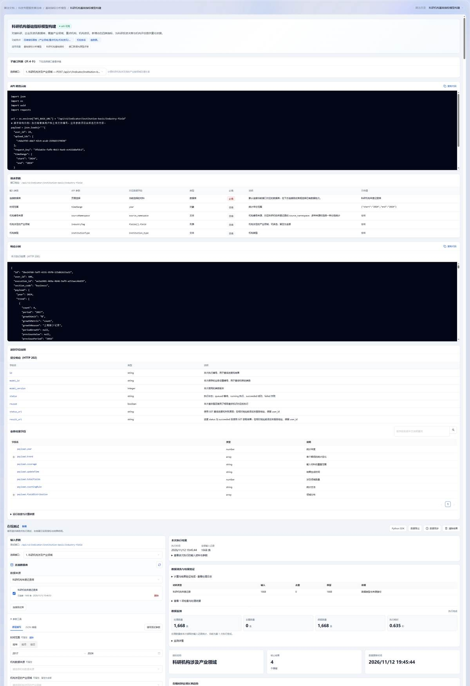

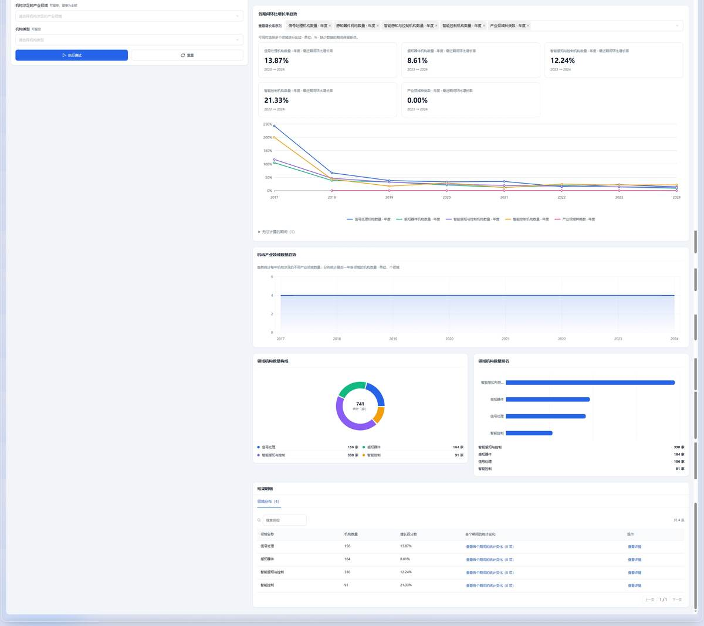

界面示意见图 3-5（共 2 页）。按 3.1.3 节「通用界面结构与操作步骤」执行：先在接口定义区核对入参字段与返回示例，再在报告页左侧设置【技术领域／学科标签】【时间范围（月／年）】【地域范围（全球／全国／深圳／指定区域）】【机构类型】等条件并生成报告；在右侧读取统计指标卡与柱状／条形图、折线趋势图与环形占比图，向下滚动查看明细表与分析结论，最后用右上角导出／打印功能留存结果。

模型具备定期更新与监测机制，支持按产业标签、机构类型、时间等条件灵活查询，为科研投资决策、产业布局、政策制定和机构评估提供量化依据。

### 3.5 产业全要素图谱

产业全要素图谱是面向产业信息融合与创新生态分析的核心基础模块，以产业链和技术链为主线，将产业、企业、政策、服务机构等关键实体及其属性、关系进行系统化抽取、融合与建模，形成统一、准确、可扩展的知识网络。图谱依托图数据库与推理规则支持知识推理与关系延展，并通过数据服务 API 对外开放。

**图谱构建五步流程**

| 序号 | 流程 | 说明 |
|---|---|---|
| 1 | 产业链与技术链环节定义 | 确定节点及上下游关系，形成图谱骨架 |
| 2 | 相关实体要素与属性提取 | 采集企业、政策、服务机构等实体及其关联属性 |
| 3 | 实体构建与消歧 | 对多源数据执行消歧、标准化与融合，确保统一与准确 |
| 4 | 知识推理 | 基于规则与模型生成新的实体关系与链路 |
| 5 | 图谱入库与更新 | 在图数据库中结构化存储，并以增量方式持续更新 |

图谱形成后提供节点重要性分析、社群发现、路径分析等图结构分析及计算能力，并支持实体检索、关系查询、语义分析、可视化展示与聚类关联分析等智能化应用。

#### 3.5.1 产业实体识别构建

**模型功能描述**

产业实体识别构建通过对接产业链环节数据库、论文库、专利库与企业库，使用规则识别、词典识别与命名实体识别模型从多源文本中自动提取产业领域的核心实体（产业链环节、产业集群、关键载体等），并按产业链环节进行结构化归类与消歧。识别结果经人工校验后纳入产业全要素图谱，为后续实体关系抽取与图计算提供统一的实体基础。

**功能要点**

| 项目 | 内容 |
|---|---|
| 处理对象 | 产业链环节、产业集群、关键载体等产业专题数据及关联的论文、专利、资讯数据 |
| 核心方法 | 基于规则（正则表达式、关键字匹配）与基于词典（分词、词性标注、NER）的双重识别，提取产业实体名称、类型、行业归属及地理位置 |
| 维护与更新 | 支持实体新增、删除、修改及定期库更新；按实体名称自动获取关联论文、专利、企业数量、区域分布等属性并周期性更新 |
| 输出结果 | 产业实体库及实体属性档案，支撑产业链全景分析、瓶颈堵点诊断与区域产业指数评价 |

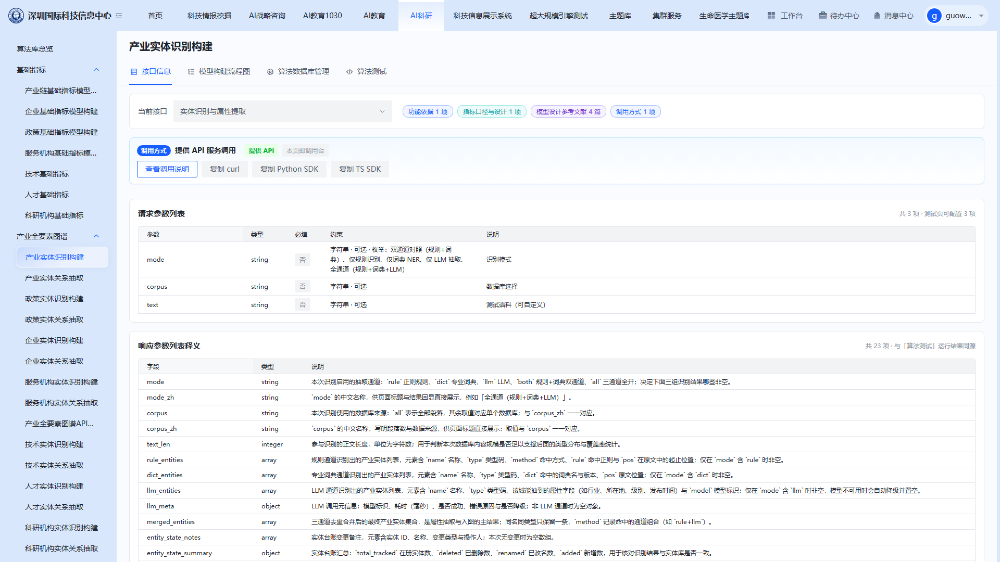

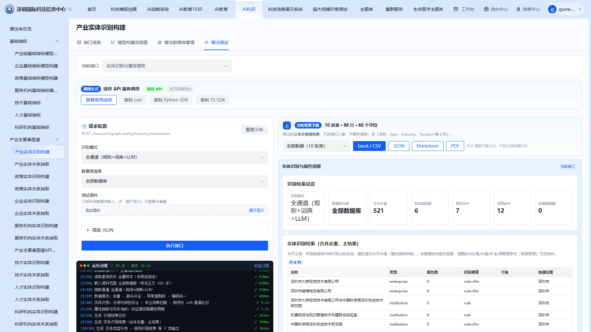

**操作指引**

按 3.1.3 节「通用界面结构与操作步骤」执行：
① 在接口信息页签核对本接口的请求参数与响应字段释义，确认参数含义与约束；
② 切换至「算法测试」页签，在参数与筛选区设置本模型对应的条件项（如产业标签、时间范围、地域范围、机构类型等），页面已预置一组可运行示例值，可在此基础上微调；
③ 点击「执行接口」，右侧运行结果区展示本次调用的执行状态、耗时、分步日志、指标卡与图表；
④ 读取统计指标卡与可视化图表，向下滚动查看明细表与分析结论；
⑤ 使用报告区右上角的导出／打印功能留存结果；如需接入业务系统，按接口信息页签的调用方式复制代码并替换参数即可集成。

**数据更新机制**

模型结果经计算、归纳与有效性验证后，通过 API 接口和数据同步机制服务化输出，支持按地域、领域、时间等条件灵活查询与下载。系统定期更新数据与指标并进行质量监测，确保指标的有效性与可靠性。

#### 3.5.2 产业实体关系抽取

**模型功能描述**

产业实体关系抽取在产业实体识别的基础上，对接产业链上下游关系数据库、论文合作关系与企业供应链关系库，使用关系分类模型从多源文本与结构化数据中抽取产业实体间的关系（上下游、支撑、替代、配套等），并形成产业实体关系网络。抽取结果经人工校验后纳入产业全要素图谱，为后续图结构分析与关键路径识别提供关系基础。

**功能要点**

| 项目 | 内容 |
|---|---|
| 处理对象 | 产业专题库及企业、政策、科研机构、服务机构等关联数据库 |
| 核心方法 | 定义关系类型并配置抽取规则，结合自然语言处理与 NER 提取产业上下游、支撑、替代、配套等关系 |
| 维护与更新 | 结果经去重、纠错、缺失值补全与格式统一后按关系类型入库，并通过定时任务同步更新 |
| 输出结果 | 产业实体关系库及产业链条图谱，呈现网络结构、核心节点及关联强度 |

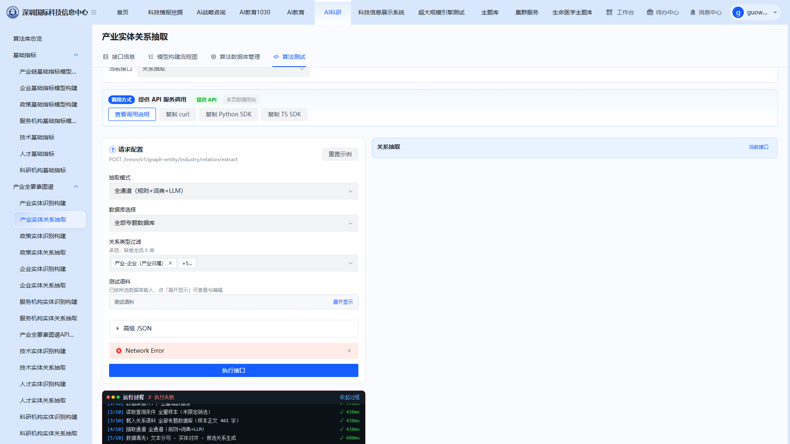

**操作指引**

按 3.1.3 节「通用界面结构与操作步骤」执行：
① 在接口信息页签核对本接口的请求参数与响应字段释义，确认参数含义与约束；
② 切换至「算法测试」页签，在参数与筛选区设置本模型对应的条件项（如产业标签、时间范围、地域范围、机构类型等），页面已预置一组可运行示例值，可在此基础上微调；
③ 点击「执行接口」，右侧运行结果区展示本次调用的执行状态、耗时、分步日志、指标卡与图表；
④ 读取统计指标卡与可视化图表，向下滚动查看明细表与分析结论；
⑤ 使用报告区右上角的导出／打印功能留存结果；如需接入业务系统，按接口信息页签的调用方式复制代码并替换参数即可集成。

**数据更新机制**

模型结果经计算、归纳与有效性验证后，通过 API 接口和数据同步机制服务化输出，支持按地域、领域、时间等条件灵活查询与下载。系统定期更新数据与指标并进行质量监测，确保指标的有效性与可靠性。

#### 3.5.3 政策实体识别构建

**模型功能描述**

政策实体识别构建通过对接政策文本库与政策实施细则库，使用规则识别、词典识别与命名实体识别模型从政策文本中自动提取政策实体（政策名称、政策发布机构、政策主题领域、政策支持对象等），并按政策主题进行结构化归类与消歧。识别结果经人工校验后纳入产业全要素图谱，为后续政策关系抽取与政策语义分析提供统一的实体基础。

**功能要点**

| 项目 | 内容 |
|---|---|
| 处理对象 | 政策文本库、政策实施细则库与政策效果监测库 |
| 核心方法 | 自动识别政策文本中的实体及属性，抽取名称、级别、类型、发布时间、发布地点等信息 |
| 维护与更新 | 支持政策实体新增、删除、修改及定期库更新；按政策编号自动获取实施效果、企业感知、关联产业等属性并周期性更新 |
| 输出结果 | 结构化政策实体库及属性档案，为政策焦点识别、力度评估与效果评价提供基础数据 |

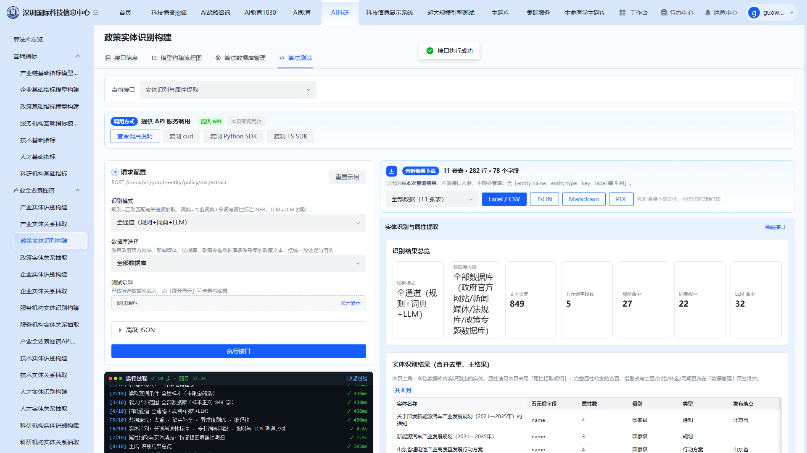

**操作指引**

按 3.1.3 节「通用界面结构与操作步骤」执行：
① 在接口信息页签核对本接口的请求参数与响应字段释义，确认参数含义与约束；
② 切换至「算法测试」页签，在参数与筛选区设置本模型对应的条件项（如产业标签、时间范围、地域范围、机构类型等），页面已预置一组可运行示例值，可在此基础上微调；
③ 点击「执行接口」，右侧运行结果区展示本次调用的执行状态、耗时、分步日志、指标卡与图表；
④ 读取统计指标卡与可视化图表，向下滚动查看明细表与分析结论；
⑤ 使用报告区右上角的导出／打印功能留存结果；如需接入业务系统，按接口信息页签的调用方式复制代码并替换参数即可集成。

**数据更新机制**

模型结果经计算、归纳与有效性验证后，通过 API 接口和数据同步机制服务化输出，支持按地域、领域、时间等条件灵活查询与下载。系统定期更新数据与指标并进行质量监测，确保指标的有效性与可靠性。

#### 3.5.4 政策实体关系抽取

**模型功能描述**

政策实体关系抽取在政策实体识别的基础上，对接政策文本库与政策引用关系数据库，使用关系分类模型从政策文本中抽取政策实体间的关系（制定→发布、发布→支持、支持→领域、引用→被引用等），并形成政策关系网络。抽取结果经人工校验后纳入产业全要素图谱，为后续政策图谱可视化与政策关联分析提供关系基础。

**功能要点**

| 项目 | 内容 |
|---|---|
| 处理对象 | 政策专题库及产业、技术、企业、人才、科研机构、服务机构等关联数据库 |
| 核心方法 | 抽取政策与主题、目标、实施主体、受益对象、监管机构及各要素之间的关系 |
| 维护与更新 | 结果经去重、纠错、缺失值补全与格式统一后按关系类型入库，并通过定时任务同步更新 |
| 输出结果 | 政策实体关系库及政策关联图谱，呈现政策协同网络、覆盖范围及执行链路 |

**操作指引**

按 3.1.3 节「通用界面结构与操作步骤」执行：
① 在接口信息页签核对本接口的请求参数与响应字段释义，确认参数含义与约束；
② 切换至「算法测试」页签，在参数与筛选区设置本模型对应的条件项（如产业标签、时间范围、地域范围、机构类型等），页面已预置一组可运行示例值，可在此基础上微调；
③ 点击「执行接口」，右侧运行结果区展示本次调用的执行状态、耗时、分步日志、指标卡与图表；
④ 读取统计指标卡与可视化图表，向下滚动查看明细表与分析结论；
⑤ 使用报告区右上角的导出／打印功能留存结果；如需接入业务系统，按接口信息页签的调用方式复制代码并替换参数即可集成。

**数据更新机制**

模型结果经计算、归纳与有效性验证后，通过 API 接口和数据同步机制服务化输出，支持按地域、领域、时间等条件灵活查询与下载。系统定期更新数据与指标并进行质量监测，确保指标的有效性与可靠性。

#### 3.5.5 企业实体识别构建

**模型功能描述**

企业实体识别构建通过对接企业工商库、企业新闻库与企业年报库，使用规则识别、词典识别与命名实体识别模型从多源文本中自动提取企业实体（企业名称、法定代表人、主营业务、所属行业等），并按行业与地区进行结构化归类与消歧。识别结果经人工校验后纳入产业全要素图谱，为后续企业关系抽取与企业画像分析提供统一的实体基础。

**功能要点**

| 项目 | 内容 |
|---|---|
| 处理对象 | 企业工商库、财务库、论文库、专利库、技术交易库、投融资库 |
| 核心方法 | 依托多源数据自动识别企业名称、类型、所属行业、地理位置及营收、员工、高管、融资额、产品、技术等属性 |
| 维护与更新 | 支持实体库新增、删除、修改及周期性更新；按企业名称获取论文产出、专利数量、技术交易额、融资额等属性并按任务周期更新 |
| 输出结果 | 企业实体库及属性档案，支撑企业画像、竞争力评估与招引培育推荐 |

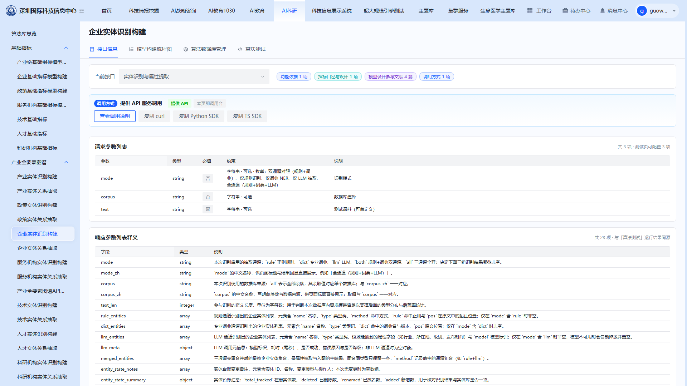

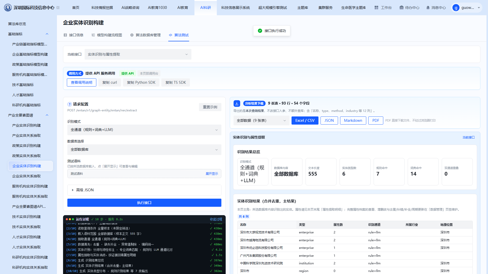

**操作指引**

按 3.1.3 节「通用界面结构与操作步骤」执行：
① 在接口信息页签核对本接口的请求参数与响应字段释义，确认参数含义与约束；
② 切换至「算法测试」页签，在参数与筛选区设置本模型对应的条件项（如产业标签、时间范围、地域范围、机构类型等），页面已预置一组可运行示例值，可在此基础上微调；
③ 点击「执行接口」，右侧运行结果区展示本次调用的执行状态、耗时、分步日志、指标卡与图表；
④ 读取统计指标卡与可视化图表，向下滚动查看明细表与分析结论；
⑤ 使用报告区右上角的导出／打印功能留存结果；如需接入业务系统，按接口信息页签的调用方式复制代码并替换参数即可集成。

**数据更新机制**

模型结果经计算、归纳与有效性验证后，通过 API 接口和数据同步机制服务化输出，支持按地域、领域、时间等条件灵活查询与下载。系统定期更新数据与指标并进行质量监测，确保指标的有效性与可靠性。

#### 3.5.6 企业实体关系抽取

**模型功能描述**

企业实体关系抽取在企业实体识别的基础上，对接企业供应链库、企业股权库与企业合作库，使用关系分类模型从多源文本与结构化数据中抽取企业实体间的关系（供应链上下游、股权持股、合作研发、竞争对手等），并形成企业关系网络。抽取结果经人工校验后纳入产业全要素图谱，为后续供应链分析与企业竞争格局分析提供关系基础。

**功能要点**

| 项目 | 内容 |
|---|---|
| 处理对象 | 企业专题库及产业、技术、政策、人才、科研机构、服务机构等关联数据库 |
| 核心方法 | 抽取企业与产业、技术、政策、人才、科研机构、服务机构之间的关系；构建供应链上下游、技术合作、投融资、客户供应商等关系类型 |
| 维护与更新 | 结果经去重、纠错、缺失值补全与格式统一后按关系类型入库，并通过定时任务同步更新 |
| 输出结果 | 企业实体关系库及企业关系图谱，支撑供应链分析、生态网络研判与战略合作发现 |

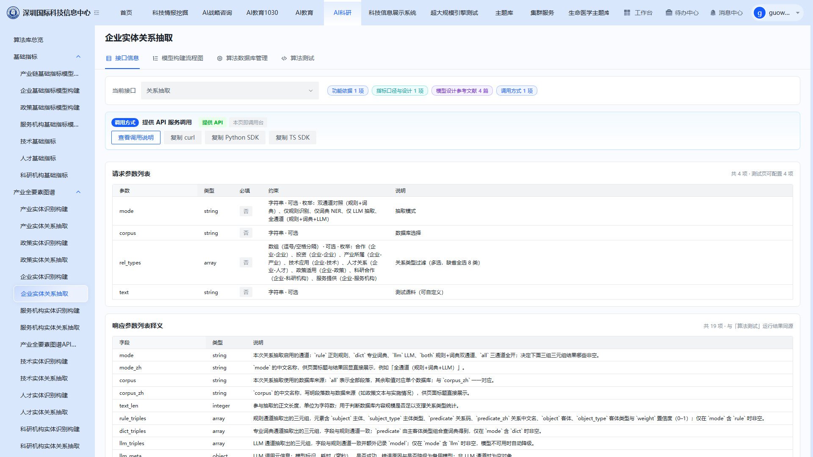

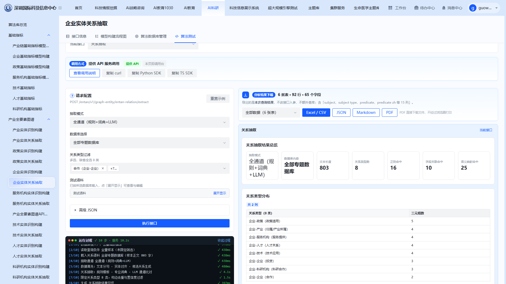

**操作指引**

按 3.1.3 节「通用界面结构与操作步骤」执行：
① 在接口信息页签核对本接口的请求参数与响应字段释义，确认参数含义与约束；
② 切换至「算法测试」页签，在参数与筛选区设置本模型对应的条件项（如产业标签、时间范围、地域范围、机构类型等），页面已预置一组可运行示例值，可在此基础上微调；
③ 点击「执行接口」，右侧运行结果区展示本次调用的执行状态、耗时、分步日志、指标卡与图表；
④ 读取统计指标卡与可视化图表，向下滚动查看明细表与分析结论；
⑤ 使用报告区右上角的导出／打印功能留存结果；如需接入业务系统，按接口信息页签的调用方式复制代码并替换参数即可集成。

**数据更新机制**

模型结果经计算、归纳与有效性验证后，通过 API 接口和数据同步机制服务化输出，支持按地域、领域、时间等条件灵活查询与下载。系统定期更新数据与指标并进行质量监测，确保指标的有效性与可靠性。

#### 3.5.7 服务机构实体识别构建

**模型功能描述**

服务机构实体识别构建通过对接服务机构工商库、资质认定库与行业年报库，使用规则识别、词典识别与命名实体识别模型从多源文本中自动提取服务机构实体（机构名称、资质等级、主营业务、服务领域等），并按机构类型进行结构化归类与消歧。识别结果经人工校验后纳入产业全要素图谱，为后续服务机构关系抽取与服务链分析提供统一的实体基础。

**功能要点**

| 项目 | 内容 |
|---|---|
| 处理对象 | 服务机构工商库、资质认定库、行业年报、技术交易库、服务记录库 |
| 核心方法 | 自动识别服务机构名称、类型、所属行业、地理位置、资质等级、服务领域等属性 |
| 维护与更新 | 支持实体库新增、删除、修改及周期性更新；按机构名称获取资质认定、技术交易、服务项目、覆盖企业数等属性并按任务周期更新 |
| 输出结果 | 服务机构实体库及属性档案，支撑服务链短板诊断与机构技术力评价 |

**操作指引**

按 3.1.3 节「通用界面结构与操作步骤」执行：
① 在接口信息页签核对本接口的请求参数与响应字段释义，确认参数含义与约束；
② 切换至「算法测试」页签，在参数与筛选区设置本模型对应的条件项（如产业标签、时间范围、地域范围、机构类型等），页面已预置一组可运行示例值，可在此基础上微调；
③ 点击「执行接口」，右侧运行结果区展示本次调用的执行状态、耗时、分步日志、指标卡与图表；
④ 读取统计指标卡与可视化图表，向下滚动查看明细表与分析结论；
⑤ 使用报告区右上角的导出／打印功能留存结果；如需接入业务系统，按接口信息页签的调用方式复制代码并替换参数即可集成。

**数据更新机制**

模型结果经计算、归纳与有效性验证后，通过 API 接口和数据同步机制服务化输出，支持按地域、领域、时间等条件灵活查询与下载。系统定期更新数据与指标并进行质量监测，确保指标的有效性与可靠性。

#### 3.5.8 服务机构实体关系抽取

**模型功能描述**

服务机构实体关系抽取在服务机构实体识别的基础上，对接服务机构合作库、服务记录库与企业需求库，使用关系分类模型从多源文本与结构化数据中抽取服务机构实体间的关系（服务供需、合作伙伴、竞争关系等），并形成服务机构关系网络。抽取结果经人工校验后纳入产业全要素图谱，为后续服务链图谱绘制与机构引入推荐提供关系基础。

**功能要点**

| 项目 | 内容 |
|---|---|
| 处理对象 | 服务机构专题库及企业、产业、技术、科研机构、政策等关联数据库 |
| 核心方法 | 抽取服务机构与企业、产业、技术、科研机构、政策之间的关系 |
| 维护与更新 | 结果经去重、纠错、缺失值补全与格式统一后按关系类型入库，并通过定时任务同步更新 |
| 输出结果 | 服务机构实体关系库及服务关系图谱，支撑服务链诊断与机构引入培育推荐 |

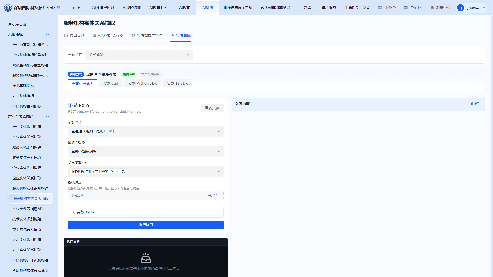

**操作指引**

按 3.1.3 节「通用界面结构与操作步骤」执行：
① 在接口信息页签核对本接口的请求参数与响应字段释义，确认参数含义与约束；
② 切换至「算法测试」页签，在参数与筛选区设置本模型对应的条件项（如产业标签、时间范围、地域范围、机构类型等），页面已预置一组可运行示例值，可在此基础上微调；
③ 点击「执行接口」，右侧运行结果区展示本次调用的执行状态、耗时、分步日志、指标卡与图表；
④ 读取统计指标卡与可视化图表，向下滚动查看明细表与分析结论；
⑤ 使用报告区右上角的导出／打印功能留存结果；如需接入业务系统，按接口信息页签的调用方式复制代码并替换参数即可集成。

**数据更新机制**

模型结果经计算、归纳与有效性验证后，通过 API 接口和数据同步机制服务化输出，支持按地域、领域、时间等条件灵活查询与下载。系统定期更新数据与指标并进行质量监测，确保指标的有效性与可靠性。

#### 3.5.9 技术实体识别构建

技术实体识别构建旨在通过对接多源技术相关数据库，自动识别和提取技术领域的核心实体及其属性，为技术情报分析、科研评价和技术交易决策提供精准的数据支持。系统将学术文献、专利信息、技术报告及交易数据导入实体识别平台，并根据业务需求执行标准化预处理与清洗，确保数据的质量与一致性。在系统构建完成后，支持实体的持续更新与维护，并结合规则识别、词典识别和属性提取方法，实现技术实体库的动态管理和高效应用。

**功能要点**

| **项目** | **内容** |
|----|----|
| 处理对象 | 学术文献、专利信息、技术报告及技术交易数据 |
| 核心方法 | 基于规则（正则表达式、关键字匹配）与基于词典（分词、词性标注、NER）的双重识别，提取技术实体名称、类型、行业归属及地理位置 |
| 维护与更新 | 支持实体新增、删除、修改及定期库更新；按实体名称自动获取论文数量、专利数量、技术交易额及区域分布等属性，并周期性更新 |
| 输出结果 | 技术实体库及实体属性档案，支撑技术情报分析、科研评价与技术交易决策 |

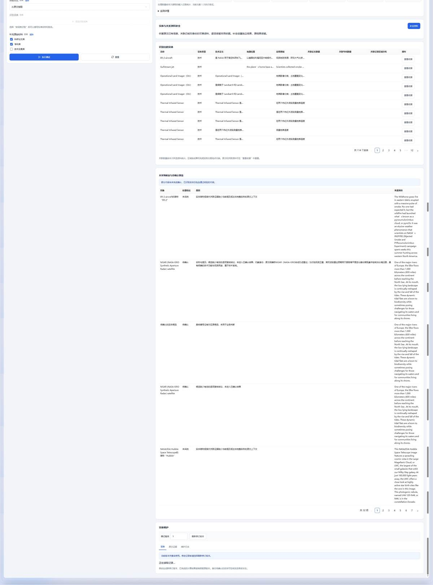

界面示意见图 3-6（共 2 页）。按 3.1.3 节「通用界面结构与操作步骤」执行：先在接口定义区核对入参字段与返回示例，再在报告页左侧设置【数据源】【实体或关系类型】【识别规则与专业词典】【时间范围】等条件并生成报告；在右侧读取统计指标卡与关系网络图与实体／关系明细表，向下滚动查看明细表与分析结论，最后用右上角导出／打印功能留存结果。

#### 3.5.10 技术实体关系抽取

技术实体关系抽取利用自然语言处理与机器学习等方法，从多源技术及关联数据库中自动识别并建模 技术实体与其他相关实体 之间的关系，包括技术与技术、技术与产业、技术与人才、技术与企业、技术与政策、技术与科研机构以及技术与服务机构等。通过统一的关系抽取规则与模型，系统不仅能刻画技术领域、分类、应用、标准及发展历程等内部关联，还能描述技术在创新生态中与外部主体的结构化联系，支撑 技术创新链的可视化呈现与关联分析。

**功能要点**

| **项目** | **内容** |
|----|----|
| 处理对象 | 技术专题库及产业、人才、企业、政策、科研机构、服务机构等关联数据库 |
| 核心方法 | 定义关系类型并配置抽取规则，结合自然语言处理与 NER 提取技术与技术、产业、人才、企业、政策、科研机构、服务机构等实体间关系 |
| 维护与更新 | 结果经去重、纠错、缺失值补全与格式统一后按关系类型入库，并通过定时任务同步更新 |
| 输出结果 | 技术实体关系库及技术创新链可视化展示，呈现网络结构、核心节点及关联强度 |

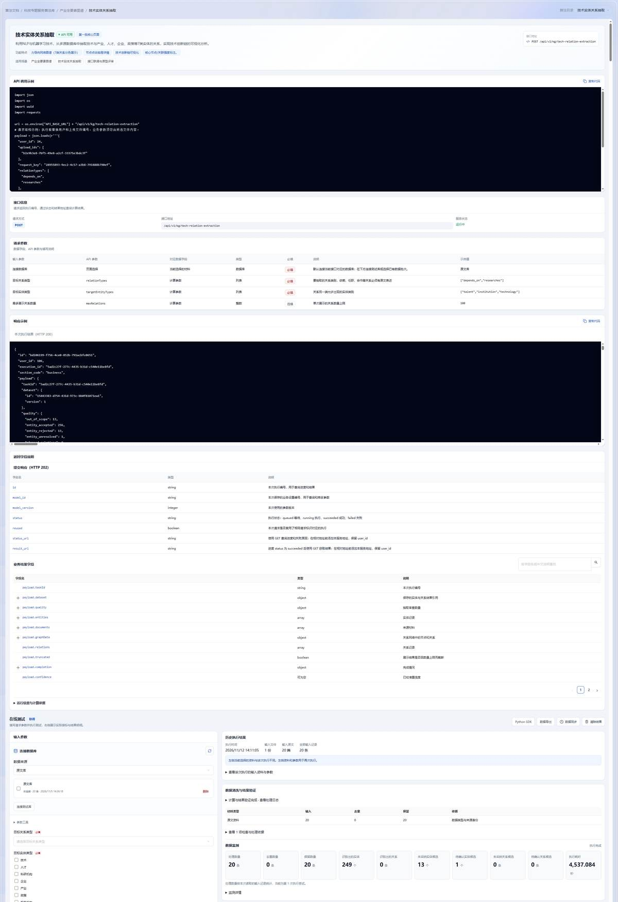

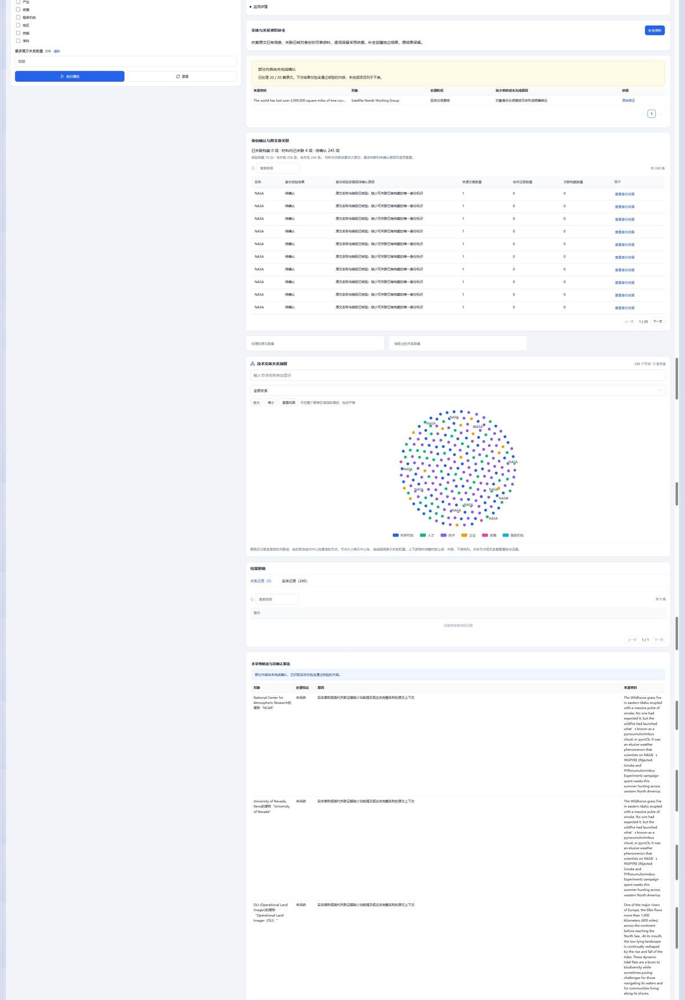

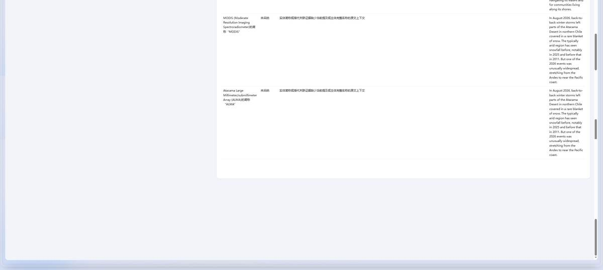

界面示意见图 3-7（共 3 页）。按 3.1.3 节「通用界面结构与操作步骤」执行：先在接口定义区核对入参字段与返回示例，再在报告页左侧设置【数据源】【实体或关系类型】【识别规则与专业词典】【时间范围】等条件并生成报告；在右侧读取统计指标卡与关系网络图与实体／关系明细表，向下滚动查看明细表与分析结论，最后用右上角导出／打印功能留存结果。

#### 3.5.11 人才实体识别构建

人才实体识别构建旨在从大规模人才数据库中自动抽取与识别人才相关的实体及其属性，并结合多种识别方法实现动态更新与维护。该过程包括将多源人才数据导入到实体识别系统，通过业务需求驱动的预处理与数据清洗，确保信息的准确性与完整性；随后利用基于规则的识别和基于词典的识别方法进行实体及属性的抽取，并通过持续的维护与更新机制保证数据库的时效性与质量；系统还可执行人才属性的深度提取，形成全面、结构化的人才信息档案，为科研管理、人才评价及政策制定提供可靠支撑。

**功能要点**

| **项目** | **内容** |
|----|----|
| 处理对象 | 学术论文、专利、招聘信息等多类型人才数据源 |
| 核心方法 | 基于规则的正则匹配与 NER 方法，抽取姓名、性别、学历、领域、单位等核心属性；按实体名称抽取年龄、研究领域、成果数量等信息 |
| 维护与更新 | 支持新增、删除、修改及周期性自动更新，属性数据经去重、纠错、补全后定期更新 |
| 输出结果 | 结构化人才信息档案，为科研管理、人才评价及政策制定提供支撑 |

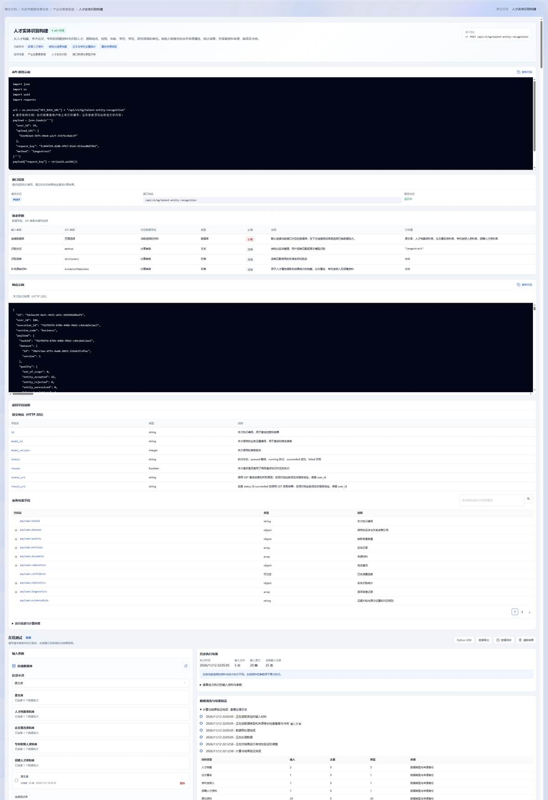

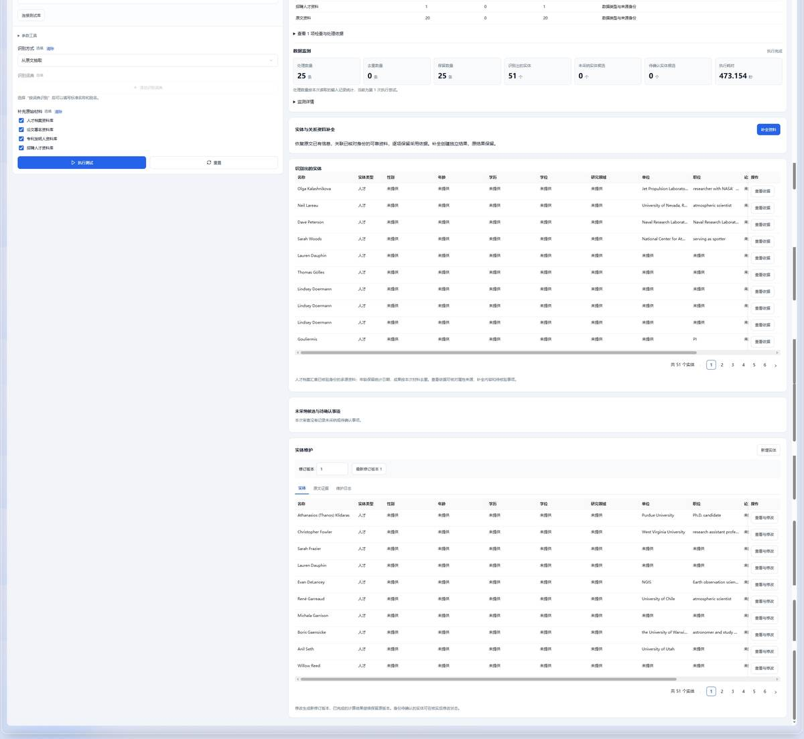

界面示意见图 3-8（共 2 页）。按 3.1.3 节「通用界面结构与操作步骤」执行：先在接口定义区核对入参字段与返回示例，再在报告页左侧设置【数据源】【实体或关系类型】【识别规则与专业词典】【时间范围】等条件并生成报告；在右侧读取统计指标卡与关系网络图与实体／关系明细表，向下滚动查看明细表与分析结论，最后用右上角导出／打印功能留存结果。

#### 3.5.12 人才实体关系抽取

人才实体关系抽取基于数据融合中枢与各大专题数据库的对接，通过自然语言处理技术与预设的人才关系规则，对人才实体及其相关领域信息进行系统化关系识别与建模，构建覆盖产业、技术、企业、科研机构、服务机构、政策等多维度的人才关系图谱。该图谱可全面反映人才与行业、所学专业、所在地区、工作经历、职业技能及政策环境之间的关联，为人才分析、政策制定和创新生态研究提供结构化数据支持。

**功能要点**

| **项目** | **内容** |
|----|----|
| 处理对象 | 人才、产业、技术、企业、科研机构、服务机构及政策等专题数据库 |
| 核心方法 | 按预设人才关系规则，利用 NER、正则匹配和关键词规则抽取人才与产业、技术、企业、科研机构、服务机构及政策间的关联并建模 |
| 维护与更新 | 关系数据经去重、纠错、缺失值填充及格式标准化后存入人才关系库，通过定时任务定期同步 |
| 输出结果 | 覆盖产业、技术、企业、科研机构、服务机构、政策等多维度的人才关系图谱 |

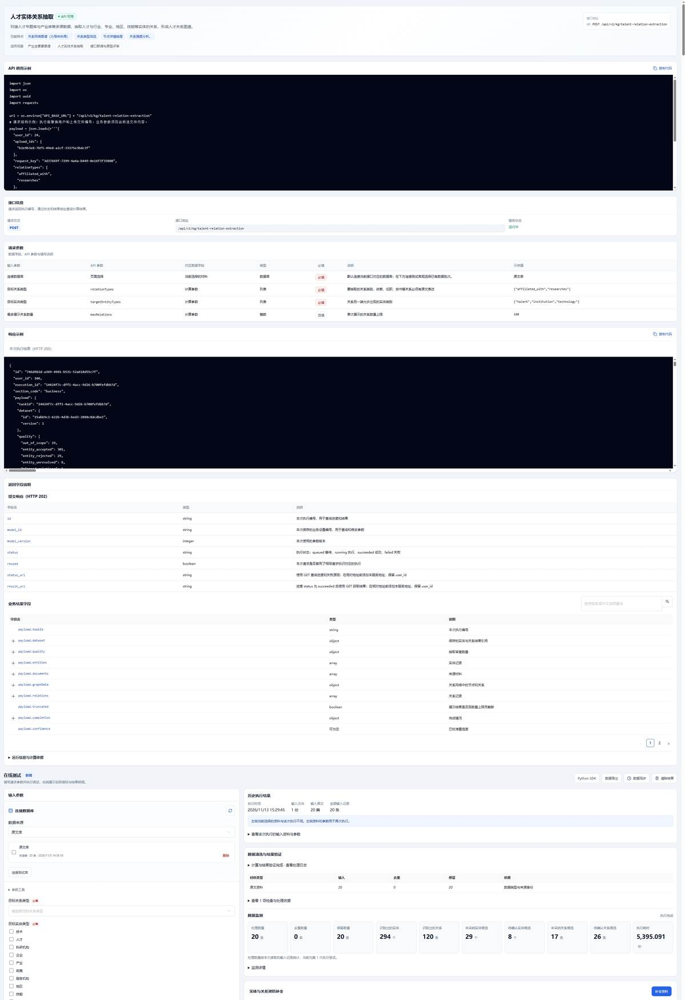

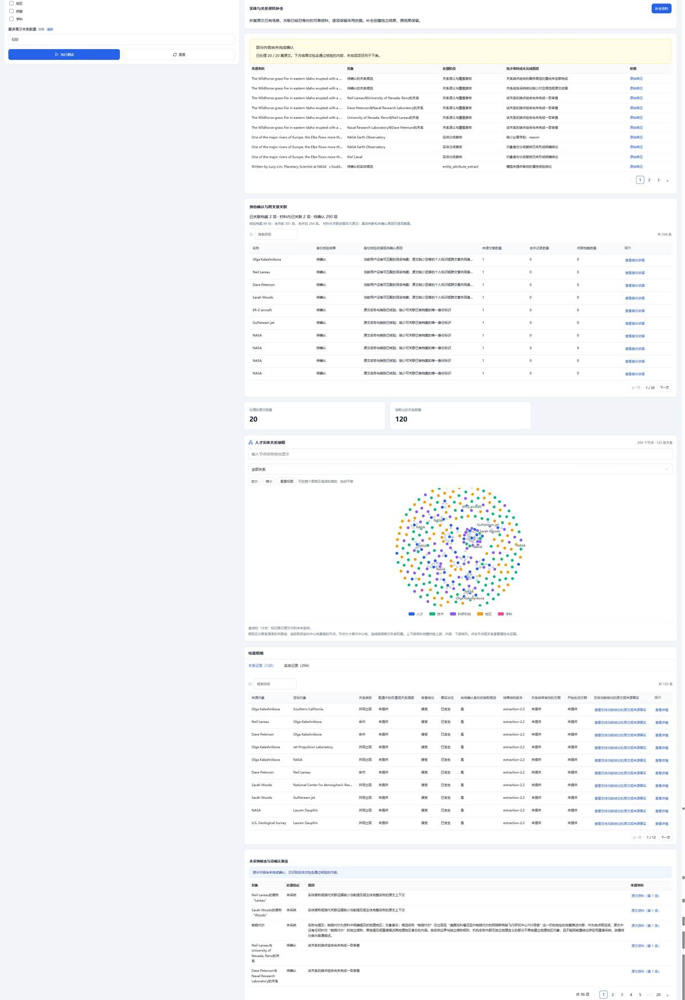

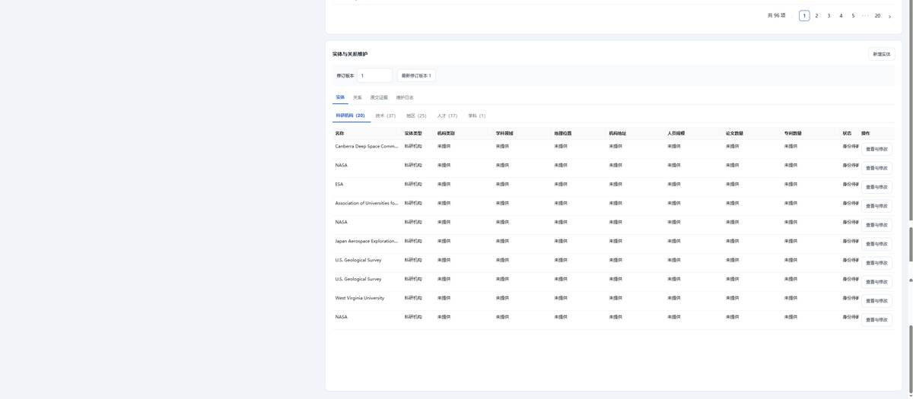

界面示意见图 3-9（共 3 页）。按 3.1.3 节「通用界面结构与操作步骤」执行：先在接口定义区核对入参字段与返回示例，再在报告页左侧设置【数据源】【实体或关系类型】【识别规则与专业词典】【时间范围】等条件并生成报告；在右侧读取统计指标卡与关系网络图与实体／关系明细表，向下滚动查看明细表与分析结论，最后用右上角导出／打印功能留存结果。

#### 3.5.13 科研机构实体识别构建

科研机构实体识别构建旨在从大规模科研机构数据库及相关信息源中，自动抽取并结构化科研机构的名称、类型、所属学科领域、地理位置及各类关键属性，为科研数据管理、分析与决策提供高质量基础数据。系统集成基于规则的识别与基于词典的识别两种方法，并配套实体维护更新及属性提取机制，确保科研机构数据的全面性、准确性与时效性。

**功能要点**

| **项目** | **内容** |
|----|----|
| 处理对象 | 学术论文数据库、专利数据库、科研机构官方网站等多源权威数据 |
| 核心方法 | 基于规则的正则匹配与关键字抽取、基于词典的分词/词性标注与 NER，提取机构名称、类型、学科领域及地理位置，并去重与异常清理 |
| 维护与更新 | 支持实体库新增、删除、修改及周期性更新；按机构名称获取人员规模、论文产出量、专利数量、地址等属性并按任务周期更新 |
| 输出结果 | 科研机构实体库及属性档案，为科研数据管理、分析与决策提供基础数据 |

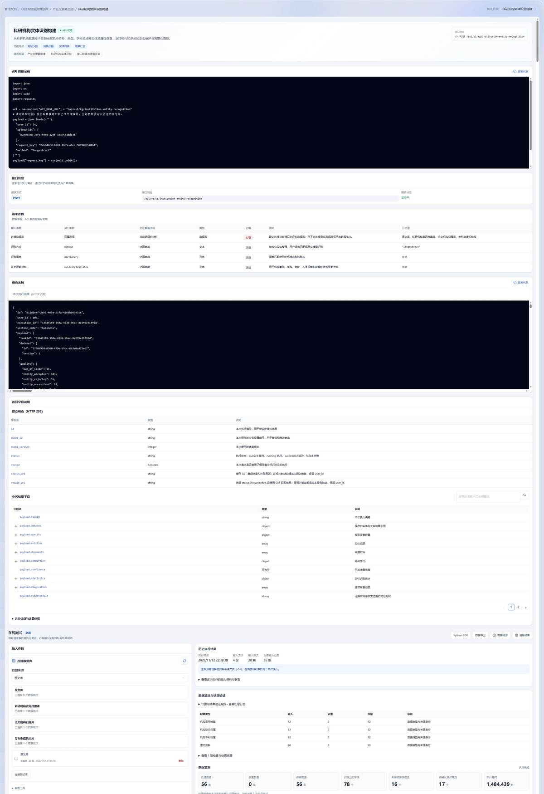

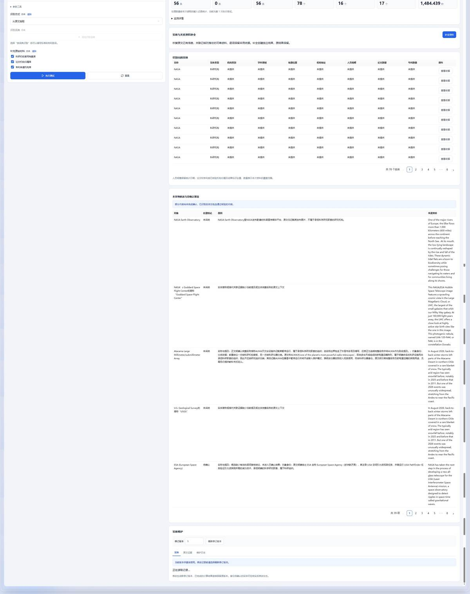

界面示意见图 3-10（共 2 页）。按 3.1.3 节「通用界面结构与操作步骤」执行：先在接口定义区核对入参字段与返回示例，再在报告页左侧设置【数据源】【实体或关系类型】【识别规则与专业词典】【时间范围】等条件并生成报告；在右侧读取统计指标卡与关系网络图与实体／关系明细表，向下滚动查看明细表与分析结论，最后用右上角导出／打印功能留存结果。

#### 3.5.14 科研机构实体关系抽取

科研机构实体关系抽取旨在基于数据融合中枢，对接科研、产业、人才、技术、政策、企业及服务等专题数据库，系统化采集并解析科研机构与其他实体之间的多类型业务关系。通过定制化的关系规则与逻辑设计，提取科研机构在研究技术领域、合作企业、科研人才、关联政策及服务等方面的关键信息，并进行整合，最终构建覆盖全产业链的科研机构实体关系图谱。该模型可为科技情报分析、创新生态评估、政策制定及资源配置提供结构化、可视化的基础数据支持。

**功能要点**

| **项目** | **内容** |
|----|----|
| 处理对象 | 科研、产业、人才、技术、政策、企业及服务等专题数据库 |
| 核心方法 | 按业务场景制定关系规则，识别并抽取合作与隶属、产业领域、人才网络、技术研发、政策关联、企业合作及服务机构对接等关系信息 |
| 维护与更新 | 批量导入后执行去重、纠错、缺失值补全与格式统一，通过定时更新与自动化维护机制持续同步 |
| 输出结果 | 覆盖全产业链的科研机构实体关系图谱，支撑科技情报分析、创新生态评估与资源配置 |

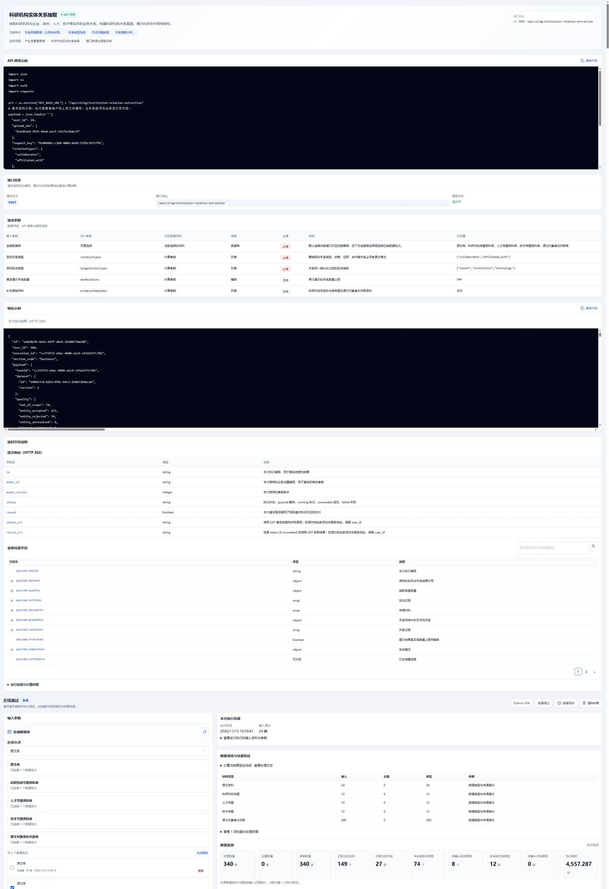

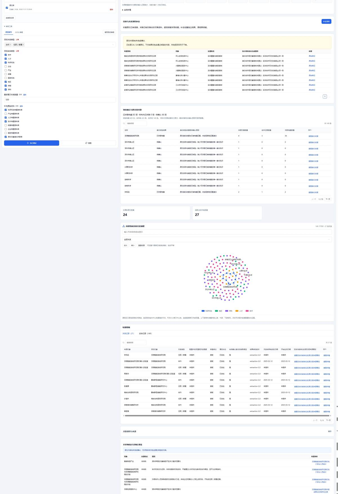

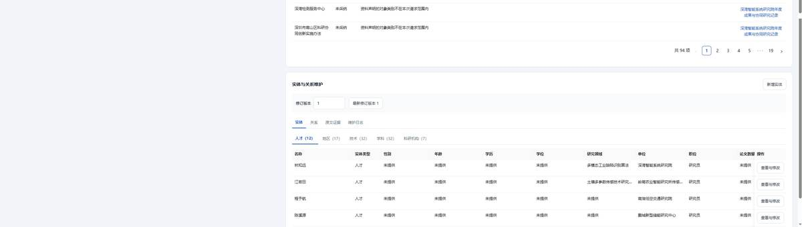

界面示意见图 3-11（共 3 页）。按 3.1.3 节「通用界面结构与操作步骤」执行：先在接口定义区核对入参字段与返回示例，再在报告页左侧设置【数据源】【实体或关系类型】【识别规则与专业词典】【时间范围】等条件并生成报告；在右侧读取统计指标卡与关系网络图与实体／关系明细表，向下滚动查看明细表与分析结论，最后用右上角导出／打印功能留存结果。

#### 3.5.15 产业全要素图谱API服务开发

**模型功能描述**

产业全要素图谱 API 服务开发在图谱构建完成后，将图数据库中的实体、属性与关系以标准化 Restful API 的形式对外提供，支持实体检索、关系查询、路径分析、节点重要性计算、社群发现与图谱可视化等能力。API 服务覆盖图谱全部实体类型与关系类型，支持按时间、地域、领域等多维条件过滤，并提供实时推理与批量计算两种服务模式。

**功能要点**

| 项目 | 内容 |
|---|---|
| 处理对象 | 产业、技术、企业、人才、科研机构、政策、服务机构七类实体及其关系数据 |
| 核心方法 | 提供节点重要性分析、社群发现、路径分析等图结构分析与计算能力，支持实体检索、关系查询、语义分析、可视化展示与聚类关联分析 |
| 维护与更新 | API 接口与图谱数据同步更新，支持图谱增量刷新与服务化监控 |
| 输出结果 | 图谱查询与分析 API 服务，支撑实体检索、关系遍历、图算法计算及可视化集成 |

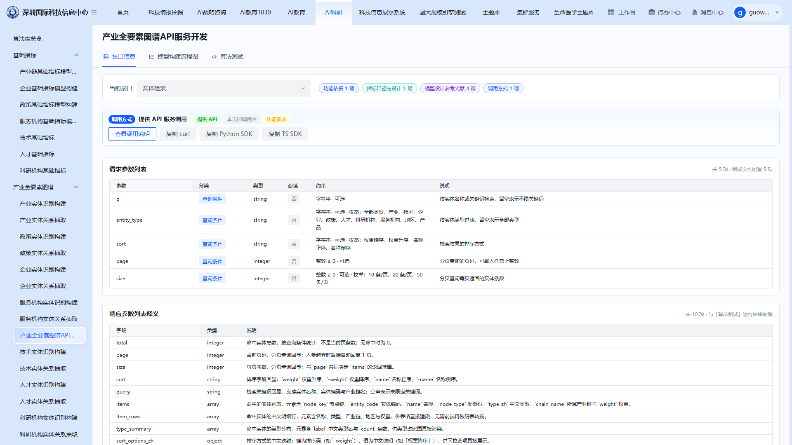

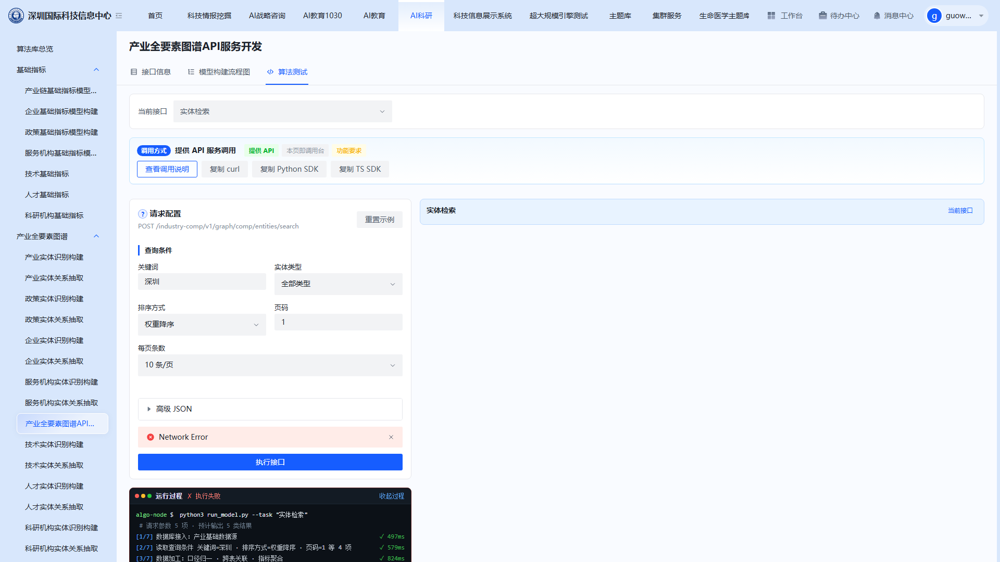

**操作指引**

按 3.1.3 节「通用界面结构与操作步骤」执行：
① 在接口信息页签核对本接口的请求参数与响应字段释义，确认参数含义与约束；
② 切换至「算法测试」页签，在参数与筛选区设置本模型对应的条件项（如产业标签、时间范围、地域范围、机构类型等），页面已预置一组可运行示例值，可在此基础上微调；
③ 点击「执行接口」，右侧运行结果区展示本次调用的执行状态、耗时、分步日志、指标卡与图表；
④ 读取统计指标卡与可视化图表，向下滚动查看明细表与分析结论；
⑤ 使用报告区右上角的导出／打印功能留存结果；如需接入业务系统，按接口信息页签的调用方式复制代码并替换参数即可集成。

**数据更新机制**

模型结果经计算、归纳与有效性验证后，通过 API 接口和数据同步机制服务化输出，支持按地域、领域、时间等条件灵活查询与下载。系统定期更新数据与指标并进行质量监测，确保指标的有效性与可靠性。

### 3.6 产业链深度分析模型构建

产业链深度分析模型围绕产业链全景描绘、关键环节识别、瓶颈堵点诊断、深圳产业链优势与机遇研判等核心场景，综合产业链上下游数据、企业布局、论文专利、政策支持与技术交易等多源信息，构建涵盖全景、深圳、周期、阶段、关键环节、瓶颈堵点、区域指数、问题识别、机遇分析与重点布局推荐的一整套分析能力。模型按"全景 → 结构分解 → 深圳聚焦 → 瓶颈识别 → 机会发现 → 布局推荐"的逻辑链组织，前序模块的分析结论作为后序模块的输入，形成可追溯的分析链路。

#### 3.6.1 产业链全景模型构建

**模型功能描述**

产业链全景模型算法基于产业知识图谱与产业基础数据，全面展示某一产业或细分产业的结构与运作全貌，涵盖上下游环节关系梳理、产业链关联数据采集与整合，以及产业链服务化功能输出。该算法通过可视化建模与数据驱动分析，帮助用户掌握产业全局、识别关键环节和主体，为产业布局优化、政策制定及协同发展提供系统支撑。

**算法输入与输出**

| 项目 | 内容 |
|---|---|
| 输入 | 产业知识图谱数据、企业信息、技术数据、人才数据、科研机构数据、服务机构数据、供应链数据、市场数据、行业数据。 |
| 输出 | 产业链全景关系图谱、上下游环节关系及主体信息清单、属性统计与分析报告、可视化展示结果。 |
| 调用方式 | 支持通过Restful API、SDK及展示平台调用，可按上下游环节或主体类别进行关系查询、数据统计与分析，并支持生成可视化图谱及数据导出服务。 |

**操作指引**

按 3.1.3 节「通用界面结构与操作步骤」执行：
① 在接口信息页签核对本接口的请求参数与响应字段释义，确认参数含义与约束；
② 切换至「算法测试」页签，在参数与筛选区设置本模型对应的条件项，页面已预置一组可运行示例值，可在此基础上微调；
③ 点击「执行接口」，右侧运行结果区展示本次调用的执行状态、耗时、分步日志、指标卡与图表；
④ 读取统计指标卡与可视化图表，向下滚动查看明细表与分析结论；
⑤ 使用报告区右上角的导出／打印功能留存结果；如需接入业务系统，按接口信息页签的调用方式复制代码并替换参数即可集成。

**数据更新机制**

模型结果经计算、归纳与有效性验证后，通过 API 接口和数据同步机制服务化输出，支持按地域、领域、时间等条件灵活查询与下载。系统定期更新数据与指标并进行质量监测，确保指标的有效性与可靠性。

#### 3.6.2 深圳产业链模型构建

**模型功能描述**

深圳产业链模型算法依托产业知识图谱与产业基础数据，形成覆盖某一产业或细分产业在深圳布局的全景产业链模型，展示全链条全部节点及其属性信息。该算法可全面刻画产业链上下游关系，整合多源关联数据，并提供服务化接口，支持企业、科研机构、人才等产业要素的查询、统计与分析，帮助政府部门、产业园区及相关机构掌握深圳产业链全貌、监测产业运行状况并优化发展布局。

**算法输入与输出**

| 项目 | 内容 |
|---|---|
| 输入 | 产业知识图谱数据、深圳区域产业基础数据、企业信息、技术数据、人才数据、科研机构信息、服务机构信息、供应链数据。 |
| 输出 | 深圳产业链全景关系图谱、上下游环节关系清单、属性统计分析报告、可视化展示结果。 |
| 调用方式 | 支持通过Restful API、SDK及展示平台调用，可按上下游环节、主体类型或区域属性进行关系查询与数据分析，并支持生成可视化图谱及数据导出服务。 |

**操作指引**

按 3.1.3 节「通用界面结构与操作步骤」执行：
① 在接口信息页签核对本接口的请求参数与响应字段释义，确认参数含义与约束；
② 切换至「算法测试」页签，在参数与筛选区设置本模型对应的条件项，页面已预置一组可运行示例值，可在此基础上微调；
③ 点击「执行接口」，右侧运行结果区展示本次调用的执行状态、耗时、分步日志、指标卡与图表；
④ 读取统计指标卡与可视化图表，向下滚动查看明细表与分析结论；
⑤ 使用报告区右上角的导出／打印功能留存结果；如需接入业务系统，按接口信息页签的调用方式复制代码并替换参数即可集成。

**数据更新机制**

模型结果经计算、归纳与有效性验证后，通过 API 接口和数据同步机制服务化输出，支持按地域、领域、时间等条件灵活查询与下载。系统定期更新数据与指标并进行质量监测，确保指标的有效性与可靠性。

#### 3.6.3 产业发展路线历程模型

**模型功能描述**

产业发展路线历程模型算法用于识别与呈现产业在发展过程中的重大事件及其对产业趋势的影响。该算法基于产业基础指标与资讯基础指标，结合事件识别算法构建重大事件时间线，为产业动态分析及决策提供量化依据。算法通过接入行业统计数据、政策法规、专家观点、新闻报道等多类数据源，记录重大事件及发生时间节点，最终生成覆盖全产业发展历程的重大事件时间线。

**算法输入与输出**

| 项目 | 内容 |
|---|---|
| 输入 | 产业基础指标数据、资讯基础指标数据、行业统计信息、政策法规文本、专家观点数据、新闻报道数据、重大事件指标体系及阈值设定。 |
| 输出 | 重大事件时间线、产业发展趋势分析报告、可视化事件分布图、动态监测数据接口。 |
| 调用方式 | 支持通过Restful API、SDK方式调用，可按产业标签或行业类别查询重大事件列表及发展路线，并支持生成分析报告、趋势图表及数据导出服务。 |

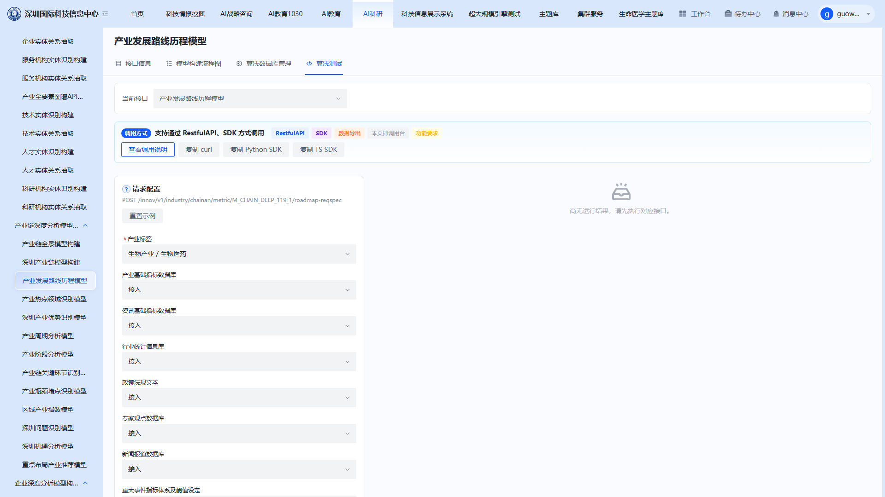

**操作指引**

按 3.1.3 节「通用界面结构与操作步骤」执行：
① 在接口信息页签核对本接口的请求参数与响应字段释义，确认参数含义与约束；
② 切换至「算法测试」页签，在参数与筛选区设置本模型对应的条件项，页面已预置一组可运行示例值，可在此基础上微调；
③ 点击「执行接口」，右侧运行结果区展示本次调用的执行状态、耗时、分步日志、指标卡与图表；
④ 读取统计指标卡与可视化图表，向下滚动查看明细表与分析结论；
⑤ 使用报告区右上角的导出／打印功能留存结果；如需接入业务系统，按接口信息页签的调用方式复制代码并替换参数即可集成。

**数据更新机制**

模型结果经计算、归纳与有效性验证后，通过 API 接口和数据同步机制服务化输出，支持按地域、领域、时间等条件灵活查询与下载。系统定期更新数据与指标并进行质量监测，确保指标的有效性与可靠性。

#### 3.6.4 产业热点领域识别模型

**模型功能描述**

产业热点领域识别模型算法通过对接资讯数据库，系统化获取目标产业的多源资讯数据，并基于热点指标与阈值设定，利用热点识别算法对产业动态进行分析，实时识别并跟踪产业热点。该算法结合数据采集、清洗、指标体系构建和服务化输出等环节，可为产业监测、市场判断及战略决策提供精确的数据支持与分析依据。

**算法输入与输出**

| 项目 | 内容 |
|---|---|
| 输入 | 新闻报道数据、行业研究报告数据、公司公告数据、市场份额指标、行业增长率指标、竞争格局指标、阈值参数。 |
| 输出 | 产业热点领域列表、热点结构分析报告、热点变化趋势图表、可视化数据接口。 |
| 调用方式 | 支持通过Restful API、SDK及在线展示平台调用，可按产业标签或细分领域获取热点识别结果，并支持生成分析报告及数据导出服务。 |

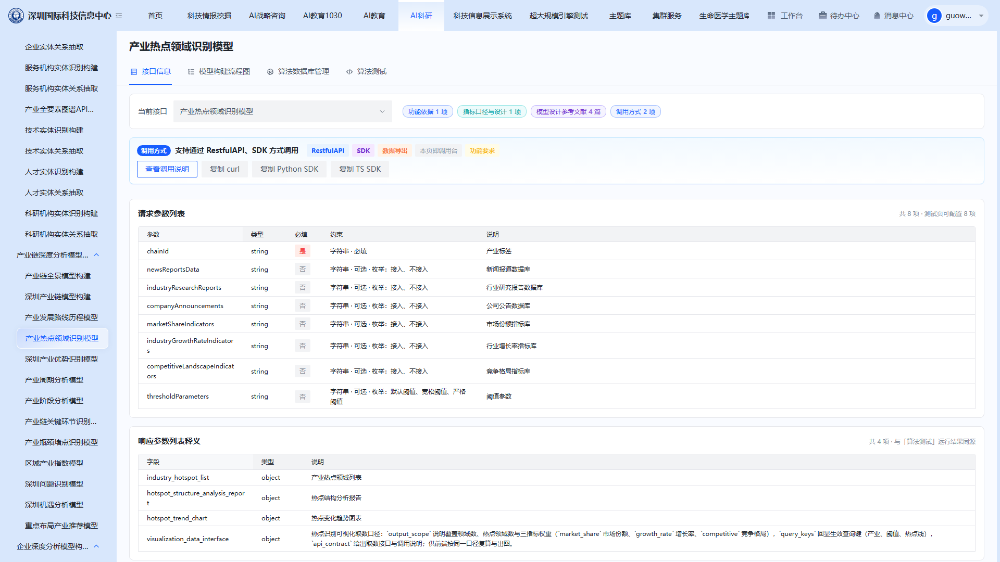

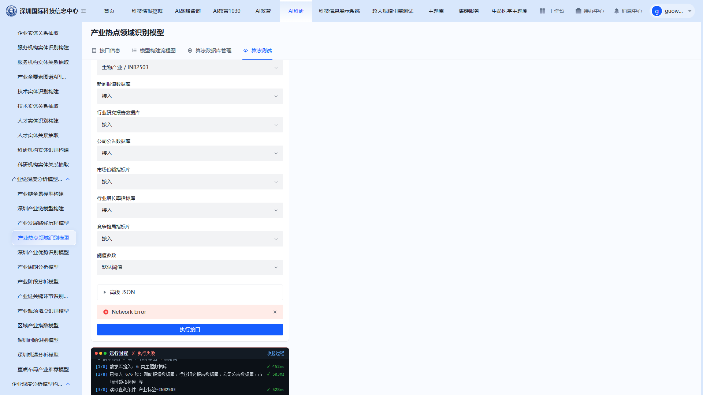

**操作指引**

按 3.1.3 节「通用界面结构与操作步骤」执行：
① 在接口信息页签核对本接口的请求参数与响应字段释义，确认参数含义与约束；
② 切换至「算法测试」页签，在参数与筛选区设置本模型对应的条件项，页面已预置一组可运行示例值，可在此基础上微调；
③ 点击「执行接口」，右侧运行结果区展示本次调用的执行状态、耗时、分步日志、指标卡与图表；
④ 读取统计指标卡与可视化图表，向下滚动查看明细表与分析结论；
⑤ 使用报告区右上角的导出／打印功能留存结果；如需接入业务系统，按接口信息页签的调用方式复制代码并替换参数即可集成。

**数据更新机制**

模型结果经计算、归纳与有效性验证后，通过 API 接口和数据同步机制服务化输出，支持按地域、领域、时间等条件灵活查询与下载。系统定期更新数据与指标并进行质量监测，确保指标的有效性与可靠性。

#### 3.6.5 深圳产业优势识别模型

**模型功能描述**

深圳产业优势识别模型算法旨在通过综合对比各领域专题库数据，构建科学的产业评价模型，并结合深圳产业数据与全国产业数据对比分析，识别深圳具有竞争力与发展优势的产业领域。该算法基于多维度指标体系（如行业增长率、市场占有率、技术创新能力等），提供实时、精准的产业优势评估结果，可服务政府决策、产业规划及企业战略制定。

**算法输入与输出**

| 项目 | 内容 |
|---|---|
| 输入 | 深圳市产业数据、全国产业数据、政策法规库数据、经济指标库数据、企业信息库数据、行业增长率指标、市场占有率指标、技术创新能力指标、权重及阈值参数。 |
| 输出 | 深圳优势产业清单、优势评分结果、详细指标分析报告、趋势变化可视化图表。 |
| 调用方式 | 支持通过Restful API、SDK方式调用，可按产业标签或行业类别获取优势产业识别结果，并支持生成分析报告及数据导出服务。 |

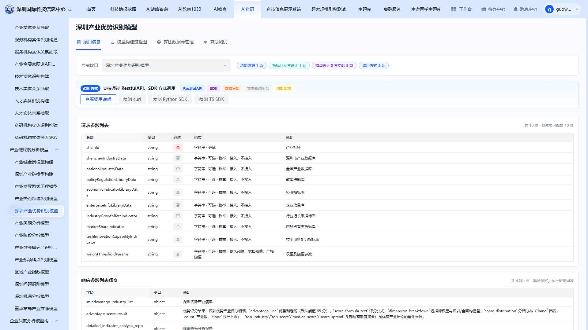

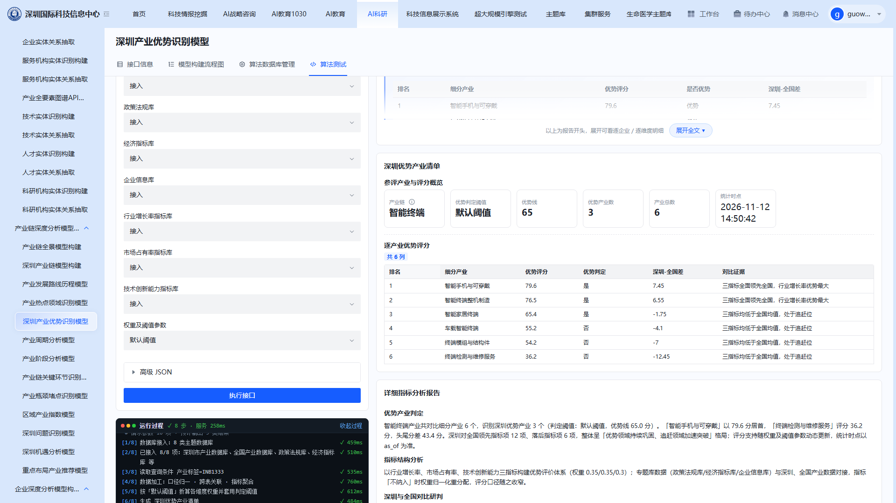

**操作指引**

按 3.1.3 节「通用界面结构与操作步骤」执行：
① 在接口信息页签核对本接口的请求参数与响应字段释义，确认参数含义与约束；
② 切换至「算法测试」页签，在参数与筛选区设置本模型对应的条件项，页面已预置一组可运行示例值，可在此基础上微调；
③ 点击「执行接口」，右侧运行结果区展示本次调用的执行状态、耗时、分步日志、指标卡与图表；
④ 读取统计指标卡与可视化图表，向下滚动查看明细表与分析结论；
⑤ 使用报告区右上角的导出／打印功能留存结果；如需接入业务系统，按接口信息页签的调用方式复制代码并替换参数即可集成。

**数据更新机制**

模型结果经计算、归纳与有效性验证后，通过 API 接口和数据同步机制服务化输出，支持按地域、领域、时间等条件灵活查询与下载。系统定期更新数据与指标并进行质量监测，确保指标的有效性与可靠性。

#### 3.6.6 产业周期分析模型

**模型功能描述**

产业周期分析模型算法旨在基于历史数据与行业特征构建周期阶段划分体系，对起始期、成长期、成熟期、衰退期等阶段设计相应评价指标与阈值，并结合实时产业数据计算指标值，预测所处周期阶段及未来趋势变化。该算法为政府、行业协会和企业的战略决策、投资判断及资源配置提供量化依据，并支持可视化展示与服务化调用。

**算法输入与输出**

| 项目 | 内容 |
|---|---|
| 输入 | 历史产业数据、实时产业数据、市场规模数据、行业增长率数据、利润率数据、周期阶段评价指标与阈值设定、模型训练参数。 |
| 输出 | 当前产业周期阶段识别结果、未来趋势预测报告、可视化趋势展示、产业周期对比分析结果。 |
| 调用方式 | 支持通过Restful API、SDK及展示平台调用，可按产业标签进行周期分析与趋势预测，并支持生成趋势报告、对比分析及数据导出服务。 |

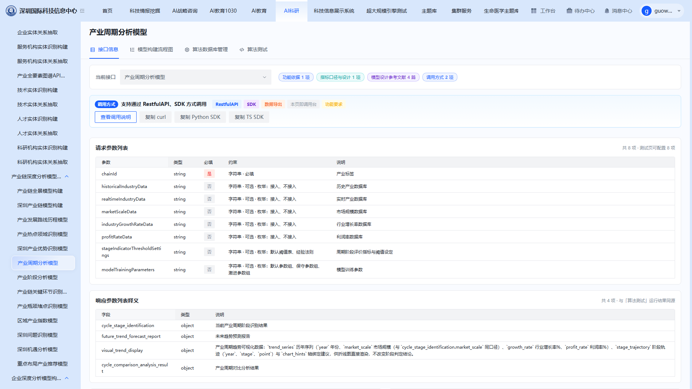

**操作指引**

按 3.1.3 节「通用界面结构与操作步骤」执行：
① 在接口信息页签核对本接口的请求参数与响应字段释义，确认参数含义与约束；
② 切换至「算法测试」页签，在参数与筛选区设置本模型对应的条件项，页面已预置一组可运行示例值，可在此基础上微调；
③ 点击「执行接口」，右侧运行结果区展示本次调用的执行状态、耗时、分步日志、指标卡与图表；
④ 读取统计指标卡与可视化图表，向下滚动查看明细表与分析结论；
⑤ 使用报告区右上角的导出／打印功能留存结果；如需接入业务系统，按接口信息页签的调用方式复制代码并替换参数即可集成。

**数据更新机制**

模型结果经计算、归纳与有效性验证后，通过 API 接口和数据同步机制服务化输出，支持按地域、领域、时间等条件灵活查询与下载。系统定期更新数据与指标并进行质量监测，确保指标的有效性与可靠性。

#### 3.6.7 产业阶段分析模型

**模型功能描述**

产业阶段分析模型算法旨在结合产业周期分析模型，依据产业关键指标值判断其所处的发展阶段，如成长期、成熟期或衰退期，为产业发展战略制定和资源配置提供量化参考。该算法通过设计具备区分度和代表性的指标体系，系统化采集并整合权威数据源，基于指标分析与周期模型映射计算产业阶段，并支持在线查询与服务化调用。

**算法输入与输出**

| 项目 | 内容 |
|---|---|
| 输入 | 生产能力数据、销售规模数据、市场份额数据、利润率数据、政策法规数据、行业统计信息、企业财报数据、指标权重参数。 |
| 输出 | 产业阶段判定结果（成长期、成熟期、衰退期）、阶段分析报告、趋势变化预测图表。 |
| 调用方式 | 支持通过Restful API、SDK及在线平台调用，可按产业标签查询当前阶段结果，并支持生成分析报告、趋势预测及数据导出服务。 |

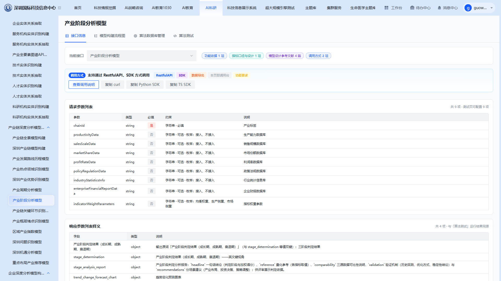

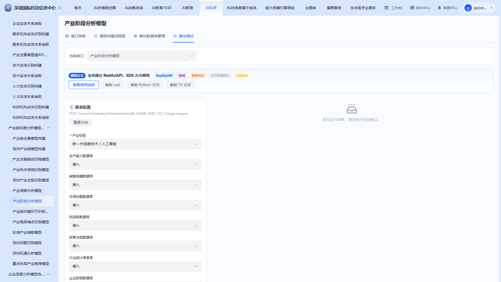

**操作指引**

按 3.1.3 节「通用界面结构与操作步骤」执行：
① 在接口信息页签核对本接口的请求参数与响应字段释义，确认参数含义与约束；
② 切换至「算法测试」页签，在参数与筛选区设置本模型对应的条件项，页面已预置一组可运行示例值，可在此基础上微调；
③ 点击「执行接口」，右侧运行结果区展示本次调用的执行状态、耗时、分步日志、指标卡与图表；
④ 读取统计指标卡与可视化图表，向下滚动查看明细表与分析结论；
⑤ 使用报告区右上角的导出／打印功能留存结果；如需接入业务系统，按接口信息页签的调用方式复制代码并替换参数即可集成。

**数据更新机制**

模型结果经计算、归纳与有效性验证后，通过 API 接口和数据同步机制服务化输出，支持按地域、领域、时间等条件灵活查询与下载。系统定期更新数据与指标并进行质量监测，确保指标的有效性与可靠性。

#### 3.6.8 产业链关键环节识别模型

**模型功能描述**

产业链关键环节识别模型算法旨在结合产业创新水平、企业规模和产业附加值等核心维度，对产业链结构进行量化分析，识别其中具有战略重要性和引领作用的关键环节。该算法通过系统采集产业相关数据，构建指标体系与阈值判定标准，经过模型训练与优化，计算各指标值并准确定位产业链的关键节点，为产业规划、政策制定及企业战略布局提供精确参考。

**算法输入与输出**

| 项目 | 内容 |
|---|---|
| 输入 | 企业财务报表数据、产业统计年鉴数据、政策法规数据、产业创新能力指标、企业规模指标、产业附加值指标、权重与阈值参数。 |
| 输出 | 产业链关键环节清单、战略重要性分析报告、可视化环节结构图、环节影响力评估结果。 |
| 调用方式 | 支持通过Restful API、SDK及可视化平台调用，可按产业标签或环节类型查询关键环节信息，并支持生成分析报告及数据导出服务。 |

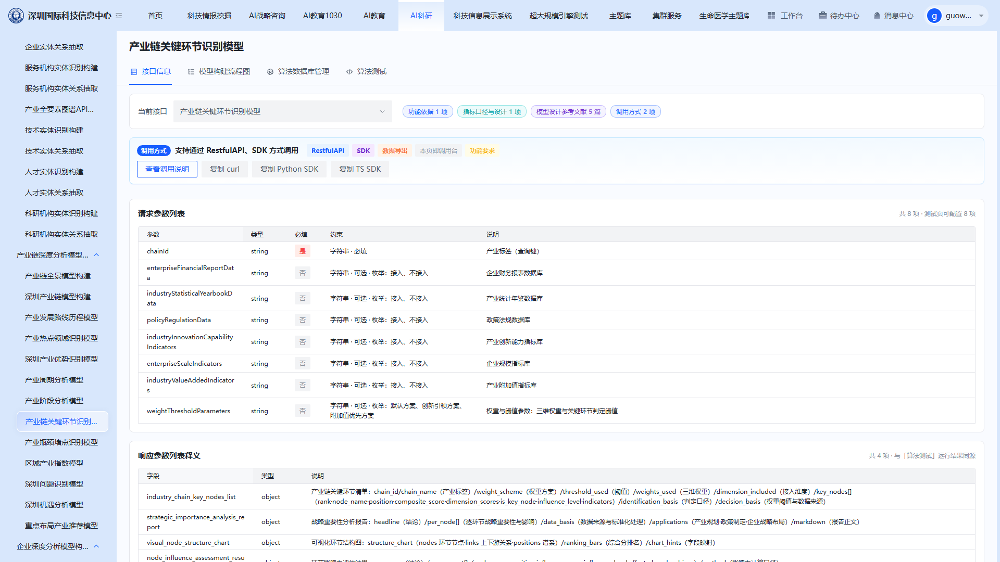

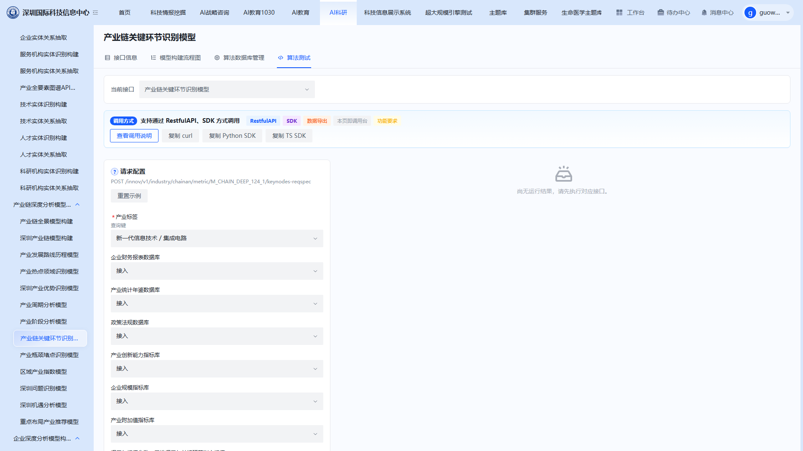

**操作指引**

按 3.1.3 节「通用界面结构与操作步骤」执行：
① 在接口信息页签核对本接口的请求参数与响应字段释义，确认参数含义与约束；
② 切换至「算法测试」页签，在参数与筛选区设置本模型对应的条件项，页面已预置一组可运行示例值，可在此基础上微调；
③ 点击「执行接口」，右侧运行结果区展示本次调用的执行状态、耗时、分步日志、指标卡与图表；
④ 读取统计指标卡与可视化图表，向下滚动查看明细表与分析结论；
⑤ 使用报告区右上角的导出／打印功能留存结果；如需接入业务系统，按接口信息页签的调用方式复制代码并替换参数即可集成。

**数据更新机制**

模型结果经计算、归纳与有效性验证后，通过 API 接口和数据同步机制服务化输出，支持按地域、领域、时间等条件灵活查询与下载。系统定期更新数据与指标并进行质量监测，确保指标的有效性与可靠性。

#### 3.6.9 产业瓶颈堵点识别模型

**模型功能描述**

产业瓶颈堵点识别模型算法面向区域与行业发展中的关键制约因素，基于技术、人才、市场需求、资金、政策五大维度构建指标体系与阈值判断机制，通过计算各维度指标值，自动提取并标识产业瓶颈堵点。该算法可为政府、研究机构和企业提供精准的产业诊断结论，支持制定针对性解决方案和发展策略，并提供服务化接口供用户随时查询最新瓶颈信息。

**算法输入与输出**

| 项目 | 内容 |
|---|---|
| 输入 | 政策法规数据、市场调研数据、专家访谈信息、行业分析数据、技术指标、人才指标、市场需求指标、资金指标、政策支持指标、权重与阈值设定。 |
| 输出 | 产业瓶颈堵点清单、瓶颈成因分析报告、影响范围评估、解决方案建议、趋势预警图表。 |
| 调用方式 | 支持通过Restful API、SDK方式调用，可按产业标签或领域类别查询最新瓶颈信息，并支持生成报告、趋势预警及数据导出服务。 |

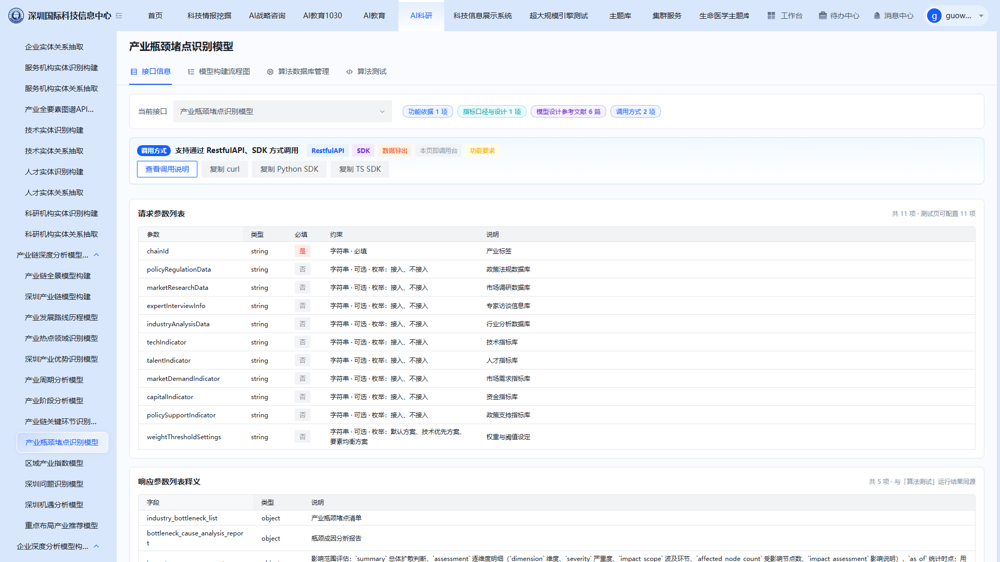

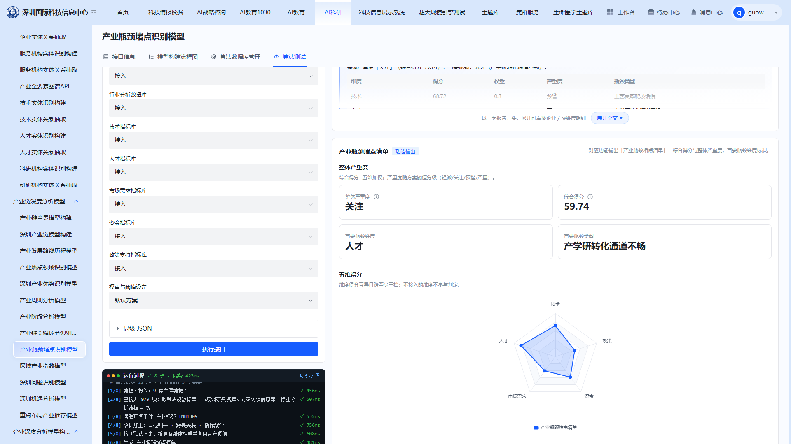

**操作指引**

按 3.1.3 节「通用界面结构与操作步骤」执行：
① 在接口信息页签核对本接口的请求参数与响应字段释义，确认参数含义与约束；
② 切换至「算法测试」页签，在参数与筛选区设置本模型对应的条件项，页面已预置一组可运行示例值，可在此基础上微调；
③ 点击「执行接口」，右侧运行结果区展示本次调用的执行状态、耗时、分步日志、指标卡与图表；
④ 读取统计指标卡与可视化图表，向下滚动查看明细表与分析结论；
⑤ 使用报告区右上角的导出／打印功能留存结果；如需接入业务系统，按接口信息页签的调用方式复制代码并替换参数即可集成。

**数据更新机制**

模型结果经计算、归纳与有效性验证后，通过 API 接口和数据同步机制服务化输出，支持按地域、领域、时间等条件灵活查询与下载。系统定期更新数据与指标并进行质量监测，确保指标的有效性与可靠性。

#### 3.6.10 区域产业指数模型

**模型功能描述**

区域产业指数模型算法用于量化评估特定区域产业的发展水平与竞争力，综合考虑企业能力竞争力、学术生态竞争力、配套生态竞争力三大核心维度，通过科学设计指标体系与阈值标准，计算区域产业指数，并为政策制定、行业研究和投资决策提供参考。该算法不仅反映当前产业生态的成熟度与潜力，还支持长期趋势分析与区域间对比。

**算法输入与输出**

| 项目 | 内容 |
|---|---|
| 输入 | 企业信息库数据、知识产权数据、高校与科研机构统计数据、人才数据、配套服务数据、指标体系与权重参数、历史产业数据。 |
| 输出 | 区域产业指数、趋势分析报告、优势与短板评估结果、区域对比分析图表。 |
| 调用方式 | 支持通过Restful API、SDK方式调用，可按区域标签进行产业指数查询，并支持生成趋势分析报告、优势短板评估及数据导出服务。 |

**操作指引**

按 3.1.3 节「通用界面结构与操作步骤」执行：
① 在接口信息页签核对本接口的请求参数与响应字段释义，确认参数含义与约束；
② 切换至「算法测试」页签，在参数与筛选区设置本模型对应的条件项，页面已预置一组可运行示例值，可在此基础上微调；
③ 点击「执行接口」，右侧运行结果区展示本次调用的执行状态、耗时、分步日志、指标卡与图表；
④ 读取统计指标卡与可视化图表，向下滚动查看明细表与分析结论；
⑤ 使用报告区右上角的导出／打印功能留存结果；如需接入业务系统，按接口信息页签的调用方式复制代码并替换参数即可集成。

**数据更新机制**

模型结果经计算、归纳与有效性验证后，通过 API 接口和数据同步机制服务化输出，支持按地域、领域、时间等条件灵活查询与下载。系统定期更新数据与指标并进行质量监测，确保指标的有效性与可靠性。

#### 3.6.11 深圳问题识别模型

**模型功能描述**

深圳问题识别模型算法旨在通过多领域数据对比分析，定位深圳产业在发展过程中的薄弱环节与突出问题。该算法综合对接深圳与全国各领域专题库，涵盖政策法规、新闻舆情、企业财务等多类数据，在全面掌握产业运行状况的基础上，设定代表性负面评价指标，并通过产业负面评价模型计算得出问题识别结果。结合深圳与全国的指标对比，算法可为政府管理部门、行业协会以及企业提供科学的决策参考，支持精准改进与政策优化。

**算法输入与输出**

| 项目 | 内容 |
|---|---|
| 输入 | 深圳产业数据、全国产业数据、政策法规数据、新闻舆情数据、企业财务数据、负面评价指标体系与权重参数。 |
| 输出 | 深圳产业问题识别结果、薄弱环节与风险清单、优先级排序报告、针对性解决方案建议、可视化分析图表。 |
| 调用方式 | 支持通过Restful API、SDK及数据分析平台调用，可按产业标签或领域类别查询问题识别结果，并支持生成分析报告、可视化展示及数据导出服务。 |

**操作指引**

按 3.1.3 节「通用界面结构与操作步骤」执行：
① 在接口信息页签核对本接口的请求参数与响应字段释义，确认参数含义与约束；
② 切换至「算法测试」页签，在参数与筛选区设置本模型对应的条件项，页面已预置一组可运行示例值，可在此基础上微调；
③ 点击「执行接口」，右侧运行结果区展示本次调用的执行状态、耗时、分步日志、指标卡与图表；
④ 读取统计指标卡与可视化图表，向下滚动查看明细表与分析结论；
⑤ 使用报告区右上角的导出／打印功能留存结果；如需接入业务系统，按接口信息页签的调用方式复制代码并替换参数即可集成。

**数据更新机制**

模型结果经计算、归纳与有效性验证后，通过 API 接口和数据同步机制服务化输出，支持按地域、领域、时间等条件灵活查询与下载。系统定期更新数据与指标并进行质量监测，确保指标的有效性与可靠性。

#### 3.6.12 深圳机遇分析模型

**模型功能描述**

深圳机遇分析模型算法基于对深圳市产业优势和发展问题的系统化分析，结合专家知识与策略配置，形成数据驱动与知识驱动相结合的机遇推荐机制。该算法通过采集、处理和分析多维度区域数据，识别核心优势产业与关键制约因素，并在专家策略指导下生成面向产业发展、政策优化和创新方向的推荐结果，为政府决策、产业布局调整和企业战略规划提供科学依据。

**算法输入与输出**

| 项目 | 内容 |
|---|---|
| 输入 | 年度经济统计数据、人口普查数据、重点产业分布数据、产业优势分析结果、发展问题识别结果、专家策略配置数据、机器学习模型参数。 |
| 输出 | 区域机遇推荐清单、产业发展建议报告、政策优化方案、创新方向分析图表。 |
| 调用方式 | 支持通过Restful API、SDK及分析报告平台调用，可按产业标签或区域领域获取机遇分析与推荐结果，并支持生成分析报告及数据导出服务。 |

**操作指引**

按 3.1.3 节「通用界面结构与操作步骤」执行：
① 在接口信息页签核对本接口的请求参数与响应字段释义，确认参数含义与约束；
② 切换至「算法测试」页签，在参数与筛选区设置本模型对应的条件项，页面已预置一组可运行示例值，可在此基础上微调；
③ 点击「执行接口」，右侧运行结果区展示本次调用的执行状态、耗时、分步日志、指标卡与图表；
④ 读取统计指标卡与可视化图表，向下滚动查看明细表与分析结论；
⑤ 使用报告区右上角的导出／打印功能留存结果；如需接入业务系统，按接口信息页签的调用方式复制代码并替换参数即可集成。

**数据更新机制**

模型结果经计算、归纳与有效性验证后，通过 API 接口和数据同步机制服务化输出，支持按地域、领域、时间等条件灵活查询与下载。系统定期更新数据与指标并进行质量监测，确保指标的有效性与可靠性。

#### 3.6.13 重点布局产业推荐模型

**模型功能描述**

重点布局产业推荐模型算法旨在基于深圳市产业优势分析与问题识别，结合专家知识制定策略，整合多源产业数据计算产业推荐指数，科学输出重点产业布局建议。该算法不仅能够反映区域产业发展的竞争优势与潜在短板，还能够支持政府、行业协会及企业在产业布局规划、政策制定和资源配置中的决策需求。

该算法对接深圳市多渠道产业数据源，采集并标准化处理产业基础信息、市场规模、发展趋势及政策环境等数据。

**算法输入与输出**

| 项目 | 内容 |
|---|---|
| 输入 | 深圳市产业基础信息数据、市场规模数据、发展趋势数据、政策环境数据、产业优势分析结果、产业问题识别结果、专家推荐策略参数（推荐标准、权重、评估规则）。 |
| 输出 | 产业推荐指数、重点布局产业排名清单、趋势分析图表、布局建议报告。 |
| 调用方式 | 支持通过Restful API、SDK及可视化展示平台调用，可按需求标签、区域或产业类别获取产业推荐结果，并支持生成趋势分析报告及数据导出服务。 |

**操作指引**

按 3.1.3 节「通用界面结构与操作步骤」执行：
① 在接口信息页签核对本接口的请求参数与响应字段释义，确认参数含义与约束；
② 切换至「算法测试」页签，在参数与筛选区设置本模型对应的条件项，页面已预置一组可运行示例值，可在此基础上微调；
③ 点击「执行接口」，右侧运行结果区展示本次调用的执行状态、耗时、分步日志、指标卡与图表；
④ 读取统计指标卡与可视化图表，向下滚动查看明细表与分析结论；
⑤ 使用报告区右上角的导出／打印功能留存结果；如需接入业务系统，按接口信息页签的调用方式复制代码并替换参数即可集成。

**数据更新机制**

模型结果经计算、归纳与有效性验证后，通过 API 接口和数据同步机制服务化输出，支持按地域、领域、时间等条件灵活查询与下载。系统定期更新数据与指标并进行质量监测，确保指标的有效性与可靠性。

### 3.7 企业深度分析模型构建

企业深度分析模型围绕创新主体分析这一核心主线，从宏观到微观、从存量到增量构建企业画像与评估体系：以企业竞争力水平为基础，叠加发展历程、痛难点识别、供应链关系、技术力与商业力双维度评估，最终输出招引与培育的综合推荐结果。模型数据来源覆盖企业工商、财务、论文、专利、技术交易、投融资与产业政策等多库联动，经实体对齐与关系融合后形成可计算的企业知识网络。

#### 3.7.1 深圳企业竞争力水平分析模型

**模型功能描述**

深圳企业竞争力水平分析模型算法基于企业基础指标模型库与企业专题库，通过设计覆盖企业规模、财务状况、人力资源及市场表现等方面的指标体系，系统化对比计算深圳企业与全国企业的指标值，从多维度综合分析深圳企业的竞争力水平。该算法不仅可识别深圳企业在不同维度的优势与短板，还能为政府、行业组织、投资机构及企业自身提供竞争力提升的决策依据。

**算法输入与输出**

| 项目 | 内容 |
|---|---|
| 输入 | 财务报表数据、税务数据、人力资源信息、市场表现数据、企业调查数据、企业规模与分类信息、分析指标体系与权重设置。 |
| 输出 | 综合竞争力指数、各分析维度的优势与短板分析报告、竞争力排名、趋势变化图表。 |
| 调用方式 | 支持通过Restful API、SDK方式调用，可按企业名称、行业或区域进行竞争力水平分析与趋势监测，并支持生成报告与数据导出。 |

**操作指引**

按 3.1.3 节「通用界面结构与操作步骤」执行：
① 在接口信息页签核对本接口的请求参数与响应字段释义，确认参数含义与约束；
② 切换至「算法测试」页签，在参数与筛选区设置本模型对应的条件项，页面已预置一组可运行示例值，可在此基础上微调；
③ 点击「执行接口」，右侧运行结果区展示本次调用的执行状态、耗时、分步日志、指标卡与图表；
④ 读取统计指标卡与可视化图表，向下滚动查看明细表与分析结论；
⑤ 使用报告区右上角的导出／打印功能留存结果；如需接入业务系统，按接口信息页签的调用方式复制代码并替换参数即可集成。

**数据更新机制**

模型结果经计算、归纳与有效性验证后，通过 API 接口和数据同步机制服务化输出，支持按地域、领域、时间等条件灵活查询与下载。系统定期更新数据与指标并进行质量监测，确保指标的有效性与可靠性。

#### 3.7.2 企业发展历程模型

**模型功能描述**

企业发展历程模型算法基于企业基础指标（如财务与经营数据）及资讯基础指标（如新闻报道、行业动态），系统化采集并分析企业在发展过程中的重大事件信息。通过定义重大事件指标并设定阈值，当指标超出该阈值时，即认定为重大事件。模型据此生成企业重大事件时间线，用于刻画企业演进路径并为决策分析提供依据。

**算法输入与输出**

| 项目 | 内容 |
|---|---|
| 输入 | 企业财务报表数据、经营数据、新闻与行业资讯数据、重大事件指标体系及阈值设定。 |
| 输出 | 企业重大事件列表、重大事件时间线、发展历程可视化视图、分析报告。 |
| 调用方式 | 支持通过Restful API、SDK方式调用，可按企业标识或名称查询企业发展历程，获取重大事件分析结果，并支持导出报告及可视化图表。 |

**操作指引**

按 3.1.3 节「通用界面结构与操作步骤」执行：
① 在接口信息页签核对本接口的请求参数与响应字段释义，确认参数含义与约束；
② 切换至「算法测试」页签，在参数与筛选区设置本模型对应的条件项，页面已预置一组可运行示例值，可在此基础上微调；
③ 点击「执行接口」，右侧运行结果区展示本次调用的执行状态、耗时、分步日志、指标卡与图表；
④ 读取统计指标卡与可视化图表，向下滚动查看明细表与分析结论；
⑤ 使用报告区右上角的导出／打印功能留存结果；如需接入业务系统，按接口信息页签的调用方式复制代码并替换参数即可集成。

**数据更新机制**

模型结果经计算、归纳与有效性验证后，通过 API 接口和数据同步机制服务化输出，支持按地域、领域、时间等条件灵活查询与下载。系统定期更新数据与指标并进行质量监测，确保指标的有效性与可靠性。

#### 3.7.3 企业发展痛难点识别模型

**模型功能描述**

企业发展痛难点识别模型算法旨在通过对企业经营及人力资源数据的深入分析，量化评估关键指标表现，识别制约企业发展的瓶颈与堵点。算法围绕经营竞争力、盈利能力、生产效率、人才状况等核心维度构建指标体系，并设定判断阈值，通过计算企业各项指标值，精准提取反映企业发展痛难点的要素，为企业管理优化、战略调整和持续改进提供科学依据。

**算法输入与输出**

| 项目 | 内容 |
|---|---|
| 输入 | 企业年报数据、财务报表数据、招聘信息、社保缴纳记录、核心指标体系及阈值设定。 |
| 输出 | 企业发展痛难点分析报告、瓶颈清单、优化建议方案。 |
| 调用方式 | 支持通过Restful API、SDK方式调用，可按企业标识或名称获取发展痛难点分析结果与优化建议，并支持导出报告及可视化数据。 |

**操作指引**

按 3.1.3 节「通用界面结构与操作步骤」执行：
① 在接口信息页签核对本接口的请求参数与响应字段释义，确认参数含义与约束；
② 切换至「算法测试」页签，在参数与筛选区设置本模型对应的条件项，页面已预置一组可运行示例值，可在此基础上微调；
③ 点击「执行接口」，右侧运行结果区展示本次调用的执行状态、耗时、分步日志、指标卡与图表；
④ 读取统计指标卡与可视化图表，向下滚动查看明细表与分析结论；
⑤ 使用报告区右上角的导出／打印功能留存结果；如需接入业务系统，按接口信息页签的调用方式复制代码并替换参数即可集成。

**数据更新机制**

模型结果经计算、归纳与有效性验证后，通过 API 接口和数据同步机制服务化输出，支持按地域、领域、时间等条件灵活查询与下载。系统定期更新数据与指标并进行质量监测，确保指标的有效性与可靠性。

#### 3.7.4 企业供应链关系分析模型

**模型功能描述**

企业供应链关系分析模型算法基于产业全要素图谱的企业关系数据与企业专题数据，面向供应链关系进行结构化建模与量化分析。该算法通过对企业间的供应链联系进行网络化构建与关键指标计算，揭示供应链的分布特征与结构特点，为企业竞争力评估、合作伙伴筛选及产业链优化提供数据支撑。

该算法通过对接产业全要素图谱、企业关系数据库及专题数据集，采集并标准化处理供应链核心信息。

**算法输入与输出**

| 项目 | 内容 |
|---|---|
| 输入 | 产业全要素图谱数据、企业关系数据库信息、企业专题数据集、供应链核心信息、图论算法参数设定。 |
| 输出 | 供应链网络结构图、供应链分布特征与结构指标计算结果、企业在供应链网络中的位置与重要性分析报告、地图或拓扑可视化展示。 |
| 调用方式 | 支持通过Restful API、SDK方式调用，可按企业标识或名称获取供应链关系分析数据，并支持导出报告及可视化图表。 |

**操作指引**

按 3.1.3 节「通用界面结构与操作步骤」执行：
① 在接口信息页签核对本接口的请求参数与响应字段释义，确认参数含义与约束；
② 切换至「算法测试」页签，在参数与筛选区设置本模型对应的条件项，页面已预置一组可运行示例值，可在此基础上微调；
③ 点击「执行接口」，右侧运行结果区展示本次调用的执行状态、耗时、分步日志、指标卡与图表；
④ 读取统计指标卡与可视化图表，向下滚动查看明细表与分析结论；
⑤ 使用报告区右上角的导出／打印功能留存结果；如需接入业务系统，按接口信息页签的调用方式复制代码并替换参数即可集成。

**数据更新机制**

模型结果经计算、归纳与有效性验证后，通过 API 接口和数据同步机制服务化输出，支持按地域、领域、时间等条件灵活查询与下载。系统定期更新数据与指标并进行质量监测，确保指标的有效性与可靠性。

#### 3.7.5 企业技术力评估模型

**模型功能描述**

企业技术力评估模型算法旨在对企业在技术能力方面的综合水平进行量化评估。算法围绕技术人才、技术创新、技术转化、技术合作、技术投入五个核心维度，设计对应的指标和阈值，并通过综合计算获取企业技术力指数。评估结果不仅能反映企业在各技术维度的优势与短板，还可为技术投入决策、合作拓展及创新能力提升提供数据支撑。

**算法输入与输出**

| 项目 | 内容 |
|---|---|
| 输入 | 企业专利数据库数据、科技项目库数据、研发投入数据、企业人才结构档案、技术合作关系数据、指标体系与权重参数。 |
| 输出 | 企业技术力指数、各维度技术力分析结果、优势与短板分析报告、趋势变化及改进建议。 |
| 调用方式 | 支持通过Restful API、SDK方式调用，可按企业标识或名称进行技术力评估，并支持生成可视化报告、对标分析及数据导出服务。 |

**操作指引**

按 3.1.3 节「通用界面结构与操作步骤」执行：
① 在接口信息页签核对本接口的请求参数与响应字段释义，确认参数含义与约束；
② 切换至「算法测试」页签，在参数与筛选区设置本模型对应的条件项，页面已预置一组可运行示例值，可在此基础上微调；
③ 点击「执行接口」，右侧运行结果区展示本次调用的执行状态、耗时、分步日志、指标卡与图表；
④ 读取统计指标卡与可视化图表，向下滚动查看明细表与分析结论；
⑤ 使用报告区右上角的导出／打印功能留存结果；如需接入业务系统，按接口信息页签的调用方式复制代码并替换参数即可集成。

**数据更新机制**

模型结果经计算、归纳与有效性验证后，通过 API 接口和数据同步机制服务化输出，支持按地域、领域、时间等条件灵活查询与下载。系统定期更新数据与指标并进行质量监测，确保指标的有效性与可靠性。

#### 3.7.6 企业商业力评估模型

**模型功能描述**

企业商业力评估模型算法旨在多维度量化分析企业的市场竞争能力与产业协作水平。该算法基于市场指标、产品指标、品牌指标、技术合作指标、产业链覆盖率及产业关键环节参与度六大维度构建指标体系，并设定对应阈值，通过计算企业各项指标值，生成反映综合竞争力的企业商业力指数，为企业战略规划、投资决策及行业对比分析提供科学依据。

**算法输入与输出**

| 项目 | 内容 |
|---|---|
| 输入 | 企业财务数据、行业研究数据、市场调研数据、产品指标数据、品牌影响力数据、技术合作及产业链布局信息、评价指标体系与权重参数。 |
| 输出 | 企业商业力指数、分维度分析报告、趋势变化图表、行业对比分析结果。 |
| 调用方式 | 支持通过Restful API、SDK方式调用，可按企业名称或标识进行商业力评估，并支持生成报告、对比分析及数据导出服务。 |

**操作指引**

按 3.1.3 节「通用界面结构与操作步骤」执行：
① 在接口信息页签核对本接口的请求参数与响应字段释义，确认参数含义与约束；
② 切换至「算法测试」页签，在参数与筛选区设置本模型对应的条件项，页面已预置一组可运行示例值，可在此基础上微调；
③ 点击「执行接口」，右侧运行结果区展示本次调用的执行状态、耗时、分步日志、指标卡与图表；
④ 读取统计指标卡与可视化图表，向下滚动查看明细表与分析结论；
⑤ 使用报告区右上角的导出／打印功能留存结果；如需接入业务系统，按接口信息页签的调用方式复制代码并替换参数即可集成。

**数据更新机制**

模型结果经计算、归纳与有效性验证后，通过 API 接口和数据同步机制服务化输出，支持按地域、领域、时间等条件灵活查询与下载。系统定期更新数据与指标并进行质量监测，确保指标的有效性与可靠性。

#### 3.7.7 招引企业综合推荐模型

**模型功能描述**

招引企业综合推荐模型算法旨在为深圳打造科学的招商引资评估和企业招引优选机制。算法基于产业相关度、政策匹配度、深圳连接度三个核心维度构建指标体系与阈值判断，并通过综合计算形成招引企业推荐指数，用于衡量企业与深圳产业发展、政策导向及经济联系的契合程度。该算法为政府招商部门、园区运营方及投资机构提供精准的企业优选依据，提升招商引资决策的科学性与执行效率。

**算法输入与输出**

| 项目 | 内容 |
|---|---|
| 输入 | 企业信用信息数据、行业协会数据、专利与知识产权数据、财务数据、业务领域信息、产业相关度及政策匹配度参数、深圳连接度参数。 |
| 输出 | 企业招引推荐指数、优选企业清单、企业行业领域排名、数据分析报告。 |
| 调用方式 | 支持通过Restful API、SDK及在线展示平台调用，可按企业标签、行业领域或地域来源进行招引推荐查询，并支持生成分析报告及数据导出服务。 |

**操作指引**

按 3.1.3 节「通用界面结构与操作步骤」执行：
① 在接口信息页签核对本接口的请求参数与响应字段释义，确认参数含义与约束；
② 切换至「算法测试」页签，在参数与筛选区设置本模型对应的条件项，页面已预置一组可运行示例值，可在此基础上微调；
③ 点击「执行接口」，右侧运行结果区展示本次调用的执行状态、耗时、分步日志、指标卡与图表；
④ 读取统计指标卡与可视化图表，向下滚动查看明细表与分析结论；
⑤ 使用报告区右上角的导出／打印功能留存结果；如需接入业务系统，按接口信息页签的调用方式复制代码并替换参数即可集成。

**数据更新机制**

模型结果经计算、归纳与有效性验证后，通过 API 接口和数据同步机制服务化输出，支持按地域、领域、时间等条件灵活查询与下载。系统定期更新数据与指标并进行质量监测，确保指标的有效性与可靠性。

#### 3.7.8 培育企业综合推荐模型

**模型功能描述**

培育企业综合推荐模型用于识别并优选具有高培育价值的企业，通过产业相关度、政策匹配度、企业潜力三大维度构建评价体系，结合设定的阈值进行综合计算，生成企业培育推荐指数。该模型可为政府部门、园区管理机构、行业协会及投资平台提供科学、高效的企业筛选和资源配置依据，助力精准培育潜力企业、优化产业结构。

模型通过对接企业、政策及市场等多源数据，采集并标准化处理企业基本信息、政策解析、市场调研及行业动态，基于产业相关度、政策匹配度和企业潜力三类指标构建评价体系并设定阈值，结合模型训练与加权计算生成量化的培育推荐指数用于评估与排名；模型具备动态监测与更新能力，并通过平台或API提供按产业、政策和规模等条件的企业推荐及详细分析，支持政策制定、投资决策与合作匹配等应用。

培育企业综合推荐模型算法用于识别并优选具有高培育价值的企业。该算法基于产业相关度、政策匹配度、企业潜力三个核心维度构建评价体系，结合设定的阈值进行综合计算，生成企业培育推荐指数。评估结果可为政府部门、园区管理机构、行业协会及投资平台提供科学、高效的企业筛选和资源配置依据，助力精准培育潜力企业、优化产业结构。

**算法输入与输出**

| 项目 | 内容 |
|---|---|
| 输入 | 企业基本信息数据、政策数据、市场调研数据、行业动态数据、产业相关度参数、政策匹配度参数、企业潜力评价指标及权重。 |
| 输出 | 企业培育推荐指数、优选企业排名、详细分析报告、可视化行业分布图。 |
| 调用方式 | 支持通过Restful API、SDK及在线平台调用，可按产业类别、政策导向、企业规模等条件筛选与分析潜力企业，并支持生成分析报告及数据导出服务。 |

**操作指引**

按 3.1.3 节「通用界面结构与操作步骤」执行：
① 在接口信息页签核对本接口的请求参数与响应字段释义，确认参数含义与约束；
② 切换至「算法测试」页签，在参数与筛选区设置本模型对应的条件项，页面已预置一组可运行示例值，可在此基础上微调；
③ 点击「执行接口」，右侧运行结果区展示本次调用的执行状态、耗时、分步日志、指标卡与图表；
④ 读取统计指标卡与可视化图表，向下滚动查看明细表与分析结论；
⑤ 使用报告区右上角的导出／打印功能留存结果；如需接入业务系统，按接口信息页签的调用方式复制代码并替换参数即可集成。

**数据更新机制**

模型结果经计算、归纳与有效性验证后，通过 API 接口和数据同步机制服务化输出，支持按地域、领域、时间等条件灵活查询与下载。系统定期更新数据与指标并进行质量监测，确保指标的有效性与可靠性。

### 3.8 政策深度分析模型构建

政策深度分析模型构建政策效能评估与政策布局建议的智能框架：先识别政策焦点与关键词，再评估政策力度与实施效果，继而发现政策短板与机遇，最终给出针对性的布局推荐。模型融合政策文本、实施细则、解读文件与企业感知数据，通过语义理解、条款拆解、指标提取与效果仿真等算法链路，支撑政策制定者从"知策"到"评策"再到"优策"的全过程决策。

#### 3.8.1 政策焦点识别模型

**模型功能描述**

政策焦点识别模型旨在对政策文本及相关执行数据进行系统分析，量化政策作用特征，识别政策中的关键焦点与潜在堵点，从而为政策制定、改进及执行优化提供数据支撑。模型通过设计涵盖制定背景、目标、适用范围、措施执行情况等维度的指标体系，并设定评估阈值，计算政策对应指标值后提取焦点与堵点信息，形成可用于决策参考的结构化结果。

**算法输入与输出**

| 项目 | 内容 |
|---|---|
| 输入 | 政策文本信息、政策执行数据、辅助数据。 |
| 输出 | 政策焦点列表、政策堵点清单、政策优化建议。 |
| 调用方式 | 模型支持通过标准化Restful API及SDK接口调用，并提供基于政策标签的在线检索及分析功能。 |

**操作指引**

按 3.1.3 节「通用界面结构与操作步骤」执行：
① 在接口信息页签核对本接口的请求参数与响应字段释义，确认参数含义与约束；
② 切换至「算法测试」页签，在参数与筛选区设置本模型对应的条件项，页面已预置一组可运行示例值，可在此基础上微调；
③ 点击「执行接口」，右侧运行结果区展示本次调用的执行状态、耗时、分步日志、指标卡与图表；
④ 读取统计指标卡与可视化图表，向下滚动查看明细表与分析结论；
⑤ 使用报告区右上角的导出／打印功能留存结果；如需接入业务系统，按接口信息页签的调用方式复制代码并替换参数即可集成。

**数据更新机制**

模型结果经计算、归纳与有效性验证后，通过 API 接口和数据同步机制服务化输出，支持按地域、领域、时间等条件灵活查询与下载。系统定期更新数据与指标并进行质量监测，确保指标的有效性与可靠性。

#### 3.8.2 政策力度评估模型

**模型功能描述**

政策力度评估模型用于量化分析不同政策在效果、覆盖范围及成本等方面的综合强度，帮助政府部门、研究机构及行业用户科学评估政策的实施力度与影响力。模型通过设计指标体系与阈值标准，对政策相关数据进行结构化分析和计算，形成政策力度指数，并支持多种查询与分析服务，涵盖趋势跟踪与排行榜输出。

政策力度评估模型旨在对政策的实施效果、覆盖范围及资源投入进行综合量化，生成可对比的政策力度指数，为政策制定部门、研究机构及行业用户提供科学决策参考。

**算法输入与输出**

| 项目 | 内容 |
|---|---|
| 输入 | 政策文本信息、政策执行数据、成本与资源数据、辅助数据。 |
| 输出 | 政策力度指数、力度维度分析报告、政策力度排行榜、趋势变化图及预测分析结果。 |
| 调用方式 | 模型支持通过标准化Restful API及SDK方式调用，可根据政策 ID、政策类别或时间区间进行力度指数计算与查询。输出支持图表化和结构化数据格式，便于嵌入政府信息系统、行业分析平台或研究工具，实现对比分析和历史回溯功能。 |

**操作指引**

按 3.1.3 节「通用界面结构与操作步骤」执行：
① 在接口信息页签核对本接口的请求参数与响应字段释义，确认参数含义与约束；
② 切换至「算法测试」页签，在参数与筛选区设置本模型对应的条件项，页面已预置一组可运行示例值，可在此基础上微调；
③ 点击「执行接口」，右侧运行结果区展示本次调用的执行状态、耗时、分步日志、指标卡与图表；
④ 读取统计指标卡与可视化图表，向下滚动查看明细表与分析结论；
⑤ 使用报告区右上角的导出／打印功能留存结果；如需接入业务系统，按接口信息页签的调用方式复制代码并替换参数即可集成。

**数据更新机制**

模型结果经计算、归纳与有效性验证后，通过 API 接口和数据同步机制服务化输出，支持按地域、领域、时间等条件灵活查询与下载。系统定期更新数据与指标并进行质量监测，确保指标的有效性与可靠性。

#### 3.8.3 政策效果评估模型

**模型功能描述**

政策效果评估模型旨在量化分析政策执行效果与影响水平，通过建立科学的指标体系和阈值标准，对政策在执行效果、社会经济效应及环境影响等方面进行综合评估，并提取政策效果评估指数作为核心量化结果，为政策改进、绩效评价及决策优化提供数据支撑。

政策效果评估模型旨在以数据驱动方式全面衡量政策在执行过程中的实际成效与综合影响，并通过量化分析生成“政策效果评估指数”，为政策改进、绩效考核及决策优化提供精准参考。

**算法输入与输出**

| 项目 | 内容 |
|---|---|
| 输入 | 政策原文及相关实施文件、政策执行过程数据、宏观经济数据、社会发展指标、环境影响数据。 |
| 输出 | 政策效果评估指数、分维度评估结果、政策改进建议与绩效优化报告 |
| 调用方式 | 模型支持通过标准化 Restful API 和 SDK 接口调用，用户可按政策标签、时间区间、执行阶段等条件进行在线查询与分析，并获取实时或历史的政策效果评估指数及详细分析报告。 |

**操作指引**

按 3.1.3 节「通用界面结构与操作步骤」执行：
① 在接口信息页签核对本接口的请求参数与响应字段释义，确认参数含义与约束；
② 切换至「算法测试」页签，在参数与筛选区设置本模型对应的条件项，页面已预置一组可运行示例值，可在此基础上微调；
③ 点击「执行接口」，右侧运行结果区展示本次调用的执行状态、耗时、分步日志、指标卡与图表；
④ 读取统计指标卡与可视化图表，向下滚动查看明细表与分析结论；
⑤ 使用报告区右上角的导出／打印功能留存结果；如需接入业务系统，按接口信息页签的调用方式复制代码并替换参数即可集成。

**数据更新机制**

模型结果经计算、归纳与有效性验证后，通过 API 接口和数据同步机制服务化输出，支持按地域、领域、时间等条件灵活查询与下载。系统定期更新数据与指标并进行质量监测，确保指标的有效性与可靠性。

#### 3.8.4 政策短板识别模型

**模型功能描述**

政策短板识别模型旨在通过对政策文本、解读及执行情况的系统分析，量化评估政策的覆盖性与有效性，识别其中存在的不足，为政策改进与优化提供科学依据。模型基于指标体系与阈值标准，计算政策在各维度的评估值，自动提取短板内容，并结合原因分析，为相关部门制定改进策略提供数据支撑。

政策短板识别模型旨在通过多源数据分析与量化评估，精准定位政策在覆盖性、执行效果及合规性等方面的不足，从而为政策优化制定提供科学依据。

**算法输入与输出**

| 项目 | 内容 |
|---|---|
| 输入 | 政策文本、执行数据、辅助分析数据。 |
| 输出 | 政策短板清单、短板成因分析、改进策略建议。 |
| 调用方式 | 调用时可按政策标签、时间区间及分析维度检索短板信息，获取结构化的评估结果与改进建议，实现在线监测、趋势分析及优化策略的即时推送。 |

**操作指引**

按 3.1.3 节「通用界面结构与操作步骤」执行：
① 在接口信息页签核对本接口的请求参数与响应字段释义，确认参数含义与约束；
② 切换至「算法测试」页签，在参数与筛选区设置本模型对应的条件项，页面已预置一组可运行示例值，可在此基础上微调；
③ 点击「执行接口」，右侧运行结果区展示本次调用的执行状态、耗时、分步日志、指标卡与图表；
④ 读取统计指标卡与可视化图表，向下滚动查看明细表与分析结论；
⑤ 使用报告区右上角的导出／打印功能留存结果；如需接入业务系统，按接口信息页签的调用方式复制代码并替换参数即可集成。

**数据更新机制**

模型结果经计算、归纳与有效性验证后，通过 API 接口和数据同步机制服务化输出，支持按地域、领域、时间等条件灵活查询与下载。系统定期更新数据与指标并进行质量监测，确保指标的有效性与可靠性。

#### 3.8.5 政策机遇识别模型

**模型功能描述**

政策机遇识别模型旨在从海量政策数据中自动识别具有机遇属性的政策，建立基于关注度、影响力、稳定性等维度的评价指标体系及阈值判断标准，通过计算政策对应指标值，精准提取潜在政策机遇。模型对接多源政策数据，包括政策文件、解读材料及分析报告，结合智能分析与可视化展示，帮助政府、企业及研究机构及时洞察政策利好，为战略规划和业务发展提供支撑。

**算法输入与输出**

| 项目 | 内容 |
|---|---|
| 输入 | 政策文本信息、政策解读与行业分析数据、历史政策指标数据。 |
| 输出 | 政策机遇清单、政策机遇趋势分析报告、可视化结果、策略建议。 |
| 调用方式 | 支持通过标准化 Restful API 和 SDK 接口调用，可按政策标签、时间区间及分析维度进行查询，返回结构化机遇数据及可视化图表。 |

**操作指引**

按 3.1.3 节「通用界面结构与操作步骤」执行：
① 在接口信息页签核对本接口的请求参数与响应字段释义，确认参数含义与约束；
② 切换至「算法测试」页签，在参数与筛选区设置本模型对应的条件项，页面已预置一组可运行示例值，可在此基础上微调；
③ 点击「执行接口」，右侧运行结果区展示本次调用的执行状态、耗时、分步日志、指标卡与图表；
④ 读取统计指标卡与可视化图表，向下滚动查看明细表与分析结论；
⑤ 使用报告区右上角的导出／打印功能留存结果；如需接入业务系统，按接口信息页签的调用方式复制代码并替换参数即可集成。

**数据更新机制**

模型结果经计算、归纳与有效性验证后，通过 API 接口和数据同步机制服务化输出，支持按地域、领域、时间等条件灵活查询与下载。系统定期更新数据与指标并进行质量监测，确保指标的有效性与可靠性。

#### 3.8.6 政策布局推荐模型

**模型功能描述**

政策布局推荐模型通过整合政策机遇识别模型与政策短板识别模型的分析结果，结合政策领域专家知识设置的策略方案，并关联政策数据库，实现针对性政策布局推荐。该模型旨在帮助政策制定者在区域或产业发展规划中精准定位可利用的政策机遇和待改进的政策短板，优化政策体系布局，提高政策决策的科学性与执行效果。

**算法输入与输出**

| 项目 | 内容 |
|---|---|
| 输入 | 政策机遇识别结果、政策短板识别结果、政策数据库数据。 |
| 输出 | 政策布局建议、执行效果预测、优化策略建议。 |
| 调用方式 | 模型支持通过 Restful API 与 SDK 接口调用，允许用户在指定区域、产业或政策主题的条件下进行布局推荐分析。调用参数可包含机遇与短板分析结果的权重设定、数据库筛选条件及策略适用范围。 |

**操作指引**

按 3.1.3 节「通用界面结构与操作步骤」执行：
① 在接口信息页签核对本接口的请求参数与响应字段释义，确认参数含义与约束；
② 切换至「算法测试」页签，在参数与筛选区设置本模型对应的条件项，页面已预置一组可运行示例值，可在此基础上微调；
③ 点击「执行接口」，右侧运行结果区展示本次调用的执行状态、耗时、分步日志、指标卡与图表；
④ 读取统计指标卡与可视化图表，向下滚动查看明细表与分析结论；
⑤ 使用报告区右上角的导出／打印功能留存结果；如需接入业务系统，按接口信息页签的调用方式复制代码并替换参数即可集成。

**数据更新机制**

模型结果经计算、归纳与有效性验证后，通过 API 接口和数据同步机制服务化输出，支持按地域、领域、时间等条件灵活查询与下载。系统定期更新数据与指标并进行质量监测，确保指标的有效性与可靠性。

### 3.9 产业服务深度分析模型构建

产业服务深度分析模型聚焦科技服务生态的短板诊断与能力评价：先绘制服务关系链、识别服务链短板，再对金融、知识产权、人力资源、市场营销、咨询与科技创新六类服务机构分别开展技术力评价，最终输出引入与培育推荐结果。模型数据来源覆盖工商登记、资质认定、行业年报、技术交易与服务记录等，支持按深圳与全国两个空间尺度的对比分析。

#### 3.9.1 服务链短板分析模型

**模型功能描述**

服务链短板分析模型旨在识别服务链中影响整体效能的薄弱环节，为提升服务质量和优化服务机构运营提供科学依据。模型通过对服务机构相关数据进行采集与处理，设计涵盖服务质量、经营效益、服务类型等维度的指标体系，并基于历史数据与专业经验设定阈值，对各指标进行计算和综合分析，从而明确服务链短板所处的具体环节及形成原因。该分析结果不仅可辅助管理者制定改进策略，还可通过服务化接口实现短板监测与动态优化。

**算法输入与输出**

| 项目 | 内容 |
|---|---|
| 输入 | 服务机构基础信息、服务质量数据、经营效益数据、服务类型数据、历史指标数据及行业对标信息。 |
| 输出 | 短板环节定位结果、短板成因分析、短板优化建议。 |
| 调用方式 | 该模型支持通过RestfulAPI和SDK调用，用户可在调用时指定服务机构标签、指标分析维度及时间区间，快速获取短板定位结果及分析报告。 |

**操作指引**

按 3.1.3 节「通用界面结构与操作步骤」执行：
① 在接口信息页签核对本接口的请求参数与响应字段释义，确认参数含义与约束；
② 切换至「算法测试」页签，在参数与筛选区设置本模型对应的条件项，页面已预置一组可运行示例值，可在此基础上微调；
③ 点击「执行接口」，右侧运行结果区展示本次调用的执行状态、耗时、分步日志、指标卡与图表；
④ 读取统计指标卡与可视化图表，向下滚动查看明细表与分析结论；
⑤ 使用报告区右上角的导出／打印功能留存结果；如需接入业务系统，按接口信息页签的调用方式复制代码并替换参数即可集成。

**数据更新机制**

模型结果经计算、归纳与有效性验证后，通过 API 接口和数据同步机制服务化输出，支持按地域、领域、时间等条件灵活查询与下载。系统定期更新数据与指标并进行质量监测，确保指标的有效性与可靠性。

#### 3.9.2 服务关系链模型

**模型功能描述**

服务关系链模型基于产业全要素图谱的服务机构关系数据，结合服务机构专题库，对服务机构之间的合作、交易及信用评价等关系链进行建模与分析。模型通过定义关系强度、关系层次、关系密度等指标，对服务关系链的分布特征与结构模式进行量化计算与可视化呈现，从而揭示服务机构间网络的稳定性、合作紧密度以及潜在风险，为行业监管、业务优化与合作决策提供数据支撑。

**算法输入与输出**

| 项目 | 内容 |
|---|---|
| 输入 | 服务机构专题数据、关系数据、辅助信息。 |
| 输出 | 服务关系链结构分析报告、网络可视化图、行业合作优化建议与关键机构匹配方案。 |
| 调用方式 | 支持通过RestfulAPI及SDK方式调用。 |

**操作指引**

按 3.1.3 节「通用界面结构与操作步骤」执行：
① 在接口信息页签核对本接口的请求参数与响应字段释义，确认参数含义与约束；
② 切换至「算法测试」页签，在参数与筛选区设置本模型对应的条件项，页面已预置一组可运行示例值，可在此基础上微调；
③ 点击「执行接口」，右侧运行结果区展示本次调用的执行状态、耗时、分步日志、指标卡与图表；
④ 读取统计指标卡与可视化图表，向下滚动查看明细表与分析结论；
⑤ 使用报告区右上角的导出／打印功能留存结果；如需接入业务系统，按接口信息页签的调用方式复制代码并替换参数即可集成。

**数据更新机制**

模型结果经计算、归纳与有效性验证后，通过 API 接口和数据同步机制服务化输出，支持按地域、领域、时间等条件灵活查询与下载。系统定期更新数据与指标并进行质量监测，确保指标的有效性与可靠性。

#### 3.9.3 金融服务机构技术力评价模型

**模型功能描述**

金融服务机构技术力评估模型旨在多维度衡量机构在资金运用与服务能力方面的综合水平。模型围绕资金规模、融资成本、资金风险、服务质量四个核心维度设计评价指标与阈值，通过计算各指标值并进行综合加权，生成反映机构技术水平与绩效表现的技术力指数。该模型可为监管部门、投资主体及企业用户提供量化、客观的评估结果，用于机构筛选、战略决策与绩效比较。

**算法输入与输出**

| 项目 | 内容 |
|---|---|
| 输入 | 财务数据、融资数据、风险数据、服务数据。 |
| 输出 | 技术力指数、各维度单项分值、机构能力优势与不足分析、跨机构比较与历年趋势分析报告。 |
| 调用方式 | 模型支持通过RestfulAPI与SDK接口调用，可按机构名称、标签或时间周期进行检索并返回实时技术力指数与各维度详细结果。 |

**操作指引**

按 3.1.3 节「通用界面结构与操作步骤」执行：
① 在接口信息页签核对本接口的请求参数与响应字段释义，确认参数含义与约束；
② 切换至「算法测试」页签，在参数与筛选区设置本模型对应的条件项，页面已预置一组可运行示例值，可在此基础上微调；
③ 点击「执行接口」，右侧运行结果区展示本次调用的执行状态、耗时、分步日志、指标卡与图表；
④ 读取统计指标卡与可视化图表，向下滚动查看明细表与分析结论；
⑤ 使用报告区右上角的导出／打印功能留存结果；如需接入业务系统，按接口信息页签的调用方式复制代码并替换参数即可集成。

**数据更新机制**

模型结果经计算、归纳与有效性验证后，通过 API 接口和数据同步机制服务化输出，支持按地域、领域、时间等条件灵活查询与下载。系统定期更新数据与指标并进行质量监测，确保指标的有效性与可靠性。

#### 3.9.4 知识产权服务机构技术力评价模型

**模型功能描述**

知识产权服务机构技术力评估模型旨在对机构的综合技术实力进行量化评价，面向政府部门、企业及投资方提供科学参考。模型从专业能力、业务范围、成功案例数、合作伙伴四个核心维度设计指标与阈值，通过计算各指标值并综合加权，生成反映机构实际技术能力的技术力指数，用于机构选择与服务水平评估。

知识产权服务机构技术力评估模型旨在通过多维度量化分析，衡量机构在知识产权相关业务领域的综合技术实力，并为政府部门、企业及投资机构提供客观、可比的技术力指数。

**算法输入与输出**

| 项目 | 内容 |
|---|---|
| 输入 | 专业能力数据、业务范围数据、成功案例数。 |
| 输出 | 单项指标得分、技术力指数、横向比较报告、动态趋势报告、评估建议。 |
| 调用方式 |  |

**操作指引**

按 3.1.3 节「通用界面结构与操作步骤」执行：
① 在接口信息页签核对本接口的请求参数与响应字段释义，确认参数含义与约束；
② 切换至「算法测试」页签，在参数与筛选区设置本模型对应的条件项，页面已预置一组可运行示例值，可在此基础上微调；
③ 点击「执行接口」，右侧运行结果区展示本次调用的执行状态、耗时、分步日志、指标卡与图表；
④ 读取统计指标卡与可视化图表，向下滚动查看明细表与分析结论；
⑤ 使用报告区右上角的导出／打印功能留存结果；如需接入业务系统，按接口信息页签的调用方式复制代码并替换参数即可集成。

**数据更新机制**

模型结果经计算、归纳与有效性验证后，通过 API 接口和数据同步机制服务化输出，支持按地域、领域、时间等条件灵活查询与下载。系统定期更新数据与指标并进行质量监测，确保指标的有效性与可靠性。

#### 3.9.5 人力资源服务机构技术力评价模型

**模型功能描述**

人力资源服务机构技术力评估模型用于量化评价机构的技术能力水平，通过对人才资源、服务标准化及客户满意度等核心维度设计指标与阈值，计算对应指标值并综合生成技术力指数。该指数可反映机构在人才供给、服务质量和客户体验等方面的综合表现，为企业决策、行业监管和服务优化提供数据支撑。

人力资源服务机构技术力评估模型用于对机构在技术能力层面的综合水平进行量化评价，通过建立涵盖人才资源、服务标准化程度和客户满意度的多维指标体系，并设定相应阈值，计算各指标的数值，综合形成技术力指数。

**算法输入与输出**

| 项目 | 内容 |
|---|---|
| 输入 | 人才资源相关数据、客户反馈数据。 |
| 输出 | 技术力指数、指标分项得分及与阈值的对比结果、技术力排名及横向比较分析、趋势分析报告。 |
| 调用方式 | 支持通过标准化RestfulAPI和SDK接口调用，并可在可视化分析平台上进行机构维度或时间维度的查询与比较。 |

**操作指引**

按 3.1.3 节「通用界面结构与操作步骤」执行：
① 在接口信息页签核对本接口的请求参数与响应字段释义，确认参数含义与约束；
② 切换至「算法测试」页签，在参数与筛选区设置本模型对应的条件项，页面已预置一组可运行示例值，可在此基础上微调；
③ 点击「执行接口」，右侧运行结果区展示本次调用的执行状态、耗时、分步日志、指标卡与图表；
④ 读取统计指标卡与可视化图表，向下滚动查看明细表与分析结论；
⑤ 使用报告区右上角的导出／打印功能留存结果；如需接入业务系统，按接口信息页签的调用方式复制代码并替换参数即可集成。

**数据更新机制**

模型结果经计算、归纳与有效性验证后，通过 API 接口和数据同步机制服务化输出，支持按地域、领域、时间等条件灵活查询与下载。系统定期更新数据与指标并进行质量监测，确保指标的有效性与可靠性。

#### 3.9.6 市场营销服务机构技术力评价模型

**模型功能描述**

市场营销服务机构技术力评估模型旨在量化衡量机构在调研、策划及成功项目执行等方面的综合技术实力。模型通过对接包括机构官网、行业报告、市场研究数据等在内的多源信息库，围绕调研能力、策划能力、成功项目案例数目三项核心指标进行设计，并基于设定阈值与加权计算，生成市场营销服务机构技术力指数，用于技术力水平评估和比较分析，为企业选择合作机构或进行竞争力研究提供依据。

**算法输入与输出**

| 项目 | 内容 |
|---|---|
| 输入 | 调研能力相关数据、策划能力相关数据、成功项目案例数据、行业基准与历史数据。 |
| 输出 | 市场营销服务机构技术力指数、各维度得分明细及权重分布、技术力水平分类、趋势分析报告。 |
| 调用方式 | 该评估模型支持通过RestfulAPI和SDK的方式调用，可按机构名称、行业标签、地域范围等条件进行技术力指数计算与查询。 |

**操作指引**

按 3.1.3 节「通用界面结构与操作步骤」执行：
① 在接口信息页签核对本接口的请求参数与响应字段释义，确认参数含义与约束；
② 切换至「算法测试」页签，在参数与筛选区设置本模型对应的条件项，页面已预置一组可运行示例值，可在此基础上微调；
③ 点击「执行接口」，右侧运行结果区展示本次调用的执行状态、耗时、分步日志、指标卡与图表；
④ 读取统计指标卡与可视化图表，向下滚动查看明细表与分析结论；
⑤ 使用报告区右上角的导出／打印功能留存结果；如需接入业务系统，按接口信息页签的调用方式复制代码并替换参数即可集成。

**数据更新机制**

模型结果经计算、归纳与有效性验证后，通过 API 接口和数据同步机制服务化输出，支持按地域、领域、时间等条件灵活查询与下载。系统定期更新数据与指标并进行质量监测，确保指标的有效性与可靠性。

#### 3.9.7 咨询服务机构技术力评价模型

**模型功能描述**

咨询服务机构技术力评估模型旨在量化评判咨询服务机构的整体技术实力水平，为业务合作选择、市场竞争分析及机构内部发展规划提供科学依据。模型围绕人才密度、行业经验、成功案例数、行业声誉四个核心维度设计评价指标及阈值，通过加权计算生成技术力指数，并可输出分析报告和提供接口查询服务，实现评估过程的标准化和结果的可视化。

**算法输入与输出**

| 项目 | 内容 |
|---|---|
| 输入 | 机构基本信息、人才密度数据、行业经验数据、成功案例数据、行业声誉数据。 |
| 输出 | 技术力指数（0–100量化评分）、优势与短板分析清单、改进建议与潜在发展方向、趋势分析报告。 |
| 调用方式 | 模型支持通过标准化RestfulAPI和SDK调用。调用时可按机构名称、行业类型、评估时间范围等条件获得技术力指数与分析报告。 |

**操作指引**

按 3.1.3 节「通用界面结构与操作步骤」执行：
① 在接口信息页签核对本接口的请求参数与响应字段释义，确认参数含义与约束；
② 切换至「算法测试」页签，在参数与筛选区设置本模型对应的条件项，页面已预置一组可运行示例值，可在此基础上微调；
③ 点击「执行接口」，右侧运行结果区展示本次调用的执行状态、耗时、分步日志、指标卡与图表；
④ 读取统计指标卡与可视化图表，向下滚动查看明细表与分析结论；
⑤ 使用报告区右上角的导出／打印功能留存结果；如需接入业务系统，按接口信息页签的调用方式复制代码并替换参数即可集成。

**数据更新机制**

模型结果经计算、归纳与有效性验证后，通过 API 接口和数据同步机制服务化输出，支持按地域、领域、时间等条件灵活查询与下载。系统定期更新数据与指标并进行质量监测，确保指标的有效性与可靠性。

#### 3.9.8 科技创新服务机构技术力评价模型

**模型功能描述**

科技创新服务机构技术力评估模型用于量化分析和评价不同服务机构的技术能力。模型围绕合作科研机构数、合作企业数、科技创新成果数量、技术转化成果数量四个核心维度构建指标体系，并设定判断阈值，通过计算各机构的指标值综合形成技术力指数。该指数可反映机构在科研合作广度、产业对接能力、成果产出实力及成果转化效率等方面的整体技术竞争力。

**算法输入与输出**

| 项目 | 内容 |
|---|---|
| 输入 | 合作科研机构数量、合作企业数量、科技创新成果数量、技术转化成果数量、历史数据及行业平均水平。 |
| 输出 | 技术力指数、技术力强弱排名、各维度指标得分及权重占比、技术力变化趋势分析结果及改进建议。 |
| 调用方式 | 模型支持通过标准化RestfulAPI或SDK接口调用。调用时可指明评估周期、数据来源类型及分析维度，快速生成技术力指数、排名结果及趋势分析报告。 |

**操作指引**

按 3.1.3 节「通用界面结构与操作步骤」执行：
① 在接口信息页签核对本接口的请求参数与响应字段释义，确认参数含义与约束；
② 切换至「算法测试」页签，在参数与筛选区设置本模型对应的条件项，页面已预置一组可运行示例值，可在此基础上微调；
③ 点击「执行接口」，右侧运行结果区展示本次调用的执行状态、耗时、分步日志、指标卡与图表；
④ 读取统计指标卡与可视化图表，向下滚动查看明细表与分析结论；
⑤ 使用报告区右上角的导出／打印功能留存结果；如需接入业务系统，按接口信息页签的调用方式复制代码并替换参数即可集成。

**数据更新机制**

模型结果经计算、归纳与有效性验证后，通过 API 接口和数据同步机制服务化输出，支持按地域、领域、时间等条件灵活查询与下载。系统定期更新数据与指标并进行质量监测，确保指标的有效性与可靠性。

#### 3.9.9 服务机构引入推荐模型

**模型功能描述**

服务机构引入推荐模型旨在为产业招引和合作决策提供量化支持，通过综合评估服务机构在竞争力、产业相关度、政策匹配度、深圳连接度等方面的表现，计算服务机构推荐指数并生成优先级排序。模型结合多维度指标体系与专业阈值设定，利用历史数据、行业经验及实时信息，实现精准推荐，从而提升服务机构选取的科学性与招引效果。

**算法输入与输出**

| 项目 | 内容 |
|---|---|
| 输入 | 服务机构基本信息、财务与市场数据、产业相关度数据、深圳连接度数据。 |
| 输出 | 服务机构推荐指数、推荐优先级排序清单、各维度指标分析报告、同类机构对比分析结果。 |
| 调用方式 | 模型支持通过标准化RestfulAPI和SDK调用，开发者或应用系统可在调用时指定分析维度、时间区间或筛选条件，快速获取推荐结果及详细分析报告。 |

**操作指引**

按 3.1.3 节「通用界面结构与操作步骤」执行：
① 在接口信息页签核对本接口的请求参数与响应字段释义，确认参数含义与约束；
② 切换至「算法测试」页签，在参数与筛选区设置本模型对应的条件项，页面已预置一组可运行示例值，可在此基础上微调；
③ 点击「执行接口」，右侧运行结果区展示本次调用的执行状态、耗时、分步日志、指标卡与图表；
④ 读取统计指标卡与可视化图表，向下滚动查看明细表与分析结论；
⑤ 使用报告区右上角的导出／打印功能留存结果；如需接入业务系统，按接口信息页签的调用方式复制代码并替换参数即可集成。

**数据更新机制**

模型结果经计算、归纳与有效性验证后，通过 API 接口和数据同步机制服务化输出，支持按地域、领域、时间等条件灵活查询与下载。系统定期更新数据与指标并进行质量监测，确保指标的有效性与可靠性。

#### 3.9.10 服务机构培育推荐模型

**模型功能描述**

服务机构培育推荐模型用于评估与推荐具有发展潜力和培育价值的服务机构，基于竞争力、产业相关度、政策匹配度、机构潜力四个维度构建指标体系与阈值判断，通过综合计算形成培育推荐指数，为政府部门、行业协会、投融资平台等提供科学的机构认定与扶持依据。模型不仅适用于现有服务机构的优选推荐，也能根据不同区域、行业及政策环境，动态调整推荐结果以匹配最新发展需求。

**算法输入与输出**

| 项目 | 内容 |
|---|---|
| 输入 | 基础信息数据、业务能力指标、行业与政策数据、潜力数据。 |
| 输出 | 培育推荐指数（0–100分或分级结果）、单维度评分、推荐排序列表、推荐说明和培育建议。 |
| 调用方式 | 模型支持通过标准化RestfulAPI和SDK接口调用，并可在可视化平台上提供按地域、机构类型、产业领域等条件的推荐及详细信息查询。 |

**操作指引**

按 3.1.3 节「通用界面结构与操作步骤」执行：
① 在接口信息页签核对本接口的请求参数与响应字段释义，确认参数含义与约束；
② 切换至「算法测试」页签，在参数与筛选区设置本模型对应的条件项，页面已预置一组可运行示例值，可在此基础上微调；
③ 点击「执行接口」，右侧运行结果区展示本次调用的执行状态、耗时、分步日志、指标卡与图表；
④ 读取统计指标卡与可视化图表，向下滚动查看明细表与分析结论；
⑤ 使用报告区右上角的导出／打印功能留存结果；如需接入业务系统，按接口信息页签的调用方式复制代码并替换参数即可集成。

**数据更新机制**

模型结果经计算、归纳与有效性验证后，通过 API 接口和数据同步机制服务化输出，支持按地域、领域、时间等条件灵活查询与下载。系统定期更新数据与指标并进行质量监测，确保指标的有效性与可靠性。

### 3.10 产业综合分析模型构建

产业综合分析模型整合前述各模块的要素与结论，构建面向区域创新生态的综合评价与协同分析能力：在综合评价维度上，分别产出科技创新成果、产业创新成果、创新人才与创新政策四类综合评价；在综合分析维度上，提供创新活力、创新要素（类型/层次/领域/综合）与创新协同的多视角分析。模型以"综合评价 + 综合分析"的互补关系服务产业发展态势研判、区域优势短板分析、政策效果评估与资源配置优化等顶层决策场景。

#### 3.10.1 区域科技创新成果综合评价模型

**模型功能描述**

区域科技创新成果综合评价模型对区域内科技创新成果进行定量化、综合性评价，为政府、科研机构及企业提供决策参考。模型对接技术专题库，从基础科学、应用科技、科研机构等多个维度设计评价指标与阈值，通过加权综合计算生成科技创新成果指数，并形成评价结果。该模型不仅可反映区域科技创新的整体水平和优势领域，还能支持持续监测与优化，实现政策制定与资源配置的科学化。

**算法输入与输出**

| 项目 | 内容 |
|---|---|
| 输入 | 区域基础科学成果数据（论文、学术奖项、重大科学突破）、区域应用科技成果数据（高价值专利、新技术应用、产业化案例）、其他参考数据。 |
| 输出 | 区域科技创新成果指数、综合评价结果、趋势分析报告、政策与资源配置建议。 |
| 调用方式 | 支持通过RestfulAPI和SDK调用，调用时可按区域标签、成果类型和时间区间进行指定查询。 |

**操作指引**

按 3.1.3 节「通用界面结构与操作步骤」执行：
① 在接口信息页签核对本接口的请求参数与响应字段释义，确认参数含义与约束；
② 切换至「算法测试」页签，在参数与筛选区设置本模型对应的条件项，页面已预置一组可运行示例值，可在此基础上微调；
③ 点击「执行接口」，右侧运行结果区展示本次调用的执行状态、耗时、分步日志、指标卡与图表；
④ 读取统计指标卡与可视化图表，向下滚动查看明细表与分析结论；
⑤ 使用报告区右上角的导出／打印功能留存结果；如需接入业务系统，按接口信息页签的调用方式复制代码并替换参数即可集成。

**数据更新机制**

模型结果经计算、归纳与有效性验证后，通过 API 接口和数据同步机制服务化输出，支持按地域、领域、时间等条件灵活查询与下载。系统定期更新数据与指标并进行质量监测，确保指标的有效性与可靠性。

#### 3.10.2 区域产业创新成果综合评价模型

**模型功能描述**

区域产业创新成果综合评价模型旨在定量化评估区域在产品服务、企业运营及服务机构等方面的创新水平，为区域产业发展规划与政策制定提供科学依据。模型通过对接产业专题库，系统采集相关领域数据，在产品服务创新、企业创新、服务机构创新等维度建立评价指标及阈值，并结合加权综合计算生成产业创新成果指数，最终形成综合评价结果。该模型不仅可反映区域产业创新整体水平，还能支持持续监测与定制化分析，服务政府、企业和研究机构的决策需求。

**算法输入与输出**

| 项目 | 内容 |
|---|---|
| 输入 | 产品服务创新数据、企业创新数据、服务机构创新数据、其他辅助数据。 |
| 输出 | 产业创新成果指数、分维度创新评价结果、综合评价报告。 |
| 调用方式 | 模型支持通过标准化RestfulAPI和SDK调用，实现基于区域标签的产业创新指数查询、指标分析和趋势可视化展示。 |

**操作指引**

按 3.1.3 节「通用界面结构与操作步骤」执行：
① 在接口信息页签核对本接口的请求参数与响应字段释义，确认参数含义与约束；
② 切换至「算法测试」页签，在参数与筛选区设置本模型对应的条件项，页面已预置一组可运行示例值，可在此基础上微调；
③ 点击「执行接口」，右侧运行结果区展示本次调用的执行状态、耗时、分步日志、指标卡与图表；
④ 读取统计指标卡与可视化图表，向下滚动查看明细表与分析结论；
⑤ 使用报告区右上角的导出／打印功能留存结果；如需接入业务系统，按接口信息页签的调用方式复制代码并替换参数即可集成。

**数据更新机制**

模型结果经计算、归纳与有效性验证后，通过 API 接口和数据同步机制服务化输出，支持按地域、领域、时间等条件灵活查询与下载。系统定期更新数据与指标并进行质量监测，确保指标的有效性与可靠性。

#### 3.10.3 区域产业创新人才综合评价模型

**模型功能描述**

区域人才创新成果综合评价模型用于综合衡量区域内创新型人才的结构与产出水平，为政府、科研机构及企业制定人才政策与发展战略提供科学依据。模型对接人才专题库，并融合人才招聘信息、科技成果库等多源数据，涵盖创新人才数量、学历结构、年龄结构、成果四大维度，通过设定指标体系与阈值，综合计算人才创新成果指数，形成量化评价结果，实现区域间的人才创新成果对比与分析。

**算法输入与输出**

| 项目 | 内容 |
|---|---|
| 输入 | 人才专题库数据、科技成果库数据、历史对比数据与参考阈值。 |
| 输出 | 区域人才创新成果指数、各维度分项评价结果、区域排名与对比分析报告。 |
| 调用方式 | 算法支持通过标准RestfulAPI及SDK接口调用。用户可按区域标签、时间区间、维度类型等查询综合指数及各分项评价结果，并获取可视化图表与分析报告。 |

**操作指引**

按 3.1.3 节「通用界面结构与操作步骤」执行：
① 在接口信息页签核对本接口的请求参数与响应字段释义，确认参数含义与约束；
② 切换至「算法测试」页签，在参数与筛选区设置本模型对应的条件项，页面已预置一组可运行示例值，可在此基础上微调；
③ 点击「执行接口」，右侧运行结果区展示本次调用的执行状态、耗时、分步日志、指标卡与图表；
④ 读取统计指标卡与可视化图表，向下滚动查看明细表与分析结论；
⑤ 使用报告区右上角的导出／打印功能留存结果；如需接入业务系统，按接口信息页签的调用方式复制代码并替换参数即可集成。

**数据更新机制**

模型结果经计算、归纳与有效性验证后，通过 API 接口和数据同步机制服务化输出，支持按地域、领域、时间等条件灵活查询与下载。系统定期更新数据与指标并进行质量监测，确保指标的有效性与可靠性。

#### 3.10.4 区域产业创新政策综合评价模型

**模型功能描述**

区域政策创新成果综合评价模型旨在以数据驱动的方式评估不同区域的创新政策成效，对接政策专题库，从创新政策数量、政策类型、政策效果等维度构建指标体系，通过阈值设定与综合计算生成政策创新成果指数，实现对区域政策创新水平的全面、客观评价。该模型为政府、研究机构及企业提供决策参考，支持政策优化与资源配置。

**算法输入与输出**

| 项目 | 内容 |
|---|---|
| 输入 | 政策基础数据、执行成效数据、历史基准数据。 |
| 输出 | 政策创新成果指数、单维度评价结果、区域政策创新水平排名与趋势分析报告、政策优化建议与资源配置参考。 |
| 调用方式 | 模型支持通过标准化RestfulAPI及SDK方式调用，允许按区域标签、时间区间及政策类别进行查询。 |

**操作指引**

按 3.1.3 节「通用界面结构与操作步骤」执行：
① 在接口信息页签核对本接口的请求参数与响应字段释义，确认参数含义与约束；
② 切换至「算法测试」页签，在参数与筛选区设置本模型对应的条件项，页面已预置一组可运行示例值，可在此基础上微调；
③ 点击「执行接口」，右侧运行结果区展示本次调用的执行状态、耗时、分步日志、指标卡与图表；
④ 读取统计指标卡与可视化图表，向下滚动查看明细表与分析结论；
⑤ 使用报告区右上角的导出／打印功能留存结果；如需接入业务系统，按接口信息页签的调用方式复制代码并替换参数即可集成。

**数据更新机制**

模型结果经计算、归纳与有效性验证后，通过 API 接口和数据同步机制服务化输出，支持按地域、领域、时间等条件灵活查询与下载。系统定期更新数据与指标并进行质量监测，确保指标的有效性与可靠性。

#### 3.10.5 区域创新活力综合分析模型

**模型功能描述**

区域创新活力综合分析模型旨在基于对各领域专题库的综合比对，系统化衡量区域在科技、产业、人才、政策等方面的创新能力与发展潜力。模型通过对区域创新科技、区域创新产业、区域创新人才以及区域创新政策四大维度的分析结果，设计指标体系及对应阈值与权重，并在计算关键指标值的基础上，综合生成区域创新活力指数，输出定量化的评估结果和决策参考，支持区域创新发展战略制定与实施。

**算法输入与输出**

| 项目 | 内容 |
|---|---|
| 输入 | 区域创新科技数据（专利数量与质量、技术成果转化率）、区域创新产业数据、区域创新人才数据、区域创新政策数据。 |
| 输出 | 区域创新活力指数、单维度评分及权重分布、优势与短板分析报告、趋势预测与策略建议。 |
| 调用方式 |  |

**操作指引**

按 3.1.3 节「通用界面结构与操作步骤」执行：
① 在接口信息页签核对本接口的请求参数与响应字段释义，确认参数含义与约束；
② 切换至「算法测试」页签，在参数与筛选区设置本模型对应的条件项，页面已预置一组可运行示例值，可在此基础上微调；
③ 点击「执行接口」，右侧运行结果区展示本次调用的执行状态、耗时、分步日志、指标卡与图表；
④ 读取统计指标卡与可视化图表，向下滚动查看明细表与分析结论；
⑤ 使用报告区右上角的导出／打印功能留存结果；如需接入业务系统，按接口信息页签的调用方式复制代码并替换参数即可集成。

**数据更新机制**

模型结果经计算、归纳与有效性验证后，通过 API 接口和数据同步机制服务化输出，支持按地域、领域、时间等条件灵活查询与下载。系统定期更新数据与指标并进行质量监测，确保指标的有效性与可靠性。

#### 3.10.6 区域创新要素类型综合评价模型

**模型功能描述**

区域创新要素类型综合评价模型用于量化评估区域在创新人才、企业、政策、服务机构、科研机构、资金及空间等要素配置与发展水平。模型通过对接产业知识图谱，系统采集人才流动、企业注册、政策法规、服务与科研机构、资金投入、地理空间等多源数据，并在数据完整性、准确性与一致性保障的基础上，设计涵盖上述维度的指标体系及相应阈值。

**算法输入与输出**

| 项目 | 内容 |
|---|---|
| 输入 | 创新人才数据、企业数据、政策数据、服务机构数据、科研机构数据。 |
| 输出 | 区域创新要素类型指数、各创新要素维度量化评分及权重分析、区域创新要素配置优势与不足清单、创新资源优化与结构调整建议。 |
| 调用方式 |  |

**操作指引**

按 3.1.3 节「通用界面结构与操作步骤」执行：
① 在接口信息页签核对本接口的请求参数与响应字段释义，确认参数含义与约束；
② 切换至「算法测试」页签，在参数与筛选区设置本模型对应的条件项，页面已预置一组可运行示例值，可在此基础上微调；
③ 点击「执行接口」，右侧运行结果区展示本次调用的执行状态、耗时、分步日志、指标卡与图表；
④ 读取统计指标卡与可视化图表，向下滚动查看明细表与分析结论；
⑤ 使用报告区右上角的导出／打印功能留存结果；如需接入业务系统，按接口信息页签的调用方式复制代码并替换参数即可集成。

**数据更新机制**

模型结果经计算、归纳与有效性验证后，通过 API 接口和数据同步机制服务化输出，支持按地域、领域、时间等条件灵活查询与下载。系统定期更新数据与指标并进行质量监测，确保指标的有效性与可靠性。

#### 3.10.7 区域创新要素层次综合评价模型

**模型功能描述**

区域创新要素层次综合评价模型面向区域创新能力分析与比较，依托产业知识图谱获取并融合区域内多维度创新要素数据，从创新人才结构、企业结构、政策结构、服务机构结构、科研机构结构、资金结构、空间结构等方面设计指标与阈值，通过加权综合计算生成区域创新要素层次指数，实现对区域创新要素的定量评估与综合排名。该模型可揭示区域创新体系的优势与短板，为政府、科研机构及企业制定发展战略和优化配置资源提供科学依据。

**算法输入与输出**

| 项目 | 内容 |
|---|---|
| 输入 | 创新人才结构数据、企业结构数据、政策结构数据、服务机构结构数据、科研机构结构数据。 |
| 输出 | 区域创新要素层次指数、各结构维度评价结果及达标情况、优势要素清单与短板要素清单、综合排名与对比分析报告、针对短板的优化建议与发展路径指引。 |
| 调用方式 | 模型支持通过标准化RestfulAPI及SDK调用，可按区域标签、时间范围及指标维度参数进行查询与分析。调用结果以结构化数据或可视化图表形式输出，方便后续分析与决策使用。 |

**操作指引**

按 3.1.3 节「通用界面结构与操作步骤」执行：
① 在接口信息页签核对本接口的请求参数与响应字段释义，确认参数含义与约束；
② 切换至「算法测试」页签，在参数与筛选区设置本模型对应的条件项，页面已预置一组可运行示例值，可在此基础上微调；
③ 点击「执行接口」，右侧运行结果区展示本次调用的执行状态、耗时、分步日志、指标卡与图表；
④ 读取统计指标卡与可视化图表，向下滚动查看明细表与分析结论；
⑤ 使用报告区右上角的导出／打印功能留存结果；如需接入业务系统，按接口信息页签的调用方式复制代码并替换参数即可集成。

**数据更新机制**

模型结果经计算、归纳与有效性验证后，通过 API 接口和数据同步机制服务化输出，支持按地域、领域、时间等条件灵活查询与下载。系统定期更新数据与指标并进行质量监测，确保指标的有效性与可靠性。

#### 3.10.8 区域创新要素领域综合评价模型

**模型功能描述**

区域创新要素领域综合评价模型旨在依托产业知识图谱，对区域在产业领域与技术领域的覆盖度及结构进行系统评估。模型通过对接政府部门、企业及科研机构等多源数据，对包括经济指标、科技创新、人才结构等在内的区域创新要素进行采集与处理，设计符合区域特征的产业领域与技术领域评价指标，并结合历史数据与专家经验设定阈值。综合运算形成区域创新要素领域指数，以量化方式揭示区域在不同要素领域的优势与短板，为政策制定、战略规划及资源配置提供科学依据。

**算法输入与输出**

| 项目 | 内容 |
|---|---|
| 输入 | 区域产业知识图谱、技术领域数据、区域创新要素数据、历史指标数据与专家评估参数。 |
| 输出 | 区域创新要素领域指数及分维度得分、优势与短板清单、趋势预测与战略建议。 |
| 调用方式 | 模型支持通过RestfulAPI、SDK方式调用，可按区域标签、产业领域、技术领域等条件获取综合评价结果。调用接口可返回区域创新要素领域指数及优势短板分析，并支持在线监测、区域间横向比较及发展趋势预测功能，实现与区域决策支持系统的无缝对接。 |

**操作指引**

按 3.1.3 节「通用界面结构与操作步骤」执行：
① 在接口信息页签核对本接口的请求参数与响应字段释义，确认参数含义与约束；
② 切换至「算法测试」页签，在参数与筛选区设置本模型对应的条件项，页面已预置一组可运行示例值，可在此基础上微调；
③ 点击「执行接口」，右侧运行结果区展示本次调用的执行状态、耗时、分步日志、指标卡与图表；
④ 读取统计指标卡与可视化图表，向下滚动查看明细表与分析结论；
⑤ 使用报告区右上角的导出／打印功能留存结果；如需接入业务系统，按接口信息页签的调用方式复制代码并替换参数即可集成。

**数据更新机制**

模型结果经计算、归纳与有效性验证后，通过 API 接口和数据同步机制服务化输出，支持按地域、领域、时间等条件灵活查询与下载。系统定期更新数据与指标并进行质量监测，确保指标的有效性与可靠性。

#### 3.10.9 区域创新要素综合分析模型

**模型功能描述**

区域创新要素综合分析模型旨在基于各领域专题库的综合对比结果，对区域创新要素类型、层次及领域进行系统化分析，结合历史数据与专家经验设计合理的阈值与权重，形成科学的评价体系。模型通过对区域相关数据进行采集、处理与分析，计算各类创新要素的指标值，并综合生成区域创新要素指数，用于揭示不同区域在创新资源、研发能力和产业布局等方面的优势与不足，为政策制定、资源配置和战略规划提供依据。

**算法输入与输出**

| 项目 | 内容 |
|---|---|
| 输入 | 区域基础数据、科技创新相关数据、行业和领域统计数据。 |
| 输出 | 区域创新要素指数、创新优势与不足分析报告、各创新要素类型、领域的分项评分与排序、创新发展趋势分析及策略建议。 |
| 调用方式 | 模型支持通过标准化RestfulAPI和SDK方式调用，可指定分析区域标签、时间范围及数据源类型进行实时计算与结果获取。 |

**操作指引**

按 3.1.3 节「通用界面结构与操作步骤」执行：
① 在接口信息页签核对本接口的请求参数与响应字段释义，确认参数含义与约束；
② 切换至「算法测试」页签，在参数与筛选区设置本模型对应的条件项，页面已预置一组可运行示例值，可在此基础上微调；
③ 点击「执行接口」，右侧运行结果区展示本次调用的执行状态、耗时、分步日志、指标卡与图表；
④ 读取统计指标卡与可视化图表，向下滚动查看明细表与分析结论；
⑤ 使用报告区右上角的导出／打印功能留存结果；如需接入业务系统，按接口信息页签的调用方式复制代码并替换参数即可集成。

**数据更新机制**

模型结果经计算、归纳与有效性验证后，通过 API 接口和数据同步机制服务化输出，支持按地域、领域、时间等条件灵活查询与下载。系统定期更新数据与指标并进行质量监测，确保指标的有效性与可靠性。

#### 3.10.10 区域创新协同分析模型

**模型功能描述**

区域创新协同分析模型基于深圳市产业全要素图谱，整合企业、科研机构与人才等创新主体的合作关系数据，综合对接各领域专题库，以完整度、中心度、密度三项区域创新协同网络指标为核心，构建量化分析体系。模型通过对区域内创新网络结构进行建模与指标计算，生成区域创新协同指数，用于衡量不同区域在创新合作方面的紧密程度、核心辐射力及网络覆盖水平，为区域创新政策制定、资源配置及战略布局提供科学依据。

**算法输入与输出**

| 项目 | 内容 |
|---|---|
| 输入 | 创新主体基础数据、合作关系数据。 |
| 输出 | 区域创新协同指数、完整度、中心度、密度三类指标值及结构化分析报告、区域协同优势与不足诊断结果、趋势变化分析。 |
| 调用方式 | 模型支持通过RestfulAPI、SDK调用，并可按区域标签或时间范围进行在线查询与分析。用户可指定分析范围及输出格式，获取实时计算结果及趋势分析报告。 |

**操作指引**

按 3.1.3 节「通用界面结构与操作步骤」执行：
① 在接口信息页签核对本接口的请求参数与响应字段释义，确认参数含义与约束；
② 切换至「算法测试」页签，在参数与筛选区设置本模型对应的条件项，页面已预置一组可运行示例值，可在此基础上微调；
③ 点击「执行接口」，右侧运行结果区展示本次调用的执行状态、耗时、分步日志、指标卡与图表；
④ 读取统计指标卡与可视化图表，向下滚动查看明细表与分析结论；
⑤ 使用报告区右上角的导出／打印功能留存结果；如需接入业务系统，按接口信息页签的调用方式复制代码并替换参数即可集成。

**数据更新机制**

模型结果经计算、归纳与有效性验证后，通过 API 接口和数据同步机制服务化输出，支持按地域、领域、时间等条件灵活查询与下载。系统定期更新数据与指标并进行质量监测，确保指标的有效性与可靠性。

### 3.11 技术链分析模型构建

技术链深度分析模型构建面向技术发展全生命周期与产业化路径，依托技术知识图谱、专题库及多源权威数据，实现从技术全景展示、发展演化到区域对比、热点识别、产业化潜力评估、瓶颈诊断与重点布局推荐的全链路分析支持。本章节共包含十一类模型：全景技术链模型全面展示某一技术或细分产业链的结构及节点属性；深圳技术链模型针对深圳技术产业链进行全链条可视化与关键环节识别；技术发展历程模型构建重大事件时间线；深圳细分领域分布模型预测技术在区域内的领域覆盖与集中度；技术前沿热点领域识别模型自动判定并跟踪新兴热点；技术产业化潜力识别模型评估科研储备、转化效率及市场竞争力的综合水平；技术转化瓶颈堵点原因识别模型定位成果转化障碍并提出优化建议；技术阶段分析模型判定技术所处阶段；深圳技术发展问题识别模型识别短板与风险；深圳技术发展机遇识别模型锁定优势领域与潜在方向；深圳技术发展重点布局领域推荐模型推荐重点技术布局方向。

#### 3.11.1 全景技术链模型

全景技术链模型基于技术知识图谱与技术基础数据，构建能够完整展示某一技术或细分技术产业链的分析与展示系统。模型以全要素节点及其属性为核心，呈现技术链结构全貌，帮助用户全面掌握产业链布局、节点特征及关联关系，为技术发展判断、产业规划和战略决策提供可视化支持。

**模型输入与输出**

| **项目** | **内容** |
|----|----|
| 输入 | 技术分类体系数据、技术知识图谱、专利数据、论文数据、标准信息、产品信息、企业信息。 |
| 输出 | 完整的技术链结构可视化结果，包括节点属性、产业链趋势分析图以及在线检索接口。 |
| 调用方式 | 支持通过Restful API、SDK方式调用，提供技术标签检索、在线监测、分析、数据导出及定制化展示服务。 |

界面示意见图 3-12（共 3 页）。按 3.1.3 节「通用界面结构与操作步骤」执行：先在接口定义区核对入参字段与返回示例，再在报告页左侧设置【技术名称／技术标签】【时间范围】【区域范围（全球／全国／深圳）】【评价指标与阈值】等条件并生成报告；在右侧读取统计指标卡与柱状图、折线与面积趋势图、雷达图及时间线视图，向下滚动查看明细表与分析结论，最后用右上角导出／打印功能留存结果。本模型重点输出：完整的技术链结构可视化结果，包括节点属性、产业链趋势分析图以及在线检索接口。如需系统集成，可按接口定义以 Restful API 或 SDK 调用，输入输出字段与上表一致。

#### 3.11.2 深圳技术链模型

深圳技术链模型基于技术知识图谱与技术基础数据构建，旨在全景化展示某一技术或细分技术在深圳产业链中的全部节点及其属性，全面揭示技术链的上下游结构与关键环节。该算法对接深圳市科技局、深圳市产业技术研究院、深圳市工业技术研究院等权威数据源，整合全市相关技术产业信息，并通过技术分类与行业分类映射形成知识结构，确保展示内容的完整性与准确性。

**模型输入与输出**

| **项目** | **内容** |
|----|----|
| 输入 | 深圳市技术产业分类信息、技术知识图谱、行业分类数据、企业信息、产业规模数据、应用领域数据。 |
| 输出 | 深圳技术链全景可视化结果，包括节点属性列表、产业链结构分析、关键节点识别及关联关系展示。 |
| 调用方式 | 支持通过Restful API、SDK方式调用，可按技术名称或分类进行查询，生成节点属性分析、关联关系展示及数据导出服务。 |

界面示意见图 3-13（共 3 页）。按 3.1.3 节「通用界面结构与操作步骤」执行：先在接口定义区核对入参字段与返回示例，再在报告页左侧设置【技术名称／技术标签】【时间范围】【区域范围（全球／全国／深圳）】【评价指标与阈值】等条件并生成报告；在右侧读取统计指标卡与柱状图、折线与面积趋势图、雷达图及时间线视图，向下滚动查看明细表与分析结论，最后用右上角导出／打印功能留存结果。本模型重点输出：深圳技术链全景可视化结果，包括节点属性列表、产业链结构分析、关键节点识别及关联关系展示。如需系统集成，可按接口定义以 Restful API 或 SDK 调用，输入输出字段与上表一致。

#### 3.11.3 技术发展历程模型

技术发展历程模型用于系统化分析特定技术在不同时期的重要动态变化，基于技术基础指标与资讯基础指标，采集该技术发展过程中的重大事件数据，通过定义事件指标并设定阈值来识别重大事件，并据此计算与构建重大事件时间线。该算法为研究技术演化规律、评估技术成熟度及预测未来趋势提供量化依据，可广泛应用于科技情报分析、技术战略规划及政策制定。

**模型输入与输出**

| **项目** | **内容** |
|----|----|
| 输入 | 技术新闻数据、专利数据、科研论文数据、行业资讯数据、技术标准发布信息、媒体报道量、政策文件发布频率。 |
| 输出 | 技术发展重大事件时间线、可视化展示结果、事件分析报告。 |
| 调用方式 | 支持通过Restful API、SDK方式调用，可按技术标签进行发展历程查询、重大事件识别及数据导出服务。 |

界面示意见图 3-14（共 9 页）。按 3.1.3 节「通用界面结构与操作步骤」执行：先在接口定义区核对入参字段与返回示例，再在报告页左侧设置【技术名称／技术标签】【时间范围】【区域范围（全球／全国／深圳）】【评价指标与阈值】等条件并生成报告；在右侧读取统计指标卡与柱状图、折线与面积趋势图、雷达图及时间线视图，向下滚动查看明细表与分析结论，最后用右上角导出／打印功能留存结果。本模型重点输出：技术发展重大事件时间线、可视化展示结果、事件分析报告。如需系统集成，可按接口定义以 Restful API 或 SDK 调用，输入输出字段与上表一致。

#### 3.11.4 深圳细分领域分布模型

深圳细分领域分布模型基于技术知识图谱与深圳区域产业数据，能够识别并计算某项技术在深圳的细分领域布局情况，为技术创新分析、产业决策和区域发展评估提供精确的领域分布信息。该算法通过整合专利、学术、企业及政策等多源数据，构建技术与产业的关联图谱，并利用机器学习方法进行细分领域预测，确保结果具有准确性、全面性和可追溯性。

**模型输入与输出**

| **项目** | **内容** |
|----|----|
| 输入 | 专利数据、学术文献数据、企业信息、行业统计数据、政策开放数据、技术关键词及分类信息、深圳产业布局与分类数据。 |
| 输出 | 深圳某项技术的细分领域分布分析结果，包括领域覆盖率、集中度指标、领域图谱及预测分析报告。 |
| 调用方式 | 支持通过Restful API、SDK方式调用，可根据技术名称或关键词获取深圳技术细分领域分布数据及分析结果，并支持数据导出与可视化展示服务。 |

界面示意见图 3-15（共 3 页）。按 3.1.3 节「通用界面结构与操作步骤」执行：先在接口定义区核对入参字段与返回示例，再在报告页左侧设置【技术名称／技术标签】【时间范围】【区域范围（全球／全国／深圳）】【评价指标与阈值】等条件并生成报告；在右侧读取统计指标卡与柱状图、折线与面积趋势图、雷达图及时间线视图，向下滚动查看明细表与分析结论，最后用右上角导出／打印功能留存结果。本模型重点输出：深圳某项技术的细分领域分布分析结果，包括领域覆盖率、集中度指标、领域图谱及预测分析报告。如需系统集成，可按接口定义以 Restful API 或 SDK 调用，输入输出字段与上表一致。

#### 3.11.5 技术前沿热点领域识别模型

技术前沿热点领域识别模型通过对接技术与资讯数据库，采集并分析学术论文、专利、新闻报道、技术博客等多源信息，依据技术前沿性指标及阈值，自动识别和解析科技领域中新兴热点。该算法综合研究热度、关键词权重、领域专家活跃度等多维指标，对某一主题或技术是否具有前沿属性进行量化评估，并支持对热点趋势进行监测与预测，为科研布局、技术投资和战略决策提供依据。

**模型输入与输出**

| **项目** | **内容** |
|----|----|
| 输入 | 学术论文数据、专利数据、新闻与技术博客信息、行业资讯数据、技术领域分类信息、专家活动数据。 |
| 输出 | 技术前沿热点领域列表、热点指数分析报告、趋势预测结果及发展阶段可视化展示。 |
| 调用方式 | 支持通过Restful API、SDK方式调用，可按技术主题或关键词进行热点领域识别与趋势预测，结果可导出并支持图表可视化。 |

界面示意见图 3-16（共 2 页）。按 3.1.3 节「通用界面结构与操作步骤」执行：先在接口定义区核对入参字段与返回示例，再在报告页左侧设置【技术名称／技术标签】【时间范围】【区域范围（全球／全国／深圳）】【评价指标与阈值】等条件并生成报告；在右侧读取统计指标卡与柱状图、折线与面积趋势图、雷达图及时间线视图，向下滚动查看明细表与分析结论，最后用右上角导出／打印功能留存结果。本模型重点输出：技术前沿热点领域列表、热点指数分析报告、趋势预测结果及发展阶段可视化展示。如需系统集成，可按接口定义以 Restful API 或 SDK 调用，输入输出字段与上表一致。

#### 3.11.6 技术产业化潜力识别模型

技术产业化潜力识别模型用于评估某项技术在基础科研、成果转化及产品市场三个方面的综合发展能力，通过建立指标体系与阈值标准，计算技术对应的各项指标值，并形成技术产业化潜力指数。该指数能够反映技术在科研储备、转化效率及市场竞争力等维度的综合水平，为政府部门、科研机构、投资平台及企业提供技术筛选、优先布局和投融资决策的量化依据。

**模型输入与输出**

| **项目** | **内容** |
|----|----|
| 输入 | 专利数据、学术论文数据、科技期刊信息、市场调研数据、技术转化案例数据、市场需求数据、评价指标体系及权重参数。 |
| 输出 | 技术产业化潜力指数、指数排名、趋势分析结果、可视化图表。 |
| 调用方式 | 支持通过Restful API、SDK方式调用，可按技术标签进行产业化潜力查询及指数排名，并支持趋势分析与数据导出。 |

界面示意见图 3-17（共 3 页）。按 3.1.3 节「通用界面结构与操作步骤」执行：先在接口定义区核对入参字段与返回示例，再在报告页左侧设置【技术名称／技术标签】【时间范围】【区域范围（全球／全国／深圳）】【评价指标与阈值】等条件并生成报告；在右侧读取统计指标卡与柱状图、折线与面积趋势图、雷达图及时间线视图，向下滚动查看明细表与分析结论，最后用右上角导出／打印功能留存结果。本模型重点输出：技术产业化潜力指数、指数排名、趋势分析结果、可视化图表。如需系统集成，可按接口定义以 Restful API 或 SDK 调用，输入输出字段与上表一致。

#### 3.11.7 技术转化瓶颈堵点原因识别模型

技术转化瓶颈堵点原因识别模型用于系统化发现产业在技术成果转化过程中的关键障碍与制约环节。通过构建涵盖技术发展、专利申请及成果转化等维度的评价指标体系与阈值判断规则，算法可计算各技术在不同环节的指标值，识别达到瓶颈堵点标准的技术要素，并分析其产生原因，明确优化方向与解决方案。该算法为政府部门、科研机构及企业提供针对性的决策支持与改进路径。

**模型输入与输出**

| **项目** | **内容** |
|----|----|
| 输入 | 专利数据、学术论文数据、成果转化平台数据、技术发展趋势信息、成果产出数据、转化效率数据、评价指标体系与阈值设定。 |
| 输出 | 技术转化瓶颈与堵点列表、原因分析报告、优化建议与解决方案、可视化分析结果。 |
| 调用方式 | 支持通过Restful API、SDK方式调用，可按技术标签获取转化瓶颈信息、原因分析及解决方案，并支持数据导出与报告生成服务。 |

界面示意见图 3-18（共 2 页）。按 3.1.3 节「通用界面结构与操作步骤」执行：先在接口定义区核对入参字段与返回示例，再在报告页左侧设置【技术名称／技术标签】【时间范围】【区域范围（全球／全国／深圳）】【评价指标与阈值】等条件并生成报告；在右侧读取统计指标卡与柱状图、折线与面积趋势图、雷达图及时间线视图，向下滚动查看明细表与分析结论，最后用右上角导出／打印功能留存结果。本模型重点输出：技术转化瓶颈与堵点列表、原因分析报告、优化建议与解决方案、可视化分析结果。如需系统集成，可按接口定义以 Restful API 或 SDK 调用，输入输出字段与上表一致。

#### 3.11.8 技术阶段分析模型

技术阶段分析模型用于判定某项技术在研发与应用周期中的当前阶段。该算法通过对技术相关指标进行采集、计算与分析，将技术归类为初级、中级或高级等阶段，为科研管理、技术评估与战略决策提供量化依据。模型结合数据驱动与专家经验设定阈值，确保阶段划分的科学性与稳定性，并支持在线查询与监测服务。

**模型输入与输出**

| **项目** | **内容** |
|----|----|
| 输入 | 技术研发报告数据、专利文献数据、市场调研数据、领域专题库信息、技术成熟度指数、技术创新度指数、专家设定的阈值参数。 |
| 输出 | 技术阶段判定结果（初级/中级/高级）、详细得分表、趋势变化分析图表。 |
| 调用方式 | 支持通过Restful API、SDK及在线展示平台调用，可按技术名称或指标进行阶段查询与分析，并支持生成报告及数据导出服务。 |

界面示意见图 3-19（共 2 页）。按 3.1.3 节「通用界面结构与操作步骤」执行：先在接口定义区核对入参字段与返回示例，再在报告页左侧设置【技术名称／技术标签】【时间范围】【区域范围（全球／全国／深圳）】【评价指标与阈值】等条件并生成报告；在右侧读取统计指标卡与柱状图、折线与面积趋势图、雷达图及时间线视图，向下滚动查看明细表与分析结论，最后用右上角导出／打印功能留存结果。本模型重点输出：技术阶段判定结果（初级/中级/高级）、详细得分表、趋势变化分析图表。如需系统集成，可按接口定义以 Restful API 或 SDK 调用，输入输出字段与上表一致。

#### 3.11.9 深圳技术发展问题识别模型

深圳技术发展问题识别模型以各领域专题库为基础，综合设计技术负面评价指标，构建多维度分析框架，并结合深圳技术数据与全国技术数据的对比分析，精准识别深圳技术发展中的短板与风险。该算法覆盖数据采集、处理、指标体系构建、模型训练与问题识别全流程，并在识别结果的基础上提出针对性改进建议，为深圳技术创新与发展提供决策支持。

**模型输入与输出**

| **项目** | **内容** |
|----|----|
| 输入 | 深圳技术数据、全国技术数据、专利信息、技术报告、学术论文数据、新闻动态数据、负面评价指标体系与阈值参数。 |
| 输出 | 深圳技术发展主要问题与风险列表、对比评估分析结果、改进建议清单、可视化分析结果。 |
| 调用方式 | 支持通过Restful API、SDK方式调用，可按技术领域或专题标签检索深圳技术发展问题与风险分析结果，并支持改进建议生成与数据导出服务。 |

界面示意见图 3-20（共 3 页）。按 3.1.3 节「通用界面结构与操作步骤」执行：先在接口定义区核对入参字段与返回示例，再在报告页左侧设置【技术名称／技术标签】【时间范围】【区域范围（全球／全国／深圳）】【评价指标与阈值】等条件并生成报告；在右侧读取统计指标卡与柱状图、折线与面积趋势图、雷达图及时间线视图，向下滚动查看明细表与分析结论，最后用右上角导出／打印功能留存结果。本模型重点输出：深圳技术发展主要问题与风险列表、对比评估分析结果、改进建议清单、可视化分析结果。如需系统集成，可按接口定义以 Restful API 或 SDK 调用，输入输出字段与上表一致。

#### 3.11.10 深圳技术发展机遇识别模型

深圳技术发展机遇识别模型通过综合对比各领域专题库数据，设计多维度技术发展指标，构建技术发展评价模型，并结合深圳与全国技术数据进行对比分析，识别深圳在技术发展中的优势领域、潜在方向及重点机会。该算法为政府部门、科研机构和企业提供科学决策依据，推动技术创新战略优化和区域产业竞争力提升。

**模型输入与输出**

| **项目** | **内容** |
|----|----|
| 输入 | 深圳技术专题库数据（专利申请量、成果转化率、创新人才数量等）、全国技术数据、企业创新信息、成果转化案例数据。 |
| 输出 | 深圳技术发展优势领域清单、潜在发展方向分析、高潜力企业列表。 |
| 调用方式 | 支持通过Restful API、SDK方式调用，可按技术领域或关键词进行机遇检索，并支持分析报告生成及数据导出服务。 |

界面示意见图 3-21（共 3 页）。按 3.1.3 节「通用界面结构与操作步骤」执行：先在接口定义区核对入参字段与返回示例，再在报告页左侧设置【技术名称／技术标签】【时间范围】【区域范围（全球／全国／深圳）】【评价指标与阈值】等条件并生成报告；在右侧读取统计指标卡与柱状图、折线与面积趋势图、雷达图及时间线视图，向下滚动查看明细表与分析结论，最后用右上角导出／打印功能留存结果。本模型重点输出：深圳技术发展优势领域清单、潜在发展方向分析、高潜力企业列表。如需系统集成，可按接口定义以 Restful API 或 SDK 调用，输入输出字段与上表一致。

#### 3.11.11 深圳技术发展重点布局领域推荐模型

深圳技术发展重点布局领域推荐模型旨在基于深圳技术优势分析与问题识别，结合领域专家的知识和策略，整合专利、科技项目、技术文献等多源数据，开展指标构建与关联分析，计算并推荐重点技术布局领域。该模型通过技术数据与专家经验的融合，实现对深圳技术发展的科学规划与重点部署指导，支持战略决策和资源配置优化。

**模型输入与输出**

| **项目** | **内容** |
|----|----|
| 输入 | 技术专利数据、科技项目成果数据、技术文献数据、深圳技术优势分析结果、领域专家策略信息、技术协同关系数据。 |
| 输出 | 重点技术布局领域推荐列表、领域特点与趋势分析结果、策略建议清单。 |
| 调用方式 | 支持通过Restful API、SDK方式调用，可按技术标签或领域主题进行重点布局领域推荐与分析，并支持生成策略报告及数据导出服务。 |

界面示意见图 3-22（共 3 页）。按 3.1.3 节「通用界面结构与操作步骤」执行：先在接口定义区核对入参字段与返回示例，再在报告页左侧设置【技术名称／技术标签】【时间范围】【区域范围（全球／全国／深圳）】【评价指标与阈值】等条件并生成报告；在右侧读取统计指标卡与柱状图、折线与面积趋势图、雷达图及时间线视图，向下滚动查看明细表与分析结论，最后用右上角导出／打印功能留存结果。本模型重点输出：重点技术布局领域推荐列表、领域特点与趋势分析结果、策略建议清单。如需系统集成，可按接口定义以 Restful API 或 SDK 调用，输入输出字段与上表一致。

### 3.12 人才分析模型构建

人才深度分析模型构建依托人才专题库、产业专题库、学术与专利数据库、社交及招聘平台等多类型数据源，结合机器学习、网络分析、自然语言处理等技术，构建从重点人才筛选到培育布局的闭环分析体系。本章节共包含十类核心模型：重点人才识别、人才流动追踪、高校学院新培育人才、深圳重点人才优势和短板分析、人才关系链、人才供需分析评价、人才学术力评估、人才产业力评估、招入人才推荐以及培育人才布局模型，覆盖人才识别、流动、供需、能力、关联与战略布局的全方位量化评估与趋势预测。

#### 3.12.1 重点人才识别模型

重点人才识别模型旨在依托多源人才相关数据，对科研能力突出或具有战略价值的个人进行精准识别与标注。该算法通过对接人才、技术、资讯数据库，定义涵盖学历、工作经验、科研成果等在内的重点人才评价指标，并结合阈值判断标准，计算候选人才的综合评价结果，用于重点人才的筛选与分析。该模型可为政府部门、企业及科研机构在人才选拔、激励和战略布局中提供数据支撑与决策依据。

**模型输入与输出**

| **项目** | **内容** |
|----|----|
| 输入 | 企业人才库数据、科技人才数据库信息、学术论文数据、个人背景信息、专业领域信息、科研成果数据、评价指标体系及权重参数。 |
| 输出 | 重点人才识别结果、综合评价报告。 |
| 调用方式 | 支持通过Restful API、SDK方式调用，可按人才标签或领域进行重点人才查询与分析，并支持生成报告及数据导出服务。 |

界面示意见图 3-30（共 2 页）。按 3.1.3 节「通用界面结构与操作步骤」执行：先在接口定义区核对入参字段与返回示例，再在报告页左侧设置【人才标签／人才 ID／企业标签】【行业领域／岗位类型】【时间范围】【区域范围】【评价指标与阈值】等条件并生成报告；在右侧读取统计指标卡与柱状图、折线趋势图、环形图、雷达图与关系网络图，向下滚动查看明细表与分析结论，最后用右上角导出／打印功能留存结果。本模型重点输出：重点人才识别结果、综合评价报告。如需系统集成，可按接口定义以 Restful API 或 SDK 调用，输入输出字段与上表一致。

#### 3.12.2 人才流动追踪模型

人才流动追踪模型基于人才关系链与人才资讯等多源数据，综合运用数据采集、处理及分析技术，构建能够按时间线精确展示区域或行业人才流动情况的量化模型。该算法支持对人才流入、流出及留存进行动态监测，并通过可视化与分析工具呈现流动趋势、原因及热点，为政府、人力资源机构及企业战略决策提供精准数据支撑。

**模型输入与输出**

| **项目** | **内容** |
|----|----|
| 输入 | 社交网络数据、招聘网站数据、简历数据库数据、人才关联关系链信息、职业轨迹数据、招聘信息特征、行业与企业标签信息。 |
| 输出 | 人才流入、流出及留存情况统计表、流动趋势分析报告、可视化关系链展示。 |
| 调用方式 | 支持通过Restful API、SDK方式调用，可按地域、行业或企业标签进行人才流动分析，并支持生成报告、趋势图及数据导出服务。 |

界面示意见图 3-31（共 2 页）。按 3.1.3 节「通用界面结构与操作步骤」执行：先在接口定义区核对入参字段与返回示例，再在报告页左侧设置【人才标签／人才 ID／企业标签】【行业领域／岗位类型】【时间范围】【区域范围】【评价指标与阈值】等条件并生成报告；在右侧读取统计指标卡与柱状图、折线趋势图、环形图、雷达图与关系网络图，向下滚动查看明细表与分析结论，最后用右上角导出／打印功能留存结果。本模型重点输出：人才流入、流出及留存情况统计表、流动趋势分析报告、可视化关系链展示。如需系统集成，可按接口定义以 Restful API 或 SDK 调用，输入输出字段与上表一致。

#### 3.12.3 高校学院新培育人才模型

高校学院新培育人才模型基于科研机构数据、技术关系图谱及专题数据，构建高校专业人才数量计算与分析体系，用于识别并提取特定技术领域下由高校培养的新增人才。该算法旨在量化高校在某技术领域的人才贡献度，分析人才培养趋势与特征，为高校人才培育规划、科研布局优化及政策制定提供数据支撑。

**模型输入与输出**

| **项目** | **内容** |
|----|----|
| 输入 | 高校数据、科研机构数据、技术关系图谱数据、专题数据、专业人才数量与分布指标、历史数据及领域特征参数。 |
| 输出 | 高校新增人才识别结果、人才培养趋势分析、学科背景与技术方向分布图、校际对比分析结果。 |
| 调用方式 | 支持通过Restful API、SDK方式调用，可按技术领域标签或高校名称查询新增人才识别结果，并支持生成趋势分析报告及数据导出服务。 |

界面示意见图 3-32（共 3 页）。按 3.1.3 节「通用界面结构与操作步骤」执行：先在接口定义区核对入参字段与返回示例，再在报告页左侧设置【人才标签／人才 ID／企业标签】【行业领域／岗位类型】【时间范围】【区域范围】【评价指标与阈值】等条件并生成报告；在右侧读取统计指标卡与柱状图、折线趋势图、环形图、雷达图与关系网络图，向下滚动查看明细表与分析结论，最后用右上角导出／打印功能留存结果。本模型重点输出：高校新增人才识别结果、人才培养趋势分析、学科背景与技术方向分布图、校际对比分析结果。如需系统集成，可按接口定义以 Restful API 或 SDK 调用，输入输出字段与上表一致。

#### 3.12.4 深圳重点人才优势和短板分析模型

深圳重点人才优势和短板分析模型通过综合比对各领域专题库数据，设计覆盖人才竞争力与市场供需特征的评价指标，构建专用人才评价体系。该算法结合深圳人才数据与全国人才数据的对比分析，从多维度识别深圳重点人才的优势领域与短板问题，支持政府、企业和机构制定精准的人才引进、培养和留用策略。

**模型输入与输出**

| **项目** | **内容** |
|----|----|
| 输入 | 深圳人才数据、全国人才数据、招聘网站信息、社交网络数据、政府人才数据库信息、评价指标体系与权重参数。 |
| 输出 | 深圳重点人才优势领域清单、短板问题分析报告、改进建议方案。 |
| 调用方式 | 支持通过Restful API、SDK方式调用，可按人才标签、行业领域或岗位类型获取优势与短板分析结果，并支持生成分析报告及数据导出服务。 |

界面示意见图 3-33（共 3 页）。按 3.1.3 节「通用界面结构与操作步骤」执行：先在接口定义区核对入参字段与返回示例，再在报告页左侧设置【人才标签／人才 ID／企业标签】【行业领域／岗位类型】【时间范围】【区域范围】【评价指标与阈值】等条件并生成报告；在右侧读取统计指标卡与柱状图、折线趋势图、环形图、雷达图与关系网络图，向下滚动查看明细表与分析结论，最后用右上角导出／打印功能留存结果。本模型重点输出：深圳重点人才优势领域清单、短板问题分析报告、改进建议方案。如需系统集成，可按接口定义以 Restful API 或 SDK 调用，输入输出字段与上表一致。

#### 3.12.5 人才关系链模型

人才关系链模型基于产业全要素图谱中的跨要素关联与人才专题数据，针对不同类型人才的关联关系进行建模，利用社交网络分析与自然语言处理技术构建可量化的关系权重体系，从而深入挖掘人才间的潜在关系链。该算法不仅揭示已知的直接联系，还能发现隐性关联和潜在合作路径，扩展人才关系链的深度与广度，为人才引进、协同创新和战略布局提供数据支撑。

**模型输入与输出**

| **项目** | **内容** |
|----|----|
| 输入 | 人才专题数据库数据、产业全要素图谱数据、招聘平台信息、社交媒体数据、企业人才库信息、研究报告数据、关系权重计算参数。 |
| 输出 | 人才关系链网络图、关系权重分析结果、潜在合作路径清单。 |
| 调用方式 | 支持通过Restful API、SDK及可视化平台调用，可按人才标签或行业领域查询关系链结构与分析结果，并支持生成网络图及数据导出服务。 |

界面示意见图 3-34（共 3 页）。按 3.1.3 节「通用界面结构与操作步骤」执行：先在接口定义区核对入参字段与返回示例，再在报告页左侧设置【人才标签／人才 ID／企业标签】【行业领域／岗位类型】【时间范围】【区域范围】【评价指标与阈值】等条件并生成报告；在右侧读取统计指标卡与柱状图、折线趋势图、环形图、雷达图与关系网络图，向下滚动查看明细表与分析结论，最后用右上角导出／打印功能留存结果。本模型重点输出：人才关系链网络图、关系权重分析结果、潜在合作路径清单。如需系统集成，可按接口定义以 Restful API 或 SDK 调用，输入输出字段与上表一致。

#### 3.12.6 人才供需分析评价模型

人才供需分析评价模型旨在综合评估特定产业的人才供需状况。该算法通过对接人才专题库与产业专题库，结合人才供给成果与产业发展数据，建立科学的分析与计算体系。在定义涉及人才供给与需求的核心指标后，利用数据分析与机器学习等技术计算人才供需评价指数，并支持对未来供需趋势进行预测，为企业用人决策、产业人才战略规划及政策制定提供数据支撑。

**模型输入与输出**

| **项目** | **内容** |
|----|----|
| 输入 | 人才专题库数据、产业专题库数据、人才流动数据、招聘数据、技能与学历指标、工作经验指标、权重与模型参数。 |
| 输出 | 产业人才供需评价指数、供需平衡分析报告、未来趋势预测图表、产业细分领域供需对比结果。 |
| 调用方式 | 支持通过Restful API、SDK方式调用，可按产业标签或细分领域查询供需指数及趋势分析，并支持生成分析报告及数据导出服务。 |

界面示意见图 3-35（共 3 页）。按 3.1.3 节「通用界面结构与操作步骤」执行：先在接口定义区核对入参字段与返回示例，再在报告页左侧设置【人才标签／人才 ID／企业标签】【行业领域／岗位类型】【时间范围】【区域范围】【评价指标与阈值】等条件并生成报告；在右侧读取统计指标卡与柱状图、折线趋势图、环形图、雷达图与关系网络图，向下滚动查看明细表与分析结论，最后用右上角导出／打印功能留存结果。本模型重点输出：产业人才供需评价指数、供需平衡分析报告、未来趋势预测图表、产业细分领域供需对比结果。如需系统集成，可按接口定义以 Restful API 或 SDK 调用，输入输出字段与上表一致。

#### 3.12.7 人才学术力评估模型

人才学术力评估模型用于基于多维度数据对人才的学术水平与科研能力进行量化评价。该算法通过连接学术论文数据库、专利数据库、人才招聘信息平台等数据源，采集与人才相关的成果、影响力及技能信息，设计包括学术成果数量、学术影响力、专业技能水平等在内的指标体系，并结合专业经验设定评价阈值，最终计算生成人才学术力指数，为人才分类、分层管理及招聘决策提供数据支撑。该模型支持动态更新数据与评估标准，并可通过服务化接口实现快速在线查询与分析。

**模型输入与输出**

| **项目** | **内容** |
|----|----|
| 输入 | 学术论文数据、专利数据、人才招聘平台信息、人才成果记录、职业技能数据、评价指标体系及权重参数。 |
| 输出 | 人才学术力指数、分级评价结果和分析报告。 |
| 调用方式 | 支持通过Restful API、SDK方式调用，可按人才ID或标签进行学术力指数查询与分析，并支持生成报告及数据导出服务。 |

界面示意见图 3-36（共 2 页）。按 3.1.3 节「通用界面结构与操作步骤」执行：先在接口定义区核对入参字段与返回示例，再在报告页左侧设置【人才标签／人才 ID／企业标签】【行业领域／岗位类型】【时间范围】【区域范围】【评价指标与阈值】等条件并生成报告；在右侧读取统计指标卡与柱状图、折线趋势图、环形图、雷达图与关系网络图，向下滚动查看明细表与分析结论，最后用右上角导出／打印功能留存结果。本模型重点输出：人才学术力指数、分级评价结果和分析报告。如需系统集成，可按接口定义以 Restful API 或 SDK 调用，输入输出字段与上表一致。

#### 3.12.8 人才产业力评估模型

人才产业力评估模型旨在量化评估企业在人才方面的综合实力。该算法基于企业影响力、产业覆盖度、媒体知名度等核心维度建立指标体系及阈值，计算生成人才产业力指数。该指数可用于衡量企业的人才竞争力，为政府部门、行业协会、投资机构及招聘平台提供决策参考。算法在设计中结合历史数据与专家经验进行优化，适配多行业、多类型企业的人才评估需求，并支持多场景动态查询和分析。

**模型输入与输出**

| **项目** | **内容** |
|----|----|
| 输入 | 人才库数据、招聘网站数据、行业数据库信息、社交媒体数据、企业影响力指标、产业覆盖度指标、媒体报道量指标、权重与阈值参数。 |
| 输出 | 人才产业力指数、趋势分析图表、企业维度对比报告。 |
| 调用方式 | 支持通过Restful API、SDK方式调用，可按企业标签、行业类别或区域进行人才产业力指数查询，并支持生成分析报告及数据导出服务。 |

界面示意见图 3-37（共 3 页）。按 3.1.3 节「通用界面结构与操作步骤」执行：先在接口定义区核对入参字段与返回示例，再在报告页左侧设置【人才标签／人才 ID／企业标签】【行业领域／岗位类型】【时间范围】【区域范围】【评价指标与阈值】等条件并生成报告；在右侧读取统计指标卡与柱状图、折线趋势图、环形图、雷达图与关系网络图，向下滚动查看明细表与分析结论，最后用右上角导出／打印功能留存结果。本模型重点输出：人才产业力指数、趋势分析图表、企业维度对比报告。如需系统集成，可按接口定义以 Restful API 或 SDK 调用，输入输出字段与上表一致。

#### 3.12.9 招入人才推荐模型

招入人才推荐模型旨在为人才引进与招聘决策提供量化参考。该算法基于学术力、产业力、产品匹配度、深圳连接度四大核心维度构建评价指标与阈值体系，通过加权综合计算生成招引人才推荐指数，用于评估人才的引进优先级。该模型不仅适配不同产业与岗位需求，还可结合区域发展战略，为政府机构、用人单位和招聘平台提供精准的人才筛选与匹配方案。

**模型输入与输出**

| **项目** | **内容** |
|----|----|
| 输入 | 专利数据、学术论文数据、社交网络信息、招聘系统数据、学术力指标、产业力指标、产品匹配度指标、深圳连接度指标、权重及阈值参数。 |
| 输出 | 招引人才推荐指数、人才优选排序清单、匹配分析报告。 |
| 调用方式 | 支持通过Restful API、SDK及在线平台调用，可按人才标签、地域、行业或岗位类型进行招引推荐，并支持生成排序清单、分析报告及数据导出服务。 |

界面示意见图 3-38（共 2 页）。按 3.1.3 节「通用界面结构与操作步骤」执行：先在接口定义区核对入参字段与返回示例，再在报告页左侧设置【人才标签／人才 ID／企业标签】【行业领域／岗位类型】【时间范围】【区域范围】【评价指标与阈值】等条件并生成报告；在右侧读取统计指标卡与柱状图、折线趋势图、环形图、雷达图与关系网络图，向下滚动查看明细表与分析结论，最后用右上角导出／打印功能留存结果。本模型重点输出：招引人才推荐指数、人才优选排序清单、匹配分析报告。如需系统集成，可按接口定义以 Restful API 或 SDK 调用，输入输出字段与上表一致。

#### 3.12.10 培育人才布局模型

培育人才布局模型用于评估并推荐具有成长潜力和战略价值的人才，面向政府、企业及科研机构的人才培育与引进决策。该算法基于产业相关度、人才潜力、人才学术力、人才产业力四个核心维度构建评价指标与阈值体系，通过对多源数据的综合分析计算培育人才推荐指数，为人才选拔、培养方案制定及产业对接提供科学依据。

**模型输入与输出**

| **项目** | **内容** |
|----|----|
| 输入 | 人才招聘平台数据、培训机构数据、科研院所数据、学术论文数据、职业背景信息、学术成果记录、产业实践案例数据、评价指标体系与权重参数。 |
| 输出 | 培育人才推荐指数、排名与筛选清单、个性化培养方案建议。 |
| 调用方式 | 支持通过Restful API、SDK方式调用，可按产业标签、行业领域或人才类别查询培育人才推荐指数，并支持生成分析报告、排名清单及数据导出服务。 |

界面示意见图 3-39（共 3 页）。按 3.1.3 节「通用界面结构与操作步骤」执行：先在接口定义区核对入参字段与返回示例，再在报告页左侧设置【人才标签／人才 ID／企业标签】【行业领域／岗位类型】【时间范围】【区域范围】【评价指标与阈值】等条件并生成报告；在右侧读取统计指标卡与柱状图、折线趋势图、环形图、雷达图与关系网络图，向下滚动查看明细表与分析结论，最后用右上角导出／打印功能留存结果。本模型重点输出：培育人才推荐指数、排名与筛选清单、个性化培养方案建议。如需系统集成，可按接口定义以 Restful API 或 SDK 调用，输入输出字段与上表一致。

### 3.13 科研机构分析模型构建

科研机构深度分析模型构建通过多源数据整合、知识图谱构建与智能算法运算，全面刻画科研机构在技术布局、发展演变、优势短板、合作关系及引入扶持等方面的特征与趋势。模块融合学术论文、专利、项目、人才、资金及政策等数据，覆盖科研机构重点技术领域布局、发展历程、深圳科研机构优势分析、痛难点识别、科研合作关系链条、引入推荐与扶持推荐等模型，实现由静态评估到动态监测、由单点分析到全局诊断的综合能力。

#### 3.13.1 科研机构重点技术领域布局模型

科研机构重点技术领域布局模型基于技术知识图谱及多源技术数据，对科研机构在重点技术领域的投入情况进行识别与量化分析。该算法融合学术论文、专利、科研项目、人才队伍等数据源，构建科研机构的技术知识图谱，利用文本挖掘与数据分析技术自动识别其核心技术领域，并通过评价体系计算在不同领域的科技综合实力，为资源优化配置与战略规划提供数据支撑。

**模型输入与输出**

| **项目** | **内容** |
|----|----|
| 输入 | 学术论文数据、专利数据、科研项目数据、人才信息数据、技术知识图谱结构、文本挖掘与分类算法参数、评价指标体系与权重。 |
| 输出 | 科研机构重点技术领域布局图谱、各领域科技综合实力评分、需投入加强领域推荐清单、可视化分析报告。 |
| 调用方式 | 支持通过Restful API、SDK方式调用，可按机构或技术领域查询布局情况、领域评分及推荐结果，并支持数据导出与可视化展示服务。 |

界面示意见图 3-23（共 3 页）。按 3.1.3 节「通用界面结构与操作步骤」执行：先在接口定义区核对入参字段与返回示例，再在报告页左侧设置【机构名称／机构标签】【技术领域】【时间范围】【区域范围（深圳／全国）】【评价指标与权重】等条件并生成报告；在右侧读取统计指标卡与柱状图、折线与面积趋势图、雷达图及关系网络图，向下滚动查看明细表与分析结论，最后用右上角导出／打印功能留存结果。本模型重点输出：科研机构重点技术领域布局图谱、各领域科技综合实力评分、需投入加强领域推荐清单、可视化分析报告。如需系统集成，可按接口定义以 Restful API 或 SDK 调用，输入输出字段与上表一致。

#### 3.13.2 科研机构发展历程模型

科研机构发展历程模型旨在基于科研机构的基础指标和资讯指标，系统识别其发展过程中的重大事件，并构建重大事件时间线，用于分析科研机构的历史演变和关键发展阶段。该算法通过定义具有代表性和区分度的重大事件指标，并结合历史数据与专业经验设定阈值，当指标值超过阈值时，即认定为重大事件；随后按时间顺序计算并输出时间线，为科研机构发展评估、政策制定和战略规划提供参考依据。

**模型输入与输出**

| **项目** | **内容** |
|----|----|
| 输入 | 科研机构基本信息、科研成果数据、科研项目数据、专利数据、论文数据、学术会议记录、重大事件指标体系及阈值设定。 |
| 输出 | 科研机构重大事件列表、重大事件时间线、发展历程可视化视图、趋势分析报告。 |
| 调用方式 | 支持通过Restful API、SDK方式调用，可按科研机构标签或名称查询发展历程重大事件时间线，并支持数据导出及可视化展示服务。 |

界面示意见图 3-24（共 2 页）。按 3.1.3 节「通用界面结构与操作步骤」执行：先在接口定义区核对入参字段与返回示例，再在报告页左侧设置【机构名称／机构标签】【技术领域】【时间范围】【区域范围（深圳／全国）】【评价指标与权重】等条件并生成报告；在右侧读取统计指标卡与柱状图、折线与面积趋势图、雷达图及关系网络图，向下滚动查看明细表与分析结论，最后用右上角导出／打印功能留存结果。本模型重点输出：科研机构重大事件列表、重大事件时间线、发展历程可视化视图、趋势分析报告。如需系统集成，可按接口定义以 Restful API 或 SDK 调用，输入输出字段与上表一致。

#### 3.13.3 深圳科研机构优势分析模型

深圳科研机构优势分析模型通过综合对比各领域专题库数据，构建覆盖科研成果水平、科研经费投入、人才队伍素质等维度的评价指标体系，并结合深圳与全国科研机构数据进行对标分析，量化识别深圳科研机构的优势与不足。该算法旨在为科研管理部门、政策制定者及机构负责人提供精准的数据依据和策略建议，推动深圳科研实力持续提升。

**模型输入与输出**

| **项目** | **内容** |
|----|----|
| 输入 | 政府科技管理公开数据、专业科技数据库信息、科研机构官网数据、科研成果信息、人才配置数据、科研经费投入数据、评价指标体系及权重参数。 |
| 输出 | 深圳科研机构优势与不足分析报告、趋势变化分析、优化建议清单。 |
| 调用方式 | 支持通过Restful API、SDK方式调用，可按机构标签或名称获取优势评价结果，并支持生成趋势分析报告及数据导出服务。 |

界面示意见图 3-25（共 3 页）。按 3.1.3 节「通用界面结构与操作步骤」执行：先在接口定义区核对入参字段与返回示例，再在报告页左侧设置【机构名称／机构标签】【技术领域】【时间范围】【区域范围（深圳／全国）】【评价指标与权重】等条件并生成报告；在右侧读取统计指标卡与柱状图、折线与面积趋势图、雷达图及关系网络图，向下滚动查看明细表与分析结论，最后用右上角导出／打印功能留存结果。本模型重点输出：深圳科研机构优势与不足分析报告、趋势变化分析、优化建议清单。如需系统集成，可按接口定义以 Restful API 或 SDK 调用，输入输出字段与上表一致。

#### 3.13.4 深圳科研机构痛难点识别模型

深圳科研机构痛难点识别模型旨在通过综合对比各领域专题库，并结合深圳与全国科研机构数据，构建负面评价分析体系，识别深圳科研机构在科研项目、成果转化、人才队伍及产业合作等方面的薄弱环节与关键问题。该算法以量化指标为基础，结合机器学习算法与自然语言处理技术，实现对科研机构痛难点问题的智能化定位与分析，为政策制定、管理优化和机构改进提供精准参考。

**模型输入与输出**

| **项目** | **内容** |
|----|----|
| 输入 | 深圳科研项目数据、科研成果数据、人才队伍数据、企业合作数据、全国科研机构对比数据、指标体系与权重参数。 |
| 输出 | 科研机构痛难点清单、成因分析报告、改进建议方案、趋势变化图表。 |
| 调用方式 | 支持通过Restful API、SDK方式调用，可按科研机构标签或名称获取痛难点分析结果，并支持生成定制化报告及数据导出服务。 |

界面示意见图 3-26（共 3 页）。按 3.1.3 节「通用界面结构与操作步骤」执行：先在接口定义区核对入参字段与返回示例，再在报告页左侧设置【机构名称／机构标签】【技术领域】【时间范围】【区域范围（深圳／全国）】【评价指标与权重】等条件并生成报告；在右侧读取统计指标卡与柱状图、折线与面积趋势图、雷达图及关系网络图，向下滚动查看明细表与分析结论，最后用右上角导出／打印功能留存结果。本模型重点输出：科研机构痛难点清单、成因分析报告、改进建议方案、趋势变化图表。如需系统集成，可按接口定义以 Restful API 或 SDK 调用，输入输出字段与上表一致。

#### 3.13.5 科研合作关系链条模型

科研合作关系链条模型基于产业全要素图谱与科研机构专题数据，对科研机构间的合作关系链进行建模与分析，计算合作强度、紧密度、频率等核心指标，全面刻画科研合作网络的分布特征与结构特点。该算法能够帮助用户识别科研机构间的合作模式、重要节点及优势领域，为科研资源配置、产学研协同和创新生态优化提供科学依据。

**模型输入与输出**

| **项目** | **内容** |
|----|----|
| 输入 | 专利数据、科研项目数据、学术成果数据、合作强度指标、紧密度指标、合作频率指标、产业全要素图谱数据。 |
| 输出 | 科研合作链总量分析报告、合作密度测算结果、核心合作节点清单、跨领域合作特征分析图谱、网络拓扑可视化展示。 |
| 调用方式 | 支持通过Restful API、SDK方式调用，可按科研机构标签或技术领域查询合作关系链条，并支持生成分析报告及可视化数据导出服务。 |

界面示意见图 3-27（共 3 页）。按 3.1.3 节「通用界面结构与操作步骤」执行：先在接口定义区核对入参字段与返回示例，再在报告页左侧设置【机构名称／机构标签】【技术领域】【时间范围】【区域范围（深圳／全国）】【评价指标与权重】等条件并生成报告；在右侧读取统计指标卡与柱状图、折线与面积趋势图、雷达图及关系网络图，向下滚动查看明细表与分析结论，最后用右上角导出／打印功能留存结果。本模型重点输出：科研合作链总量分析报告、合作密度测算结果、核心合作节点清单、跨领域合作特征分析图谱、网络拓扑可视化展示。如需系统集成，可按接口定义以 Restful API 或 SDK 调用，输入输出字段与上表一致。

#### 3.13.6 科研机构引入推荐模型

科研机构引入推荐模型旨在为区域或产业发展提供精准的科研机构招引决策依据。该算法基于多源科研数据，围绕学术影响力、科技成果、科研团队实力等核心维度设计评价指标及判断阈值，通过综合计算得到衡量科研机构招引价值的推荐指数。模型不仅能够对国内外科研机构进行定量化评估，还可结合政策目标与产业布局动态调整推荐结果，支持政府部门、园区管理和投资方制定科学的机构招引策略。

**模型输入与输出**

| **项目** | **内容** |
|----|----|
| 输入 | 学术论文数据、专利数据、科技项目数据、科研人员信息、机构基本信息、研究方向数据、成果产出分析结果、评价指标体系与权重参数。 |
| 输出 | 科研机构招引推荐指数、机构筛选与排名清单、推荐分析报告。 |
| 调用方式 | 支持通过Restful API、SDK及在线展示平台调用，可按关键字、领域、地域等条件进行科研机构招引推荐，并支持生成报告及数据导出服务。 |

界面示意见图 3-28（共 2 页）。按 3.1.3 节「通用界面结构与操作步骤」执行：先在接口定义区核对入参字段与返回示例，再在报告页左侧设置【机构名称／机构标签】【技术领域】【时间范围】【区域范围（深圳／全国）】【评价指标与权重】等条件并生成报告；在右侧读取统计指标卡与柱状图、折线与面积趋势图、雷达图及关系网络图，向下滚动查看明细表与分析结论，最后用右上角导出／打印功能留存结果。本模型重点输出：科研机构招引推荐指数、机构筛选与排名清单、推荐分析报告。如需系统集成，可按接口定义以 Restful API 或 SDK 调用，输入输出字段与上表一致。

#### 3.13.7 科研机构扶持推荐模型

科研机构扶持推荐模型旨在为政府部门、科研管理机构及投资方提供科学的扶持优选依据。该算法通过多维度指标体系对科研机构进行定量化评估，涵盖科研成果水平、科研经费使用效率、人才队伍结构等关键要素，并为每个指标设定阈值，以判定机构是否达到扶持标准。综合计算各指标值及权重后，生成扶持推荐指数，用于衡量机构扶持优先级，为政策制定、资金分配及合作决策提供数据支撑。

**模型输入与输出**

| **项目** | **内容** |
|----|----|
| 输入 | 科研机构基础信息、科研成果数据、科研经费数据、人才队伍结构数据、评价指标体系及权重设定、扶持目标及阈值参数。 |
| 输出 | 科研机构扶持推荐指数、机构排名列表与分析。 |
| 调用方式 | 支持通过Restful API、SDK及在线展示平台调用，可按机构名称或技术领域进行指数查询与排名，并支持生成报告及数据导出服务。 |

界面示意见图 3-29（共 3 页）。按 3.1.3 节「通用界面结构与操作步骤」执行：先在接口定义区核对入参字段与返回示例，再在报告页左侧设置【机构名称／机构标签】【技术领域】【时间范围】【区域范围（深圳／全国）】【评价指标与权重】等条件并生成报告；在右侧读取统计指标卡与柱状图、折线与面积趋势图、雷达图及关系网络图，向下滚动查看明细表与分析结论，最后用右上角导出／打印功能留存结果。本模型重点输出：科研机构扶持推荐指数、机构排名列表与分析。如需系统集成，可按接口定义以 Restful API 或 SDK 调用，输入输出字段与上表一致。

# **用户操作常见问题及处理**

本章列举业务用户在使用科技专题服务算法库过程中可能遇到的常见问题、原因分析、解决措施，以及对业务需求理解偏差导致的操作错误与补救办法。

**（1）报告页只看到上半部分，后面的图表和明细表看不到？**

【原因分析】各功能项的分析结果报告是长页面，接口定义、统计指标卡、各类图表、明细数据与结论文字按顺序纵向排布，浏览器一屏无法完整显示。

【解决措施】在报告区继续向下滚动查看后续内容；明细数据表自带分页控件，需用底部分页翻页。需要一次性留存完整报告时，使用报告区右上角的打印／导出功能按页输出。

**（2）在左侧改了筛选条件，右侧结果却没有变化？**

【原因分析】左侧参数与筛选区仅负责收集条件，修改后不会自动重算；必须重新点击「查询／生成报告」才会刷新指标卡、图表与明细表。

【解决措施】确认条件已填写完整、必填项无遗漏后重新执行查询；若仍未变化，检查时间范围与标签是否与数据源一致，必要时清空条件后重新设置。

**（3）找不到导出、打印或列设置入口？**

【原因分析】入口分两处：报告区右上角为整份报告的导出／打印，明细数据表工具栏为当前表格的列设置与表格级导出，位置容易混淆。

【解决措施】导出完整报告用右上角入口；只需某张明细表时用表格工具栏，并先用列设置勾选所需字段。浏览器若拦截下载，请在 2.3.2 支持的浏览器中允许本站点下载。

**（4）按接口定义调用 API，返回字段与页面上看到的不一致？**

【原因分析】页面展示的是经过可视化加工的指标卡、图表与报告文字，API 返回的是原始结构字段；两者口径一致但形态不同。

【解决措施】以接口定义区的入参字段表（字段名、类型、是否必填）与返回结果 JSON 示例为准组织请求和解析响应；字段名与含义对照各节「模型输入与输出」表核对，勿直接照抄页面展示的中文标签。

**（5）手册截图里的数字与实际查询结果不一样？**

【原因分析】第 3 章界面截图为示例数据，用于说明页面结构与操作位置；实际结果随数据同步批次、查询条件、权重与阈值配置动态变化。

【解决措施】以当前系统实时查询结果为准，引用结论时记录数据更新时间、模型版本与参数口径；不要将截图中的数值作为业务依据。

**（6）查询结果为空，或某个指标没有数据？**

【原因分析】所选技术领域、时间范围或地域条件与数据源中的标签不匹配；指标结果尚未完成当轮数据同步；部分指标在基期无数据时不会输出环比增长率。

【解决措施】核对技术领域关键词、时间粒度（月／年）与地域标签，调整条件后重新执行查询；确认数据同步任务已完成，稍后重试；对无基期数据的指标改看绝对量或扩大时间窗口。

**（7）环比增长率异常、为负或显示为“—”？**

【原因分析】环比计算依赖上一周期数据，基期样本缺失、数据清洗中异常值剔除或去重后样本量过小都会影响增长率；技术交易额等指标对异常值较为敏感。

【解决措施】优先核对基期与本期的数据量；将时间粒度由月切换为年、扩大领域范围后重新计算；结合统计指标卡中的平均值等一并判读，避免仅凭单点增长率下结论。

**（8）前沿论文机构、领先专利主体机构名单与预期不一致？**

【原因分析】这两类指标依赖发表论文数、影响因子、引用次数或专利数量、专利质量、技术覆盖范围等判定指标及阈值；阈值偏高会漏选、偏低会多选。

【解决措施】在左侧参数区复核判定指标与阈值，按行业特点和业务目标重新设定并重新生成报告；保留调整前后的名单做对比，确认影响后再用于决策。

**（9）产业全要素图谱中出现重复实体或关系缺失？**

【原因分析】多源数据未充分消歧与对齐，或关系抽取规则、专业词典未覆盖新增实体类型与关系类型；定时同步任务尚未完成。

【解决措施】按“实体构建与消歧—知识推理—图谱入库”流程重新处理，补充实体词典与关系抽取规则，对重复实体执行对齐合并；确认定时同步完成后，再通过图谱 API 在关系网络图中复查实体与关联。

**（10）推荐清单、指数排名在不同时间查看时变化较大？**

【原因分析】模型具备动态监测与更新能力，会随最新数据接入、权重与阈值调整更新推荐指数和排序；不同查询条件（领域、地域、岗位类型）也会得到不同清单。

【解决措施】记录每次分析的数据更新时间、模型版本、查询条件与参数；在同一组条件下做前后对比，引用结论时一并注明数据截止时间与参数口径。

**（11）通过 Restful API / SDK 调用模型时超时或返回失败？**

【原因分析】查询条件过宽、单次请求数据量过大；客户端网络带宽不足或连接不稳定；批量评估与实时推理并发较高时可能出现排队。

【解决措施】缩小时间、地域、领域条件并分页查询；大数据量结果改用异步导出；按 2.3 节要求确认客户端网络带宽≥10Mbps、连接稳定；仍失败时联系系统管理员核查服务状态。

**（12）把“数据源对接、数据清洗、数据服务开发”当成日常操作去执行？**

【原因分析】3.2 节所述的五步流程是指标模型在后台的生产与更新流程，不是业务用户的查询步骤；业务用户面对的是接口定义页与已服务化发布的分析报告。

【解决措施】停止在页面上寻找数据清洗或接口开发入口；按 3.1.1 节通用操作步骤与各节界面示意，设置查询条件、生成报告、查看图表明细并导出即可。如确需新增指标或调整数据同步规则，应通过系统管理流程提交需求，由后台统一实施。
