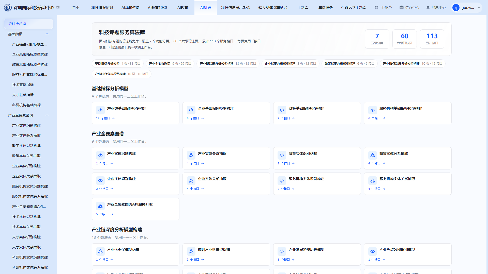
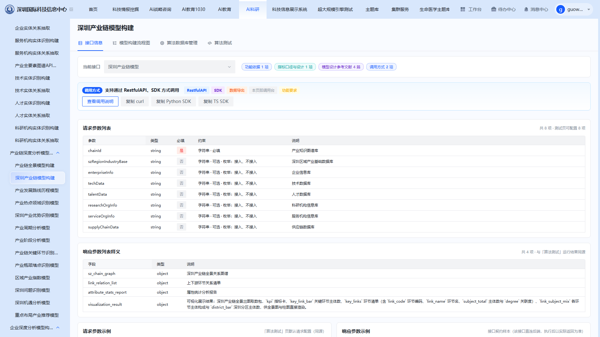
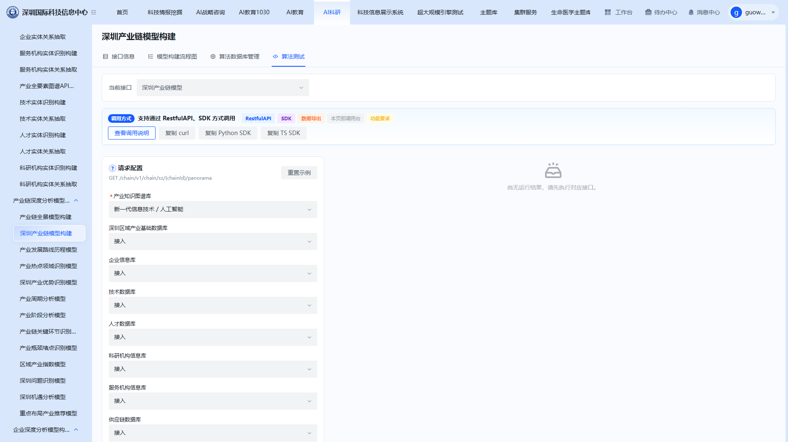
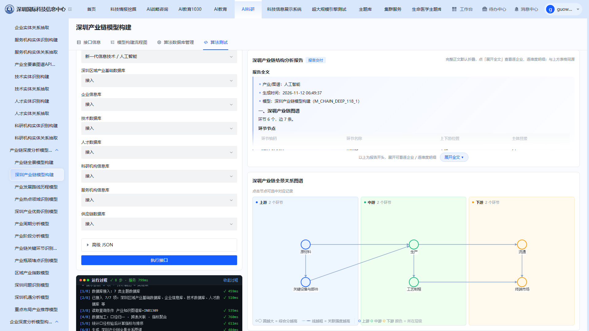

# 国际科技信息中心项目 · 科技专题算法库 · 管理员手册

| 项 | 值 |
|---|---|
| 文档编号 | SUM-GKX-2026-v1.0 |
| 文档名称 | 科技专题算法库 · 管理员手册 |
| 版本号 | v1.0 |
| 适用项目 | 国际科技信息中心项目 |
| 密级 | 内部公开 |
| 编制日期 | 2026年11月 |

深圳市科技创新局 · 国际科技信息中心项目

---

## 1 引言

### 1.1 标识

- **系统名称**：科技专题算法库
- **所属项目**：国际科技信息中心项目 · 智能服务集群
- **文档编号**：SUM-GKX-2026-v1.0

### 1.2 文档概述

#### 1.2.1 编写目的

本文档面向算法库的管理与核对人员，说明算法页内可执行的维护操作、数据源接入状态核对方法与算法结果验证方式，作为日常巡检、算法评审和问题定位的依据。

#### 1.2.2 适用读者

本手册面向算法库管理员、算法评审人员、专题系统联调负责人。

#### 1.2.3 文档范围

本文档仅介绍算法库页内可见的管理与核对操作，不包含算法开发、模型训练、服务部署与运维监控内容。

### 1.3 缩略词

| 缩略词 | 全称 | 说明 |
|---|---|---|
| API | Application Programming Interface | 应用程序编程接口 |
| SDK | Software Development Kit | 软件开发工具包 |
| KPI | Key Performance Indicator | 关键指标 |
| JSON | JavaScript Object Notation | 一种数据交换格式 |

---

## 2 系统概述

### 2.1 系统简介

科技专题算法库把专题分析所需的计算能力按分析对象组织为算法页，每页对应一类能力，并通过统一工作台暴露接口信息、模型构建流程图、数据源接入状态与在线测试台。

管理员在算法库中的工作不是开发新算法，而是围绕既有算法页做三类核对：

1. **口径核对**——确认算法页的功能依据、指标口径与参考文献与需求一致；
2. **数据核对**——确认算法依赖的各数据源处于接入状态，结果数据来源可追溯；
3. **结果核对**——通过在线测试台执行一次真实调用，用返回结果验证指标量级与字段完整性。

以上操作全部在算法页内完成，无需跳转其他后台。

### 2.2 系统主要功能

| 编号 | 管理事项 | 对应页内位置 |
|---:|---|---|
| 2.2.1 | 算法页与接口规模核对 | 算法库总览 |
| 2.2.2 | 功能依据、指标口径、参考文献核对 | 算法页 · 接口信息 |
| 2.2.3 | 算法处理链路核对 | 算法页 · 模型构建流程图 |
| 2.2.4 | 数据源接入状态核对 | 算法页 · 算法数据库管理 |
| 2.2.5 | 接口调用与结果验证 | 算法页 · 算法测试 |
| 2.2.6 | 评审场景展示开关 | 页面顶部 · 评审模式 |

### 2.3 运行环境

#### 2.3.1 硬件环境

PC 端：普通办公计算机，CPU 4 核及以上，内存 ≥8GB，硬盘剩余空间 ≥30GB，支持常规网络接入。

#### 2.3.2 软件环境

- 操作系统：支持 Windows 10/11、macOS 12+ 系统
- 浏览器：支持 Chrome 90+、Edge 90+（推荐 Chrome）
- 无需安装插件

#### 2.3.3 网络环境

客户端需接入内网并具备算法库访问权限，网络带宽 ≥10Mbps。

---

## 3 使用指南

### 3.1 业务流程

算法库的日常管理按四步进行：**进入总览核对范围 → 逐页核对口径与数据源 → 执行测试验证结果 → 记录问题并推动修复**。

1. 从"算法库总览"确认当前分类、算法页与接口的总量，与本次验收或评审范围作对照。
2. 进入目标算法页，先看"接口信息"确认功能依据与指标口径，再看"算法数据库管理"确认依赖数据源是否已接入。
3. 切到"算法测试"，用默认示例参数执行一次接口，观察返回结果的状态、耗时与指标量级。
4. 发现问题（字段缺失、量级异常、数据源未接入、页面无法打开）时按页面名称与接口路径记录，交由研发定位。

### 3.2 算法库总览与导航

总览看板给出功能分类数、算法页数、接口总数三项总量，并按分类列出页面与接口分布，是核对"本次交付范围是否齐全"的入口。

导航为两段式：一级为功能分类，二级为算法页。点击分类标题展开其下的算法页，点击算法页在右侧打开工作台。页面顶部"总览"按钮可随时返回看板。

核对要点：
- 分类数量与页面数量是否与交付清单一致；
- 各分类接口数之和是否等于接口总数；
- 是否存在页面能展开但无法打开的情况（打开后工作台空白）。

### 3.3 接口信息核对

接口信息页签是口径核对的主入口，逐项确认：

- **当前接口**：本页若有多个接口，逐个切换核对，避免只核对了第一个。
- **功能依据**：确认该接口对应的功能条目与需求一致，数量应大于零。
- **指标口径与设计**：核对指标定义、统计范围、取数年份等口径描述是否与业务约定一致。
- **模型设计参考文献**：确认有参考依据且篇数合理。
- **调用方式**：确认 RestfulAPI 与 SDK 两种方式均可用，调用说明可正常打开。
- **请求参数列表**：核对参数类型、必填项与枚举约束是否与实际业务取值一致。
- **响应参数列表释义**：核对返回字段是否覆盖业务页面所需数据，说明文字是否可读。

### 3.4 模型构建流程图核对

流程图页签呈现算法从数据输入到结果输出的处理链路。核对时重点看两点：链路环节是否与实际计算逻辑一致；标注的数据来源是否与"算法数据库管理"中列出的数据源一一对应。

### 3.5 算法数据库管理

数据源接入状态直接决定算法能否出结果。该页签列出算法依赖的数据源及接入状态，常见数据源包括图谱库、企业库、技术库、人才库、科研机构库、服务机构库、供应链库、市场库、行业库。

核对要点：
- 关键数据源是否均为"接入"状态；
- 结果为空或指标异常时，先回到此处确认对应数据源是否被关闭；
- 数据源状态与流程图标注是否一致。

### 3.6 算法测试与结果核对

在算法测试页签执行真实调用，是验证算法可用性的最终手段。

操作步骤：

1. 保持默认示例参数（或按业务场景微调），展开"高级 JSON"可查看完整请求体。
2. 点击"执行接口"，等待右侧运行结果区返回。
3. 核对三项内容：执行状态是否成功、总耗时是否在可接受范围、指标卡与列表数据量级是否符合业务预期。
4. 需要进一步核对的，按响应参数释义逐字段比对，确认字段名与取值含义一致。

### 3.7 评审模式

页面顶部提供"评审模式"开关。评审场景下开启后，页面对功能依据、指标口径与参考文献等信息做突出展示，便于逐项核对；日常巡检与联调时保持关闭，避免界面信息过多。

---

## 4 用户操作常见问题及处理

（1）进入某个算法页后，右侧工作台一直空白，看不到接口信息与测试台？

【原因分析】该算法页对应的前端路由资源未加载成功，常见于页面尚未完成发布、浏览器缓存了旧版本资源，或网络中断导致资源请求失败。
【解决措施】先在页面刷新重试一次；仍为空时更换浏览器或无痕窗口重新进入，排除缓存影响；确认其他算法页正常后，将页面名称与地址反馈研发核实该页是否已发布。

（2）算法测试点击"执行接口"后长时间无结果，或结果区提示失败？

【原因分析】接口依赖的下游数据源未接入、数据量过大导致超时，或依赖的计算服务繁忙。
【解决措施】先到"算法数据库管理"确认相关数据源为接入状态；缩小参数范围（如限定产业、年份）后重试；多次重试仍失败时记录接口路径与大致时间点，交研发排查。

（3）测试返回结果中部分指标为空或明显偏小？

【原因分析】对应数据源未纳入计算、所选统计年份无数据，或参数取值超出数据覆盖范围。
【解决措施】核对请求参数中的年份与筛选条件，改选有数据覆盖的年份或范围；确认数据源接入状态；如仍异常，按响应参数释义逐字段比对，定位缺失的具体字段后反馈研发。

（4）评审模式下页面信息过多，影响正常核对？

【原因分析】评审模式会额外展开依据与口径信息，属于展示层增强。
【解决措施】点击页面顶部"评审模式"开关关闭即可恢复常规视图。
