深圳市科技创新局

国际科技信息中心项目

科技专题服务算法库

用户手册

深圳市智慧城市科技发展集团有限公司

2026年11月

**文档控制**

  ---------- -------------------------------------------------------------------------------------------------- ------------ ------------ ---------------------
   **版本**                                           **修改内容简述**                                           **修改人**   **审批人**      **修改日期**

     v1.0     依据《五、实施方案-智慧认知大脑-科技专题算法库》及 37 个功能项系统界面截图编制，形成用户操作说明      ---          ---           2026年11月

                                                                                                                                          

                                                                                                                                          

                                                                                                                                          

                                                                                                                                          
  ---------- -------------------------------------------------------------------------------------------------- ------------ ------------ ---------------------

目录

注：本目录由 Word 自动域生成，打开文档后按 F9（或右键"更新域"）刷新标题与页码。

# 

# **引言**

## 标识

文档编号：SUM-GKX-2026-v1.0

文档名称：科技专题服务算法库用户手册

版本号：v1.0

适用项目：国际科技信息中心项目

密级：内部公开

## 文档概述

### **编写目的**

本文档为《科技专题服务算法库用户手册》，旨在帮助用户全面了解系统功能、掌握标准操作流程、明确使用规范。本手册可作为日常操作指导、岗前培训资料及问题查阅依据，保障系统规范、高效使用。

### **适用读者**

本手册面向系统普通业务用户人员。

### **文档范围**

本文档主要介绍系统界面、各项业务功能操作、常用设置及基础故障说明，不包含系统部署、代码开发、数据库维护等底层技术内容。

## 缩略词

**表 1-1 缩略词表**

  -----------------------------------------------------------------------------------------------------------------------------
  **缩略词**     **全称与说明**
  -------------- --------------------------------------------------------------------------------------------------------------
  API            应用程序接口（Application Programming Interface）；系统通过 API 接口对外提供指标查询、图谱检索与模型分析服务

  Restful API    基于 REST 风格的网络服务接口，支持按技术标签、机构名称、人才标签等条件查询模型结果

  SDK            软件开发工具包（Software Development Kit），供业务系统集成调用模型能力

  NER            命名实体识别（Named Entity Recognition），用于从多源文本中抽取技术、人才、科研机构等实体

  CPU            中央处理器；客户端硬件环境要求 CPU 4 核及以上

  PC             个人计算机；本手册所述操作均在 PC 端浏览器完成

  Mbps           兆比特每秒；客户端网络带宽要求 ≥10Mbps
  -----------------------------------------------------------------------------------------------------------------------------

# **系统概述**

## 系统简介

科技专题服务算法库是深度挖掘算法的重要服务引擎，面向政府、高校、科研机构、智库与科研企业的专题化分析与决策场景，提供从指标体系构建、知识图谱计算、深度分析与评价、预测仿真到推荐匹配的一体化能力。算法库贯通产业、技术、企业、人才、政策与服务机构等关键要素，在统一的数据底座与算力平台上，将分散的多源数据加工为结构化的指标与可计算的知识网络，输出可挖掘、可分析、可预测的智能成果，支撑线上智能分析与线下大规模分析预测的全链条服务。

围绕专题业务的本质特征，算法库构建可配置的指标体系与跨要素知识图谱，结合图结构计算、时序分析与机理模型，形成面向产业链与技术链的全景洞察，支持态势监测、趋势研判、瓶颈识别、路径优化与政策仿真。通过对企业、科研机构与人才的综合画像与评估，算法库实现对创新主体的竞争力判断与协同潜力识别，并在招引、培育与重点布局等决策环节提供面向场景的推荐与匹配结果。同时，算法库强调结果的可解释与评估，以模型卡、特征贡献与不确定性度量提升结论的透明度与可复审性，为科学决策提供可靠依据。

在数据与算力支撑方面，算法库打通论文与专利、项目与经费、工商与财务、政策与实施效果、人才与机构关系、地理与时序等多类型数据，完成清洗、实体对齐、关系与事件抽取、主题归类等知识加工，确保数据资产的统一与高质量。依托统一的模型管理与图计算能力，算法库兼顾批量评估与实时推理，保障动态监测与在线推演的性能与稳定性。

面向应用价值，算法库以统一、可信、可演化的智能能力服务政策制定与评估、产业发展与布局、创新主体培育与引进、区域综合诊断等关键场景。它将复杂的科技数据与业务知识转化为可操作的洞察与行动方案，提升科技治理的科学性与时效性，促进产业链与技术链的协同升级，助力区域创新生态的持续优化。

功能架构上，科技专题服务算法库主要包括基础指标分析模型、产业全要素图谱、深度分析模型三大板块。基础指标分析模型包括产业链基础指标、技术基础指标、企业基础指标、人才基础指标、科研机构基础指标、政策基础指标、服务机构基础指标的构建和分析；产业全要素图谱包括图谱构建、图结构分析计算、API 服务三部分；深度分析模型包括产业链、技术链、企业、科研机构、人才、政策、产业服务及产业综合等深度分析模型。

基础指标分析模型负责构建完整的产业指标体系，为上层业务应用提供高质量、可复用的指标服务；产业全要素图谱将产业数据、科研知识和新闻信息整合关联，形成结构化、可视化的产业知识图谱并提供图结构分析及计算能力；深度分析模型在两者的能力基础上，利用数据挖掘、机器学习等技术构建多类专题分析模型，支撑市场研判、趋势预测与业务建议。

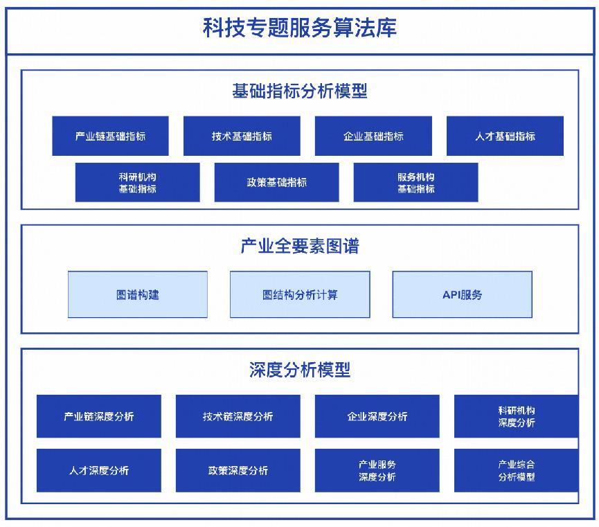{width="4.6in" height="4.046936789151356in"}

图 2-1 科技专题服务算法库功能架构

## 主要功能

+:-----:+:------------------:+:------------------------:+:--------------------------------:+
| 编号  | 系统名称           | 功能模块                 | 功能项                           |
+-------+--------------------+--------------------------+----------------------------------+
| 1     | 科技专题服务算法库 | 基础指标分析模型         | 技术基础指标模型构建             |
+-------+                    |                          +----------------------------------+
| 2     |                    |                          | 人才基础指标模型构建             |
+-------+                    |                          +----------------------------------+
| 3     |                    |                          | 科研机构基础指标模型构建         |
+-------+                    +--------------------------+----------------------------------+
| 4     |                    | 产业全要素图谱           | 技术实体识别构建                 |
+-------+                    |                          +----------------------------------+
| 5     |                    |                          | 技术实体关系抽取                 |
+-------+                    |                          +----------------------------------+
| 6     |                    |                          | 人才实体识别构建                 |
+-------+                    |                          +----------------------------------+
| 7     |                    |                          | 人才实体关系抽取                 |
+-------+                    |                          +----------------------------------+
| 8     |                    |                          | 科研机构实体识别构建             |
+-------+                    |                          +----------------------------------+
| 9     |                    |                          | 科研机构实体关系抽取             |
+-------+                    +--------------------------+----------------------------------+
| 10    |                    | 技术链深度分析模型构建   | 全景技术链模型                   |
+-------+                    |                          +----------------------------------+
| 11    |                    |                          | 深圳技术链模型                   |
+-------+                    |                          +----------------------------------+
| 12    |                    |                          | 技术发展历程模型                 |
+-------+                    |                          +----------------------------------+
| 13    |                    |                          | 深圳细分领域分布模型             |
+-------+                    |                          +----------------------------------+
| 14    |                    |                          | 技术前沿热点领域识别模型         |
+-------+                    |                          +----------------------------------+
| 15    |                    |                          | 技术产业化潜力识别模型           |
+-------+                    |                          +----------------------------------+
| 16    |                    |                          | 技术转化瓶颈堵点原因识别模型     |
+-------+                    |                          +----------------------------------+
| 17    |                    |                          | 技术阶段分析模型                 |
+-------+                    |                          +----------------------------------+
| 18    |                    |                          | 深圳技术发展问题识别模型         |
+-------+                    |                          +----------------------------------+
| 19    |                    |                          | 深圳技术发展机遇识别模型         |
+-------+                    |                          +----------------------------------+
| 20    |                    |                          | 深圳技术发展重点布局领域推荐模型 |
+-------+                    +--------------------------+----------------------------------+
| 21    |                    | 科研机构深度分析模型构建 | 科研机构重点技术领域布局模型     |
+-------+                    |                          +----------------------------------+
| 22    |                    |                          | 科研机构发展历程模型             |
+-------+                    |                          +----------------------------------+
| 23    |                    |                          | 深圳科研机构优势分析模型         |
+-------+                    |                          +----------------------------------+
| 24    |                    |                          | 深圳科研机构痛难点识别模型       |
+-------+                    |                          +----------------------------------+
| 25    |                    |                          | 科研合作关系链条模型             |
+-------+                    |                          +----------------------------------+
| 26    |                    |                          | 科研机构引入推荐模型             |
+-------+                    |                          +----------------------------------+
| 27    |                    |                          | 科研机构扶持推荐模型             |
+-------+                    +--------------------------+----------------------------------+
| 28    |                    | 人才深度分析模型构建     | 重点人才识别模型                 |
+-------+                    |                          +----------------------------------+
| 29    |                    |                          | 人才流动追踪模型                 |
+-------+                    |                          +----------------------------------+
| 30    |                    |                          | 高校学院新培育人才模型           |
+-------+                    |                          +----------------------------------+
| 31    |                    |                          | 深圳重点人才优势和短板分析模型   |
+-------+                    |                          +----------------------------------+
| 32    |                    |                          | 人才关系链模型                   |
+-------+                    |                          +----------------------------------+
| 33    |                    |                          | 人才供需分析评价模型             |
+-------+                    |                          +----------------------------------+
| 34    |                    |                          | 人才学术力评估模型               |
+-------+                    |                          +----------------------------------+
| 35    |                    |                          | 人才产业力评估模型               |
+-------+                    |                          +----------------------------------+
| 36    |                    |                          | 招入人才推荐模型                 |
+-------+                    |                          +----------------------------------+
| 37    |                    |                          | 培育人才布局模型                 |
+-------+--------------------+--------------------------+----------------------------------+

表中功能项与第 3 章使用指南逐一对应。实施方案中科技专题服务算法库整体覆盖基础指标分析模型、产业全要素图谱及八类深度分析模型；本手册按当前系统开放范围，对基础指标、图谱构建、技术链、科研机构与人才深度分析功能给出操作说明，其余同板块模型可参照相同操作流程使用。

名称对照：系统界面中个别功能项名称与本手册章节标题略有差异，均为同一功能项，章节标题沿用招标文件功能清单------界面「人才产品力评估模型」对应 3.6.8「人才产业力评估模型」；界面「招引人才推荐模型」对应 3.6.9「招入人才推荐模型」；界面「深圳重点人才优势与短板分析模型」对应 3.6.4「深圳重点人才优势和短板分析模型」。第 3 章各节按章节标题编排，界面截图按系统实际名称显示。

## 运行环境

### **硬件环境**

[PC端：普通办公计算机，CPU 4核及以上，内存≥8GB，硬盘剩余空间≥30GB，支持常规网络接入。]{.mark}

### **软件环境**

[操作系统：支持麒麟、统信、鸿蒙、Windows、MacOS系统；]{.mark}

[浏览器：支持360安全浏览器、奇安信可信浏览器、Chrome、Edge、Safari、Firefox浏览器；]{.mark}

依赖软件：无需安装额外插件，使用浏览器直接访问系统即可。

界面说明：各功能项页面由「接口定义」与「分析结果报告」组成，报告为长页面布局，需在浏览器中向下滚动查看全部图表、明细表与分析结论；明细表自带分页控件，报告区右上角提供导出与打印入口。

### **网络环境**

客户端需接入项目指定网络，网络带宽≥10Mbps，网络稳定无断连，并具备访问系统服务及 Internet 资源的权限。

# **使用指南**

## 业务流程

系统业务流程整体划分为 5 个阶段：①基础能力构建------建立指标体系和知识图谱；②产业要素分析------分析产业链和技术链；③创新主体分析------评估企业、科研机构和人才；④政策服务分析------评价政策和服务机构；⑤综合评价模型。各阶段与分析模块的对应关系见图 3-1。

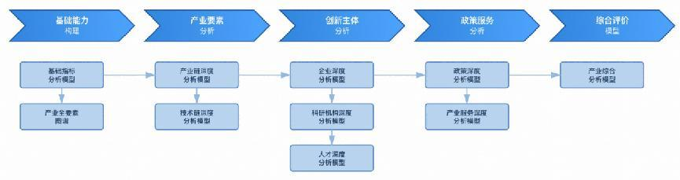{width="5.8in" height="1.5354910323709536in"}

图 3-1 科技专题服务算法库业务流程图

**① 基础能力构建。**建立涵盖产业链、技术、企业、人才、科研机构、政策、服务机构七大维度的基础指标体系，并构建产业全要素知识图谱，提供节点重要性分析、社群发现、路径分析等图结构计算能力及标准化 API 服务，为后续深度分析提供统一的数据底座。

**② 产业要素分析。**聚焦产业链与技术链：梳理上下游关系、价值链分布与关键环节，识别产业热点、深圳产业优势、产业周期与阶段、瓶颈堵点及区域产业指数；同时描绘技术发展历程、深圳细分领域分布，识别前沿热点、产业化潜力与技术转化瓶颈。

**③ 创新主体分析。**围绕企业、科研机构、人才三类主体开展多维度评估：分析企业竞争力、发展历程、痛难点、供应链关系与技术力/商业力，评估科研机构布局、优势短板与合作链条，识别重点人才、追踪人才流动、评价人才学术力与产业力，并输出招引、培育与布局推荐结果。

**④ 政策服务分析。**构建政策效能评估与产业服务生态分析框架：识别政策焦点、评估政策力度与实施效果、发现政策短板与机遇、给出政策布局建议；同时诊断服务链短板、绘制服务关系链，对金融、知识产权、人力资源、市场营销、咨询、科技创新六类服务机构开展技术力评价与引入培育推荐。

**⑤ 综合评价模型。**整合前期各模块成果，构建区域科技创新成果、产业创新成果、创新人才、创新政策等综合评价模型，以及区域创新活力、创新要素类型/层次/领域/综合与区域创新协同分析模型，服务于产业发展态势研判、区域优势短板分析、政策效果评估与资源配置优化。

**通用界面结构与操作步骤**

第 3.2---3.6 节各功能项界面结构一致，自上而下分为「接口定义」与「分析结果报告」两部分，均为长页面，需向下滚动查看全部内容。标准操作步骤如下，各节不再重复叙述。

① 查看接口定义：页面顶部列出模型名称与说明、请求方式、请求地址，以及入参字段表（字段名、类型、是否必填、说明），下方给出返回结果 JSON 示例。调用前先核对必填项与字段类型；接口入参与各节的「模型输入与输出」表对应。

② 配置查询条件：在报告页左侧的参数与筛选区设置该模型对应的条件项，点击「查询／生成报告」执行分析。左侧条件区支持展开、收起与多选；修改条件后须重新执行查询，结果才会刷新。

③ 读取统计结果：右侧上方为统计指标卡（总量、占比、均值、指数等），中部为可视化图表，包括柱状／条形图、折线与面积趋势图、环形／饼图、雷达图、地图及关系网络图等，按图表下方图例区分数据系列。

④ 查看明细与结论：继续向下滚动查看明细数据表格、底部分页控件，以及分析结论与建议文字；明细表工具栏提供列设置、导出与打印入口。

⑤ 留存与复用：使用报告区右上角的导出／打印功能保存报告；如需接入业务系统，按接口定义以 Restful API 或 SDK 调用，输入输出字段与各节表格一致。

使用提示：业务用户日常以第 3 章的查询、分析和导出操作为主；指标体系构建、知识图谱入库、模型训练与数据同步由系统后台按统一流程执行。算法库以模型卡、特征贡献与不确定性度量提升结论的透明度与可复审性，引用分析结论时请同时关注数据更新时间与模型版本。界面截图中的数值为示例数据，实际结果随数据更新与参数配置变化。

## 基础指标分析模型

基础指标分析模型库以单因子、单指标维度对产业相关各领域要素进行量化计算与模型构建，为上层业务应用提供高质量、可复用的指标服务支撑。模型库以产业链和技术链为起点，向下延伸至企业、科研机构、人才与政策等创新实体的基本属性、状态属性及事件属性，通过标准化数据处理流程将多源基础数据转化为结构化指标。

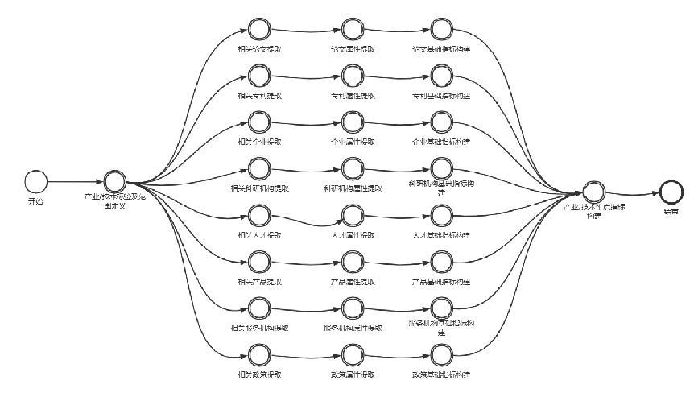{width="5.6in" height="3.2352668416447945in"}

图 3-2 基础指标分析模型构建数据流图

所有基础指标模型统一遵循五步处理流程：①数据源对接；②数据清洗；③数据处理；④数据服务开发；⑤数据同步。模型计算结果通过 API 接口和消息队列方式服务化输出，支持按时间、地域、领域等多维条件灵活检索与下载，并定期更新与监测。业务用户无需执行后台处理步骤，直接按本节操作说明查询指标结果即可。

实施方案中基础指标分析模型共覆盖产业链、技术、企业、人才、科研机构、政策、服务机构七类子模型；本手册按当前系统开放范围，对技术、人才、科研机构三类基础指标模型给出操作说明，其余子模型的操作方式与之相同。

### **技术基础指标模型构建**

技术基础指标模型基于技术专题数据，对接产业技术数据库及资讯数据库，完成数据采集、预处理、指标计算与服务化输出，实现对全球、全国及区域技术链基础特征的系统量化与动态更新。模型采集论文、专利、交易、资讯等全量数据，统一执行去重、去噪、缺失值补全、格式标准化，并结合领域分类、时间窗口划分、机构类型过滤等特征提取。模型包括以下指标体系：论文数量、深圳论文数量、区域论文数量、前沿论文机构、专利数量、深圳专利数量、区域专利申请数、领先专利主体机构、技术交易额分析、技术交易额区域分析、技术动态资讯。

**指标清单（技术基础指标模型）**

  -----------------------------------------------------------------------------------------------------------------------------------------------------------------------------
  **序号**   **指标名称**         **统计口径**                                                                               **主要查询条件与输出**
  ---------- -------------------- ------------------------------------------------------------------------------------------ --------------------------------------------------
  1          论文数量             按月/年统计全球/全国机构在该技术领域发表的论文数量，并计算环比增长率                       技术领域、时间；输出论文数量与增长率

  2          深圳论文数量         按月/年统计深圳所有机构在该技术领域发表的论文数量及环比增长率，观察论文趋势                时间、领域分类；输出深圳论文数量与增长率

  3          区域论文数量         按论文所属机构地址提取地区信息，统计各地区论文数量及占比                                   地区；输出论文数量与占比

  4          前沿论文机构         以发表论文数、影响因子、引用次数等指标设定阈值，识别前沿论文机构并统计机构及所在区域数据   区域、时间、领域；输出机构名单及指标数据

  5          专利数量             按月/年统计全球/全国申请成功的该技术领域专利数量及环比增长率                               技术领域标签、时间；输出专利数量与增长率

  6          深圳专利数量         按月/年统计深圳申请成功的该技术领域专利数量及环比增长率                                    技术领域、时间；输出深圳专利数量与增长率

  7          区域专利申请数       按地区统计申请成功的专利数，并计算环比增长率                                               地区标签、时间；输出专利申请成功数与增长率

  8          领先专利主体机构     以专利数量、专利质量、专利技术覆盖范围等指标设定阈值，识别领先专利主体机构                 领先指标、时间；输出机构名单与指标结果

  9          技术交易额分析       按月/年统计技术交易额、成交量、总技术交易额、单笔技术交易额及增长率                        技术交易标签、时间；输出交易额与增长率

  10         技术交易额区域分析   按区域统计技术交易额及环比增长率，支持按技术合作、技术转让、技术服务等类型分类             区域标签、时间；输出区域交易额与增长率

  11         技术动态资讯         统计技术热点标签频次、相关资讯数量、发布时间、阅读量及技术发展历程                         技术热点标签、时间；输出热点标签、资讯与发展历程
  -----------------------------------------------------------------------------------------------------------------------------------------------------------------------------

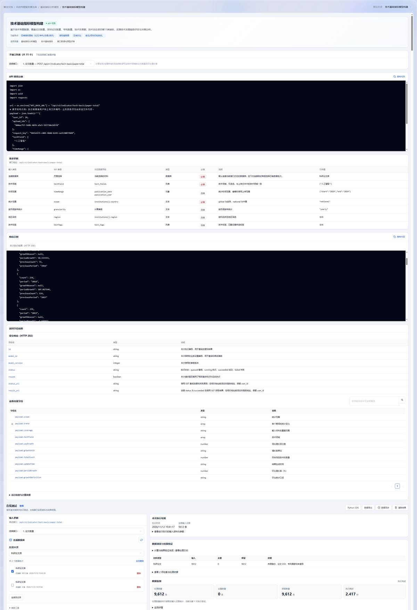{width="5.7in" height="8.3125in"}

图 3-3 技术基础指标模型构建界面示意（1/2）

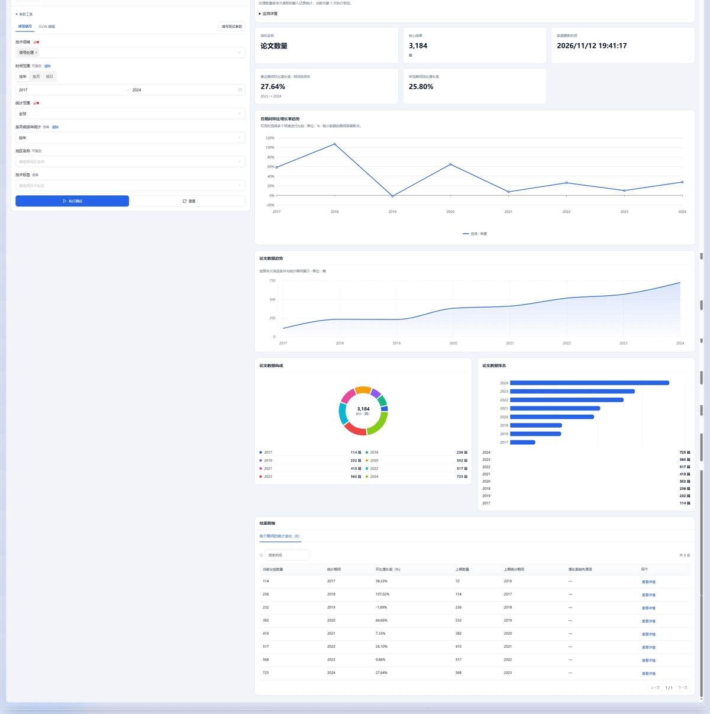{width="5.7in" height="5.7332502187226595in"}

图 3-3 技术基础指标模型构建界面示意（2/2）

界面示意见图 3-3（共 2 页）。按 3.1 节「通用界面结构与操作步骤」执行：先在接口定义区核对入参字段与返回示例，再在报告页左侧设置【技术领域／学科标签】【时间范围（月／年）】【地域范围（全球／全国／深圳／指定区域）】【机构类型】等条件并生成报告；在右侧读取统计指标卡与柱状／条形图、折线趋势图与环形占比图，向下滚动查看明细表与分析结论，最后用右上角导出／打印功能留存结果。

指标结果按统一五步流程生产，经有效性验证后通过 API 接口与消息队列同步至数据服务；系统定期更新数据与指标并进行监测分析，确保指标的有效性与可靠性。

### **人才基础指标模型构建**

人才基础指标模型基于人才专题数据，构建人才分析和评价的核心指标体系，为区域科研水平评估、人才战略制定及产业发展分析提供数据支撑。模型与人才数据库建立稳定接口，采集人才数量、机构分布、领域分类以及历年供给情况等信息，执行去重、缺失值补全、异常值修正、编码统一及时间范围与数据质量分析。人才指标模型包含人才分布、人才机构分布、人才领域分布及人才供给数量四项指标。

**指标清单（人才基础指标模型）**

  ----------------------------------------------------------------------------------------------------------------------------------------------------
  **序号**   **指标名称**    **统计口径**                                                           **主要查询条件与输出**
  ---------- --------------- ---------------------------------------------------------------------- --------------------------------------------------
  1          人才分布        按省份/国家统计人才数量，形成全国/全球人才分布，并分析年度变化趋势     省份/国家、时间；输出人才数量指标

  2          人才机构分布    按省份/国家与机构类型统计人才机构数量，并计算环比增长率                省份/国家、机构类型、时间；输出机构分布与增长率

  3          人才领域分布    按细分产业/技术领域统计人才数量及环比增长率，支持领域间对比            细分领域、时间；输出人才数量与增长率

  4          人才供给数量    按学科统计学士/硕士/博士历年毕业数量，比较不同学科趋势并分析供需状况   学科标签、时间、毕业层次；输出各学科历年毕业数量
  ----------------------------------------------------------------------------------------------------------------------------------------------------

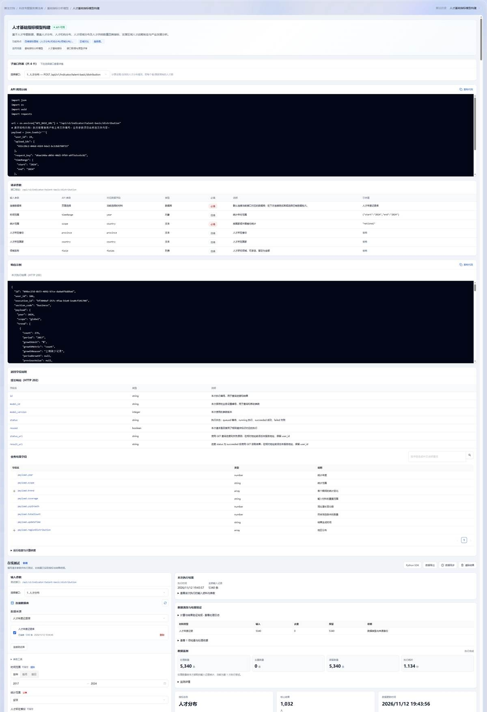{width="5.7in" height="8.3125in"}

图 3-4 人才基础指标模型构建界面示意（1/2）

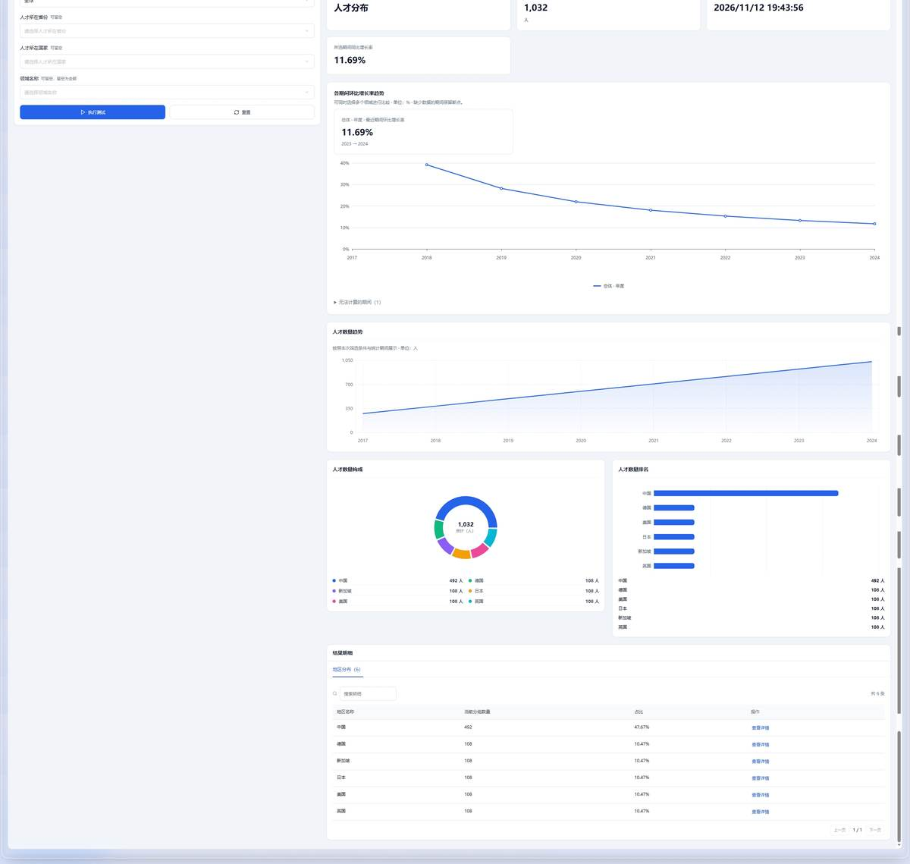{width="5.7in" height="5.4102504374453195in"}

图 3-4 人才基础指标模型构建界面示意（2/2）

界面示意见图 3-4（共 2 页）。按 3.1 节「通用界面结构与操作步骤」执行：先在接口定义区核对入参字段与返回示例，再在报告页左侧设置【技术领域／学科标签】【时间范围（月／年）】【地域范围（全球／全国／深圳／指定区域）】【机构类型】等条件并生成报告；在右侧读取统计指标卡与柱状／条形图、折线趋势图与环形占比图，向下滚动查看明细表与分析结论，最后用右上角导出／打印功能留存结果。

指标结果经计算、归纳与有效性验证后，通过 API 接口和数据同步机制服务化输出，支持按地域、领域、学科、时间等条件灵活查询与下载，并定期更新与监测。

### **科研机构基础指标模型构建**

科研机构基础指标模型通过与科研、企业及资讯数据库等数据源对接，采集涵盖研究领域、论文、专利、人才流动、技术交易、机构类型和涉足产业等信息，并执行去重、去噪、格式化、补全等标准化清洗。模型从科研机构涉及产业领域、重点科研机构、科研机构资讯、新增科研机构动态四大维度构建指标体系，经计算、归纳与验证后通过 API 接口和数据服务同步输出。

**指标清单（科研机构基础指标模型）**

  ---------------------------------------------------------------------------------------------------------------------------------------------------------------
  **序号**   **指标名称**           **统计口径**                                                                 **主要查询条件与输出**
  ---------- ---------------------- ---------------------------------------------------------------------------- ------------------------------------------------
  1          科研机构涉及产业领域   按产业标签统计科研机构涉足的产业链领域，并计算增长率                         产业标签、时间；输出涉及领域指标与增长率

  2          重点科研机构           以发表论文数、专利数等科研质量指标设定阈值，识别重点科研机构                 科研机构标签、时间；输出重点机构及科研质量指标

  3          科研机构资讯           整合论文、专利、人才流动、技术交易等资讯，计算机构综合科研实力及环比增长率   机构标签、时间；输出综合科研实力与增长率

  4          新增科研机构动态       按机构类型统计历年涉足领域科研机构的新增数量并分析变化                       机构类型、时间；输出历年新增数量指标
  ---------------------------------------------------------------------------------------------------------------------------------------------------------------

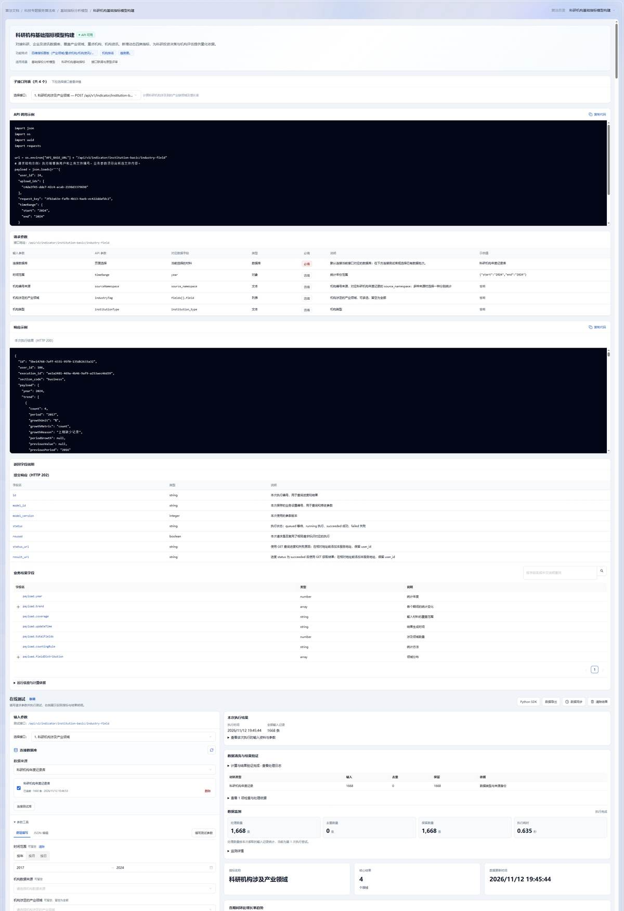{width="5.7in" height="8.3125in"}

图 3-5 科研机构基础指标模型构建界面示意（1/2）

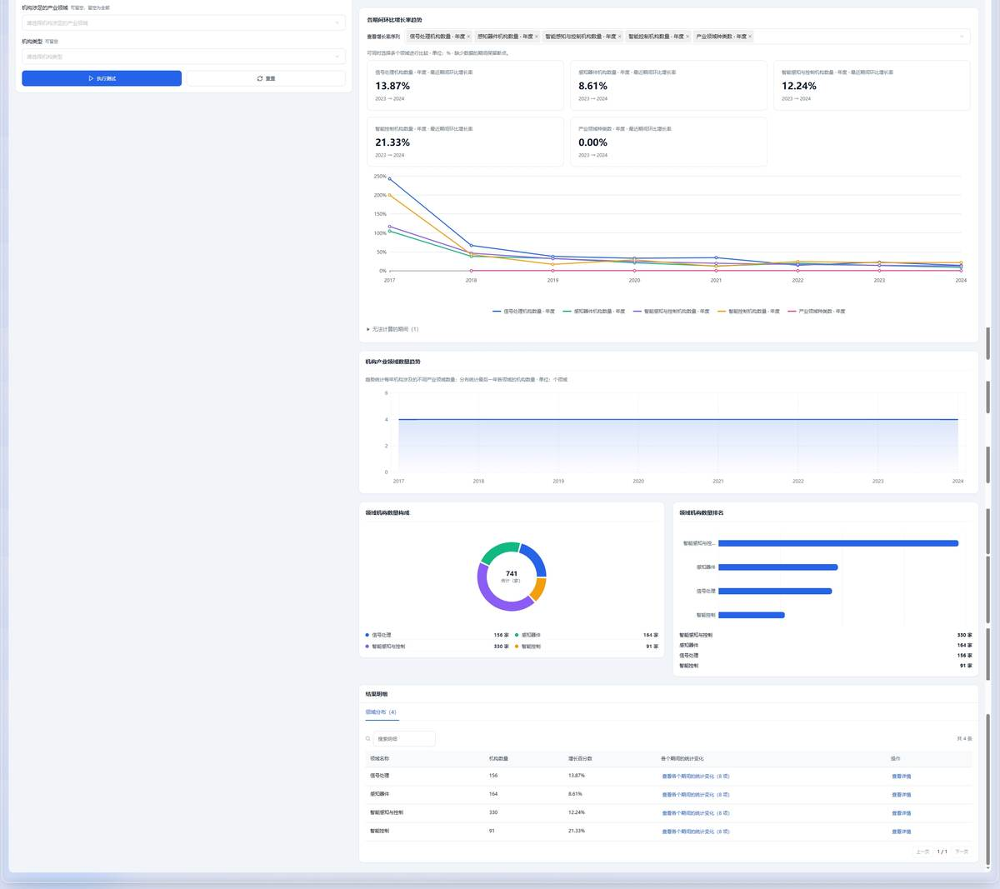{width="5.7in" height="5.0682502187226595in"}

图 3-5 科研机构基础指标模型构建界面示意（2/2）

界面示意见图 3-5（共 2 页）。按 3.1 节「通用界面结构与操作步骤」执行：先在接口定义区核对入参字段与返回示例，再在报告页左侧设置【技术领域／学科标签】【时间范围（月／年）】【地域范围（全球／全国／深圳／指定区域）】【机构类型】等条件并生成报告；在右侧读取统计指标卡与柱状／条形图、折线趋势图与环形占比图，向下滚动查看明细表与分析结论，最后用右上角导出／打印功能留存结果。

模型具备定期更新与监测机制，支持按产业标签、机构类型、时间等条件灵活查询，为科研投资决策、产业布局、政策制定和机构评估提供量化依据。

## 产业全要素图谱

产业全要素图谱是面向产业信息融合与创新生态分析的核心基础模块，以产业链和技术链为主线，将产业、技术、企业、科研机构、人才、政策、服务机构等七类关键实体及其属性、关系进行系统化抽取、融合与建模，形成统一、准确、可扩展的知识网络。图谱依托图数据库与推理规则支持知识推理与关系延展，并通过数据服务 API 对外开放。

本章节涵盖的核心功能包括各类实体的识别构建与关系抽取，以及产业全要素图谱 API 服务开发，提供标准化接口支持数据检索、关系分析、知识扩充与网络指标计算。整体构建遵循五大流程。

**图谱构建五步流程**

  --------------------------------------------------------------------------------------------------------
  **序号**   **流程**                 **说明**
  ---------- ------------------------ --------------------------------------------------------------------
  1          产业链与技术链环节定义   确定节点及上下游关系

  2          相关实体要素与属性提取   采集论文、专利、企业、科研机构、人才、服务机构、政策等及其关联属性

  3          实体构建与消歧           对多源数据执行消歧、标准化与融合，确保统一与准确

  4          知识推理                 生成新的实体关系与链路

  5          图谱入库                 完成在图数据库中的结构化存储与持续更新
  --------------------------------------------------------------------------------------------------------

图谱形成后提供节点重要性分析、社群发现、路径分析等图结构分析及计算能力，并支持实体检索、关系查询、语义分析、可视化展示、聚类与关联分析等智能化应用。本章节按当前系统开放范围，对技术、人才、科研机构三类实体的识别构建与关系抽取给出操作说明；其余实体类型的操作方式与之相同。

### **技术实体识别构建**

技术实体识别构建旨在通过对接多源技术相关数据库，自动识别和提取技术领域的核心实体及其属性，为技术情报分析、科研评价和技术交易决策提供精准的数据支持。系统将学术文献、专利信息、技术报告及交易数据导入实体识别平台，并根据业务需求执行标准化预处理与清洗，确保数据的质量与一致性。在系统构建完成后，支持实体的持续更新与维护，并结合规则识别、词典识别和属性提取方法，实现技术实体库的动态管理和高效应用。

**功能要点**

  ------------------------------------------------------------------------------------------------------------------------------------------
  **项目**       **内容**
  -------------- ---------------------------------------------------------------------------------------------------------------------------
  处理对象       学术文献、专利信息、技术报告及技术交易数据

  核心方法       基于规则（正则表达式、关键字匹配）与基于词典（分词、词性标注、NER）的双重识别，提取技术实体名称、类型、行业归属及地理位置

  维护与更新     支持实体新增、删除、修改及定期库更新；按实体名称自动获取论文数量、专利数量、技术交易额及区域分布等属性，并周期性更新

  输出结果       技术实体库及实体属性档案，支撑技术情报分析、科研评价与技术交易决策
  ------------------------------------------------------------------------------------------------------------------------------------------

{width="5.7in" height="8.3125in"}

图 3-6 技术实体识别构建界面示意（1/2）

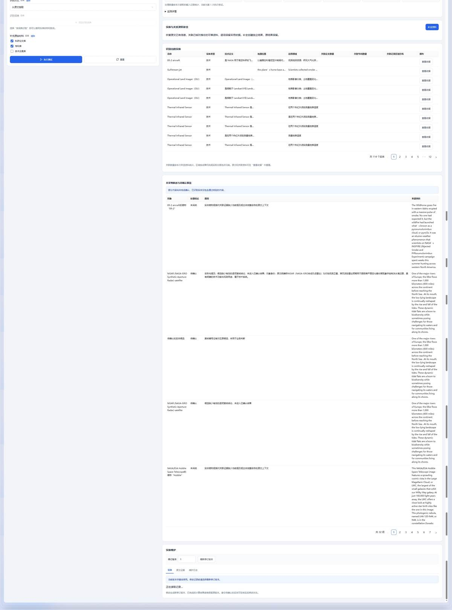{width="5.7in" height="7.685499781277341in"}

图 3-6 技术实体识别构建界面示意（2/2）

界面示意见图 3-6（共 2 页）。按 3.1 节「通用界面结构与操作步骤」执行：先在接口定义区核对入参字段与返回示例，再在报告页左侧设置【数据源】【实体或关系类型】【识别规则与专业词典】【时间范围】等条件并生成报告；在右侧读取统计指标卡与关系网络图与实体／关系明细表，向下滚动查看明细表与分析结论，最后用右上角导出／打印功能留存结果。

### **技术实体关系抽取**

技术实体关系抽取利用自然语言处理与机器学习等方法，从多源技术及关联数据库中自动识别并建模 技术实体与其他相关实体 之间的关系，包括技术与技术、技术与产业、技术与人才、技术与企业、技术与政策、技术与科研机构以及技术与服务机构等。通过统一的关系抽取规则与模型，系统不仅能刻画技术领域、分类、应用、标准及发展历程等内部关联，还能描述技术在创新生态中与外部主体的结构化联系，支撑 技术创新链的可视化呈现与关联分析。

**功能要点**

  ------------------------------------------------------------------------------------------------------------------------------------------
  **项目**       **内容**
  -------------- ---------------------------------------------------------------------------------------------------------------------------
  处理对象       技术专题库及产业、人才、企业、政策、科研机构、服务机构等关联数据库

  核心方法       定义关系类型并配置抽取规则，结合自然语言处理与 NER 提取技术与技术、产业、人才、企业、政策、科研机构、服务机构等实体间关系

  维护与更新     结果经去重、纠错、缺失值补全与格式统一后按关系类型入库，并通过定时任务同步更新

  输出结果       技术实体关系库及技术创新链可视化展示，呈现网络结构、核心节点及关联强度
  ------------------------------------------------------------------------------------------------------------------------------------------

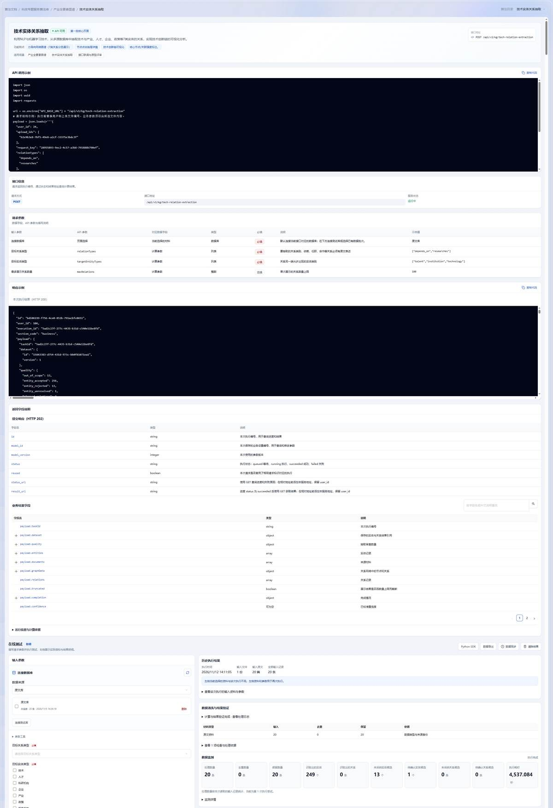{width="5.7in" height="8.3125in"}

图 3-7 技术实体关系抽取界面示意（1/3）

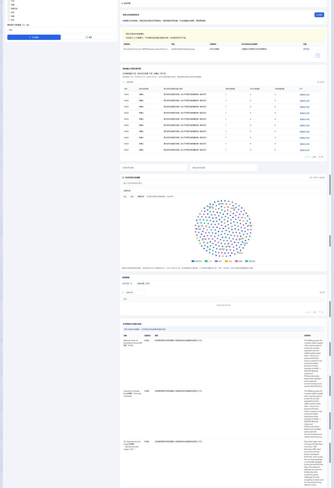{width="5.7in" height="8.3125in"}

图 3-7 技术实体关系抽取界面示意（2/3）

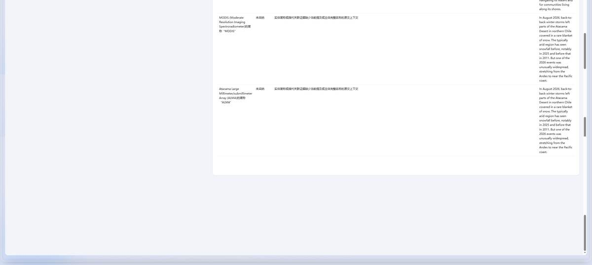{width="5.7in" height="2.5554997812773403in"}

图 3-7 技术实体关系抽取界面示意（3/3）

界面示意见图 3-7（共 3 页）。按 3.1 节「通用界面结构与操作步骤」执行：先在接口定义区核对入参字段与返回示例，再在报告页左侧设置【数据源】【实体或关系类型】【识别规则与专业词典】【时间范围】等条件并生成报告；在右侧读取统计指标卡与关系网络图与实体／关系明细表，向下滚动查看明细表与分析结论，最后用右上角导出／打印功能留存结果。

### **人才实体识别构建**

人才实体识别构建旨在从大规模人才数据库中自动抽取与识别人才相关的实体及其属性，并结合多种识别方法实现动态更新与维护。该过程包括将多源人才数据导入到实体识别系统，通过业务需求驱动的预处理与数据清洗，确保信息的准确性与完整性；随后利用基于规则的识别和基于词典的识别方法进行实体及属性的抽取，并通过持续的维护与更新机制保证数据库的时效性与质量；系统还可执行人才属性的深度提取，形成全面、结构化的人才信息档案，为科研管理、人才评价及政策制定提供可靠支撑。

**功能要点**

  ----------------------------------------------------------------------------------------------------------------------------------------
  **项目**       **内容**
  -------------- -------------------------------------------------------------------------------------------------------------------------
  处理对象       学术论文、专利、招聘信息等多类型人才数据源

  核心方法       基于规则的正则匹配与 NER 方法，抽取姓名、性别、学历、领域、单位等核心属性；按实体名称抽取年龄、研究领域、成果数量等信息

  维护与更新     支持新增、删除、修改及周期性自动更新，属性数据经去重、纠错、补全后定期更新

  输出结果       结构化人才信息档案，为科研管理、人才评价及政策制定提供支撑
  ----------------------------------------------------------------------------------------------------------------------------------------

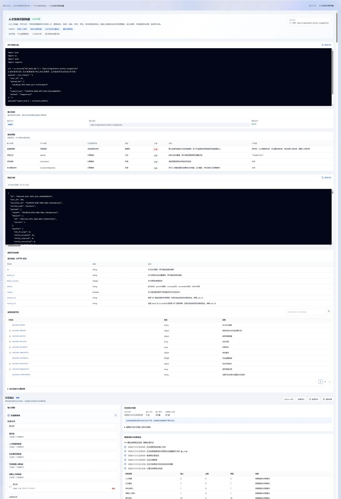{width="5.7in" height="8.3125in"}

图 3-8 人才实体识别构建界面示意（1/2）

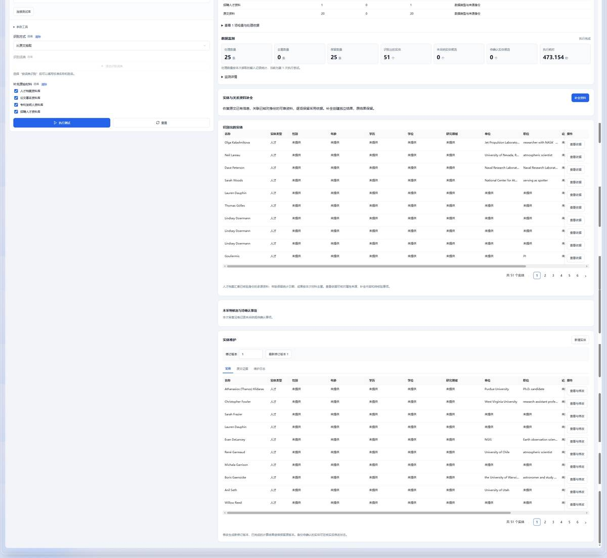{width="5.7in" height="5.239249781277341in"}

图 3-8 人才实体识别构建界面示意（2/2）

界面示意见图 3-8（共 2 页）。按 3.1 节「通用界面结构与操作步骤」执行：先在接口定义区核对入参字段与返回示例，再在报告页左侧设置【数据源】【实体或关系类型】【识别规则与专业词典】【时间范围】等条件并生成报告；在右侧读取统计指标卡与关系网络图与实体／关系明细表，向下滚动查看明细表与分析结论，最后用右上角导出／打印功能留存结果。

### **人才实体关系抽取**

人才实体关系抽取基于数据融合中枢与各大专题数据库的对接，通过自然语言处理技术与预设的人才关系规则，对人才实体及其相关领域信息进行系统化关系识别与建模，构建覆盖产业、技术、企业、科研机构、服务机构、政策等多维度的人才关系图谱。该图谱可全面反映人才与行业、所学专业、所在地区、工作经历、职业技能及政策环境之间的关联，为人才分析、政策制定和创新生态研究提供结构化数据支持。

**功能要点**

  -------------------------------------------------------------------------------------------------------------------------------------
  **项目**       **内容**
  -------------- ----------------------------------------------------------------------------------------------------------------------
  处理对象       人才、产业、技术、企业、科研机构、服务机构及政策等专题数据库

  核心方法       按预设人才关系规则，利用 NER、正则匹配和关键词规则抽取人才与产业、技术、企业、科研机构、服务机构及政策间的关联并建模

  维护与更新     关系数据经去重、纠错、缺失值填充及格式标准化后存入人才关系库，通过定时任务定期同步

  输出结果       覆盖产业、技术、企业、科研机构、服务机构、政策等多维度的人才关系图谱
  -------------------------------------------------------------------------------------------------------------------------------------

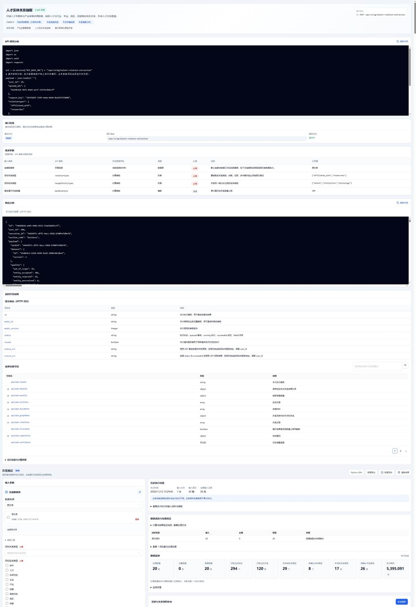{width="5.7in" height="8.3125in"}

图 3-9 人才实体关系抽取界面示意（1/3）

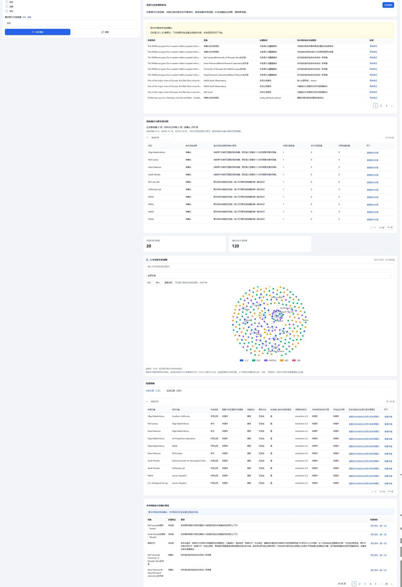{width="5.7in" height="8.3125in"}

图 3-9 人才实体关系抽取界面示意（2/3）

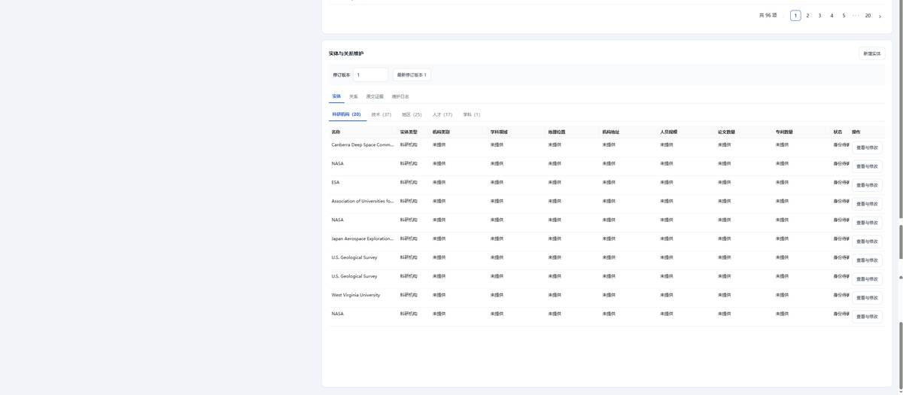{width="5.7in" height="2.49375in"}

图 3-9 人才实体关系抽取界面示意（3/3）

界面示意见图 3-9（共 3 页）。按 3.1 节「通用界面结构与操作步骤」执行：先在接口定义区核对入参字段与返回示例，再在报告页左侧设置【数据源】【实体或关系类型】【识别规则与专业词典】【时间范围】等条件并生成报告；在右侧读取统计指标卡与关系网络图与实体／关系明细表，向下滚动查看明细表与分析结论，最后用右上角导出／打印功能留存结果。

### **科研机构实体识别构建**

科研机构实体识别构建旨在从大规模科研机构数据库及相关信息源中，自动抽取并结构化科研机构的名称、类型、所属学科领域、地理位置及各类关键属性，为科研数据管理、分析与决策提供高质量基础数据。系统集成基于规则的识别与基于词典的识别两种方法，并配套实体维护更新及属性提取机制，确保科研机构数据的全面性、准确性与时效性。

**功能要点**

  ----------------------------------------------------------------------------------------------------------------------------------------
  **项目**       **内容**
  -------------- -------------------------------------------------------------------------------------------------------------------------
  处理对象       学术论文数据库、专利数据库、科研机构官方网站等多源权威数据

  核心方法       基于规则的正则匹配与关键字抽取、基于词典的分词/词性标注与 NER，提取机构名称、类型、学科领域及地理位置，并去重与异常清理

  维护与更新     支持实体库新增、删除、修改及周期性更新；按机构名称获取人员规模、论文产出量、专利数量、地址等属性并按任务周期更新

  输出结果       科研机构实体库及属性档案，为科研数据管理、分析与决策提供基础数据
  ----------------------------------------------------------------------------------------------------------------------------------------

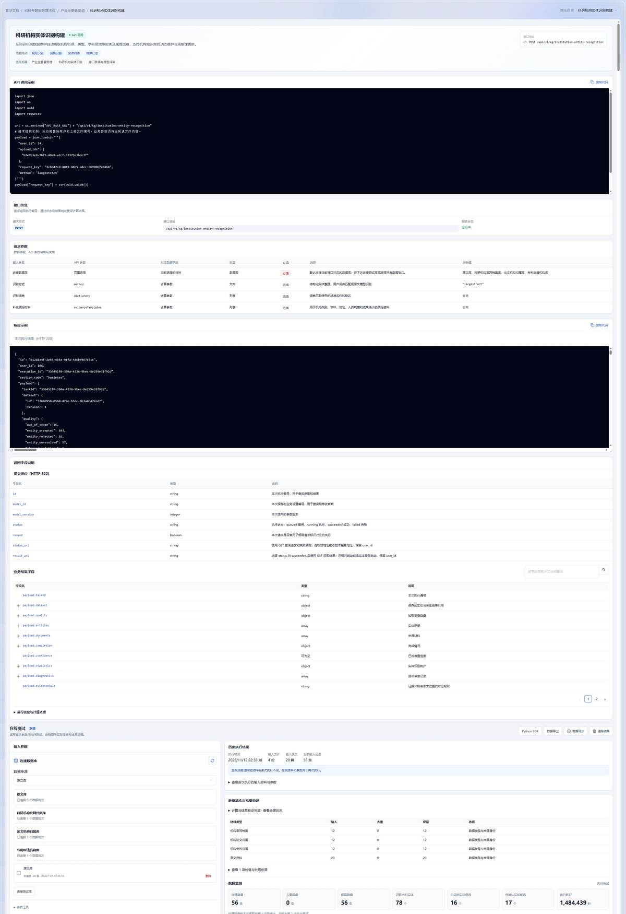{width="5.7in" height="8.3125in"}

图 3-10 科研机构实体识别构建界面示意（1/2）

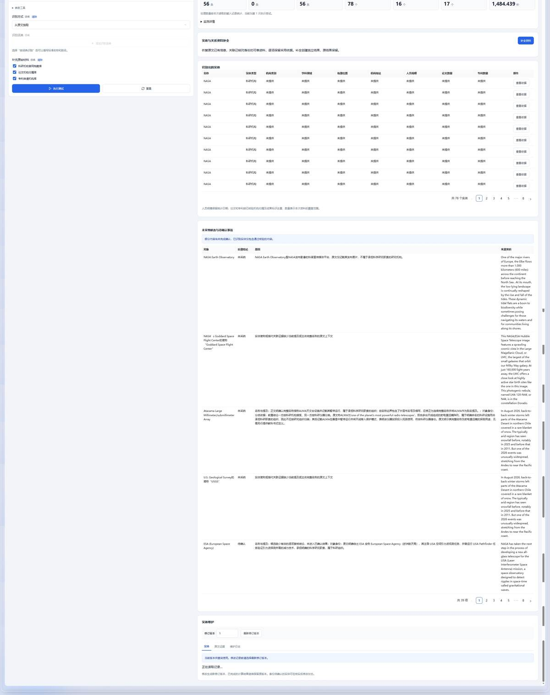{width="5.7in" height="7.2009995625546805in"}

图 3-10 科研机构实体识别构建界面示意（2/2）

界面示意见图 3-10（共 2 页）。按 3.1 节「通用界面结构与操作步骤」执行：先在接口定义区核对入参字段与返回示例，再在报告页左侧设置【数据源】【实体或关系类型】【识别规则与专业词典】【时间范围】等条件并生成报告；在右侧读取统计指标卡与关系网络图与实体／关系明细表，向下滚动查看明细表与分析结论，最后用右上角导出／打印功能留存结果。

### **科研机构实体关系抽取**

科研机构实体关系抽取旨在基于数据融合中枢，对接科研、产业、人才、技术、政策、企业及服务等专题数据库，系统化采集并解析科研机构与其他实体之间的多类型业务关系。通过定制化的关系规则与逻辑设计，提取科研机构在研究技术领域、合作企业、科研人才、关联政策及服务等方面的关键信息，并进行整合，最终构建覆盖全产业链的科研机构实体关系图谱。该模型可为科技情报分析、创新生态评估、政策制定及资源配置提供结构化、可视化的基础数据支持。

**功能要点**

  ---------------------------------------------------------------------------------------------------------------------------------------
  **项目**       **内容**
  -------------- ------------------------------------------------------------------------------------------------------------------------
  处理对象       科研、产业、人才、技术、政策、企业及服务等专题数据库

  核心方法       按业务场景制定关系规则，识别并抽取合作与隶属、产业领域、人才网络、技术研发、政策关联、企业合作及服务机构对接等关系信息

  维护与更新     批量导入后执行去重、纠错、缺失值补全与格式统一，通过定时更新与自动化维护机制持续同步

  输出结果       覆盖全产业链的科研机构实体关系图谱，支撑科技情报分析、创新生态评估与资源配置
  ---------------------------------------------------------------------------------------------------------------------------------------

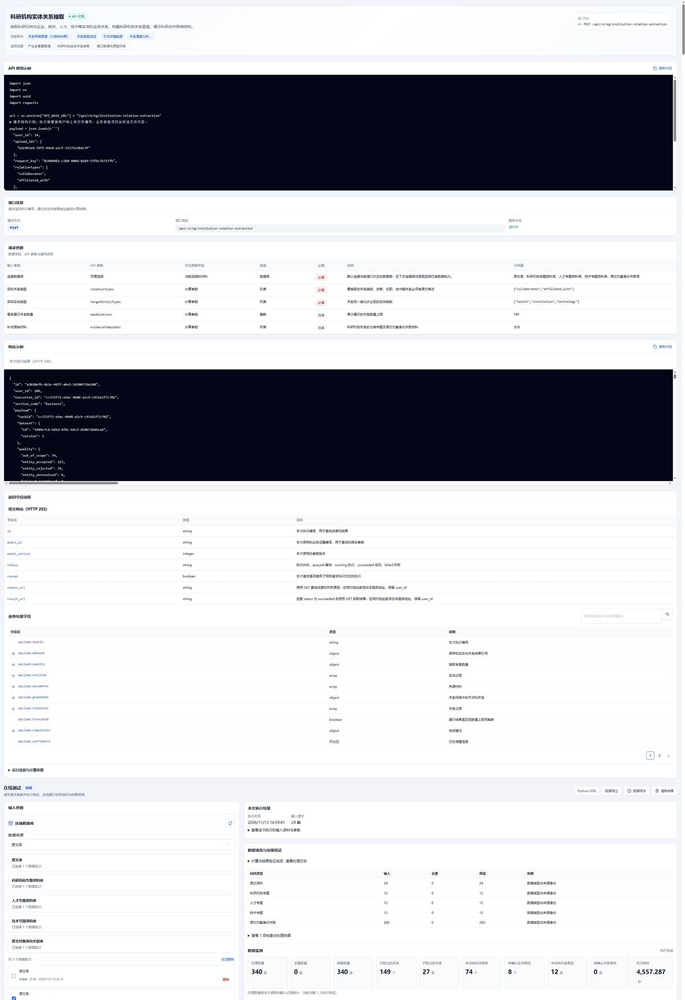{width="5.7in" height="8.3125in"}

图 3-11 科研机构实体关系抽取界面示意（1/3）

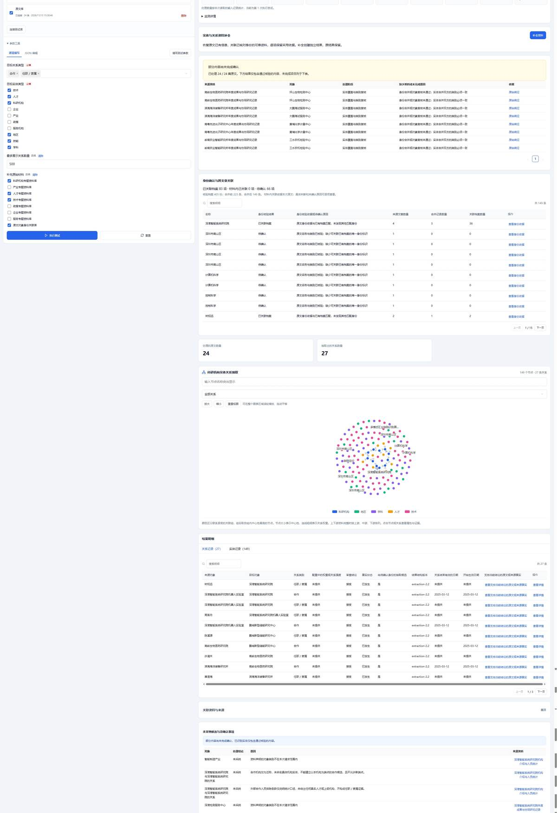{width="5.7in" height="8.3125in"}

图 3-11 科研机构实体关系抽取界面示意（2/3）

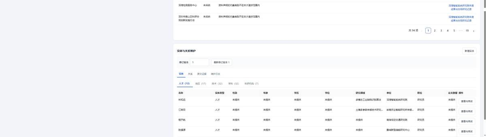{width="5.7in" height="1.615in"}

图 3-11 科研机构实体关系抽取界面示意（3/3）

界面示意见图 3-11（共 3 页）。按 3.1 节「通用界面结构与操作步骤」执行：先在接口定义区核对入参字段与返回示例，再在报告页左侧设置【数据源】【实体或关系类型】【识别规则与专业词典】【时间范围】等条件并生成报告；在右侧读取统计指标卡与关系网络图与实体／关系明细表，向下滚动查看明细表与分析结论，最后用右上角导出／打印功能留存结果。

## 技术链深度分析模型构建

技术链深度分析模型构建面向技术发展全生命周期与产业化路径，依托技术知识图谱、专题库及多源权威数据，实现从技术全景展示、发展演化到区域对比、热点识别、产业化潜力评估、瓶颈诊断与重点布局推荐的全链路分析支持。本章节共包含十一类模型：全景技术链模型全面展示某一技术或细分产业链的结构及节点属性；深圳技术链模型针对深圳技术产业链进行全链条可视化与关键环节识别；技术发展历程模型构建重大事件时间线；深圳细分领域分布模型预测技术在区域内的领域覆盖与集中度；技术前沿热点领域识别模型自动判定并跟踪新兴热点；技术产业化潜力识别模型评估科研储备、转化效率及市场竞争力的综合水平；技术转化瓶颈堵点原因识别模型定位成果转化障碍并提出优化建议；技术阶段分析模型判定技术所处阶段；深圳技术发展问题识别模型识别短板与风险；深圳技术发展机遇识别模型锁定优势领域与潜在方向；深圳技术发展重点布局领域推荐模型推荐重点技术布局方向。

### **全景技术链模型**

全景技术链模型基于技术知识图谱与技术基础数据，构建能够完整展示某一技术或细分技术产业链的分析与展示系统。模型以全要素节点及其属性为核心，呈现技术链结构全貌，帮助用户全面掌握产业链布局、节点特征及关联关系，为技术发展判断、产业规划和战略决策提供可视化支持。

**模型输入与输出**

  ---------------------------------------------------------------------------------------------------------------
  **项目**       **内容**
  -------------- ------------------------------------------------------------------------------------------------
  输入           技术分类体系数据、技术知识图谱、专利数据、论文数据、标准信息、产品信息、企业信息。

  输出           完整的技术链结构可视化结果，包括节点属性、产业链趋势分析图以及在线检索接口。

  调用方式       支持通过Restful API、SDK方式调用，提供技术标签检索、在线监测、分析、数据导出及定制化展示服务。
  ---------------------------------------------------------------------------------------------------------------

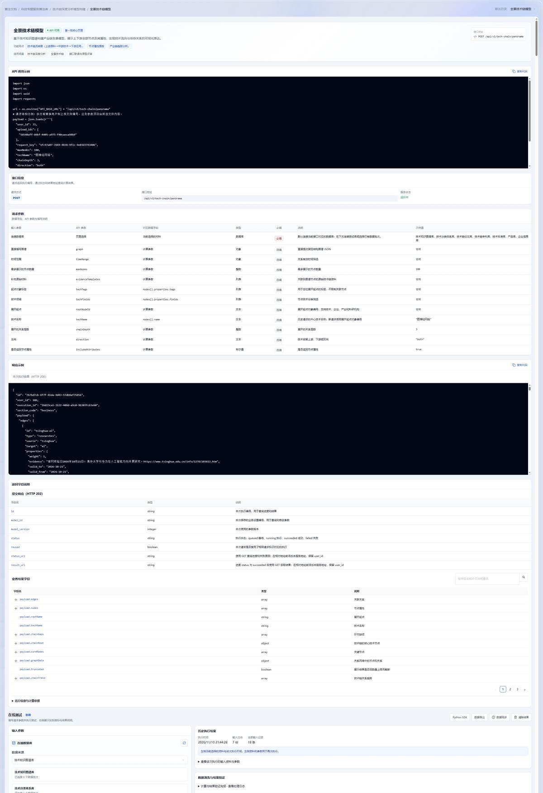{width="5.7in" height="8.3125in"}

图 3-12 全景技术链模型界面示意（1/3）

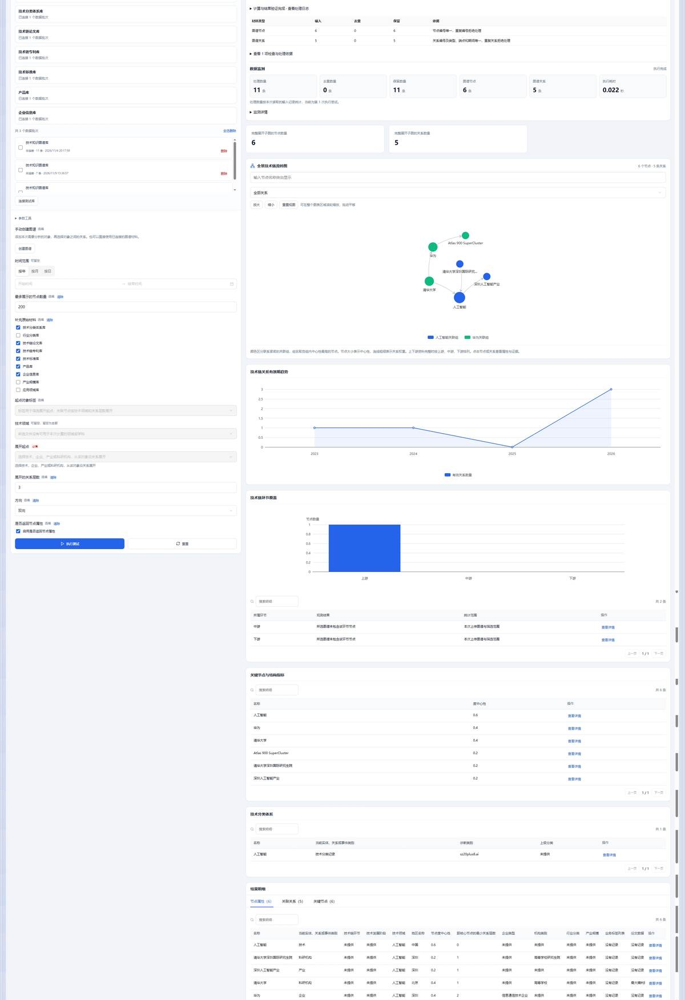{width="5.7in" height="8.3125in"}

图 3-12 全景技术链模型界面示意（2/3）

{width="5.7in" height="1.4629997812773403in"}

图 3-12 全景技术链模型界面示意（3/3）

界面示意见图 3-12（共 3 页）。按 3.1 节「通用界面结构与操作步骤」执行：先在接口定义区核对入参字段与返回示例，再在报告页左侧设置【技术名称／技术标签】【时间范围】【区域范围（全球／全国／深圳）】【评价指标与阈值】等条件并生成报告；在右侧读取统计指标卡与柱状图、折线与面积趋势图、雷达图及时间线视图，向下滚动查看明细表与分析结论，最后用右上角导出／打印功能留存结果。本模型重点输出：完整的技术链结构可视化结果，包括节点属性、产业链趋势分析图以及在线检索接口。如需系统集成，可按接口定义以 Restful API 或 SDK 调用，输入输出字段与上表一致。

### **深圳技术链模型**

深圳技术链模型基于技术知识图谱与技术基础数据构建，旨在全景化展示某一技术或细分技术在深圳产业链中的全部节点及其属性，全面揭示技术链的上下游结构与关键环节。该算法对接深圳市科技局、深圳市产业技术研究院、深圳市工业技术研究院等权威数据源，整合全市相关技术产业信息，并通过技术分类与行业分类映射形成知识结构，确保展示内容的完整性与准确性。

**模型输入与输出**

  -----------------------------------------------------------------------------------------------------------------------------
  **项目**       **内容**
  -------------- --------------------------------------------------------------------------------------------------------------
  输入           深圳市技术产业分类信息、技术知识图谱、行业分类数据、企业信息、产业规模数据、应用领域数据。

  输出           深圳技术链全景可视化结果，包括节点属性列表、产业链结构分析、关键节点识别及关联关系展示。

  调用方式       支持通过Restful API、SDK方式调用，可按技术名称或分类进行查询，生成节点属性分析、关联关系展示及数据导出服务。
  -----------------------------------------------------------------------------------------------------------------------------

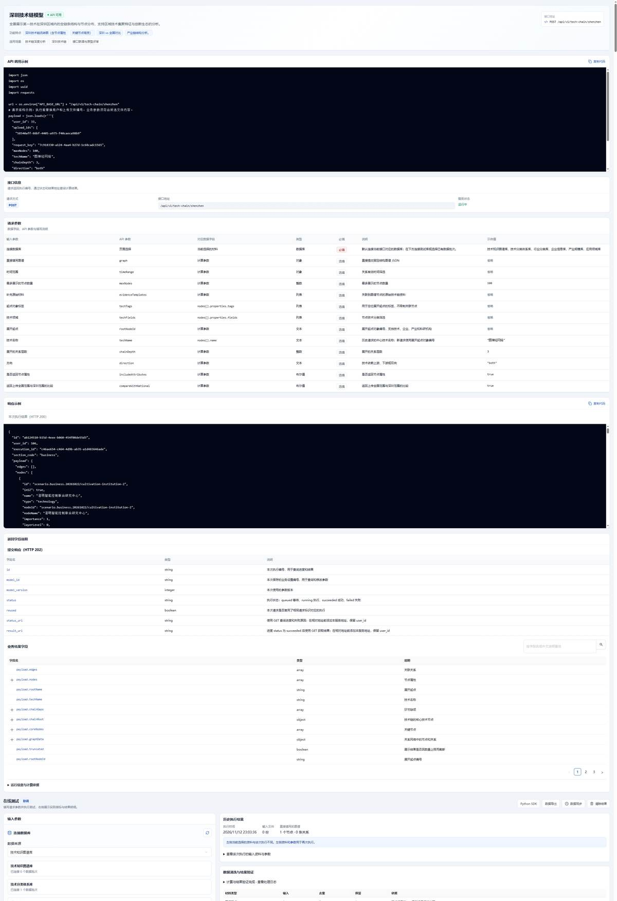{width="5.7in" height="8.3125in"}

图 3-13 深圳技术链模型界面示意（1/3）

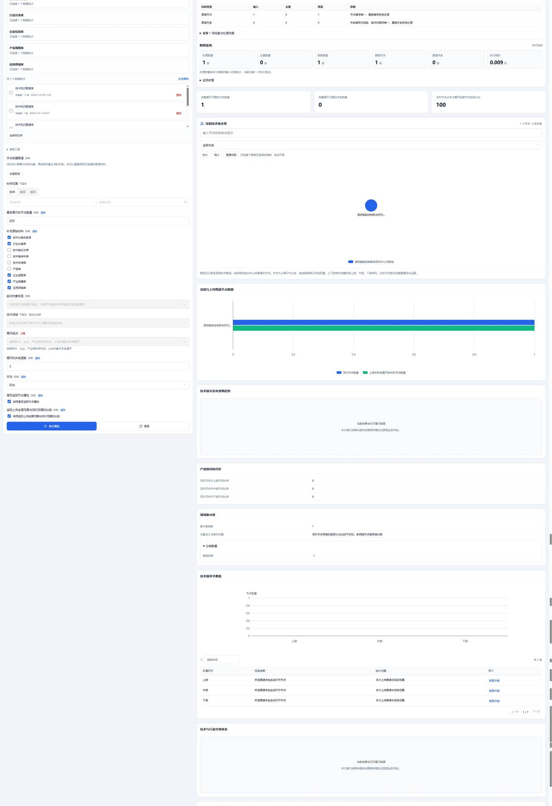{width="5.7in" height="8.3125in"}

图 3-13 深圳技术链模型界面示意（2/3）

{width="5.7in" height="1.6815004374453193in"}

图 3-13 深圳技术链模型界面示意（3/3）

界面示意见图 3-13（共 3 页）。按 3.1 节「通用界面结构与操作步骤」执行：先在接口定义区核对入参字段与返回示例，再在报告页左侧设置【技术名称／技术标签】【时间范围】【区域范围（全球／全国／深圳）】【评价指标与阈值】等条件并生成报告；在右侧读取统计指标卡与柱状图、折线与面积趋势图、雷达图及时间线视图，向下滚动查看明细表与分析结论，最后用右上角导出／打印功能留存结果。本模型重点输出：深圳技术链全景可视化结果，包括节点属性列表、产业链结构分析、关键节点识别及关联关系展示。如需系统集成，可按接口定义以 Restful API 或 SDK 调用，输入输出字段与上表一致。

### **技术发展历程模型**

技术发展历程模型用于系统化分析特定技术在不同时期的重要动态变化，基于技术基础指标与资讯基础指标，采集该技术发展过程中的重大事件数据，通过定义事件指标并设定阈值来识别重大事件，并据此计算与构建重大事件时间线。该算法为研究技术演化规律、评估技术成熟度及预测未来趋势提供量化依据，可广泛应用于科技情报分析、技术战略规划及政策制定。

**模型输入与输出**

  ---------------------------------------------------------------------------------------------------------------------
  **项目**       **内容**
  -------------- ------------------------------------------------------------------------------------------------------
  输入           技术新闻数据、专利数据、科研论文数据、行业资讯数据、技术标准发布信息、媒体报道量、政策文件发布频率。

  输出           技术发展重大事件时间线、可视化展示结果、事件分析报告。

  调用方式       支持通过Restful API、SDK方式调用，可按技术标签进行发展历程查询、重大事件识别及数据导出服务。
  ---------------------------------------------------------------------------------------------------------------------

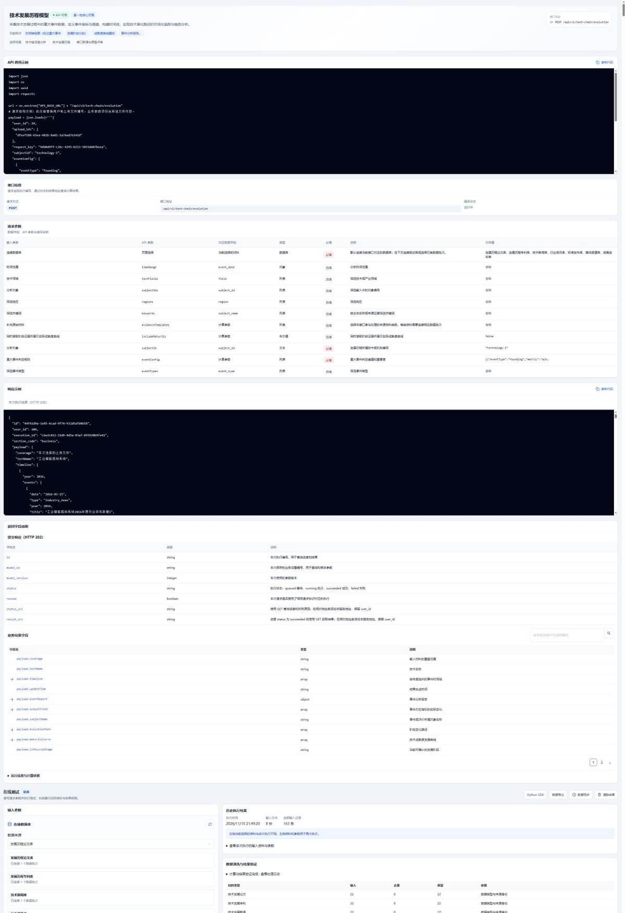{width="5.7in" height="8.3125in"}

图 3-14 技术发展历程模型界面示意（1/9）

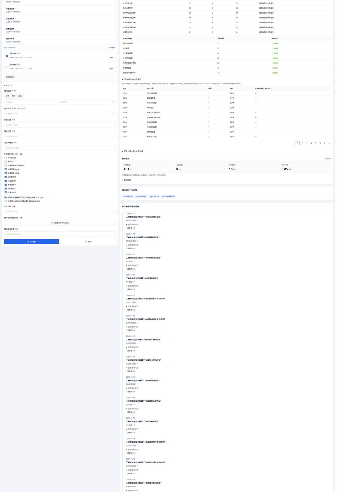{width="5.7in" height="8.3125in"}

图 3-14 技术发展历程模型界面示意（2/9）

{width="5.7in" height="8.3125in"}

图 3-14 技术发展历程模型界面示意（3/9）

{width="5.7in" height="8.3125in"}

图 3-14 技术发展历程模型界面示意（4/9）

{width="5.7in" height="8.3125in"}

图 3-14 技术发展历程模型界面示意（5/9）

{width="5.7in" height="8.3125in"}

图 3-14 技术发展历程模型界面示意（6/9）

{width="5.7in" height="8.3125in"}

图 3-14 技术发展历程模型界面示意（7/9）

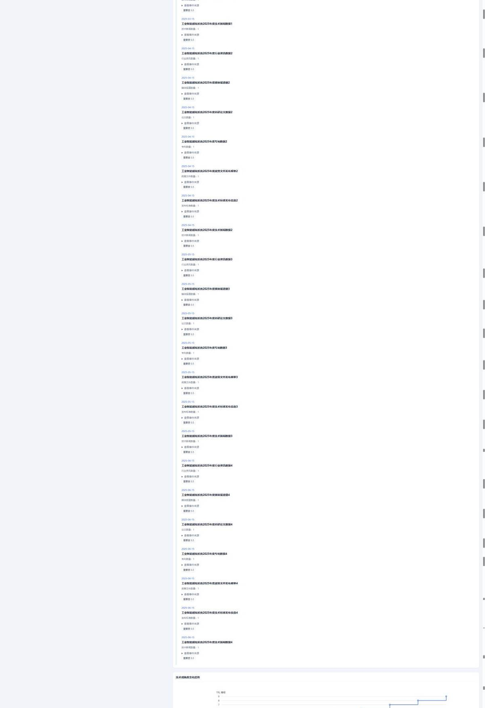{width="5.7in" height="8.3125in"}

图 3-14 技术发展历程模型界面示意（8/9）

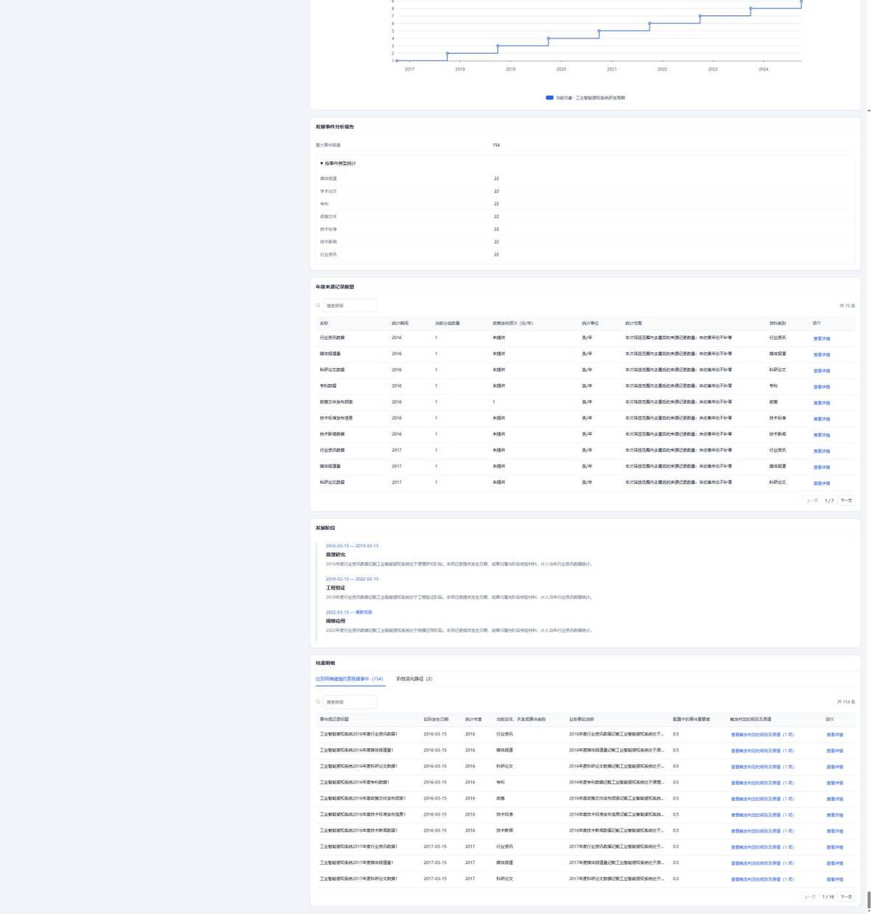{width="5.7in" height="5.980250437445319in"}

图 3-14 技术发展历程模型界面示意（9/9）

界面示意见图 3-14（共 9 页）。按 3.1 节「通用界面结构与操作步骤」执行：先在接口定义区核对入参字段与返回示例，再在报告页左侧设置【技术名称／技术标签】【时间范围】【区域范围（全球／全国／深圳）】【评价指标与阈值】等条件并生成报告；在右侧读取统计指标卡与柱状图、折线与面积趋势图、雷达图及时间线视图，向下滚动查看明细表与分析结论，最后用右上角导出／打印功能留存结果。本模型重点输出：技术发展重大事件时间线、可视化展示结果、事件分析报告。如需系统集成，可按接口定义以 Restful API 或 SDK 调用，输入输出字段与上表一致。

### **深圳细分领域分布模型**

深圳细分领域分布模型基于技术知识图谱与深圳区域产业数据，能够识别并计算某项技术在深圳的细分领域布局情况，为技术创新分析、产业决策和区域发展评估提供精确的领域分布信息。该算法通过整合专利、学术、企业及政策等多源数据，构建技术与产业的关联图谱，并利用机器学习方法进行细分领域预测，确保结果具有准确性、全面性和可追溯性。

**模型输入与输出**

  -------------------------------------------------------------------------------------------------------------------------------------------------
  **项目**       **内容**
  -------------- ----------------------------------------------------------------------------------------------------------------------------------
  输入           专利数据、学术文献数据、企业信息、行业统计数据、政策开放数据、技术关键词及分类信息、深圳产业布局与分类数据。

  输出           深圳某项技术的细分领域分布分析结果，包括领域覆盖率、集中度指标、领域图谱及预测分析报告。

  调用方式       支持通过Restful API、SDK方式调用，可根据技术名称或关键词获取深圳技术细分领域分布数据及分析结果，并支持数据导出与可视化展示服务。
  -------------------------------------------------------------------------------------------------------------------------------------------------

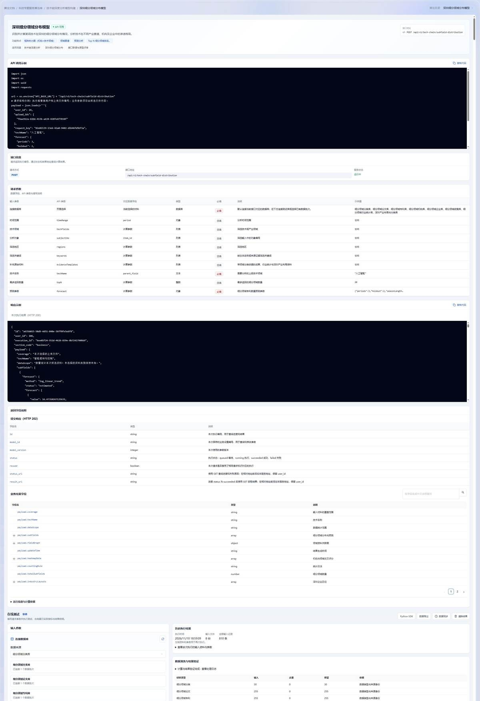{width="5.7in" height="8.3125in"}

图 3-15 深圳细分领域分布模型界面示意（1/3）

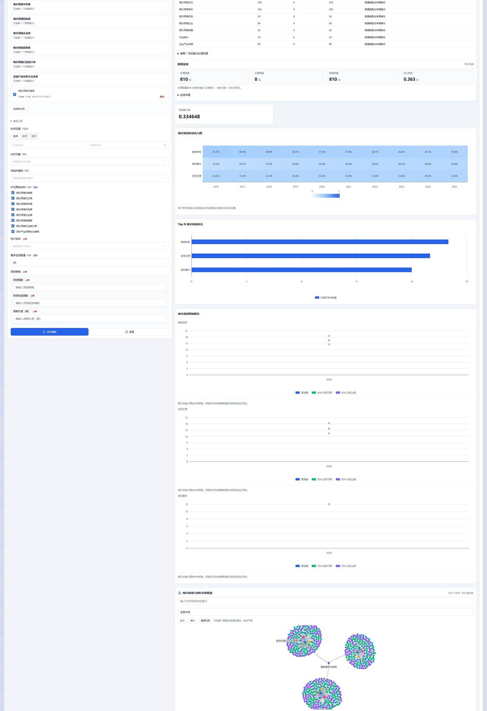{width="5.7in" height="8.3125in"}

图 3-15 深圳细分领域分布模型界面示意（2/3）

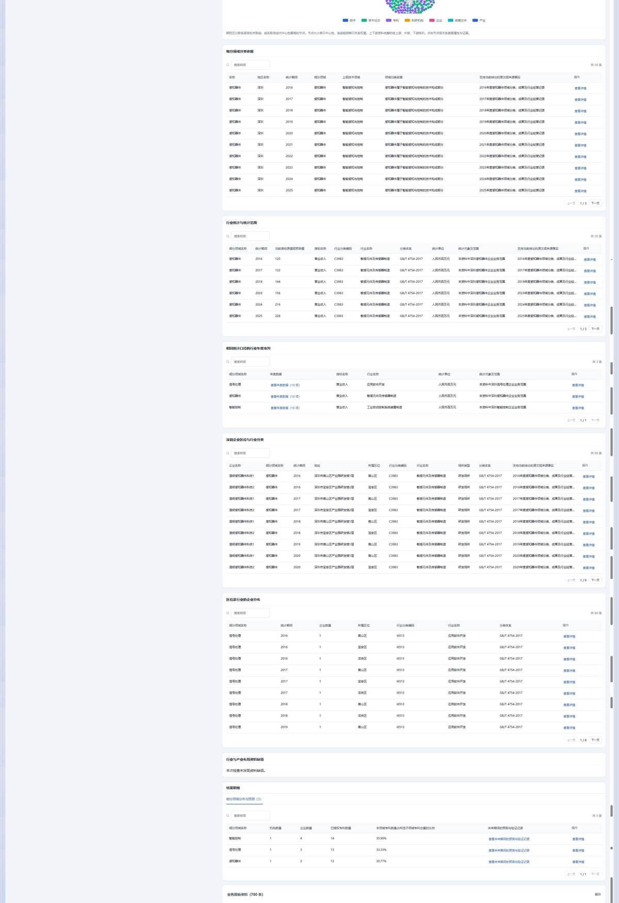{width="5.7in" height="8.3125in"}

图 3-15 深圳细分领域分布模型界面示意（3/3）

界面示意见图 3-15（共 3 页）。按 3.1 节「通用界面结构与操作步骤」执行：先在接口定义区核对入参字段与返回示例，再在报告页左侧设置【技术名称／技术标签】【时间范围】【区域范围（全球／全国／深圳）】【评价指标与阈值】等条件并生成报告；在右侧读取统计指标卡与柱状图、折线与面积趋势图、雷达图及时间线视图，向下滚动查看明细表与分析结论，最后用右上角导出／打印功能留存结果。本模型重点输出：深圳某项技术的细分领域分布分析结果，包括领域覆盖率、集中度指标、领域图谱及预测分析报告。如需系统集成，可按接口定义以 Restful API 或 SDK 调用，输入输出字段与上表一致。

### **技术前沿热点领域识别模型**

技术前沿热点领域识别模型通过对接技术与资讯数据库，采集并分析学术论文、专利、新闻报道、技术博客等多源信息，依据技术前沿性指标及阈值，自动识别和解析科技领域中新兴热点。该算法综合研究热度、关键词权重、领域专家活跃度等多维指标，对某一主题或技术是否具有前沿属性进行量化评估，并支持对热点趋势进行监测与预测，为科研布局、技术投资和战略决策提供依据。

**模型输入与输出**

  -------------------------------------------------------------------------------------------------------------------------------
  **项目**       **内容**
  -------------- ----------------------------------------------------------------------------------------------------------------
  输入           学术论文数据、专利数据、新闻与技术博客信息、行业资讯数据、技术领域分类信息、专家活动数据。

  输出           技术前沿热点领域列表、热点指数分析报告、趋势预测结果及发展阶段可视化展示。

  调用方式       支持通过Restful API、SDK方式调用，可按技术主题或关键词进行热点领域识别与趋势预测，结果可导出并支持图表可视化。
  -------------------------------------------------------------------------------------------------------------------------------

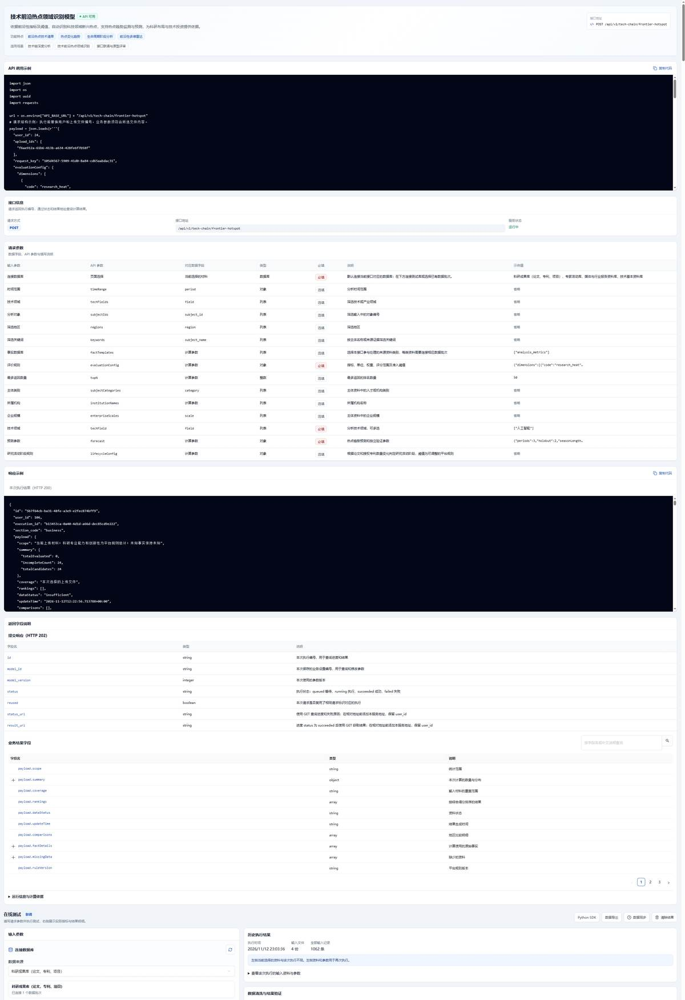{width="5.7in" height="8.3125in"}

图 3-16 技术前沿热点领域识别模型界面示意（1/2）

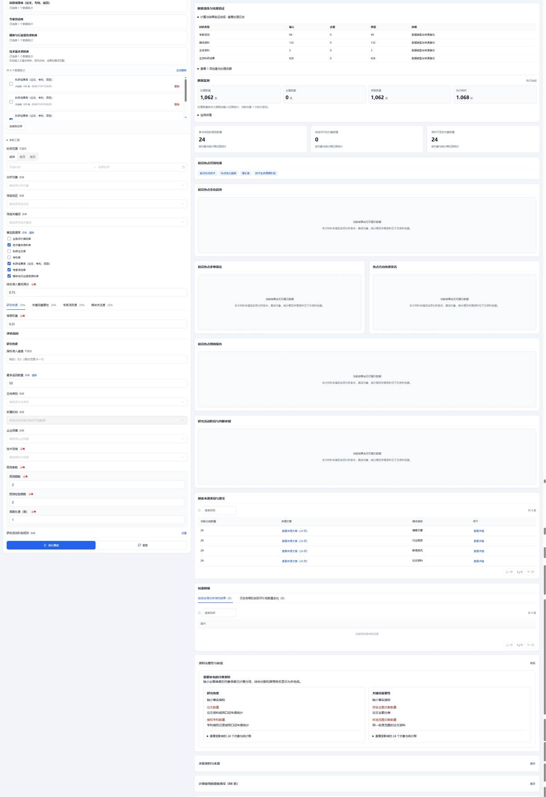{width="5.7in" height="8.3125in"}

图 3-16 技术前沿热点领域识别模型界面示意（2/2）

界面示意见图 3-16（共 2 页）。按 3.1 节「通用界面结构与操作步骤」执行：先在接口定义区核对入参字段与返回示例，再在报告页左侧设置【技术名称／技术标签】【时间范围】【区域范围（全球／全国／深圳）】【评价指标与阈值】等条件并生成报告；在右侧读取统计指标卡与柱状图、折线与面积趋势图、雷达图及时间线视图，向下滚动查看明细表与分析结论，最后用右上角导出／打印功能留存结果。本模型重点输出：技术前沿热点领域列表、热点指数分析报告、趋势预测结果及发展阶段可视化展示。如需系统集成，可按接口定义以 Restful API 或 SDK 调用，输入输出字段与上表一致。

### **技术产业化潜力识别模型**

技术产业化潜力识别模型用于评估某项技术在基础科研、成果转化及产品市场三个方面的综合发展能力，通过建立指标体系与阈值标准，计算技术对应的各项指标值，并形成技术产业化潜力指数。该指数能够反映技术在科研储备、转化效率及市场竞争力等维度的综合水平，为政府部门、科研机构、投资平台及企业提供技术筛选、优先布局和投融资决策的量化依据。

**模型输入与输出**

  -----------------------------------------------------------------------------------------------------------------------------
  **项目**       **内容**
  -------------- --------------------------------------------------------------------------------------------------------------
  输入           专利数据、学术论文数据、科技期刊信息、市场调研数据、技术转化案例数据、市场需求数据、评价指标体系及权重参数。

  输出           技术产业化潜力指数、指数排名、趋势分析结果、可视化图表。

  调用方式       支持通过Restful API、SDK方式调用，可按技术标签进行产业化潜力查询及指数排名，并支持趋势分析与数据导出。
  -----------------------------------------------------------------------------------------------------------------------------

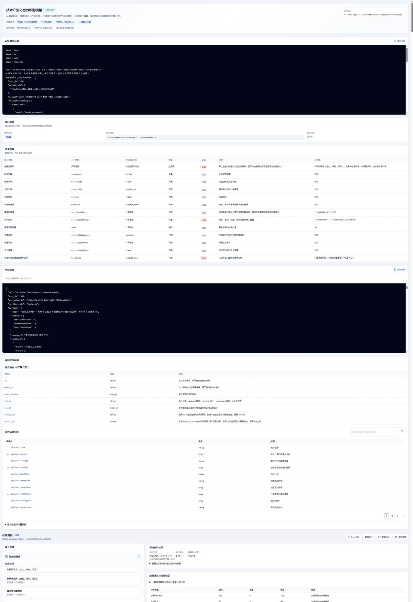{width="5.7in" height="8.3125in"}

图 3-17 技术产业化潜力识别模型界面示意（1/3）

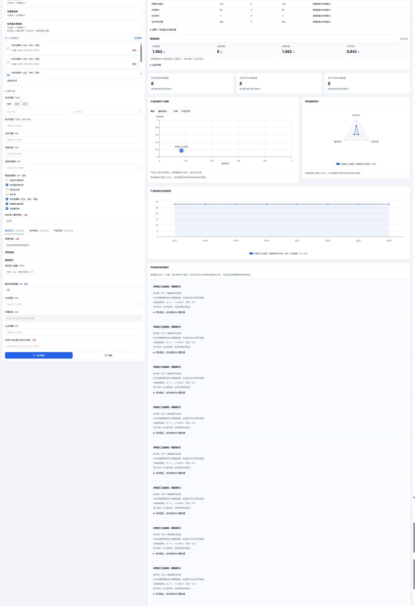{width="5.7in" height="8.3125in"}

图 3-17 技术产业化潜力识别模型界面示意（2/3）

{width="5.7in" height="1.0545002187226598in"}

图 3-17 技术产业化潜力识别模型界面示意（3/3）

界面示意见图 3-17（共 3 页）。按 3.1 节「通用界面结构与操作步骤」执行：先在接口定义区核对入参字段与返回示例，再在报告页左侧设置【技术名称／技术标签】【时间范围】【区域范围（全球／全国／深圳）】【评价指标与阈值】等条件并生成报告；在右侧读取统计指标卡与柱状图、折线与面积趋势图、雷达图及时间线视图，向下滚动查看明细表与分析结论，最后用右上角导出／打印功能留存结果。本模型重点输出：技术产业化潜力指数、指数排名、趋势分析结果、可视化图表。如需系统集成，可按接口定义以 Restful API 或 SDK 调用，输入输出字段与上表一致。

### **技术转化瓶颈堵点原因识别模型**

技术转化瓶颈堵点原因识别模型用于系统化发现产业在技术成果转化过程中的关键障碍与制约环节。通过构建涵盖技术发展、专利申请及成果转化等维度的评价指标体系与阈值判断规则，算法可计算各技术在不同环节的指标值，识别达到瓶颈堵点标准的技术要素，并分析其产生原因，明确优化方向与解决方案。该算法为政府部门、科研机构及企业提供针对性的决策支持与改进路径。

**模型输入与输出**

  -----------------------------------------------------------------------------------------------------------------------------------
  **项目**       **内容**
  -------------- --------------------------------------------------------------------------------------------------------------------
  输入           专利数据、学术论文数据、成果转化平台数据、技术发展趋势信息、成果产出数据、转化效率数据、评价指标体系与阈值设定。

  输出           技术转化瓶颈与堵点列表、原因分析报告、优化建议与解决方案、可视化分析结果。

  调用方式       支持通过Restful API、SDK方式调用，可按技术标签获取转化瓶颈信息、原因分析及解决方案，并支持数据导出与报告生成服务。
  -----------------------------------------------------------------------------------------------------------------------------------

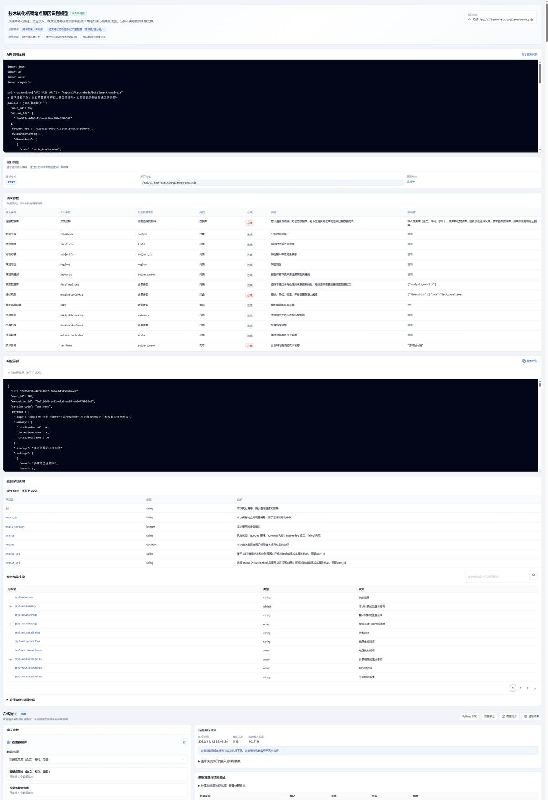{width="5.7in" height="8.3125in"}

图 3-18 技术转化瓶颈堵点原因识别模型界面示意（1/2）

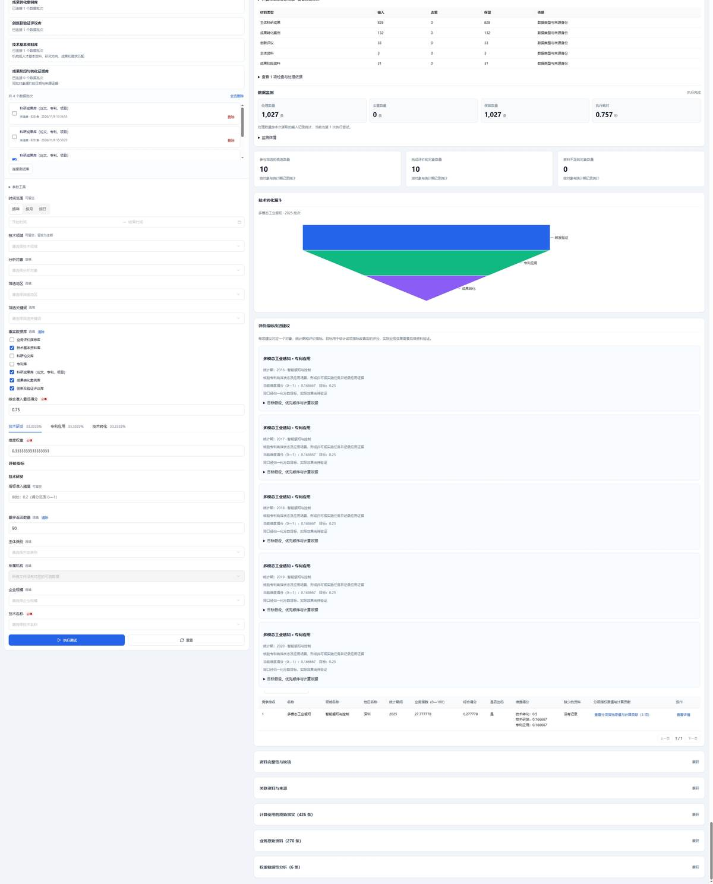{width="5.7in" height="7.06799978127734in"}

图 3-18 技术转化瓶颈堵点原因识别模型界面示意（2/2）

界面示意见图 3-18（共 2 页）。按 3.1 节「通用界面结构与操作步骤」执行：先在接口定义区核对入参字段与返回示例，再在报告页左侧设置【技术名称／技术标签】【时间范围】【区域范围（全球／全国／深圳）】【评价指标与阈值】等条件并生成报告；在右侧读取统计指标卡与柱状图、折线与面积趋势图、雷达图及时间线视图，向下滚动查看明细表与分析结论，最后用右上角导出／打印功能留存结果。本模型重点输出：技术转化瓶颈与堵点列表、原因分析报告、优化建议与解决方案、可视化分析结果。如需系统集成，可按接口定义以 Restful API 或 SDK 调用，输入输出字段与上表一致。

### **技术阶段分析模型**

技术阶段分析模型用于判定某项技术在研发与应用周期中的当前阶段。该算法通过对技术相关指标进行采集、计算与分析，将技术归类为初级、中级或高级等阶段，为科研管理、技术评估与战略决策提供量化依据。模型结合数据驱动与专家经验设定阈值，确保阶段划分的科学性与稳定性，并支持在线查询与监测服务。

**模型输入与输出**

  -----------------------------------------------------------------------------------------------------------------------------------
  **项目**       **内容**
  -------------- --------------------------------------------------------------------------------------------------------------------
  输入           技术研发报告数据、专利文献数据、市场调研数据、领域专题库信息、技术成熟度指数、技术创新度指数、专家设定的阈值参数。

  输出           技术阶段判定结果（初级/中级/高级）、详细得分表、趋势变化分析图表。

  调用方式       支持通过Restful API、SDK及在线展示平台调用，可按技术名称或指标进行阶段查询与分析，并支持生成报告及数据导出服务。
  -----------------------------------------------------------------------------------------------------------------------------------

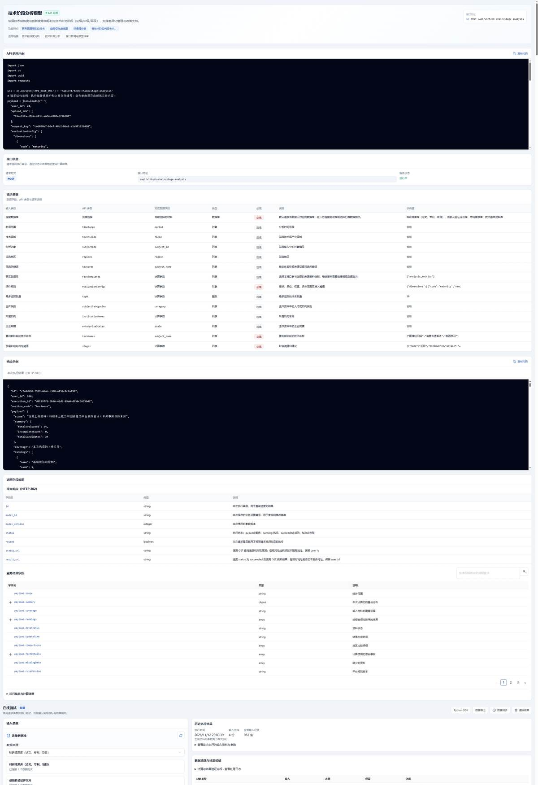{width="5.7in" height="8.3125in"}

图 3-19 技术阶段分析模型界面示意（1/2）

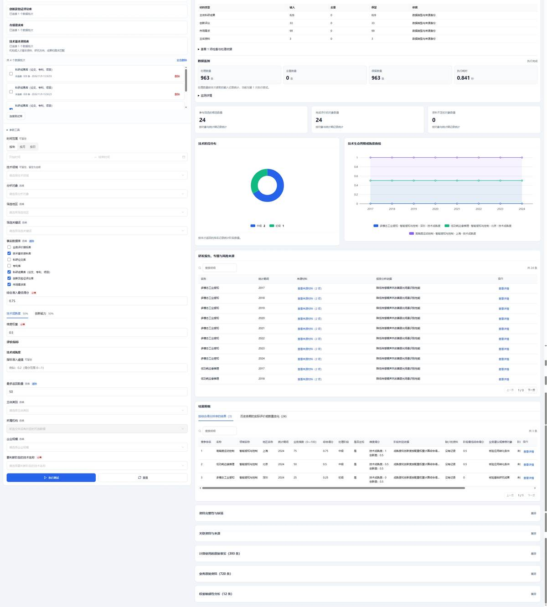{width="5.7in" height="6.3270002187226595in"}

图 3-19 技术阶段分析模型界面示意（2/2）

界面示意见图 3-19（共 2 页）。按 3.1 节「通用界面结构与操作步骤」执行：先在接口定义区核对入参字段与返回示例，再在报告页左侧设置【技术名称／技术标签】【时间范围】【区域范围（全球／全国／深圳）】【评价指标与阈值】等条件并生成报告；在右侧读取统计指标卡与柱状图、折线与面积趋势图、雷达图及时间线视图，向下滚动查看明细表与分析结论，最后用右上角导出／打印功能留存结果。本模型重点输出：技术阶段判定结果（初级/中级/高级）、详细得分表、趋势变化分析图表。如需系统集成，可按接口定义以 Restful API 或 SDK 调用，输入输出字段与上表一致。

### **深圳技术发展问题识别模型**

深圳技术发展问题识别模型以各领域专题库为基础，综合设计技术负面评价指标，构建多维度分析框架，并结合深圳技术数据与全国技术数据的对比分析，精准识别深圳技术发展中的短板与风险。该算法覆盖数据采集、处理、指标体系构建、模型训练与问题识别全流程，并在识别结果的基础上提出针对性改进建议，为深圳技术创新与发展提供决策支持。

**模型输入与输出**

  -----------------------------------------------------------------------------------------------------------------------------------------------
  **项目**       **内容**
  -------------- --------------------------------------------------------------------------------------------------------------------------------
  输入           深圳技术数据、全国技术数据、专利信息、技术报告、学术论文数据、新闻动态数据、负面评价指标体系与阈值参数。

  输出           深圳技术发展主要问题与风险列表、对比评估分析结果、改进建议清单、可视化分析结果。

  调用方式       支持通过Restful API、SDK方式调用，可按技术领域或专题标签检索深圳技术发展问题与风险分析结果，并支持改进建议生成与数据导出服务。
  -----------------------------------------------------------------------------------------------------------------------------------------------

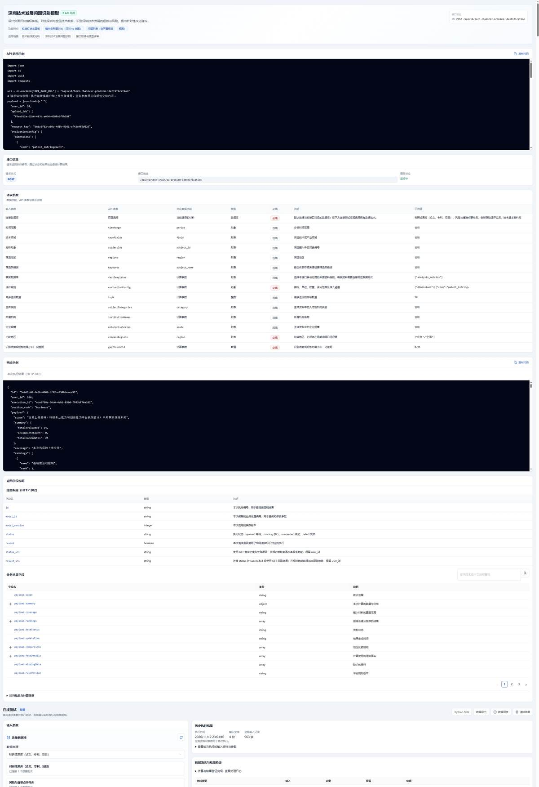{width="5.7in" height="8.3125in"}

图 3-20 深圳技术发展问题识别模型界面示意（1/3）

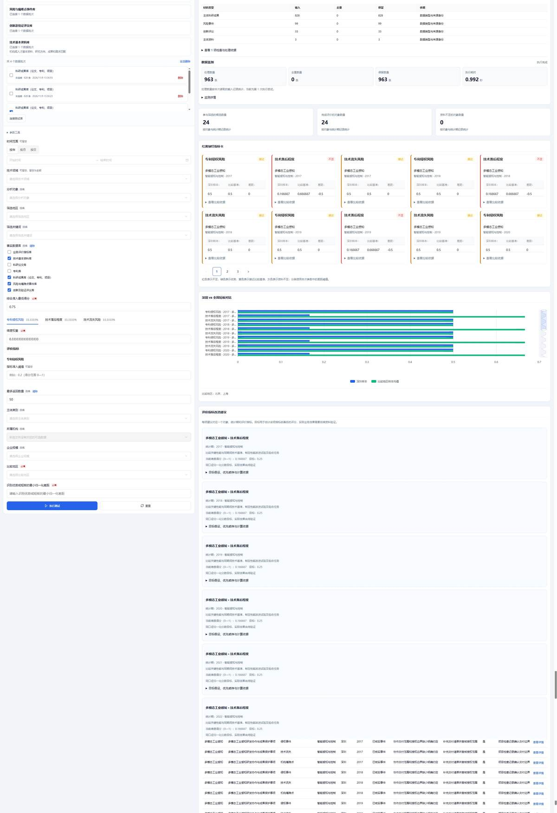{width="5.7in" height="8.3125in"}

图 3-20 深圳技术发展问题识别模型界面示意（2/3）

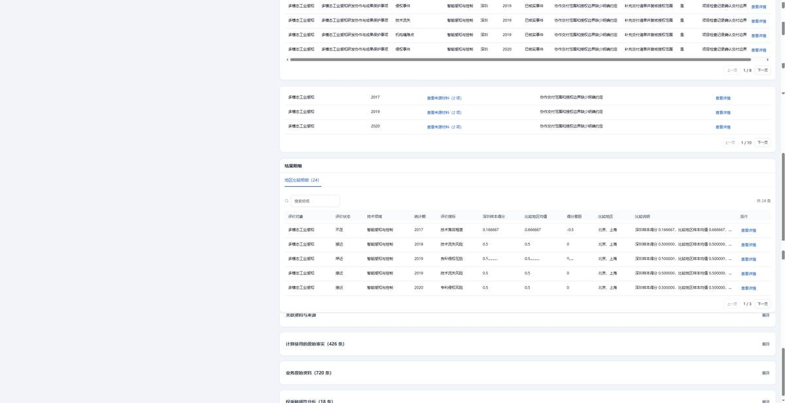{width="5.7in" height="2.9307502187226597in"}

图 3-20 深圳技术发展问题识别模型界面示意（3/3）

界面示意见图 3-20（共 3 页）。按 3.1 节「通用界面结构与操作步骤」执行：先在接口定义区核对入参字段与返回示例，再在报告页左侧设置【技术名称／技术标签】【时间范围】【区域范围（全球／全国／深圳）】【评价指标与阈值】等条件并生成报告；在右侧读取统计指标卡与柱状图、折线与面积趋势图、雷达图及时间线视图，向下滚动查看明细表与分析结论，最后用右上角导出／打印功能留存结果。本模型重点输出：深圳技术发展主要问题与风险列表、对比评估分析结果、改进建议清单、可视化分析结果。如需系统集成，可按接口定义以 Restful API 或 SDK 调用，输入输出字段与上表一致。

### **深圳技术发展机遇识别模型**

深圳技术发展机遇识别模型通过综合对比各领域专题库数据，设计多维度技术发展指标，构建技术发展评价模型，并结合深圳与全国技术数据进行对比分析，识别深圳在技术发展中的优势领域、潜在方向及重点机会。该算法为政府部门、科研机构和企业提供科学决策依据，推动技术创新战略优化和区域产业竞争力提升。

**模型输入与输出**

  -----------------------------------------------------------------------------------------------------------------------------
  **项目**       **内容**
  -------------- --------------------------------------------------------------------------------------------------------------
  输入           深圳技术专题库数据（专利申请量、成果转化率、创新人才数量等）、全国技术数据、企业创新信息、成果转化案例数据。

  输出           深圳技术发展优势领域清单、潜在发展方向分析、高潜力企业列表。

  调用方式       支持通过Restful API、SDK方式调用，可按技术领域或关键词进行机遇检索，并支持分析报告生成及数据导出服务。
  -----------------------------------------------------------------------------------------------------------------------------

{width="5.7in" height="8.3125in"}

图 3-21 深圳技术发展机遇识别模型界面示意（1/3）

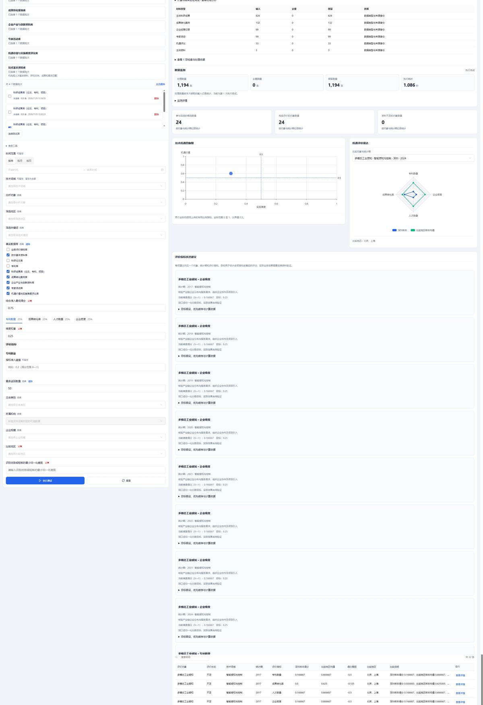{width="5.7in" height="8.3125in"}

图 3-21 深圳技术发展机遇识别模型界面示意（2/3）

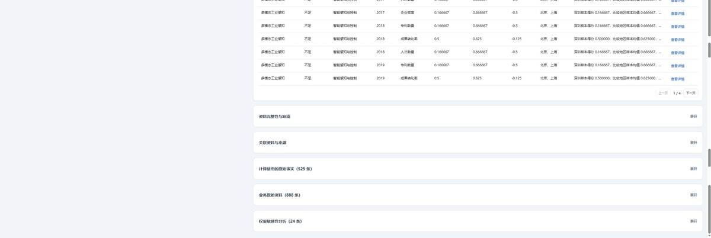{width="5.7in" height="1.9095002187226597in"}

图 3-21 深圳技术发展机遇识别模型界面示意（3/3）

界面示意见图 3-21（共 3 页）。按 3.1 节「通用界面结构与操作步骤」执行：先在接口定义区核对入参字段与返回示例，再在报告页左侧设置【技术名称／技术标签】【时间范围】【区域范围（全球／全国／深圳）】【评价指标与阈值】等条件并生成报告；在右侧读取统计指标卡与柱状图、折线与面积趋势图、雷达图及时间线视图，向下滚动查看明细表与分析结论，最后用右上角导出／打印功能留存结果。本模型重点输出：深圳技术发展优势领域清单、潜在发展方向分析、高潜力企业列表。如需系统集成，可按接口定义以 Restful API 或 SDK 调用，输入输出字段与上表一致。

### **深圳技术发展重点布局领域推荐模型**

深圳技术发展重点布局领域推荐模型旨在基于深圳技术优势分析与问题识别，结合领域专家的知识和策略，整合专利、科技项目、技术文献等多源数据，开展指标构建与关联分析，计算并推荐重点技术布局领域。该模型通过技术数据与专家经验的融合，实现对深圳技术发展的科学规划与重点部署指导，支持战略决策和资源配置优化。

**模型输入与输出**

  ---------------------------------------------------------------------------------------------------------------------------------------
  **项目**       **内容**
  -------------- ------------------------------------------------------------------------------------------------------------------------
  输入           技术专利数据、科技项目成果数据、技术文献数据、深圳技术优势分析结果、领域专家策略信息、技术协同关系数据。

  输出           重点技术布局领域推荐列表、领域特点与趋势分析结果、策略建议清单。

  调用方式       支持通过Restful API、SDK方式调用，可按技术标签或领域主题进行重点布局领域推荐与分析，并支持生成策略报告及数据导出服务。
  ---------------------------------------------------------------------------------------------------------------------------------------

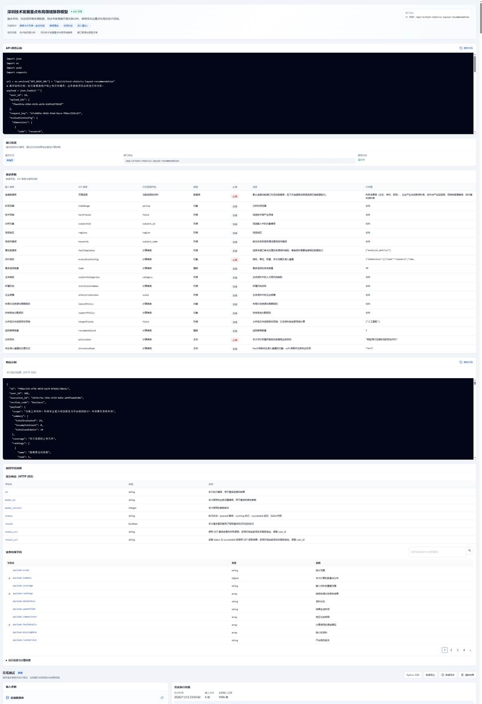{width="5.7in" height="8.3125in"}

图 3-22 深圳技术发展重点布局领域推荐模型界面示意（1/3）

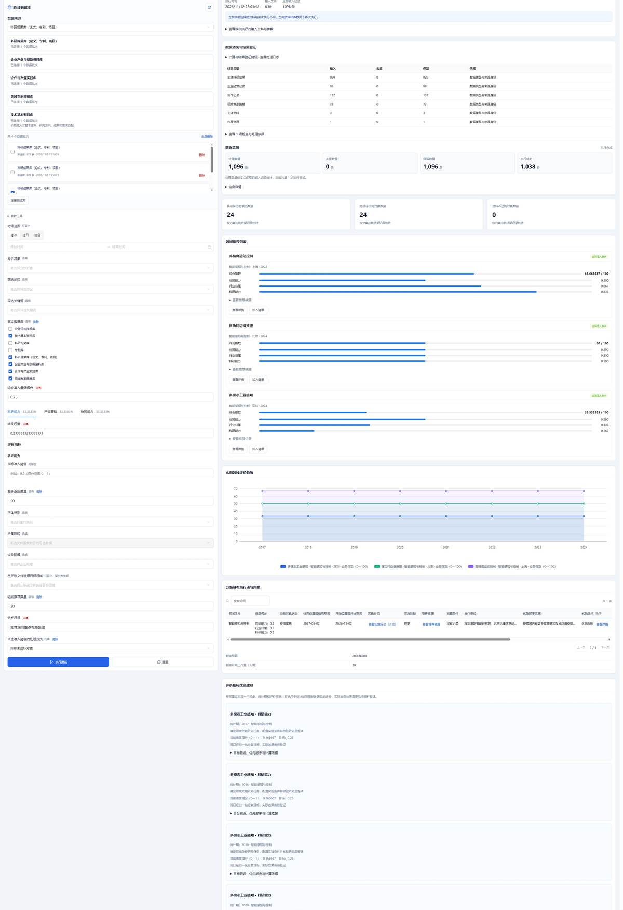{width="5.7in" height="8.3125in"}

图 3-22 深圳技术发展重点布局领域推荐模型界面示意（2/3）

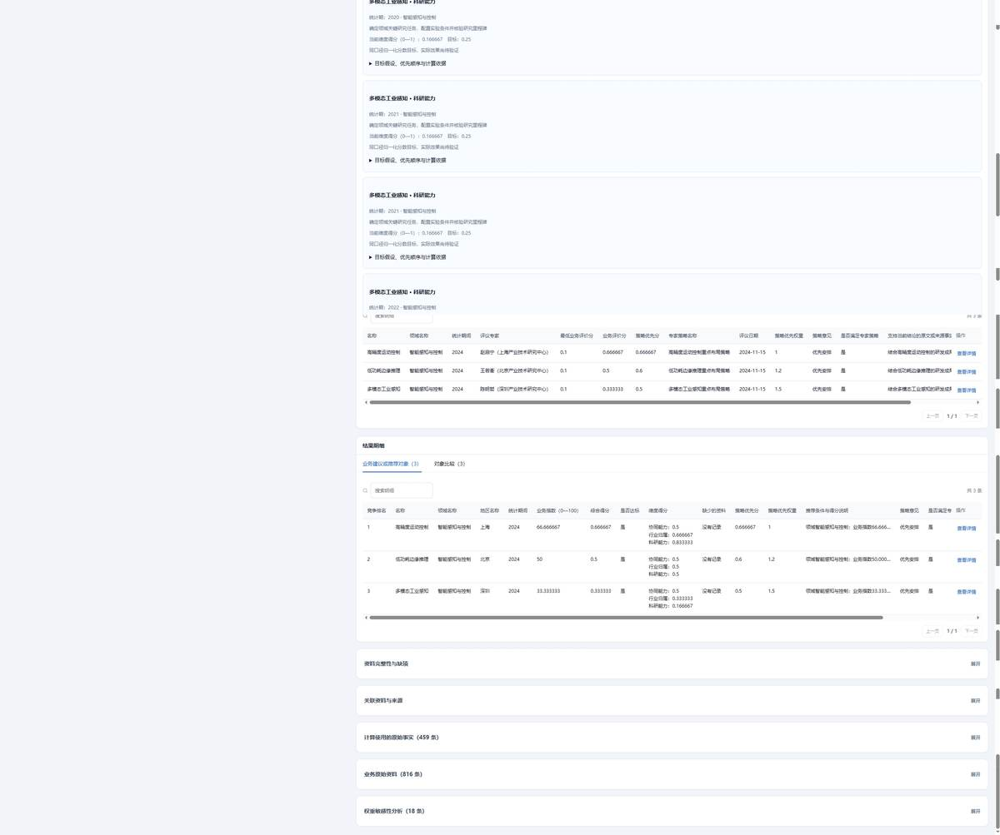{width="5.7in" height="4.76424978127734in"}

图 3-22 深圳技术发展重点布局领域推荐模型界面示意（3/3）

界面示意见图 3-22（共 3 页）。按 3.1 节「通用界面结构与操作步骤」执行：先在接口定义区核对入参字段与返回示例，再在报告页左侧设置【技术名称／技术标签】【时间范围】【区域范围（全球／全国／深圳）】【评价指标与阈值】等条件并生成报告；在右侧读取统计指标卡与柱状图、折线与面积趋势图、雷达图及时间线视图，向下滚动查看明细表与分析结论，最后用右上角导出／打印功能留存结果。本模型重点输出：重点技术布局领域推荐列表、领域特点与趋势分析结果、策略建议清单。如需系统集成，可按接口定义以 Restful API 或 SDK 调用，输入输出字段与上表一致。

## 科研机构深度分析模型构建

科研机构深度分析模型构建通过多源数据整合、知识图谱构建与智能算法运算，全面刻画科研机构在技术布局、发展演变、优势短板、合作关系及引入扶持等方面的特征与趋势。模块融合学术论文、专利、项目、人才、资金及政策等数据，覆盖科研机构重点技术领域布局、发展历程、深圳科研机构优势分析、痛难点识别、科研合作关系链条、引入推荐与扶持推荐等模型，实现由静态评估到动态监测、由单点分析到全局诊断的综合能力。

### **科研机构重点技术领域布局模型**

科研机构重点技术领域布局模型基于技术知识图谱及多源技术数据，对科研机构在重点技术领域的投入情况进行识别与量化分析。该算法融合学术论文、专利、科研项目、人才队伍等数据源，构建科研机构的技术知识图谱，利用文本挖掘与数据分析技术自动识别其核心技术领域，并通过评价体系计算在不同领域的科技综合实力，为资源优化配置与战略规划提供数据支撑。

**模型输入与输出**

  ---------------------------------------------------------------------------------------------------------------------------------------
  **项目**       **内容**
  -------------- ------------------------------------------------------------------------------------------------------------------------
  输入           学术论文数据、专利数据、科研项目数据、人才信息数据、技术知识图谱结构、文本挖掘与分类算法参数、评价指标体系与权重。

  输出           科研机构重点技术领域布局图谱、各领域科技综合实力评分、需投入加强领域推荐清单、可视化分析报告。

  调用方式       支持通过Restful API、SDK方式调用，可按机构或技术领域查询布局情况、领域评分及推荐结果，并支持数据导出与可视化展示服务。
  ---------------------------------------------------------------------------------------------------------------------------------------

{width="5.7in" height="8.3125in"}

图 3-23 科研机构重点技术领域布局模型界面示意（1/3）

{width="5.7in" height="8.3125in"}

图 3-23 科研机构重点技术领域布局模型界面示意（2/3）

{width="5.7in" height="4.18474956255468in"}

图 3-23 科研机构重点技术领域布局模型界面示意（3/3）

界面示意见图 3-23（共 3 页）。按 3.1 节「通用界面结构与操作步骤」执行：先在接口定义区核对入参字段与返回示例，再在报告页左侧设置【机构名称／机构标签】【技术领域】【时间范围】【区域范围（深圳／全国）】【评价指标与权重】等条件并生成报告；在右侧读取统计指标卡与柱状图、折线与面积趋势图、雷达图及关系网络图，向下滚动查看明细表与分析结论，最后用右上角导出／打印功能留存结果。本模型重点输出：科研机构重点技术领域布局图谱、各领域科技综合实力评分、需投入加强领域推荐清单、可视化分析报告。如需系统集成，可按接口定义以 Restful API 或 SDK 调用，输入输出字段与上表一致。

### **科研机构发展历程模型**

科研机构发展历程模型旨在基于科研机构的基础指标和资讯指标，系统识别其发展过程中的重大事件，并构建重大事件时间线，用于分析科研机构的历史演变和关键发展阶段。该算法通过定义具有代表性和区分度的重大事件指标，并结合历史数据与专业经验设定阈值，当指标值超过阈值时，即认定为重大事件；随后按时间顺序计算并输出时间线，为科研机构发展评估、政策制定和战略规划提供参考依据。

**模型输入与输出**

  -------------------------------------------------------------------------------------------------------------------------------------
  **项目**       **内容**
  -------------- ----------------------------------------------------------------------------------------------------------------------
  输入           科研机构基本信息、科研成果数据、科研项目数据、专利数据、论文数据、学术会议记录、重大事件指标体系及阈值设定。

  输出           科研机构重大事件列表、重大事件时间线、发展历程可视化视图、趋势分析报告。

  调用方式       支持通过Restful API、SDK方式调用，可按科研机构标签或名称查询发展历程重大事件时间线，并支持数据导出及可视化展示服务。
  -------------------------------------------------------------------------------------------------------------------------------------

{width="5.7in" height="8.3125in"}

图 3-24 科研机构发展历程模型界面示意（1/2）

{width="5.7in" height="8.075in"}

图 3-24 科研机构发展历程模型界面示意（2/2）

界面示意见图 3-24（共 2 页）。按 3.1 节「通用界面结构与操作步骤」执行：先在接口定义区核对入参字段与返回示例，再在报告页左侧设置【机构名称／机构标签】【技术领域】【时间范围】【区域范围（深圳／全国）】【评价指标与权重】等条件并生成报告；在右侧读取统计指标卡与柱状图、折线与面积趋势图、雷达图及关系网络图，向下滚动查看明细表与分析结论，最后用右上角导出／打印功能留存结果。本模型重点输出：科研机构重大事件列表、重大事件时间线、发展历程可视化视图、趋势分析报告。如需系统集成，可按接口定义以 Restful API 或 SDK 调用，输入输出字段与上表一致。

### **深圳科研机构优势分析模型**

深圳科研机构优势分析模型通过综合对比各领域专题库数据，构建覆盖科研成果水平、科研经费投入、人才队伍素质等维度的评价指标体系，并结合深圳与全国科研机构数据进行对标分析，量化识别深圳科研机构的优势与不足。该算法旨在为科研管理部门、政策制定者及机构负责人提供精准的数据依据和策略建议，推动深圳科研实力持续提升。

**模型输入与输出**

  ---------------------------------------------------------------------------------------------------------------------------------------------------
  **项目**       **内容**
  -------------- ------------------------------------------------------------------------------------------------------------------------------------
  输入           政府科技管理公开数据、专业科技数据库信息、科研机构官网数据、科研成果信息、人才配置数据、科研经费投入数据、评价指标体系及权重参数。

  输出           深圳科研机构优势与不足分析报告、趋势变化分析、优化建议清单。

  调用方式       支持通过Restful API、SDK方式调用，可按机构标签或名称获取优势评价结果，并支持生成趋势分析报告及数据导出服务。
  ---------------------------------------------------------------------------------------------------------------------------------------------------

{width="5.7in" height="8.3125in"}

图 3-25 深圳科研机构优势分析模型界面示意（1/3）

{width="5.7in" height="8.3125in"}

图 3-25 深圳科研机构优势分析模型界面示意（2/3）

{width="5.7in" height="3.14450021872266in"}

图 3-25 深圳科研机构优势分析模型界面示意（3/3）

界面示意见图 3-25（共 3 页）。按 3.1 节「通用界面结构与操作步骤」执行：先在接口定义区核对入参字段与返回示例，再在报告页左侧设置【机构名称／机构标签】【技术领域】【时间范围】【区域范围（深圳／全国）】【评价指标与权重】等条件并生成报告；在右侧读取统计指标卡与柱状图、折线与面积趋势图、雷达图及关系网络图，向下滚动查看明细表与分析结论，最后用右上角导出／打印功能留存结果。本模型重点输出：深圳科研机构优势与不足分析报告、趋势变化分析、优化建议清单。如需系统集成，可按接口定义以 Restful API 或 SDK 调用，输入输出字段与上表一致。

### **深圳科研机构痛难点识别模型**

深圳科研机构痛难点识别模型旨在通过综合对比各领域专题库，并结合深圳与全国科研机构数据，构建负面评价分析体系，识别深圳科研机构在科研项目、成果转化、人才队伍及产业合作等方面的薄弱环节与关键问题。该算法以量化指标为基础，结合机器学习算法与自然语言处理技术，实现对科研机构痛难点问题的智能化定位与分析，为政策制定、管理优化和机构改进提供精准参考。

**模型输入与输出**

  ---------------------------------------------------------------------------------------------------------------------------------
  **项目**       **内容**
  -------------- ------------------------------------------------------------------------------------------------------------------
  输入           深圳科研项目数据、科研成果数据、人才队伍数据、企业合作数据、全国科研机构对比数据、指标体系与权重参数。

  输出           科研机构痛难点清单、成因分析报告、改进建议方案、趋势变化图表。

  调用方式       支持通过Restful API、SDK方式调用，可按科研机构标签或名称获取痛难点分析结果，并支持生成定制化报告及数据导出服务。
  ---------------------------------------------------------------------------------------------------------------------------------

{width="5.7in" height="8.3125in"}

图 3-26 深圳科研机构痛难点识别模型界面示意（1/3）

{width="5.7in" height="8.3125in"}

图 3-26 深圳科研机构痛难点识别模型界面示意（2/3）

{width="5.7in" height="4.53625in"}

图 3-26 深圳科研机构痛难点识别模型界面示意（3/3）

界面示意见图 3-26（共 3 页）。按 3.1 节「通用界面结构与操作步骤」执行：先在接口定义区核对入参字段与返回示例，再在报告页左侧设置【机构名称／机构标签】【技术领域】【时间范围】【区域范围（深圳／全国）】【评价指标与权重】等条件并生成报告；在右侧读取统计指标卡与柱状图、折线与面积趋势图、雷达图及关系网络图，向下滚动查看明细表与分析结论，最后用右上角导出／打印功能留存结果。本模型重点输出：科研机构痛难点清单、成因分析报告、改进建议方案、趋势变化图表。如需系统集成，可按接口定义以 Restful API 或 SDK 调用，输入输出字段与上表一致。

### **科研合作关系链条模型**

科研合作关系链条模型基于产业全要素图谱与科研机构专题数据，对科研机构间的合作关系链进行建模与分析，计算合作强度、紧密度、频率等核心指标，全面刻画科研合作网络的分布特征与结构特点。该算法能够帮助用户识别科研机构间的合作模式、重要节点及优势领域，为科研资源配置、产学研协同和创新生态优化提供科学依据。

**模型输入与输出**

  ---------------------------------------------------------------------------------------------------------------------------------------
  **项目**       **内容**
  -------------- ------------------------------------------------------------------------------------------------------------------------
  输入           专利数据、科研项目数据、学术成果数据、合作强度指标、紧密度指标、合作频率指标、产业全要素图谱数据。

  输出           科研合作链总量分析报告、合作密度测算结果、核心合作节点清单、跨领域合作特征分析图谱、网络拓扑可视化展示。

  调用方式       支持通过Restful API、SDK方式调用，可按科研机构标签或技术领域查询合作关系链条，并支持生成分析报告及可视化数据导出服务。
  ---------------------------------------------------------------------------------------------------------------------------------------

{width="5.7in" height="8.3125in"}

图 3-27 科研合作关系链条模型界面示意（1/3）

{width="5.7in" height="8.3125in"}

图 3-27 科研合作关系链条模型界面示意（2/3）

{width="5.7in" height="5.196500437445319in"}

图 3-27 科研合作关系链条模型界面示意（3/3）

界面示意见图 3-27（共 3 页）。按 3.1 节「通用界面结构与操作步骤」执行：先在接口定义区核对入参字段与返回示例，再在报告页左侧设置【机构名称／机构标签】【技术领域】【时间范围】【区域范围（深圳／全国）】【评价指标与权重】等条件并生成报告；在右侧读取统计指标卡与柱状图、折线与面积趋势图、雷达图及关系网络图，向下滚动查看明细表与分析结论，最后用右上角导出／打印功能留存结果。本模型重点输出：科研合作链总量分析报告、合作密度测算结果、核心合作节点清单、跨领域合作特征分析图谱、网络拓扑可视化展示。如需系统集成，可按接口定义以 Restful API 或 SDK 调用，输入输出字段与上表一致。

### **科研机构引入推荐模型**

科研机构引入推荐模型旨在为区域或产业发展提供精准的科研机构招引决策依据。该算法基于多源科研数据，围绕学术影响力、科技成果、科研团队实力等核心维度设计评价指标及判断阈值，通过综合计算得到衡量科研机构招引价值的推荐指数。模型不仅能够对国内外科研机构进行定量化评估，还可结合政策目标与产业布局动态调整推荐结果，支持政府部门、园区管理和投资方制定科学的机构招引策略。

**模型输入与输出**

  ---------------------------------------------------------------------------------------------------------------------------------------------
  **项目**       **内容**
  -------------- ------------------------------------------------------------------------------------------------------------------------------
  输入           学术论文数据、专利数据、科技项目数据、科研人员信息、机构基本信息、研究方向数据、成果产出分析结果、评价指标体系与权重参数。

  输出           科研机构招引推荐指数、机构筛选与排名清单、推荐分析报告。

  调用方式       支持通过Restful API、SDK及在线展示平台调用，可按关键字、领域、地域等条件进行科研机构招引推荐，并支持生成报告及数据导出服务。
  ---------------------------------------------------------------------------------------------------------------------------------------------

{width="5.7in" height="8.3125in"}

图 3-28 科研机构引入推荐模型界面示意（1/2）

{width="5.7in" height="8.3125in"}

图 3-28 科研机构引入推荐模型界面示意（2/2）

界面示意见图 3-28（共 2 页）。按 3.1 节「通用界面结构与操作步骤」执行：先在接口定义区核对入参字段与返回示例，再在报告页左侧设置【机构名称／机构标签】【技术领域】【时间范围】【区域范围（深圳／全国）】【评价指标与权重】等条件并生成报告；在右侧读取统计指标卡与柱状图、折线与面积趋势图、雷达图及关系网络图，向下滚动查看明细表与分析结论，最后用右上角导出／打印功能留存结果。本模型重点输出：科研机构招引推荐指数、机构筛选与排名清单、推荐分析报告。如需系统集成，可按接口定义以 Restful API 或 SDK 调用，输入输出字段与上表一致。

### **科研机构扶持推荐模型**

科研机构扶持推荐模型旨在为政府部门、科研管理机构及投资方提供科学的扶持优选依据。该算法通过多维度指标体系对科研机构进行定量化评估，涵盖科研成果水平、科研经费使用效率、人才队伍结构等关键要素，并为每个指标设定阈值，以判定机构是否达到扶持标准。综合计算各指标值及权重后，生成扶持推荐指数，用于衡量机构扶持优先级，为政策制定、资金分配及合作决策提供数据支撑。

**模型输入与输出**

  -------------------------------------------------------------------------------------------------------------------------------------
  **项目**       **内容**
  -------------- ----------------------------------------------------------------------------------------------------------------------
  输入           科研机构基础信息、科研成果数据、科研经费数据、人才队伍结构数据、评价指标体系及权重设定、扶持目标及阈值参数。

  输出           科研机构扶持推荐指数、机构排名列表与分析。

  调用方式       支持通过Restful API、SDK及在线展示平台调用，可按机构名称或技术领域进行指数查询与排名，并支持生成报告及数据导出服务。
  -------------------------------------------------------------------------------------------------------------------------------------

{width="5.7in" height="8.3125in"}

图 3-29 科研机构扶持推荐模型界面示意（1/3）

{width="5.7in" height="8.3125in"}

图 3-29 科研机构扶持推荐模型界面示意（2/3）

{width="5.7in" height="4.83549978127734in"}

图 3-29 科研机构扶持推荐模型界面示意（3/3）

界面示意见图 3-29（共 3 页）。按 3.1 节「通用界面结构与操作步骤」执行：先在接口定义区核对入参字段与返回示例，再在报告页左侧设置【机构名称／机构标签】【技术领域】【时间范围】【区域范围（深圳／全国）】【评价指标与权重】等条件并生成报告；在右侧读取统计指标卡与柱状图、折线与面积趋势图、雷达图及关系网络图，向下滚动查看明细表与分析结论，最后用右上角导出／打印功能留存结果。本模型重点输出：科研机构扶持推荐指数、机构排名列表与分析。如需系统集成，可按接口定义以 Restful API 或 SDK 调用，输入输出字段与上表一致。

## 人才深度分析模型构建

人才深度分析模型构建依托人才专题库、产业专题库、学术与专利数据库、社交及招聘平台等多类型数据源，结合机器学习、网络分析、自然语言处理等技术，构建从重点人才筛选到培育布局的闭环分析体系。本章节共包含十类核心模型：重点人才识别、人才流动追踪、高校学院新培育人才、深圳重点人才优势和短板分析、人才关系链、人才供需分析评价、人才学术力评估、人才产业力评估、招入人才推荐以及培育人才布局模型，覆盖人才识别、流动、供需、能力、关联与战略布局的全方位量化评估与趋势预测。

### **重点人才识别模型**

重点人才识别模型旨在依托多源人才相关数据，对科研能力突出或具有战略价值的个人进行精准识别与标注。该算法通过对接人才、技术、资讯数据库，定义涵盖学历、工作经验、科研成果等在内的重点人才评价指标，并结合阈值判断标准，计算候选人才的综合评价结果，用于重点人才的筛选与分析。该模型可为政府部门、企业及科研机构在人才选拔、激励和战略布局中提供数据支撑与决策依据。

**模型输入与输出**

  -------------------------------------------------------------------------------------------------------------------------------------
  **项目**       **内容**
  -------------- ----------------------------------------------------------------------------------------------------------------------
  输入           企业人才库数据、科技人才数据库信息、学术论文数据、个人背景信息、专业领域信息、科研成果数据、评价指标体系及权重参数。

  输出           重点人才识别结果、综合评价报告。

  调用方式       支持通过Restful API、SDK方式调用，可按人才标签或领域进行重点人才查询与分析，并支持生成报告及数据导出服务。
  -------------------------------------------------------------------------------------------------------------------------------------

{width="5.7in" height="8.3125in"}

图 3-30 重点人才识别模型界面示意（1/2）

{width="5.7in" height="6.08in"}

图 3-30 重点人才识别模型界面示意（2/2）

界面示意见图 3-30（共 2 页）。按 3.1 节「通用界面结构与操作步骤」执行：先在接口定义区核对入参字段与返回示例，再在报告页左侧设置【人才标签／人才 ID／企业标签】【行业领域／岗位类型】【时间范围】【区域范围】【评价指标与阈值】等条件并生成报告；在右侧读取统计指标卡与柱状图、折线趋势图、环形图、雷达图与关系网络图，向下滚动查看明细表与分析结论，最后用右上角导出／打印功能留存结果。本模型重点输出：重点人才识别结果、综合评价报告。如需系统集成，可按接口定义以 Restful API 或 SDK 调用，输入输出字段与上表一致。

### **人才流动追踪模型**

人才流动追踪模型基于人才关系链与人才资讯等多源数据，综合运用数据采集、处理及分析技术，构建能够按时间线精确展示区域或行业人才流动情况的量化模型。该算法支持对人才流入、流出及留存进行动态监测，并通过可视化与分析工具呈现流动趋势、原因及热点，为政府、人力资源机构及企业战略决策提供精准数据支撑。

**模型输入与输出**

  -----------------------------------------------------------------------------------------------------------------------------------
  **项目**       **内容**
  -------------- --------------------------------------------------------------------------------------------------------------------
  输入           社交网络数据、招聘网站数据、简历数据库数据、人才关联关系链信息、职业轨迹数据、招聘信息特征、行业与企业标签信息。

  输出           人才流入、流出及留存情况统计表、流动趋势分析报告、可视化关系链展示。

  调用方式       支持通过Restful API、SDK方式调用，可按地域、行业或企业标签进行人才流动分析，并支持生成报告、趋势图及数据导出服务。
  -----------------------------------------------------------------------------------------------------------------------------------

{width="5.7in" height="8.3125in"}

图 3-31 人才流动追踪模型界面示意（1/2）

{width="5.7in" height="7.42424978127734in"}

图 3-31 人才流动追踪模型界面示意（2/2）

界面示意见图 3-31（共 2 页）。按 3.1 节「通用界面结构与操作步骤」执行：先在接口定义区核对入参字段与返回示例，再在报告页左侧设置【人才标签／人才 ID／企业标签】【行业领域／岗位类型】【时间范围】【区域范围】【评价指标与阈值】等条件并生成报告；在右侧读取统计指标卡与柱状图、折线趋势图、环形图、雷达图与关系网络图，向下滚动查看明细表与分析结论，最后用右上角导出／打印功能留存结果。本模型重点输出：人才流入、流出及留存情况统计表、流动趋势分析报告、可视化关系链展示。如需系统集成，可按接口定义以 Restful API 或 SDK 调用，输入输出字段与上表一致。

### **高校学院新培育人才模型**

高校学院新培育人才模型基于科研机构数据、技术关系图谱及专题数据，构建高校专业人才数量计算与分析体系，用于识别并提取特定技术领域下由高校培养的新增人才。该算法旨在量化高校在某技术领域的人才贡献度，分析人才培养趋势与特征，为高校人才培育规划、科研布局优化及政策制定提供数据支撑。

**模型输入与输出**

  -----------------------------------------------------------------------------------------------------------------------------------------
  **项目**       **内容**
  -------------- --------------------------------------------------------------------------------------------------------------------------
  输入           高校数据、科研机构数据、技术关系图谱数据、专题数据、专业人才数量与分布指标、历史数据及领域特征参数。

  输出           高校新增人才识别结果、人才培养趋势分析、学科背景与技术方向分布图、校际对比分析结果。

  调用方式       支持通过Restful API、SDK方式调用，可按技术领域标签或高校名称查询新增人才识别结果，并支持生成趋势分析报告及数据导出服务。
  -----------------------------------------------------------------------------------------------------------------------------------------

{width="5.7in" height="8.3125in"}

图 3-32 高校学院新培育人才模型界面示意（1/3）

{width="5.7in" height="8.3125in"}

图 3-32 高校学院新培育人才模型界面示意（2/3）

{width="5.7in" height="3.05424978127734in"}

图 3-32 高校学院新培育人才模型界面示意（3/3）

界面示意见图 3-32（共 3 页）。按 3.1 节「通用界面结构与操作步骤」执行：先在接口定义区核对入参字段与返回示例，再在报告页左侧设置【人才标签／人才 ID／企业标签】【行业领域／岗位类型】【时间范围】【区域范围】【评价指标与阈值】等条件并生成报告；在右侧读取统计指标卡与柱状图、折线趋势图、环形图、雷达图与关系网络图，向下滚动查看明细表与分析结论，最后用右上角导出／打印功能留存结果。本模型重点输出：高校新增人才识别结果、人才培养趋势分析、学科背景与技术方向分布图、校际对比分析结果。如需系统集成，可按接口定义以 Restful API 或 SDK 调用，输入输出字段与上表一致。

### **深圳重点人才优势和短板分析模型**

深圳重点人才优势和短板分析模型通过综合比对各领域专题库数据，设计覆盖人才竞争力与市场供需特征的评价指标，构建专用人才评价体系。该算法结合深圳人才数据与全国人才数据的对比分析，从多维度识别深圳重点人才的优势领域与短板问题，支持政府、企业和机构制定精准的人才引进、培养和留用策略。

**模型输入与输出**

  ---------------------------------------------------------------------------------------------------------------------------------------------
  **项目**       **内容**
  -------------- ------------------------------------------------------------------------------------------------------------------------------
  输入           深圳人才数据、全国人才数据、招聘网站信息、社交网络数据、政府人才数据库信息、评价指标体系与权重参数。

  输出           深圳重点人才优势领域清单、短板问题分析报告、改进建议方案。

  调用方式       支持通过Restful API、SDK方式调用，可按人才标签、行业领域或岗位类型获取优势与短板分析结果，并支持生成分析报告及数据导出服务。
  ---------------------------------------------------------------------------------------------------------------------------------------------

{width="5.7in" height="8.3125in"}

图 3-33 深圳重点人才优势和短板分析模型界面示意（1/3）

{width="5.7in" height="8.3125in"}

图 3-33 深圳重点人才优势和短板分析模型界面示意（2/3）

{width="5.7in" height="6.20825021872266in"}

图 3-33 深圳重点人才优势和短板分析模型界面示意（3/3）

界面示意见图 3-33（共 3 页）。按 3.1 节「通用界面结构与操作步骤」执行：先在接口定义区核对入参字段与返回示例，再在报告页左侧设置【人才标签／人才 ID／企业标签】【行业领域／岗位类型】【时间范围】【区域范围】【评价指标与阈值】等条件并生成报告；在右侧读取统计指标卡与柱状图、折线趋势图、环形图、雷达图与关系网络图，向下滚动查看明细表与分析结论，最后用右上角导出／打印功能留存结果。本模型重点输出：深圳重点人才优势领域清单、短板问题分析报告、改进建议方案。如需系统集成，可按接口定义以 Restful API 或 SDK 调用，输入输出字段与上表一致。

### **人才关系链模型**

人才关系链模型基于产业全要素图谱中的跨要素关联与人才专题数据，针对不同类型人才的关联关系进行建模，利用社交网络分析与自然语言处理技术构建可量化的关系权重体系，从而深入挖掘人才间的潜在关系链。该算法不仅揭示已知的直接联系，还能发现隐性关联和潜在合作路径，扩展人才关系链的深度与广度，为人才引进、协同创新和战略布局提供数据支撑。

**模型输入与输出**

  -------------------------------------------------------------------------------------------------------------------------------------------
  **项目**       **内容**
  -------------- ----------------------------------------------------------------------------------------------------------------------------
  输入           人才专题数据库数据、产业全要素图谱数据、招聘平台信息、社交媒体数据、企业人才库信息、研究报告数据、关系权重计算参数。

  输出           人才关系链网络图、关系权重分析结果、潜在合作路径清单。

  调用方式       支持通过Restful API、SDK及可视化平台调用，可按人才标签或行业领域查询关系链结构与分析结果，并支持生成网络图及数据导出服务。
  -------------------------------------------------------------------------------------------------------------------------------------------

{width="5.7in" height="8.3125in"}

图 3-34 人才关系链模型界面示意（1/3）

{width="5.7in" height="8.3125in"}

图 3-34 人才关系链模型界面示意（2/3）

{width="5.7in" height="6.6975in"}

图 3-34 人才关系链模型界面示意（3/3）

界面示意见图 3-34（共 3 页）。按 3.1 节「通用界面结构与操作步骤」执行：先在接口定义区核对入参字段与返回示例，再在报告页左侧设置【人才标签／人才 ID／企业标签】【行业领域／岗位类型】【时间范围】【区域范围】【评价指标与阈值】等条件并生成报告；在右侧读取统计指标卡与柱状图、折线趋势图、环形图、雷达图与关系网络图，向下滚动查看明细表与分析结论，最后用右上角导出／打印功能留存结果。本模型重点输出：人才关系链网络图、关系权重分析结果、潜在合作路径清单。如需系统集成，可按接口定义以 Restful API 或 SDK 调用，输入输出字段与上表一致。

### **人才供需分析评价模型**

人才供需分析评价模型旨在综合评估特定产业的人才供需状况。该算法通过对接人才专题库与产业专题库，结合人才供给成果与产业发展数据，建立科学的分析与计算体系。在定义涉及人才供给与需求的核心指标后，利用数据分析与机器学习等技术计算人才供需评价指数，并支持对未来供需趋势进行预测，为企业用人决策、产业人才战略规划及政策制定提供数据支撑。

**模型输入与输出**

  -----------------------------------------------------------------------------------------------------------------------------------
  **项目**       **内容**
  -------------- --------------------------------------------------------------------------------------------------------------------
  输入           人才专题库数据、产业专题库数据、人才流动数据、招聘数据、技能与学历指标、工作经验指标、权重与模型参数。

  输出           产业人才供需评价指数、供需平衡分析报告、未来趋势预测图表、产业细分领域供需对比结果。

  调用方式       支持通过Restful API、SDK方式调用，可按产业标签或细分领域查询供需指数及趋势分析，并支持生成分析报告及数据导出服务。
  -----------------------------------------------------------------------------------------------------------------------------------

{width="5.7in" height="8.3125in"}

图 3-35 人才供需分析评价模型界面示意（1/3）

{width="5.7in" height="8.3125in"}

图 3-35 人才供需分析评价模型界面示意（2/3）

{width="5.7in" height="8.18900043744532in"}

图 3-35 人才供需分析评价模型界面示意（3/3）

界面示意见图 3-35（共 3 页）。按 3.1 节「通用界面结构与操作步骤」执行：先在接口定义区核对入参字段与返回示例，再在报告页左侧设置【人才标签／人才 ID／企业标签】【行业领域／岗位类型】【时间范围】【区域范围】【评价指标与阈值】等条件并生成报告；在右侧读取统计指标卡与柱状图、折线趋势图、环形图、雷达图与关系网络图，向下滚动查看明细表与分析结论，最后用右上角导出／打印功能留存结果。本模型重点输出：产业人才供需评价指数、供需平衡分析报告、未来趋势预测图表、产业细分领域供需对比结果。如需系统集成，可按接口定义以 Restful API 或 SDK 调用，输入输出字段与上表一致。

### **人才学术力评估模型**

人才学术力评估模型用于基于多维度数据对人才的学术水平与科研能力进行量化评价。该算法通过连接学术论文数据库、专利数据库、人才招聘信息平台等数据源，采集与人才相关的成果、影响力及技能信息，设计包括学术成果数量、学术影响力、专业技能水平等在内的指标体系，并结合专业经验设定评价阈值，最终计算生成人才学术力指数，为人才分类、分层管理及招聘决策提供数据支撑。该模型支持动态更新数据与评估标准，并可通过服务化接口实现快速在线查询与分析。

**模型输入与输出**

  ---------------------------------------------------------------------------------------------------------------------------
  **项目**       **内容**
  -------------- ------------------------------------------------------------------------------------------------------------
  输入           学术论文数据、专利数据、人才招聘平台信息、人才成果记录、职业技能数据、评价指标体系及权重参数。

  输出           人才学术力指数、分级评价结果和分析报告。

  调用方式       支持通过Restful API、SDK方式调用，可按人才ID或标签进行学术力指数查询与分析，并支持生成报告及数据导出服务。
  ---------------------------------------------------------------------------------------------------------------------------

{width="5.7in" height="8.3125in"}

图 3-36 人才学术力评估模型界面示意（1/2）

{width="5.7in" height="7.94200021872266in"}

图 3-36 人才学术力评估模型界面示意（2/2）

界面示意见图 3-36（共 2 页）。按 3.1 节「通用界面结构与操作步骤」执行：先在接口定义区核对入参字段与返回示例，再在报告页左侧设置【人才标签／人才 ID／企业标签】【行业领域／岗位类型】【时间范围】【区域范围】【评价指标与阈值】等条件并生成报告；在右侧读取统计指标卡与柱状图、折线趋势图、环形图、雷达图与关系网络图，向下滚动查看明细表与分析结论，最后用右上角导出／打印功能留存结果。本模型重点输出：人才学术力指数、分级评价结果和分析报告。如需系统集成，可按接口定义以 Restful API 或 SDK 调用，输入输出字段与上表一致。

### **人才产业力评估模型**

人才产业力评估模型旨在量化评估企业在人才方面的综合实力。该算法基于企业影响力、产业覆盖度、媒体知名度等核心维度建立指标体系及阈值，计算生成人才产业力指数。该指数可用于衡量企业的人才竞争力，为政府部门、行业协会、投资机构及招聘平台提供决策参考。算法在设计中结合历史数据与专家经验进行优化，适配多行业、多类型企业的人才评估需求，并支持多场景动态查询和分析。

**模型输入与输出**

  -----------------------------------------------------------------------------------------------------------------------------------------
  **项目**       **内容**
  -------------- --------------------------------------------------------------------------------------------------------------------------
  输入           人才库数据、招聘网站数据、行业数据库信息、社交媒体数据、企业影响力指标、产业覆盖度指标、媒体报道量指标、权重与阈值参数。

  输出           人才产业力指数、趋势分析图表、企业维度对比报告。

  调用方式       支持通过Restful API、SDK方式调用，可按企业标签、行业类别或区域进行人才产业力指数查询，并支持生成分析报告及数据导出服务。
  -----------------------------------------------------------------------------------------------------------------------------------------

{width="5.7in" height="8.3125in"}

图 3-37 人才产业力评估模型界面示意（1/3）

{width="5.7in" height="8.3125in"}

图 3-37 人才产业力评估模型界面示意（2/3）

{width="5.7in" height="4.265499781277341in"}

图 3-37 人才产业力评估模型界面示意（3/3）

界面示意见图 3-37（共 3 页）。按 3.1 节「通用界面结构与操作步骤」执行：先在接口定义区核对入参字段与返回示例，再在报告页左侧设置【人才标签／人才 ID／企业标签】【行业领域／岗位类型】【时间范围】【区域范围】【评价指标与阈值】等条件并生成报告；在右侧读取统计指标卡与柱状图、折线趋势图、环形图、雷达图与关系网络图，向下滚动查看明细表与分析结论，最后用右上角导出／打印功能留存结果。本模型重点输出：人才产业力指数、趋势分析图表、企业维度对比报告。如需系统集成，可按接口定义以 Restful API 或 SDK 调用，输入输出字段与上表一致。

### **招入人才推荐模型**

招入人才推荐模型旨在为人才引进与招聘决策提供量化参考。该算法基于学术力、产业力、产品匹配度、深圳连接度四大核心维度构建评价指标与阈值体系，通过加权综合计算生成招引人才推荐指数，用于评估人才的引进优先级。该模型不仅适配不同产业与岗位需求，还可结合区域发展战略，为政府机构、用人单位和招聘平台提供精准的人才筛选与匹配方案。

**模型输入与输出**

  -----------------------------------------------------------------------------------------------------------------------------------------------------
  **项目**       **内容**
  -------------- --------------------------------------------------------------------------------------------------------------------------------------
  输入           专利数据、学术论文数据、社交网络信息、招聘系统数据、学术力指标、产业力指标、产品匹配度指标、深圳连接度指标、权重及阈值参数。

  输出           招引人才推荐指数、人才优选排序清单、匹配分析报告。

  调用方式       支持通过Restful API、SDK及在线平台调用，可按人才标签、地域、行业或岗位类型进行招引推荐，并支持生成排序清单、分析报告及数据导出服务。
  -----------------------------------------------------------------------------------------------------------------------------------------------------

{width="5.7in" height="8.3125in"}

图 3-38 招入人才推荐模型界面示意（1/2）

{width="5.7in" height="7.94674978127734in"}

图 3-38 招入人才推荐模型界面示意（2/2）

界面示意见图 3-38（共 2 页）。按 3.1 节「通用界面结构与操作步骤」执行：先在接口定义区核对入参字段与返回示例，再在报告页左侧设置【人才标签／人才 ID／企业标签】【行业领域／岗位类型】【时间范围】【区域范围】【评价指标与阈值】等条件并生成报告；在右侧读取统计指标卡与柱状图、折线趋势图、环形图、雷达图与关系网络图，向下滚动查看明细表与分析结论，最后用右上角导出／打印功能留存结果。本模型重点输出：招引人才推荐指数、人才优选排序清单、匹配分析报告。如需系统集成，可按接口定义以 Restful API 或 SDK 调用，输入输出字段与上表一致。

### **培育人才布局模型**

培育人才布局模型用于评估并推荐具有成长潜力和战略价值的人才，面向政府、企业及科研机构的人才培育与引进决策。该算法基于产业相关度、人才潜力、人才学术力、人才产业力四个核心维度构建评价指标与阈值体系，通过对多源数据的综合分析计算培育人才推荐指数，为人才选拔、培养方案制定及产业对接提供科学依据。

**模型输入与输出**

  -----------------------------------------------------------------------------------------------------------------------------------------------------
  **项目**       **内容**
  -------------- --------------------------------------------------------------------------------------------------------------------------------------
  输入           人才招聘平台数据、培训机构数据、科研院所数据、学术论文数据、职业背景信息、学术成果记录、产业实践案例数据、评价指标体系与权重参数。

  输出           培育人才推荐指数、排名与筛选清单、个性化培养方案建议。

  调用方式       支持通过Restful API、SDK方式调用，可按产业标签、行业领域或人才类别查询培育人才推荐指数，并支持生成分析报告、排名清单及数据导出服务。
  -----------------------------------------------------------------------------------------------------------------------------------------------------

{width="5.7in" height="8.3125in"}

图 3-39 培育人才布局模型界面示意（1/3）

{width="5.7in" height="8.3125in"}

图 3-39 培育人才布局模型界面示意（2/3）

{width="5.7in" height="5.57174978127734in"}

图 3-39 培育人才布局模型界面示意（3/3）

界面示意见图 3-39（共 3 页）。按 3.1 节「通用界面结构与操作步骤」执行：先在接口定义区核对入参字段与返回示例，再在报告页左侧设置【人才标签／人才 ID／企业标签】【行业领域／岗位类型】【时间范围】【区域范围】【评价指标与阈值】等条件并生成报告；在右侧读取统计指标卡与柱状图、折线趋势图、环形图、雷达图与关系网络图，向下滚动查看明细表与分析结论，最后用右上角导出／打印功能留存结果。本模型重点输出：培育人才推荐指数、排名与筛选清单、个性化培养方案建议。如需系统集成，可按接口定义以 Restful API 或 SDK 调用，输入输出字段与上表一致。

# **用户操作常见问题及处理**

本章列举业务用户在使用科技专题服务算法库过程中可能遇到的常见问题、原因分析、解决措施，以及对业务需求理解偏差导致的操作错误与补救办法。

**（1）报告页只看到上半部分，后面的图表和明细表看不到？**

【原因分析】各功能项的分析结果报告是长页面，接口定义、统计指标卡、各类图表、明细数据与结论文字按顺序纵向排布，浏览器一屏无法完整显示。

【解决措施】在报告区继续向下滚动查看后续内容；明细数据表自带分页控件，需用底部分页翻页。需要一次性留存完整报告时，使用报告区右上角的打印／导出功能按页输出。

**（2）在左侧改了筛选条件，右侧结果却没有变化？**

【原因分析】左侧参数与筛选区仅负责收集条件，修改后不会自动重算；必须重新点击「查询／生成报告」才会刷新指标卡、图表与明细表。

【解决措施】确认条件已填写完整、必填项无遗漏后重新执行查询；若仍未变化，检查时间范围与标签是否与数据源一致，必要时清空条件后重新设置。

**（3）找不到导出、打印或列设置入口？**

【原因分析】入口分两处：报告区右上角为整份报告的导出／打印，明细数据表工具栏为当前表格的列设置与表格级导出，位置容易混淆。

【解决措施】导出完整报告用右上角入口；只需某张明细表时用表格工具栏，并先用列设置勾选所需字段。浏览器若拦截下载，请在 2.3.2 支持的浏览器中允许本站点下载。

**（4）按接口定义调用 API，返回字段与页面上看到的不一致？**

【原因分析】页面展示的是经过可视化加工的指标卡、图表与报告文字，API 返回的是原始结构字段；两者口径一致但形态不同。

【解决措施】以接口定义区的入参字段表（字段名、类型、是否必填）与返回结果 JSON 示例为准组织请求和解析响应；字段名与含义对照各节「模型输入与输出」表核对，勿直接照抄页面展示的中文标签。

**（5）手册截图里的数字与实际查询结果不一样？**

【原因分析】第 3 章界面截图为示例数据，用于说明页面结构与操作位置；实际结果随数据同步批次、查询条件、权重与阈值配置动态变化。

【解决措施】以当前系统实时查询结果为准，引用结论时记录数据更新时间、模型版本与参数口径；不要将截图中的数值作为业务依据。

**（6）查询结果为空，或某个指标没有数据？**

【原因分析】所选技术领域、时间范围或地域条件与数据源中的标签不匹配；指标结果尚未完成当轮数据同步；部分指标在基期无数据时不会输出环比增长率。

【解决措施】核对技术领域关键词、时间粒度（月／年）与地域标签，调整条件后重新执行查询；确认数据同步任务已完成，稍后重试；对无基期数据的指标改看绝对量或扩大时间窗口。

**（7）环比增长率异常、为负或显示为"---"？**

【原因分析】环比计算依赖上一周期数据，基期样本缺失、数据清洗中异常值剔除或去重后样本量过小都会影响增长率；技术交易额等指标对异常值较为敏感。

【解决措施】优先核对基期与本期的数据量；将时间粒度由月切换为年、扩大领域范围后重新计算；结合统计指标卡中的平均值等一并判读，避免仅凭单点增长率下结论。

**（8）前沿论文机构、领先专利主体机构名单与预期不一致？**

【原因分析】这两类指标依赖发表论文数、影响因子、引用次数或专利数量、专利质量、技术覆盖范围等判定指标及阈值；阈值偏高会漏选、偏低会多选。

【解决措施】在左侧参数区复核判定指标与阈值，按行业特点和业务目标重新设定并重新生成报告；保留调整前后的名单做对比，确认影响后再用于决策。

**（9）产业全要素图谱中出现重复实体或关系缺失？**

【原因分析】多源数据未充分消歧与对齐，或关系抽取规则、专业词典未覆盖新增实体类型与关系类型；定时同步任务尚未完成。

【解决措施】按"实体构建与消歧---知识推理---图谱入库"流程重新处理，补充实体词典与关系抽取规则，对重复实体执行对齐合并；确认定时同步完成后，再通过图谱 API 在关系网络图中复查实体与关联。

**（10）推荐清单、指数排名在不同时间查看时变化较大？**

【原因分析】模型具备动态监测与更新能力，会随最新数据接入、权重与阈值调整更新推荐指数和排序；不同查询条件（领域、地域、岗位类型）也会得到不同清单。

【解决措施】记录每次分析的数据更新时间、模型版本、查询条件与参数；在同一组条件下做前后对比，引用结论时一并注明数据截止时间与参数口径。

**（11）通过 Restful API / SDK 调用模型时超时或返回失败？**

【原因分析】查询条件过宽、单次请求数据量过大；客户端网络带宽不足或连接不稳定；批量评估与实时推理并发较高时可能出现排队。

【解决措施】缩小时间、地域、领域条件并分页查询；大数据量结果改用异步导出；按 2.3 节要求确认客户端网络带宽≥10Mbps、连接稳定；仍失败时联系系统管理员核查服务状态。

**（12）把"数据源对接、数据清洗、数据服务开发"当成日常操作去执行？**

【原因分析】3.2 节所述的五步流程是指标模型在后台的生产与更新流程，不是业务用户的查询步骤；业务用户面对的是接口定义页与已服务化发布的分析报告。

【解决措施】停止在页面上寻找数据清洗或接口开发入口；按 3.1 节通用操作步骤与各节界面示意，设置查询条件、生成报告、查看图表明细并导出即可。如确需新增指标或调整数据同步规则，应通过系统管理流程提交需求，由后台统一实施。
