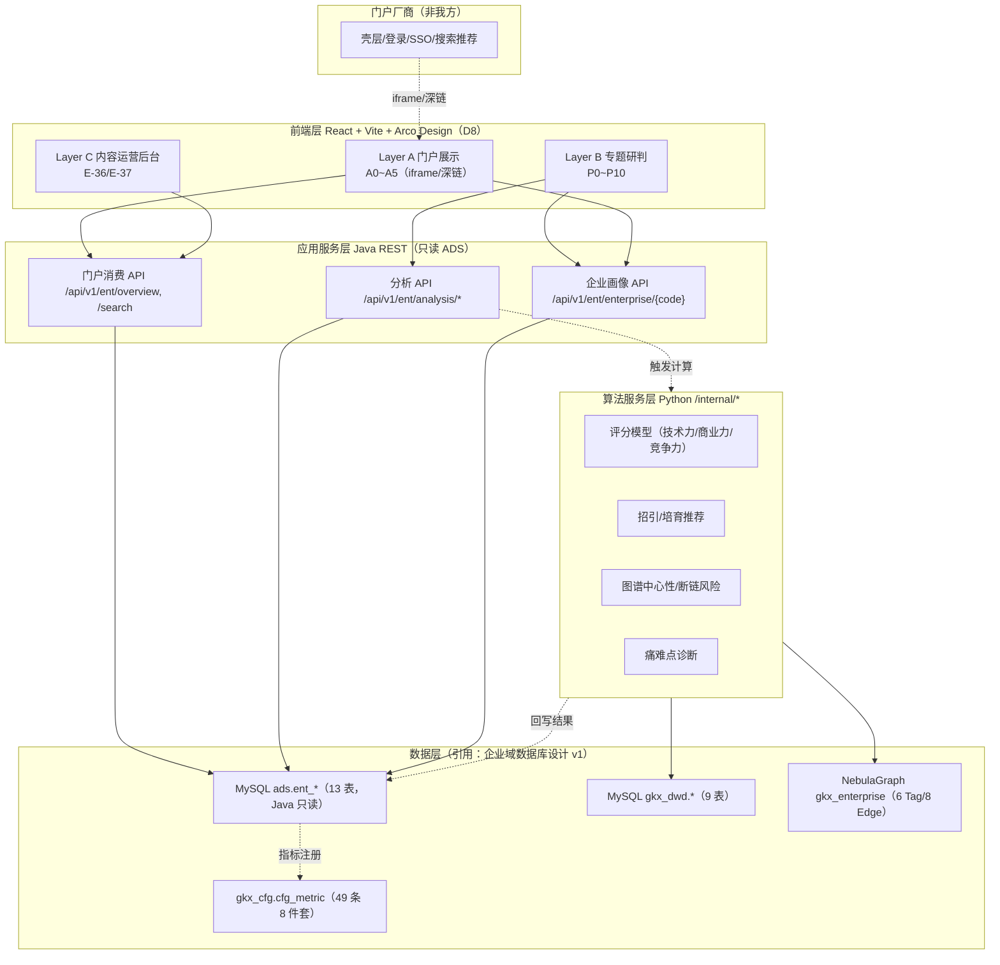
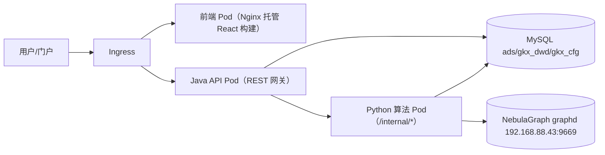

# 企业要素 系统概要设计说明书（HLD）

| 属性 | 内容 |
|------|------|
| 文档名称 | 企业要素（ENT）系统概要设计说明书（HLD） |
| 版本 / 日期 / 作者 | **V1.0 / 2026-06-18 / [agent:doc-agent] + [human:待PM终审]** |
| 文档状态 | Markdown 初稿（待 PM 终审；本期不转 docx） |
| 章节体系 | 对齐正式件 V6（1 引言 / 2 系统架构设计 / 3 系统详细设计 / 4 算法及大模型设计 / 5 接口设计 / 6 数据设计 / 7 安全设计 / 8 性能设计 / 9 可观测性与维护） |
| 适用系统 | 科技专题服务系统 · 战略分析 + 智慧服务门户 · 集群服务（企业要素 ENT 子模块） |
| 支撑基线 | `ENT-functional-design-v2.md`（v2.1.0，18 个验收点 E-20~E-37） |
| 技术栈 | React + Vite + Arco Design（D8） / Java REST（只读 ADS） / Python `/internal/*`（算法、图谱） / NebulaGraph |

---

## 文档目的

本说明书是企业要素（ENT）的系统概要设计，承接需求规格说明书（SRS）与功能设计说明书（FDS v2.1），自顶向下定义系统架构、模块划分、页面-组件-数据流、算法规格、接口契约、数据设计引用、安全/性能/可观测性，作为详细设计与开发的设计基线。数据层引用《企业域数据库设计(v1)》，不重复设计库表与全量 DDL。

> **内容来源声明**：本说明书为"格式参考、内容发挥"产物。章节版式对齐正式件 V6；**全部架构、模块、接口、算法规格、数据引用严格来自下列内容真源**，doc-agent 不自创架构/字段/接口、不写代码、不改算法实现。算法仅列规格、标注 Python `/internal/*` 与依赖，待 algorithm-agent 落地。凡完成度/验收结论性措辞均回避，留待 PM 终审；业务口径未定项标"待甲方确认"。

## 读者对象

| 读者 | 关注章节 |
|------|---------|
| 架构师 / PM（评审/拍板方） | §2 架构设计、§7 安全、§8 性能、§9 可观测性 |
| frontend / ui-agent（前端实现方） | §3 系统详细设计（模块/组件/数据流）、§5 接口设计 |
| api-agent（Java 实现方） | §5 接口设计、§6 数据设计（只读 ADS 契约） |
| algorithm-agent（算法实现方） | §4 算法及大模型设计、§6 数据设计（🔧 字段） |
| data-agent（数据实现方） | §6 数据设计（引用）、§4 算法依赖 |
| qa-agent（验收方） | §3 页面-组件映射、§5 接口、§9 可观测性 |

## 关联文档清单（内容真源）

| # | 文档 | 路径 | 在本 HLD 中的角色 |
|---|------|------|------------------|
| 1 | 企业要素需求规格说明书（SRS） | `agent-delivery/验收文档/企业要素需求规格说明书SRS(v1).md` | **需求输入**：FR-01~FR-18、NF-01~NF-13、追溯矩阵 |
| 2 | 企业要素功能设计说明书（FDS） | `topic_demo/docs/ia/enterprise/ENT-functional-design-v2.md`（v2.1.0） | 三层架构、页面、UX 组件契约、DC 设计决策 |
| 3 | 企业要素信息架构（IA） | `topic_demo/docs/ia/enterprise/ENT-IA.md` | 站点地图、页面-组件映射、路由 |
| 4 | 企业要素用户旅程（User Flow） | `topic_demo/docs/ia/enterprise/ENT-userflow.md` | 跨层旅程、异常路径、埋点 |
| 5 | 企业分析低保真线框（Wireframe） | `topic_demo/docs/ia/enterprise/ENT-wireframe.md` | 区块布局、字段表、metric_id |
| 6 | **企业域数据库设计（v1）** | `agent-delivery/data/企业域数据库设计(v1).md` | **§6 数据设计引用源**：DWD/ADS/cfg_metric/NebulaGraph/三段映射 |
| 7 | 验收点细则 | `agent-delivery/acceptance-catalog/catalog-topic-enterprise.yaml` | E-20~E-37 范围 |
| 8 | 团队 AI 公约 / 架构基线 | `agent-delivery/architecture-baseline.md`、`.cursor/rules/00-team-constitution.mdc` | 架构铁律 |
| 9 | 版式参考（V6） | `formal-docs-registry.yaml` → `03详细设计说明书-...-V6.docx` | 章节体系、Mermaid 写法 |

---

## 目录

1. [引言](#1-引言)
2. [系统架构设计](#2-系统架构设计)
3. [系统详细设计](#3-系统详细设计)
4. [算法及大模型设计](#4-算法及大模型设计)
5. [接口设计](#5-接口设计)
6. [数据设计](#6-数据设计)
7. [安全设计](#7-安全设计)
8. [性能设计](#8-性能设计)
9. [可观测性与维护](#9-可观测性与维护)

---

## 1. 引言

### 1.1 目的

本文档定义企业要素（ENT）系统的概要设计，将 SRS 的 18 个功能需求与 13 个非功能需求落实为系统架构、模块、组件与接口设计，供详细设计与开发承接。

### 1.2 范围

覆盖企业要素全链路三层：Layer A 门户集群服务·企业发展（A0~A5）、Layer B 专题战略分析·企业分析（P0~P10）、Layer C 内容运营后台（E-36/E-37）。数据层引用《企业域数据库设计(v1)》，本文档不重复库表/全量 DDL。

### 1.3 参考文档

见首页"关联文档清单"。设计基线 = SRS + FDS v2.1 + 企业域数据库设计(v1)。

### 1.4 术语

术语口径与 SRS §1.4 一致（企业类型、明星企业、技术力、商业力、综合竞争力、招引/培育、供应链、痛难点、JudgmentStrip、CompareBasket、metric_id、ADS、embed 模式等）。架构相关术语：

| 术语 | 说明 |
|------|------|
| ADS | 应用结果层 `ads.ent_*`，Java 只读契约面 |
| DWD | 标准明细层 `gkx_dwd.*` |
| `/internal/*` | Python 内部算法服务接口，仅 Java 调用 |
| 共享聚合核心 | 展示与专题两前端共享 Java 聚合层（方案 A） |
| Deep Link | Layer A → B 携带上下文的跳转 |

---

## 2. 系统架构设计

### 2.1 总体分层架构



> 调用链铁律（C-01/C-02/C-07）：前端 → Java REST → ADS（只读）；算法在 Python `/internal/*`，由 Java 调用；Python 读 DWD/图谱并回写 ADS；Java 不写算法、不直连 nGQL；前端不直连数据库/图谱。

### 2.2 三层定位（A / B / C）

| 层 | 技术形态 | 职责 | 与其他层关系 |
|----|---------|------|-------------|
| Layer A 门户展示 | React 页面 + 门户 iframe/深链 | 浏览感知（3 分钟看懂产业） | 深链 Layer B；与 B 同源 API（DC4） |
| Layer B 专题研判 | React 工作台 | 配置/对比/诊断/导出（15 分钟决策） | 消费分析 API；调用算法（经 Java） |
| Layer C 内容运营 | React 后台 | 维护展示内容与配置 | 驱动 Layer A 渲染（CMS） |

### 2.3 技术栈（D8）

| 层 | 技术选型 |
|----|---------|
| 前端 | React + Vite + Arco Design + ECharts（图表）+ AntV G6（图谱）+ Leaflet（地图）+ dayjs；主色 `#165DFF` |
| 应用服务 | Java（REST），只读 ADS |
| 算法服务 | Python（NLP / 图谱算法 / 模型推理），`/internal/*` |
| 图谱 | NebulaGraph 3.x（`192.168.88.43:9669`，space `gkx_enterprise`） |
| 存储 | MySQL 8.0（DWD/ADS/cfg）+ NebulaGraph + Redis/ES（平台级，按需） |

### 2.4 部署视图（K8s dev）



- CI/CD：push → Pipeline 绿 → K8s dev rollout（架构铁律 5）。
- 正式仓走 feature 分支 + PR + CI 绿 + 人工评审，不直接 push main/dev。

### 2.5 架构合规自检（架构铁律对照）

| # | 铁律 | 本设计 |
|---|------|--------|
| 1 | 算法只在 Python | ✅ §4 算法均标 Python `/internal/*`；Java 不写算法 |
| 2 | 调用链不越层 | ✅ 前端→Java→ADS；算法→Python（§2.1） |
| 3 | 图谱 NebulaGraph 禁 Neo4j | ✅ space `gkx_enterprise`（§6 引用） |
| 4 | 可观测性三端 | ✅ §9 Java Agent + Python instrument + 前端 observability.ts |
| 7 | 共享聚合核心（方案 A） | ✅ 两前端共享 Java；Java 只读 ADS、不直连 nGQL |
| 8 | 数据策略 ADS 先行 + Mock | ✅ §6 引用 ADS 契约 + `mock_` 批次 |
| 9 | 前端规范 D8 | ✅ §2.3 Arco 栈 + token |
| 10 | 数据血缘 D9 | ✅ §6 cfg_metric 8 件套；§9 ⓘ/🧪 |

---

## 3. 系统详细设计

> 模块级设计：按页面（A0~A5 / P0~P10 / C）给模块职责、关键组件、页面-组件-数据流。组件命名用 D8 §9 通用组件（IA §4 骨架）。

### 3.1 统一页面骨架与共享组件

所有页面遵循统一骨架（FDS §8.1 / IA §4）：

```text
PageShell
├─ TopicSidebar（embed 时隐藏）
├─ ContextBar（全局上下文：产业/时间窗/区域/企业类型 + 对比篮 + 导出/刷新/保存口径）
├─ JudgmentStrip（结论先行：关注/原因/建议动作链）
├─ MetricCard × N（KPI + 同比 + ⓘ + 🧪）
├─ SearchableCascadeFilter / FilterBar（本页增量筛选）
├─ 主可视化：ChartPanel | MapPanel | GraphCanvas
├─ PrimaryWorkbenchTabs / SecondaryAnalysisTabs（工作台/研判 Tab）
├─ DataTable | EvidenceList（明细/证据）
└─ DetailDrawer（企业画像 + MetricSpecCard）
```

**关键共享组件契约（UX 核心基础设施，FDS §3.4 / §7）**：

| 组件 | 职责 | 跨页行为 |
|------|------|---------|
| **ContextBar** | 承载全局上下文键（`industry / time_window / region / ent_types[] / enterprise_codes[] / embed`） | 跨页保留，URL + session 持久化（NF-05） |
| **CompareBasket（对比篮）** | 企业对比集合（≤10 家），Chip 栏展示 | 在 P1→P3→P10→P8 间穿透联动；切换产业二次确认清空 |
| **JudgmentStrip** | 结论先行研判摘要（≤3 句 + 1~2 ActionLink） | ActionLink 链到唯一下一页并带当前上下文 query |
| **DetailDrawer** | 统一企业画像抽屉（A/B 共用） | Header + KPI 行 + Tab + 固定底栏（＋对比篮/供应链/痛难点/引育） |
| **MetricSpecCard** | 指标 8 件套数据说明卡（D9） | 由统计数字旁 ⓘ 触发，回链 cfg_metric |

### 3.2 Layer A 模块设计（A0~A5）

| 模块 | 职责 | 关键组件 | 数据流（消费 API → ADS 表） |
|------|------|---------|---------------------------|
| A0 企业发展首页（E-31） | 维度入口 + 4 KPI | PageShell · MetricCard · DataCard · EvidenceList | `GET /api/v1/ent/overview` → `ent_overview` |
| A1 企业整体概况（E-32） | 总数/趋势/分布/科研人数 | MetricCard · ChartPanel · MapPanel | `ent_overview`（与 P0 同源）；地图深链 P1 |
| A2 重点企业全景图（E-33） | 链全景/规模/领域 | IndustryChainTree · MapPanel · ChartPanel · DataCard · DetailDrawer | `ent_panorama` |
| A3 明星企业介绍（E-34） | 产品/技术/团队/生态 | SectionPanel · MetricCard · ChartPanel · GraphCanvas（只读）· DetailDrawer | `ent_star`（CMS）+ `ent_supply_chain`（生态）+ `/enterprise/{code}` |
| A4 深圳企业介绍（E-35） | 数量/领域/规模/重点 | MetricCard · IndustryChainTree · ChartPanel · DataTable · DetailDrawer | `ent_shenzhen`；CTA 深链 P5 |
| A5 一张图·企业图层 | 指标+行政区+点位+搜索 | MapPanel · ChartPanel · DetailDrawer | `ent_map_layer` |

**Layer A 设计要点**：只读浏览为主，导出/建模深链 Layer B；embed 模式隐藏 TopicSidebar、产业上下文只读、页脚"在专题系统中打开 ↗"；A/B 重叠指标同源 API（避免两个总数不一致，DC4 / X-01）。

### 3.3 Layer B 模块设计（P0~P10）

| 模块 | 职责 | 关键组件 | 数据流（分析 API → ADS 表 / 算法） |
|------|------|---------|----------------------------------|
| P0 企业分析概述（E-20） | 战略驾驶舱（结论先行） | ContextBar · JudgmentStrip · MetricCard×5 · ChartPanel · MapPanel · EvidenceList | `ent_overview` |
| P1 重点企业类型分析（E-21） | 类型×区域三级下钻 | SearchableCascadeFilter · MapPanel（Leaflet 下钻）· ChartPanel · DataTable | `ent_type_dist` + 🔧spatial |
| P2 重点企业领域分布（E-22） | 领域覆盖矩阵 | FilterBar · ChartPanel · DataTable · DetailDrawer | `ent_domain_cover` + 🔧domain |
| P3 能力评估（E-23/E-24） | 技术力/商业力对比 | PrimaryWorkbenchTabs · SectionPanel（权重配置）· ChartPanel（雷达）· DataTable · EvidenceList | `ent_capability` + 🔧scoring |
| P5 深圳企业现状（E-25） | 链位 + 多城市对标 | PrimaryWorkbenchTabs · MetricCard · ChartPanel · DataTable | `ent_sz_status` + 🔧spatial/city |
| P6 引育推荐（E-26/E-27） | 招引/培育名单 | PrimaryWorkbenchTabs · FilterBar · DataTable · DetailDrawer · EvidenceList | `ent_recommend` + 🔧recommend |
| P8 供应链关系（E-28） | 图谱下钻 + 风险 | GraphCanvas（G6）· SectionPanel · StatusTag · DetailDrawer · EvidenceList | `ent_supply_chain` + 🔧Nebula |
| P9 发展痛难点（E-29） | 诊断报告 | SectionPanel · ChartPanel · EvidenceList · DetailDrawer | `ent_painpoint` + 🔧diagnosis |
| P10 企业竞争力（E-30） | 综合竞争力唯一入口 | MetricCard · ChartPanel（雷达）· DataTable · EvidenceList | `ent_competitiveness` + 🔧scoring |

**Layer B 设计要点**：全局筛选与对比篮跨页保留（NF-05）；P0 为纯驾驶舱（迁出 E-31~E-35，DC2/DC3）；P10 为竞争力唯一入口（DC3）；P3 与 P10 共享技术力/商业力底层得分；复杂交互（GIS/G6/权重）不简化，用 skeleton + 降级保体验（DC5）。

### 3.4 Layer C 模块设计（E-36/E-37）

| 模块 | 职责 | 消费方 | 数据流 |
|------|------|--------|--------|
| E-36 可视化展示内容管理 | 展示区块开关/排序，页面配置驱动 | Layer A 各页 | 配置写入 → Layer A 按配置渲染 |
| E-37 门户企业发展内容管理 | 明星企业 CMS、全景图标注、深圳文案 | A2/A3/A4 | `ent_star` 等（Mock 阶段 JSON，正式走内容运营中心；发布 ≤5min 生效） |

### 3.5 跨层深链与嵌入模式

| 源 | 目标 | 参数（FDS §13.2） |
|----|------|------------------|
| A1 MapPanel | P1 | `region`、`industry` |
| A2 规模/领域 | P1 / P2 | `ent_types[]` / `chain_node` |
| A3 详情 | P8 / P10 | `enterprise_code` |
| A4 CTA | P5 | `industry` |
| P0 JudgmentStrip | P5 / P6 | `suggested_action` |
| P5 链缺口 | P6 招引 | `strategy=补链` |
| P8 高风险 | P9 | `dimension=供应链` |

嵌入模式：iframe（`embed=1` 隐藏侧栏、产业只读）；深链在专题系统新标签打开（脱离 iframe，保留 TopicSidebar）。

### 3.6 异常路径设计（User Flow §2）

| 场景 | 设计处理 |
|------|---------|
| 筛选无结果（EX-01） | EmptyState + "清除类型/扩大区域"快捷按钮 |
| 权重≠100%（EX-02） | "生成评估"禁用 + inline 红色提示当前合计 |
| 对比企业<2（EX-03） | P3/P10"生成评估"禁用 + tooltip |
| 算法/Mock（EX-04） | 显示值 + 🧪；失败不阻塞，ⓘ 显示"加载中" |
| 图谱节点过多（EX-05） | 折叠 + "仅看核心供应商" |
| 切换产业（EX-06） | Modal 确认"将清空对比篮，是否继续？" |
| embed 无权限（EX-07） | 友好页"请从门户登录后访问" |

---

## 4. 算法及大模型设计

> 本章**只列规格不写实现**：每个算法标注归属（Python `/internal/*`）、输入依赖（ODS/DWD）、输出（回写 ADS 字段 / metric_id）、口径开放项，待 algorithm-agent 落地（已在 `cfg_model_registry.yaml` 注册对应 model）。算法不在 Java 实现（C-01）。

### 4.1 算法规格清单

| # | 算法 | 归属 | 输入依赖 | 输出（ADS / metric_id） | 口径开放项 |
|---|------|------|---------|------------------------|-----------|
| ALG-01 | 技术力评分（ENT_WEIGHTED_SCORE） | Python `/internal/*` | DWD：专利/研发投入/技术合作/人才（`dwd_org_rd_achiev_info`、`dwd_org_annual_financial_info`、`dwd_org_tag_info`） | `ent_capability.tech_score` → `M_ENT_TECH_POWER_SCORE` | Q014 指标库/权重 |
| ALG-02 | 商业力评分（ENT_WEIGHTED_SCORE） | Python `/internal/*` | DWD：营收/利润/市场/产业链覆盖 | `ent_capability.business_score` → `M_ENT_BUSINESS_POWER_SCORE` | Q014；市场份额无源（K-O7） |
| ALG-03 | 综合竞争力（tech×W1 + business×W2） | Python `/internal/*` | ALG-01/02 输出 + 创新指数 | `ent_competitiveness.competitiveness_score` → `M_ENT_COMPETITIVENESS_SCORE`、`*_RANK`、`SHORTBOARD_COUNT` | Q014 |
| ALG-04 | 招引推荐指数（ENT_RECOMMEND） | Python `/internal/*` | 产业相关度 + 政策匹配 + 生态连接度 | `ent_recommend.attraction_index` → `M_ENT_ATTRACTION_INDEX` 等 | Q015 阈值/权重 |
| ALG-05 | 培育推荐指数（ENT_RECOMMEND） | Python `/internal/*` | 相关度 + 政策 + 成长潜力 + 创新力 | `ent_recommend.cultivation_index` → `M_ENT_CULTIVATION_INDEX` 等 | Q015 |
| ALG-06 | 供应链中心性（ENT_GRAPH_CENTRALITY） | Python `/internal/*` @ NebulaGraph | 图谱 `gkx_enterprise`（supply 边） | `ent_supply_chain.node_centrality` → `M_ENT_NODE_CENTRALITY` | Q017 |
| ALG-07 | 断链风险评级（ENT_SUPPLYCHAIN） | Python `/internal/*` | 供应链网络 + 风险表（`dwd_org_risk_*`） | `ent_supply_chain.supply_chain_risk` → `M_ENT_SUPPLY_CHAIN_RISK`、`CORE_SUPPLIER_COUNT` | Q017 阈值/评级 |
| ALG-08 | 痛难点诊断（ENT_DIAGNOSIS） | Python `/internal/*` | DWD 多字段 + 专家知识库 | `ent_painpoint.*` → `M_ENT_PAINPOINT_COUNT/SEVERITY/GAP` | Q018 维度/阈值 |
| ALG-09 | 区域密度/集聚（ENT_SPATIAL_DENSITY / AGGLOMERATION） | Python `/internal/*` | DWD 企业经纬度 + 区域维表 | `ent_type_dist.density/agglomeration_index` → `M_ENT_REGIONAL_DENSITY`、`AGGLOMERATION_INDEX` | Q012 精度/分母 |
| ALG-10 | 领域覆盖广度/深度/多元化（ENT_DOMAIN） | Python `/internal/*` | `dwd.enterprise_industry`（链节点）+ 标签 | `ent_domain_cover.*` → `M_ENT_DOMAIN_COVERAGE_*`、`DIVERSIFICATION_INDEX` | Q013 领域全集 |
| ALG-11 | 产业链完整度/城市对标（ENT_SPATIAL/city） | Python `/internal/*` | `dwd.enterprise_industry` + 多城市切片 | `ent_sz_status.*` → `M_ENT_CHAIN_COMPLETENESS`、`CITY_*` | Q016 对标城市集合 |
| ALG-12 | 创新型/企业类型判定 + 比率派生（ENT_RATIO） | Python `/internal/*` | `dwd.enterprise.is_*` 标签解析、相邻年比率 | `M_ENT_INNOVATIVE_COUNT`、`TYPE_COUNT`、`PROFIT_MARGIN`、`REVENUE_GROWTH_RATE` 等 | Q010/Q011 |

> metric 层面：49 个 `M_ENT_*` 中 ✅ 直接可聚合 14 / 🔧 待算法 30 / ⚠️ 口径待甲方 4 / ❌ 无来源 1（详见数据库设计 v1 §6.3）。algorithm-agent 已为 30 条 🔧 注册 12 个 model（含 NebulaGraph 中心性模型）。

### 4.2 大模型 / NLP 能力（规格）

| 能力 | 用途 | 归属 | 备注 |
|------|------|------|------|
| 业务/产品/技术标签抽取 | 领域映射（FR-08）、企业画像 | Python NLP | 依赖 `dwd_company_*_tags`、经营范围文本 |
| 资讯情感分析 | 企业资讯（`enterprise_news.sentiment`） | Python NLP | positive/neutral/negative |
| 实体识别与链接 | 合作关系方识别（`enterprise_cooperation`） | Python NLP | NER + 实体链接 |

> 大模型/NLP 仅列规格，具体模型与提示工程由 algorithm-agent 落地；Java 不承载推理。

---

## 5. 接口设计

> REST 接口清单（Java 实现，只读 ADS）。请求/响应仅列要点，详细契约由 api-agent 在开发承接包定义。接口与 ADS 表对应见 §6。

### 5.1 接口分层与清单

| 接口 | 方法 | 消费层 | 对应 ADS 表 | 说明 |
|------|------|--------|-------------|------|
| `/api/v1/ent/overview` | GET | A0/A1/P0 | `ent_overview` | 概况 KPI/趋势/分布（同源，DC4） |
| `/api/v1/ent/search` | GET | 门户全文检索 | `ent_map_layer` / dwd | 企业实体检索（`?q=`） |
| `/api/v1/ent/panorama` | GET | A2 | `ent_panorama` | 重点企业全景/规模/领域 |
| `/api/v1/ent/star` | GET | A3 | `ent_star` | 明星企业列表/详情（CMS） |
| `/api/v1/ent/shenzhen` | GET | A4 | `ent_shenzhen` | 深圳企业四维 |
| `/api/v1/ent/map/layer` | GET | A5 | `ent_map_layer` | 一张图企业图层/点位 |
| `/api/v1/ent/analysis/type-dist` | GET | P1 | `ent_type_dist` | 类型×区域分布 + 集聚 |
| `/api/v1/ent/analysis/domain` | GET | P2 | `ent_domain_cover` | 领域覆盖矩阵 |
| `/api/v1/ent/analysis/capability` | GET/POST | P3 | `ent_capability` | 能力评估（POST 携指标/权重触发计算） |
| `/api/v1/ent/analysis/sz-status` | GET | P5 | `ent_sz_status` | 深圳链位 + 城市对标 |
| `/api/v1/ent/analysis/recommend` | GET | P6 | `ent_recommend` | 招引/培育名单 |
| `/api/v1/ent/analysis/supply-chain` | GET | P8 | `ent_supply_chain` | 供应链节点/中心性/风险 |
| `/api/v1/ent/analysis/pain-points` | GET/POST | P9 | `ent_painpoint` | 痛难点诊断报告 |
| `/api/v1/ent/analysis/competitiveness` | GET/POST | P10 | `ent_competitiveness` | 综合竞争力评价 |
| `/api/v1/ent/enterprise/{code}` | GET | DetailDrawer（A/B 共用） | `ent_capability` 等 + dwd | 企业画像 |
| `/metrics/v1/spec/{metric_id}` | GET | MetricSpecCard（ⓘ） | `cfg_metric` | 指标 8 件套数据说明（D9） |
| `/metrics/v1/lineage/{metric_id}` | GET | 血缘查看 | `cfg_metric_lineage` | 4 段血缘链 |

### 5.2 请求/响应要点

- **请求**：通用上下文参数 `industry`、`time_window`、`region`、`ent_types[]`、`enterprise_codes[]`；分析类（能力/竞争力/痛难点）POST 携带指标勾选与权重（前端已做权重=100% 校验，NF/EX-02）。
- **响应**：统计字段随值返回 `metric_id` 与 `is_mock` 标记（驱动前端 ⓘ / 🧪）；列表类返回分页；图谱类返回节点/边与中心性结果（来自回写 ADS）。
- **错误/降级**：算法未就绪返回降级标记，前端不白屏（NF-13）。

### 5.3 契约约束（Java 只读 ADS）

| 约束 | 内容 |
|------|------|
| 只读 | Java 仅 SELECT 读 `ads.ent_*`，不写库、不直连 NebulaGraph nGQL（C-07/铁律 7） |
| 同源 | A/B 重叠指标共用同一 metric_id 与 ADS 注册口径（如 `M_ENT_TOTAL_COUNT`），避免不一致（DC4） |
| 算法触发 | 需计算的分析接口经 Java 调 Python `/internal/*`，结果回写 ADS 后由 Java 只读返回 |
| 血缘 | 每个统计 metric_id 可经 `/metrics/v1/*` 回链 cfg_metric / lineage（D9） |

---

## 6. 数据设计

> 本章引用《企业域数据库设计(v1)》（`agent-delivery/data/企业域数据库设计(v1).md`），**不重复全量 DDL**。下表为概要与引用锚点。

### 6.1 数据分层概要（引用 数据库设计 v1 §1）

```text
三方要素库（186 张 dwd_* 贴源 ODS，只读）
   │ 数据工厂清洗/归一/聚合（Python）
   ▼
DWD 自建标准明细 gkx_dwd.*（9 表，字段沿用 ODS）
   │ DWS 轻聚合 + algorithm-agent 评分模型
   ▼
ADS 应用结果 ads.ent_*（13 表，Java 只读契约面）
   ├─► MySQL（DWD/ADS/cfg）
   └─► NebulaGraph space=gkx_enterprise（供应链/合作/母子图谱）
```

### 6.2 DWD 标准明细层（引用 §4，9 表）

| 表（逻辑名） | 说明 |
|-------------|------|
| `dwd.enterprise`（66 字段） | 企业主表（双源归一：`enterprise_code` = COALESCE(机构口径, 工商口径）） |
| `dwd.enterprise_finance_history` | 财务历史（逐年） |
| `dwd.enterprise_patent_history` | 专利历史（逐年） |
| `dwd.enterprise_parent_subsidiary` | 母子公司/股权 |
| `dwd.enterprise_supply_chain` | 供应链上下游 |
| `dwd.enterprise_industry` | 产业链归属 |
| `dwd.enterprise_cooperation` | 合作关系 |
| `dwd.enterprise_business_tag` | 业务/资质标签 |
| `dwd.enterprise_news` | 企业重点资讯/事件 |

主键策略（引用 §3）：物理主键 `id BIGINT`；业务归一主键 `enterprise_code VARCHAR(64) UNIQUE`（统一社会信用代码）；NebulaGraph `vid = ent:{enterprise_code}` 与 RDBMS 对齐。

### 6.3 ADS 应用结果层（引用 §5，13 表，Java 只读）

| ADS 表 | 消费页面 | 对应接口 |
|--------|---------|---------|
| `ent_overview` | P0/A1 | `/ent/overview` |
| `ent_panorama` | A2 | `/ent/panorama` |
| `ent_star` | A3 | `/ent/star` |
| `ent_shenzhen` | A4 | `/ent/shenzhen` |
| `ent_map_layer` | A5 | `/ent/map/layer` |
| `ent_type_dist` | P1 | `/analysis/type-dist` |
| `ent_domain_cover` | P2 | `/analysis/domain` |
| `ent_capability` | P3/P10 | `/analysis/capability` |
| `ent_sz_status` | P5 | `/analysis/sz-status` |
| `ent_recommend` | P6 | `/analysis/recommend` |
| `ent_supply_chain` | P8 | `/analysis/supply-chain` |
| `ent_painpoint` | P9 | `/analysis/pain-points` |
| `ent_competitiveness` | P10 | `/analysis/competitiveness` |

通用列：业务键 + metric 值列 + `calc_batch_id`（Mock 前缀 `mock_`）+ `ext JSON` + `update_time`。

### 6.4 指标注册 cfg_metric（引用 §6，D9）

- `gkx_cfg.cfg_metric`：49 条 `M_ENT_*` 指标的 8 件套元数据（metric_id / 中文名 / 口径定义 / 公式 / 源表 / 源系统 / 更新频率 / 版本）。
- `gkx_cfg.cfg_metric_lineage`：4 段血缘链（ODS→DWD→DWS→ADS）。
- 状态分布：✅14 / 🔧30 / ⚠️4 / ❌1（详见数据库设计 v1 §6.3）。
- 前端 ⓘ（MetricSpecCard）经 `/metrics/v1/spec/{metric_id}` 读取本表（NF-07）。

### 6.5 NebulaGraph 图谱（引用 §7）

- Space `gkx_enterprise`（`vid_type=FIXED_STRING(80)`，`vid = ent:{enterprise_code}`）。
- **Tag 6 类**：enterprise / industry / research / talent / service / region。
- **Edge 8 类**：supply / parent_sub / invest / industry_belong / research_coop / talent_coop / service_provide / cooperate。
- 供 P8 供应链分析 / A3 生态图谱；Python 灌数与中心性计算，结果回写 `ent_supply_chain`；Java 禁直连 nGQL（铁律 3/7）。

### 6.6 三段映射与覆盖率（引用 §8）

- ODS→DWD→ADS→页面 映射矩阵见数据库设计 v1 §8.1；DWD 129 字段整体覆盖率 **92.2%**（✅53 / 🔧42 / ⚠️5 / ❌3 / 🟦26）。
- ❌ 无来源字段（market_share / brand_score / customer_concentration）需采购（K-O7）。

### 6.7 ER 关系（引用 §10）

ER 图见数据库设计 v1 §10：`ENTERPRISE` 主表 1:N 关联 finance/patent/supply_chain/industry/cooperation/business_tag/news 子表，并经 `enterprise_code` 关联 ADS 能力/供应链/推荐/明星表；`CFG_METRIC` 1:N `CFG_METRIC_LINEAGE` 并注册 ADS 指标。本 HLD 不重复绘制全量 ER。

---

## 7. 安全设计

| # | 安全项 | 设计 |
|---|--------|------|
| SEC-01 | 调用链隔离 | 前端不直连数据库/图谱；仅经 Java REST；算法经 Java 调 Python `/internal/*`（C-02） |
| SEC-02 | 只读契约 | Java 对 ADS 只读；无写库/写图权限（C-07） |
| SEC-03 | embed 跨域 | iframe 嵌入遵循 CORS / 白名单（NF-06）；门户 embed SSO 待确认（Q021/O-12） |
| SEC-04 | 鉴权 | 登录/SSO 由门户厂商负责；embed 无权限显示友好页（EX-07） |
| SEC-05 | 内部接口 | Python `/internal/*` 仅限 Java 服务内网调用，不对外暴露 |
| SEC-06 | 数据合规 | 企业数据展示遵循来源授权与合规；采购数据（K-O7）满足合规 |

---

## 8. 性能设计

| # | 性能项 | 设计 |
|---|--------|------|
| PERF-01 | 首屏 LCP | KPI 区域 LCP < 2.5s（正式环境，NF-04）；ADS 预聚合 + 索引（数据库设计 v1 索引策略） |
| PERF-02 | 加载体验 | 异步操作 skeleton/进度态，禁止白屏；筛选确认 300ms 内 skeleton（NF-10/UX-06） |
| PERF-03 | 图谱性能 | P8 默认 2 级，节点 >200 自动折叠 + "仅看核心供应商"（EX-05）；中心性离线计算回写 ADS，前端不实时跑图算法 |
| PERF-04 | 算法解耦 | 算法 weekly/daily 批量预计算写 ADS，前端只读结果，避免实时重算 |
| PERF-05 | 缓存 | 上下文键 URL + session 持久化（NF-05）；可叠加平台级 Redis/ES 缓存（按需） |
| PERF-06 | 响应式 | 最小宽度 1280；embed 自适应容器（NF-09） |

---

## 9. 可观测性与维护

### 9.1 可观测性（三端，C-04）

| 端 | 手段 |
|----|------|
| 前端 | `observability.ts` 接入 13 个埋点事件（SRS NF-12 表）；事件命名以既有约定为准 |
| Java | Java Agent 指标/链路追踪 |
| Python | Python instrument（算法服务监控） |

### 9.2 数据血缘与口径透明（D9，NF-07）

- 每个统计数字旁 ⓘ → MetricSpecCard（8 件套，经 `/metrics/v1/spec`）。
- Mock 阶段统计数字旁 🧪（MockBadge）；待确认口径 ⚠️ 角标。
- 切真实源时 ADS `calc_batch_id` 去 `mock_` 前缀，UI 自动去 🧪。

### 9.3 降级与开关（NF-13）

- 算法结果未就绪：MetricSpecCard 降级"数据说明加载中"，不阻塞主界面（EX-04）。
- 图谱不可用：可读 RDBMS 兜底镜像（`graph_node`/`graph_edge`，数据库设计 v1 §7.4）做 1 跳兜底。
- `cfg_degrade_switch`：数据源未就绪降级开关（沿用总纲）。

### 9.4 维护

- ADS 契约面冻结，字段沿用 ODS 命名，Wave 1 切真实源零改动（数据策略）。
- 数据质量规则 DQ-01~DQ-15 纳入 CI（数据库设计 v1 §9），阻断级失败拦截上线。
- CI/CD：push → Pipeline 绿 → K8s dev rollout；正式仓走 feature 分支 + PR + 人工评审。

---

## 附录 A · 模块/接口/算法数量自检

| 项 | 数量 |
|----|------|
| 页面模块 | A0~A5（6）+ P0~P10（9 页）+ C（2 能力）= 17 |
| REST 接口（含 metrics） | §5.1 共 18 个 |
| ADS 表（引用） | 13 |
| 算法规格 | ALG-01~ALG-12（12 项），覆盖 30 条 🔧 metric |
| NebulaGraph | 6 Tag / 8 Edge |

## 附录 B · 版本历史

| 版本 | 日期 | 说明 |
|------|------|------|
| V1.0 | 2026-06-18 | 初稿：对齐 V6 章节，9 章 + 2 附录；模块 17 / 接口 18 / 算法 12 规格；数据层引用《企业域数据库设计(v1)》 |

---

**文档结束 — 企业要素系统概要设计说明书（HLD）V1.0（Markdown 初稿，待 PM 终审）**
