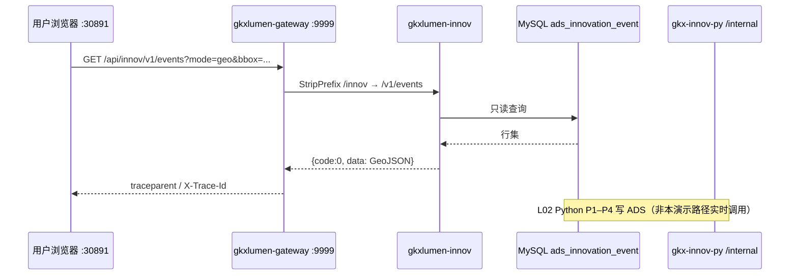

# 创新监测-M1-端到端演示记录

> 格式参考 `templates/acceptance-e2e-demo-template.md` + seq 时序图 Mermaid 写法。  
> **PM pipeline waiver v2**：本文档按 L01–L09 handoff 汇编；**dev 实测步骤与截图标 DEFERRED**，待 infra 恢复后由 qa-agent 补跑并回填「结果」列。

| 项目 | 内容 |
|------|------|
| Epic | E-INNOV-M1 |
| 里程碑 | M1 |
| 演示环境 | 前端 http://10.50.69.111:30891/innov · 网关 http://10.50.69.111:9999 · K8s `dev` |
| 演示日期 | 2026-06-20（汇编日；浏览器实测 **DEFERRED**） |
| 签收类型 | **条件签收**：代码交付完成，工程化补验 open |

## 1. 演示路径

| 步骤 | 操作（实写） | 结果 |
|------|-------------|------|
| 1 | 打开 http://10.50.69.111:30891/innov ，默认进入 M1「科创事件地图」Tab | **DEFERRED**（待 K8s :30891 rollout + qa 浏览器补验） |
| 2 | 地图加载 GeoJSON 点位；拖拽/缩放触发 bbox 刷新（`moveend` 防抖 300ms） | **DEFERRED** |
| 3 | 切换热力图开关，热力层与点位层切换 | **DEFERRED** |
| 4 | 筛选：时间范围 / 事件类型（12 类字典）/ 重要度 / 关键词；列表与地图同步 | **DEFERRED** |
| 5 | 点击列表行或地图点位 → 详情抽屉（评分明细）+ 关联分析表 | **DEFERRED** |
| 6 | 故意断 API → Message 含 traceId，无未捕获 Promise rejection | **DEFERRED** |
| 7 | 网关 curl：`GET /innov/v1/events?mode=list&pageNum=1&pageSize=20` 返回 `code=0` 且有数据 | **DEFERRED**（见 `创新监测-M1-接口测试报告.md` 41 条用例） |
| 8 | 网关 curl：`GET /innov/v1/dict/event-types` 含 `nameZh` + `color` 与图例一致 | **DEFERRED** |
| 9 | Grafana 三联查：抽样 traceId 在 Tempo 有完整链路、Loki 可搜关联日志 | **DEFERRED** |

### 1.1 调用链（设计态，已代码落地）

## 2. 三仓版本

| 仓 | commit | 镜像 tag | Pipeline |
|----|--------|----------|----------|
| demo-algo-science（`demo-algo-science`） | `e9788ac` @ `feat/E-INNOV-M1-L02` | `gkx-innov-py:e9788ac0`（待 py:image） | [#4126](https://gitlab.htmisoft.net/gkx-lumen/demo-algo-science/-/pipelines/4126) **DEFERRED 绿** |
| lumen-svc-platform（`lumen-svc-platform`） | `4287d9e` @ `feat/E-INNOV-M1-L06`（含 L03–L05 链） | `gkxlumen-innov:{sha}`（待 backend:build） | **DEFERRED** |
| lumen-ui-science-pc（`lumen-ui-science-pc`） | `717875e` @ `feat/E-INNOV-M1-L08` | `gkx-lumen-pc:{sha}` | [#4118](https://gitlab.htmisoft.net/gkx-lumen/lumen-ui-science-pc/-/pipelines/4118) rollout **DEFERRED** |

> 分支与 SHA 真源：`task-registry.yaml` E-INNOV-M1-L02/L03/L06/L07/L08 及对应 handoff。

## 3. 截图 / 录屏

| 项 | 状态 | 说明 |
|----|------|------|
| :30891/innov EventMap 全屏截图 | **DEFERRED** | infra 恢复后 qa 补采 |
| 详情抽屉 + 关联分析截图 | **DEFERRED** | 同上 |
| Grafana Tempo trace 截图 | **DEFERRED** | L10 补验矩阵 D-18 |
| 录屏（筛选→地图联动→详情） | **DEFERRED** | 可选，qa 补录 |

## 4. 与 demo2 差异（backlog）

> 完整对照见 `agent-handoffs/平台基建-PLATFORM/E-INNOV-M1-L09-demo2-diff.md` §5。

| demo2 有 | lumen 现状 | 正式文件依据 | 计划 Epic |
|---------|-----------|-------------|----------|
| 地域级联筛选 | lumen EventMap 仅 bbox 隐式范围 | V6 §3.2.4.3 | **BL-M1-02** EventMap |
| 技术领域筛选 | 未实现 | 03-API 契约 §1.1 | **BL-M1-03** |
| 实时 KPI 四指标 + 30s 刷新 | 未实现（demo2 Tab 为 KG 范式） | V6 §3.2.4.3 | **BL-M1-05** |
| 地图/列表全屏切换 | 左右分栏固定 | Design.md §3.2 | **BL-M1-07** |
| 地图工具栏（缩放/重置/全屏） | 未实现 | Design.md §8 | **BL-M1-08** |
| 列表「在地图中查看」 | 未实现 | L09 §3.1 | **BL-M1-09** |
| 知识图谱实体聚焦 | 未实现（M2 范围） | epic-E-INNOV-M1-demo2-map | **BL-M1-04** M2 |
| 创新趋势 / 领域分布图 | 未实现 | WBS M5 | **BL-M1-15/16** M5 |

**产品决策待 PM**：lumen `/innov` 是否合并 demo2「事件地图 + 实时 KPI/知识图谱」双范式，或维持 M1–M5 五 Tab 骨架（见 L09 §5）。

## 5. 签收

| 角色 | 日期 | 结论 |
|------|------|------|
| coordinator-agent | 2026-06-20 | **有条件通过** |
| qa-agent（工程化补验） | — | **OPEN**（见 `E-INNOV-M1-L10-signoff.md` §3） |
| architect-agent（§5 合规） | — | **引用签收**（代码态自检 ✅；运行时项随补验） |

**签收结论**：L01–L09 代码与 handoff 均已交付；在 **PM pipeline waiver v2** 下，**不等待** CI 绿或 K8s rollout，以「代码交付完成 + 补验矩阵登记」完成 M1 条件签收。工程化补验（CI/K8s/curl/浏览器/OTel）全部 **DEFERRED**，owner：qa-agent + devops-agent，触发条件：`INCIDENT-2026-06-18-k8s-dev-nfs-storage` 恢复或 E-PLATFORM-P0-L06 平台部署就绪。

---

*文档 · coordinator-agent · E-INNOV-M1-L10 · 2026-06-20*
